## 1. 1 — 奶油色高领毛衣·学院风

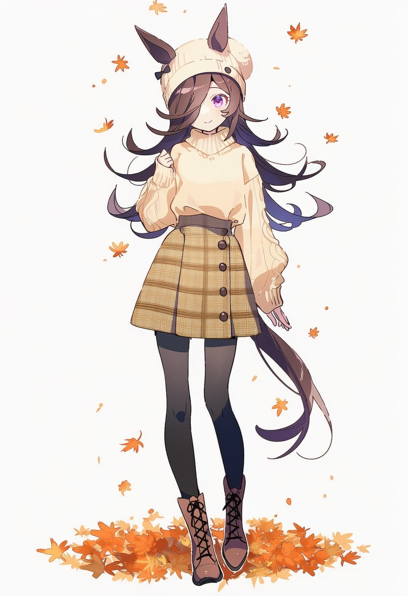

| 字段 | 内容 |
| --- | --- |
| 序号 | 1 |
| 穿搭命名 | 奶油色高领毛衣·学院风 |
| 完整Tag串 | cream_turtleneck_sweater, camel_wool_plaid_mini_skirt, cream_beanie, hair_bow, black_opaque_tights, brown_knee_boots, autumn_university, falling_maple_leaves, warm_afternoon_light |
| 搭配要点说明 | 奶油白+驼棕主色，格纹增加学院感，膝上长靴衬秋季 |

## 2. 2 — 酒红罗纹毛衣·温柔系

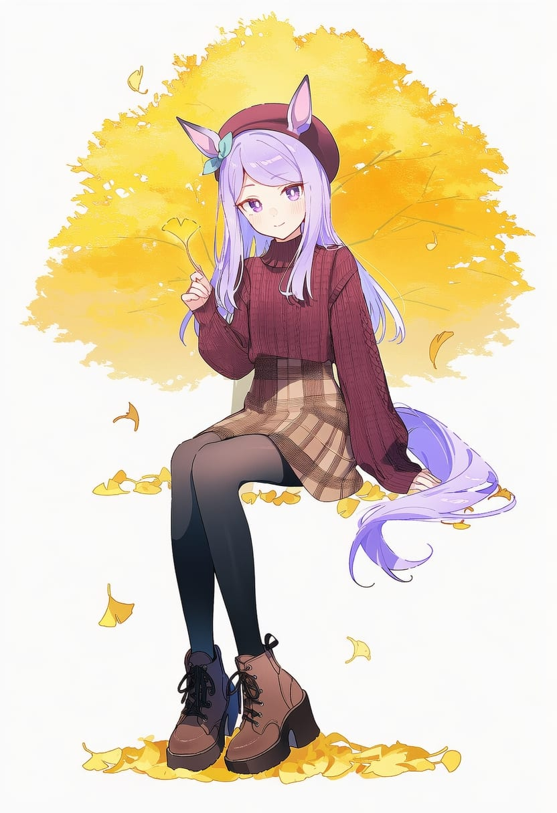

| 字段 | 内容 |
| --- | --- |
| 序号 | 2 |
| 穿搭命名 | 酒红罗纹毛衣·温柔系 |
| 完整Tag串 | burgundy_ribbed_sweater, brown_plaid_mini_skirt, burgundy_beret, ribbon_hair_bow, black_opaque_tights, brown_platform_boots, golden_autumn_park, warm_toned_lighting |
| 搭配要点说明 | 酒红+棕色暖调，毛呢裙配厚底靴，适合黄昏约会 |

## 3. 3 — 薄荷绿开衫·清新系

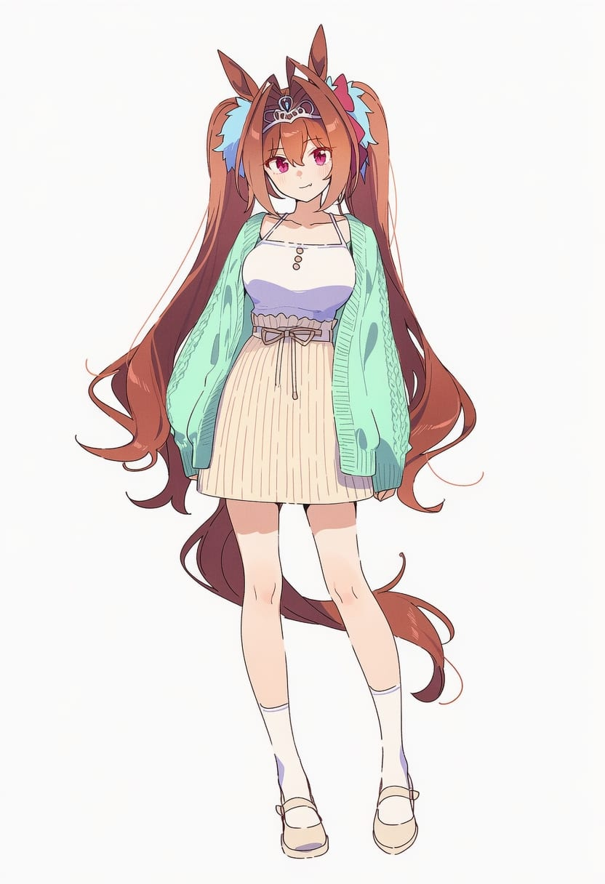

| 字段 | 内容 |
| --- | --- |
| 序号 | 3 |
| 穿搭命名 | 薄荷绿开衫·清新系 |
| 完整Tag串 | mint_green_cardigan, white_camisole, cream_ribbed_skirt, knitted_headband, leaf_hair_ornament, cream_mary_janes, white_knee_socks, autumn_cafe, soft_diffused_light |
| 搭配要点说明 | 薄荷绿+奶油白清新，蕾丝+白袜可爱，咖啡馆场景 |

## 4. 4 — 芥末黄阿兰毛衣·美式复古

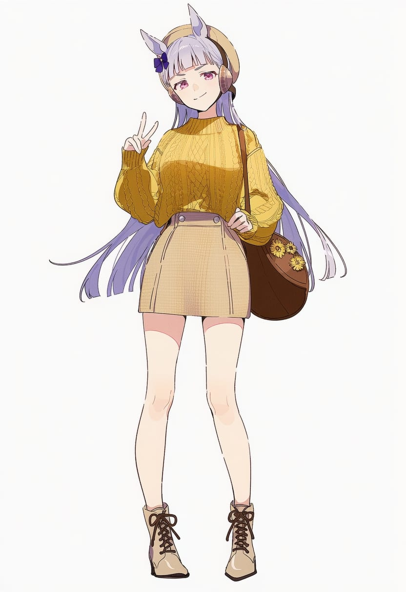

| 字段 | 内容 |
| --- | --- |
| 序号 | 4 |
| 穿搭命名 | 芥末黄阿兰毛衣·美式复古 |
| 完整Tag串 | mustard_aran_sweater, tan_corduroy_mini_skirt, tan_newsboy_cap, pearl_hair_ornament, tan_riding_boots, american_vintage, autumn_farmhouse |
| 搭配要点说明 | 芥末黄+卡其复古，阿兰编织花纹，麻花毛衣温暖 |

## 5. 5 — 燕麦短款毛衣·森系

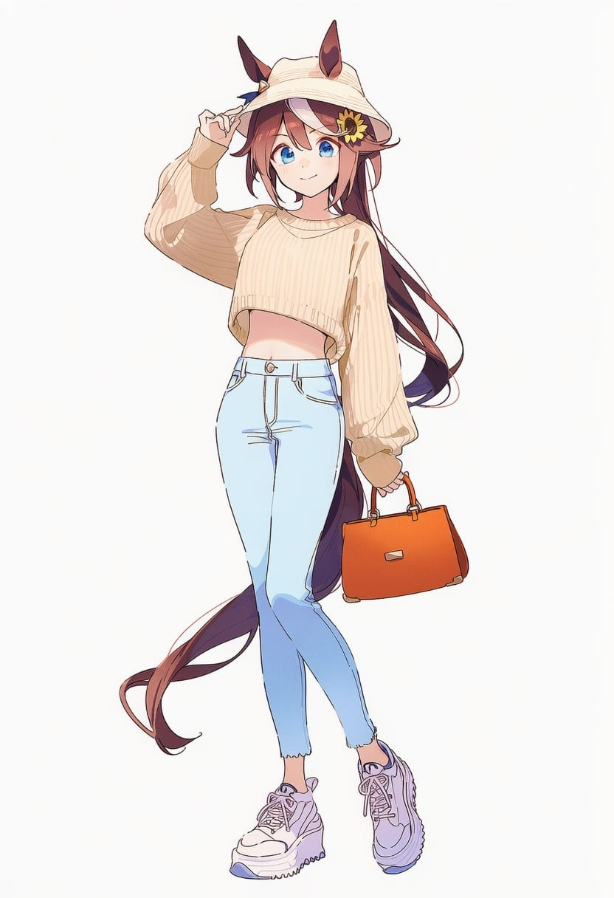

| 字段 | 内容 |
| --- | --- |
| 序号 | 5 |
| 穿搭命名 | 燕麦短款毛衣·森系 |
| 完整Tag串 | cropped_oatmeal_sweater, high_waist_light_blue_jeans, cream_bucket_hat, sunflower_hair_ornament, white_platform_sneakers, golden_hour, forest_path |
| 搭配要点说明 | 燕麦色+浅蓝丹宁，短款毛衣显高，森系户外 |

## 6. 6 — 格纹开衫+衬衫·淑女风

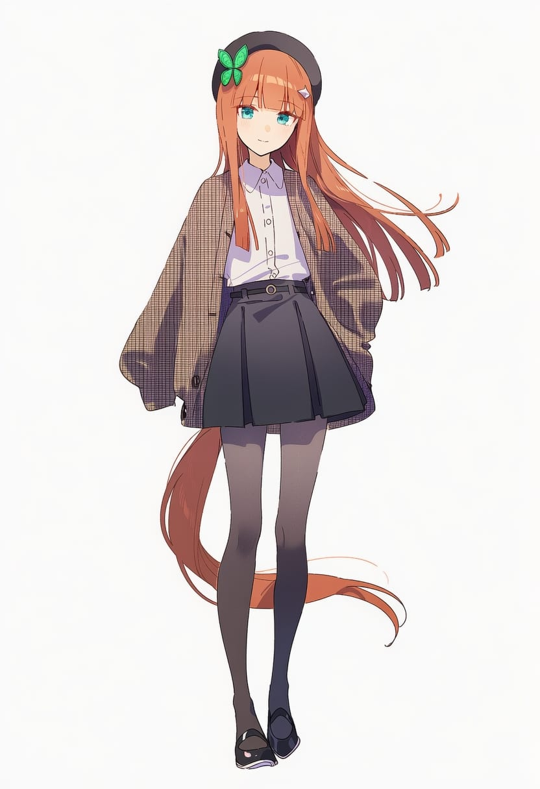

| 字段 | 内容 |
| --- | --- |
| 序号 | 6 |
| 穿搭命名 | 格纹开衫+衬衫·淑女风 |
| 完整Tag串 | plaid_cardigan, white_button-up_shirt, black_mini_skirt, black_beret, butterfly_hair_ornament, black_mary_janes, black_opaque_tights, autumn_sunset, refined_portrait |
| 搭配要点说明 | 格纹开衫+黑色百褶，蝴蝶结发饰淑女，晚霞光 |

## 7. 7 — 奶咖色开衫+针织裙·慵懒

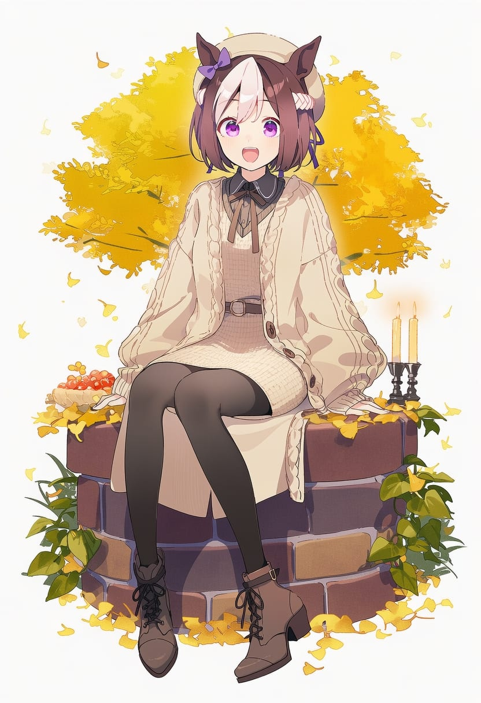

| 字段 | 内容 |
| --- | --- |
| 序号 | 7 |
| 穿搭命名 | 奶咖色开衫+针织裙·慵懒 |
| 完整Tag串 | beige_cardigan, ribbed_beige_dress, oatmeal_beret, pearl_hair_ornament, brown_ankle_boots, cream_coat_scarf, cozy_autumn_home, warm_candlelight |
| 搭配要点说明 | 奶咖+燕麦莫兰迪，开衫配连身裙，居家慵懒 |

## 8. 8 — 军绿夹克+露脐装·街头

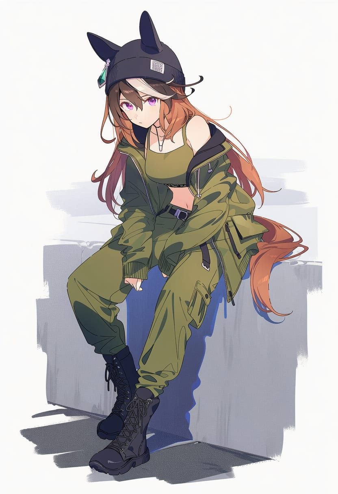

| 字段 | 内容 |
| --- | --- |
| 序号 | 8 |
| 穿搭命名 | 军绿夹克+露脐装·街头 |
| 完整Tag串 | military_jacket, olive_crop_top, olive_cargo_pants, black_beanie, cross_hair_ornament, black_combat_boots, urban_street, overcast_sky |
| 搭配要点说明 | 军绿+橄榄绿军风，机能工装，街头硬朗 |

## 9. 9 — 酒红露肩毛衣·约会装

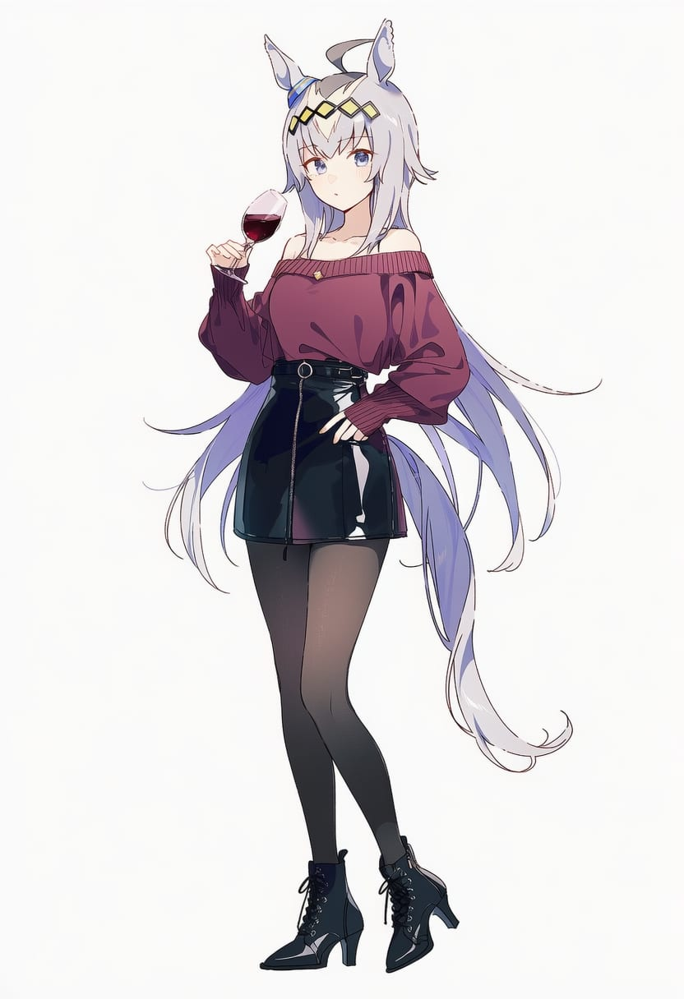

| 字段 | 内容 |
| --- | --- |
| 序号 | 9 |
| 穿搭命名 | 酒红露肩毛衣·约会装 |
| 完整Tag串 | burgundy_off-shoulder_sweater, black_leather_mini_skirt, wine_beret, cat_hair_ornament, black_stiletto_ankle_boots, sheer_black_tights, autumn_date_night, bokeh_lights |
| 搭配要点说明 | 酒红露肩+漆皮，女人味十足，夜晚灯海 |

## 10. 10 — 卡其开衫+碎花裙·田园

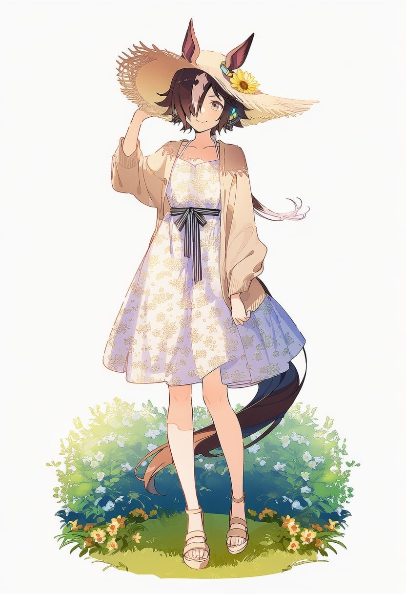

| 字段 | 内容 |
| --- | --- |
| 序号 | 10 |
| 穿搭命名 | 卡其开衫+碎花裙·田园 |
| 完整Tag串 | beige_cardigan, floral_midi_dress, tan_straw_hat, flower_hair_ornament, tan_espadrilles, garden_terrace, soft_morning_light |
| 搭配要点说明 | 米白开衫+碎花连衣裙，田园温柔，清晨柔光 |

## 11. 11 — 藏青毛衣+百褶裙·学院

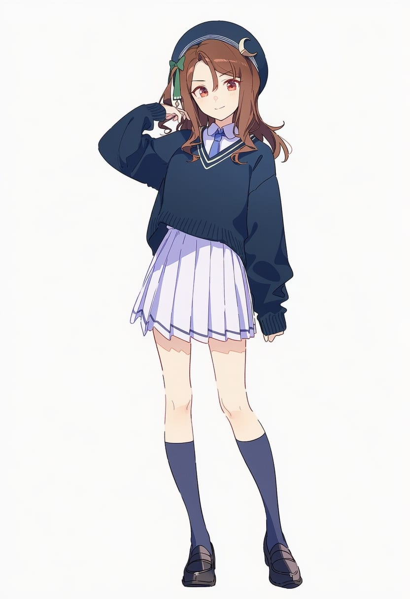

| 字段 | 内容 |
| --- | --- |
| 序号 | 11 |
| 穿搭命名 | 藏青毛衣+百褶裙·学院 |
| 完整Tag串 | navy_sweater, white_pleated_skirt, navy_beret, crescent_hair_ornament, black_loafers, knee_socks, ivy_league, old_library |
| 搭配要点说明 | 藏青+白色清爽学院，乐福鞋配袜子，图书馆 |

## 12. 12 — 粉紫渐变针织·甜美

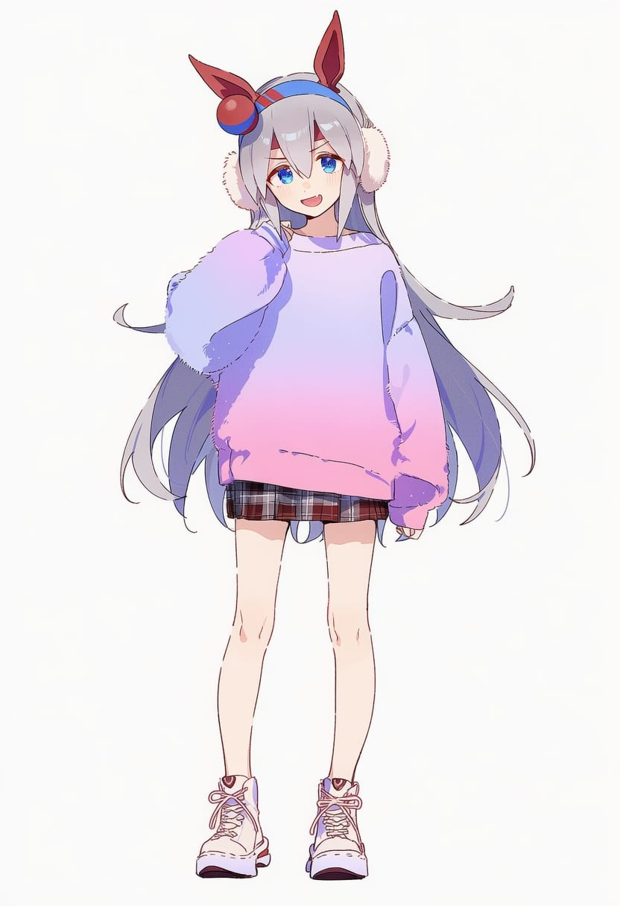

| 字段 | 内容 |
| --- | --- |
| 序号 | 12 |
| 穿搭命名 | 粉紫渐变针织·甜美 |
| 完整Tag串 | lavender_to_pink_gradient_sweater, plaid_mini_skirt, fluffy_earmuffs, heart_hair_ornament, white_high_top_sneakers, pastel_autumn, sweet_shop, soft_pink_light |
| 搭配要点说明 | 紫粉渐变+格裙，可爱甜美，甜点店里 |

## 13. 13 — 菱格毛衣+灯芯绒裙·英伦

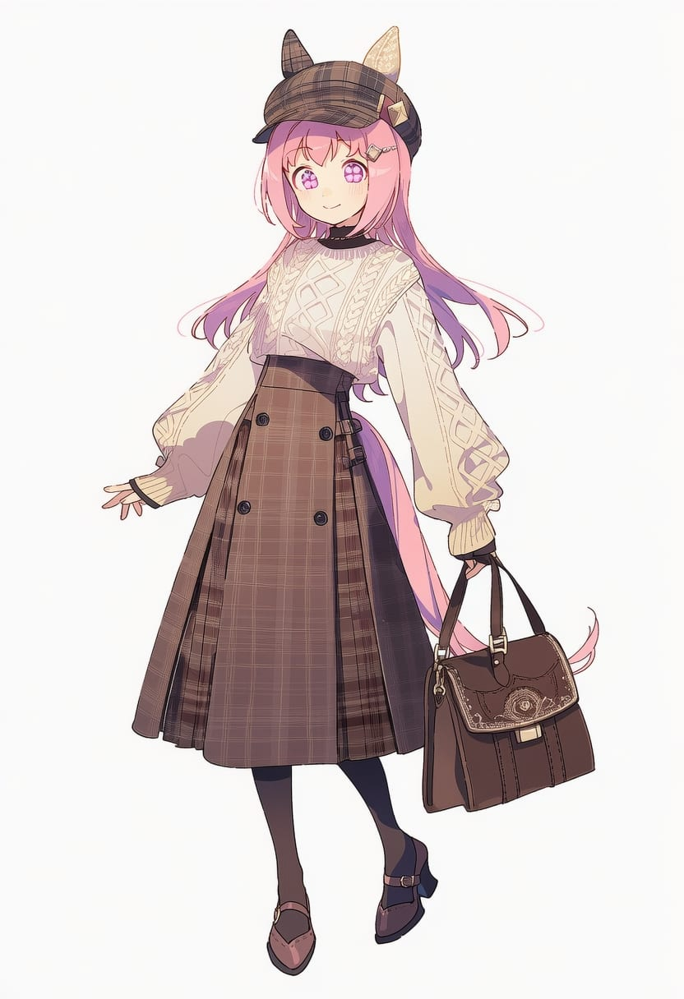

| 字段 | 内容 |
| --- | --- |
| 序号 | 13 |
| 穿搭命名 | 菱格毛衣+灯芯绒裙·英伦 |
| 完整Tag串 | argyle_sweater, brown_corduroy_skirt, checkered_flat_cap, diamond_hair_ornament, brown_brogues, tights, british_autumn, raining |
| 搭配要点说明 | 菱格+灯芯绒英伦，条格帽配布洛克鞋，雨中 |

## 14. 14 — 白色毛衣背心叠衬·知性

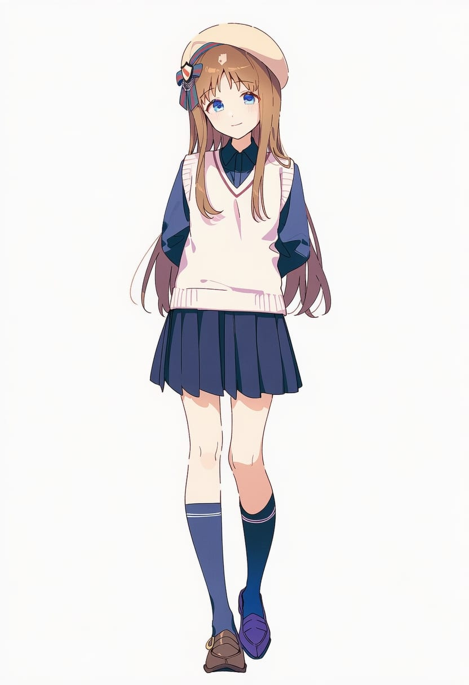

| 字段 | 内容 |
| --- | --- |
| 序号 | 14 |
| 穿搭命名 | 白色毛衣背心叠衬·知性 |
| 完整Tag串 | white_sweater_vest, blue_dress_shirt, navy_pleated_skirt, cream_beret, star_hair_ornament, brown_loafers, knee_socks, autumn_university, clean_style |
| 搭配要点说明 | 白色羊毛马甲叠蓝衬衫，知性利落，大学校园 |

## 15. 15 — 黑色牛仔+卫衣·街头叠穿

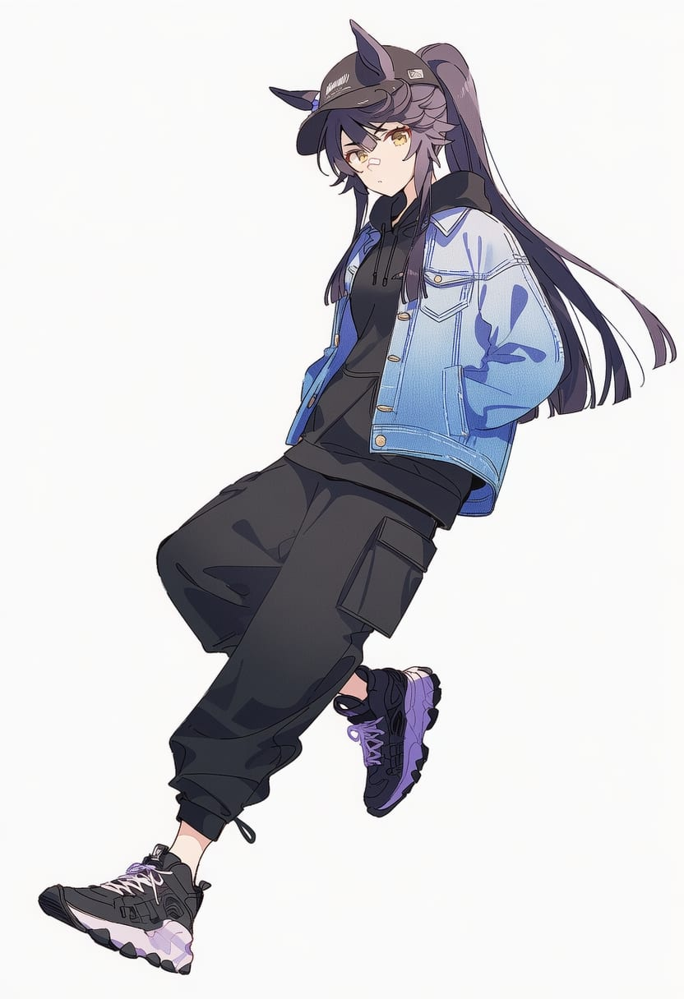

| 字段 | 内容 |
| --- | --- |
| 序号 | 15 |
| 穿搭命名 | 黑色牛仔+卫衣·街头叠穿 |
| 完整Tag串 | denim_jacket, black_hoodie, black_cargo_pants, black_baseball_cap, lightning_hair_ornament, chunky_black_sneakers, streetwear, autumn_city, film_grain |
| 搭配要点说明 | 牛仔黑+酷黑街头，鳄鱼皮底，城市夜景 |

## 16. 16 — 棕色皮机车夹克·复古

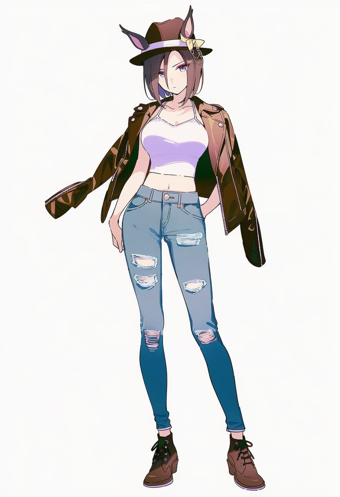

| 字段 | 内容 |
| --- | --- |
| 序号 | 16 |
| 穿搭命名 | 棕色皮机车夹克·复古 |
| 完整Tag串 | brown_leather_jacket, white_camisole, high_waist_ripped_jeans, brown_fedora, feather_hair_ornament, brown_brogues, vintage_rebel, diner_night |
| 搭配要点说明 | 棕皮衣+破洞牛仔裤，硬朗复古，路边餐馆 |

## 17. 17 — 粉色棒球外套·阳光运动

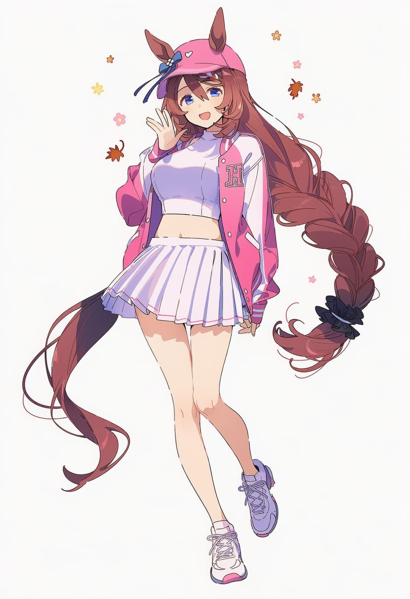

| 字段 | 内容 |
| --- | --- |
| 序号 | 17 |
| 穿搭命名 | 粉色棒球外套·阳光运动 |
| 完整Tag串 | pink_letterman_jacket, white_crop_top, white_pleated_tennis_skirt, pink_cap, heart_hair_ornament, white_low_top_sneakers, pom_pom_scarf, autumn_sports_field, cheerful |
| 搭配要点说明 | 粉棒球外套+网球裙，活力运动，操场 |

## 18. 18 — 黑色夹克+伞裙·赫本风

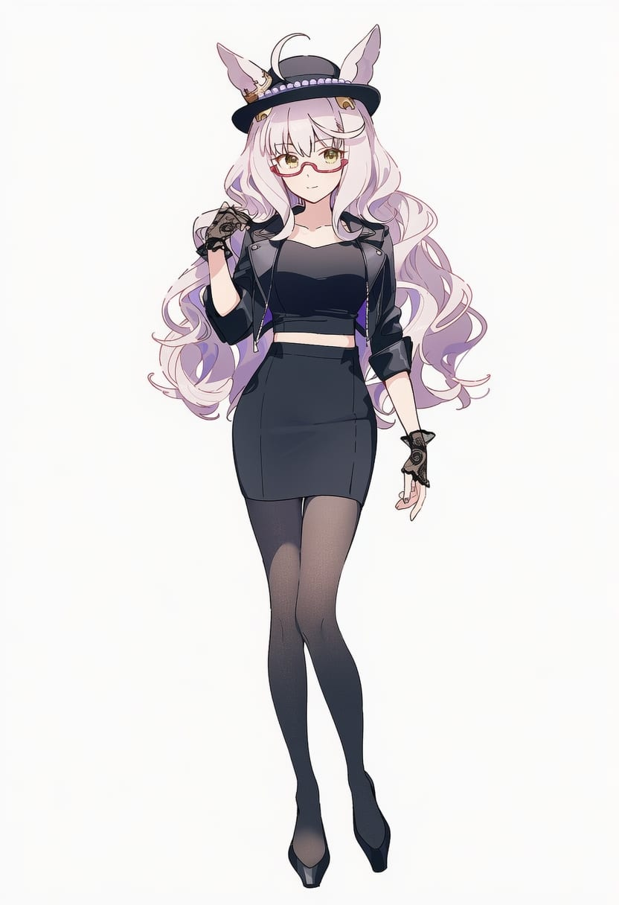

| 字段 | 内容 |
| --- | --- |
| 序号 | 18 |
| 穿搭命名 | 黑色夹克+伞裙·赫本风 |
| 完整Tag串 | black_jacket, black_cropped_top, a-line_skirt, black_bowler_hat, pearl_hair_ornament, black_ballet_flats, black_opaque_tights, parisian_street, vintage_cinema_tone |
| 搭配要点说明 | 黑夹克+A字伞裙，赫本风，巴黎街头 |

## 19. 19 — 藏青西装大衣·英伦淑女

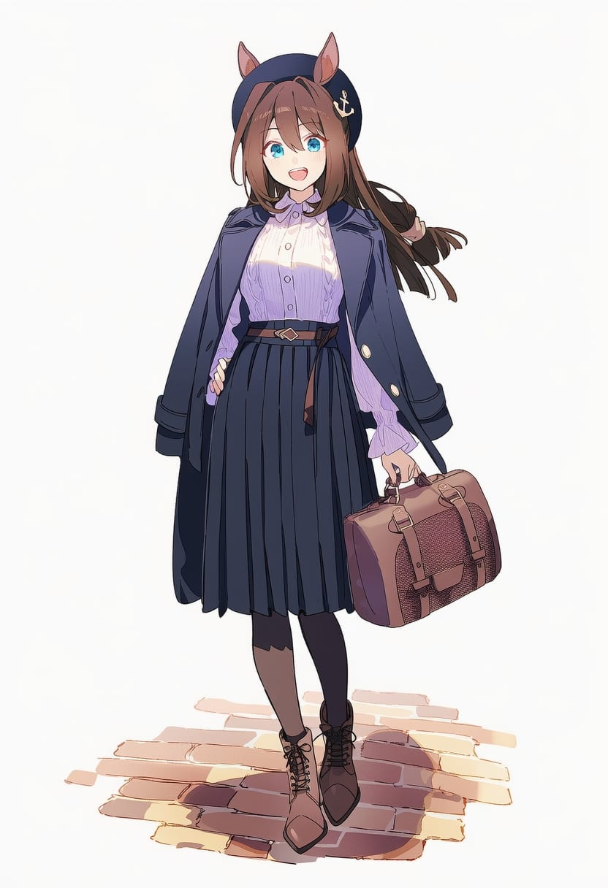

| 字段 | 内容 |
| --- | --- |
| 序号 | 19 |
| 穿搭命名 | 藏青西装大衣·英伦淑女 |
| 完整Tag串 | navy_peacoat, white_blouse, navy_pleated_skirt, navy_cloche_hat, anchor_hair_ornament, brown_riding_boots, preppy_autumn, brick_path |
| 搭配要点说明 | 藏青双排扣+白衬衫，正经淑女，红砖路 |

## 20. 20 — 迷彩夹克+工装裤·机能

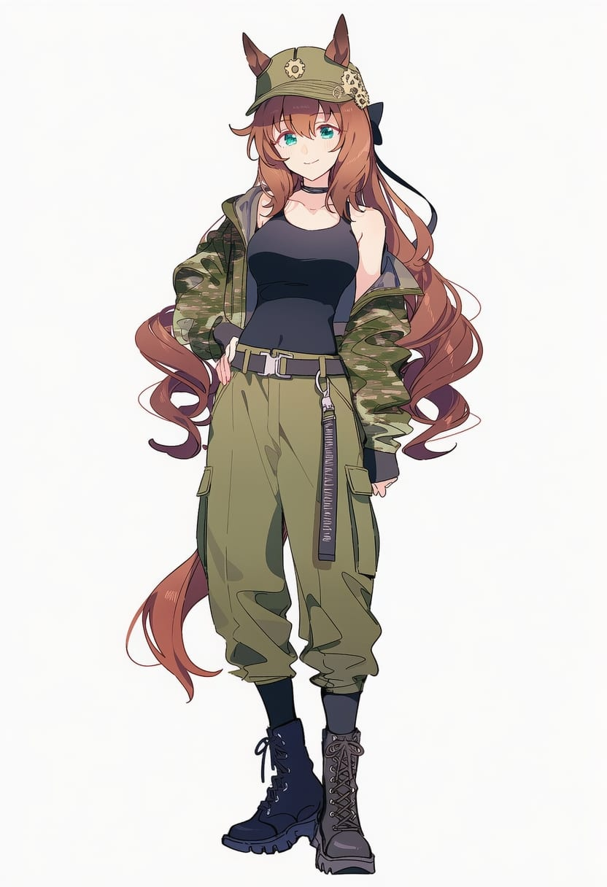

| 字段 | 内容 |
| --- | --- |
| 序号 | 20 |
| 穿搭命名 | 迷彩夹克+工装裤·机能 |
| 完整Tag串 | camouflage_jacket, black_tank_top, olive_cargo_pants, olive_field_cap, gear_hair_ornament, black_lace-up_boots, tactical_city, moody_sky |
| 搭配要点说明 | 迷彩+工装机能，军事风，阴天街头 |

## 21. 21 — 奶油毛绒开衫·仙女软妹

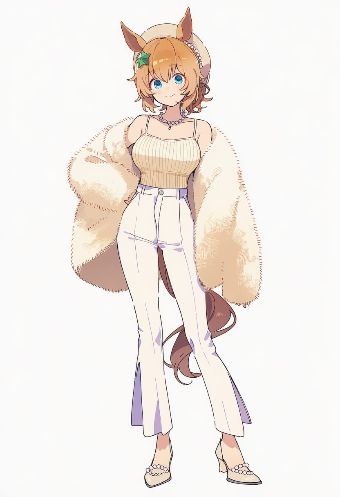

| 字段 | 内容 |
| --- | --- |
| 序号 | 21 |
| 穿搭命名 | 奶油毛绒开衫·仙女软妹 |
| 完整Tag串 | cream_fur_cardigan, cream_ribbed_camisole, white_wide_leg_pants, cream_beret, pearl_hair_ornament, cream_pumps, innocent_vibe, soft_portrait_light |
| 搭配要点说明 | 奶油毛绒开衫+阔腿裤，软妹仙女，柔光 |

## 22. 22 — 粗花呢西装+短裤·名媛

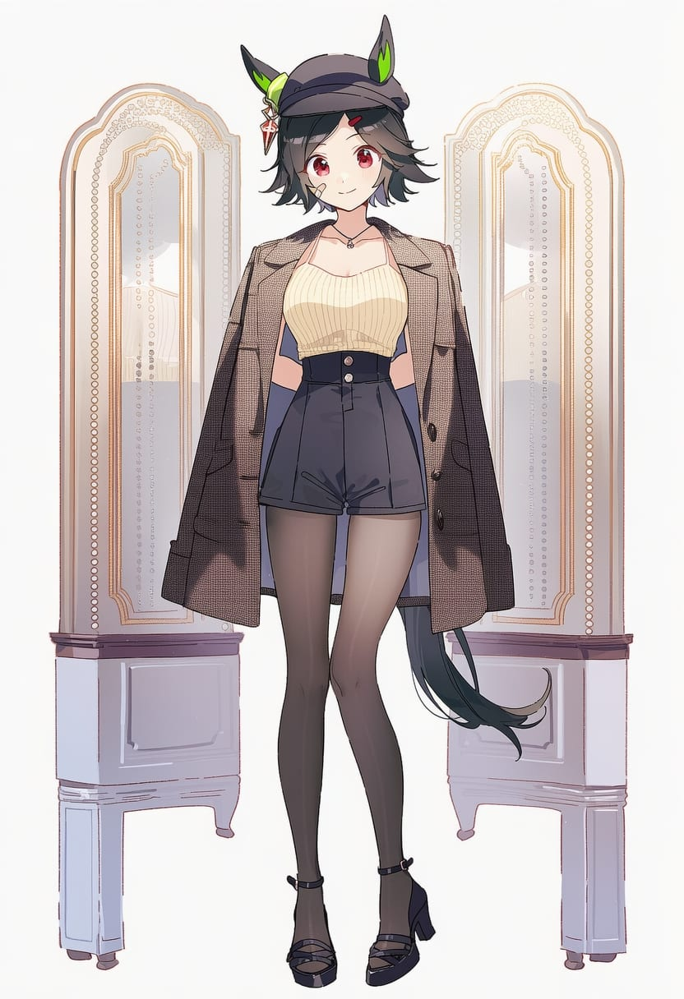

| 字段 | 内容 |
| --- | --- |
| 序号 | 22 |
| 穿搭命名 | 粗花呢西装+短裤·名媛 |
| 完整Tag串 | tweed_blazer, cream_ribbed_camisole, black_high_waist_shorts, black_newsboy_cap, coin_hair_ornament, black_t-strap_heels, sheer_black_stockings, vintage_glam, mirror_room |
| 搭配要点说明 | 粗花呢+短裤名媛，复古格调，玻璃框 |

## 23. 23 — 宽牛仔外套叠卫衣·休闲

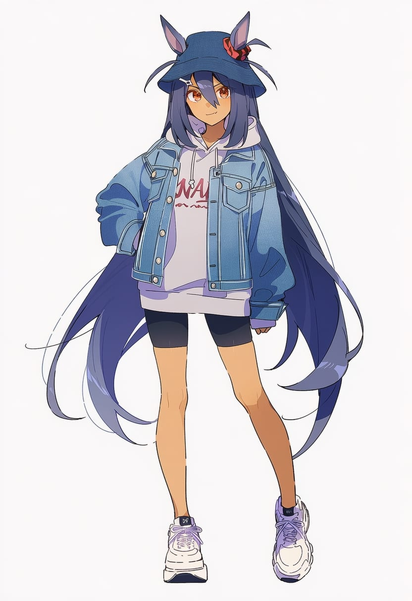

| 字段 | 内容 |
| --- | --- |
| 序号 | 23 |
| 穿搭命名 | 宽牛仔外套叠卫衣·休闲 |
| 完整Tag串 | oversized_denim_jacket, gray_hoodie, black_bike_shorts, denim_bucket_hat, star_hair_ornament, chunky_white_sneakers, layered_streetwear, autumn_park |
| 搭配要点说明 | 牛仔+灰卫衣叠穿，街头休闲，公园 |

## 24. 24 — 锈色风衣+高领毛衣·暖意

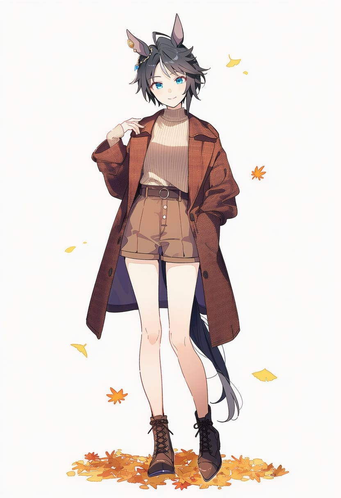

| 字段 | 内容 |
| --- | --- |
| 序号 | 24 |
| 穿搭命名 | 锈色风衣+高领毛衣·暖意 |
| 完整Tag串 | rust_trench_coat, beige_turtleneck_sweater, brown_high_waist_shorts, rust_beret, maple_leaf_hair_ornament, brown_riding_boots, autumn_street, golden_foliage |
| 搭配要点说明 | 锈色风衣+高领，秋意浓，满地金黄 |

## 25. 25 — 薰衣草卫衣·慵懒居家

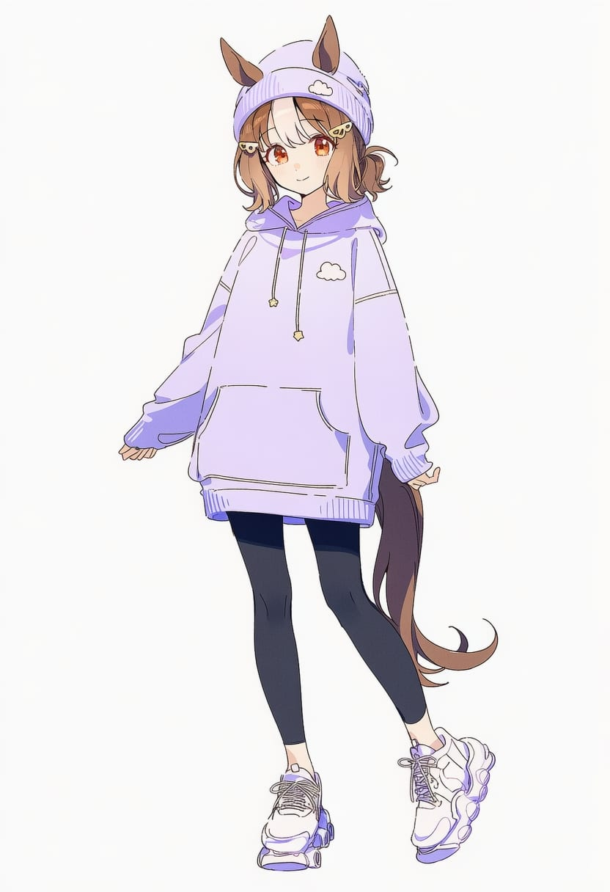

| 字段 | 内容 |
| --- | --- |
| 序号 | 25 |
| 穿搭命名 | 薰衣草卫衣·慵懒居家 |
| 完整Tag串 | lavender_oversized_hoodie, black_leggings, lavender_beanie, cloud_hair_ornament, white_platform_sneakers, loungewear, cozy_bedroom, morning_light |
| 搭配要点说明 | 薰衣草卫衣+紧身裤，慵懒家居，晨光 |

## 26. 26 — 黑色连帽卫衣+格裙·甜酷

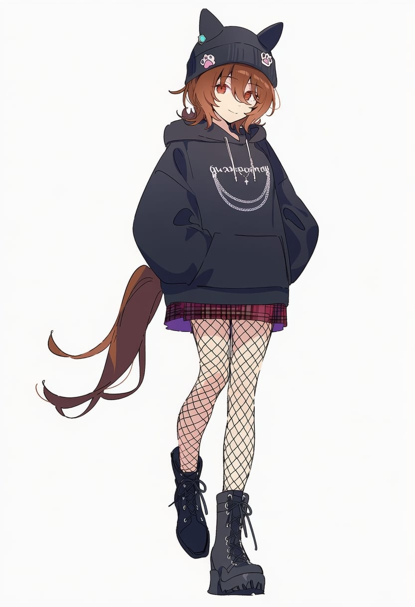

| 字段 | 内容 |
| --- | --- |
| 序号 | 26 |
| 穿搭命名 | 黑色连帽卫衣+格裙·甜酷 |
| 完整Tag串 | black_oversized_hoodie, plaid_mini_skirt, black_beanie, paw_hair_ornament, black_lace_boots, fishnet_tights, grunge_gal, rainy_autumn |
| 搭配要点说明 | 黑卫衣+格裙甜酷，暗黑少女，雨天 |

## 27. 27 — 奶油短款卫衣·活力少女

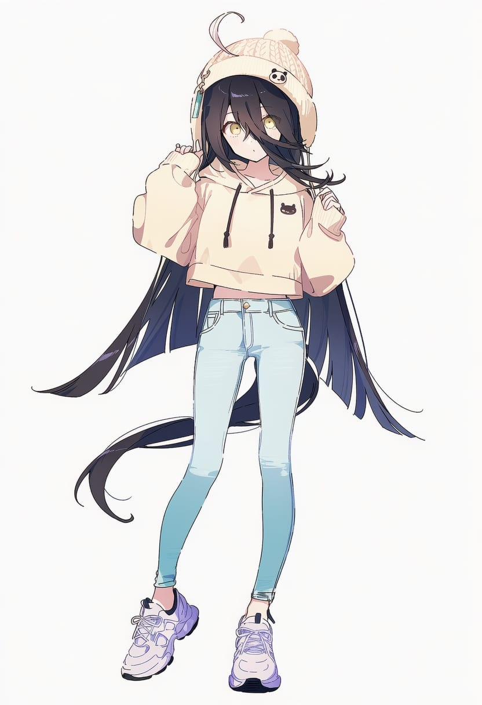

| 字段 | 内容 |
| --- | --- |
| 序号 | 27 |
| 穿搭命名 | 奶油短款卫衣·活力少女 |
| 完整Tag串 | cream_cropped_hoodie, light_blue_skinny_jeans, cream_earflap_beanie, panda_hair_ornament, white_running_shoes, sporty_chic, sunny_autumn |
| 搭配要点说明 | 奶油短款卫衣+蓝牛仔裤，阳光活力 |

## 28. 28 — 灰色拉链卫衣+皮裤·运动

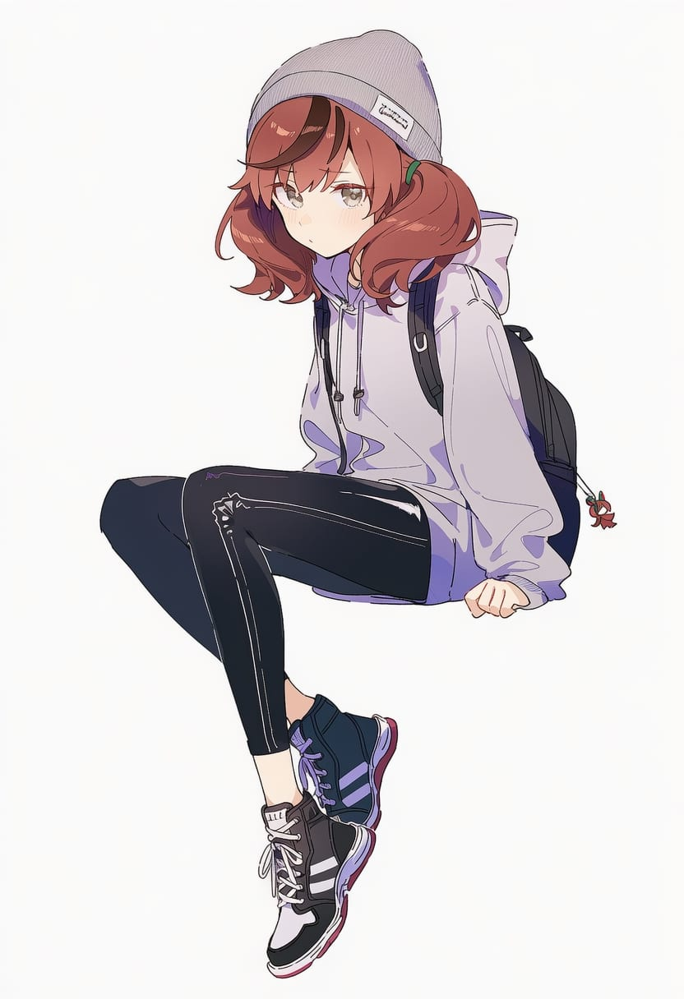

| 字段 | 内容 |
| --- | --- |
| 序号 | 28 |
| 穿搭命名 | 灰色拉链卫衣+皮裤·运动 |
| 完整Tag串 | gray_zip_hoodie, black_leather_leggings, gray_beanie, bone_hair_ornament, black_high_top_sneakers, athleisure, gym_autumn |
| 搭配要点说明 | 灰拉链卫衣+漆皮裤，运动街头 |

## 29. 29 — 卡其双排扣风衣·英伦

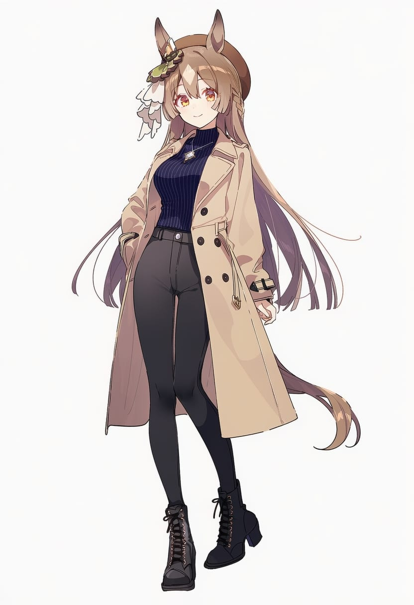

| 字段 | 内容 |
| --- | --- |
| 序号 | 29 |
| 穿搭命名 | 卡其双排扣风衣·英伦 |
| 完整Tag串 | beige_trench_coat, navy_striped_sweater, black_tight_pants, brown_fedora, amber_hair_ornament, black_rider_boots, london_autumn, foggy_morning |
| 搭配要点说明 | 卡其风衣+条纹针织，伦敦雾晨 |

## 30. 30 — 黑色长大衣+红裙·华丽

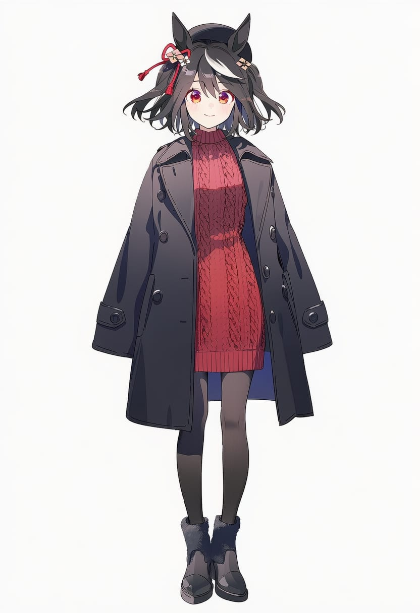

| 字段 | 内容 |
| --- | --- |
| 序号 | 30 |
| 穿搭命名 | 黑色长大衣+红裙·华丽 |
| 完整Tag串 | black_long_coat, red_knitted_dress, black_cloche_hat, gem_hair_ornament, black_shearling_ankle_boots, black_opaque_tights, glamour, high_fashion |
| 搭配要点说明 | 黑色长大衣+红色连衣裙，红毯华丽 |

## 31. 31 — 灰色双排扣大衣·通勤

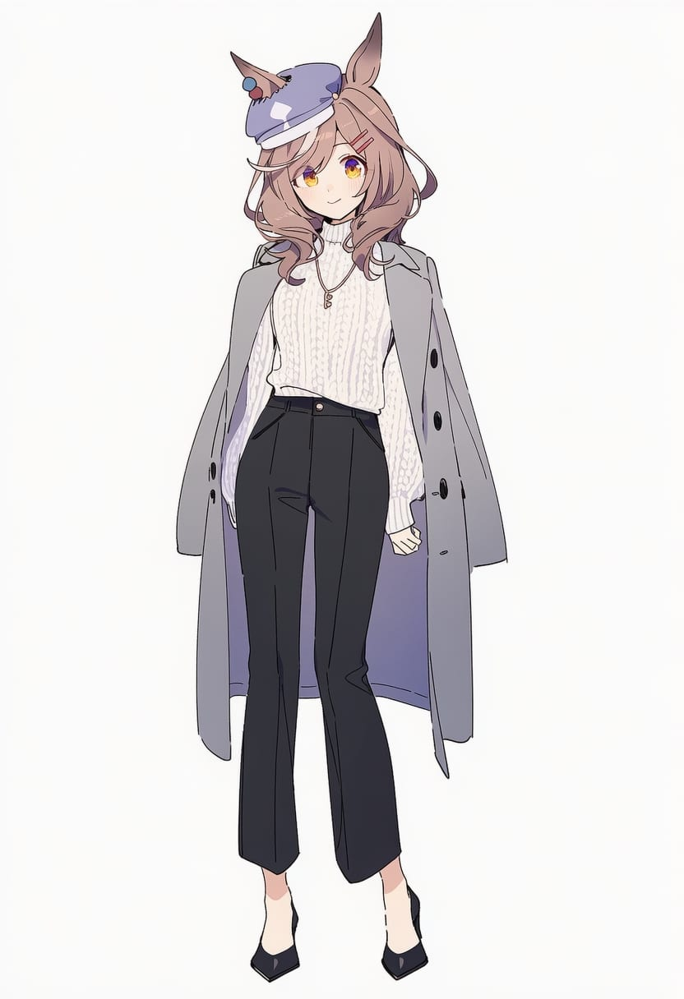

| 字段 | 内容 |
| --- | --- |
| 序号 | 31 |
| 穿搭命名 | 灰色双排扣大衣·通勤 |
| 完整Tag串 | gray_peacoat, white_cashmere_sweater, black_suit_pants, gray_flat_cap, key_hair_ornament, black_pointy_pumps, office_elegance, city_commute |
| 搭配要点说明 | 灰大衣+白针织，通勤干练 |

## 32. 32 — 驼色羊毛大衣·法式优雅

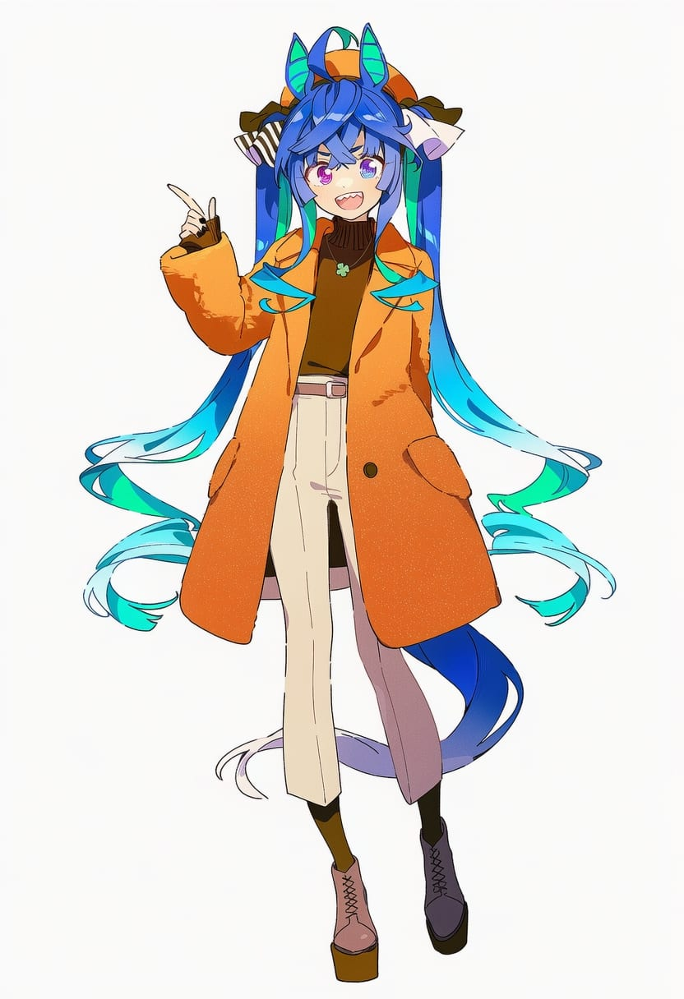

| 字段 | 内容 |
| --- | --- |
| 序号 | 32 |
| 穿搭命名 | 驼色羊毛大衣·法式优雅 |
| 完整Tag串 | burnt_orange_wool_coat, brown_turtleneck_sweater, cream_wide_leg_trousers, camel_beret, clover_hair_ornament, brown_block_heels, parisian_elegance, eiffel_vibe |
| 搭配要点说明 | 驼色羊毛大衣+高领，法式优雅 |

## 33. 33 — 黑色皮风衣+红撞色·辣妹

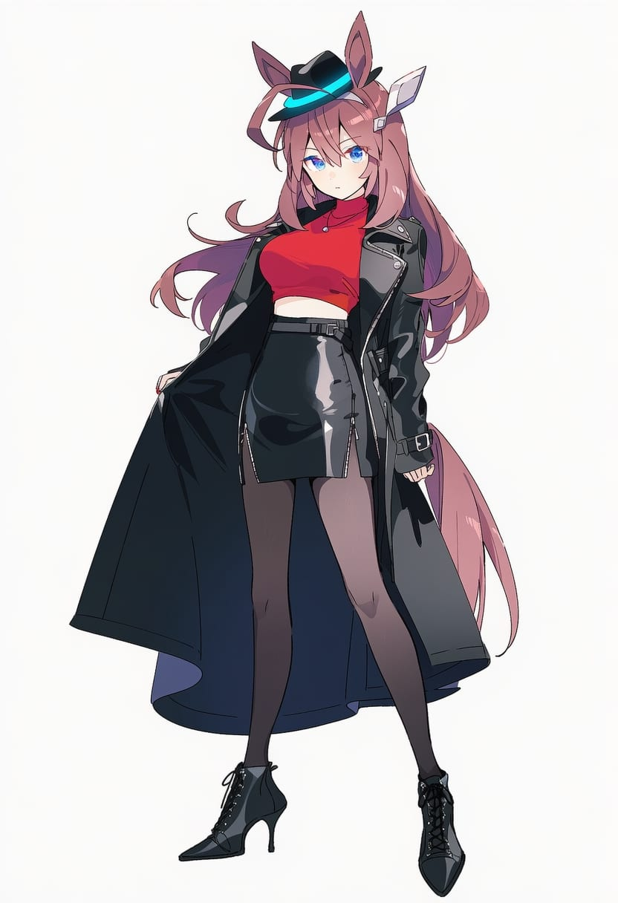

| 字段 | 内容 |
| --- | --- |
| 序号 | 33 |
| 穿搭命名 | 黑色皮风衣+红撞色·辣妹 |
| 完整Tag串 | black_leather_trench_coat, red_crop_top, black_high_waist_skirt, black_porkpie_hat, spade_hair_ornament, black_stiletto_heels, femme_fatale, neon_night |
| 搭配要点说明 | 黑皮衣+红短裙，辣妹冷艳，霓虹 |

## 34. 34 — 格纹西装外套·90s港风

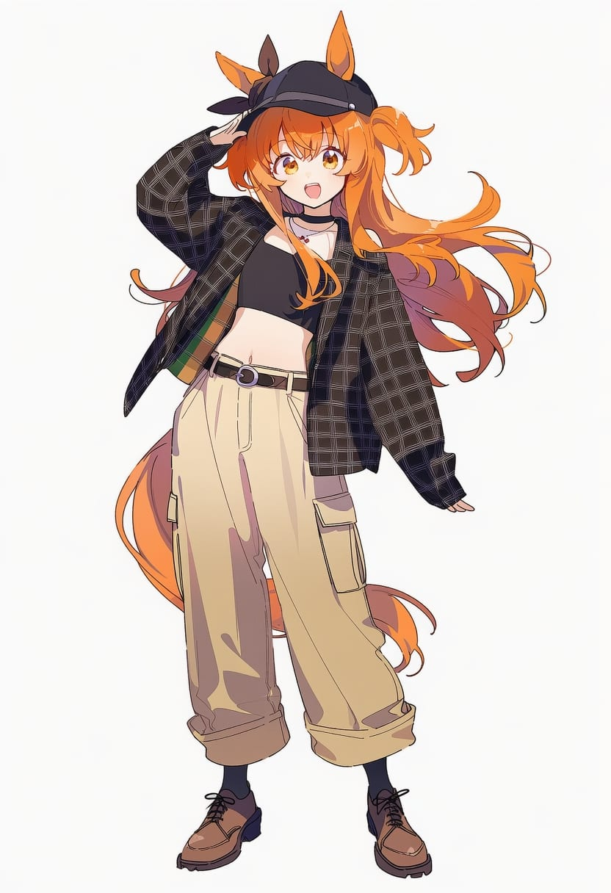

| 字段 | 内容 |
| --- | --- |
| 序号 | 34 |
| 穿搭命名 | 格纹西装外套·90s港风 |
| 完整Tag串 | checkered_blazer, black_crop_top, tan_cargo_pants, black_newsboy_cap, tassel_hair_ornament, brown_loafers, 90s_retro, vintage_tone |
| 搭配要点说明 | 格纹西装+工装裤，90s复古 |

## 35. 35 — 奶油粉针织连衣裙·浪漫

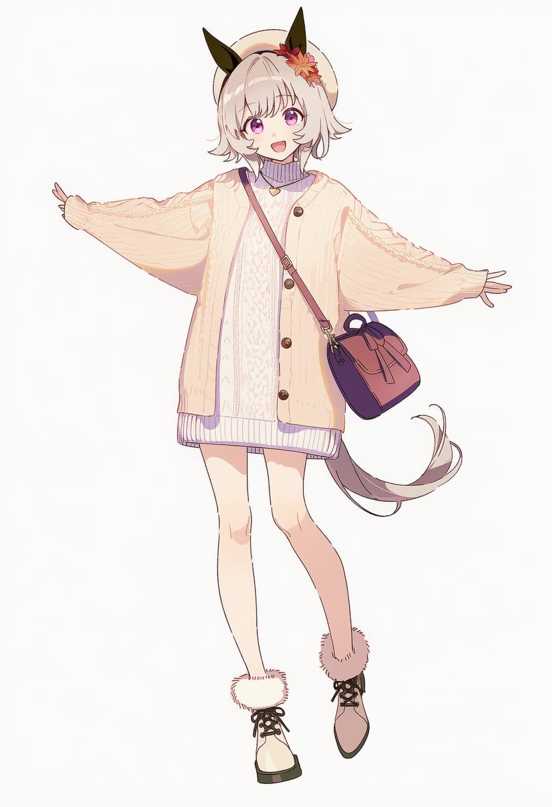

| 字段 | 内容 |
| --- | --- |
| 序号 | 35 |
| 穿搭命名 | 奶油粉针织连衣裙·浪漫 |
| 完整Tag串 | cream_pink_wool_dress, blush_cardigan, floppy_cream_hat, flower_hair_ornament, cream_fur-trimmed_ankle_boots, romantic_autumn, angelic_glow |
| 搭配要点说明 | 粉奶油针织连衣裙，浪漫仙女 |

## 36. 36 — 炭灰长大衣·极简高级

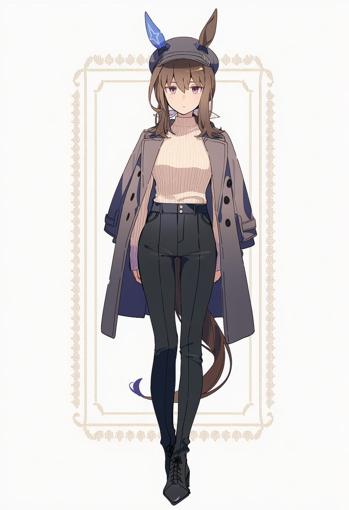

| 字段 | 内容 |
| --- | --- |
| 序号 | 36 |
| 穿搭命名 | 炭灰长大衣·极简高级 |
| 完整Tag串 | charcoal_overcoat, ivory_ribbed_sweater, black_taut_pants, charcoal_flat_cap, line_hair_ornament, black_chelsea_boots, minimalist, architectural_frame |
| 搭配要点说明 | 炭灰大衣极简，高级感 |

## 37. 37 — 藏蓝西装+白衬·法式

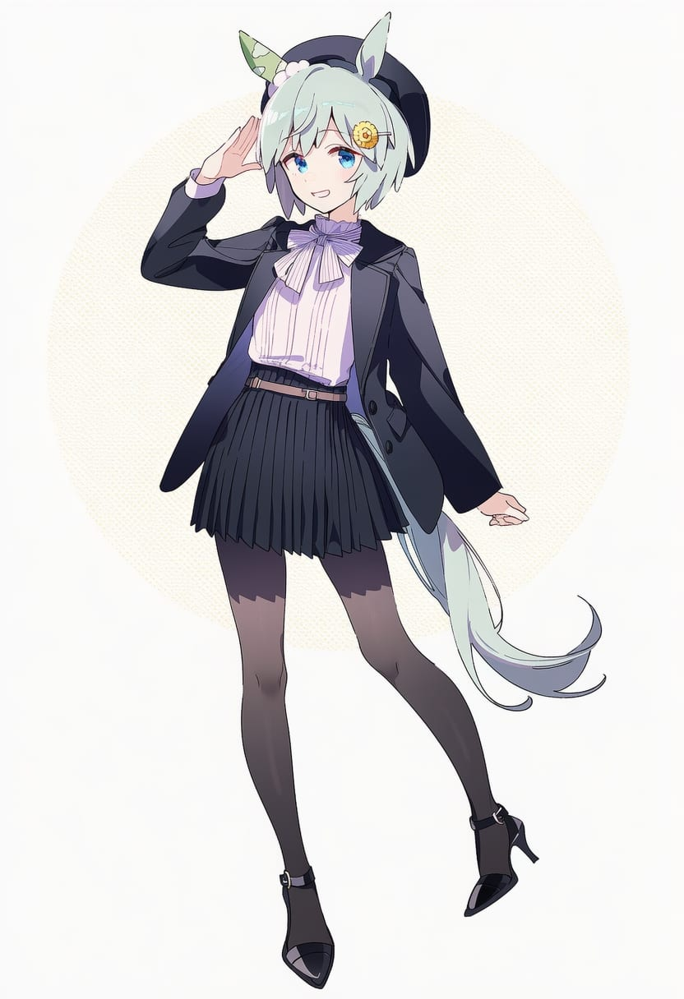

| 字段 | 内容 |
| --- | --- |
| 序号 | 37 |
| 穿搭命名 | 藏蓝西装+白衬·法式 |
| 完整Tag串 | navy_blazer, white_silk_blouse, navy_pleated_mini_skirt, navy_beret, musical_note_hair_ornament, black_club_heels, chanel_inspired, beret_scarf, french_elegance |
| 搭配要点说明 | 藏蓝西装+丝衬衫，法式淑女 |

## 38. 38 — 棕色麂皮外套·西部风情

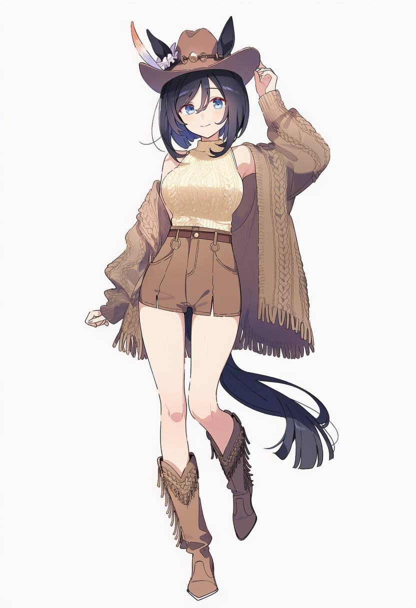

| 字段 | 内容 |
| --- | --- |
| 序号 | 38 |
| 穿搭命名 | 棕色麂皮外套·西部风情 |
| 完整Tag串 | brown_sherpa_jacket, cream_knitted_tank_top, brown_high_waist_shorts, brown_cowboy_hat, feather_hat_ornament, brown_fringe_boots, western, autumn_ranch |
| 搭配要点说明 | 麂皮夹克+西部牛仔靴，西部风情 |

## 39. 39 — 粉色毛绒开衫·软糯

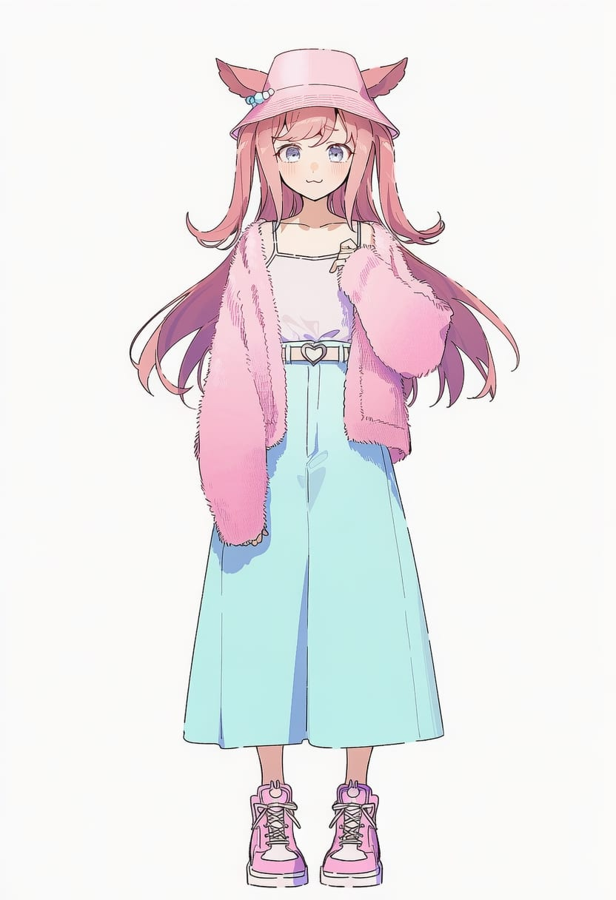

| 字段 | 内容 |
| --- | --- |
| 序号 | 39 |
| 穿搭命名 | 粉色毛绒开衫·软糯 |
| 完整Tag串 | pink_fluffy_cardigan, white_camisole, light_blue_wide_pants, pink_bucket_hat, rabbit_hair_ornament, pink_high_top_sneakers, kawaii, pastel_world |
| 搭配要点说明 | 粉粉软糯，可爱甜美，兔耳发饰 |

## 40. 40 — 黑色毛边大衣+红格裙·冷艳

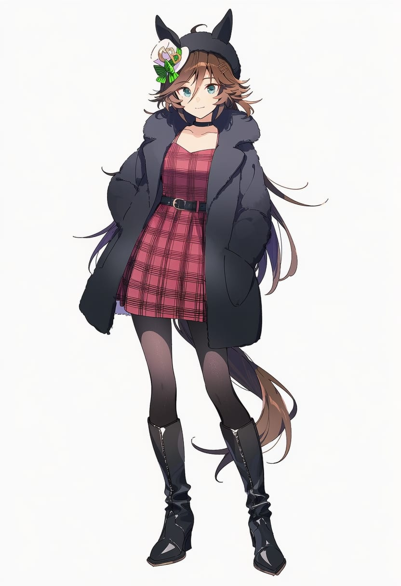

| 字段 | 内容 |
| --- | --- |
| 序号 | 40 |
| 穿搭命名 | 黑色毛边大衣+红格裙·冷艳 |
| 完整Tag串 | fur-trimmed_black_coat, red_plaid_mini_dress, black_ushanka, crown_hair_ornament, black_knee_boots, black_opaque_tights, early_winter_glam |
| 搭配要点说明 | 黑皮草+红格裙冷艳，冬日华丽 |

## 41. 41 — 白色针织斗篷+灯芯绒·波西

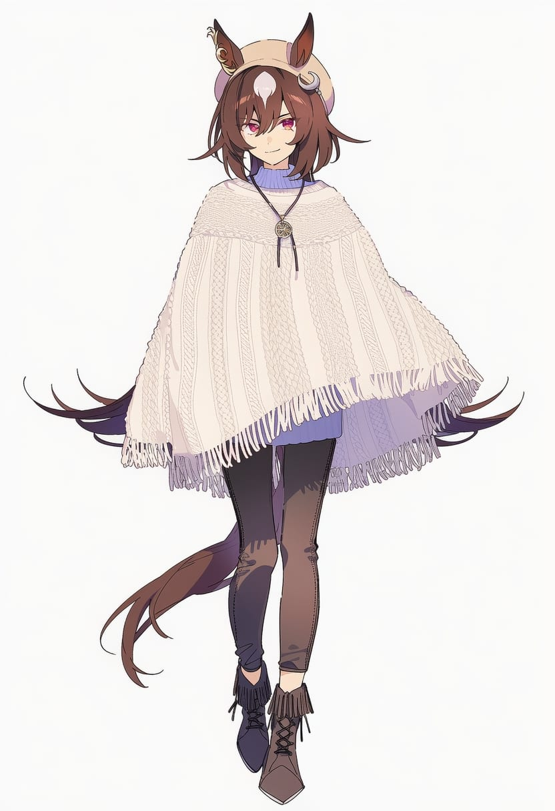

| 字段 | 内容 |
| --- | --- |
| 序号 | 41 |
| 穿搭命名 | 白色针织斗篷+灯芯绒·波西 |
| 完整Tag串 | white_knitted_poncho, brown_corduroy_pants, fox_hat, crescent_hair_ornament, brown_fringe_boots, bohemian, spirits_autumn |
| 搭配要点说明 | 白针织斗篷+灯芯绒裤，波西慵懒 |

## 42. 42 — 紫葡萄毛衣+格裙·个性

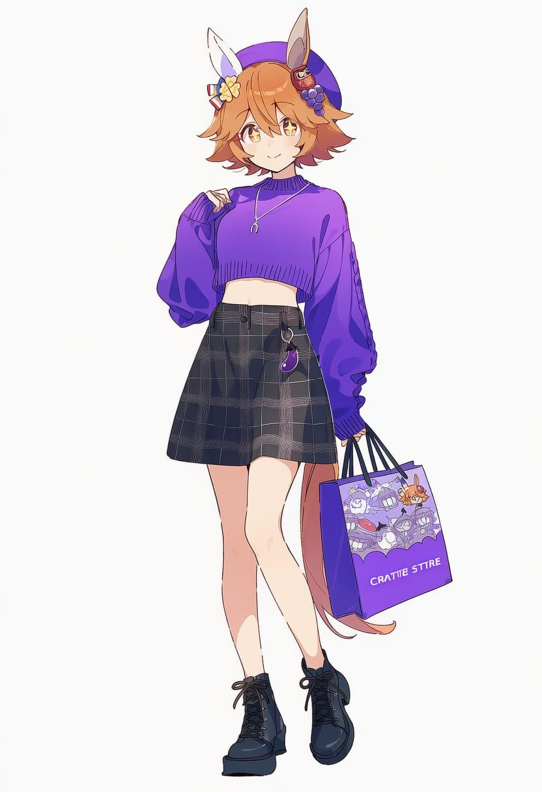

| 字段 | 内容 |
| --- | --- |
| 序号 | 42 |
| 穿搭命名 | 紫葡萄毛衣+格裙·个性 |
| 完整Tag串 | purple_cropped_sweater, black_plaid_mini_skirt, purple_beret, grape_hair_ornament, black_low_block_heels, eggplant_accent, creative_street |
| 搭配要点说明 | 紫毛衣+格裙，个性亮色 |

## 43. 43 — 锈红撞色毛衣·秋收

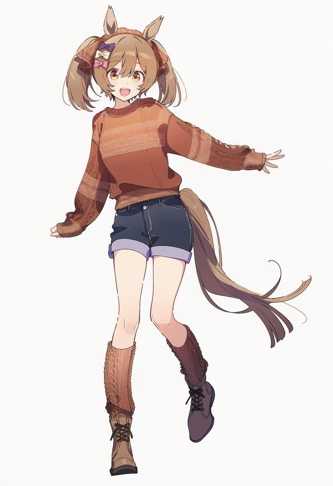

| 字段 | 内容 |
| --- | --- |
| 序号 | 43 |
| 穿搭命名 | 锈红撞色毛衣·秋收 |
| 完整Tag串 | rust_color-block_sweater, dark_denim_shorts, rust_knitted_headband, apple_hair_ornament, brown_knit_leg_warmers, brown_desert_boots, harvest_vibes, warm_tone |
| 搭配要点说明 | 锈红撞色，丰收暖秋，民族风 |

## 44. 44 — 束身+蓬纱短裙·暗黑童话

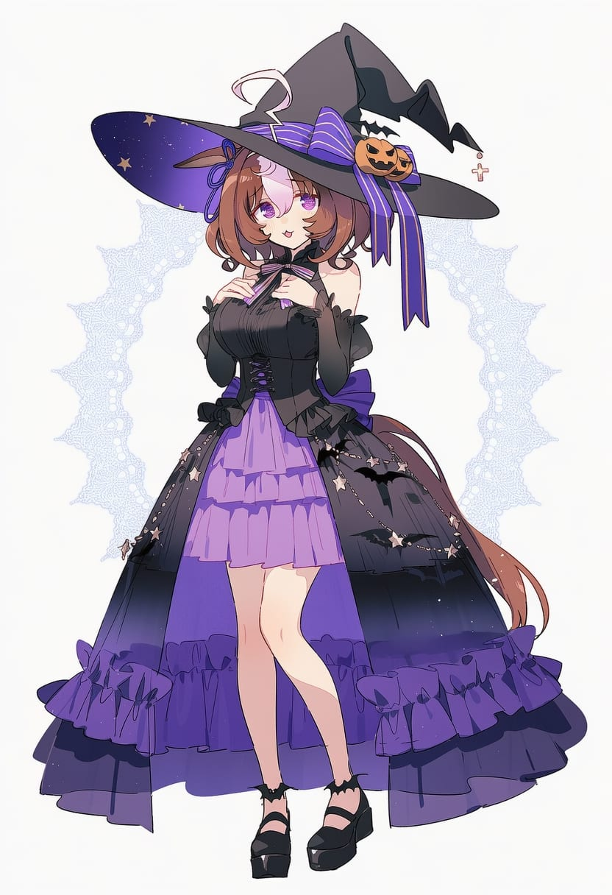

| 字段 | 内容 |
| --- | --- |
| 序号 | 44 |
| 穿搭命名 | 束身+蓬纱短裙·暗黑童话 |
| 完整Tag串 | black_corset_top, purple_tulle_skirt, black_witch_hat, bat_hair_ornament, black_platform_mary_janes, halloween, spooky_forest, moonlight |
| 搭配要点说明 | 束身+蓬纱，暗黑童话，南瓜万圣 |

## 45. 45 — 青绿条纹开衫·趣味

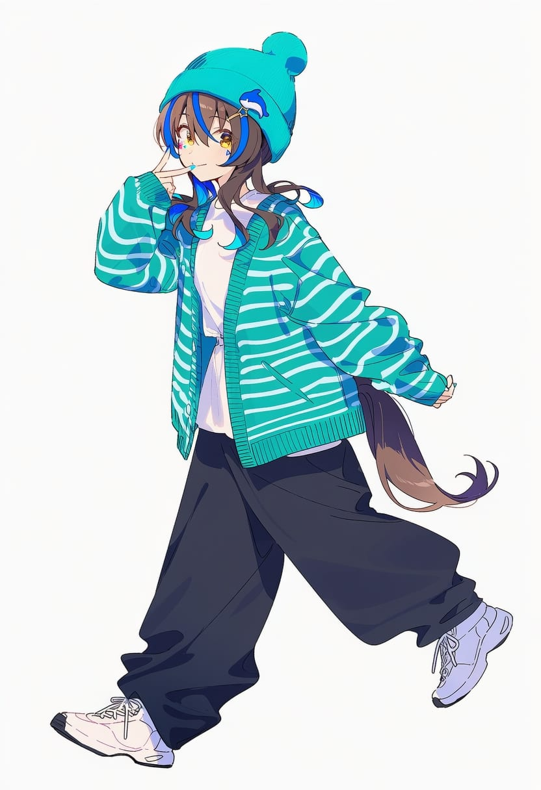

| 字段 | 内容 |
| --- | --- |
| 序号 | 45 |
| 穿搭命名 | 青绿条纹开衫·趣味 |
| 完整Tag串 | teal_striped_cardigan, white_t-shirt, black_baggy_pants, teal_beanie, dolphin_hair_ornament, white_running_shoes, color_block, playful_autumn |
| 搭配要点说明 | 青绿条纹开衫+黑阔腿裤，趣味 |

## 46. 46 — 奶油披肩+高领·北欧舒适

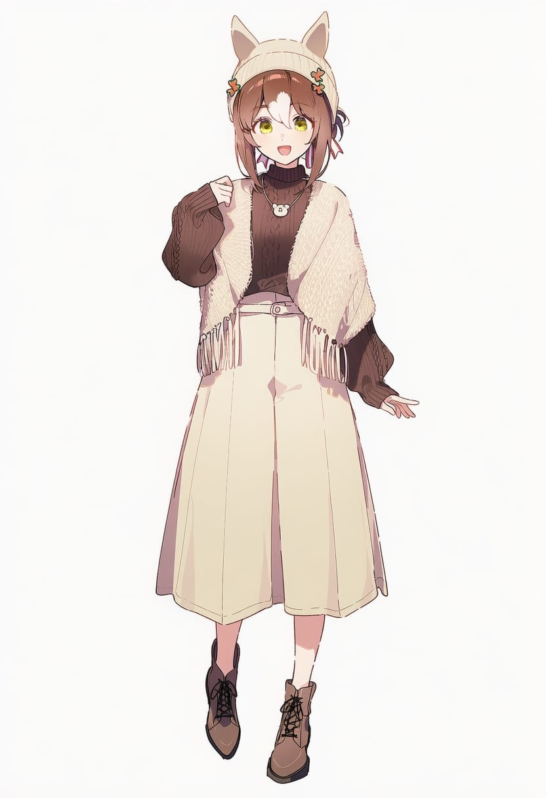

| 字段 | 内容 |
| --- | --- |
| 序号 | 46 |
| 穿搭命名 | 奶油披肩+高领·北欧舒适 |
| 完整Tag串 | cream_shawl_cardigan, brown_turtleneck_sweater, cream_wide_leg_pants, cream_earflap_beanie, bear_hair_ornament, brown_suede_ankle_boots, hygge, scenic_knit |
| 搭配要点说明 | 奶油披肩+高领，北欧舒适风 |

## 47. 47 — 酒红天鹅绒·贵妇感

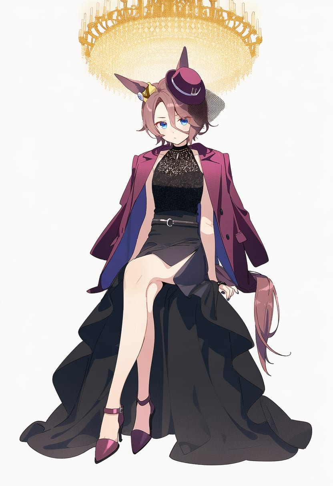

| 字段 | 内容 |
| --- | --- |
| 序号 | 47 |
| 穿搭命名 | 酒红天鹅绒·贵妇感 |
| 完整Tag串 | burgundy_velvet_blazer, black_lace_camisole, black_satin_skirt, burgundy_cloche_hat, jewel_crown_hair_ornament, burgundy_stiletto_heels, evening_luxury, chandelier_light |
| 搭配要点说明 | 酒红天鹅绒+黑蕾丝，贵妇奢华 |

## 48. 48 — 米白开衫+内搭·初秋

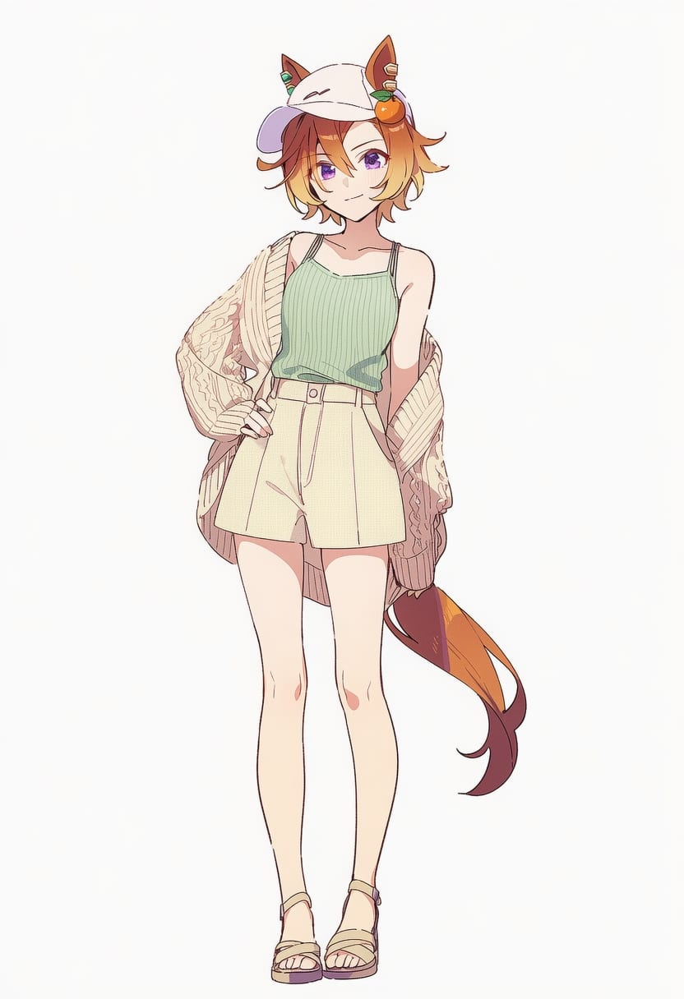

| 字段 | 内容 |
| --- | --- |
| 序号 | 48 |
| 穿搭命名 | 米白开衫+内搭·初秋 |
| 完整Tag串 | cream_ribbed_cardigan, sage_green_knitted_tank_top, cream_linen_shorts, white_baseball_cap, fruit_hair_ornament, beige_slingback_flats, late_autumn, relaxed_casual |
| 搭配要点说明 | 米白开衫+青绿内搭，初秋清爽 |

## 49. 49 — 黑+银·暗黑街头

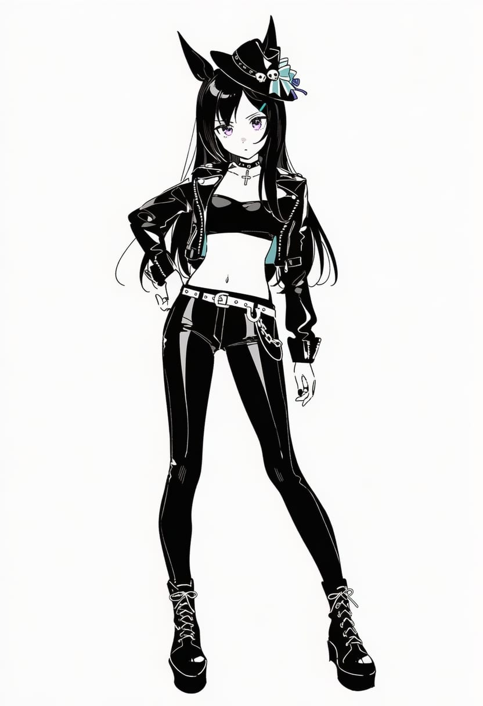

| 字段 | 内容 |
| --- | --- |
| 序号 | 49 |
| 穿搭命名 | 黑+银·暗黑街头 |
| 完整Tag串 | black_leather_jacket, black_bandeau_top, black_leather_leggings, black_fedora, skull_hair_ornament, black_platform_boots, silver_chain, urban_night, monochrome |
| 搭配要点说明 | 纯黑+银饰，酷感街头，暗黑 |

## 50. 50 — 纯白仙女·冬日预演

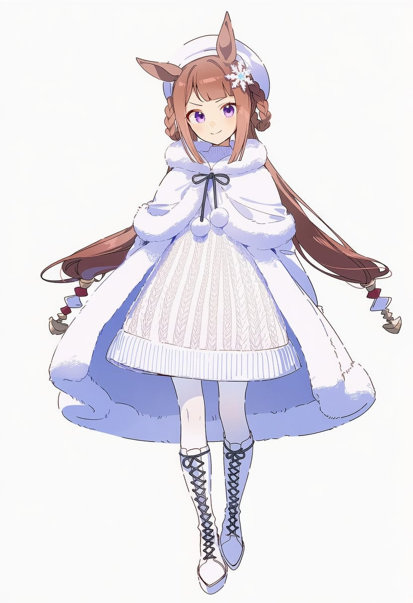

| 字段 | 内容 |
| --- | --- |
| 序号 | 50 |
| 穿搭命名 | 纯白仙女·冬日预演 |
| 完整Tag串 | fur-trimmed_white_coat, white_knitted_dress, white_beret, snowflake_hair_ornament, white_knee_boots, white_opaque_tights, snow_flurries, ice_queen_aesthetic |
| 搭配要点说明 | 纯白毛绒+雪花，冬雪仙女 |

---
