## 1. 1 — 温暖针织学院

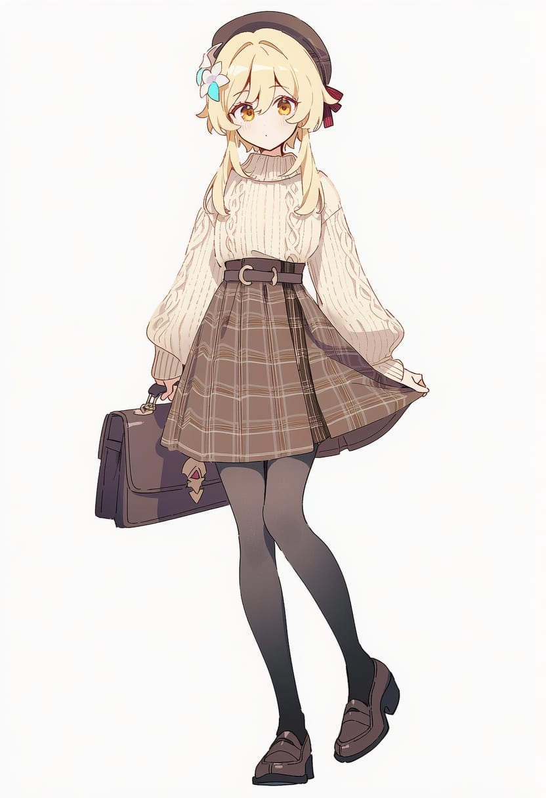

| 字段 | 内容 |
| --- | --- |
| 序号 | 1 |
| 风格主题 | 温暖针织学院 |
| 搭配思路（中文描述） | 贝雷帽+红色发带点缀，奶油色高领针织与棕色格纹裙形成温暖学院感；黑丝+棕色乐福鞋收尾，整体色调沉稳却带秋日暖意，围巾增加层次。 |
| 从头到脚Tag串（英文逗号分隔） | beret, brown beret, hair_ribbon, red hair_ribbon, turtleneck_sweater, cream turtleneck_sweater, ribbed_sweater, plaid_skirt, brown plaid_skirt, black pantyhose, kneehighs, brown loafers, scarf, plaid scarf, brown scarf |

## 2. 2 — 文艺卡迪根

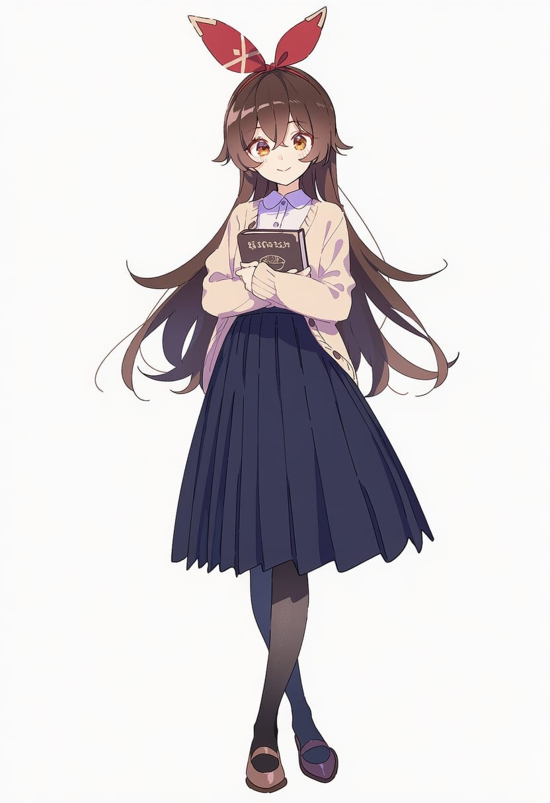

| 字段 | 内容 |
| --- | --- |
| 序号 | 2 |
| 风格主题 | 文艺卡迪根 |
| 搭配思路（中文描述） | 黑色花发带衬托文艺气质，米色开衫轻搭白衬衫，高腰百褶裙利落；棕色玛丽珍鞋与手持书本强化知性氛围，黑丝增加秋日厚度。 |
| 从头到脚Tag串（英文逗号分隔） | hairband, black hairband, flower_hairband, cardigan, beige cardigan, open cardigan, collared_shirt, white shirt, high-waist_skirt, pleated_skirt, navy skirt, black tights, mary_janes, brown mary_janes, book, holding book |

## 3. 3 — 街头落叶风

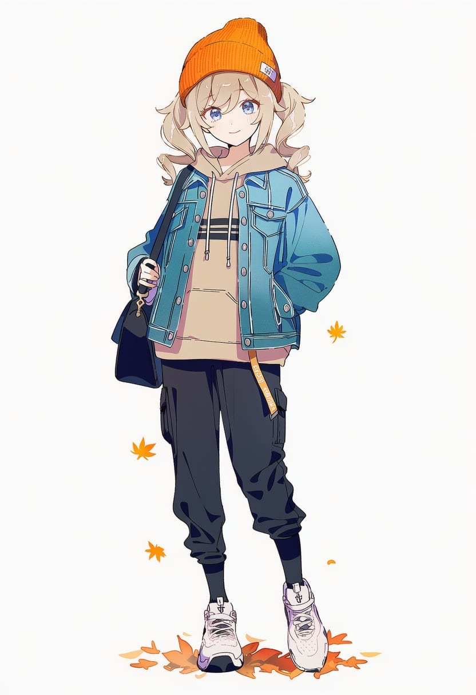

| 字段 | 内容 |
| --- | --- |
| 序号 | 3 |
| 风格主题 | 街头落叶风 |
| 搭配思路（中文描述） | 橙色毛线帽呼应落叶色，oversize棕色卫衣+蓝色牛仔夹克层叠街头感；黑色工装裤与白球鞋轻便实用，斜挎包+落叶元素强化秋季户外氛围。 |
| 从头到脚Tag串（英文逗号分隔） | beanie, orange beanie, hoodie, oversized hoodie, brown hoodie, denim_jacket, blue denim_jacket, open jacket, cargo_pants, black cargo_pants, sneakers, white sneakers, crossbody_bag, autumn leaves |

## 4. 4 — 优雅风衣

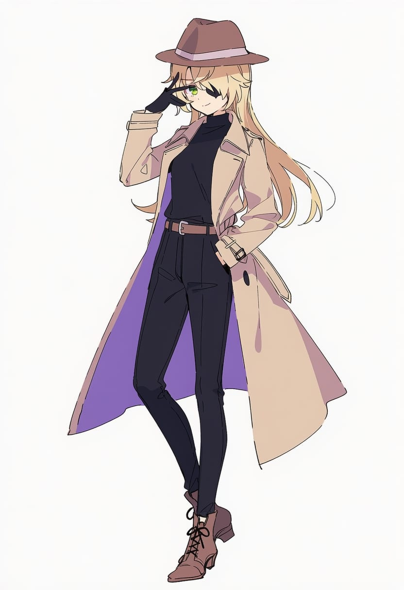

| 字段 | 内容 |
| --- | --- |
| 序号 | 4 |
| 风格主题 | 优雅风衣 |
| 搭配思路（中文描述） | 棕色软呢帽搭配米色风衣，黑色高领内搭经典；黑色西装裤+棕色踝靴显干练，皮带与黑手套增加都市优雅细节。 |
| 从头到脚Tag串（英文逗号分隔） | fedora, brown fedora, trench_coat, beige trench_coat, open coat, turtleneck, black turtleneck, suit_pants, black pants, ankle_boots, brown ankle_boots, leather belt, brown belt, gloves, black gloves |

## 5. 5 — 复古阿兰毛衣

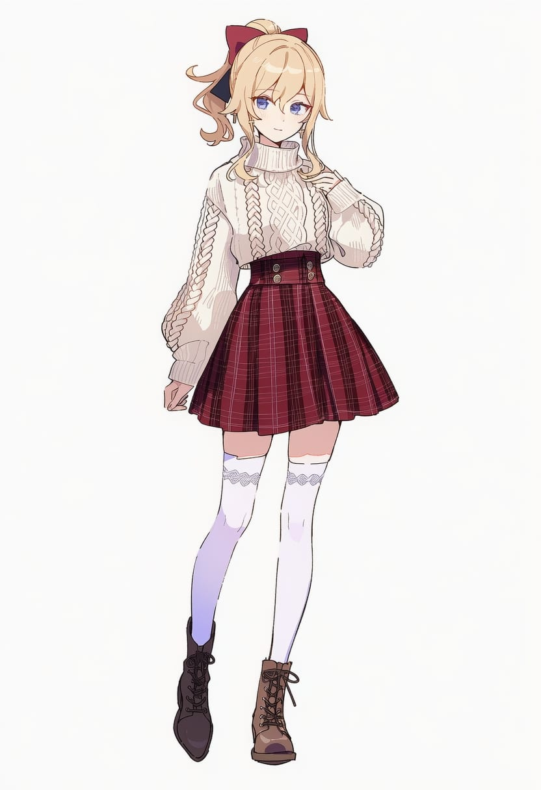

| 字段 | 内容 |
| --- | --- |
| 序号 | 5 |
| 风格主题 | 复古阿兰毛衣 |
| 搭配思路（中文描述） | 大红蝴蝶结与白色阿兰毛衣形成复古撞色，红色格纹高腰裙呼应；白色过膝袜+棕色短靴，针织围巾增添手作温暖感。 |
| 从头到脚Tag串（英文逗号分隔） | hair_bow, large hair_bow, red hair_bow, aran_sweater, white aran_sweater, cable knit, high-waist_skirt, plaid skirt, red plaid skirt, thighhighs, white thighhighs, boots, brown boots, scarf, knitted scarf |

## 6. 6 — 柔软连帽卫衣

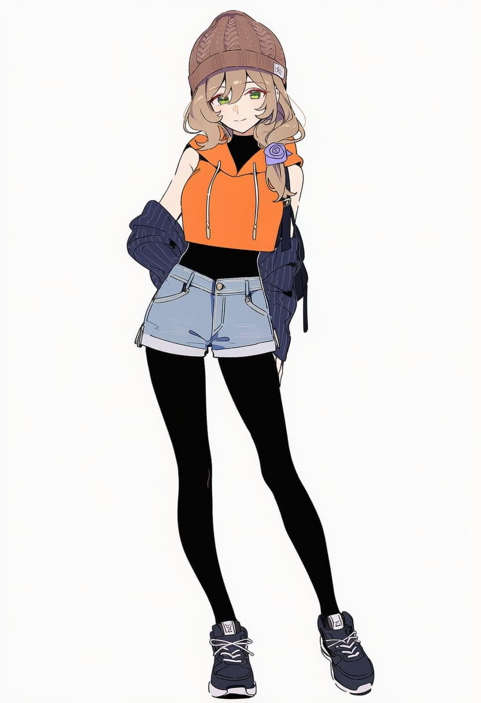

| 字段 | 内容 |
| --- | --- |
| 序号 | 6 |
| 风格主题 | 柔软连帽卫衣 |
| 搭配思路（中文描述） | 棕色护耳帽可爱，橙色短款连帽卫衣露出黑色高领，层次分明；蓝色牛仔短裤配黑丝，黑球鞋与双肩包保持轻便活力。 |
| 从头到脚Tag串（英文逗号分隔） | earflap_beanie, brown earflap_beanie, cropped_hoodie, orange cropped_hoodie, sleeveless_hoodie, turtleneck underneath, black turtleneck, denim_shorts, blue denim_shorts, black pantyhose, sneakers, black sneakers, backpack |

## 7. 7 — 学院马甲叠穿

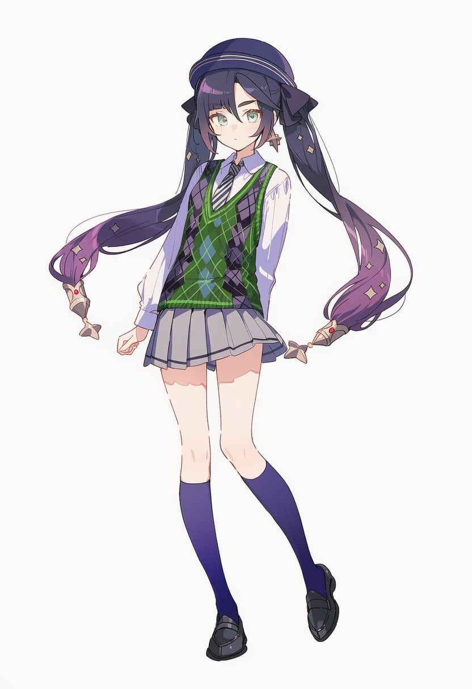

| 字段 | 内容 |
| --- | --- |
| 序号 | 7 |
| 风格主题 | 学院马甲叠穿 |
| 搭配思路（中文描述） | 海军蓝学生帽+绿菱格马甲经典学院叠穿，白衬衫长袖打底；灰色百褶裙+海军蓝过膝袜，黑乐福鞋与条纹领带完成正式感。 |
| 从头到脚Tag串（英文逗号分隔） | school_hat, navy school_hat, sweater_vest, argyle sweater_vest, green argyle, collared_shirt, white shirt, long sleeves, pleated_skirt, gray skirt, kneehighs, navy kneehighs, loafers, black loafers, necktie, striped necktie |

## 8. 8 — 宽松慵懒针织

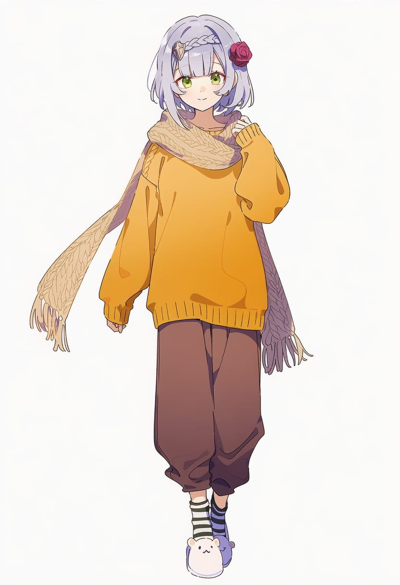

| 字段 | 内容 |
| --- | --- |
| 序号 | 8 |
| 风格主题 | 宽松慵懒针织 |
| 搭配思路（中文描述） | 金属发夹点缀，芥末黄oversize露肩毛衣慵懒；棕色宽松裤+条纹袜与室内拖鞋，长围巾随意包裹，强调居家秋日舒适感。 |
| 从头到脚Tag串（英文逗号分隔） | hairclip, metal hairclip, oversized sweater, mustard yellow sweater, off-shoulder_sweater, baggy_pants, brown baggy_pants, socks, striped socks, slippers, indoor slippers, scarf, long scarf, wrapped scarf |

## 9. 9 — 皮夹克机车

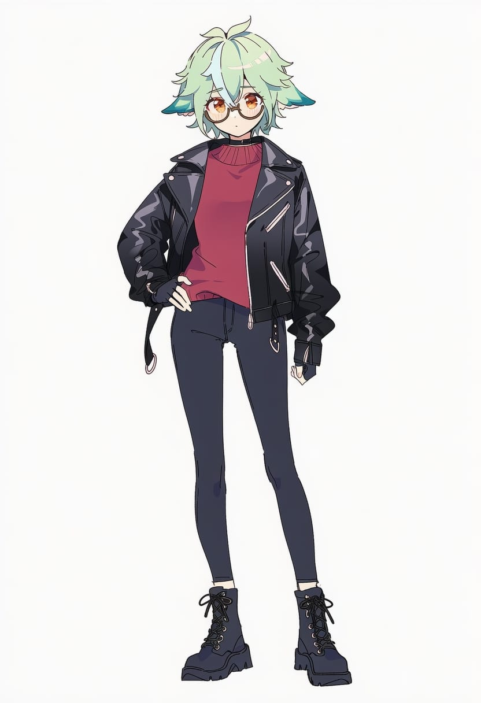

| 字段 | 内容 |
| --- | --- |
| 序号 | 9 |
| 风格主题 | 皮夹克机车 |
| 搭配思路（中文描述） | 黑色皮夹克敞开露出红色高领，形成强烈对比；黑色紧身牛仔裤+战斗靴硬朗，半指手套与项圈强化机车叛逆气质。 |
| 从头到脚Tag串（英文逗号分隔） | leather_jacket, black leather_jacket, open jacket, turtleneck_sweater, red turtleneck, skinny_jeans, black jeans, boots, combat boots, black boots, fingerless_gloves, black gloves, choker, black choker |

## 10. 10 — 毛边大衣甜美

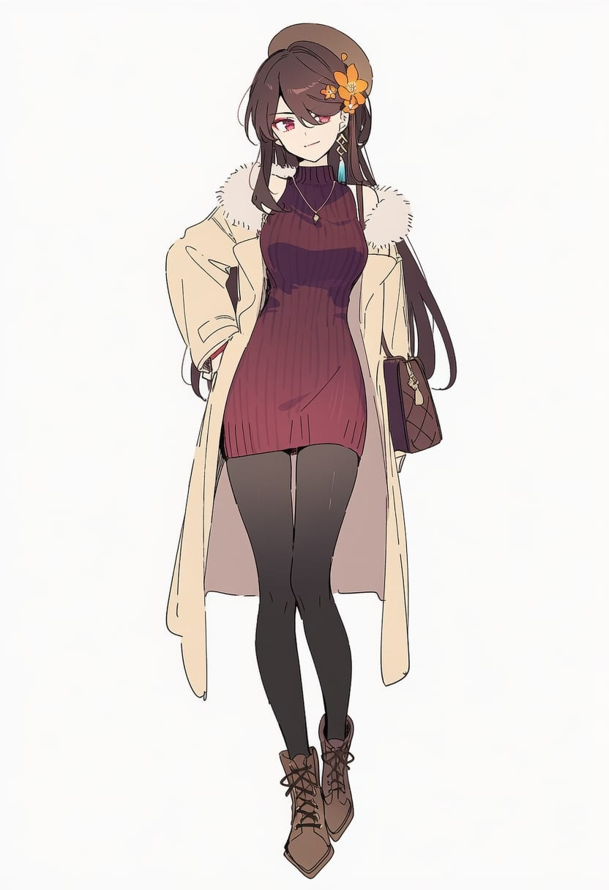

| 字段 | 内容 |
| --- | --- |
| 序号 | 10 |
| 风格主题 | 毛边大衣甜美 |
| 搭配思路（中文描述） | 棕色迷你礼帽+奶油色毛边大衣甜美，毛衣连衣裙保暖；黑丝+棕色踝靴，橙色发花与手提包呼应秋色。 |
| 从头到脚Tag串（英文逗号分隔） | mini_hat, brown mini_hat, fur-trimmed_coat, cream fur-trimmed_coat, long_coat, dress, sweater dress, brown dress, black tights, ankle_boots, brown boots, handbag, brown handbag, hair_flower, orange hair_flower |

## 11. 11 — 格子衬衫层叠

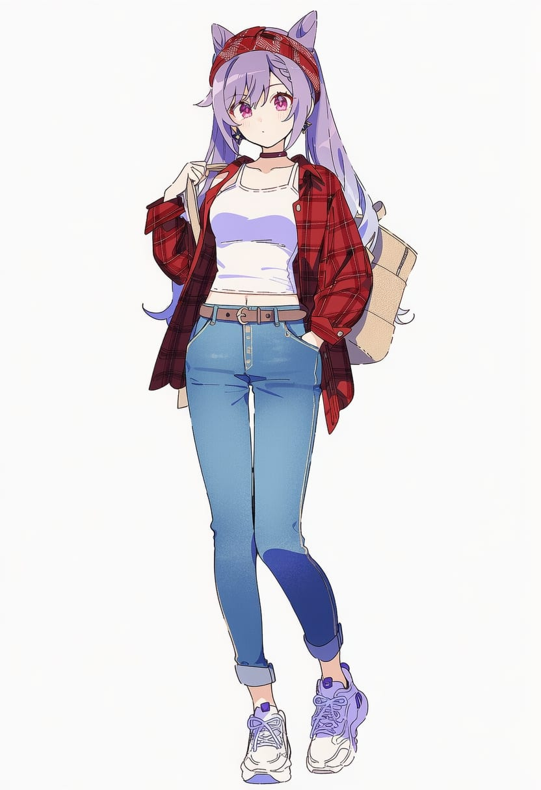

| 字段 | 内容 |
| --- | --- |
| 序号 | 11 |
| 风格主题 | 格子衬衫层叠 |
| 搭配思路（中文描述） | 格纹发带与红色法兰绒衬衫呼应，内搭白背心；蓝色牛仔裤+棕色皮带经典，白球鞋与帆布背包保持轻松日常感。 |
| 从头到脚Tag串（英文逗号分隔） | headband, plaid headband, flannel shirt, red plaid shirt, open shirt, tank_top, white tank_top, jeans, blue jeans, belt, brown belt, sneakers, white sneakers, backpack, canvas backpack |

## 12. 12 — 高领毛衣配裙

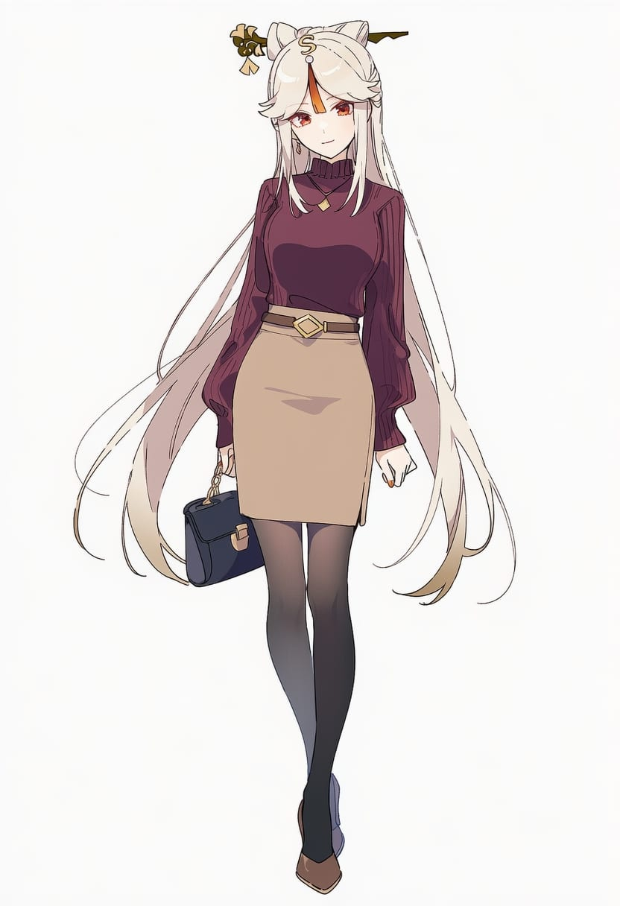

| 字段 | 内容 |
| --- | --- |
| 序号 | 12 |
| 风格主题 | 高领毛衣配裙 |
| 搭配思路（中文描述） | 多条棕色发带精致，酒红高领毛衣沉稳；棕色中长裙+黑丝，棕色高跟鞋与精致耳环、手包提升优雅度。 |
| 从头到脚Tag串（英文逗号分隔） | hair_ribbon, multiple hair_ribbons, brown ribbons, turtleneck_sweater, burgundy turtleneck, long sleeves, midi skirt, brown midi skirt, black pantyhose, heels, brown heels, earrings, small earrings, clutch |

## 13. 13 — 运动休闲秋装

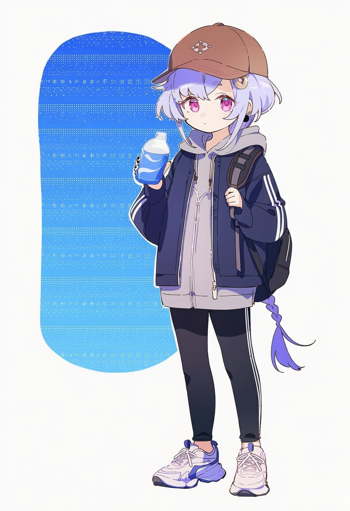

| 字段 | 内容 |
| --- | --- |
| 序号 | 13 |
| 风格主题 | 运动休闲秋装 |
| 搭配思路（中文描述） | 棕色棒球帽运动风，海军蓝运动夹克内搭灰卫衣；黑色运动裤+白球鞋，运动包与水瓶强化功能性秋日穿搭。 |
| 从头到脚Tag串（英文逗号分隔） | baseball_cap, brown baseball_cap, track_jacket, navy track_jacket, zip-up, hoodie underneath, gray hoodie, sweatpants, black sweatpants, sneakers, white sneakers, sports bag, water bottle |

## 14. 14 — 日式羽织秋意

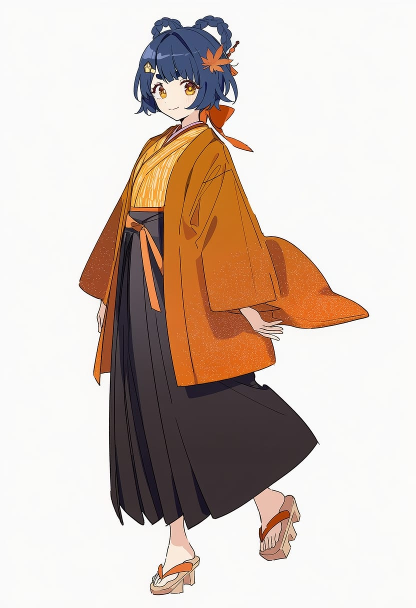

| 字段 | 内容 |
| --- | --- |
| 序号 | 14 |
| 风格主题 | 日式羽织秋意 |
| 搭配思路（中文描述） | 枫叶发饰点题，棕色羽织外搭秋色和服；深色袴裤+木屐，橙色腰带与发簪保留日式秋意仪式感。 |
| 从头到脚Tag串（英文逗号分隔） | hair_ornament, leaf hair_ornament, haori, brown haori, open haori, kimono, autumn kimono, orange patterned, hakama_pants, dark hakama, geta, wooden geta, sash, orange sash, hair_stick |

## 15. 15 — 短款夹克活力

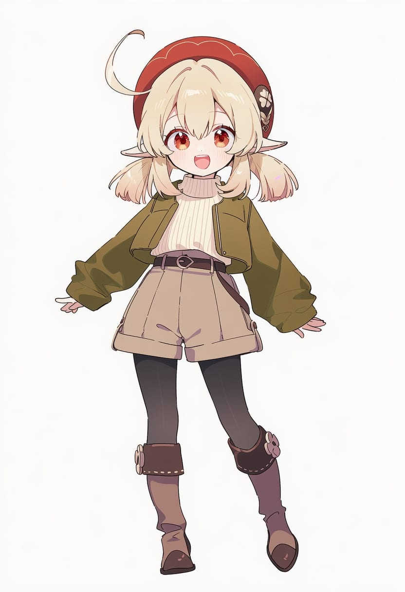

| 字段 | 内容 |
| --- | --- |
| 序号 | 15 |
| 风格主题 | 短款夹克活力 |
| 搭配思路（中文描述） | 红色贝雷帽活泼，橄榄绿短夹克+奶油高领层叠；棕色高腰短裤+黑丝，及膝靴与短围巾保持轻快比例。 |
| 从头到脚Tag串（英文逗号分隔） | beret, red beret, cropped_jacket, olive cropped_jacket, turtleneck, cream turtleneck, high-waist_shorts, brown shorts, black tights, boots, knee boots, brown boots, scarf, short scarf |

## 16. 16 — 长风衣都市

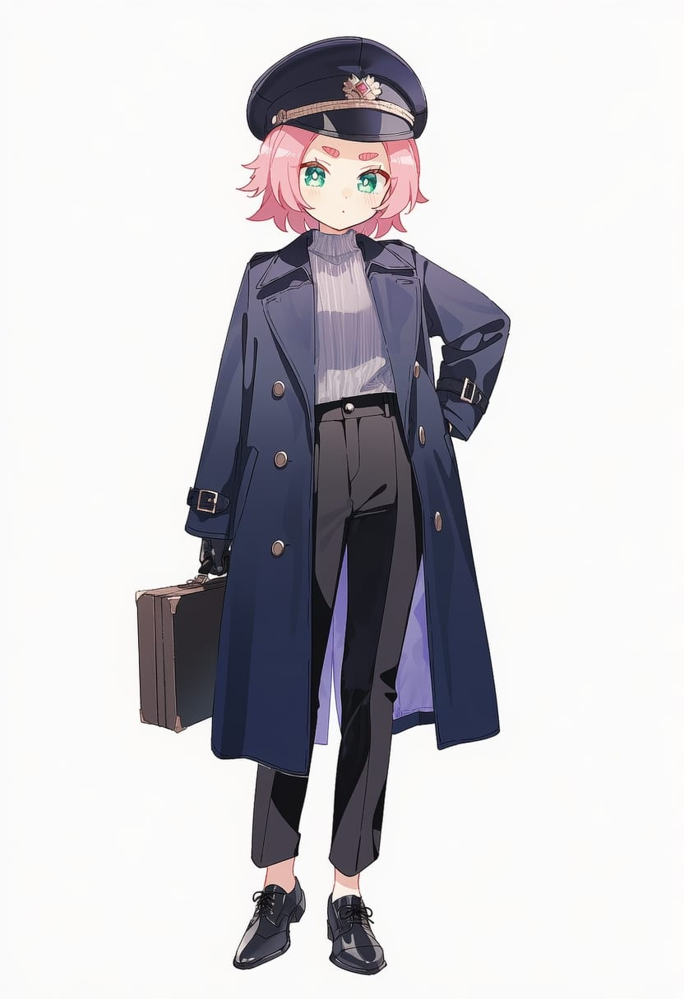

| 字段 | 内容 |
| --- | --- |
| 序号 | 16 |
| 风格主题 | 长风衣都市 |
| 搭配思路（中文描述） | 黑色尖顶帽利落，海军蓝长风衣正式；灰色毛衣+黑色西裤，牛津鞋与皮革手套、公文包塑造都市干练形象。 |
| 从头到脚Tag串（英文逗号分隔） | peaked_cap, black peaked_cap, long_coat, navy long_coat, buttoned coat, sweater, gray sweater, trousers, black trousers, oxfords, black oxfords, gloves, leather gloves, briefcase |

## 17. 17 — 蓬松针织裙

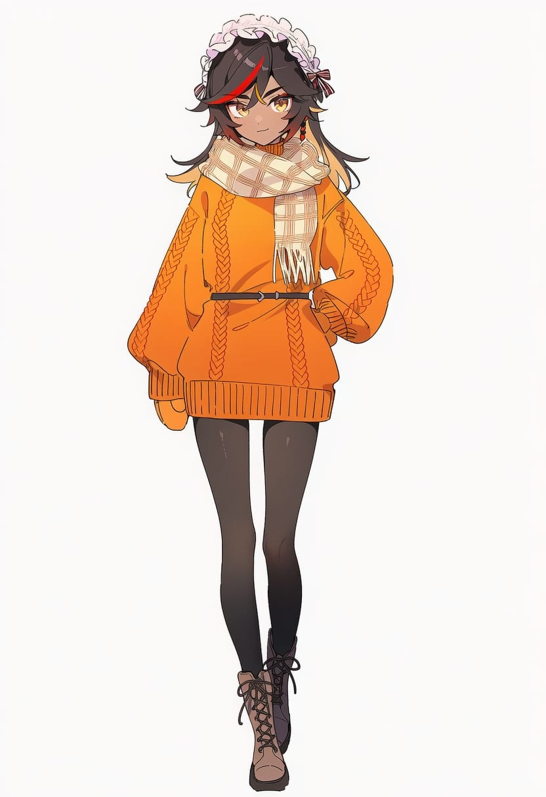

| 字段 | 内容 |
| --- | --- |
| 序号 | 17 |
| 风格主题 | 蓬松针织裙 |
| 搭配思路（中文描述） | 荷叶边发带甜美，橙色针织连衣裙保暖；细腰带收腰，黑丝+棕色及膝靴，格纹围巾与橙色手套呼应色调。 |
| 从头到脚Tag串（英文逗号分隔） | hairband, frilled hairband, white hairband, sweater_dress, orange sweater_dress, long sleeves, belt, thin belt, black tights, boots, brown knee-high boots, scarf, plaid scarf, mittens, orange mittens |

## 18. 18 — 牛仔外套经典

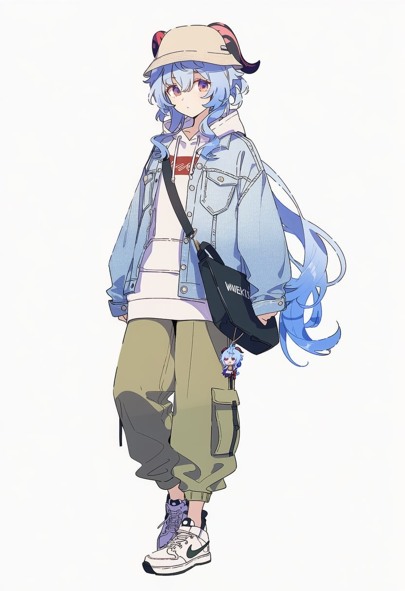

| 字段 | 内容 |
| --- | --- |
| 序号 | 18 |
| 风格主题 | 牛仔外套经典 |
| 搭配思路（中文描述） | 米色渔夫帽休闲，浅蓝牛仔外套经典；白卫衣+橄榄绿工装裤，高帮球鞋与钥匙扣斜挎包增加街头细节。 |
| 从头到脚Tag串（英文逗号分隔） | bucket_hat, beige bucket_hat, denim_jacket, light blue denim_jacket, open jacket, hoodie, white hoodie, cargo_pants, olive cargo_pants, sneakers, high-top sneakers, crossbody bag, keychain |

## 19. 19 — 毛呢大衣正式

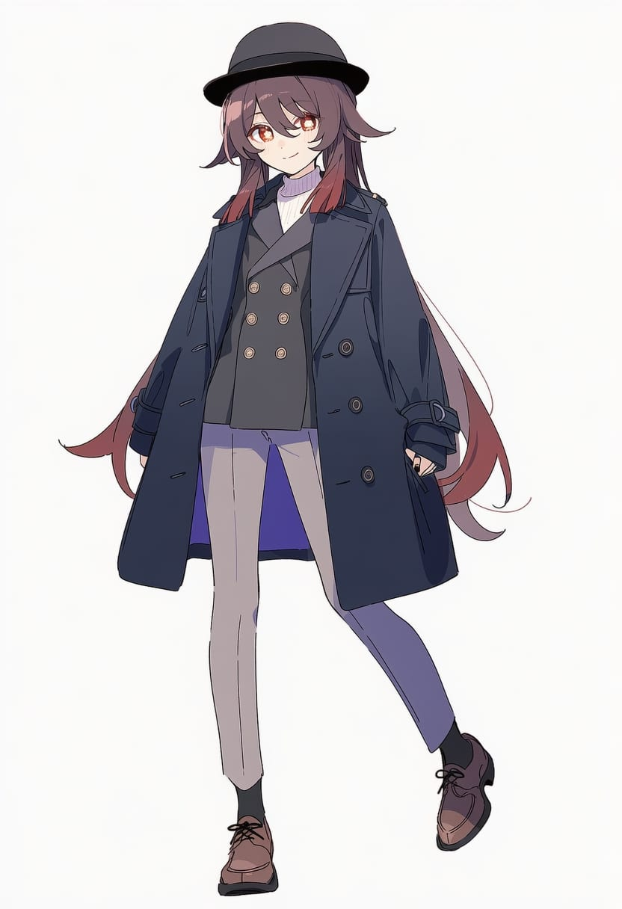

| 字段 | 内容 |
| --- | --- |
| 序号 | 19 |
| 风格主题 | 毛呢大衣正式 |
| 搭配思路（中文描述） | 黑色圆顶礼帽正式，海军蓝双排扣大衣经典；白高领+灰色西裤，棕色乐福鞋与纯色围巾、手表完成商务秋装。 |
| 从头到脚Tag串（英文逗号分隔） | bowler_hat, black bowler_hat, peacoat, navy peacoat, double-breasted, turtleneck, white turtleneck, suit_pants, gray pants, loafers, brown loafers, scarf, solid scarf, watch |

## 20. 20 — 条纹毛衣青春

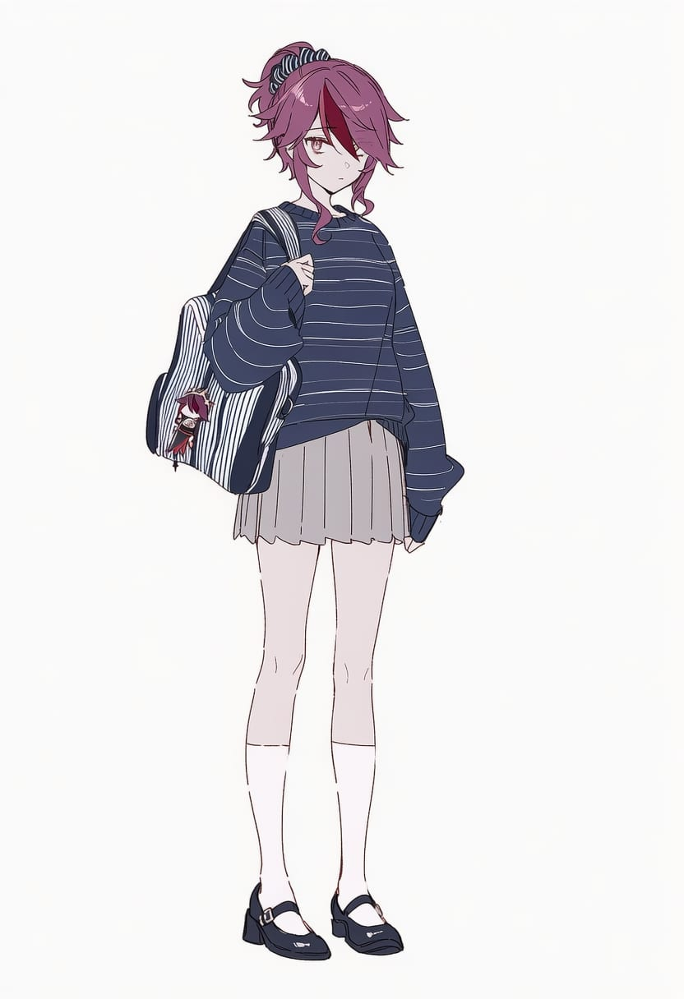

| 字段 | 内容 |
| --- | --- |
| 序号 | 20 |
| 风格主题 | 条纹毛衣青春 |
| 搭配思路（中文描述） | 条纹大肠发饰青春，海军蓝条纹毛衣活力；灰色百褶裙+白过膝袜，黑色玛丽珍与条纹肩包保持少女感。 |
| 从头到脚Tag串（英文逗号分隔） | hair_scrunchie, striped scrunchie, striped_sweater, navy striped sweater, long sleeves, pleated_skirt, gray pleated skirt, kneehighs, white kneehighs, mary_janes, black mary_janes, shoulder bag, striped bag |

## 21. 21 — 开衫叠衬衫

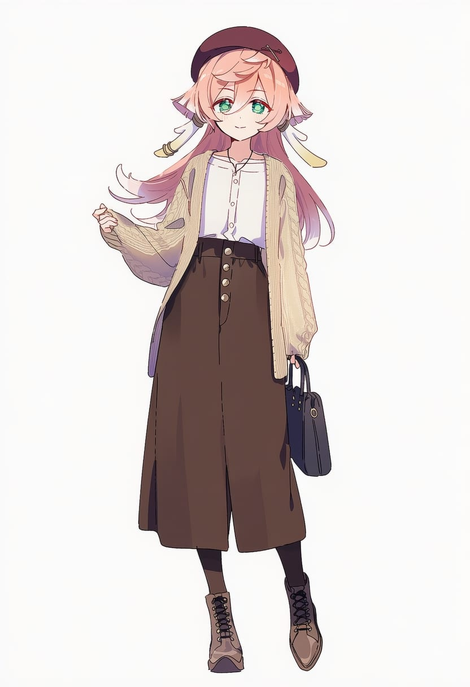

| 字段 | 内容 |
| --- | --- |
| 序号 | 21 |
| 风格主题 | 开衫叠衬衫 |
| 搭配思路（中文描述） | 棕色头巾文艺，米色长开衫轻搭白衬衫；棕色高腰裤+麂皮踝靴，简约项链与托特包强调温柔知性。 |
| 从头到脚Tag串（英文逗号分隔） | headscarf, brown headscarf, cardigan, long cardigan, beige cardigan, buttoned, blouse, white blouse, high-waist_pants, brown pants, ankle_boots, suede boots, necklace, simple necklace, tote bag |

## 22. 22 — 军装夹克飒爽

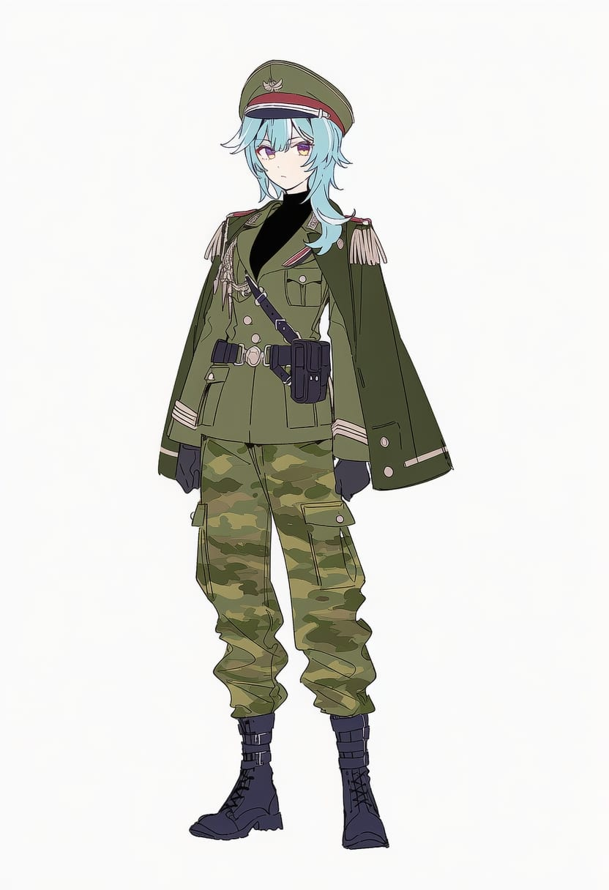

| 字段 | 内容 |
| --- | --- |
| 序号 | 22 |
| 风格主题 | 军装夹克飒爽 |
| 搭配思路（中文描述） | 绿色军帽+橄榄绿军装夹克飒爽，黑色高领打底；迷彩工装裤+战斗靴，实用腰带与手套强化机能感。 |
| 从头到脚Tag串（英文逗号分隔） | military_hat, green military_hat, military_jacket, olive military_jacket, epaulettes, turtleneck, black turtleneck, cargo_pants, camouflage pants, combat boots, black boots, belt, utility belt, gloves |

## 23. 23 — 软呢礼帽文艺

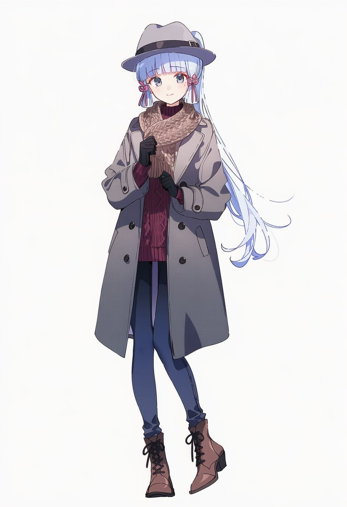

| 字段 | 内容 |
| --- | --- |
| 序号 | 23 |
| 风格主题 | 软呢礼帽文艺 |
| 搭配思路（中文描述） | 灰色软呢帽文艺，炭灰羊毛大衣敞开；酒红毛衣+深色牛仔裤，切尔西靴与针织围巾、手套营造秋日文艺氛围。 |
| 从头到脚Tag串（英文逗号分隔） | fedora, gray fedora, wool coat, charcoal wool coat, open coat, sweater, burgundy sweater, jeans, dark jeans, boots, chelsea boots, brown boots, scarf, knitted scarf, gloves |

## 24. 24 — 荷叶边甜美秋

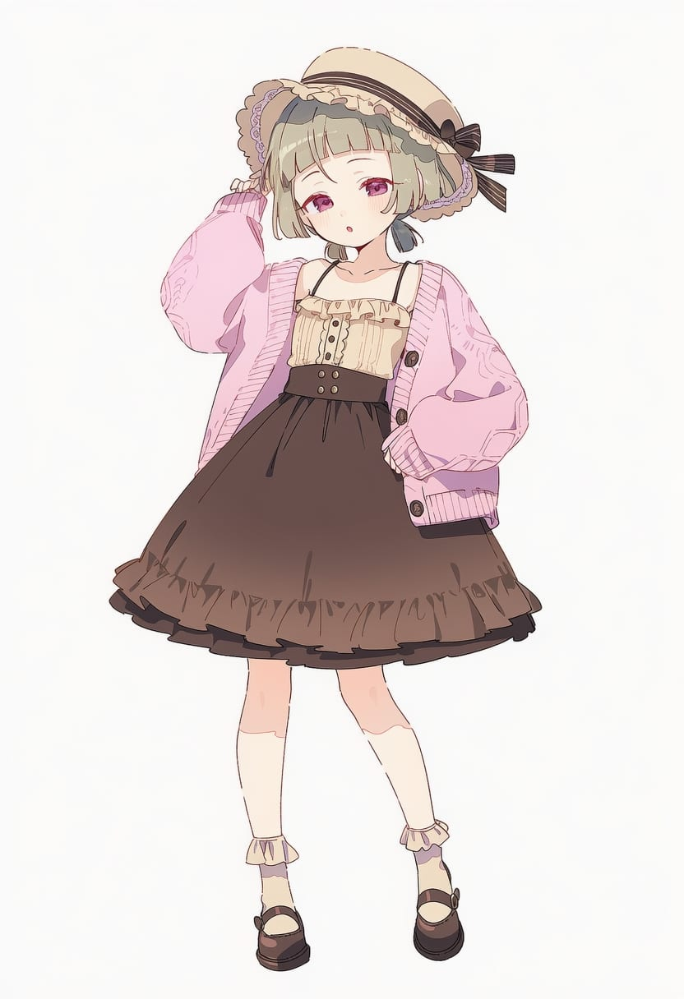

| 字段 | 内容 |
| --- | --- |
| 序号 | 24 |
| 风格主题 | 荷叶边甜美秋 |
| 搭配思路（中文描述） | 米色荷叶边帽甜美，奶油荷叶边吊带+粉色开衫；棕色喇叭裙+荷叶边袜，棕色玛丽珍与蝴蝶结发饰强化软萌感。 |
| 从头到脚Tag串（英文逗号分隔） | frilled_hat, beige frilled_hat, frilled_camisole, cream frilled top, cardigan, pink cardigan, open cardigan, skirt, flared skirt, brown skirt, socks, frilled socks, Mary Janes, brown shoes, hair_bow |

## 25. 25 — 羽绒服休闲

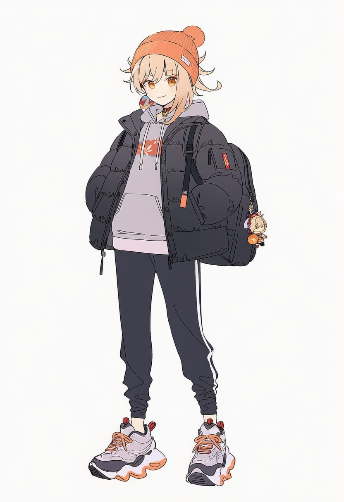

| 字段 | 内容 |
| --- | --- |
| 序号 | 25 |
| 风格主题 | 羽绒服休闲 |
| 搭配思路（中文描述） | 橙色毛球帽可爱，黑色羽绒服实用；灰卫衣+黑色慢跑裤，厚底球鞋与双肩包、水瓶适合日常活动。 |
| 从头到脚Tag串（英文逗号分隔） | beanie, pom-pom beanie, orange beanie, down_jacket, black down_jacket, puffer, hoodie underneath, gray hoodie, joggers, black joggers, sneakers, chunky sneakers, backpack, water bottle |

## 26. 26 — 披肩优雅

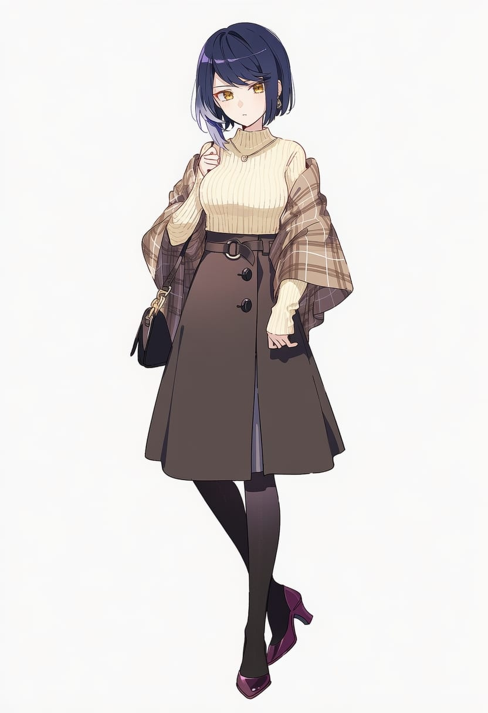

| 字段 | 内容 |
| --- | --- |
| 序号 | 26 |
| 风格主题 | 披肩优雅 |
| 搭配思路（中文描述） | 棕色格纹披肩优雅，奶油毛衣保暖；橄榄绿高腰中长裙+黑丝，低跟鞋与皮手袋、耳环提升成熟气质。 |
| 从头到脚Tag串（英文逗号分隔） | shawl, plaid shawl, brown plaid, sweater, cream sweater, long sleeves, high-waist_skirt, midi skirt, olive skirt, black tights, heels, low heels, handbag, leather handbag, earrings |

## 27. 27 — 棒球夹克运动

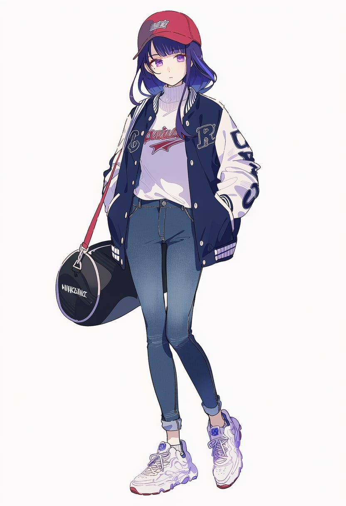

| 字段 | 内容 |
| --- | --- |
| 序号 | 27 |
| 风格主题 | 棒球夹克运动 |
| 搭配思路（中文描述） | 红色棒球帽活力，海军蓝棒球夹克经典；白高领+蓝牛仔裤，白球鞋露出袜口，旅行袋增加运动感。 |
| 从头到脚Tag串（英文逗号分隔） | baseball_cap, red baseball_cap, letterman_jacket, navy letterman_jacket, varsity, turtleneck, white turtleneck, jeans, blue jeans, sneakers, white sneakers, socks, visible socks, duffel bag |

## 28. 28 — 灯笼裤异域

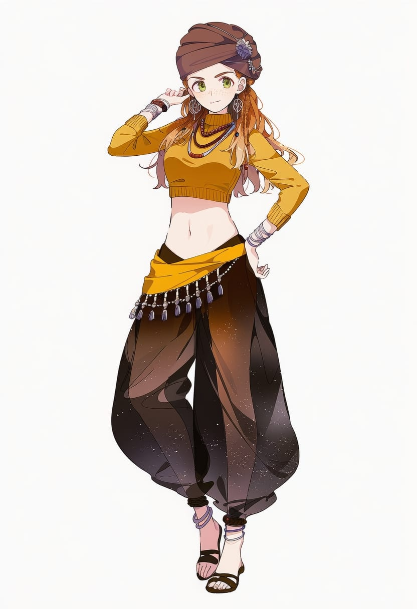

| 字段 | 内容 |
| --- | --- |
| 序号 | 28 |
| 风格主题 | 灯笼裤异域 |
| 搭配思路（中文描述） | 棕色软头巾异域，芥末黄短毛衣+图案灯笼裤；平底凉鞋与脚链、手链、大耳环营造秋日异域风情。 |
| 从头到脚Tag串（英文逗号分隔） | turban, soft turban, brown turban, cropped_sweater, mustard cropped sweater, harem_pants, patterned harem pants, orange tones, sandals, flat sandals, anklet, bracelet, earrings, large earrings |

## 29. 29 — 破洞牛仔街头

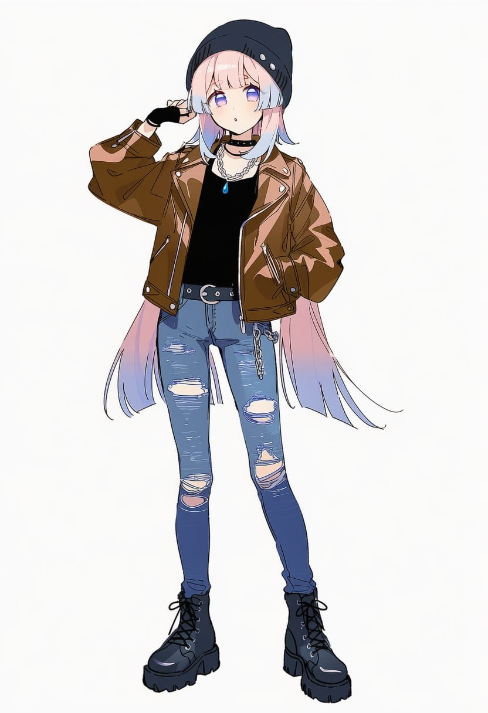

| 字段 | 内容 |
| --- | --- |
| 序号 | 29 |
| 风格主题 | 破洞牛仔街头 |
| 搭配思路（中文描述） | 黑色毛线帽街头，棕色皮夹克敞开露出黑背心；破洞蓝牛仔裤+战斗靴，项圈与链条、半指手套强化叛逆感。 |
| 从头到脚Tag串（英文逗号分隔） | beanie, black beanie, leather_jacket, brown leather_jacket, open jacket, tank_top, black tank_top, torn_jeans, blue torn jeans, boots, combat boots, black boots, choker, chain necklace, fingerless gloves |

## 30. 30 — 圣诞毛衣预热

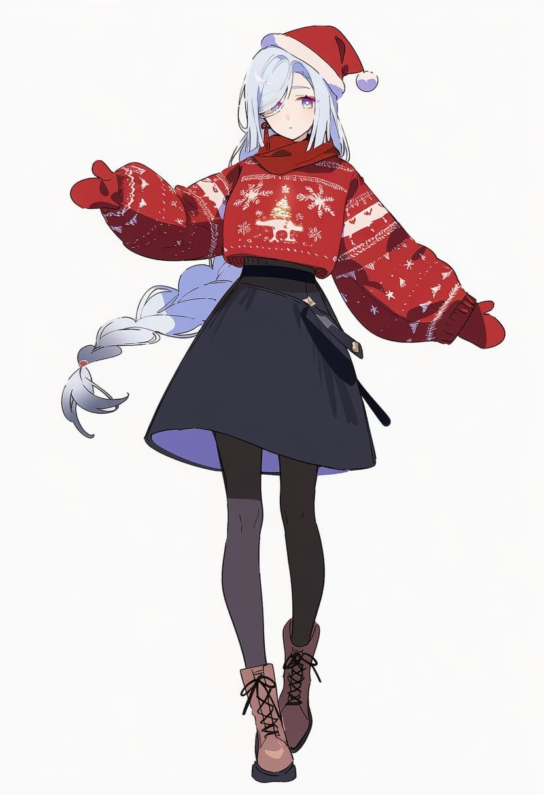

| 字段 | 内容 |
| --- | --- |
| 序号 | 30 |
| 风格主题 | 圣诞毛衣预热 |
| 搭配思路（中文描述） | 迷你圣诞帽预热节日，红色驯鹿图案毛衣欢乐；黑色高腰裙+黑丝，棕色短靴与红围巾、红手套提前营造圣诞氛围。 |
| 从头到脚Tag串（英文逗号分隔） | mini_santa_hat, red mini santa hat, christmas_sweater, red christmas sweater, print sweater, reindeer print, high-waist_skirt, black skirt, black tights, boots, brown boots, scarf, red scarf, mittens, red mittens |

## 31. 31 — 灯芯绒复古

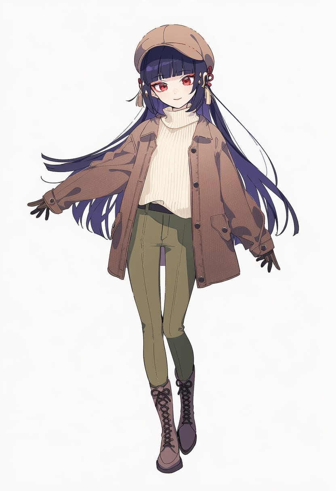

| 字段 | 内容 |
| --- | --- |
| 序号 | 31 |
| 风格主题 | 灯芯绒复古 |
| 搭配思路（中文描述） | 棕色报童帽复古，棕色灯芯绒夹克+奶油高领；橄榄绿灯芯绒裤+系带靴，纯色围巾与手套完成复古秋装。 |
| 从头到脚Tag串（英文逗号分隔） | news boy_cap, brown newsboy_cap, corduroy jacket, brown corduroy jacket, open jacket, turtleneck, cream turtleneck, corduroy pants, olive pants, boots, lace-up boots, brown boots, scarf, solid brown scarf, gloves |

## 32. 32 — 高领叠穿学院

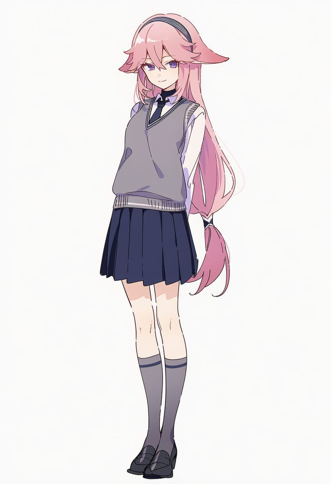

| 字段 | 内容 |
| --- | --- |
| 序号 | 32 |
| 风格主题 | 高领叠穿学院 |
| 搭配思路（中文描述） | 条纹发带学院，炭灰高领+灰色马甲叠穿；海军蓝百褶裙+灰过膝袜，黑乐福鞋与纯色领带正式感十足。 |
| 从头到脚Tag串（英文逗号分隔） | hairband, striped hairband, navy hairband, turtleneck_sweater, charcoal turtleneck, sweater_vest, gray sweater_vest, pleated_skirt, navy pleated skirt, kneehighs, gray kneehighs, loafers, black loafers, necktie, solid necktie |

## 33. 33 — 斗篷式披肩

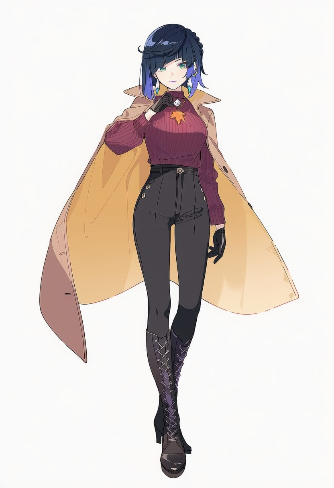

| 字段 | 内容 |
| --- | --- |
| 序号 | 33 |
| 风格主题 | 斗篷式披肩 |
| 搭配思路（中文描述） | 棕色连帽斗篷神秘，酒红毛衣内搭；黑色高腰裤+及膝靴，皮手套与秋叶胸针增加故事感。 |
| 从头到脚Tag串（英文逗号分隔） | hooded cape, brown hooded cape, cape, long cape, sweater, burgundy sweater, high-waist_pants, black pants, boots, knee-high boots, gloves, leather gloves, brooch, autumn leaf brooch |

## 34. 34 — 法兰绒衬衫牛仔

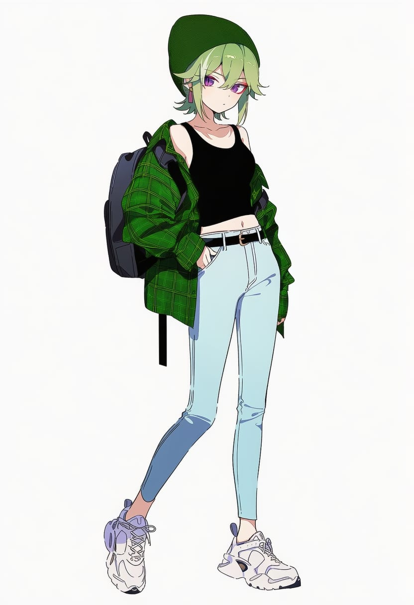

| 字段 | 内容 |
| --- | --- |
| 序号 | 34 |
| 风格主题 | 法兰绒衬衫牛仔 |
| 搭配思路（中文描述） | 森林绿毛线帽，绿色格纹法兰绒衬衫敞开；黑背心+浅蓝牛仔裤，黑皮带与白球鞋、皮背包保持休闲。 |
| 从头到脚Tag串（英文逗号分隔） | beanie, forest green beanie, flannel shirt, green plaid flannel, open shirt, tank_top, black tank_top, jeans, light blue jeans, belt, black belt, sneakers, white sneakers, backpack, leather backpack |

## 35. 35 — 羊羔毛外套软萌

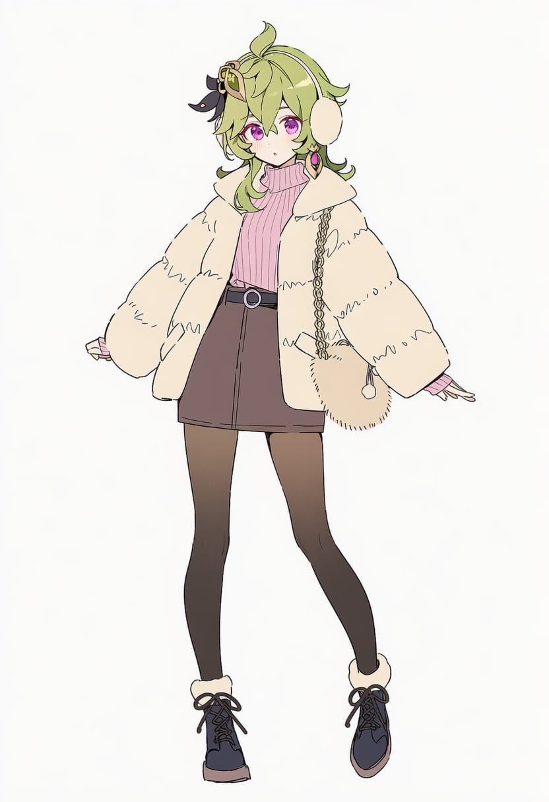

| 字段 | 内容 |
| --- | --- |
| 序号 | 35 |
| 风格主题 | 羊羔毛外套软萌 |
| 搭配思路（中文描述） | 棕色耳罩软萌，奶油羊羔毛外套敞开；粉色高领+棕色A字裙，黑丝+踝靴，毛茸茸手袋强化可爱感。 |
| 从头到脚Tag串（英文逗号分隔） | earmuffs, brown earmuffs, shearling jacket, cream shearling jacket, open jacket, turtleneck, pink turtleneck, skirt, A-line skirt, brown skirt, tights, black tights, boots, ankle boots, handbag, fuzzy handbag |

## 36. 36 — 西装外套知性

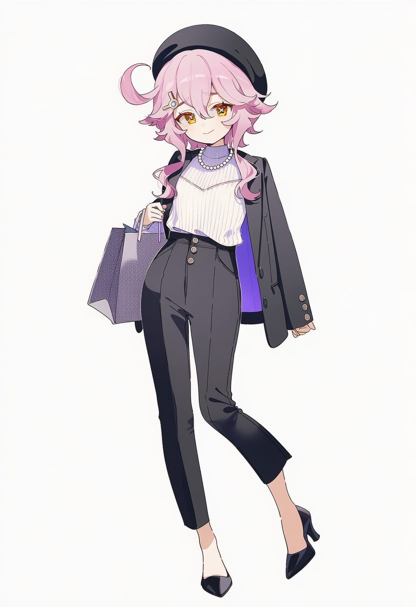

| 字段 | 内容 |
| --- | --- |
| 序号 | 36 |
| 风格主题 | 西装外套知性 |
| 搭配思路（中文描述） | 黑色贝雷帽知性，炭灰西装外套敞开；白衬衫+黑色高腰西裤，低跟方跟鞋与珍珠项链、结构托特包干练优雅。 |
| 从头到脚Tag串（英文逗号分隔） | beret, black beret, blazer, charcoal blazer, open blazer, blouse, white blouse, high-waist_pants, tailored pants, black pants, heels, low block heels, necklace, pearl necklace, tote bag, structured tote |

## 37. 37 — 针织开衫长裙

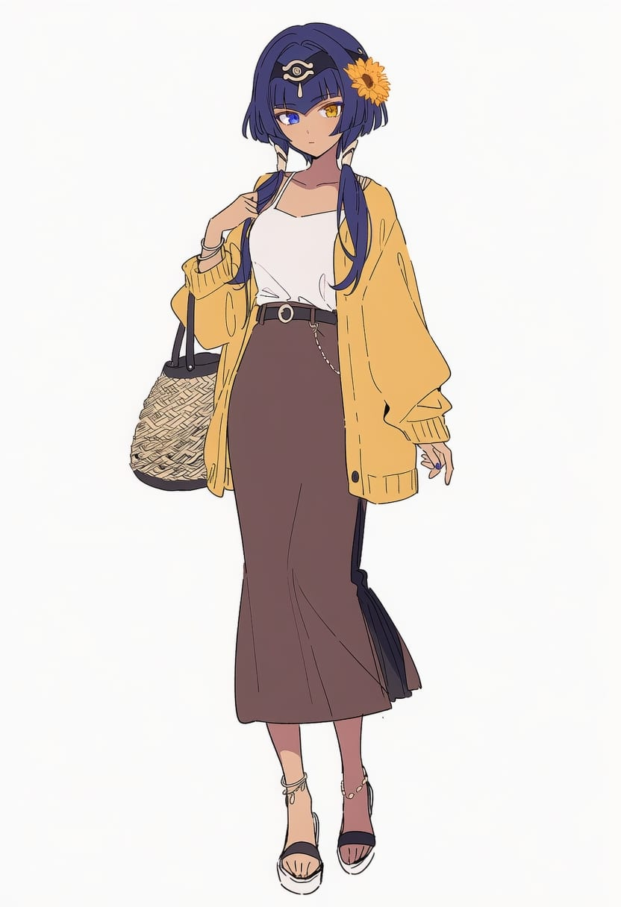

| 字段 | 内容 |
| --- | --- |
| 序号 | 37 |
| 风格主题 | 针织开衫长裙 |
| 搭配思路（中文描述） | 橙色发花点缀，芥末黄长开衫轻搭白吊带；棕色长裙+平底凉鞋，脚链手链与编织包营造自然秋日感。 |
| 从头到脚Tag串（英文逗号分隔） | hair_flower, orange hair_flower, long cardigan, mustard long cardigan, open cardigan, camisole, white camisole, maxi skirt, brown maxi skirt, sandals, flat sandals, anklet, bracelet, woven bag |

## 38. 38 — 工装裤机能

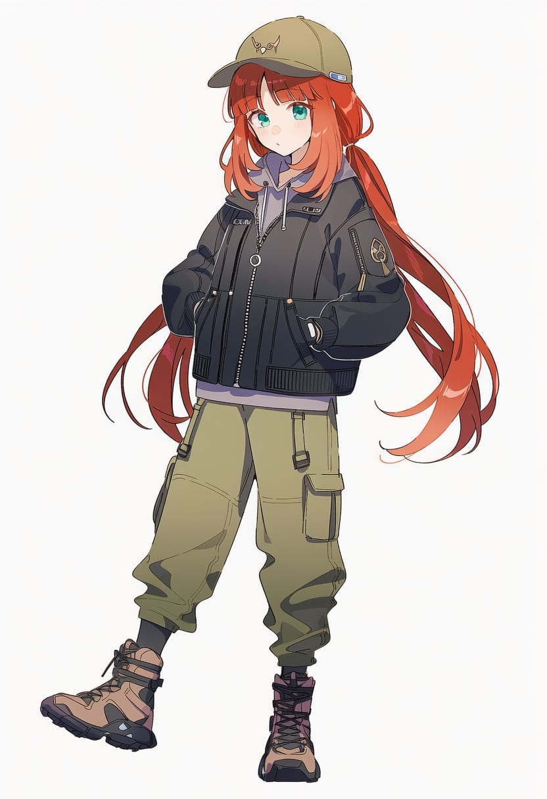

| 字段 | 内容 |
| --- | --- |
| 序号 | 38 |
| 风格主题 | 工装裤机能 |
| 搭配思路（中文描述） | 橄榄绿棒球帽机能，黑色飞行员夹克内搭灰卫衣；多口袋橄榄绿工装裤+徒步靴，实用腰带与半指手套强化机能。 |
| 从头到脚Tag串（英文逗号分隔） | baseball_cap, olive baseball_cap, bomber_jacket, black bomber_jacket, zip-up, hoodie underneath, gray hoodie, cargo_pants, multi-pocket cargo pants, olive pants, boots, hiking boots, utility belt, gloves, fingerless gloves |

## 39. 39 — 毛呢短裙学院

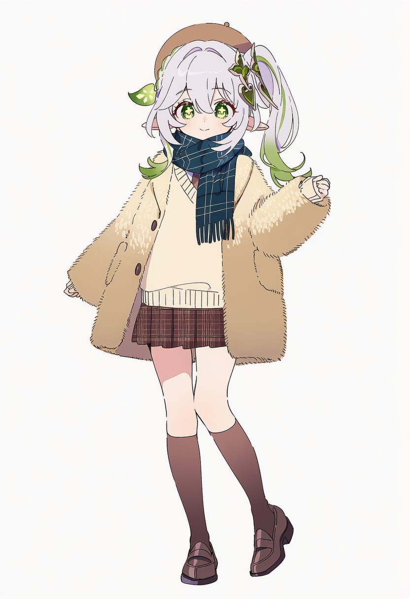

| 字段 | 内容 |
| --- | --- |
| 序号 | 39 |
| 风格主题 | 毛呢短裙学院 |
| 搭配思路（中文描述） | 棕色学生帽学院，驼色羊毛大衣敞开；奶油毛衣+格纹百褶裙，棕色过膝袜与乐福鞋、格纹围巾经典。 |
| 从头到脚Tag串（英文逗号分隔） | school_hat, brown school_hat, wool coat, camel wool coat, open coat, sweater, cream sweater, pleated_skirt, plaid pleated skirt, kneehighs, brown kneehighs, loafers, brown loafers, scarf, plaid scarf |

## 40. 40 — 丝绒秋意优雅

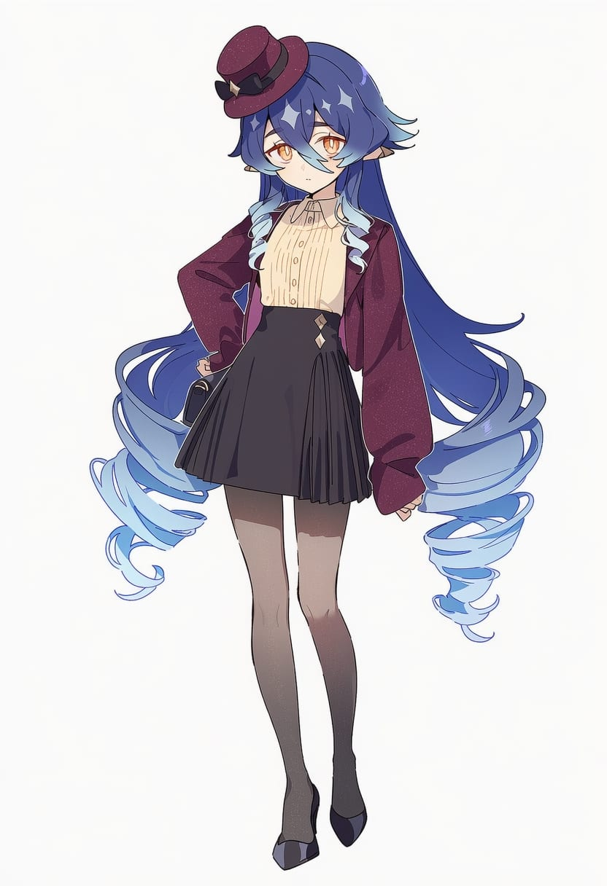

| 字段 | 内容 |
| --- | --- |
| 序号 | 40 |
| 风格主题 | 丝绒秋意优雅 |
| 搭配思路（中文描述） | 小礼帽精致，酒红丝绒外套敞开；奶油衬衫+黑色丝绒高腰裙，薄丝袜+黑色高跟鞋，丝绒手包与耳环华丽。 |
| 从头到脚Tag串（英文逗号分隔） | fascinator, small fascinator, velvet jacket, burgundy velvet jacket, open jacket, blouse, cream blouse, high-waist_skirt, velvet skirt, black skirt, tights, sheer tights, heels, black heels, clutch, velvet clutch |

## 41. 41 — 连帽斗篷神秘

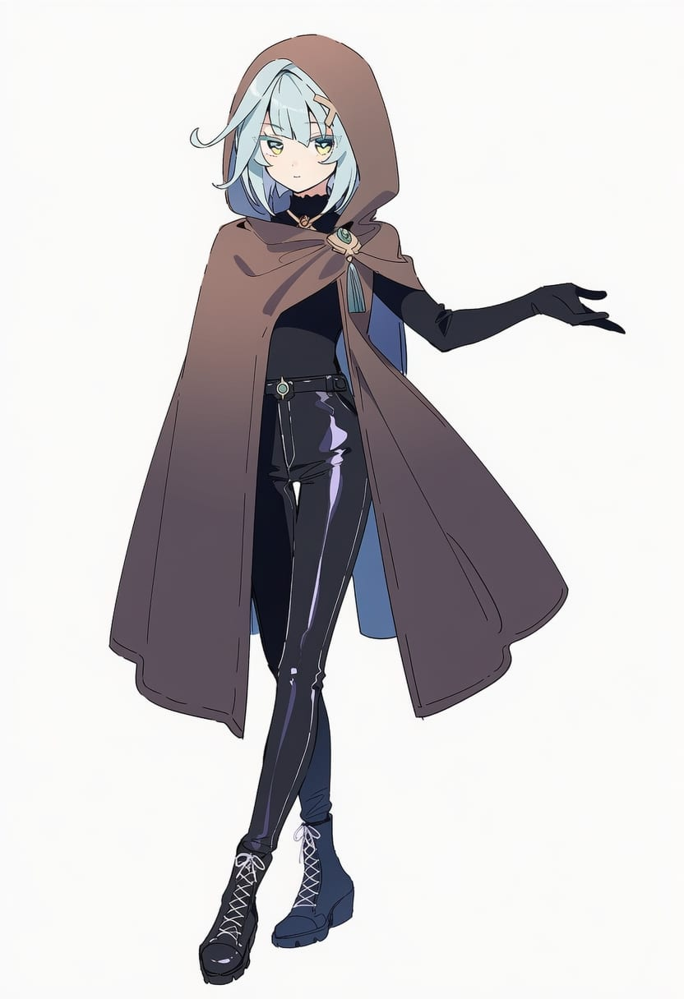

| 字段 | 内容 |
| --- | --- |
| 序号 | 41 |
| 风格主题 | 连帽斗篷神秘 |
| 搭配思路（中文描述） | 棕色兜帽神秘，深色长斗篷；黑色高领+紧身裤，高筒靴与长手套、金属胸针营造暗黑秋意。 |
| 从头到脚Tag串（英文逗号分隔） | hood, brown hood, cloak, long cloak, dark cloak, turtleneck underneath, black turtleneck, pants, tight pants, black pants, boots, tall boots, gloves, long gloves, brooch, metal brooch |

## 42. 42 — 格子百褶裙经典

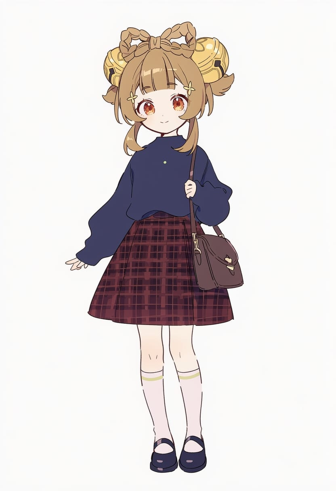

| 字段 | 内容 |
| --- | --- |
| 序号 | 42 |
| 风格主题 | 格子百褶裙经典 |
| 搭配思路（中文描述） | 红色发带经典，海军蓝毛衣+红色格纹百褶裙；白过膝袜+黑色玛丽珍，皮肩包与发夹保持学院少女感。 |
| 从头到脚Tag串（英文逗号分隔） | hair_ribbon, red hair_ribbon, sweater, navy sweater, long sleeves, plaid_skirt, red plaid skirt, high-waist, kneehighs, white kneehighs, mary_janes, black mary_janes, shoulder bag, leather bag, hairclip |

## 43. 43 — 短款羽绒服轻便

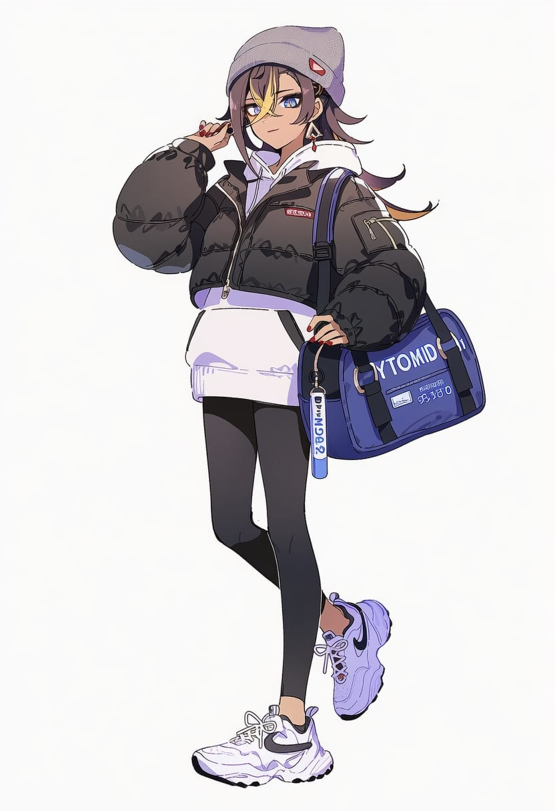

| 字段 | 内容 |
| --- | --- |
| 序号 | 43 |
| 风格主题 | 短款羽绒服轻便 |
| 搭配思路（中文描述） | 灰色毛线帽轻便，黑色短款羽绒服；白卫衣+黑打底裤，跑鞋与斜挎包、水瓶适合轻户外。 |
| 从头到脚Tag串（英文逗号分隔） | beanie, gray beanie, cropped down jacket, black cropped puffer, zip-up, hoodie underneath, white hoodie, leggings, black leggings, sneakers, running sneakers, crossbody bag, water bottle |

## 44. 44 — 亚麻风衣自然

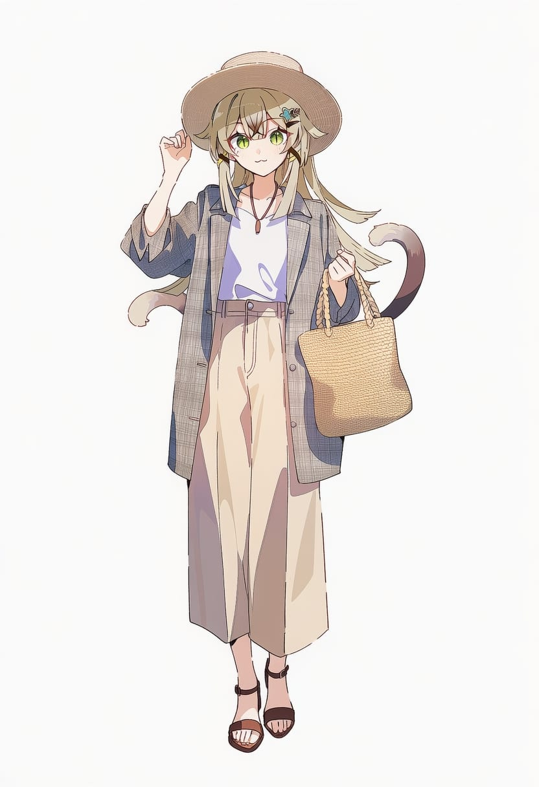

| 字段 | 内容 |
| --- | --- |
| 序号 | 44 |
| 风格主题 | 亚麻风衣自然 |
| 搭配思路（中文描述） | 米色草帽自然，亚麻风衣敞开；白衬衫+米色阔腿裤，皮凉鞋与编织托特、木项链强调自然质感。 |
| 从头到脚Tag串（英文逗号分隔） | straw_hat, beige straw hat, linen coat, natural linen coat, open coat, blouse, white blouse, wide-leg pants, beige pants, sandals, leather sandals, tote bag, woven tote, necklace, wooden necklace |

## 45. 45 — 针织背心叠穿

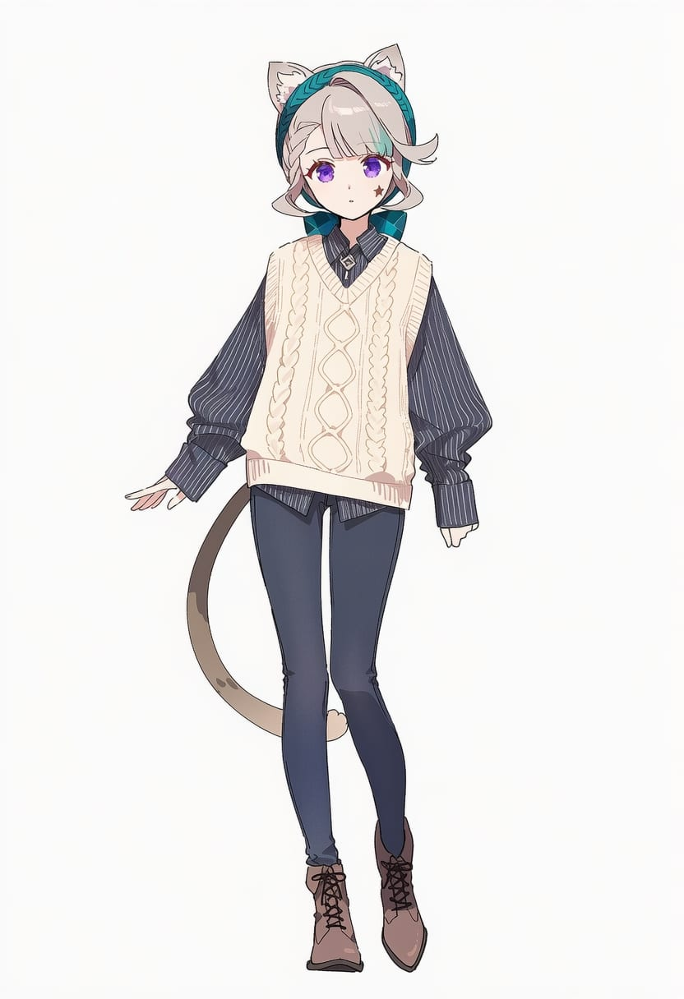

| 字段 | 内容 |
| --- | --- |
| 序号 | 45 |
| 风格主题 | 针织背心叠穿 |
| 搭配思路（中文描述） | 针织发带温暖，奶油绞花针织背心+条纹衬衫；深色牛仔裤+切尔西靴，细围巾完成叠穿层次。 |
| 从头到脚Tag串（英文逗号分隔） | headband, knitted headband, sweater_vest, cable knit sweater vest, cream vest, collared_shirt, striped shirt, long sleeves, jeans, dark jeans, boots, chelsea boots, brown boots, scarf, thin scarf |

## 46. 46 — 皮草领大衣华丽

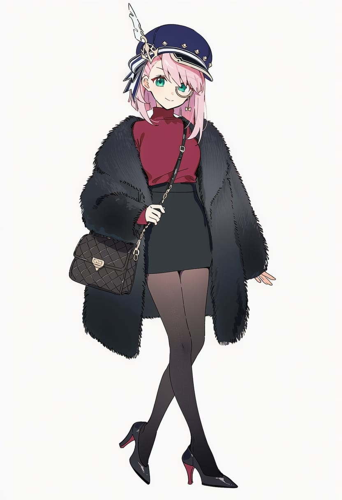

| 字段 | 内容 |
| --- | --- |
| 序号 | 46 |
| 风格主题 | 皮草领大衣华丽 |
| 搭配思路（中文描述） | 黑色迷你礼帽华丽，深色皮草大衣敞开；红色高领+黑色铅笔裙，黑丝+尖头高跟，结构手袋与耳环提升气场。 |
| 从头到脚Tag串（英文逗号分隔） | mini_hat, black mini hat, fur_coat, dark fur coat, open coat, turtleneck, red turtleneck, skirt, pencil skirt, black skirt, tights, black tights, heels, pointed heels, handbag, structured handbag, earrings |

## 47. 47 — 运动卫衣秋日

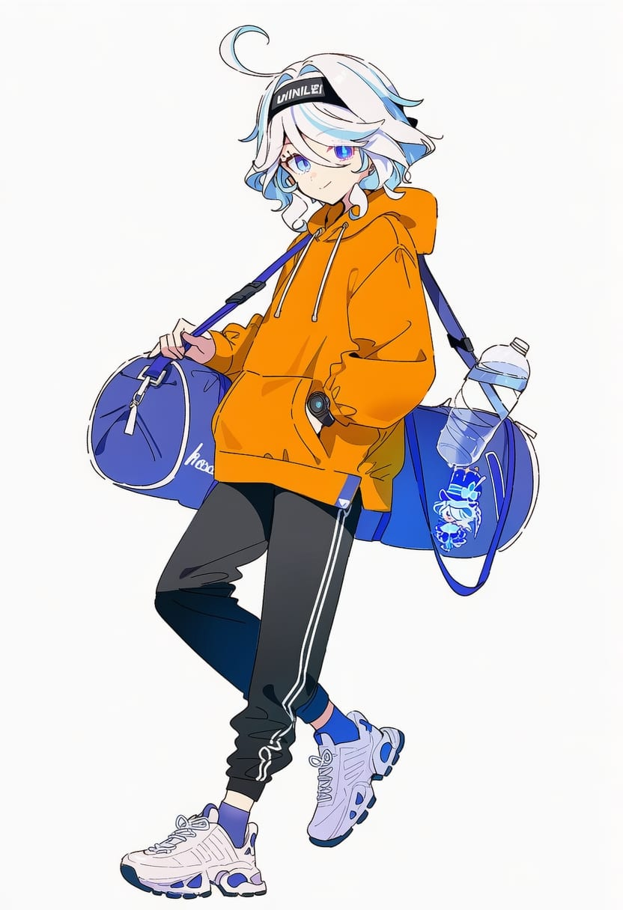

| 字段 | 内容 |
| --- | --- |
| 序号 | 47 |
| 风格主题 | 运动卫衣秋日 |
| 搭配思路（中文描述） | 黑色运动发带，橙色oversize卫衣活力；黑色运动裤+白球鞋露出踝袜，旅行袋与运动手表、水瓶功能性强。 |
| 从头到脚Tag串（英文逗号分隔） | sports headband, black headband, hoodie, oversized hoodie, orange hoodie, track_pants, black track pants, sneakers, white sneakers, socks, ankle socks, duffel bag, sports watch, water bottle |

## 48. 48 — 和风披肩秋色

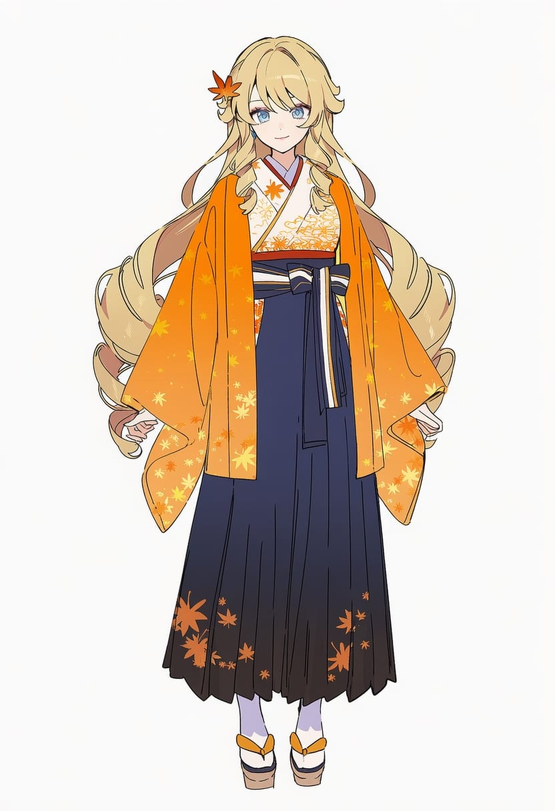

| 字段 | 内容 |
| --- | --- |
| 序号 | 48 |
| 风格主题 | 和风披肩秋色 |
| 搭配思路（中文描述） | 枫叶发饰点题，橙色羽织外搭秋色和服；深色短裤+白足袋木屐，红色腰带保留和风秋意。 |
| 从头到脚Tag串（英文逗号分隔） | hair_ornament, maple leaf hair_ornament, haori, orange haori, open haori, kimono, patterned kimono, autumn colors, hakama_shorts, dark shorts, tabi, white tabi, geta, wooden geta, sash, red sash |

## 49. 49 — 灯笼袖针织

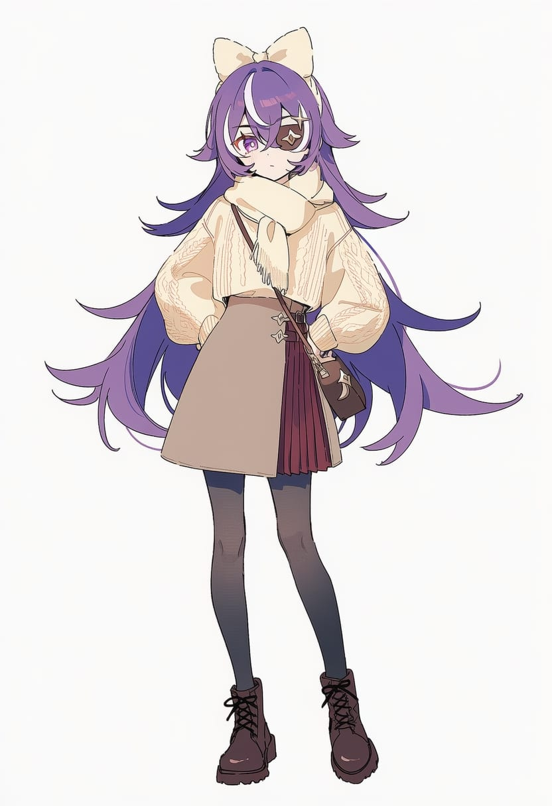

| 字段 | 内容 |
| --- | --- |
| 序号 | 49 |
| 风格主题 | 灯笼袖针织 |
| 搭配思路（中文描述） | 奶油大蝴蝶结甜美，奶油灯笼袖毛衣浪漫；棕色高腰裙+黑丝，踝靴与软围巾、小手袋保持柔和比例。 |
| 从头到脚Tag串（英文逗号分隔） | hair_bow, large cream hair_bow, balloon sleeve sweater, cream balloon sleeve sweater, high-waist_skirt, brown skirt, tights, black tights, boots, ankle boots, scarf, soft scarf, handbag, small handbag |

## 50. 50 — 迷彩机能街头

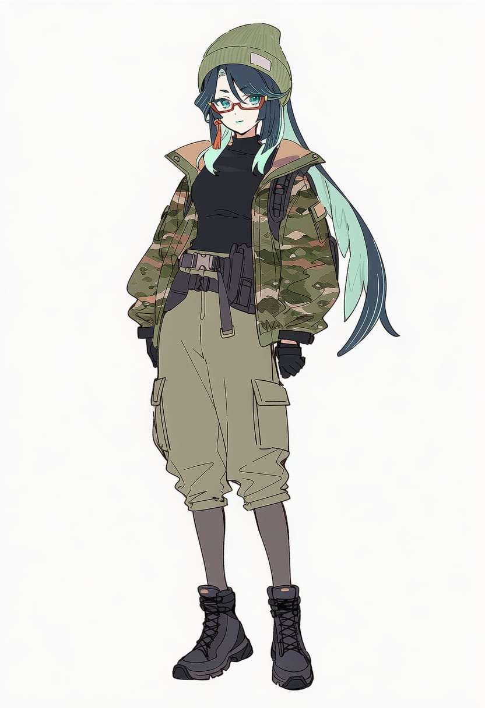

| 字段 | 内容 |
| --- | --- |
| 序号 | 50 |
| 风格主题 | 迷彩机能街头 |
| 搭配思路（中文描述） | 迷彩毛线帽机能，迷彩军装夹克敞开；黑色高领+迷彩工装裤，战斗靴与战术腰带、手套、背包强化街头机能感。 |
| 从头到脚Tag串（英文逗号分隔） | beanie, camouflage beanie, military_jacket, camouflage jacket, open jacket, turtleneck, black turtleneck, cargo_pants, camouflage cargo pants, combat boots, black boots, utility belt, gloves, tactical gloves, backpack |

---
