## 1. chinese_clothes — 中式服饰

| 字段 | 内容 |
| --- | --- |
| danbooru tag | chinese_clothes |
| tag 中文名 | 中式服饰 |
| tag 中文含义 | 中国民族/传统服饰的总称 |
| 分类 | 中国-综合 |
| 角色 tag | ganyu_(genshin_impact) |
| 序号 | 0001 |

## 2. traditional_chinese_clothes — 中国传统服饰

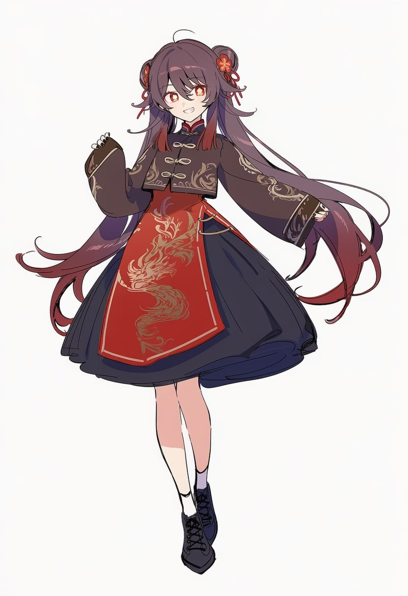

| 字段 | 内容 |
| --- | --- |
| danbooru tag | traditional_chinese_clothes |
| tag 中文名 | 中国传统服饰 |
| tag 中文含义 | 中国传统服饰（细分tag） |
| 分类 | 中国-综合 |
| 角色 tag | hu_tao_(genshin_impact) |
| 序号 | 0002 |

## 3. hanfu — 汉服

| 字段 | 内容 |
| --- | --- |
| danbooru tag | hanfu |
| tag 中文名 | 汉服 |
| tag 中文含义 | 汉民族传统服饰，交领右衽、宽袖长袍 |
| 分类 | 中国-全身 |
| 角色 tag | keqing_(genshin_impact) |
| 序号 | 0003 |

## 4. white_hanfu — 白色汉服

| 字段 | 内容 |
| --- | --- |
| danbooru tag | white_hanfu |
| tag 中文名 | 白色汉服 |
| tag 中文含义 | 汉服的白色配色（颜色变体代表一种） |
| 分类 | 中国-颜色 |
| 角色 tag | ningguang_(genshin_impact) |
| 序号 | 0004 |

## 5. qipao — 旗袍

| 字段 | 内容 |
| --- | --- |
| danbooru tag | qipao |
| tag 中文名 | 旗袍 |
| tag 中文含义 | 中国女性传统服饰，立领、盘扣、紧身长裙 |
| 分类 | 中国-全身 |
| 角色 tag | qiqi_(genshin_impact) |
| 序号 | 0005 |

## 6. qungua — 裙褂

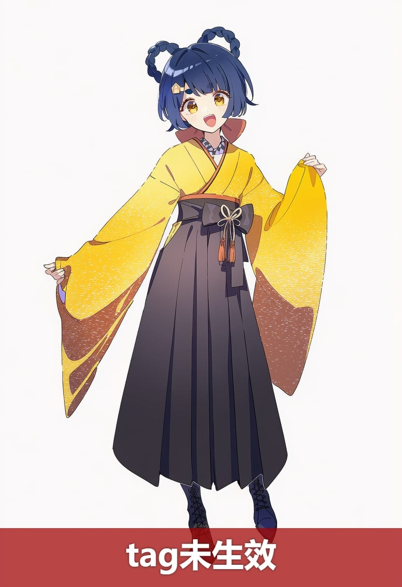

| 字段 | 内容 |
| --- | --- |
| danbooru tag | qungua |
| tag 中文名 | 裙褂 |
| tag 中文含义 | 中式新娘/古典裙装 |
| 分类 | 中国-下装 |
| 角色 tag | xiangling_(genshin_impact) |
| 序号 | 0006 |

## 7. ruqun — 襦裙

| 字段 | 内容 |
| --- | --- |
| danbooru tag | ruqun |
| tag 中文名 | 襦裙 |
| tag 中文含义 | 上襦下裙的汉服制式 |
| 分类 | 中国-下装 |
| 角色 tag | shenhe_(genshin_impact) |
| 序号 | 0007 |

## 8. zhijupao — 直裾袍

| 字段 | 内容 |
| --- | --- |
| danbooru tag | zhijupao |
| tag 中文名 | 直裾袍 |
| tag 中文含义 | 直裾（下摆直线）的汉服长袍 |
| 分类 | 中国-全身 |
| 角色 tag | yun_jin_(genshin_impact) |
| 序号 | 0008 |

## 9. aoqun — 袄裙

| 字段 | 内容 |
| --- | --- |
| danbooru tag | aoqun |
| tag 中文名 | 袄裙 |
| tag 中文含义 | 上袄下裙的汉服女装制式 |
| 分类 | 中国-下装 |
| 角色 tag | yelan_(genshin_impact) |
| 序号 | 0009 |

## 10. duijin_ruqun — 对襟襦裙

| 字段 | 内容 |
| --- | --- |
| danbooru tag | duijin_ruqun |
| tag 中文名 | 对襟襦裙 |
| tag 中文含义 | 对襟式襦裙汉服 |
| 分类 | 中国-下装 |
| 角色 tag | yanfei_(genshin_impact) |
| 序号 | 0010 |

## 11. jiaoling_ruqun — 交领襦裙

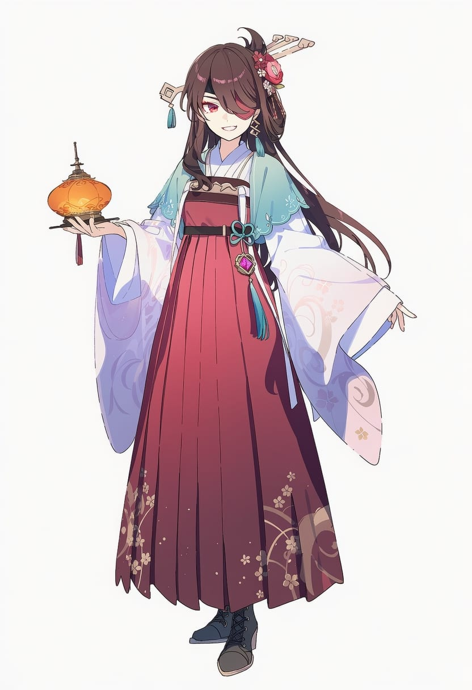

| 字段 | 内容 |
| --- | --- |
| danbooru tag | jiaoling_ruqun |
| tag 中文名 | 交领襦裙 |
| tag 中文含义 | 交领式襦裙汉服 |
| 分类 | 中国-下装 |
| 角色 tag | beidou_(genshin_impact) |
| 序号 | 0011 |

## 12. qixiong_ruqun — 齐胸襦裙

| 字段 | 内容 |
| --- | --- |
| danbooru tag | qixiong_ruqun |
| tag 中文名 | 齐胸襦裙 |
| tag 中文含义 | 齐胸襦裙汉服（隋唐风） |
| 分类 | 中国-下装 |
| 角色 tag | cloud_retainer_(genshin_impact) |
| 序号 | 0012 |

## 13. mamianqun — 马面裙

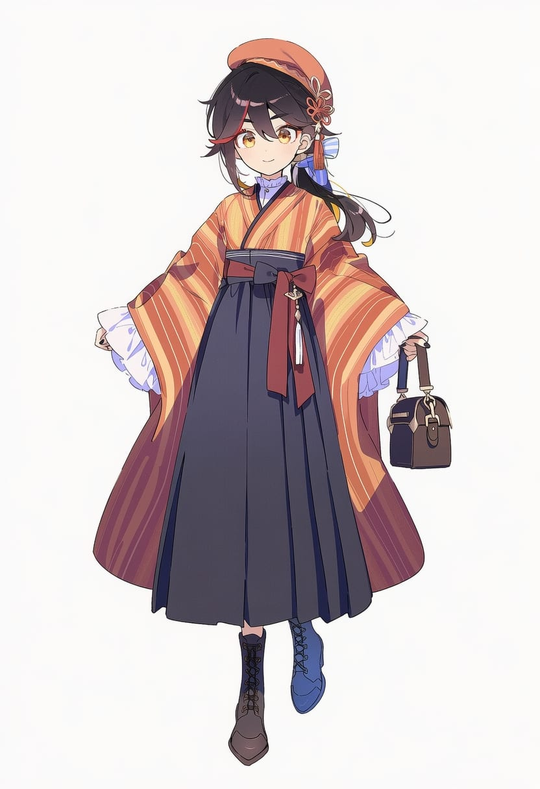

| 字段 | 内容 |
| --- | --- |
| danbooru tag | mamianqun |
| tag 中文名 | 马面裙 |
| tag 中文含义 | 中国传统百褶马面裙 |
| 分类 | 中国-下装 |
| 角色 tag | xinyan_(genshin_impact) |
| 序号 | 0013 |

## 14. tangzhuang — 唐装

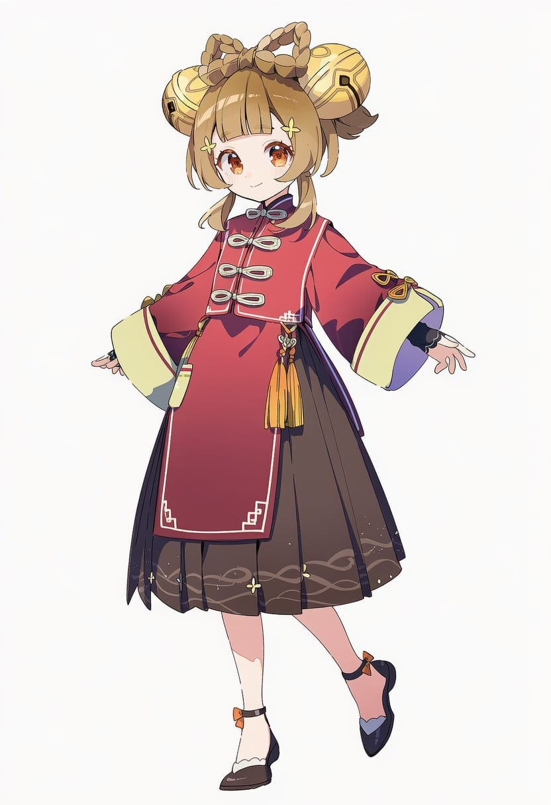

| 字段 | 内容 |
| --- | --- |
| danbooru tag | tangzhuang |
| tag 中文名 | 唐装 |
| tag 中文含义 | 中式对襟盘扣短上衣 |
| 分类 | 中国-上衣 |
| 角色 tag | yaoyao_(genshin_impact) |
| 序号 | 0014 |

## 15. japanese_clothes — 日式服饰

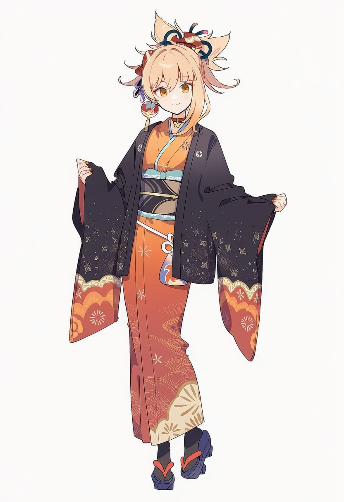

| 字段 | 内容 |
| --- | --- |
| danbooru tag | japanese_clothes |
| tag 中文名 | 日式服饰 |
| tag 中文含义 | 日本传统/和服系服饰总称 |
| 分类 | 日本-综合 |
| 角色 tag | yoimiya_(genshin_impact) |
| 序号 | 0015 |

## 16. kimono — 和服

| 字段 | 内容 |
| --- | --- |
| danbooru tag | kimono |
| tag 中文名 | 和服 |
| tag 中文含义 | 日本传统长袍，宽袖、交领 |
| 分类 | 日本-全身 |
| 角色 tag | raiden_shogun |
| 序号 | 0016 |

## 17. white_kimono — 白色和服

| 字段 | 内容 |
| --- | --- |
| danbooru tag | white_kimono |
| tag 中文名 | 白色和服 |
| tag 中文含义 | 和服的白色配色（颜色变体代表一种） |
| 分类 | 日本-颜色 |
| 角色 tag | kamisato_ayaka |
| 序号 | 0017 |

## 18. yukata — 浴衣

| 字段 | 内容 |
| --- | --- |
| danbooru tag | yukata |
| tag 中文名 | 浴衣 |
| tag 中文含义 | 夏日轻薄和服，棉质 |
| 分类 | 日本-全身 |
| 角色 tag | sangonomiya_kokomi |
| 序号 | 0018 |

## 19. hakama — 袴

| 字段 | 内容 |
| --- | --- |
| danbooru tag | hakama |
| tag 中文名 | 袴 |
| tag 中文含义 | 和服裤裙，传统宽松长裤 |
| 分类 | 日本-下装 |
| 角色 tag | yae_miko |
| 序号 | 0019 |

## 20. haori — 羽织

| 字段 | 内容 |
| --- | --- |
| danbooru tag | haori |
| tag 中文名 | 羽织 |
| tag 中文含义 | 和服外套，短款对襟 |
| 分类 | 日本-外套 |
| 角色 tag | kujou_sara |
| 序号 | 0020 |

## 21. obi — 腰带(带)

| 字段 | 内容 |
| --- | --- |
| danbooru tag | obi |
| tag 中文名 | 腰带(带) |
| tag 中文含义 | 和服服饰腰带宽腰带 |
| 分类 | 日本-配饰 |
| 角色 tag | kuki_shinobu |
| 序号 | 0021 |

## 22. miko — 巫女服

| 字段 | 内容 |
| --- | --- |
| danbooru tag | miko |
| tag 中文名 | 巫女服 |
| tag 中文含义 | 神社巫女穿的传统服装 |
| 分类 | 日本-全身 |
| 角色 tag | kirara_(genshin_impact) |
| 序号 | 0022 |

## 23. fundoshi — 裈/兜裆布

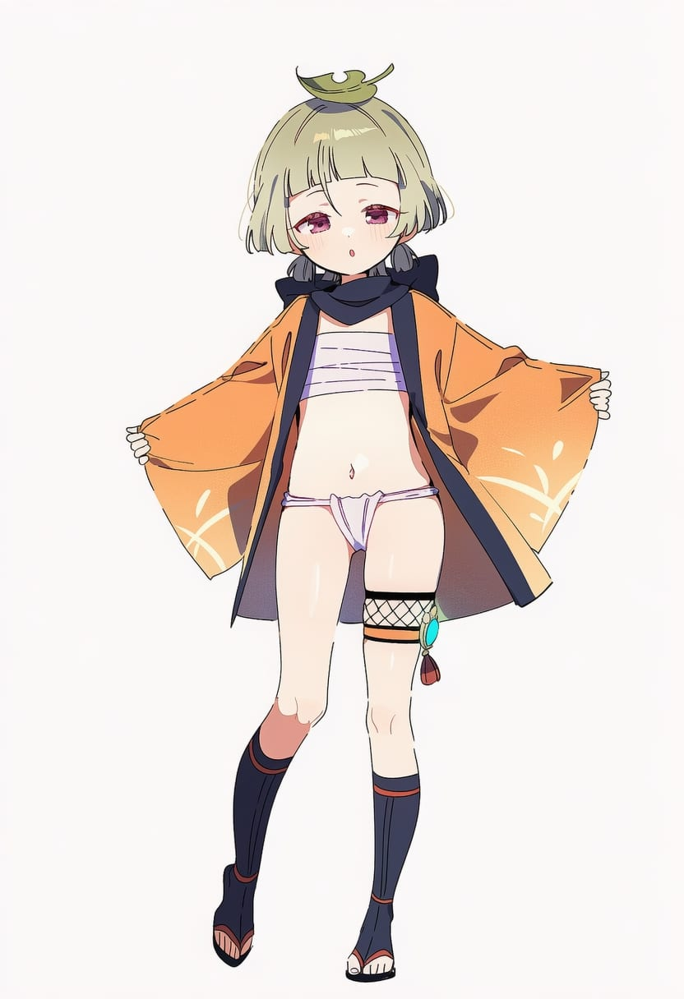

| 字段 | 内容 |
| --- | --- |
| danbooru tag | fundoshi |
| tag 中文名 | 裈/兜裆布 |
| tag 中文含义 | 日本传统男式缠腰布 |
| 分类 | 日本-下装 |
| 角色 tag | sayu_(genshin_impact) |
| 序号 | 0023 |

## 24. kariginu — 狩衣

| 字段 | 内容 |
| --- | --- |
| danbooru tag | kariginu |
| tag 中文名 | 狩衣 |
| tag 中文含义 | 日本公家宽松外衣 |
| 分类 | 日本-外套 |
| 角色 tag | yumemizuki_mizuki |
| 序号 | 0024 |

## 25. kataginu — 肩衣

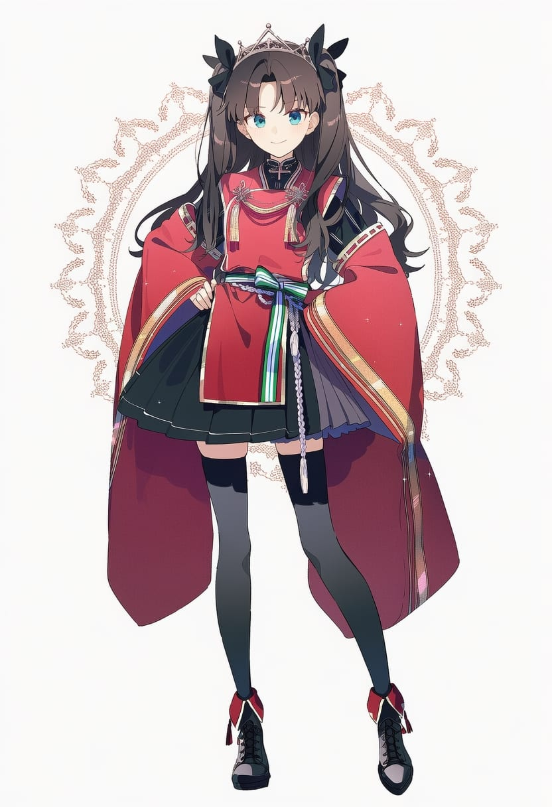

| 字段 | 内容 |
| --- | --- |
| danbooru tag | kataginu |
| tag 中文名 | 肩衣 |
| tag 中文含义 | 无袖肩衣（幕府时期服饰） |
| 分类 | 日本-外套 |
| 角色 tag | tohsaka_rin |
| 序号 | 0025 |

## 26. happi — 法被

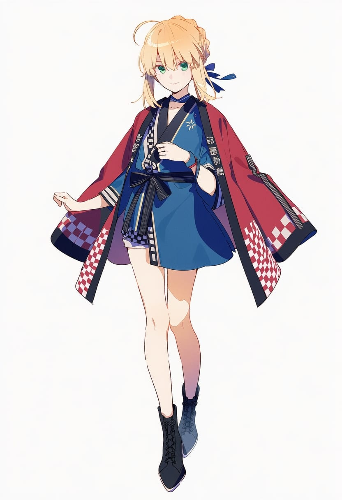

| 字段 | 内容 |
| --- | --- |
| danbooru tag | happi |
| tag 中文名 | 法被 |
| tag 中文含义 | 日本短和服工作服/祭典服 |
| 分类 | 日本-外套 |
| 角色 tag | artoria_pendragon_(fate) |
| 序号 | 0026 |

## 27. furisode — 振袖

| 字段 | 内容 |
| --- | --- |
| danbooru tag | furisode |
| tag 中文名 | 振袖 |
| tag 中文含义 | 和服长袖（未婚女性礼服） |
| 分类 | 日本-衣袖 |
| 角色 tag | medusa_(fate) |
| 序号 | 0027 |

## 28. wa_lolita — 和式洛丽塔

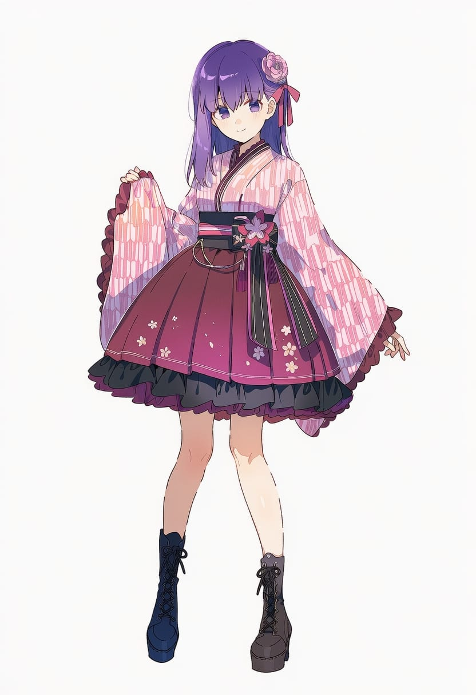

| 字段 | 内容 |
| --- | --- |
| danbooru tag | wa_lolita |
| tag 中文名 | 和式洛丽塔 |
| tag 中文含义 | 融合和服元素的洛丽塔洋装 |
| 分类 | 日本-全身 |
| 角色 tag | matou_sakura |
| 序号 | 0028 |

## 29. wa_maid — 和式女仆装

| 字段 | 内容 |
| --- | --- |
| danbooru tag | wa_maid |
| tag 中文名 | 和式女仆装 |
| tag 中文含义 | 融合和服元素的女仆装 |
| 分类 | 日本-全身 |
| 角色 tag | hakurei_reimu |
| 序号 | 0029 |

## 30. hifu — 被衣

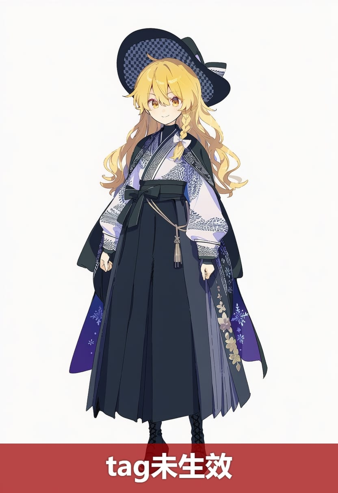

| 字段 | 内容 |
| --- | --- |
| danbooru tag | hifu |
| tag 中文名 | 被衣 |
| tag 中文含义 | 和服配穿的内衣/衬衣 |
| 分类 | 日本-内搭 |
| 角色 tag | kirisame_marisa |
| 序号 | 0030 |

## 31. attus — 阿图斯

| 字段 | 内容 |
| --- | --- |
| danbooru tag | attus |
| tag 中文名 | 阿图斯 |
| tag 中文含义 | 阿伊努树皮布传统外衣 |
| 分类 | 阿伊努-全身 |
| 角色 tag | amami_haruka |
| 序号 | 0031 |

## 32. korean_clothes — 韩式服饰

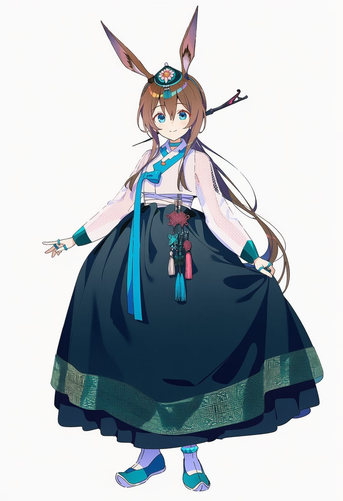

| 字段 | 内容 |
| --- | --- |
| danbooru tag | korean_clothes |
| tag 中文名 | 韩式服饰 |
| tag 中文含义 | 韩国传统服饰总称 |
| 分类 | 韩国-综合 |
| 角色 tag | amiya_(arknights) |
| 序号 | 0032 |

## 33. hanbok — 韩服

| 字段 | 内容 |
| --- | --- |
| danbooru tag | hanbok |
| tag 中文名 | 韩服 |
| tag 中文含义 | 朝鲜半岛传统服饰 |
| 分类 | 韩国-全身 |
| 角色 tag | dobermann_(arknights) |
| 序号 | 0033 |

## 34. white_hanbok — 白色韩服

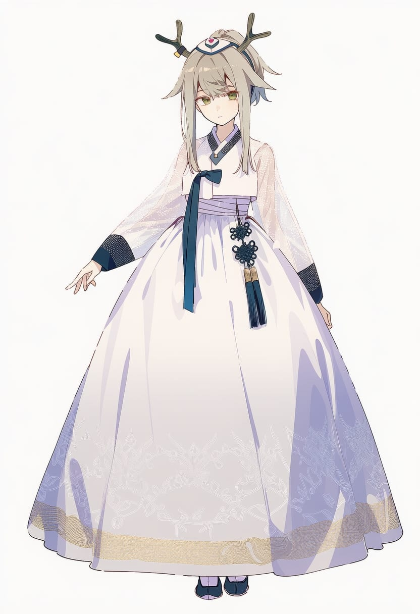

| 字段 | 内容 |
| --- | --- |
| danbooru tag | white_hanbok |
| tag 中文名 | 白色韩服 |
| tag 中文含义 | 韩服的白色配色（颜色变体代表一种） |
| 分类 | 韩国-颜色 |
| 角色 tag | firewatch_(arknights) |
| 序号 | 0034 |

## 35. hwalot — 阔衣

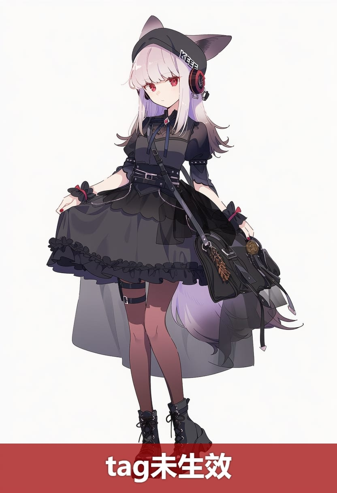

| 字段 | 内容 |
| --- | --- |
| danbooru tag | hwalot |
| tag 中文名 | 阔衣 |
| tag 中文含义 | 韩国新娘大礼服（花加彩） |
| 分类 | 韩国-全身 |
| 角色 tag | frostleaf_(arknights) |
| 序号 | 0035 |

## 36. jeogori — 赤古里

| 字段 | 内容 |
| --- | --- |
| danbooru tag | jeogori |
| tag 中文名 | 赤古里 |
| tag 中文含义 | 韩服短上衣 |
| 分类 | 韩国-上衣 |
| 角色 tag | gavial_(arknights) |
| 序号 | 0036 |

## 37. durumagi — 道服外袍

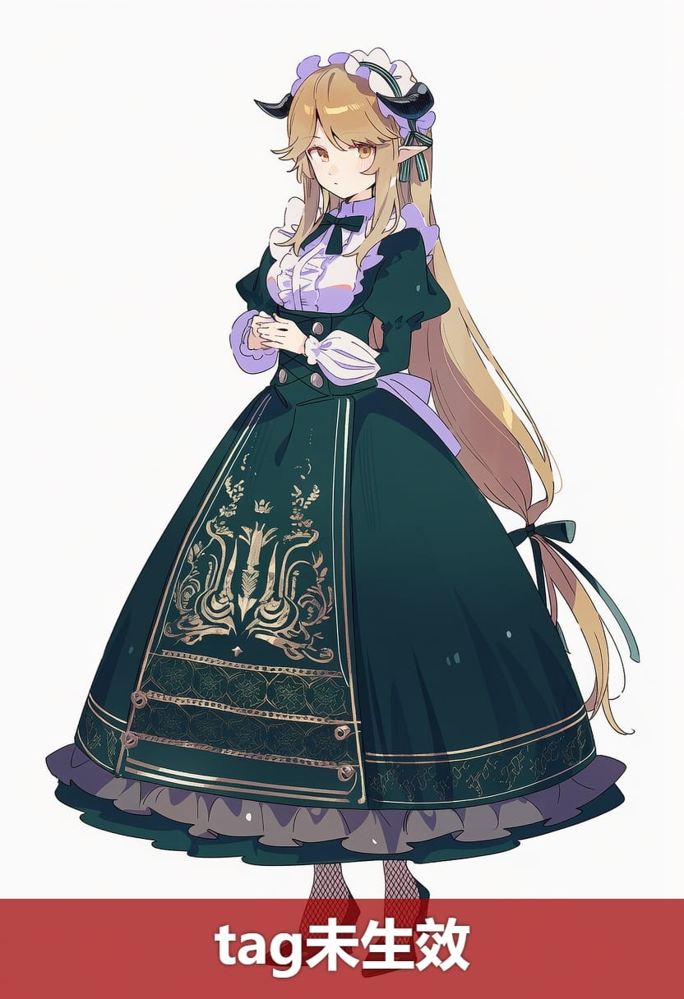

| 字段 | 内容 |
| --- | --- |
| danbooru tag | durumagi |
| tag 中文名 | 道服外袍 |
| tag 中文含义 | 韩国传统长大衣/外袍 |
| 分类 | 韩国-外套 |
| 角色 tag | meteorite_(arknights) |
| 序号 | 0037 |

## 38. jo_lolita — 韩系洛丽塔

| 字段 | 内容 |
| --- | --- |
| danbooru tag | jo_lolita |
| tag 中文名 | 韩系洛丽塔 |
| tag 中文含义 | 韩式风洛丽塔洋装 |
| 分类 | 韩国-全身 |
| 角色 tag | myrrh_(arknights) |
| 序号 | 0038 |

## 39. mongolian_clothes — 蒙古服饰

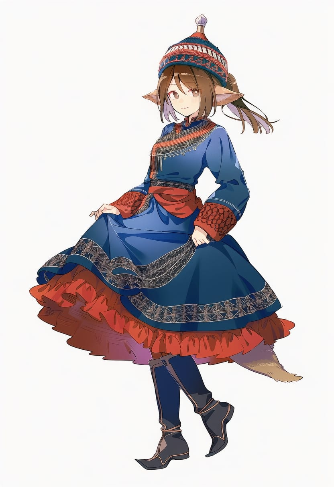

| 字段 | 内容 |
| --- | --- |
| danbooru tag | mongolian_clothes |
| tag 中文名 | 蒙古服饰 |
| tag 中文含义 | 蒙古民族传统服饰总称 |
| 分类 | 蒙古-综合 |
| 角色 tag | perfumer_(arknights) |
| 序号 | 0039 |

## 40. deel — 蒙古袍

| 字段 | 内容 |
| --- | --- |
| danbooru tag | deel |
| tag 中文名 | 蒙古袍 |
| tag 中文含义 | 蒙古族传统长袍，侧开衩宽袖 |
| 分类 | 蒙古-全身 |
| 角色 tag | warfarin_(arknights) |
| 序号 | 0040 |

## 41. vietnamese_clothes — 越南服饰

| 字段 | 内容 |
| --- | --- |
| danbooru tag | vietnamese_clothes |
| tag 中文名 | 越南服饰 |
| tag 中文含义 | 越南传统服饰总称 |
| 分类 | 越南-综合 |
| 角色 tag | durin_(arknights) |
| 序号 | 0041 |

## 42. ao_dai — 奥黛

| 字段 | 内容 |
| --- | --- |
| danbooru tag | ao_dai |
| tag 中文名 | 奥黛 |
| tag 中文含义 | 越南传统长旗袍，高领开衩 |
| 分类 | 越南-全身 |
| 角色 tag | yato_(arknights) |
| 序号 | 0042 |

## 43. ao_nhat_binh — 越南四身袄

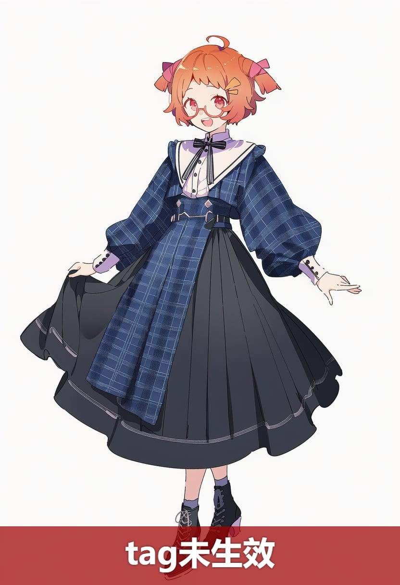

| 字段 | 内容 |
| --- | --- |
| danbooru tag | ao_nhat_binh |
| tag 中文名 | 越南四身袄 |
| tag 中文含义 | 越南北部四身袄 |
| 分类 | 越南-全身 |
| 角色 tag | beagle_(arknights) |
| 序号 | 0043 |

## 44. asian_indian_clothes — 南亚印度服饰

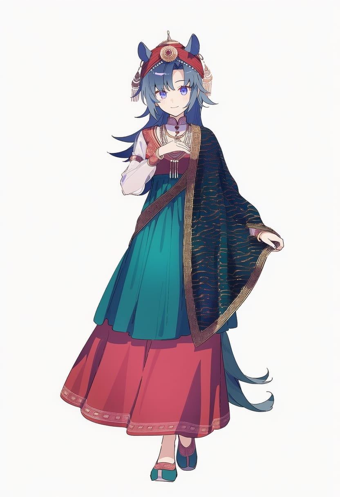

| 字段 | 内容 |
| --- | --- |
| danbooru tag | asian_indian_clothes |
| tag 中文名 | 南亚印度服饰 |
| tag 中文含义 | 印度/次大陆传统服饰总称 |
| 分类 | 印度-综合 |
| 角色 tag | fang_(arknights) |
| 序号 | 0044 |

## 45. sari — 纱丽

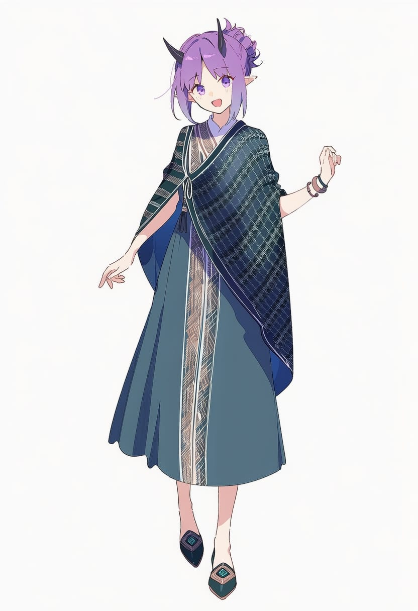

| 字段 | 内容 |
| --- | --- |
| danbooru tag | sari |
| tag 中文名 | 纱丽 |
| tag 中文含义 | 印度传统女式裹身长布裙 |
| 分类 | 印度-全身 |
| 角色 tag | hibiscus_(arknights) |
| 序号 | 0045 |

## 46. bindi — 眉心痣

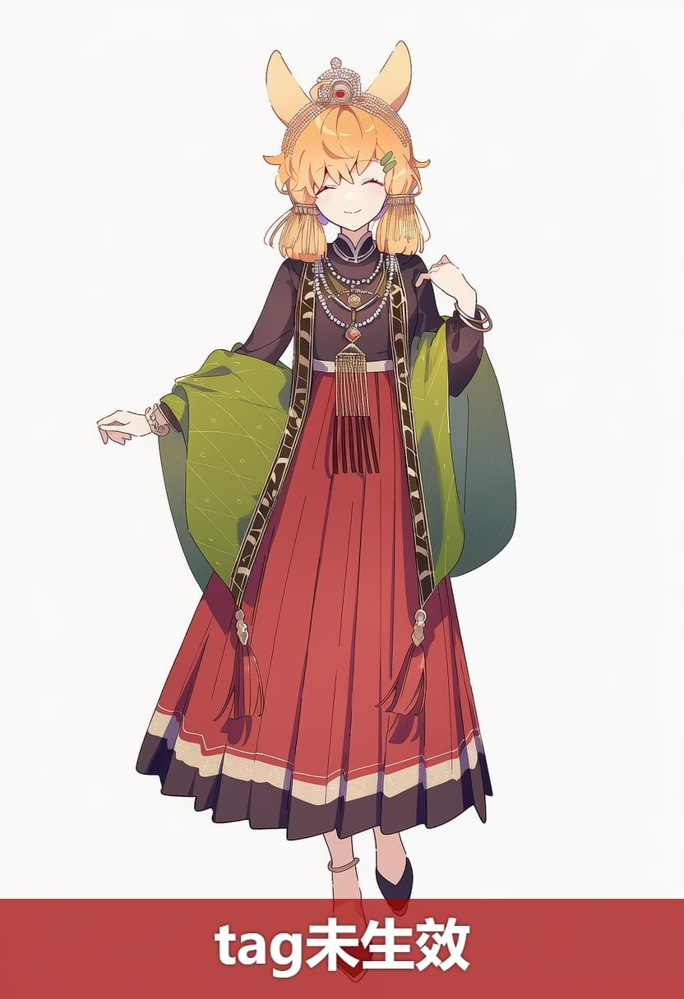

| 字段 | 内容 |
| --- | --- |
| danbooru tag | bindi |
| tag 中文名 | 眉心痣 |
| tag 中文含义 | 印度女性额前圆点装饰 |
| 分类 | 印度-配饰 |
| 角色 tag | kroos_(arknights) |
| 序号 | 0046 |

## 47. paisley — 佩斯利纹

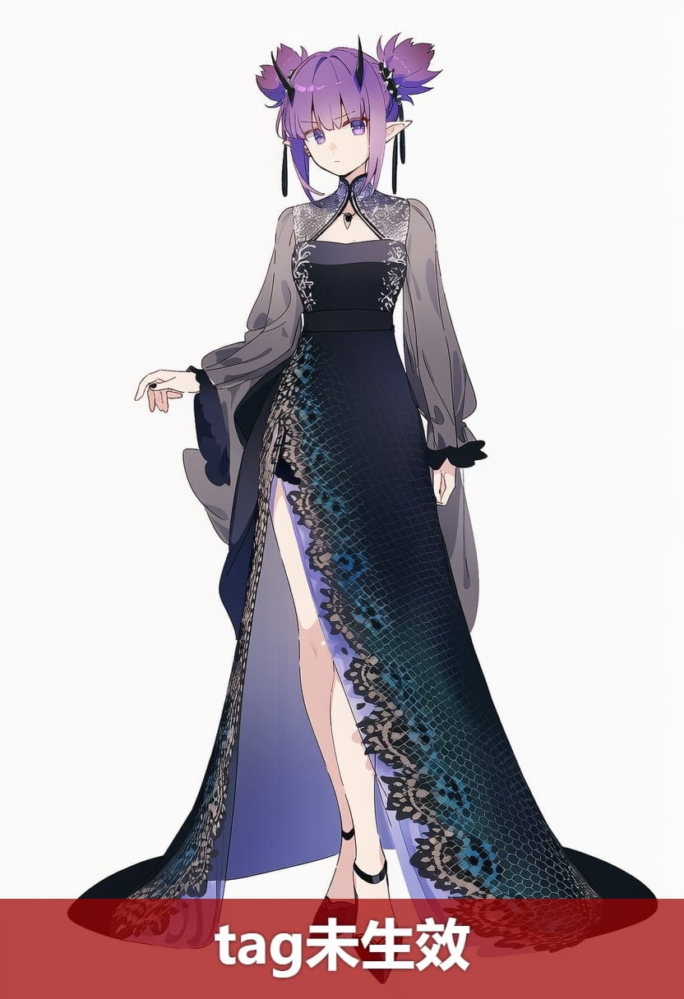

| 字段 | 内容 |
| --- | --- |
| danbooru tag | paisley |
| tag 中文名 | 佩斯利纹 |
| tag 中文含义 | 印度传统佩斯利花纹服饰 |
| 分类 | 印度-纹样 |
| 角色 tag | lava_(arknights) |
| 序号 | 0047 |

## 48. ainu_clothes — 阿伊努服饰

| 字段 | 内容 |
| --- | --- |
| danbooru tag | ainu_clothes |
| tag 中文名 | 阿伊努服饰 |
| tag 中文含义 | 阿伊努族传统服饰（日本北海道原住民） |
| 分类 | 阿伊努-综合 |
| 角色 tag | kisaragi_chihaya |
| 序号 | 0048 |

## 49. ancient_egyptian_clothes — 古埃及服饰

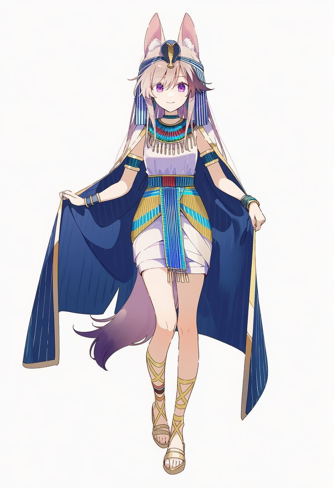

| 字段 | 内容 |
| --- | --- |
| danbooru tag | ancient_egyptian_clothes |
| tag 中文名 | 古埃及服饰 |
| tag 中文含义 | 古埃及时期传统服饰 |
| 分类 | 古埃及-综合 |
| 角色 tag | cardigan_(arknights) |
| 序号 | 0049 |

## 50. shendyt — 缠腰布(埃及)

| 字段 | 内容 |
| --- | --- |
| danbooru tag | shendyt |
| tag 中文名 | 缠腰布(埃及) |
| tag 中文含义 | 古埃及男性缠腰短裙/围裙 |
| 分类 | 古埃及-下装 |
| 角色 tag | melantha_(arknights) |
| 序号 | 0050 |

## 51. usekh_collar — 宽项圈(埃及)

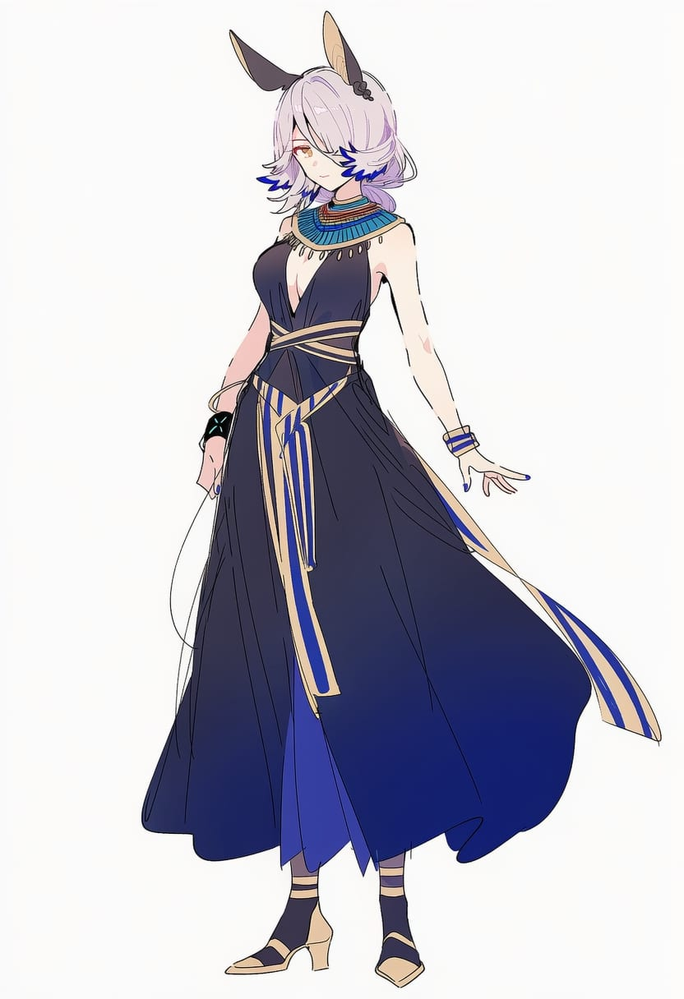

| 字段 | 内容 |
| --- | --- |
| danbooru tag | usekh_collar |
| tag 中文名 | 宽项圈(埃及) |
| tag 中文含义 | 古埃及宽大项圈项链 |
| 分类 | 古埃及-配饰 |
| 角色 tag | orchid_(arknights) |
| 序号 | 0051 |

## 52. ankh — 安卡

| 字段 | 内容 |
| --- | --- |
| danbooru tag | ankh |
| tag 中文名 | 安卡 |
| tag 中文含义 | 古埃及生命符号饰品 |
| 分类 | 古埃及-配饰 |
| 角色 tag | projekt_red_(arknights) |
| 序号 | 0052 |

## 53. eye_of_horus — 荷鲁斯之眼

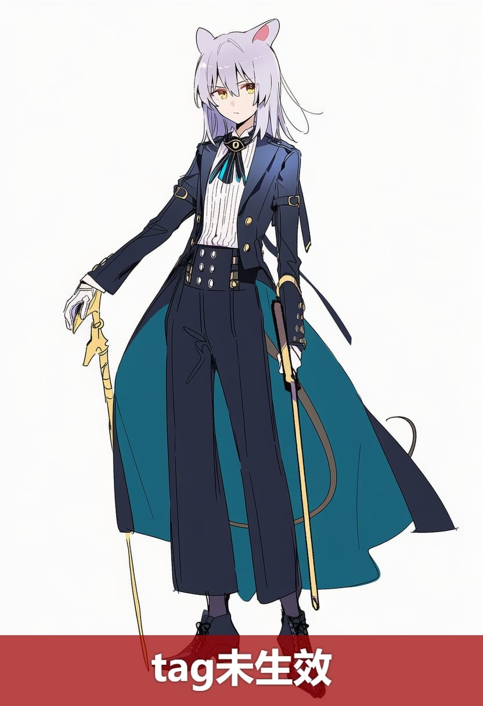

| 字段 | 内容 |
| --- | --- |
| danbooru tag | eye_of_horus |
| tag 中文名 | 荷鲁斯之眼 |
| tag 中文含义 | 古埃及护符眼饰 |
| 分类 | 古埃及-配饰 |
| 角色 tag | scavenger_(arknights) |
| 序号 | 0053 |

## 54. uraeus — 圣蛇饰

| 字段 | 内容 |
| --- | --- |
| danbooru tag | uraeus |
| tag 中文名 | 圣蛇饰 |
| tag 中文含义 | 古埃及王冠上的眼镜蛇饰品 |
| 分类 | 古埃及-头饰 |
| 角色 tag | deepcolor_(arknights) |
| 序号 | 0054 |

## 55. ancient_greek_clothes — 古希腊服饰

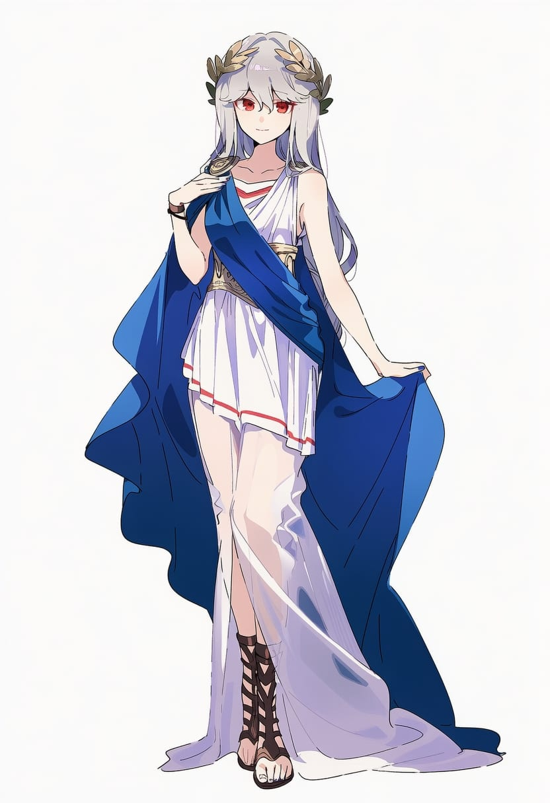

| 字段 | 内容 |
| --- | --- |
| danbooru tag | ancient_greek_clothes |
| tag 中文名 | 古希腊服饰 |
| tag 中文含义 | 古希腊时期传统服饰 |
| 分类 | 古希腊-综合 |
| 角色 tag | specter_(arknights) |
| 序号 | 0055 |

## 56. chiton — 希顿长袍

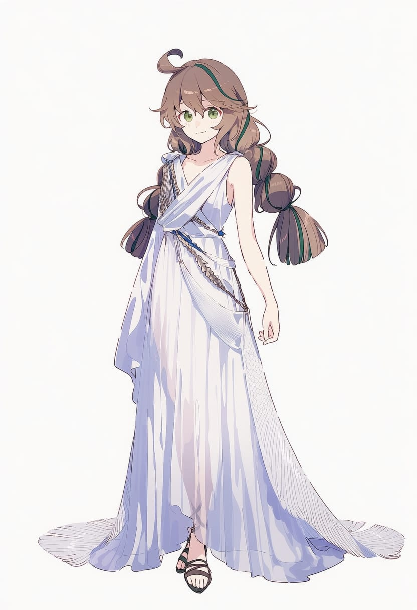

| 字段 | 内容 |
| --- | --- |
| danbooru tag | chiton |
| tag 中文名 | 希顿长袍 |
| tag 中文含义 | 古希腊贴身及膝/及踝内衣袍 |
| 分类 | 古希腊-全身 |
| 角色 tag | cuora_(arknights) |
| 序号 | 0056 |

## 57. himation — 希玛纯

| 字段 | 内容 |
| --- | --- |
| danbooru tag | himation |
| tag 中文名 | 希玛纯 |
| tag 中文含义 | 古希腊外披大衣/斗篷 |
| 分类 | 古希腊-外套 |
| 角色 tag | vigna_(arknights) |
| 序号 | 0057 |

## 58. peplos — 佩普洛斯

| 字段 | 内容 |
| --- | --- |
| danbooru tag | peplos |
| tag 中文名 | 佩普洛斯 |
| tag 中文含义 | 古希腊女式折叠短袖袍 |
| 分类 | 古希腊-全身 |
| 角色 tag | franka_(arknights) |
| 序号 | 0058 |

## 59. toga — 托加袍

| 字段 | 内容 |
| --- | --- |
| danbooru tag | toga |
| tag 中文名 | 托加袍 |
| tag 中文含义 | 古罗马男性宽大外袍 |
| 分类 | 古罗马-外套 |
| 角色 tag | jessica_(arknights) |
| 序号 | 0059 |

## 60. laurel_crown — 桂冠

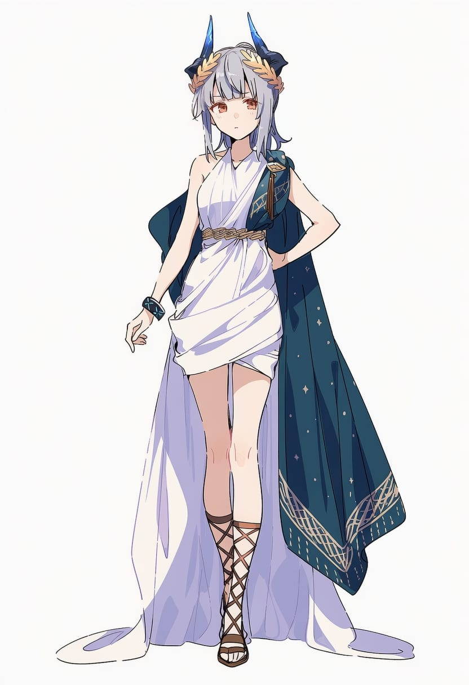

| 字段 | 内容 |
| --- | --- |
| danbooru tag | laurel_crown |
| tag 中文名 | 桂冠 |
| tag 中文含义 | 古希腊罗马月桂叶头冠 |
| 分类 | 地中海-头饰 |
| 角色 tag | liskarm_(arknights) |
| 序号 | 0060 |

## 61. attic_helmet — 阿提卡头盔

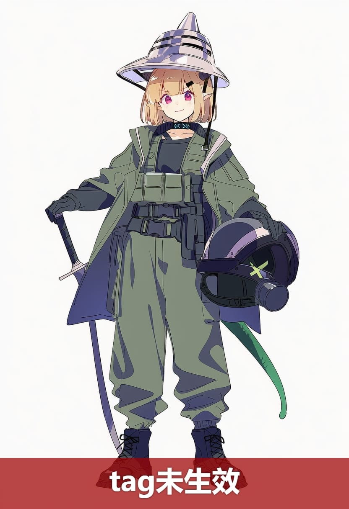

| 字段 | 内容 |
| --- | --- |
| danbooru tag | attic_helmet |
| tag 中文名 | 阿提卡头盔 |
| tag 中文含义 | 古希腊阿提卡式头盔 |
| 分类 | 古希腊-头饰 |
| 角色 tag | vanilla_(arknights) |
| 序号 | 0061 |

## 62. corinthian_helmet — 科林斯头盔

| 字段 | 内容 |
| --- | --- |
| danbooru tag | corinthian_helmet |
| tag 中文名 | 科林斯头盔 |
| tag 中文含义 | 古希腊科林斯式头盔 |
| 分类 | 古希腊-头饰 |
| 角色 tag | ifrit_(arknights) |
| 序号 | 0062 |

## 63. phrygian_cap — 弗里吉亚帽

| 字段 | 内容 |
| --- | --- |
| danbooru tag | phrygian_cap |
| tag 中文名 | 弗里吉亚帽 |
| tag 中文含义 | 古希腊及法国象征自由的软帽 |
| 分类 | 地中海-头饰 |
| 角色 tag | mayer_(arknights) |
| 序号 | 0063 |

## 64. laurel_crown — 桂冠

| 字段 | 内容 |
| --- | --- |
| danbooru tag | laurel_crown |
| tag 中文名 | 桂冠 |
| tag 中文含义 | 古希腊罗马月桂叶头冠 |
| 分类 | 地中海-头饰 |
| 角色 tag | ptilopsis_(arknights) |
| 序号 | 0064 |

## 65. mexican_clothes — 墨西哥服饰

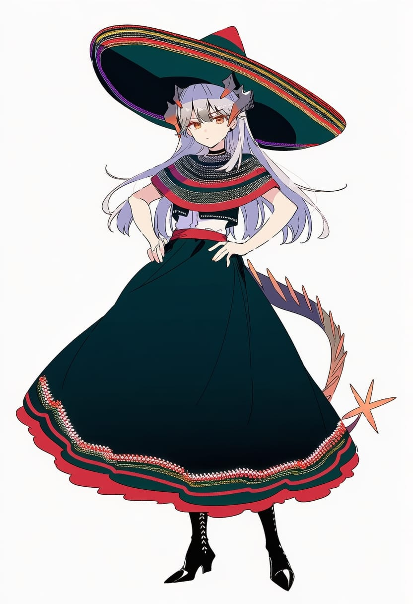

| 字段 | 内容 |
| --- | --- |
| danbooru tag | mexican_clothes |
| tag 中文名 | 墨西哥服饰 |
| tag 中文含义 | 墨西哥传统服饰总称 |
| 分类 | 墨西哥-综合 |
| 角色 tag | saria_(arknights) |
| 序号 | 0065 |

## 66. mexican_dress — 墨西哥连衣裙

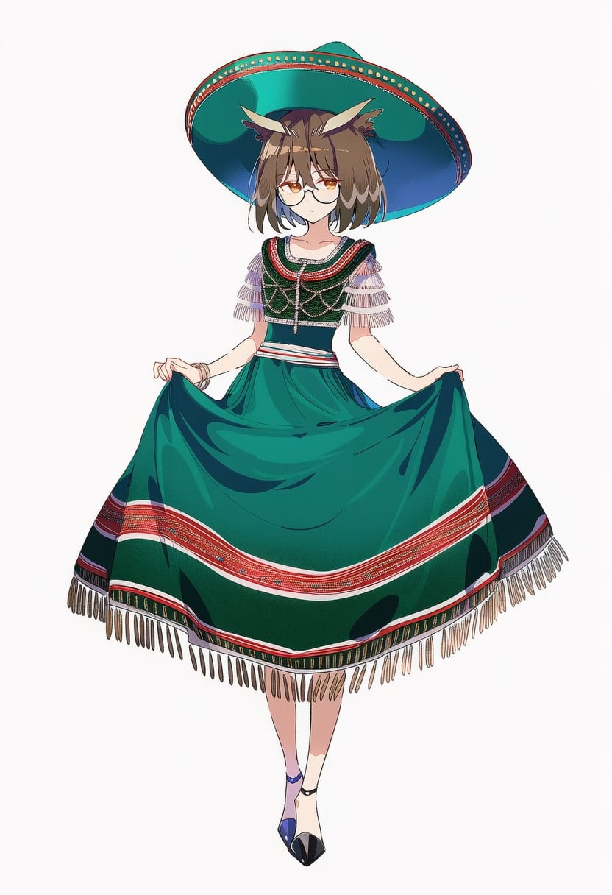

| 字段 | 内容 |
| --- | --- |
| danbooru tag | mexican_dress |
| tag 中文名 | 墨西哥连衣裙 |
| tag 中文含义 | 墨西哥传统印花连衣裙 |
| 分类 | 墨西哥-全身 |
| 角色 tag | silence_(arknights) |
| 序号 | 0066 |

## 67. aztec_clothes — 阿兹特克服饰

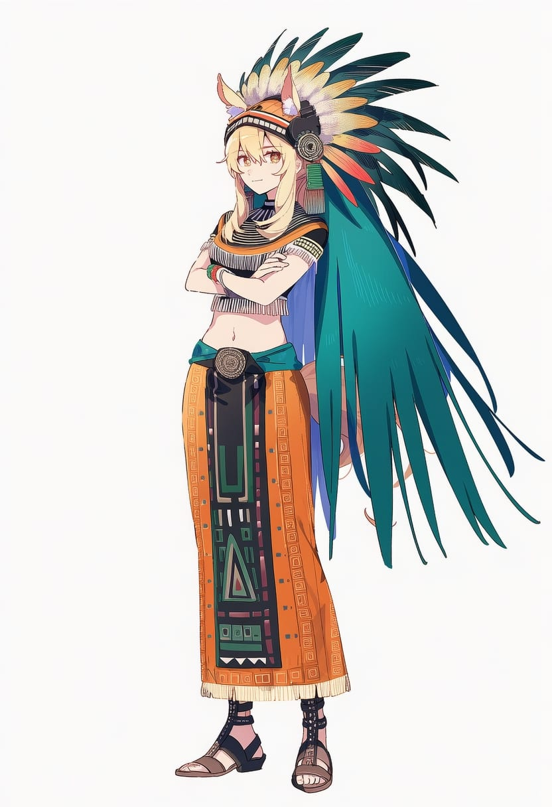

| 字段 | 内容 |
| --- | --- |
| danbooru tag | aztec_clothes |
| tag 中文名 | 阿兹特克服饰 |
| tag 中文含义 | 阿兹特克文明传统服饰 |
| 分类 | 中美洲-综合 |
| 角色 tag | nearl_(arknights) |
| 序号 | 0067 |

## 68. incan_clothes — 印加服饰

| 字段 | 内容 |
| --- | --- |
| danbooru tag | incan_clothes |
| tag 中文名 | 印加服饰 |
| tag 中文含义 | 印加文明传统服饰 |
| 分类 | 南美洲-综合 |
| 角色 tag | nightingale_(arknights) |
| 序号 | 0068 |

## 69. native_american_clothes — 美洲原住民服饰

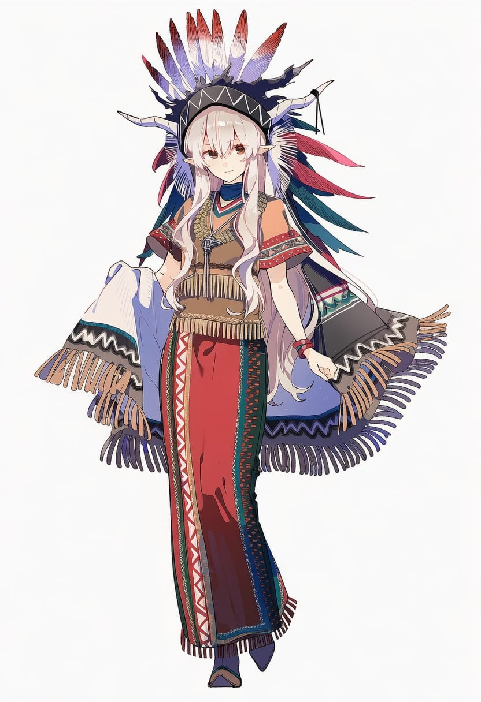

| 字段 | 内容 |
| --- | --- |
| danbooru tag | native_american_clothes |
| tag 中文名 | 美洲原住民服饰 |
| tag 中文含义 | 北美印第安原住民传统服饰 |
| 分类 | 美洲原住民-综合 |
| 角色 tag | shining_(arknights) |
| 序号 | 0069 |

## 70. south-east_asian_clothes — 东南亚服饰

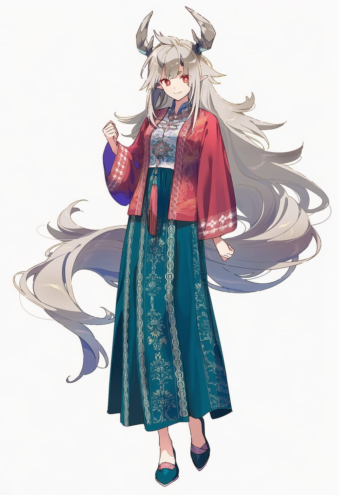

| 字段 | 内容 |
| --- | --- |
| danbooru tag | south-east_asian_clothes |
| tag 中文名 | 东南亚服饰 |
| tag 中文含义 | 东南亚地区传统服饰总称 |
| 分类 | 东南亚-综合 |
| 角色 tag | matoimaru_(arknights) |
| 序号 | 0070 |

## 71. thai_clothes — 泰国服饰

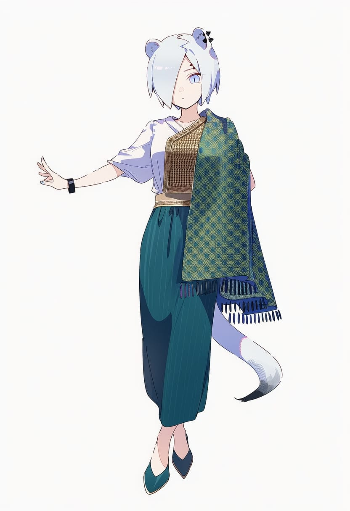

| 字段 | 内容 |
| --- | --- |
| danbooru tag | thai_clothes |
| tag 中文名 | 泰国服饰 |
| tag 中文含义 | 泰国传统服饰总称 |
| 分类 | 泰国-综合 |
| 角色 tag | shirayuki_(arknights) |
| 序号 | 0071 |

## 72. balinese_clothes — 巴厘岛服饰

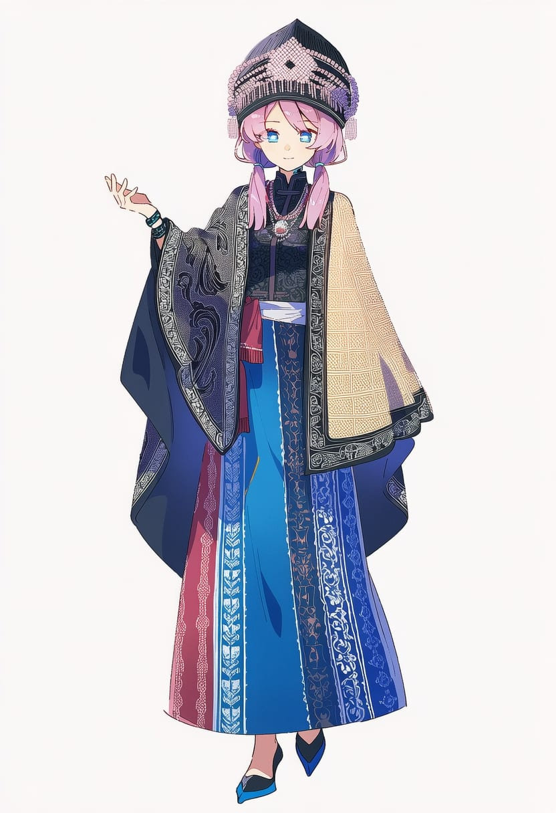

| 字段 | 内容 |
| --- | --- |
| danbooru tag | balinese_clothes |
| tag 中文名 | 巴厘岛服饰 |
| tag 中文含义 | 印尼巴厘岛传统服饰 |
| 分类 | 东南亚-综合 |
| 角色 tag | blue_poison_(arknights) |
| 序号 | 0072 |

## 73. indonesian_clothes — 印尼服饰

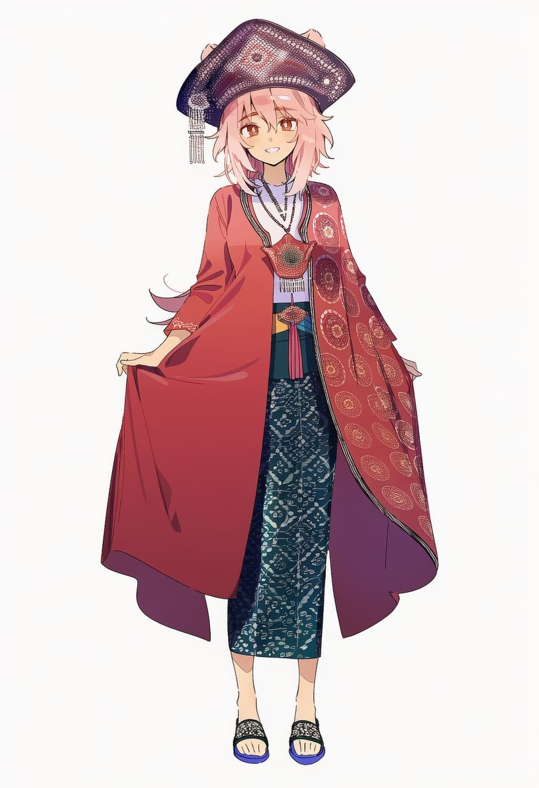

| 字段 | 内容 |
| --- | --- |
| danbooru tag | indonesian_clothes |
| tag 中文名 | 印尼服饰 |
| tag 中文含义 | 印度尼西亚传统服饰总称 |
| 分类 | 东南亚-综合 |
| 角色 tag | gravel_(arknights) |
| 序号 | 0073 |

## 74. filipino_clothes — 菲律宾服饰

| 字段 | 内容 |
| --- | --- |
| danbooru tag | filipino_clothes |
| tag 中文名 | 菲律宾服饰 |
| tag 中文含义 | 菲律宾传统服饰总称 |
| 分类 | 菲律宾-综合 |
| 角色 tag | meteor_(arknights) |
| 序号 | 0074 |

## 75. pakistani_clothes — 巴基斯坦服饰

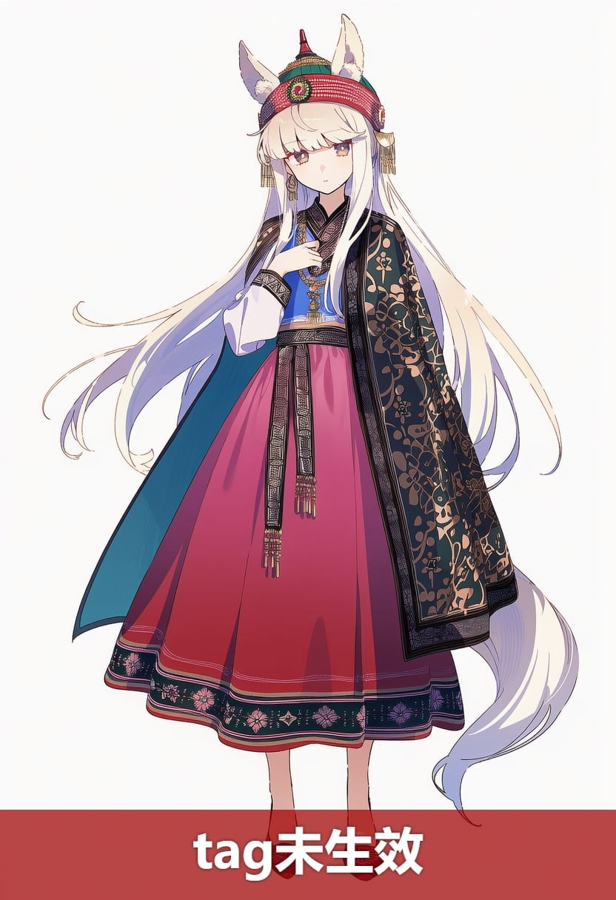

| 字段 | 内容 |
| --- | --- |
| danbooru tag | pakistani_clothes |
| tag 中文名 | 巴基斯坦服饰 |
| tag 中文含义 | 巴基斯坦传统服饰 |
| 分类 | 南亚-综合 |
| 角色 tag | platinum_(arknights) |
| 序号 | 0075 |

## 76. scottish_clothes — 苏格兰服饰

| 字段 | 内容 |
| --- | --- |
| danbooru tag | scottish_clothes |
| tag 中文名 | 苏格兰服饰 |
| tag 中文含义 | 苏格兰传统服饰（如格子裙） |
| 分类 | 欧洲-综合 |
| 角色 tag | cliffheart_(arknights) |
| 序号 | 0077 |

## 77. kilt — 苏格兰方格裙

| 字段 | 内容 |
| --- | --- |
| danbooru tag | kilt |
| tag 中文名 | 苏格兰方格裙 |
| tag 中文含义 | 苏格兰传统男式格子褶裙 |
| 分类 | 苏格兰-下装 |
| 角色 tag | pramanix_(arknights) |
| 序号 | 0078 |

## 78. danish_clothes — 丹麦服饰

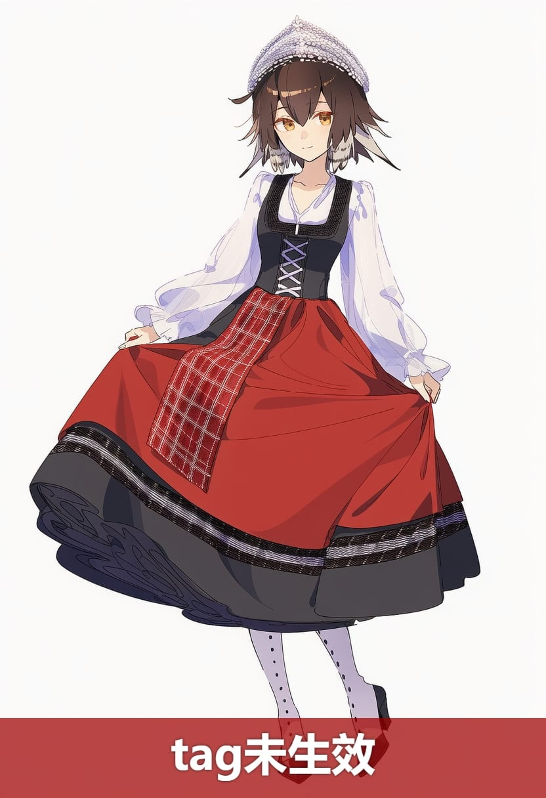

| 字段 | 内容 |
| --- | --- |
| danbooru tag | danish_clothes |
| tag 中文名 | 丹麦服饰 |
| tag 中文含义 | 丹麦传统服饰 |
| 分类 | 欧洲-综合 |
| 角色 tag | plume_(arknights) |
| 序号 | 0079 |

## 79. dutch_clothes — 荷兰服饰

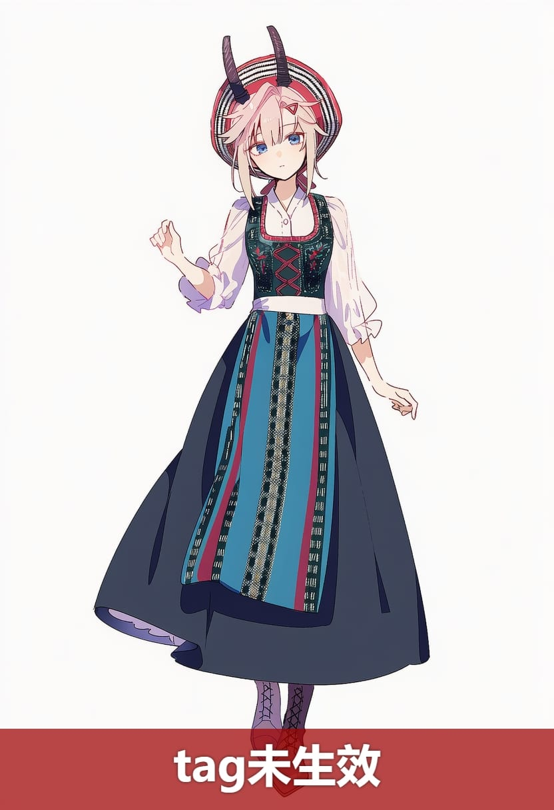

| 字段 | 内容 |
| --- | --- |
| danbooru tag | dutch_clothes |
| tag 中文名 | 荷兰服饰 |
| tag 中文含义 | 荷兰传统服饰 |
| 分类 | 欧洲-综合 |
| 角色 tag | earthspirit_(arknights) |
| 序号 | 0080 |

## 80. belgian_clothes — 比利时服饰

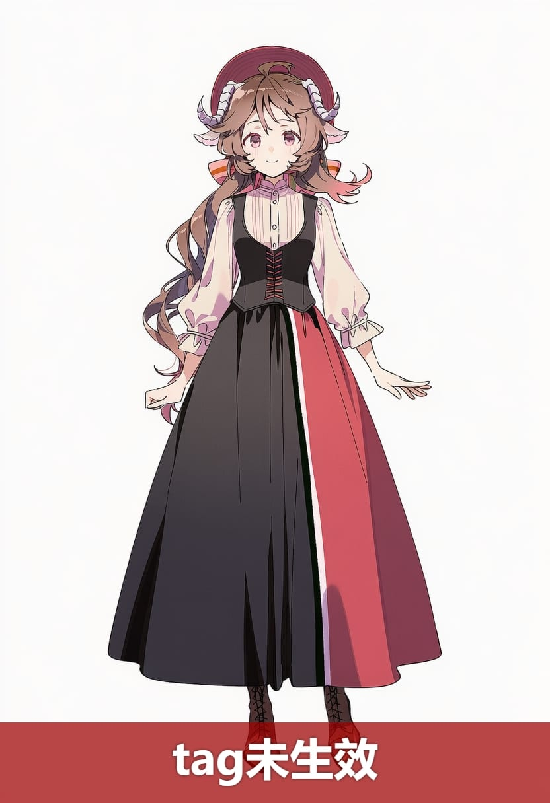

| 字段 | 内容 |
| --- | --- |
| danbooru tag | belgian_clothes |
| tag 中文名 | 比利时服饰 |
| tag 中文含义 | 比利时传统服饰 |
| 分类 | 欧洲-综合 |
| 角色 tag | eyjafjalla_(arknights) |
| 序号 | 0081 |

## 81. traditional_slavic_clothes — 斯拉夫传统服饰

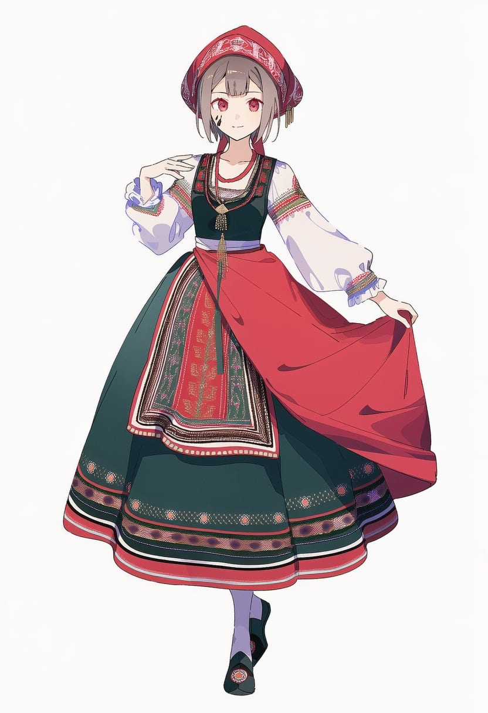

| 字段 | 内容 |
| --- | --- |
| danbooru tag | traditional_slavic_clothes |
| tag 中文名 | 斯拉夫传统服饰 |
| tag 中文含义 | 斯拉夫民族传统服饰 |
| 分类 | 欧洲-综合 |
| 角色 tag | vulcan_(arknights) |
| 序号 | 0082 |

## 82. turkish_clothes — 土耳其服饰

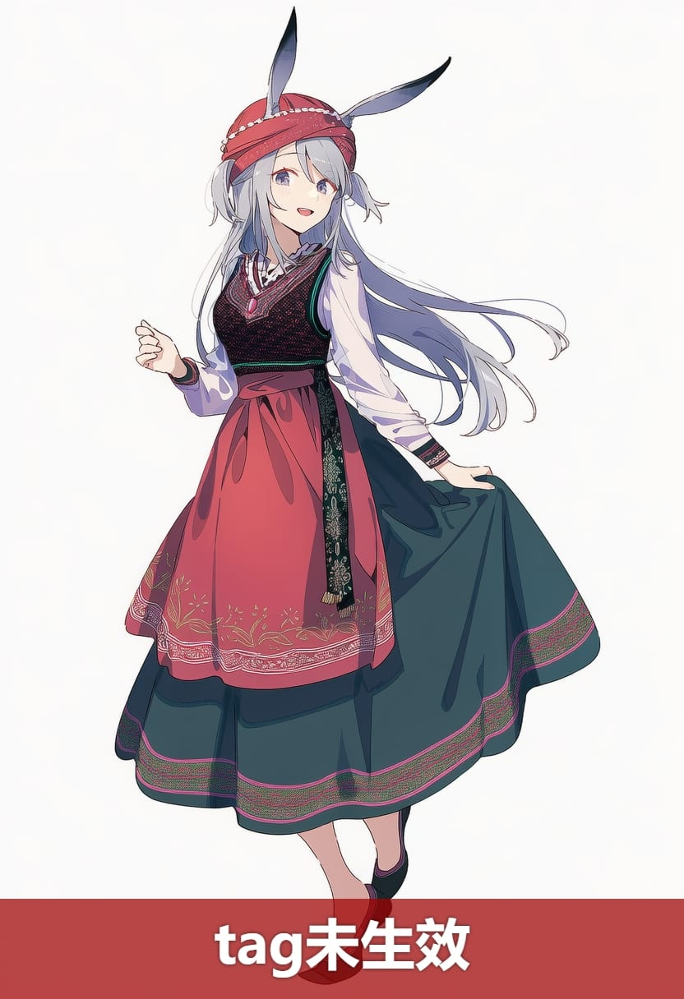

| 字段 | 内容 |
| --- | --- |
| danbooru tag | turkish_clothes |
| tag 中文名 | 土耳其服饰 |
| tag 中文含义 | 土耳其传统服饰 |
| 分类 | 土耳其-综合 |
| 角色 tag | savage_(arknights) |
| 序号 | 0083 |

## 83. turkic_clothes — 突厥服饰

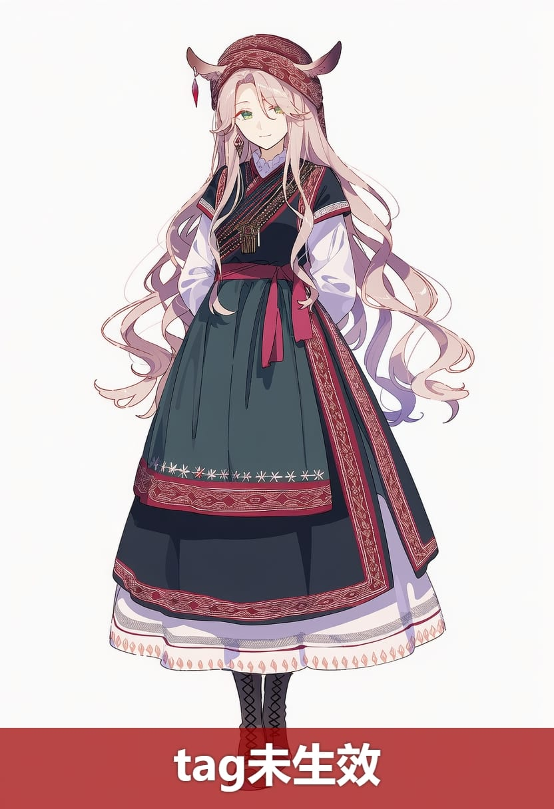

| 字段 | 内容 |
| --- | --- |
| danbooru tag | turkic_clothes |
| tag 中文名 | 突厥服饰 |
| tag 中文含义 | 突厥系民族传统服饰 |
| 分类 | 中亚-综合 |
| 角色 tag | gitano_(arknights) |
| 序号 | 0084 |

## 84. hunnic_clothes — 匈人服饰

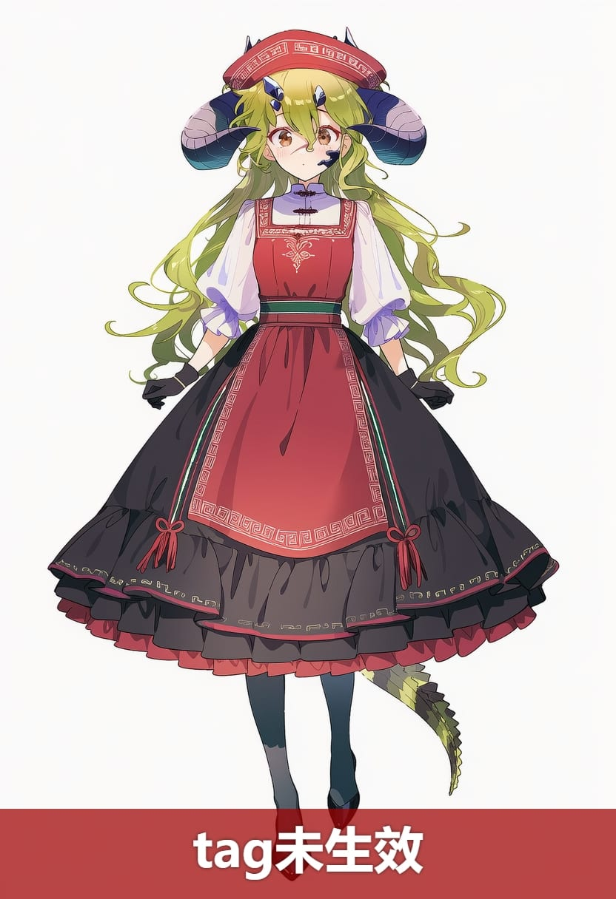

| 字段 | 内容 |
| --- | --- |
| danbooru tag | hunnic_clothes |
| tag 中文名 | 匈人服饰 |
| tag 中文含义 | 匈人（匈奴系）服饰 |
| 分类 | 中亚-综合 |
| 角色 tag | estelle_(arknights) |
| 序号 | 0085 |

## 85. crimean_tatar_clothes — 克里米亚鞑靼服饰

| 字段 | 内容 |
| --- | --- |
| danbooru tag | crimean_tatar_clothes |
| tag 中文名 | 克里米亚鞑靼服饰 |
| tag 中文含义 | 克里米亚鞑靼传统服饰 |
| 分类 | 欧洲-综合 |
| 角色 tag | manticore_(arknights) |
| 序号 | 0086 |

## 86. guatemalan_clothes — 危地马拉服饰

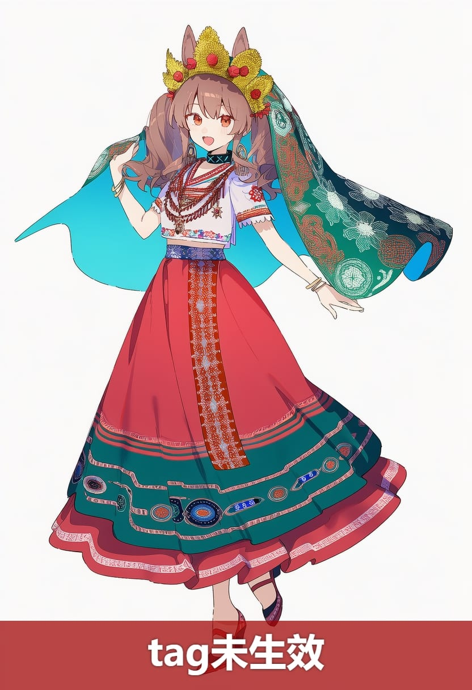

| 字段 | 内容 |
| --- | --- |
| danbooru tag | guatemalan_clothes |
| tag 中文名 | 危地马拉服饰 |
| tag 中文含义 | 危地马拉玛雅彩织服饰 |
| 分类 | 美洲-综合 |
| 角色 tag | angelina_(arknights) |
| 序号 | 0087 |

## 87. jamaican_clothes — 牙买加服饰

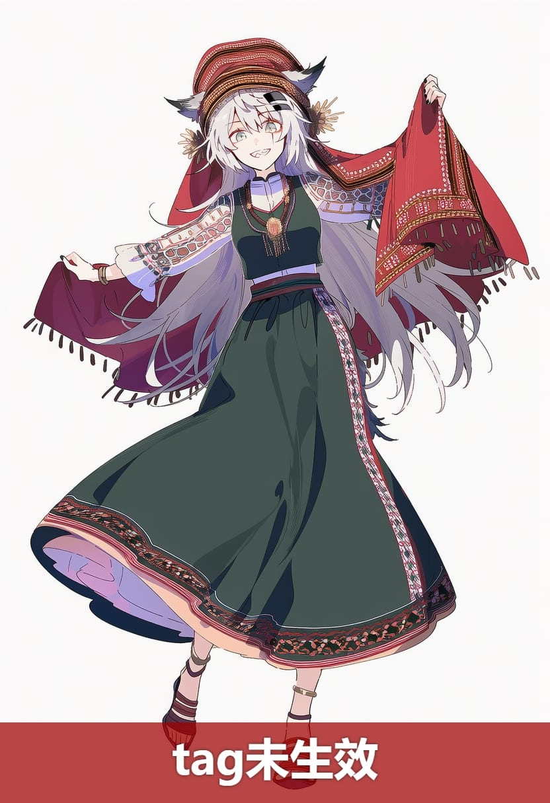

| 字段 | 内容 |
| --- | --- |
| danbooru tag | jamaican_clothes |
| tag 中文名 | 牙买加服饰 |
| tag 中文含义 | 牙买加传统服饰 |
| 分类 | 美洲-综合 |
| 角色 tag | lappland_(arknights) |
| 序号 | 0088 |

## 88. azerbaijani_clothes — 阿塞拜疆服饰

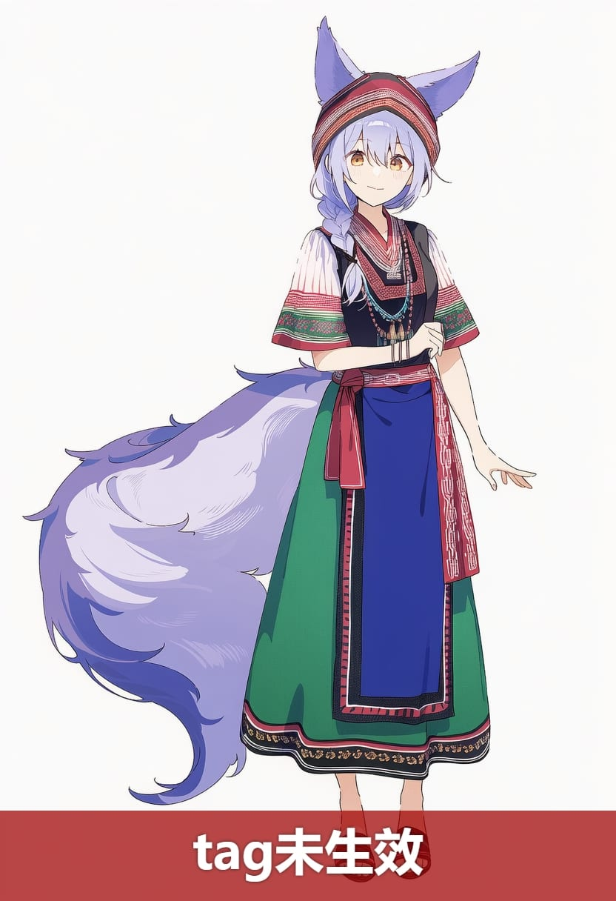

| 字段 | 内容 |
| --- | --- |
| danbooru tag | azerbaijani_clothes |
| tag 中文名 | 阿塞拜疆服饰 |
| tag 中文含义 | 阿塞拜疆传统服饰 |
| 分类 | 中亚-综合 |
| 角色 tag | provence_(arknights) |
| 序号 | 0089 |

## 89. afghan_clothes — 阿富汗服饰

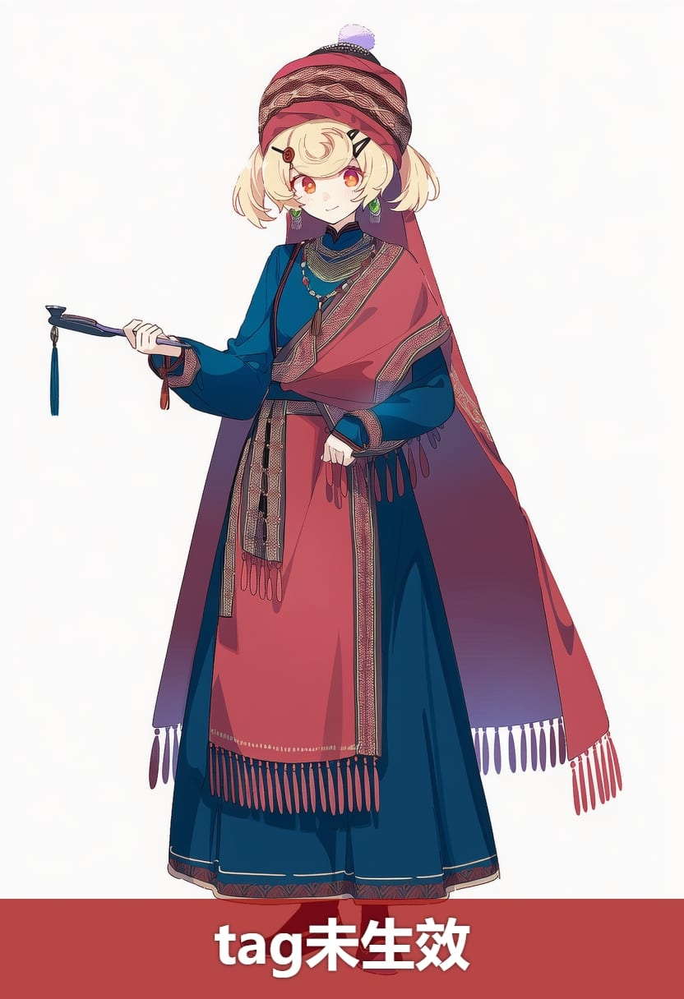

| 字段 | 内容 |
| --- | --- |
| danbooru tag | afghan_clothes |
| tag 中文名 | 阿富汗服饰 |
| tag 中文含义 | 阿富汗传统服饰 |
| 分类 | 中亚-综合 |
| 角色 tag | gummy_(arknights) |
| 序号 | 0090 |

## 90. algerian_clothes — 阿尔及利亚服饰

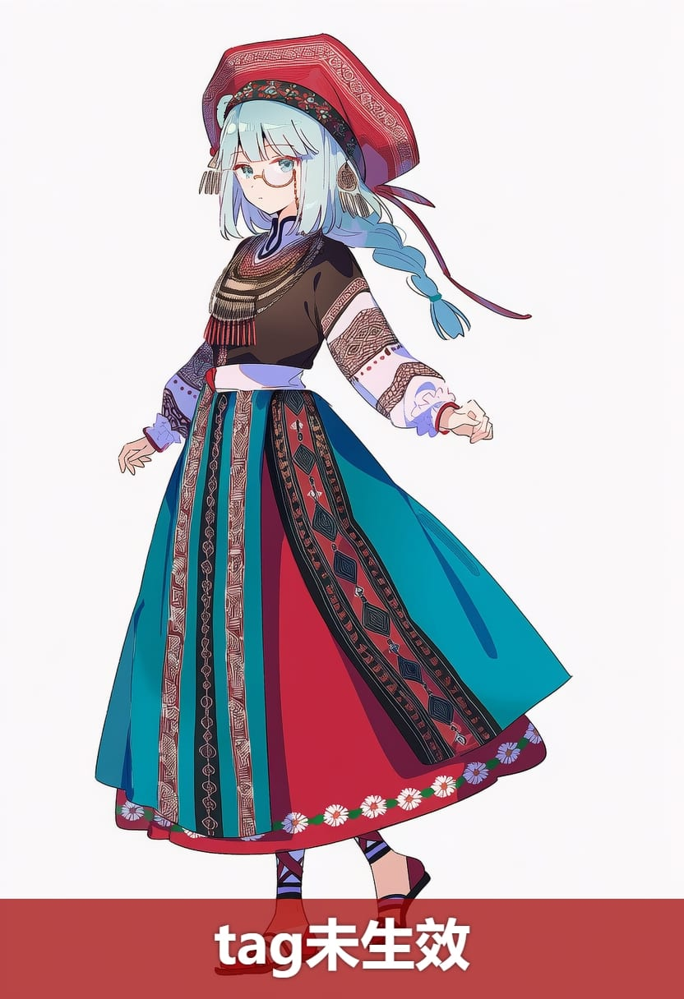

| 字段 | 内容 |
| --- | --- |
| danbooru tag | algerian_clothes |
| tag 中文名 | 阿尔及利亚服饰 |
| tag 中文含义 | 阿尔及利亚传统服饰 |
| 分类 | 非洲-综合 |
| 角色 tag | istina_(arknights) |
| 序号 | 0091 |

## 91. tunisian_clothes — 突尼斯服饰

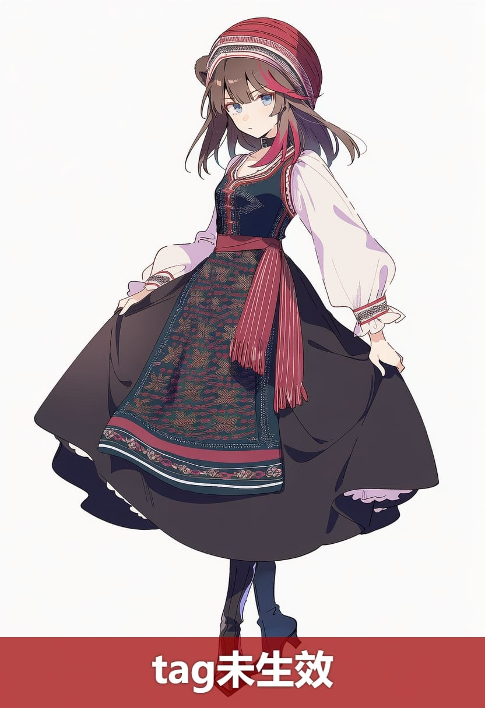

| 字段 | 内容 |
| --- | --- |
| danbooru tag | tunisian_clothes |
| tag 中文名 | 突尼斯服饰 |
| tag 中文含义 | 突尼斯传统服饰 |
| 分类 | 非洲-综合 |
| 角色 tag | zima_(arknights) |
| 序号 | 0092 |

## 92. arabian_clothes — 阿拉伯服饰

| 字段 | 内容 |
| --- | --- |
| danbooru tag | arabian_clothes |
| tag 中文名 | 阿拉伯服饰 |
| tag 中文含义 | 阿拉伯半岛传统服饰 |
| 分类 | 中东-综合 |
| 角色 tag | haze_(arknights) |
| 序号 | 0093 |

## 93. turban — 头巾(缠头)

| 字段 | 内容 |
| --- | --- |
| danbooru tag | turban |
| tag 中文名 | 头巾(缠头) |
| tag 中文含义 | 中东/南亚传统缠头巾 |
| 分类 | 中东-头饰 |
| 角色 tag | mousse_(arknights) |
| 序号 | 0094 |

## 94. african_clothes — 非洲服饰

| 字段 | 内容 |
| --- | --- |
| danbooru tag | african_clothes |
| tag 中文名 | 非洲服饰 |
| tag 中文含义 | 非洲大陆传统服饰总称 |
| 分类 | 非洲-综合 |
| 角色 tag | skyfire_(arknights) |
| 序号 | 0095 |

## 95. amazigh_clothes — 柏柏尔服饰

| 字段 | 内容 |
| --- | --- |
| danbooru tag | amazigh_clothes |
| tag 中文名 | 柏柏尔服饰 |
| tag 中文含义 | 北非柏柏尔人传统服饰 |
| 分类 | 非洲-综合 |
| 角色 tag | indra_(arknights) |
| 序号 | 0096 |

## 96. hand_fan — 团扇

| 字段 | 内容 |
| --- | --- |
| danbooru tag | hand_fan |
| tag 中文名 | 团扇 |
| tag 中文含义 | 中国古典圆形团扇 |
| 分类 | 中国-配饰 |
| 角色 tag | lan_yan_(genshin_impact) |
| 序号 | 0097 |

## 97. chinese_knot — 中国结

| 字段 | 内容 |
| --- | --- |
| danbooru tag | chinese_knot |
| tag 中文名 | 中国结 |
| tag 中文含义 | 中国传统绳结装饰 |
| 分类 | 中国-配饰 |
| 角色 tag | guizhong_(genshin_impact) |
| 序号 | 0098 |

## 98. hair_stick — 发簪

| 字段 | 内容 |
| --- | --- |
| danbooru tag | hair_stick |
| tag 中文名 | 发簪 |
| tag 中文含义 | 中国传统长发簪/发钗 |
| 分类 | 中国-配饰 |
| 角色 tag | madame_ping_(genshin_impact) |
| 序号 | 0100 |

## 99. tassel — 流苏

| 字段 | 内容 |
| --- | --- |
| danbooru tag | tassel |
| tag 中文名 | 流苏 |
| tag 中文含义 | 玉佩/中国结上的流苏垂饰 |
| 分类 | 中国-配饰 |
| 角色 tag | qingque_(honkai:_star_rail) |
| 序号 | 0101 |

## 100. folding_fan — 折扇

| 字段 | 内容 |
| --- | --- |
| danbooru tag | folding_fan |
| tag 中文名 | 折扇 |
| tag 中文含义 | 中国/东亚折扇 |
| 分类 | 中国-配饰 |
| 角色 tag | feixiao_(honkai:_star_rail) |
| 序号 | 0103 |

## 101. necklace — 璎珞

| 字段 | 内容 |
| --- | --- |
| danbooru tag | necklace |
| tag 中文名 | 璎珞 |
| tag 中文含义 | 多层珠串璎珞项链 |
| 分类 | 中国-配饰 |
| 角色 tag | fu_xuan_(honkai:_star_rail) |
| 序号 | 0106 |

## 102. armlet — 臂钏

| 字段 | 内容 |
| --- | --- |
| danbooru tag | armlet |
| tag 中文名 | 臂钏 |
| tag 中文含义 | 古典臂钏/臂环 |
| 分类 | 中国-配饰 |
| 角色 tag | tingyun_(honkai:_star_rail) |
| 序号 | 0107 |

## 103. kanzashi — 发簪(和)

| 字段 | 内容 |
| --- | --- |
| danbooru tag | kanzashi |
| tag 中文名 | 发簪(和) |
| tag 中文含义 | 日本传统发簪/簪花 |
| 分类 | 日本-配饰 |
| 角色 tag | mima_(touhou) |
| 序号 | 0108 |

## 104. geta — 木屐

| 字段 | 内容 |
| --- | --- |
| danbooru tag | geta |
| tag 中文名 | 木屐 |
| tag 中文含义 | 日本传统木屐 |
| 分类 | 日本-配饰 |
| 角色 tag | kikuri_(touhou) |
| 序号 | 0109 |

## 105. nose_ring — 鼻环

| 字段 | 内容 |
| --- | --- |
| danbooru tag | nose_ring |
| tag 中文名 | 鼻环 |
| tag 中文含义 | 印度传统鼻环 |
| 分类 | 印度-配饰 |
| 角色 tag | rope_(arknights) |
| 序号 | 0111 |

## 106. anklet — 脚镯

| 字段 | 内容 |
| --- | --- |
| danbooru tag | anklet |
| tag 中文名 | 脚镯 |
| tag 中文含义 | 印度传统脚镯/脚铃 |
| 分类 | 印度-配饰 |
| 角色 tag | shaw_(arknights) |
| 序号 | 0112 |

## 107. tiara — 头冠

| 字段 | 内容 |
| --- | --- |
| danbooru tag | tiara |
| tag 中文名 | 头冠 |
| tag 中文含义 | 欧洲贵妇头冠 |
| 分类 | 欧洲-配饰 |
| 角色 tag | saber_(fate) |
| 序号 | 0115 |

## 108. crown — 王冠

| 字段 | 内容 |
| --- | --- |
| danbooru tag | crown |
| tag 中文名 | 王冠 |
| tag 中文含义 | 欧洲/王室王冠 |
| 分类 | 欧洲-配饰 |
| 角色 tag | medea_(fate) |
| 序号 | 0116 |

## 109. pearl_necklace — 珍珠项链

| 字段 | 内容 |
| --- | --- |
| danbooru tag | pearl_necklace |
| tag 中文名 | 珍珠项链 |
| tag 中文含义 | 欧洲古典珍珠项链 |
| 分类 | 欧洲-配饰 |
| 角色 tag | illyasviel_von_einzbern |
| 序号 | 0117 |

## 110. corset — 束腰

| 字段 | 内容 |
| --- | --- |
| danbooru tag | corset |
| tag 中文名 | 束腰 |
| tag 中文含义 | 欧洲古典束腰内衣 |
| 分类 | 欧洲-配饰 |
| 角色 tag | mitsuzuri_ayako |
| 序号 | 0119 |

## 111. hair_flower — 发饰花

| 字段 | 内容 |
| --- | --- |
| danbooru tag | hair_flower |
| tag 中文名 | 发饰花 |
| tag 中文含义 | 东南亚/南亚热带发饰花 |
| 分类 | 东南亚-配饰 |
| 角色 tag | exusiai_(arknights) |
| 序号 | 0120 |

---
