## 1. weapon — 武器

| 字段 | 内容 |
| --- | --- |
| 序号 | 0001 |
| tag | weapon |
| tag中文名 | 武器 |
| tag中文含义 | 泛指能用来攻击或造成伤害的武器 |
| tag所属的子类 | 通用武器 |
| 角色 | cirno |

## 2. gun — 枪械

| 字段 | 内容 |
| --- | --- |
| 序号 | 0002 |
| tag | gun |
| tag中文名 | 枪械 |
| tag中文含义 | 泛指通过枪管发射弹丸的枪 |
| tag所属的子类 | 通用武器 |
| 角色 | rumia |

## 3. bomb — 炸弹

| 字段 | 内容 |
| --- | --- |
| 序号 | 0003 |
| tag | bomb |
| tag中文名 | 炸弹 |
| tag中文含义 | 会爆炸造成伤害的炸弹 |
| tag所属的子类 | 爆炸物与重火力 |
| 角色 | chen |

## 4. cannon — 大炮

| 字段 | 内容 |
| --- | --- |
| 序号 | 0004 |
| tag | cannon |
| tag中文名 | 大炮 |
| tag中文含义 | 大型炮管式火炮 |
| tag所属的子类 | 爆炸物与重火力 |
| 角色 | abigail_williams_(fate) |

## 5. arm_cannon — 臂炮

| 字段 | 内容 |
| --- | --- |
| 序号 | 0005 |
| tag | arm_cannon |
| tag中文名 | 臂炮 |
| tag中文含义 | 装在手臂上的炮 |
| tag所属的子类 | 爆炸物与重火力 |
| 角色 | daiyousei |

## 6. grenade — 手榴弹

| 字段 | 内容 |
| --- | --- |
| 序号 | 0006 |
| tag | grenade |
| tag中文名 | 手榴弹 |
| tag中文含义 | 手持投掷的爆炸物 |
| tag所属的子类 | 爆炸物与重火力 |
| 角色 | illyasviel_von_einzbern |

## 7. missile — 导弹

| 字段 | 内容 |
| --- | --- |
| 序号 | 0007 |
| tag | missile |
| tag中文名 | 导弹 |
| tag中文含义 | 带动力飞行并打击目标的导弹 |
| tag所属的子类 | 爆炸物与重火力 |
| 角色 | kinomoto_sakura |

## 8. grenade_launcher — 榴弹发射器

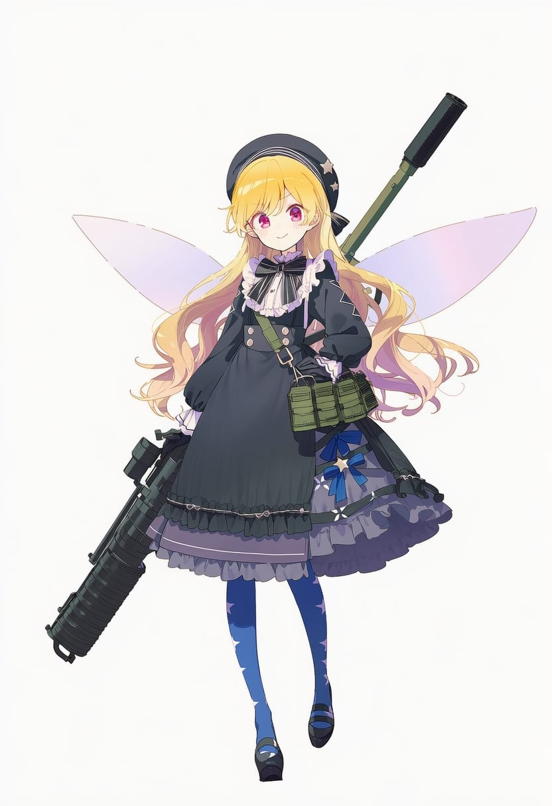

| 字段 | 内容 |
| --- | --- |
| 序号 | 0008 |
| tag | grenade_launcher |
| tag中文名 | 榴弹发射器 |
| tag中文含义 | 专门发射榴弹的武器 |
| tag所属的子类 | 爆炸物与重火力 |
| 角色 | clownpiece |

## 9. rocket_launcher — 火箭筒

| 字段 | 内容 |
| --- | --- |
| 序号 | 0009 |
| tag | rocket_launcher |
| tag中文名 | 火箭筒 |
| tag中文含义 | 肩扛或手持发射火箭弹的武器 |
| tag所属的子类 | 爆炸物与重火力 |
| 角色 | klee_(genshin_impact) |

## 10. musket — 火枪

| 字段 | 内容 |
| --- | --- |
| 序号 | 0010 |
| tag | musket |
| tag中文名 | 火枪 |
| tag中文含义 | 长管前装式老式步枪 |
| tag所属的子类 | 古式火器 |
| 角色 | suzuran_(arknights) |

## 11. handgun — 手枪

| 字段 | 内容 |
| --- | --- |
| 序号 | 0011 |
| tag | handgun |
| tag中文名 | 手枪 |
| tag中文含义 | 可以单手持握的短枪 |
| tag所属的子类 | 手枪与左轮 |
| 角色 | anya_(spy_x_family) |

## 12. revolver — 左轮手枪

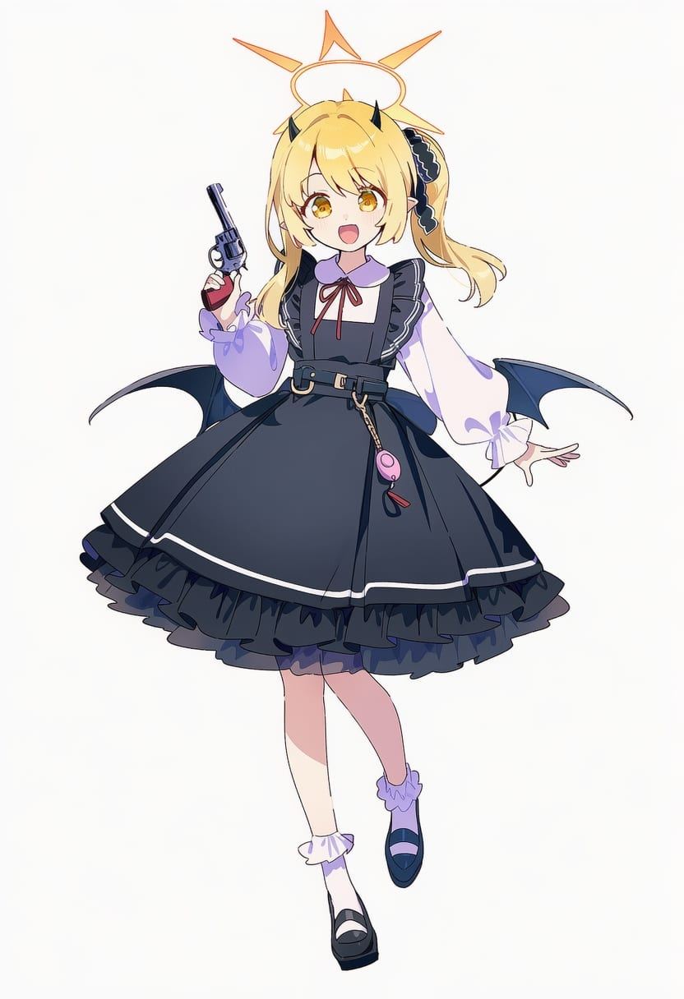

| 字段 | 内容 |
| --- | --- |
| 序号 | 0012 |
| tag | revolver |
| tag中文名 | 左轮手枪 |
| tag中文含义 | 带旋转弹巢的手枪 |
| tag所属的子类 | 手枪与左轮 |
| 角色 | ibuki_(blue_archive) |

## 13. machine_gun — 机枪

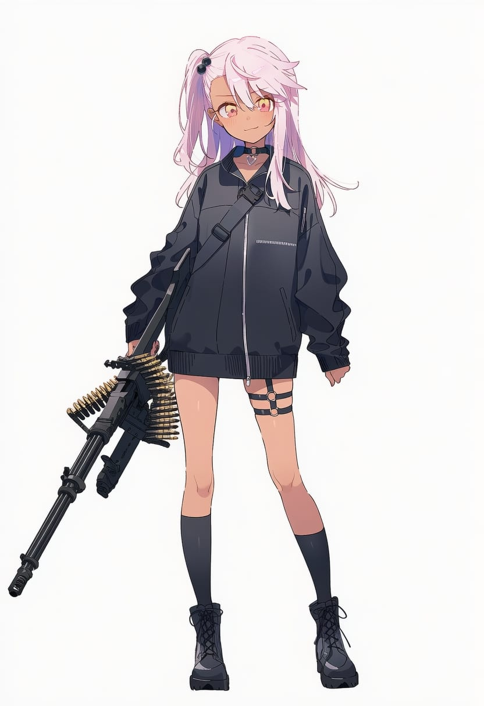

| 字段 | 内容 |
| --- | --- |
| 序号 | 0013 |
| tag | machine_gun |
| tag中文名 | 机枪 |
| tag中文含义 | 可以持续自动射击的机枪 |
| tag所属的子类 | 机枪 |
| 角色 | chloe_von_einzbern |

## 14. gatling_gun — 加特林机枪

| 字段 | 内容 |
| --- | --- |
| 序号 | 0014 |
| tag | gatling_gun |
| tag中文名 | 加特林机枪 |
| tag中文含义 | 多根枪管旋转射击的机枪 |
| tag所属的子类 | 机枪 |
| 角色 | furude_rika |

## 15. rifle — 步枪

| 字段 | 内容 |
| --- | --- |
| 序号 | 0015 |
| tag | rifle |
| tag中文名 | 步枪 |
| tag中文含义 | 长枪管肩射枪械 |
| tag所属的子类 | 步枪 |
| 角色 | kokona_(blue_archive) |

## 16. anti-materiel_rifle — 反器材步枪

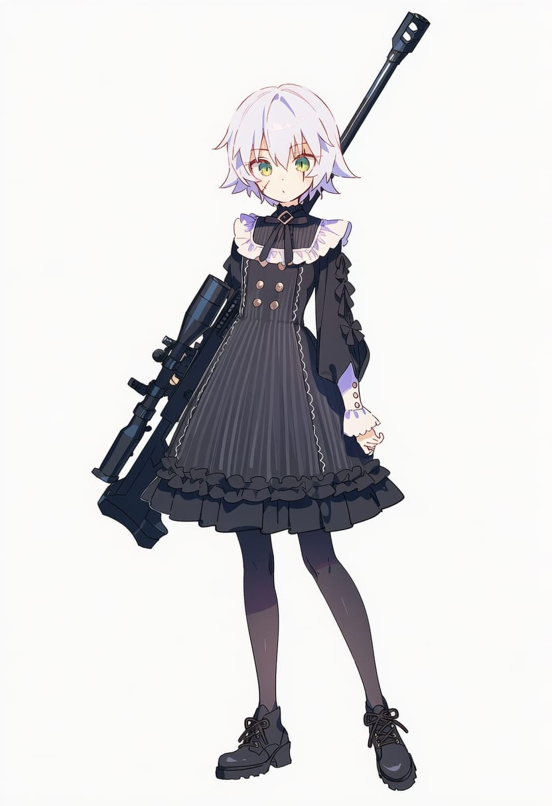

| 字段 | 内容 |
| --- | --- |
| 序号 | 0016 |
| tag | anti-materiel_rifle |
| tag中文名 | 反器材步枪 |
| tag中文含义 | 用于打击设备或硬目标的大口径步枪 |
| tag所属的子类 | 步枪 |
| 角色 | jack_the_ripper_(fate/apocrypha) |

## 17. assault_rifle — 突击步枪

| 字段 | 内容 |
| --- | --- |
| 序号 | 0017 |
| tag | assault_rifle |
| tag中文名 | 突击步枪 |
| tag中文含义 | 可选择射击模式的现代军用步枪 |
| tag所属的子类 | 步枪 |
| 角色 | unicorn_(azur_lane) |

## 18. sniper_rifle — 狙击步枪

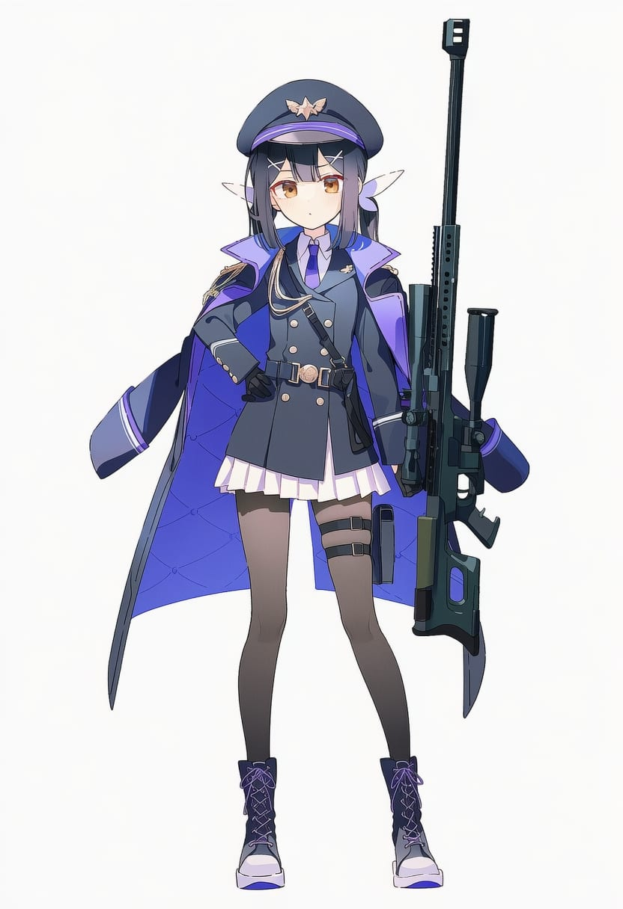

| 字段 | 内容 |
| --- | --- |
| 序号 | 0018 |
| tag | sniper_rifle |
| tag中文名 | 狙击步枪 |
| tag中文含义 | 配合瞄准镜进行远距离射击的步枪 |
| tag所属的子类 | 步枪 |
| 角色 | miyu_edelfelt |

## 19. shotgun — 霰弹枪

| 字段 | 内容 |
| --- | --- |
| 序号 | 0019 |
| tag | shotgun |
| tag中文名 | 霰弹枪 |
| tag中文含义 | 主要发射霰弹的长枪 |
| tag所属的子类 | 霰弹枪 |
| 角色 | houjou_satoko |

## 20. submachine_gun — 冲锋枪

| 字段 | 内容 |
| --- | --- |
| 序号 | 0020 |
| tag | submachine_gun |
| tag中文名 | 冲锋枪 |
| tag中文含义 | 使用手枪弹并能自动射击的短枪 |
| tag所属的子类 | 冲锋枪 |
| 角色 | qiqi_(genshin_impact) |

## 21. energy_gun — 能量枪

| 字段 | 内容 |
| --- | --- |
| 序号 | 0021 |
| tag | energy_gun |
| tag中文名 | 能量枪 |
| tag中文含义 | 发射光束或能量弹的枪 |
| tag所属的子类 | 能量武器 |
| 角色 | akagi_miria |

## 22. beam_rifle — 光束步枪

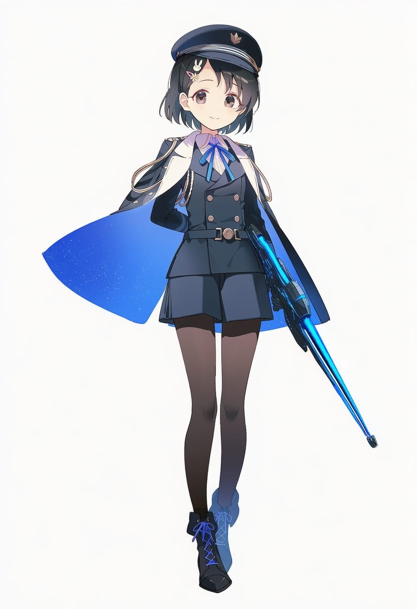

| 字段 | 内容 |
| --- | --- |
| 序号 | 0022 |
| tag | beam_rifle |
| tag中文名 | 光束步枪 |
| tag中文含义 | 发射光束的步枪 |
| tag所属的子类 | 能量武器 |
| 角色 | sasaki_chie |

## 23. ray_gun — 射线枪

| 字段 | 内容 |
| --- | --- |
| 序号 | 0023 |
| tag | ray_gun |
| tag中文名 | 射线枪 |
| tag中文含义 | 科幻风格发射射线的枪 |
| tag所属的子类 | 能量武器 |
| 角色 | daidouji_tomoyo |

## 24. energy_sword — 能量剑

| 字段 | 内容 |
| --- | --- |
| 序号 | 0024 |
| tag | energy_sword |
| tag中文名 | 能量剑 |
| tag中文含义 | 剑刃由光或能量构成的剑 |
| tag所属的子类 | 能量武器 |
| 角色 | suou_momoko |

## 25. arm_blade — 臂刃

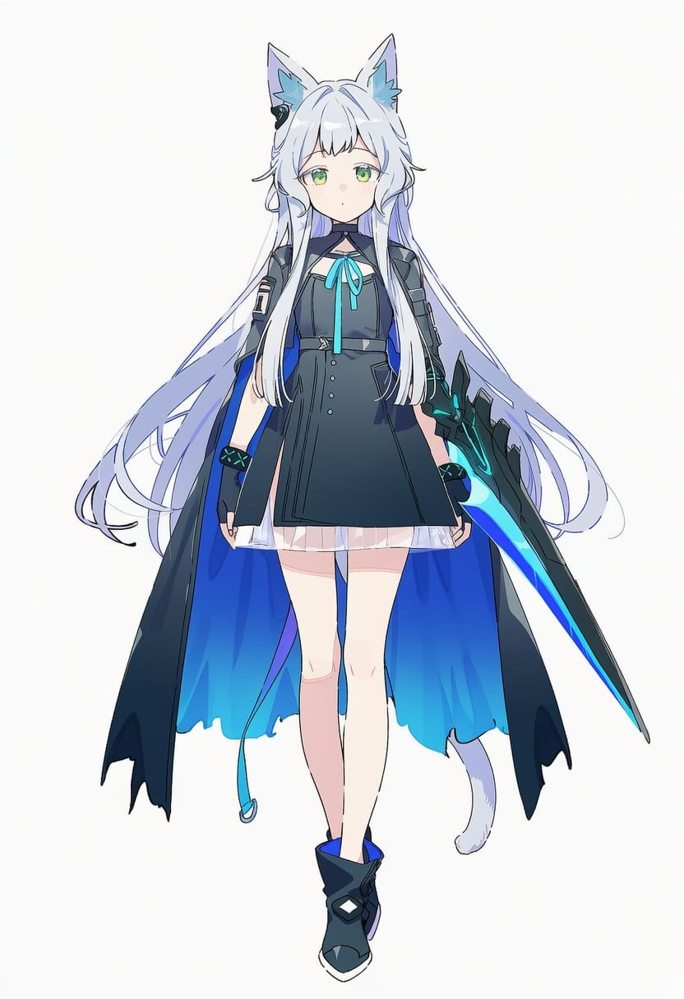

| 字段 | 内容 |
| --- | --- |
| 序号 | 0025 |
| tag | arm_blade |
| tag中文名 | 臂刃 |
| tag中文含义 | 固定在手臂上的刀刃 |
| tag所属的子类 | 刀剑类 |
| 角色 | rosmontis_(arknights) |

## 26. gunblade — 枪刃

| 字段 | 内容 |
| --- | --- |
| 序号 | 0026 |
| tag | gunblade |
| tag中文名 | 枪刃 |
| tag中文含义 | 枪和刀剑结合的武器 |
| tag所属的子类 | 刀剑类 |
| 角色 | last_order_(toaru_majutsu_no_index) |

## 27. sword — 剑

| 字段 | 内容 |
| --- | --- |
| 序号 | 0027 |
| tag | sword |
| tag中文名 | 剑 |
| tag中文含义 | 泛指各种刀剑形武器 |
| tag所属的子类 | 刀剑类 |
| 角色 | ichihara_nina |

## 28. greatsword — 大剑

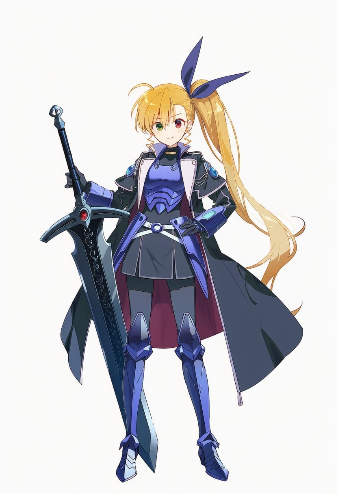

| 字段 | 内容 |
| --- | --- |
| 序号 | 0028 |
| tag | greatsword |
| tag中文名 | 大剑 |
| tag中文含义 | 体型很大的双手剑 |
| tag所属的子类 | 刀剑类 |
| 角色 | vivio |

## 29. katana — 日本刀

| 字段 | 内容 |
| --- | --- |
| 序号 | 0029 |
| tag | katana |
| tag中文名 | 日本刀 |
| tag中文含义 | 典型弧形单刃日本刀 |
| tag所属的子类 | 刀剑类 |
| 角色 | hachikuji_mayoi |

## 30. rapier — 细剑

| 字段 | 内容 |
| --- | --- |
| 序号 | 0030 |
| tag | rapier |
| tag中文名 | 细剑 |
| tag中文含义 | 细长、以刺击为主的剑 |
| tag所属的子类 | 刀剑类 |
| 角色 | sajo_yukimi |

## 31. saber_(weapon) — 军刀

| 字段 | 内容 |
| --- | --- |
| 序号 | 0031 |
| tag | saber_(weapon) |
| tag中文名 | 军刀 |
| tag中文含义 | 单刃弯曲的佩刀或军刀 |
| tag所属的子类 | 刀剑类 |
| 角色 | sigewinne_(genshin_impact) |

## 32. shinai — 竹刀

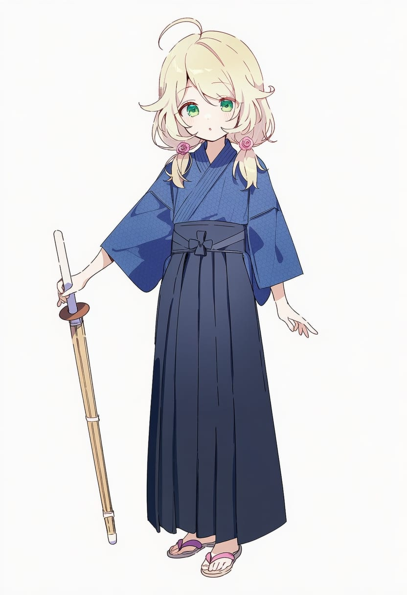

| 字段 | 内容 |
| --- | --- |
| 序号 | 0032 |
| tag | shinai |
| tag中文名 | 竹刀 |
| tag中文含义 | 剑道练习用竹制刀 |
| tag所属的子类 | 刀剑类 |
| 角色 | yusa_kozue |

## 33. polearm — 长柄武器

| 字段 | 内容 |
| --- | --- |
| 序号 | 0033 |
| tag | polearm |
| tag中文名 | 长柄武器 |
| tag中文含义 | 泛指长杆头部带刃或尖头的武器 |
| tag所属的子类 | 长柄武器 |
| 角色 | momoe_nagisa |

## 34. halberd — 戟斧

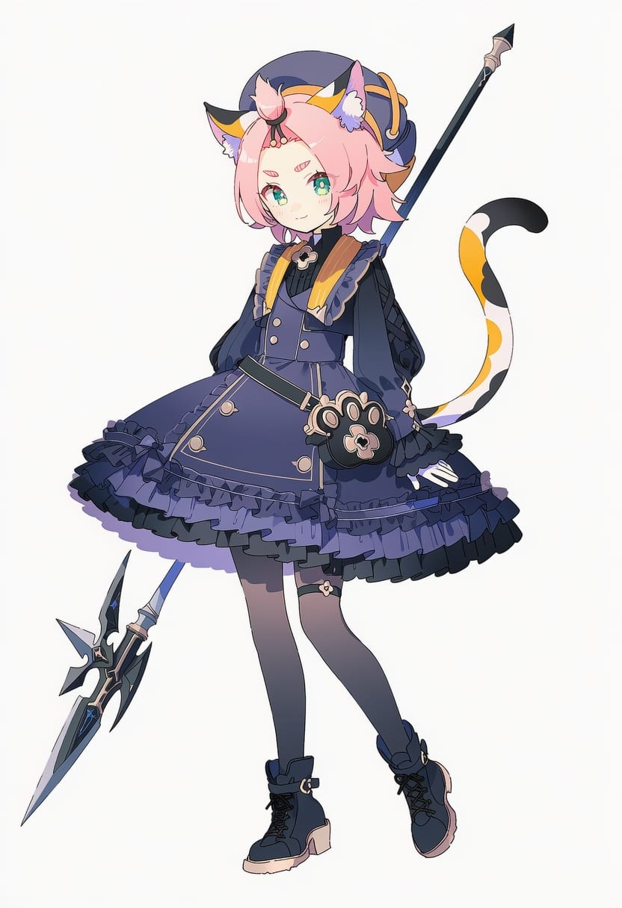

| 字段 | 内容 |
| --- | --- |
| 序号 | 0034 |
| tag | halberd |
| tag中文名 | 戟斧 |
| tag中文含义 | 结合斧刃和枪尖的长柄武器 |
| tag所属的子类 | 长柄武器 |
| 角色 | diona_(genshin_impact) |

## 35. naginata — 薙刀

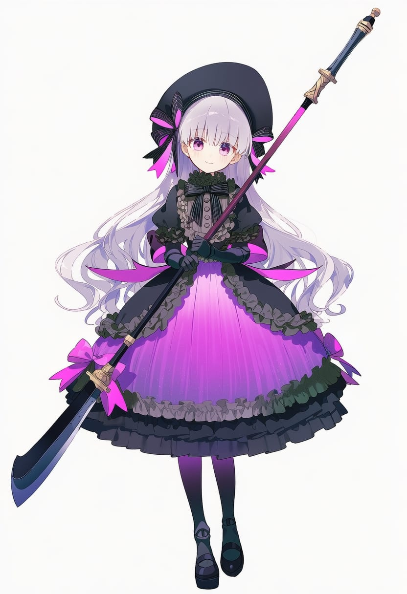

| 字段 | 内容 |
| --- | --- |
| 序号 | 0035 |
| tag | naginata |
| tag中文名 | 薙刀 |
| tag中文含义 | 日本长柄弯刃武器 |
| tag所属的子类 | 长柄武器 |
| 角色 | nursery_rhyme_(fate) |

## 36. scythe — 镰刀

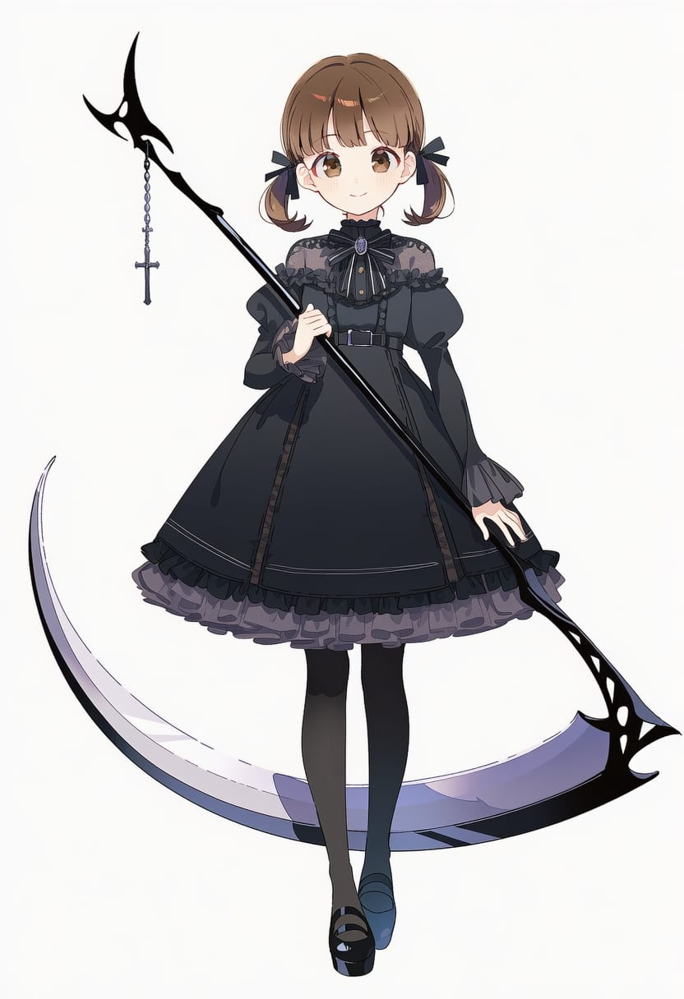

| 字段 | 内容 |
| --- | --- |
| 序号 | 0036 |
| tag | scythe |
| tag中文名 | 镰刀 |
| tag中文含义 | 长柄大镰刀形武器 |
| tag所属的子类 | 长柄武器 |
| 角色 | doujima_nanako |

## 37. spear — 长矛

| 字段 | 内容 |
| --- | --- |
| 序号 | 0037 |
| tag | spear |
| tag中文名 | 长矛 |
| tag中文含义 | 长杆前端带尖头的刺击武器 |
| tag所属的子类 | 长柄武器 |
| 角色 | ushiromiya_maria |

## 38. trident — 三叉戟

| 字段 | 内容 |
| --- | --- |
| 序号 | 0038 |
| tag | trident |
| tag中文名 | 三叉戟 |
| tag中文含义 | 前端有三个尖齿的长柄武器 |
| tag所属的子类 | 长柄武器 |
| 角色 | griseo |

## 39. axe — 斧

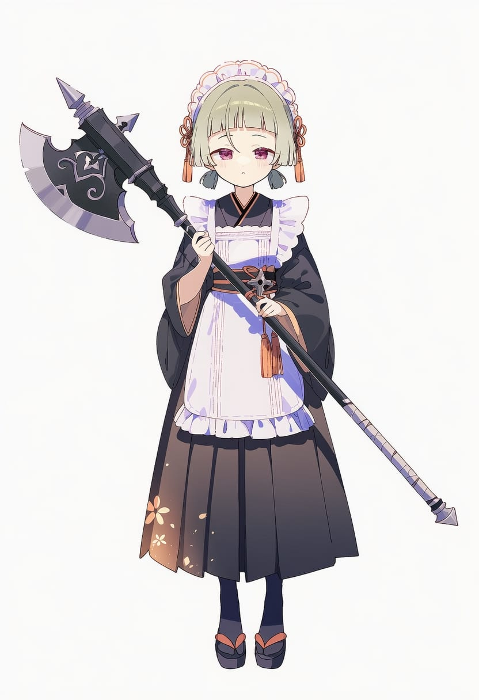

| 字段 | 内容 |
| --- | --- |
| 序号 | 0039 |
| tag | axe |
| tag中文名 | 斧 |
| tag中文含义 | 带宽刃的砍击武器 |
| tag所属的子类 | 钝器与链击武器 |
| 角色 | sayu_(genshin_impact) |

## 40. ball_and_chain_(weapon) — 链球武器

| 字段 | 内容 |
| --- | --- |
| 序号 | 0040 |
| tag | ball_and_chain_(weapon) |
| tag中文名 | 链球武器 |
| tag中文含义 | 用链子连接重球的武器 |
| tag所属的子类 | 钝器与链击武器 |
| 角色 | jouga_maya |

## 41. bo_staff — 长棍

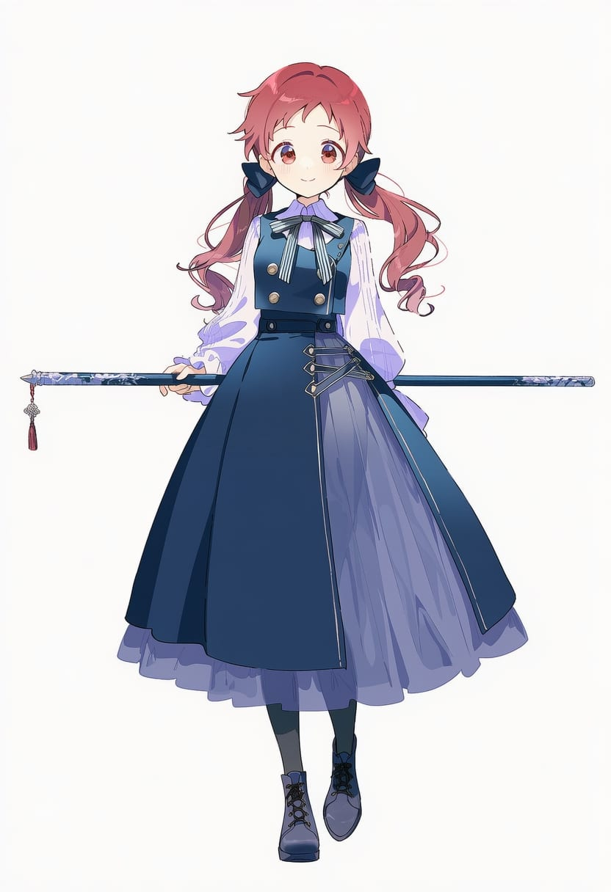

| 字段 | 内容 |
| --- | --- |
| 序号 | 0041 |
| tag | bo_staff |
| tag中文名 | 长棍 |
| tag中文含义 | 较长的直棍武器 |
| tag所属的子类 | 钝器与链击武器 |
| 角色 | natsu_megumi |

## 42. club_(weapon) — 棍棒

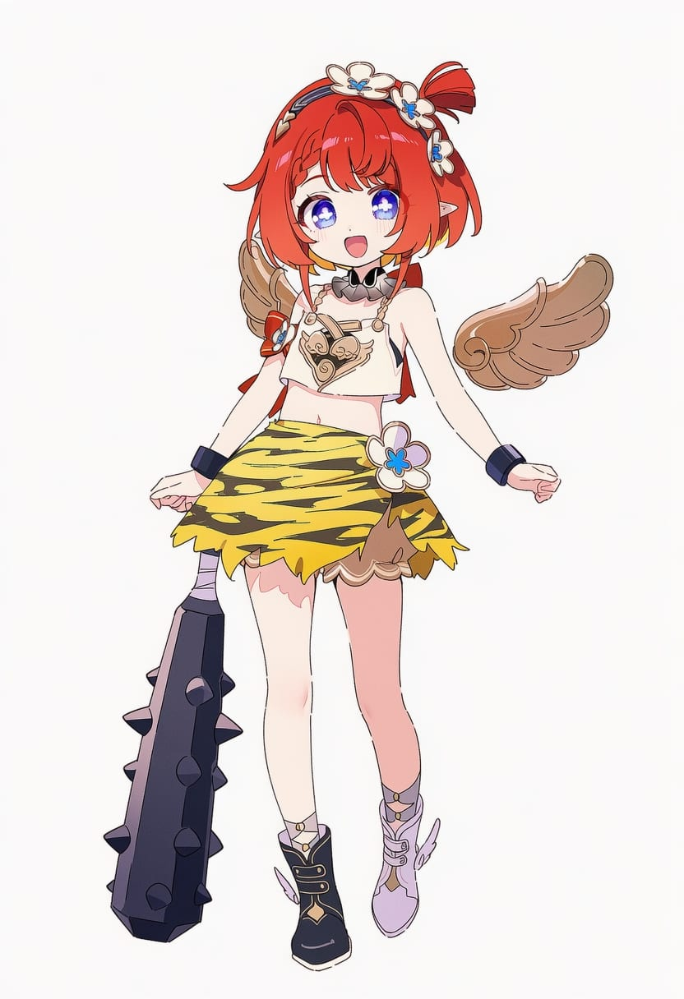

| 字段 | 内容 |
| --- | --- |
| 序号 | 0042 |
| tag | club_(weapon) |
| tag中文名 | 棍棒 |
| tag中文含义 | 粗重的棒状打击武器 |
| tag所属的子类 | 钝器与链击武器 |
| 角色 | tribbie_(honkai:_star_rail) |

## 43. kanabou — 金棒

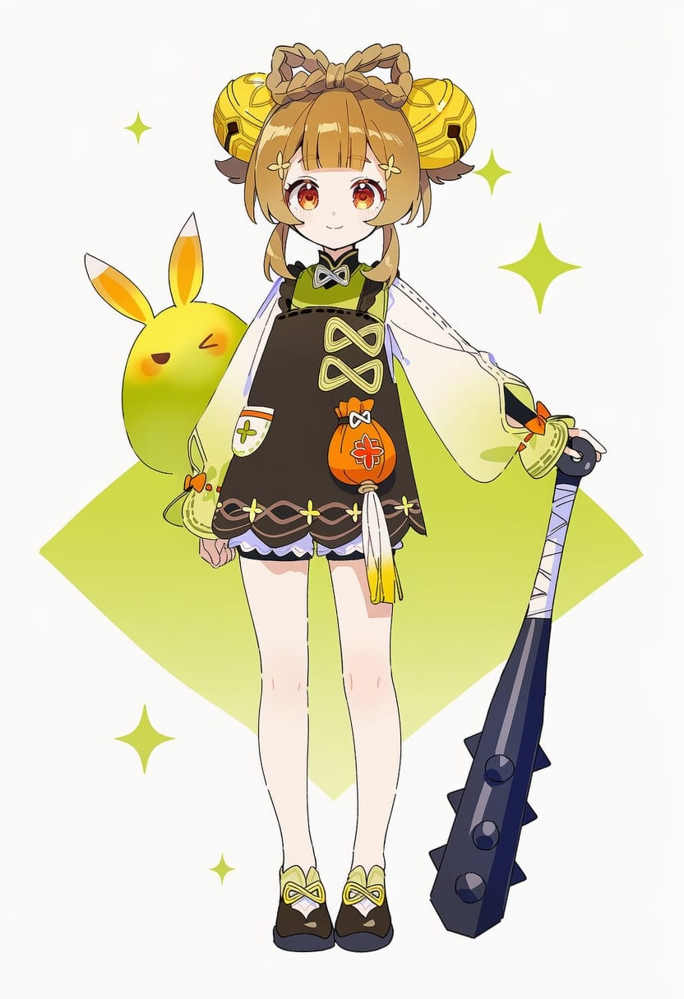

| 字段 | 内容 |
| --- | --- |
| 序号 | 0043 |
| tag | kanabou |
| tag中文名 | 金棒 |
| tag中文含义 | 带凸点或金属钉的日式重棍 |
| tag所属的子类 | 钝器与链击武器 |
| 角色 | yaoyao_(genshin_impact) |

## 44. hammer — 锤

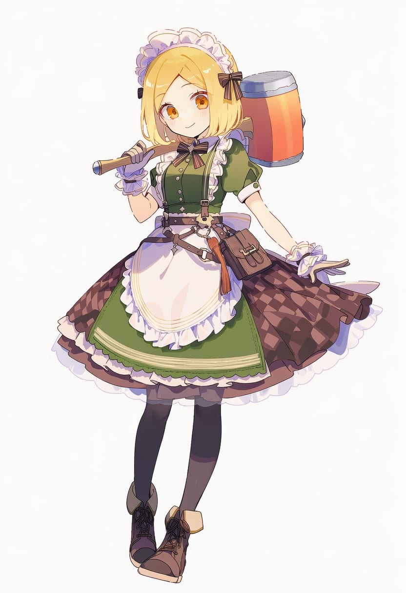

| 字段 | 内容 |
| --- | --- |
| 序号 | 0044 |
| tag | hammer |
| tag中文名 | 锤 |
| tag中文含义 | 锤头式打击武器 |
| tag所属的子类 | 钝器与链击武器 |
| 角色 | paul_bunyan_(fate) |

## 45. mace — 钉头锤

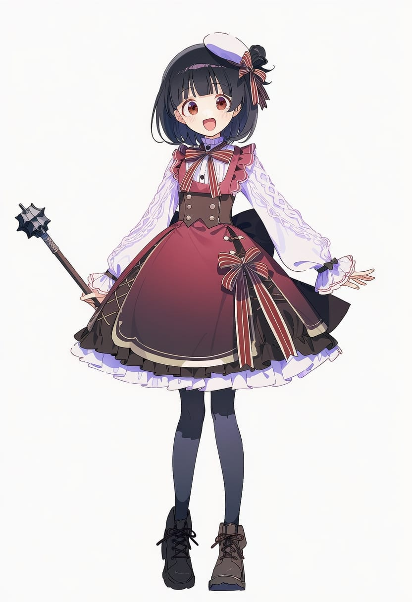

| 字段 | 内容 |
| --- | --- |
| 序号 | 0045 |
| tag | mace |
| tag中文名 | 钉头锤 |
| tag中文含义 | 头部较重的短柄打击武器 |
| tag所属的子类 | 钝器与链击武器 |
| 角色 | nakatani_iku |

## 46. whip — 鞭子

| 字段 | 内容 |
| --- | --- |
| 序号 | 0046 |
| tag | whip |
| tag中文名 | 鞭子 |
| tag中文含义 | 柔软长条状抽打武器 |
| tag所属的子类 | 钝器与链击武器 |
| 角色 | poppy_(pokemon) |

## 47. tonfa — 拐棍

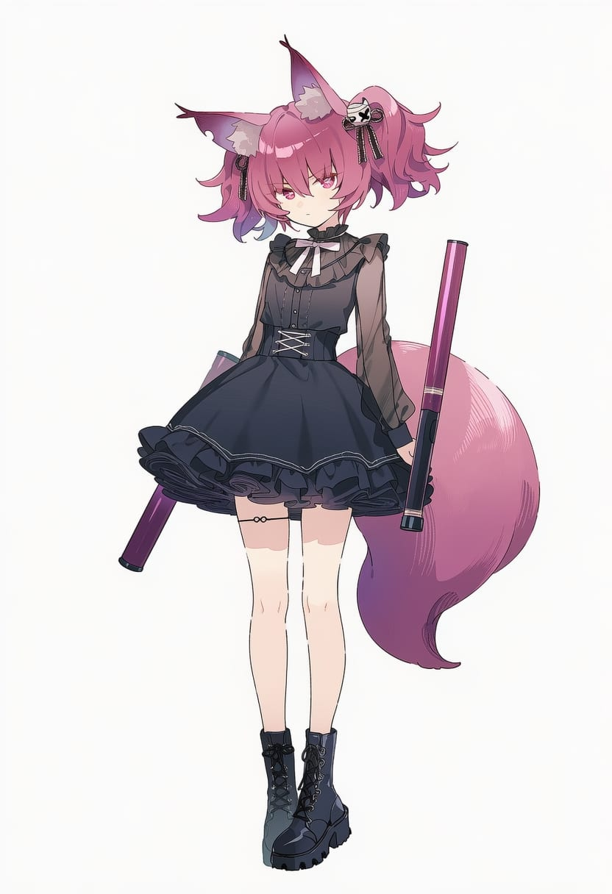

| 字段 | 内容 |
| --- | --- |
| 序号 | 0047 |
| tag | tonfa |
| tag中文名 | 拐棍 |
| tag中文含义 | 侧面带握把的短棍武器 |
| tag所属的子类 | 钝器与链击武器 |
| 角色 | shamare_(arknights) |

## 48. knife — 刀/匕首

| 字段 | 内容 |
| --- | --- |
| 序号 | 0048 |
| tag | knife |
| tag中文名 | 刀/匕首 |
| tag中文含义 | 泛指短小单刃或双刃刀具 |
| tag所属的子类 | 短兵器与忍具 |
| 角色 | cherino_(blue_archive) |

## 49. dagger — 匕首

| 字段 | 内容 |
| --- | --- |
| 序号 | 0049 |
| tag | dagger |
| tag中文名 | 匕首 |
| tag中文含义 | 短小、适合刺击的双刃短兵器 |
| tag所属的子类 | 短兵器与忍具 |
| 角色 | eldridge_(azur_lane) |

## 50. kunai — 苦无

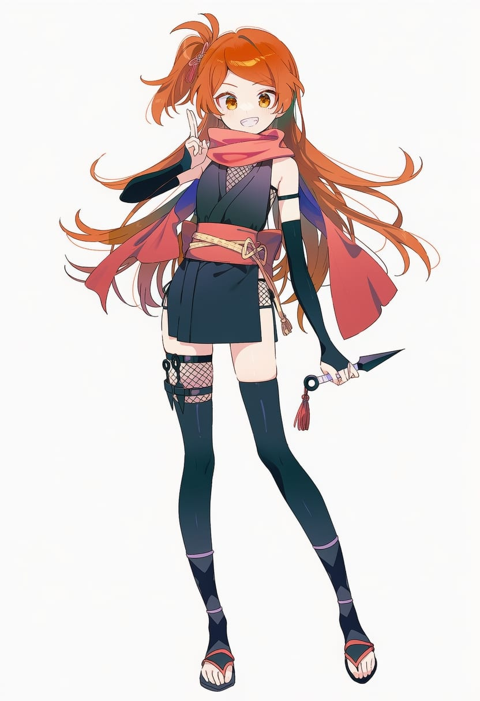

| 字段 | 内容 |
| --- | --- |
| 序号 | 0050 |
| tag | kunai |
| tag中文名 | 苦无 |
| tag中文含义 | 忍者题材常见的尖锐投掷或近战工具 |
| tag所属的子类 | 短兵器与忍具 |
| 角色 | ogami_tamaki |

## 51. sickle — 手镰

| 字段 | 内容 |
| --- | --- |
| 序号 | 0051 |
| tag | sickle |
| tag中文名 | 手镰 |
| tag中文含义 | 短柄弯刃镰刀 |
| tag所属的子类 | 短兵器与忍具 |
| 角色 | kachina_(genshin_impact) |

## 52. claw_(weapon) — 爪刃

| 字段 | 内容 |
| --- | --- |
| 序号 | 0052 |
| tag | claw_(weapon) |
| tag中文名 | 爪刃 |
| tag中文含义 | 像兽爪一样套在手上的刃器 |
| tag所属的子类 | 短兵器与忍具 |
| 角色 | clara_(honkai:_star_rail) |

## 53. bow_(weapon) — 弓

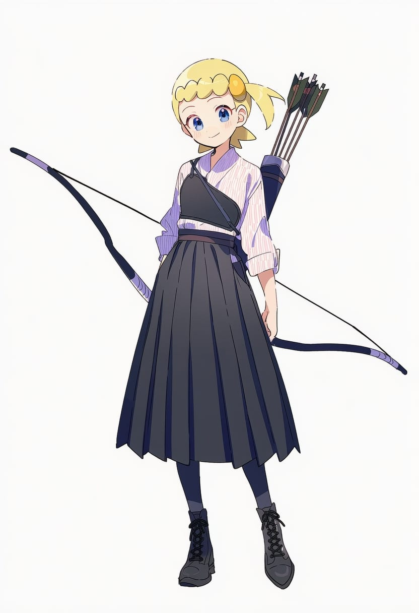

| 字段 | 内容 |
| --- | --- |
| 序号 | 0053 |
| tag | bow_(weapon) |
| tag中文名 | 弓 |
| tag中文含义 | 拉弦发射箭矢的武器 |
| tag所属的子类 | 远程冷兵器 |
| 角色 | bonnie_(pokemon) |

## 54. chakram — 环刃

| 字段 | 内容 |
| --- | --- |
| 序号 | 0054 |
| tag | chakram |
| tag中文名 | 环刃 |
| tag中文含义 | 圆环形投掷刃器 |
| tag所属的子类 | 远程冷兵器 |
| 角色 | mihama_chiyo |

## 55. crossbow — 弩

| 字段 | 内容 |
| --- | --- |
| 序号 | 0055 |
| tag | crossbow |
| tag中文名 | 弩 |
| tag中文含义 | 用机械结构拉弦发射弩箭的武器 |
| tag所属的子类 | 远程冷兵器 |
| 角色 | vampire_(azur_lane) |

## 56. shuriken — 手里剑

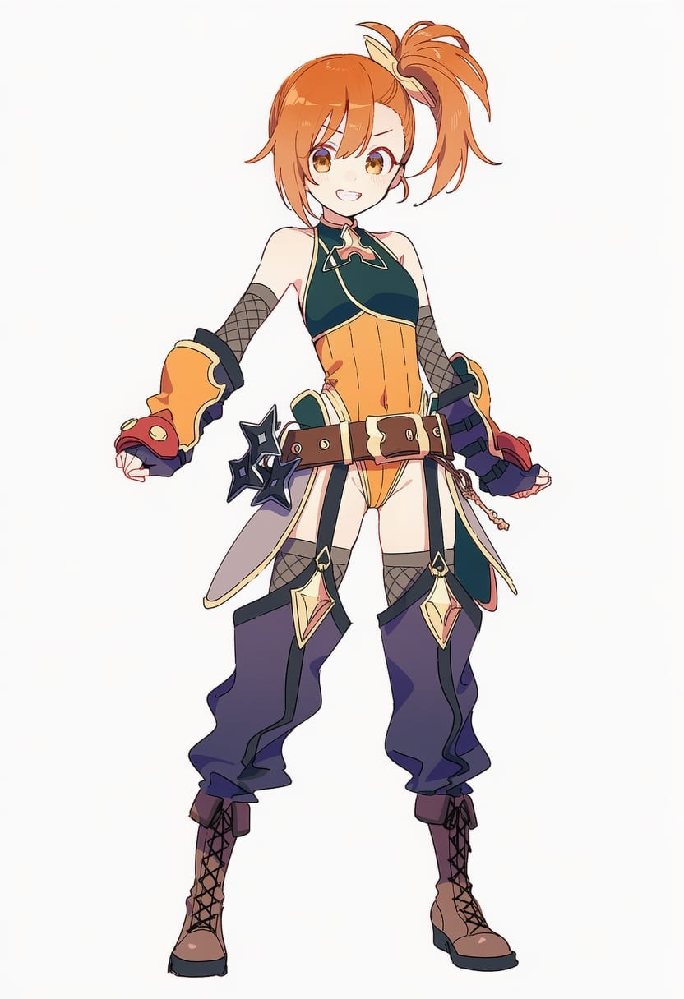

| 字段 | 内容 |
| --- | --- |
| 序号 | 0056 |
| tag | shuriken |
| tag中文名 | 手里剑 |
| tag中文含义 | 忍者题材常见的星形投掷刃 |
| tag所属的子类 | 远程冷兵器 |
| 角色 | misogi_(princess_connect!) |

## 57. baseball_bat — 棒球棒

| 字段 | 内容 |
| --- | --- |
| 序号 | 0057 |
| tag | baseball_bat |
| tag中文名 | 棒球棒 |
| tag中文含义 | 棒球棒作为打击武器 |
| tag所属的子类 | 工具与临时武器 |
| 角色 | mimi_(princess_connect!) |

## 58. brass_knuckles — 指虎

| 字段 | 内容 |
| --- | --- |
| 序号 | 0058 |
| tag | brass_knuckles |
| tag中文名 | 指虎 |
| tag中文含义 | 套在拳头上的金属打击武器 |
| tag所属的子类 | 工具与临时武器 |
| 角色 | koga_koharu |

## 59. chainsaw — 链锯

| 字段 | 内容 |
| --- | --- |
| 序号 | 0059 |
| tag | chainsaw |
| tag中文名 | 链锯 |
| tag中文含义 | 带高速链条锯齿的工具或武器 |
| tag所属的子类 | 工具与临时武器 |
| 角色 | miyauchi_renge |

## 60. crowbar — 撬棍

| 字段 | 内容 |
| --- | --- |
| 序号 | 0060 |
| tag | crowbar |
| tag中文名 | 撬棍 |
| tag中文含义 | 金属撬棍作为近战武器 |
| tag所属的子类 | 工具与临时武器 |
| 角色 | yoshino_(date_a_live) |

## 61. drill — 钻头/电钻

| 字段 | 内容 |
| --- | --- |
| 序号 | 0061 |
| tag | drill |
| tag中文名 | 钻头/电钻 |
| tag中文含义 | 钻头或钻机作为攻击武器 |
| tag所属的子类 | 工具与临时武器 |
| 角色 | shiro_(no_game_no_life) |

## 62. flamethrower — 火焰喷射器

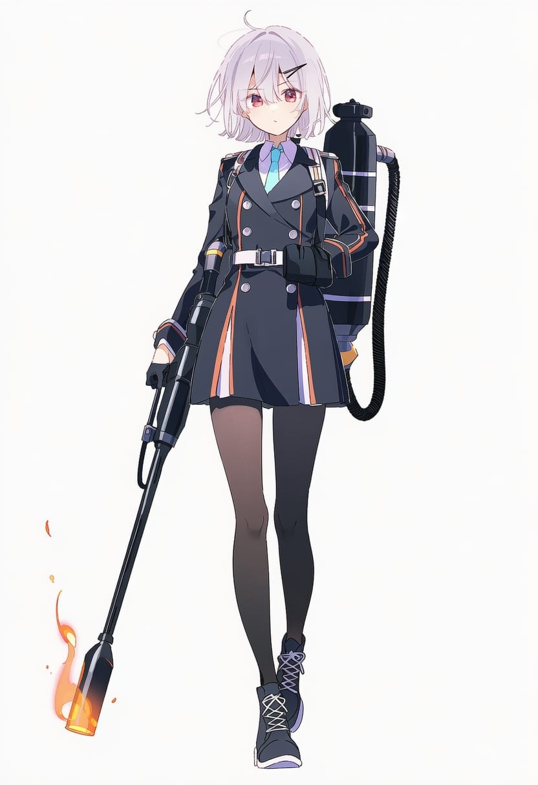

| 字段 | 内容 |
| --- | --- |
| 序号 | 0062 |
| tag | flamethrower |
| tag中文名 | 火焰喷射器 |
| tag中文含义 | 持续喷出火焰的武器 |
| tag所属的子类 | 工具与临时武器 |
| 角色 | hakase_(nichijou) |

---
