## 1. traditional_media — 传统媒材

| 字段 | 内容 |
| --- | --- |
| 序号 | 0001 |
| tag | traditional_media |
| tag中文名 | 传统媒材 |
| tag中文含义 | 真的用铅笔、颜料等实体工具完成，不是纯数码绘制 |
| tag所属的子类 | 传统与特殊媒材 |

## 2. faux_traditional_media — 数码仿传统媒材

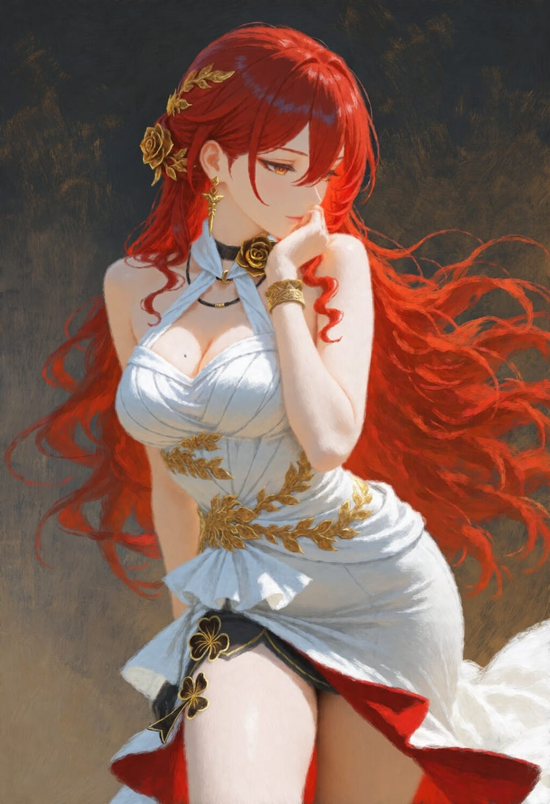

| 字段 | 内容 |
| --- | --- |
| 序号 | 0002 |
| tag | faux_traditional_media |
| tag中文名 | 数码仿传统媒材 |
| tag中文含义 | 数码画，但故意做成纸上手绘、颜料或铅笔的感觉 |
| tag所属的子类 | 传统与特殊媒材 |

## 3. mixed_media — 混合媒材

| 字段 | 内容 |
| --- | --- |
| 序号 | 0003 |
| tag | mixed_media |
| tag中文名 | 混合媒材 |
| tag中文含义 | 传统手绘、数码、照片或3D等不同媒介明显混着使用 |
| tag所属的子类 | 传统与特殊媒材 |

## 4. sketch — 素描/草图

| 字段 | 内容 |
| --- | --- |
| 序号 | 0004 |
| tag | sketch |
| tag中文名 | 素描/草图 |
| tag中文含义 | 像起稿一样，结构线、试探线和粗糙笔触比较明显 |
| tag所属的子类 | 传统与特殊媒材 |

## 5. painting_(medium) — 绘画媒材

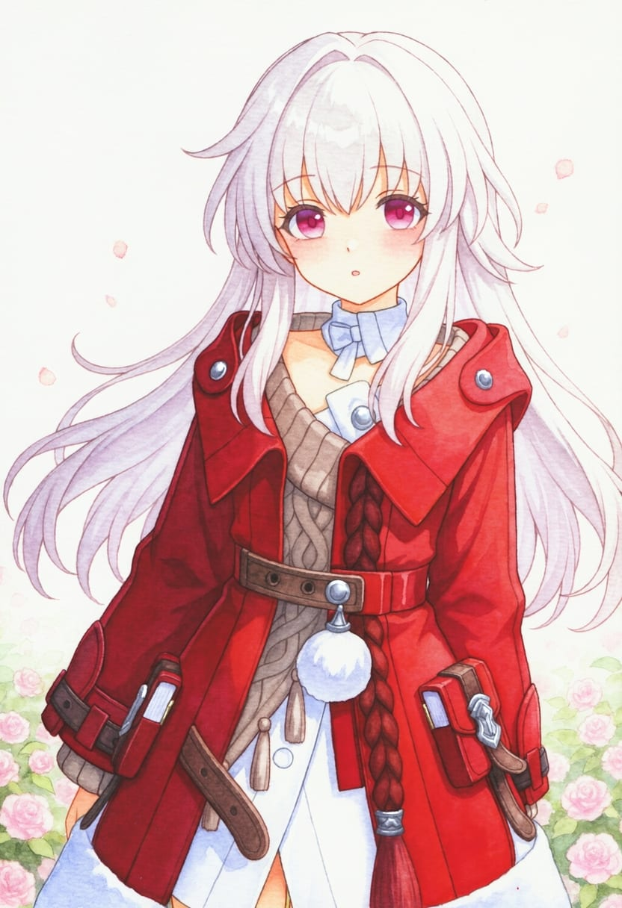

| 字段 | 内容 |
| --- | --- |
| 序号 | 0005 |
| tag | painting_(medium) |
| tag中文名 | 绘画媒材 |
| tag中文含义 | 以颜料绘画方式完成的实体画作，泛指传统绘画 |
| tag所属的子类 | 传统与特殊媒材 |

## 6. watercolor_(medium) — 水彩画

| 字段 | 内容 |
| --- | --- |
| 序号 | 0006 |
| tag | watercolor_(medium) |
| tag中文名 | 水彩画 |
| tag中文含义 | 真实水彩颜料绘制，颜色透明，常有水痕和晕染 |
| tag所属的子类 | 传统与特殊媒材 |

## 7. gouache_(medium) — 水粉画

| 字段 | 内容 |
| --- | --- |
| 序号 | 0007 |
| tag | gouache_(medium) |
| tag中文名 | 水粉画 |
| tag中文含义 | 用水粉颜料绘制，颜色比水彩更厚、更不透明，常有平整色块 |
| tag所属的子类 | 传统与特殊媒材 |

## 8. acrylic_paint_(medium) — 丙烯画

| 字段 | 内容 |
| --- | --- |
| 序号 | 0008 |
| tag | acrylic_paint_(medium) |
| tag中文名 | 丙烯画 |
| tag中文含义 | 真实丙烯颜料绘制，颜色厚实、覆盖力强 |
| tag所属的子类 | 传统与特殊媒材 |

## 9. oil_painting_(medium) — 油画

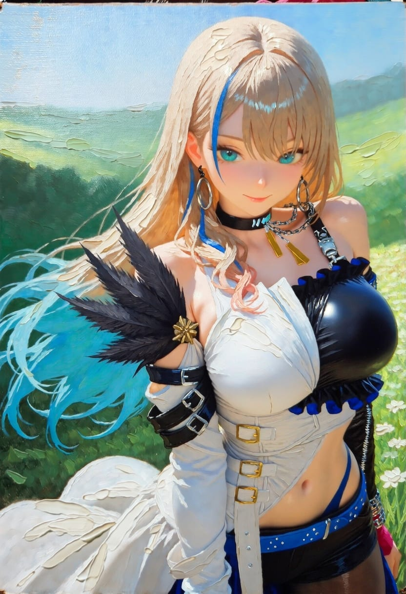

| 字段 | 内容 |
| --- | --- |
| 序号 | 0009 |
| tag | oil_painting_(medium) |
| tag中文名 | 油画 |
| tag中文含义 | 真实油彩绘制，常见厚重颜料、笔触和画布感 |
| tag所属的子类 | 传统与特殊媒材 |

## 10. graphite_(medium) — 石墨铅笔画

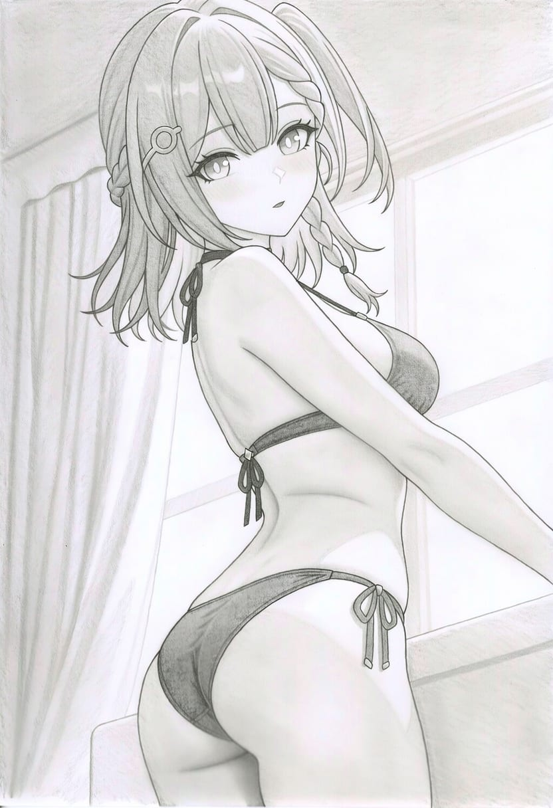

| 字段 | 内容 |
| --- | --- |
| 序号 | 0010 |
| tag | graphite_(medium) |
| tag中文名 | 石墨铅笔画 |
| tag中文含义 | 用石墨铅笔画，整体偏灰黑，能看到铅笔纹理 |
| tag所属的子类 | 传统与特殊媒材 |

## 11. colored_pencil_(medium) — 彩铅画

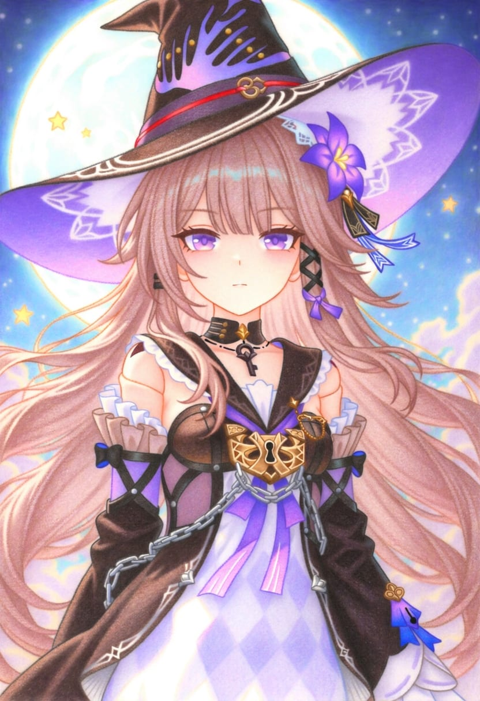

| 字段 | 内容 |
| --- | --- |
| 序号 | 0011 |
| tag | colored_pencil_(medium) |
| tag中文名 | 彩铅画 |
| tag中文含义 | 用彩色铅笔绘制，能看到细密的铅笔线和叠色 |
| tag所属的子类 | 传统与特殊媒材 |

## 12. crayon_(medium) — 蜡笔画

| 字段 | 内容 |
| --- | --- |
| 序号 | 0012 |
| tag | crayon_(medium) |
| tag中文名 | 蜡笔画 |
| tag中文含义 | 用蜡笔绘制，线条粗糙、有颗粒和明显的蜡质涂抹感 |
| tag所属的子类 | 传统与特殊媒材 |

## 13. pen_(medium) — 笔墨绘画

| 字段 | 内容 |
| --- | --- |
| 序号 | 0013 |
| tag | pen_(medium) |
| tag中文名 | 笔墨绘画 |
| tag中文含义 | 用实体笔蘸墨或类似工具绘制，线条感明显 |
| tag所属的子类 | 传统与特殊媒材 |

## 14. millipen_(medium) — 针管笔画

| 字段 | 内容 |
| --- | --- |
| 序号 | 0014 |
| tag | millipen_(medium) |
| tag中文名 | 针管笔画 |
| tag中文含义 | 用细号针管笔绘制，线条细、均匀、干净 |
| tag所属的子类 | 传统与特殊媒材 |

## 15. nib_pen_(medium) — 蘸水笔画

| 字段 | 内容 |
| --- | --- |
| 序号 | 0015 |
| tag | nib_pen_(medium) |
| tag中文名 | 蘸水笔画 |
| tag中文含义 | 用笔尖蘸墨绘制，线条粗细会随力度变化 |
| tag所属的子类 | 传统与特殊媒材 |

## 16. ballpoint_pen_(medium) — 圆珠笔画

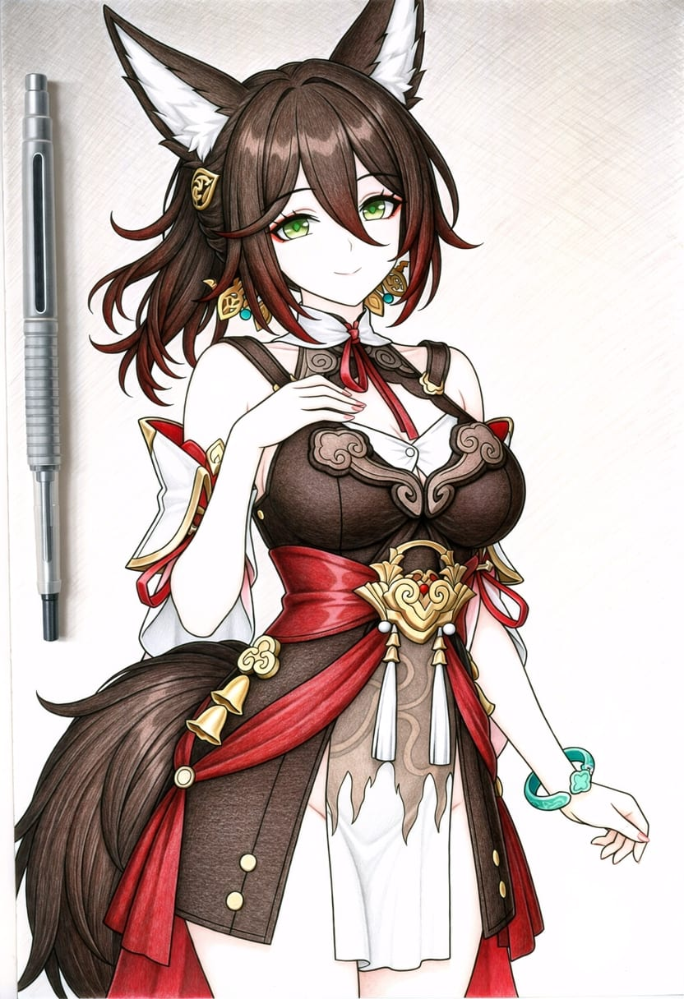

| 字段 | 内容 |
| --- | --- |
| 序号 | 0016 |
| tag | ballpoint_pen_(medium) |
| tag中文名 | 圆珠笔画 |
| tag中文含义 | 用圆珠笔绘制，常见细密线条和密集排线 |
| tag所属的子类 | 传统与特殊媒材 |

## 17. ink_(medium) — 墨水画

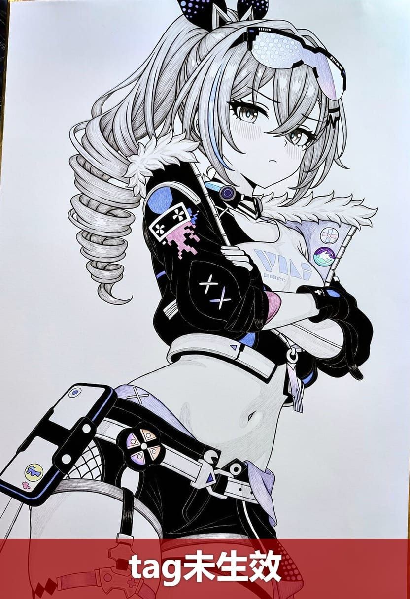

| 字段 | 内容 |
| --- | --- |
| 序号 | 0017 |
| tag | ink_(medium) |
| tag中文名 | 墨水画 |
| tag中文含义 | 主要用墨水在纸上绘制，黑白或墨色表现明显 |
| tag所属的子类 | 传统与特殊媒材 |

## 18. color_ink_(medium) — 彩色墨水画

| 字段 | 内容 |
| --- | --- |
| 序号 | 0018 |
| tag | color_ink_(medium) |
| tag中文名 | 彩色墨水画 |
| tag中文含义 | 用彩色墨水绘制，颜色通透并带明显墨水质感 |
| tag所属的子类 | 传统与特殊媒材 |

## 19. marker_(medium) — 马克笔画

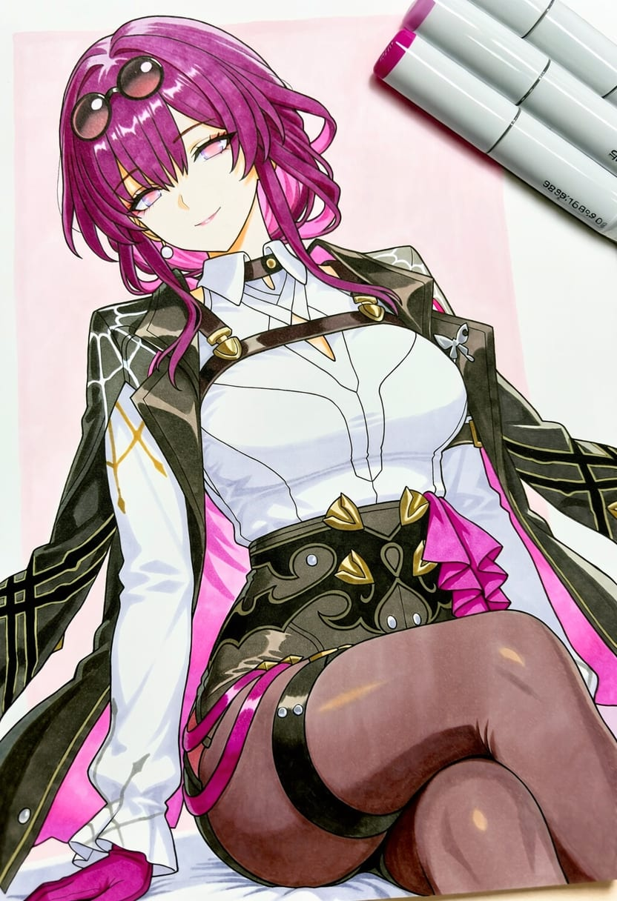

| 字段 | 内容 |
| --- | --- |
| 序号 | 0019 |
| tag | marker_(medium) |
| tag中文名 | 马克笔画 |
| tag中文含义 | 用马克笔上色，色块直接，笔触和叠色很明显 |
| tag所属的子类 | 传统与特殊媒材 |

## 20. calligraphy_brush_(medium) — 毛笔画

| 字段 | 内容 |
| --- | --- |
| 序号 | 0020 |
| tag | calligraphy_brush_(medium) |
| tag中文名 | 毛笔画 |
| tag中文含义 | 用毛笔类工具绘制，线条有明显提按和粗细变化 |
| tag所属的子类 | 传统与特殊媒材 |

## 21. watercolor_pencil_(medium) — 水溶彩铅

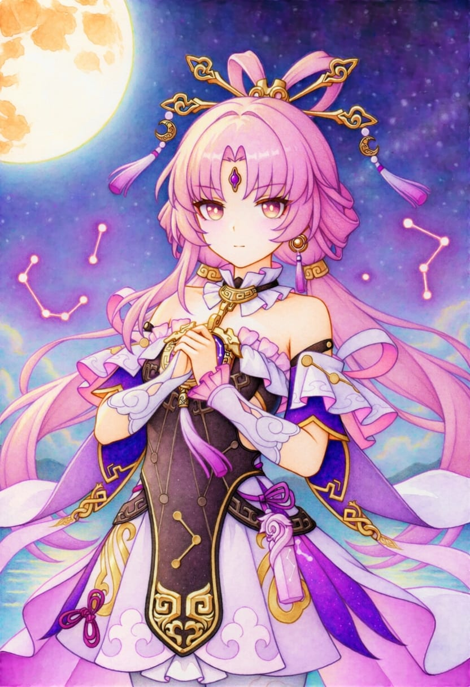

| 字段 | 内容 |
| --- | --- |
| 序号 | 0021 |
| tag | watercolor_pencil_(medium) |
| tag中文名 | 水溶彩铅 |
| tag中文含义 | 先像彩铅一样画，再用水化开形成水彩式晕染 |
| tag所属的子类 | 传统与特殊媒材 |

## 22. pastel_(medium) — 粉彩画

| 字段 | 内容 |
| --- | --- |
| 序号 | 0022 |
| tag | pastel_(medium) |
| tag中文名 | 粉彩画 |
| tag中文含义 | 用粉彩棒绘制，颜色柔和，表面有粉末和擦涂感 |
| tag所属的子类 | 传统与特殊媒材 |

## 23. ink_wash_painting — 水墨画

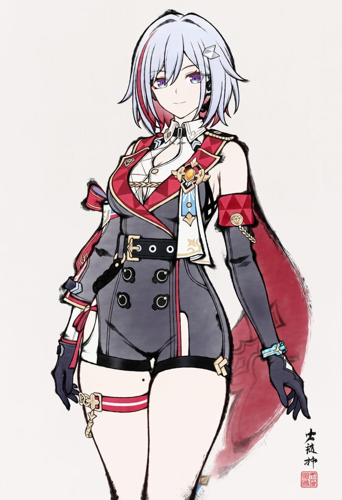

| 字段 | 内容 |
| --- | --- |
| 序号 | 0023 |
| tag | ink_wash_painting |
| tag中文名 | 水墨画 |
| tag中文含义 | 用浓淡墨色、留白和水分变化来表现画面 |
| tag所属的子类 | 传统与特殊媒材 |

## 24. papercraft_(medium) — 纸艺

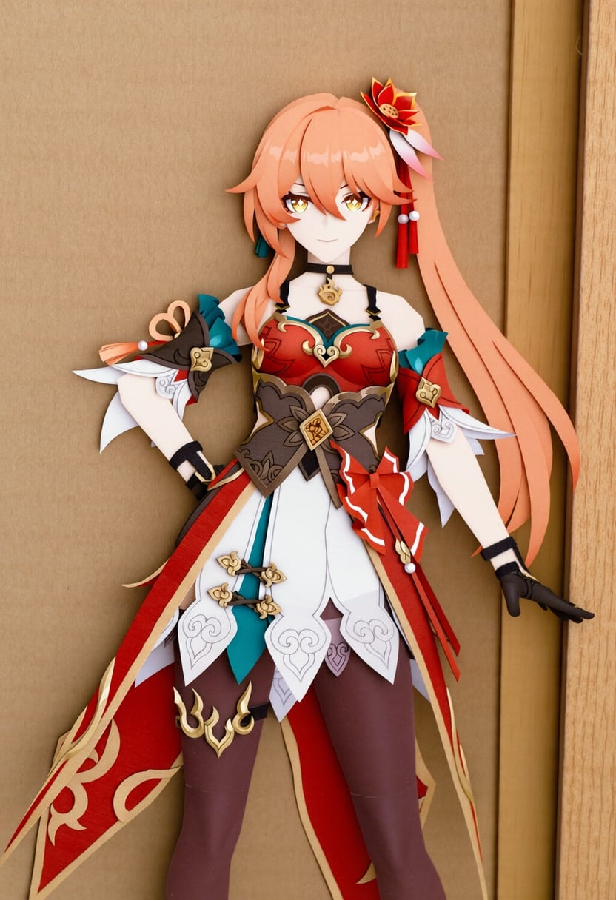

| 字段 | 内容 |
| --- | --- |
| 序号 | 0024 |
| tag | papercraft_(medium) |
| tag中文名 | 纸艺 |
| tag中文含义 | 主体由剪纸、折纸、纸雕等纸材制作而成 |
| tag所属的子类 | 传统与特殊媒材 |

## 25. masking_tape_(medium) — 胶带画

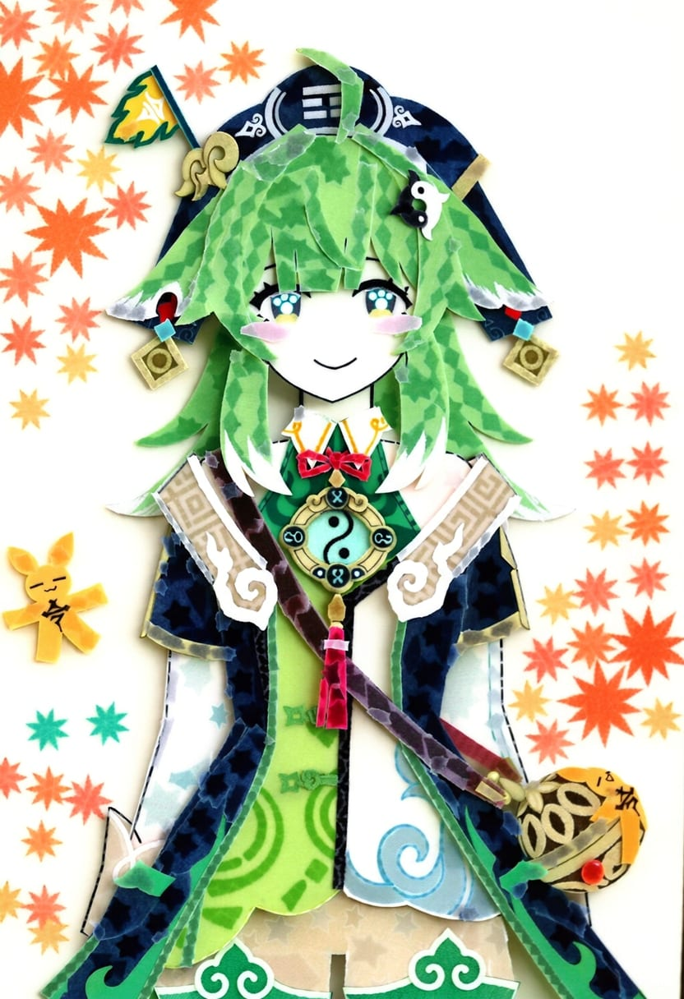

| 字段 | 内容 |
| --- | --- |
| 序号 | 0025 |
| tag | masking_tape_(medium) |
| tag中文名 | 胶带画 |
| tag中文含义 | 用彩色胶带或和纸胶带拼贴出图像 |
| tag所属的子类 | 传统与特殊媒材 |

## 26. impasto — 厚涂颜料

| 字段 | 内容 |
| --- | --- |
| 序号 | 0026 |
| tag | impasto |
| tag中文名 | 厚涂颜料 |
| tag中文含义 | 颜料堆得很厚，能明显看到立体笔触或刮刀痕迹；做梵高感时很实用 |
| tag所属的子类 | 传统与特殊媒材 |

## 27. lineart — 线稿

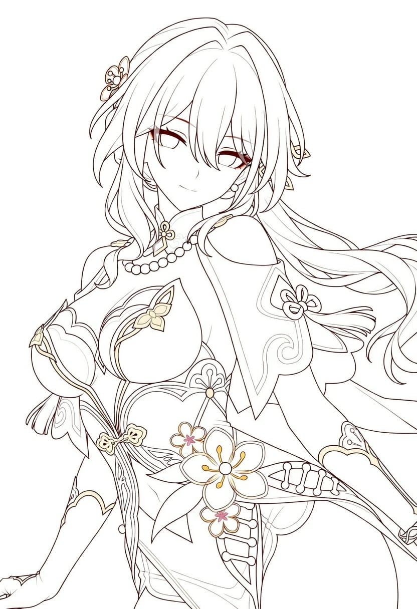

| 字段 | 内容 |
| --- | --- |
| 序号 | 0027 |
| tag | lineart |
| tag中文名 | 线稿 |
| tag中文含义 | 以清晰线条为主体，基本没有完整上色 |
| tag所属的子类 | 线稿与笔触 |

## 28. no_lineart — 无线稿

| 字段 | 内容 |
| --- | --- |
| 序号 | 0028 |
| tag | no_lineart |
| tag中文名 | 无线稿 |
| tag中文含义 | 轮廓主要靠色块和明暗区分，看不到明显勾线 |
| tag所属的子类 | 线稿与笔触 |

## 29. thick_lineart — 粗线稿

| 字段 | 内容 |
| --- | --- |
| 序号 | 0029 |
| tag | thick_lineart |
| tag中文名 | 粗线稿 |
| tag中文含义 | 整套线稿都明显比常规线条更粗、更有重量 |
| tag所属的子类 | 线稿与笔触 |

## 30. jaggy_lines — 锯齿线条

| 字段 | 内容 |
| --- | --- |
| 序号 | 0030 |
| tag | jaggy_lines |
| tag中文名 | 锯齿线条 |
| tag中文含义 | 线条故意呈现不平滑、锯齿或像素化的边缘 |
| tag所属的子类 | 线稿与笔触 |

## 31. colored_lineart — 彩色线稿

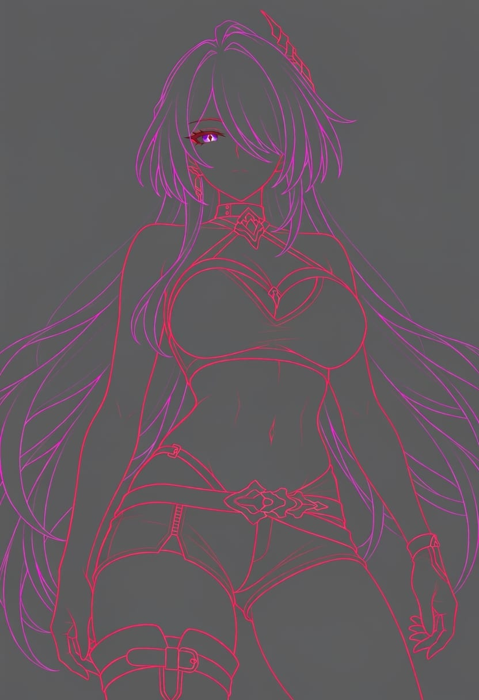

| 字段 | 内容 |
| --- | --- |
| 序号 | 0031 |
| tag | colored_lineart |
| tag中文名 | 彩色线稿 |
| tag中文含义 | 线稿不是纯黑色，而是用彩色线条勾勒 |
| tag所属的子类 | 线稿与笔触 |

## 32. outline — 外轮廓描边

| 字段 | 内容 |
| --- | --- |
| 序号 | 0032 |
| tag | outline |
| tag中文名 | 外轮廓描边 |
| tag中文含义 | 人物或物体外侧有一圈明显的描边 |
| tag所属的子类 | 线稿与笔触 |

## 33. thick_outlines — 粗外轮廓

| 字段 | 内容 |
| --- | --- |
| 序号 | 0033 |
| tag | thick_outlines |
| tag中文名 | 粗外轮廓 |
| tag中文含义 | 人物或物体最外圈描边特别粗 |
| tag所属的子类 | 线稿与笔触 |

## 34. black_outline — 黑色描边

| 字段 | 内容 |
| --- | --- |
| 序号 | 0034 |
| tag | black_outline |
| tag中文名 | 黑色描边 |
| tag中文含义 | 人物或物体外圈用黑色线条描边 |
| tag所属的子类 | 线稿与笔触 |

## 35. hatching_(texture) — 排线阴影

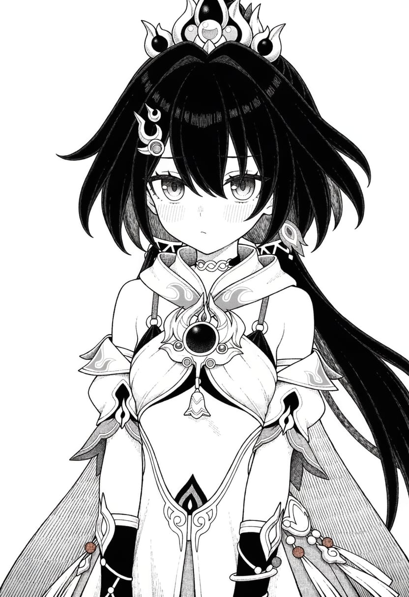

| 字段 | 内容 |
| --- | --- |
| 序号 | 0035 |
| tag | hatching_(texture) |
| tag中文名 | 排线阴影 |
| tag中文含义 | 用一组组平行短线来做阴影或材质 |
| tag所属的子类 | 线稿与笔触 |

## 36. linear_hatching — 直线排线

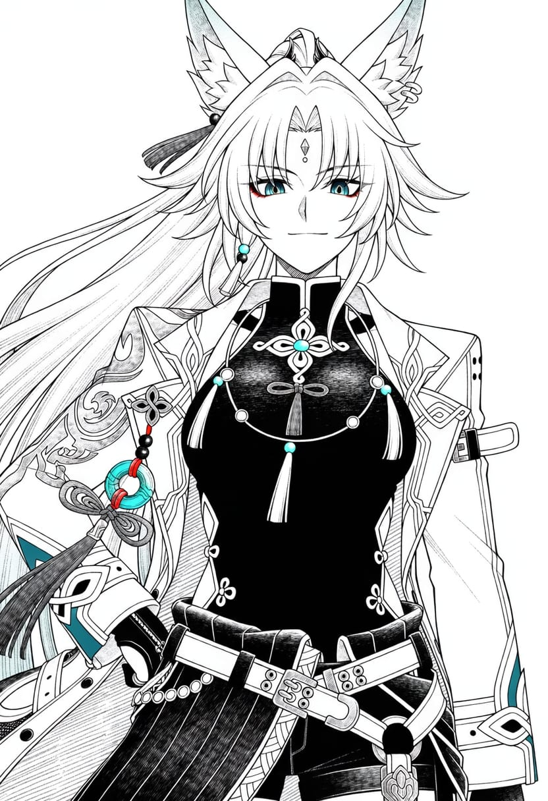

| 字段 | 内容 |
| --- | --- |
| 序号 | 0036 |
| tag | linear_hatching |
| tag中文名 | 直线排线 |
| tag中文含义 | 主要用规则直线排线表现明暗 |
| tag所属的子类 | 线稿与笔触 |

## 37. crosshatching — 交叉排线

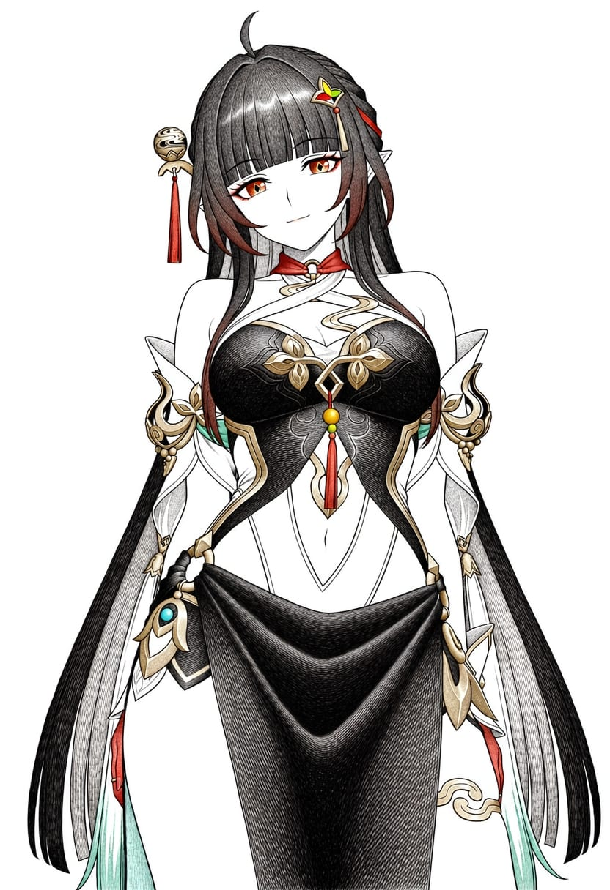

| 字段 | 内容 |
| --- | --- |
| 序号 | 0037 |
| tag | crosshatching |
| tag中文名 | 交叉排线 |
| tag中文含义 | 用多组交叉线条叠出更深的阴影 |
| tag所属的子类 | 线稿与笔触 |

## 38. brush_stroke — 明显笔刷痕

| 字段 | 内容 |
| --- | --- |
| 序号 | 0038 |
| tag | brush_stroke |
| tag中文名 | 明显笔刷痕 |
| tag中文含义 | 画面保留看得出的刷痕或笔触，不刻意抹平 |
| tag所属的子类 | 线稿与笔触 |

## 39. anime_coloring — 动画式上色

| 字段 | 内容 |
| --- | --- |
| 序号 | 0039 |
| tag | anime_coloring |
| tag中文名 | 动画式上色 |
| tag中文含义 | 像动画赛璐璐上色，色块清楚，阴影层级少而硬 |
| tag所属的子类 | 上色与配色 |

## 40. flat_color — 平涂

| 字段 | 内容 |
| --- | --- |
| 序号 | 0040 |
| tag | flat_color |
| tag中文名 | 平涂 |
| tag中文含义 | 大面积用均匀纯色铺色，几乎没有复杂明暗 |
| tag所属的子类 | 上色与配色 |

## 41. watercolor_effect — 水彩效果

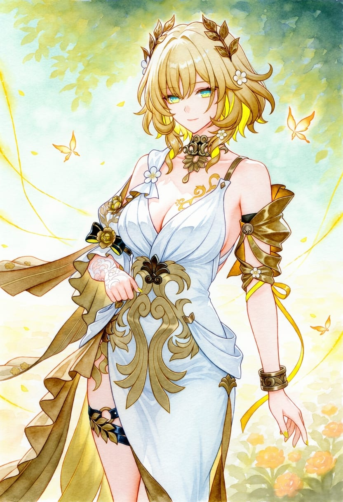

| 字段 | 内容 |
| --- | --- |
| 序号 | 0041 |
| tag | watercolor_effect |
| tag中文名 | 水彩效果 |
| tag中文含义 | 不是实际水彩媒材，但视觉上故意做出水彩晕染感 |
| tag所属的子类 | 上色与配色 |

## 42. blending — 柔和混色

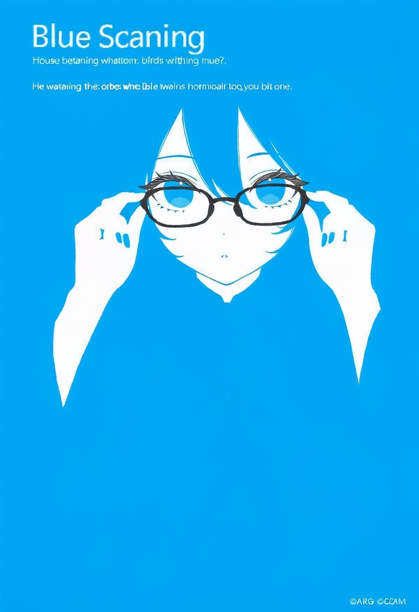

| 字段 | 内容 |
| --- | --- |
| 序号 | 0042 |
| tag | blending |
| tag中文名 | 柔和混色 |
| tag中文含义 | 前景与背景相融，颜色和明暗之间被平滑揉开，过渡很柔 |
| tag所属的子类 | 上色与配色 |

## 43. monochrome — 单色画面

| 字段 | 内容 |
| --- | --- |
| 序号 | 0043 |
| tag | monochrome |
| tag中文名 | 单色画面 |
| tag中文含义 | 整张图主要只使用一种色相及其深浅变化 |
| tag所属的子类 | 上色与配色 |

## 44. greyscale — 灰度

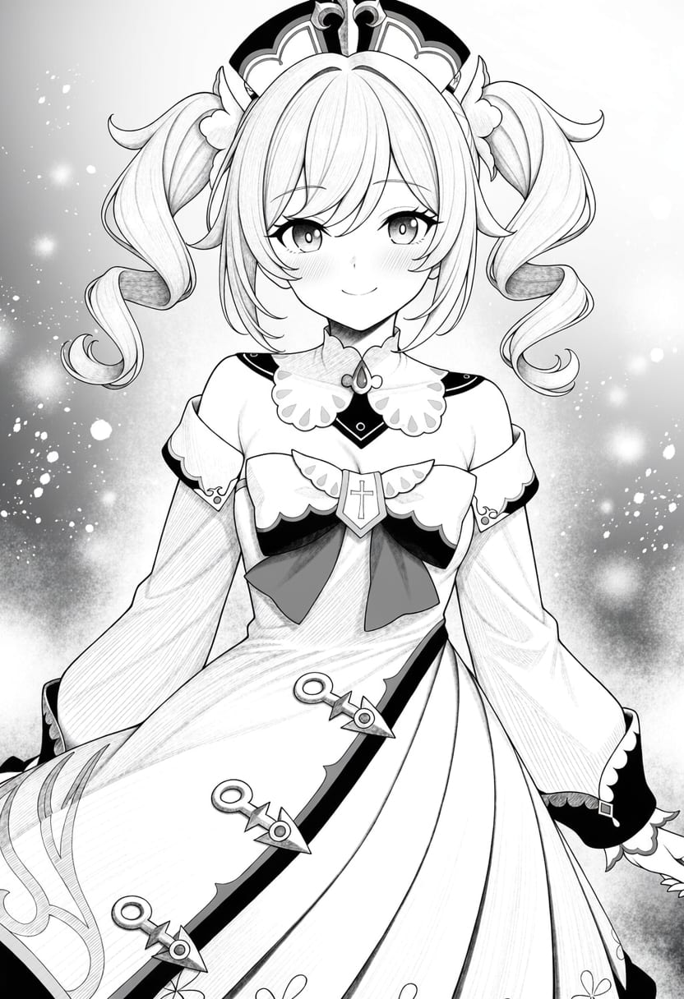

| 字段 | 内容 |
| --- | --- |
| 序号 | 0044 |
| tag | greyscale |
| tag中文名 | 灰度 |
| tag中文含义 | 画面只有黑、白、灰，没有彩色 |
| tag所属的子类 | 上色与配色 |

## 45. partially_colored — 局部上色

| 字段 | 内容 |
| --- | --- |
| 序号 | 0045 |
| tag | partially_colored |
| tag中文名 | 局部上色 |
| tag中文含义 | 大部分画面无彩色，只给少数区域上色 |
| tag所属的子类 | 上色与配色 |

## 46. spot_color — 重点色

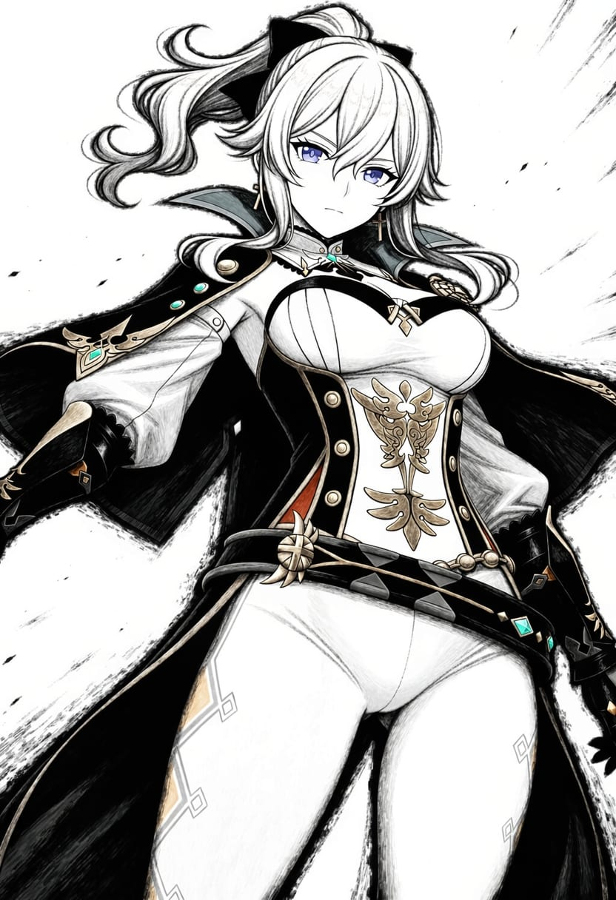

| 字段 | 内容 |
| --- | --- |
| 序号 | 0046 |
| tag | spot_color |
| tag中文名 | 重点色 |
| tag中文含义 | 整体接近黑白，只用一两种颜色突出重点 |
| tag所属的子类 | 上色与配色 |

## 47. multiple_monochrome — 多组单色块

| 字段 | 内容 |
| --- | --- |
| 序号 | 0047 |
| tag | multiple_monochrome |
| tag中文名 | 多组单色块 |
| tag中文含义 | 不同区域各自使用不同的单色系，而不是全图同一色 |
| tag所属的子类 | 上色与配色 |

## 48. limited_palette — 限定色板

| 字段 | 内容 |
| --- | --- |
| 序号 | 0048 |
| tag | limited_palette |
| tag中文名 | 限定色板 |
| tag中文含义 | 整张图只用少量几种颜色，配色数量被刻意限制 |
| tag所属的子类 | 上色与配色 |

## 49. dark — 暗色调

| 字段 | 内容 |
| --- | --- |
| 序号 | 0049 |
| tag | dark |
| tag中文名 | 暗色调 |
| tag中文含义 | 整体明度很低，画面偏暗 |
| tag所属的子类 | 上色与配色 |

## 50. muted_colors — 低饱和色

| 字段 | 内容 |
| --- | --- |
| 序号 | 0050 |
| tag | muted_colors |
| tag中文名 | 低饱和色 |
| tag中文含义 | 颜色被压灰，整体不鲜艳 |
| tag所属的子类 | 上色与配色 |

## 51. pale_colors — 浅淡色

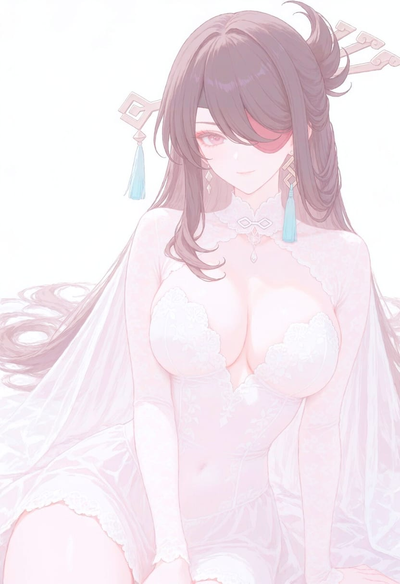

| 字段 | 内容 |
| --- | --- |
| 序号 | 0051 |
| tag | pale_colors |
| tag中文名 | 浅淡色 |
| tag中文含义 | 颜色很浅、明度高，整体轻柔发白 |
| tag所属的子类 | 上色与配色 |

## 52. sepia — 棕褐色调

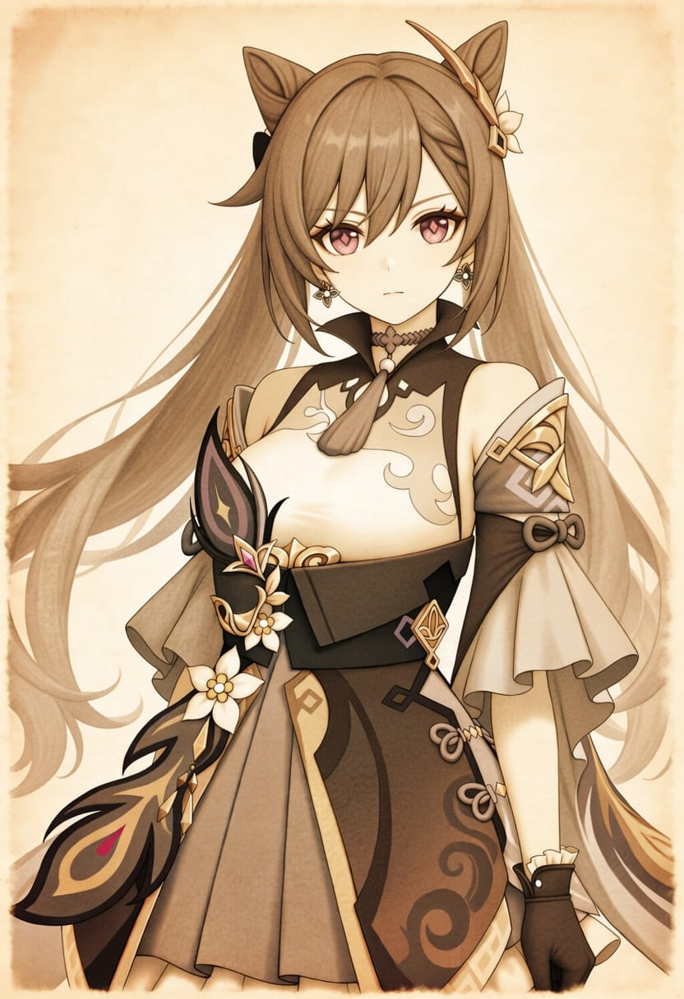

| 字段 | 内容 |
| --- | --- |
| 序号 | 0052 |
| tag | sepia |
| tag中文名 | 棕褐色调 |
| tag中文含义 | 画面以棕褐色为主，像旧照片或老纸张 |
| tag所属的子类 | 上色与配色 |

## 53. pastel_colors — 粉彩色

| 字段 | 内容 |
| --- | --- |
| 序号 | 0053 |
| tag | pastel_colors |
| tag中文名 | 粉彩色 |
| tag中文含义 | 使用柔和、偏浅、低冲击的粉彩配色 |
| tag所属的子类 | 上色与配色 |

## 54. high_contrast — 高对比

| 字段 | 内容 |
| --- | --- |
| 序号 | 0054 |
| tag | high_contrast |
| tag中文名 | 高对比 |
| tag中文含义 | 亮部和暗部差距很大，黑白或色彩反差强 |
| tag所属的子类 | 上色与配色 |

## 55. saturated — 高饱和

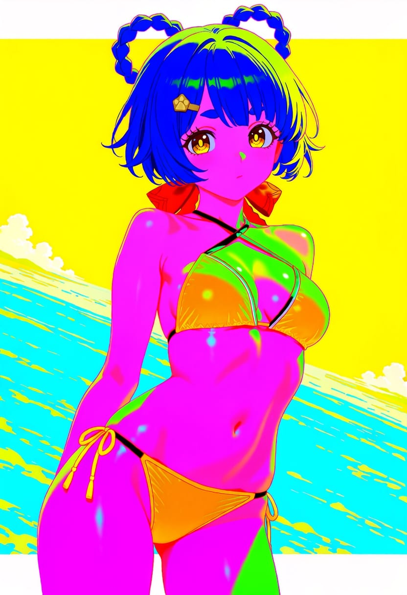

| 字段 | 内容 |
| --- | --- |
| 序号 | 0055 |
| tag | saturated |
| tag中文名 | 高饱和 |
| tag中文含义 | 颜色非常鲜艳、浓烈 |
| tag所属的子类 | 上色与配色 |

## 56. colorful — 多彩

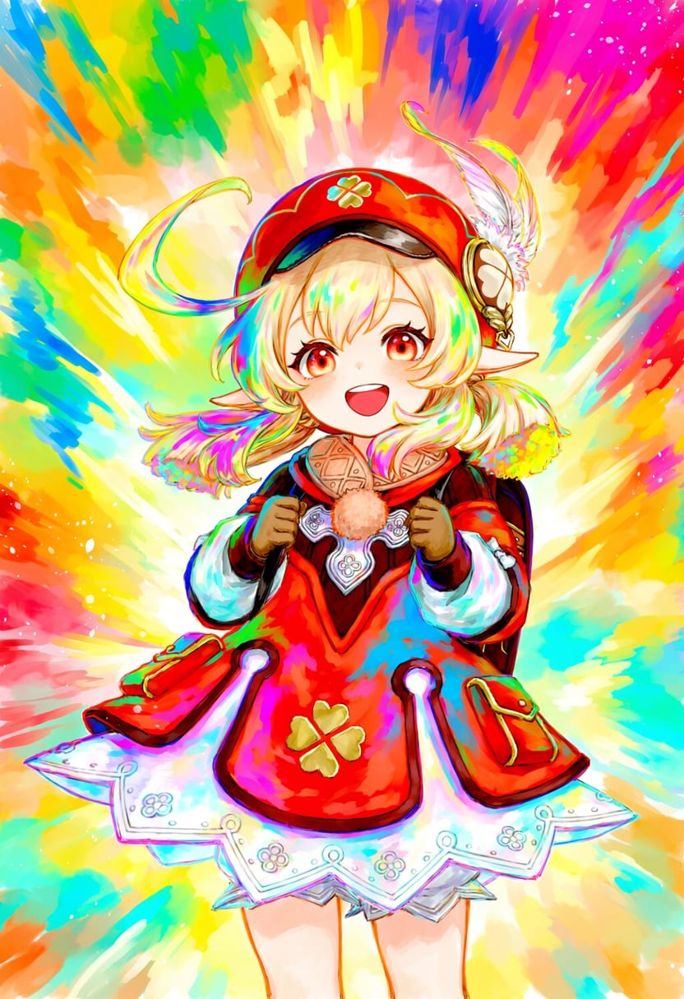

| 字段 | 内容 |
| --- | --- |
| 序号 | 0056 |
| tag | colorful |
| tag中文名 | 多彩 |
| tag中文含义 | 画面同时使用很多明显不同的颜色 |
| tag所属的子类 | 上色与配色 |

## 57. neon_palette — 霓虹配色

| 字段 | 内容 |
| --- | --- |
| 序号 | 0057 |
| tag | neon_palette |
| tag中文名 | 霓虹配色 |
| tag中文含义 | 使用强烈的荧光、霓虹感高饱和颜色 |
| tag所属的子类 | 上色与配色 |

## 58. cool_colors — 冷色调

| 字段 | 内容 |
| --- | --- |
| 序号 | 0058 |
| tag | cool_colors |
| tag中文名 | 冷色调 |
| tag中文含义 | 整体以蓝、青、紫等冷色为主 |
| tag所属的子类 | 上色与配色 |

## 59. warm_colors — 暖色调

| 字段 | 内容 |
| --- | --- |
| 序号 | 0059 |
| tag | warm_colors |
| tag中文名 | 暖色调 |
| tag中文含义 | 整体以红、橙、黄等暖色为主 |
| tag所属的子类 | 上色与配色 |

## 60. analogous_colors — 邻近色配色

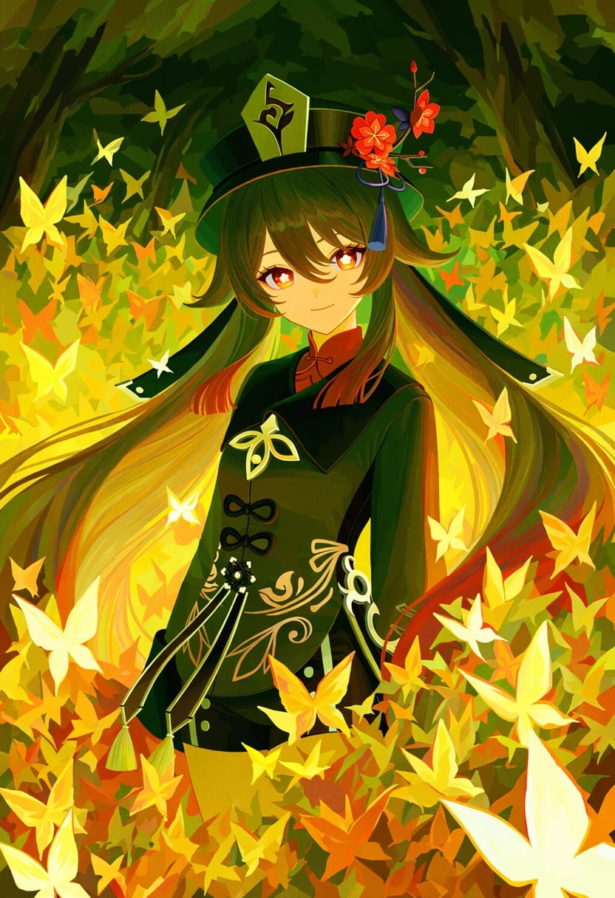

| 字段 | 内容 |
| --- | --- |
| 序号 | 0060 |
| tag | analogous_colors |
| tag中文名 | 邻近色配色 |
| tag中文含义 | 主要使用色环上彼此接近的颜色，整体很协调 |
| tag所属的子类 | 上色与配色 |

## 61. complementary_colors — 互补色配色

| 字段 | 内容 |
| --- | --- |
| 序号 | 0061 |
| tag | complementary_colors |
| tag中文名 | 互补色配色 |
| tag中文含义 | 主要用色环上相对的两组颜色制造强反差 |
| tag所属的子类 | 上色与配色 |

## 62. hue_shifting — 色相偏移上色

| 字段 | 内容 |
| --- | --- |
| 序号 | 0062 |
| tag | hue_shifting |
| tag中文名 | 色相偏移上色 |
| tag中文含义 | 明暗变化时颜色也跟着换色相，不只是简单变亮变暗 |
| tag所属的子类 | 上色与配色 |

## 63. color_trace — 彩线贴色

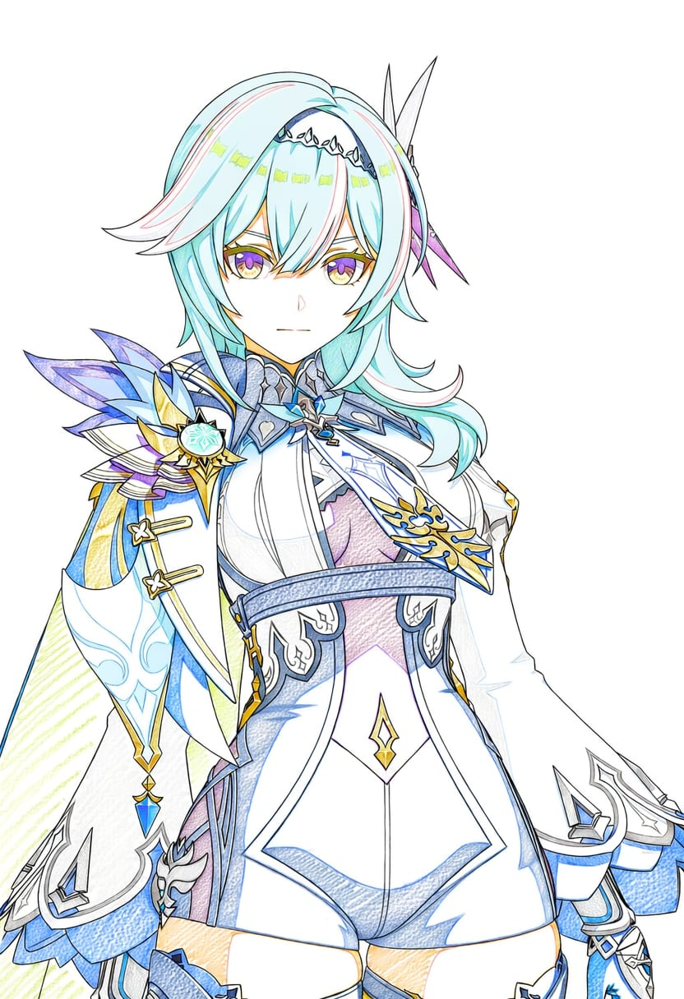

| 字段 | 内容 |
| --- | --- |
| 序号 | 0063 |
| tag | color_trace |
| tag中文名 | 彩线贴色 |
| tag中文含义 | 线稿颜色跟随附近填色变化，而不是统一黑线 |
| tag所属的子类 | 上色与配色 |

## 64. motion_lines — 运动线

| 字段 | 内容 |
| --- | --- |
| 序号 | 0064 |
| tag | motion_lines |
| tag中文名 | 运动线 |
| tag中文含义 | 用方向线表现物体或角色正在移动 |
| tag所属的子类 | 漫画与印刷技法 |

## 65. speed_lines — 速度线

| 字段 | 内容 |
| --- | --- |
| 序号 | 0065 |
| tag | speed_lines |
| tag中文名 | 速度线 |
| tag中文含义 | 用密集放射或平行线强化高速运动感 |
| tag所属的子类 | 漫画与印刷技法 |

## 66. emphasis_lines — 强调线

| 字段 | 内容 |
| --- | --- |
| 序号 | 0066 |
| tag | emphasis_lines |
| tag中文名 | 强调线 |
| tag中文含义 | 用放射线或集中线条把视觉注意力拉到主体 |
| tag所属的子类 | 漫画与印刷技法 |

## 67. notice_lines — 注意线

| 字段 | 内容 |
| --- | --- |
| 序号 | 0067 |
| tag | notice_lines |
| tag中文名 | 注意线 |
| tag中文含义 | 用短小强调线提示某个细节突然被注意到 |
| tag所属的子类 | 漫画与印刷技法 |

## 68. shout_lines — 喊叫强调线

| 字段 | 内容 |
| --- | --- |
| 序号 | 0068 |
| tag | shout_lines |
| tag中文名 | 喊叫强调线 |
| tag中文含义 | 用强烈放射线配合喊叫或激烈情绪 |
| tag所属的子类 | 漫画与印刷技法 |

## 69. halftone — 半色调网点

| 字段 | 内容 |
| --- | --- |
| 序号 | 0069 |
| tag | halftone |
| tag中文名 | 半色调网点 |
| tag中文含义 | 用规则小点或网纹模拟灰阶和印刷阴影 |
| tag所属的子类 | 漫画与印刷技法 |

## 70. ben-day_dots — 本戴点

| 字段 | 内容 |
| --- | --- |
| 序号 | 0070 |
| tag | ben-day_dots |
| tag中文名 | 本戴点 |
| tag中文含义 | 用明显、规则的大网点形成复古印刷和漫画感 |
| tag所属的子类 | 漫画与印刷技法 |

## 71. screentones — 漫画网点

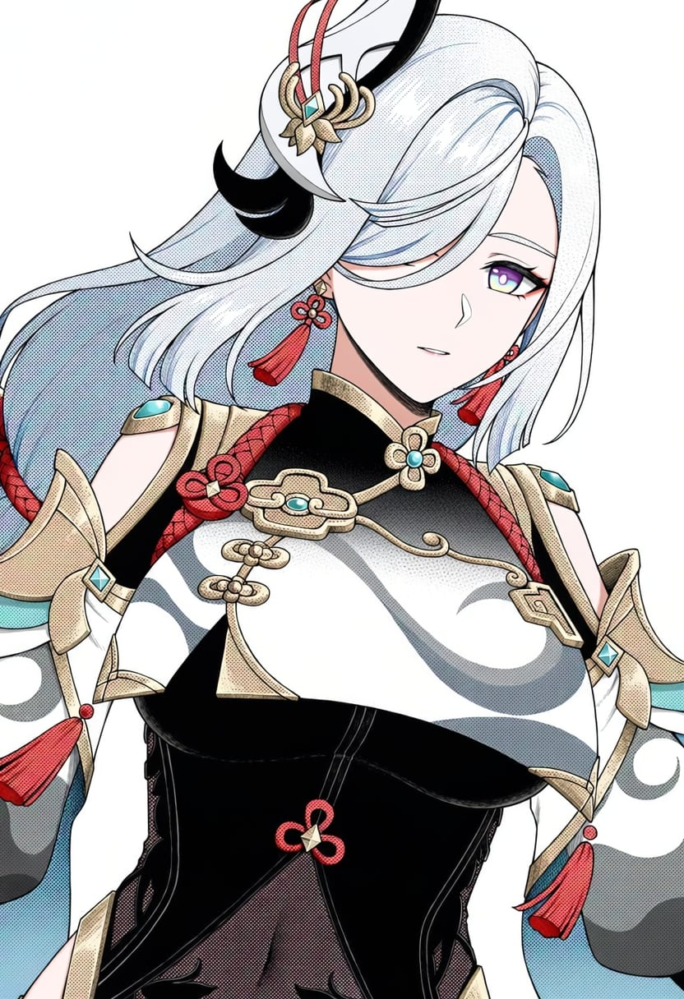

| 字段 | 内容 |
| --- | --- |
| 序号 | 0071 |
| tag | screentones |
| tag中文名 | 漫画网点 |
| tag中文含义 | 使用漫画常见网点、纹理纸来表现灰度和阴影 |
| tag所属的子类 | 漫画与印刷技法 |

## 72. dithering — 抖动网点

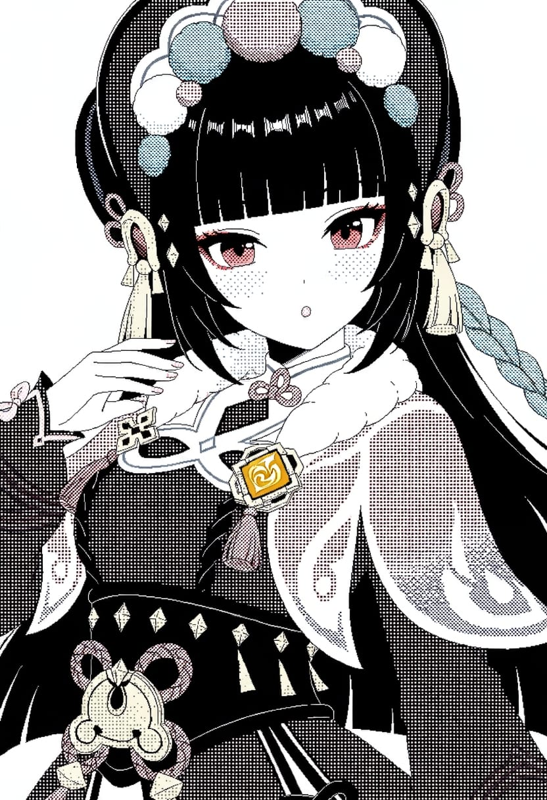

| 字段 | 内容 |
| --- | --- |
| 序号 | 0072 |
| tag | dithering |
| tag中文名 | 抖动网点 |
| tag中文含义 | 用像素点或交错点阵模拟中间色和渐变 |
| tag所属的子类 | 漫画与印刷技法 |

## 73. 3d — 3D渲染

| 字段 | 内容 |
| --- | --- |
| 序号 | 0073 |
| tag | 3d |
| tag中文名 | 3D渲染 |
| tag中文含义 | 画面主体明显由三维模型和渲染生成 |
| tag所属的子类 | 数字、像素与3D |

## 74. faux_3d — 伪3D

| 字段 | 内容 |
| --- | --- |
| 序号 | 0074 |
| tag | faux_3d |
| tag中文名 | 伪3D |
| tag中文含义 | 本质是二维画面，但故意做出立体模型或3D渲染般的观感 |
| tag所属的子类 | 数字、像素与3D |

## 75. cel_rendering — 赛璐璐式3D渲染

| 字段 | 内容 |
| --- | --- |
| 序号 | 0075 |
| tag | cel_rendering |
| tag中文名 | 赛璐璐式3D渲染 |
| tag中文含义 | 3D画面做成二维动画般的硬阴影和描边效果 |
| tag所属的子类 | 数字、像素与3D |

## 76. oekaki — 网页涂鸦风

| 字段 | 内容 |
| --- | --- |
| 序号 | 0076 |
| tag | oekaki |
| tag中文名 | 网页涂鸦风 |
| tag中文含义 | 带早期网页绘图板常见的简单笔刷、低分辨率手绘感 |
| tag所属的子类 | 数字、像素与3D |

## 77. pixel_art — 像素画

| 字段 | 内容 |
| --- | --- |
| 序号 | 0077 |
| tag | pixel_art |
| tag中文名 | 像素画 |
| tag中文含义 | 用可见的方形像素块构成图像 |
| tag所属的子类 | 数字、像素与3D |

## 78. sprite_art — 精灵图

| 字段 | 内容 |
| --- | --- |
| 序号 | 0078 |
| tag | sprite_art |
| tag中文名 | 精灵图 |
| tag中文含义 | 像游戏角色素材一样的小型像素角色或对象图 |
| tag所属的子类 | 数字、像素与3D |

## 79. low_poly — 低多边形

| 字段 | 内容 |
| --- | --- |
| 序号 | 0079 |
| tag | low_poly |
| tag中文名 | 低多边形 |
| tag中文含义 | 用少量多边形和明显几何面组成3D造型 |
| tag所属的子类 | 数字、像素与3D |

## 80. pc-98_(style) — PC-98风格

| 字段 | 内容 |
| --- | --- |
| 序号 | 0080 |
| tag | pc-98_(style) |
| tag中文名 | PC-98风格 |
| tag中文含义 | 模仿PC-98时代游戏的低色数、像素与复古CG观感 |
| tag所属的子类 | 数字、像素与3D |

## 81. painterly — 绘画感渲染

| 字段 | 内容 |
| --- | --- |
| 序号 | 0081 |
| tag | painterly |
| tag中文名 | 绘画感渲染 |
| tag中文含义 | 不追求干净赛璐璐边界，更多靠笔触和色块塑造体积 |
| tag所属的子类 | 写实与绘画渲染 |

## 82. realistic — 写实风格

| 字段 | 内容 |
| --- | --- |
| 序号 | 0082 |
| tag | realistic |
| tag中文名 | 写实风格 |
| tag中文含义 | 人体、材质、光影和比例整体更接近现实 |
| tag所属的子类 | 写实与绘画渲染 |

## 83. fake_photograph — 仿照片

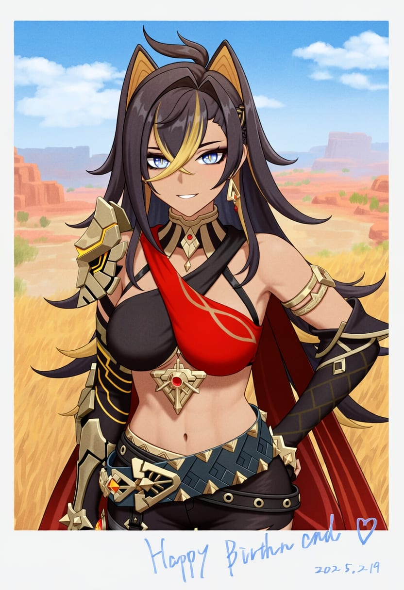

| 字段 | 内容 |
| --- | --- |
| 序号 | 0084 |
| tag | fake_photograph |
| tag中文名 | 仿照片 |
| tag中文含义 | 明明是绘图，却故意做成像随手拍摄的照片 |
| tag所属的子类 | 写实与绘画渲染 |

## 84. chiaroscuro — 明暗对照法

| 字段 | 内容 |
| --- | --- |
| 序号 | 0085 |
| tag | chiaroscuro |
| tag中文名 | 明暗对照法 |
| tag中文含义 | 用很强的亮暗对比塑造体积和戏剧性光影 |
| tag所属的子类 | 写实与绘画渲染 |

## 85. abstract — 抽象艺术

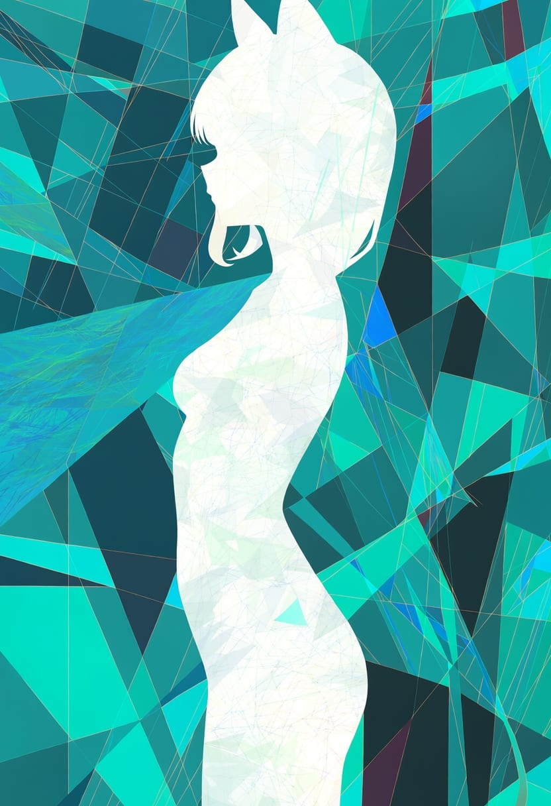

| 字段 | 内容 |
| --- | --- |
| 序号 | 0086 |
| tag | abstract |
| tag中文名 | 抽象艺术 |
| tag中文含义 | 不强调真实物体，主要靠形状、颜色和结构表达 |
| tag所属的子类 | 艺术流派 |

## 86. minimalism — 极简主义

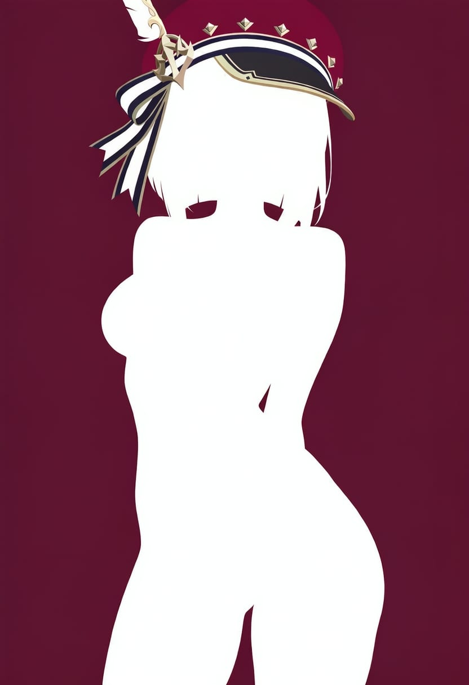

| 字段 | 内容 |
| --- | --- |
| 序号 | 0087 |
| tag | minimalism |
| tag中文名 | 极简主义 |
| tag中文含义 | 元素很少，画面留白多，造型和颜色都尽量简化 |
| tag所属的子类 | 艺术流派 |

## 87. cubism — 立体主义

| 字段 | 内容 |
| --- | --- |
| 序号 | 0088 |
| tag | cubism |
| tag中文名 | 立体主义 |
| tag中文含义 | 把人物和物体拆成几何块面，从多个角度同时重组画面 |
| tag所属的子类 | 艺术流派 |

## 88. impressionism — 印象派

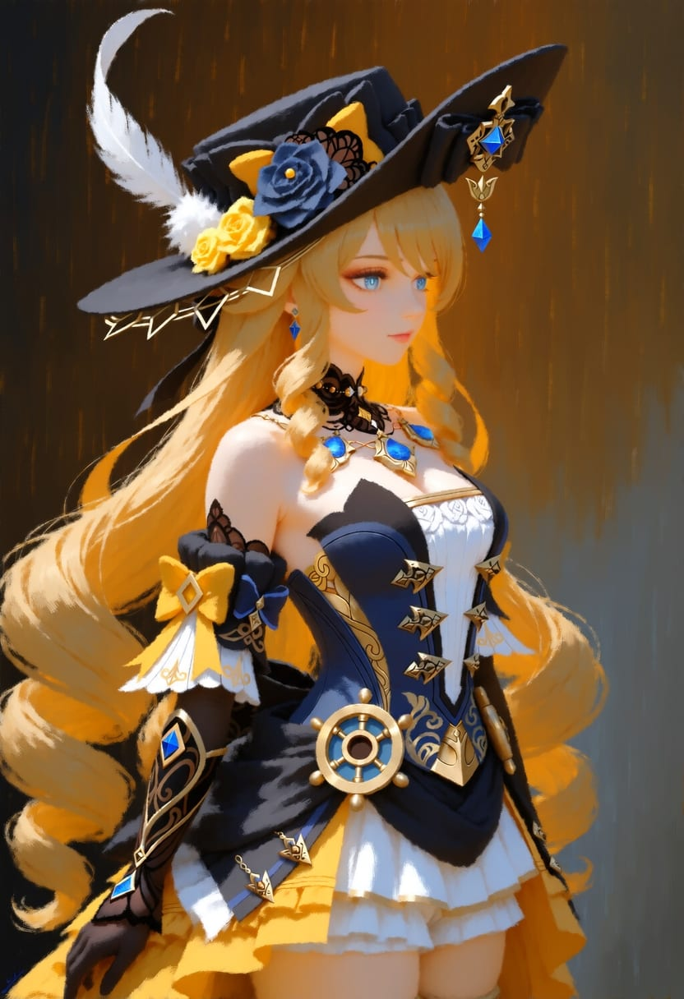

| 字段 | 内容 |
| --- | --- |
| 序号 | 0089 |
| tag | impressionism |
| tag中文名 | 印象派 |
| tag中文含义 | 强调光色和松散笔触，不追求细节轮廓完全清楚 |
| tag所属的子类 | 艺术流派 |

## 89. art_nouveau — 新艺术 / 穆夏风格

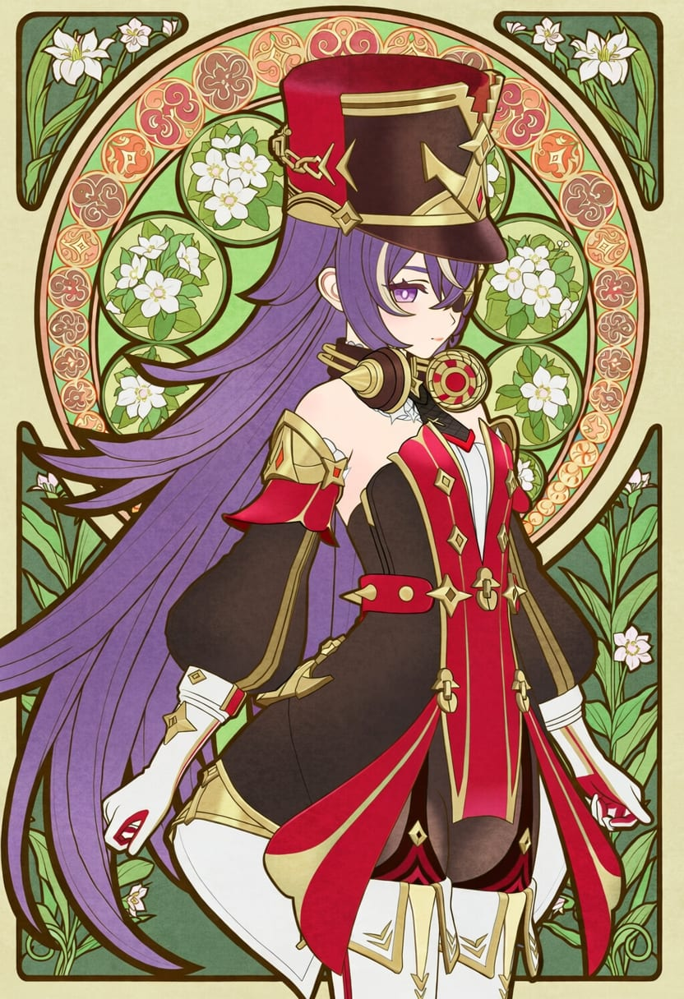

| 字段 | 内容 |
| --- | --- |
| 序号 | 0090 |
| tag | art_nouveau |
| tag中文名 | 新艺术 / 穆夏风格 |
| tag中文含义 | 典型穆夏式装饰画感：流动曲线、花草纹样、平涂和华丽圆形边框 |
| tag所属的子类 | 艺术流派 |

## 90. nihonga — 日本画

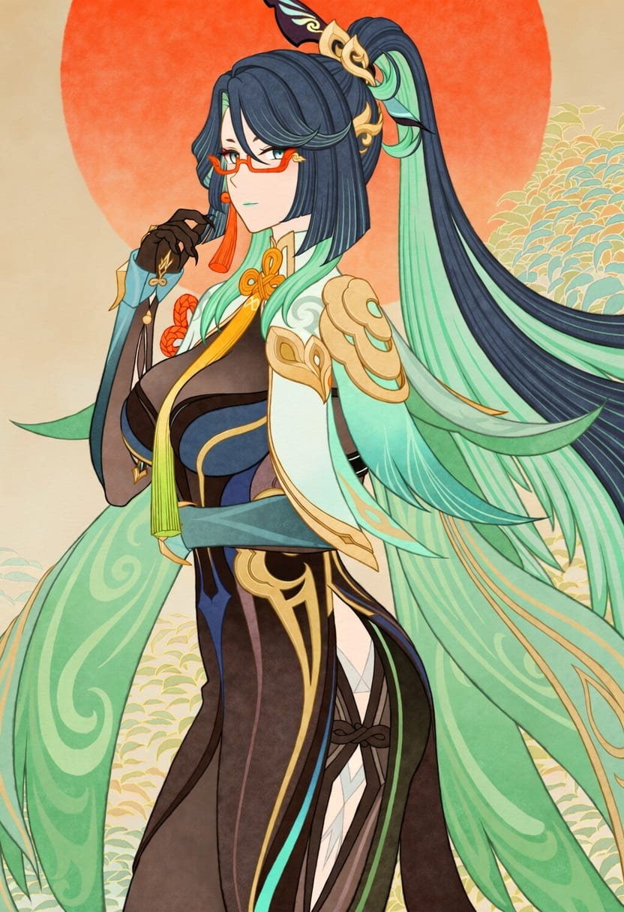

| 字段 | 内容 |
| --- | --- |
| 序号 | 0091 |
| tag | nihonga |
| tag中文名 | 日本画 |
| tag中文含义 | 模仿或采用近现代日本传统绘画的材料和审美 |
| tag所属的子类 | 艺术流派 |

## 91. sumi-e — 墨绘 / 水墨写意风

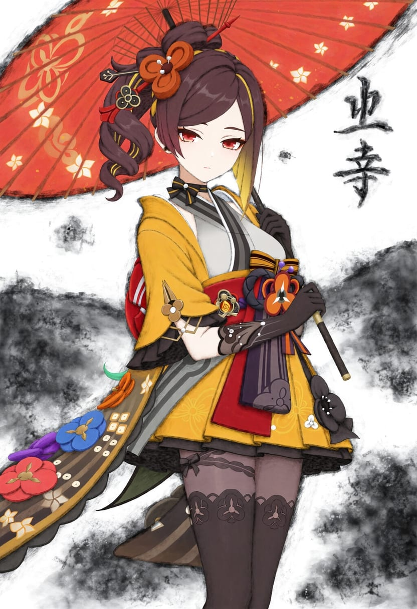

| 字段 | 内容 |
| --- | --- |
| 序号 | 0092 |
| tag | sumi-e |
| tag中文名 | 墨绘 / 水墨写意风 |
| tag中文含义 | 只用少量黑墨和简练线条表现对象，强调留白和概括 |
| tag所属的子类 | 艺术流派 |

## 92. ukiyo-e — 浮世绘

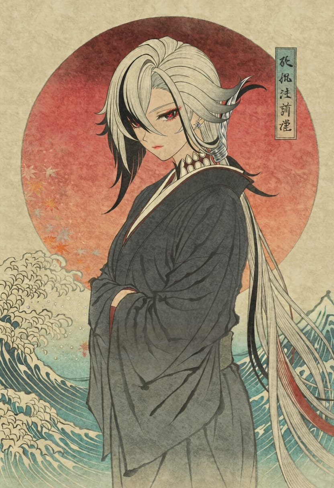

| 字段 | 内容 |
| --- | --- |
| 序号 | 0093 |
| tag | ukiyo-e |
| tag中文名 | 浮世绘 |
| tag中文含义 | 模仿日本浮世绘版画的平面色块、线条和构图 |
| tag所属的子类 | 艺术流派 |

## 93. ligne_claire — 清线风格

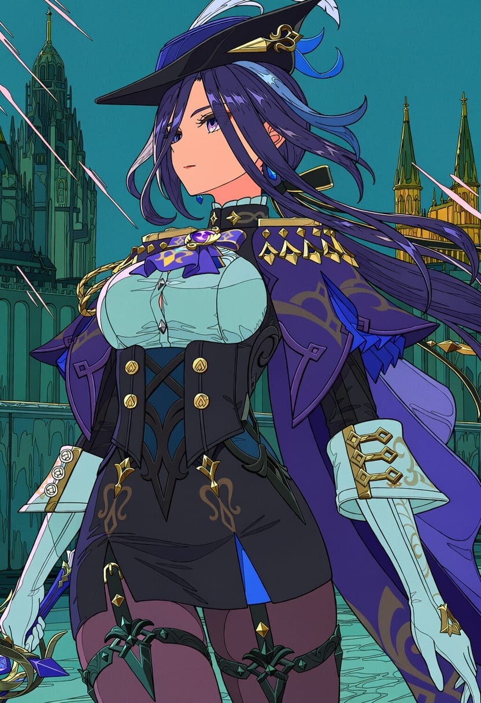

| 字段 | 内容 |
| --- | --- |
| 序号 | 0094 |
| tag | ligne_claire |
| tag中文名 | 清线风格 |
| tag中文含义 | 线条粗细均匀、清晰干净，色块平整，细节易读 |
| tag所属的子类 | 艺术流派 |

## 94. surreal — 超现实主义

| 字段 | 内容 |
| --- | --- |
| 序号 | 0095 |
| tag | surreal |
| tag中文名 | 超现实主义 |
| tag中文含义 | 把现实物体以不合常理、梦境般的方式组合 |
| tag所属的子类 | 艺术流派 |

## 95. superflat — 超扁平

| 字段 | 内容 |
| --- | --- |
| 序号 | 0096 |
| tag | superflat |
| tag中文名 | 超扁平 |
| tag中文含义 | 强调二维平面、扁平色块和日本流行视觉感 |
| tag所属的子类 | 艺术流派 |

## 96. psychedelic — 迷幻风格

| 字段 | 内容 |
| --- | --- |
| 序号 | 0097 |
| tag | psychedelic |
| tag中文名 | 迷幻风格 |
| tag中文含义 | 颜色、形状和图案强烈扭曲，带眩晕或幻觉感 |
| tag所属的子类 | 艺术流派 |

## 97. tarot_(medium) — 塔罗牌画面 / 塔罗牌风格

| 字段 | 内容 |
| --- | --- |
| 序号 | 0098 |
| tag | tarot_(medium) |
| tag中文名 | 塔罗牌画面 / 塔罗牌风格 |
| tag中文含义 | 整张图被设计成一张塔罗牌，通常带牌框、象征图案和仪式感构图 |
| tag所属的子类 | 装饰与版式风格 |

## 98. collage — 拼贴画 / 拼贴风格

| 字段 | 内容 |
| --- | --- |
| 序号 | 0099 |
| tag | collage |
| tag中文名 | 拼贴画 / 拼贴风格 |
| tag中文含义 | 把照片、纸片、插画或不同图像素材切开后重新拼成一张画 |
| tag所属的子类 | 装饰与版式风格 |

## 99. mosaic_art — 马赛克艺术

| 字段 | 内容 |
| --- | --- |
| 序号 | 0100 |
| tag | mosaic_art |
| tag中文名 | 马赛克艺术 |
| tag中文含义 | 用很多小块色片、石块或方片拼成完整图像；不是打码马赛克 |
| tag所属的子类 | 装饰与版式风格 |

## 100. toon_(style) — 西式卡通风

| 字段 | 内容 |
| --- | --- |
| 序号 | 0101 |
| tag | toon_(style) |
| tag中文名 | 西式卡通风 |
| tag中文含义 | 整体造型、线条和表情接近西方动画或卡通 |
| tag所属的子类 | 卡通、仿风与复古审美 |

## 101. western_comics_(style) — 欧美漫画风

| 字段 | 内容 |
| --- | --- |
| 序号 | 0102 |
| tag | western_comics_(style) |
| tag中文名 | 欧美漫画风 |
| tag中文含义 | 模仿欧美漫画常见的墨线、阴影和夸张造型 |
| tag所属的子类 | 卡通、仿风与复古审美 |

## 102. animification — 动漫化

| 字段 | 内容 |
| --- | --- |
| 序号 | 0103 |
| tag | animification |
| tag中文名 | 动漫化 |
| tag中文含义 | 把原本非动漫造型的人物或事物改画成日系动漫风 |
| tag所属的子类 | 卡通、仿风与复古审美 |

## 103. cartoonized — 卡通化

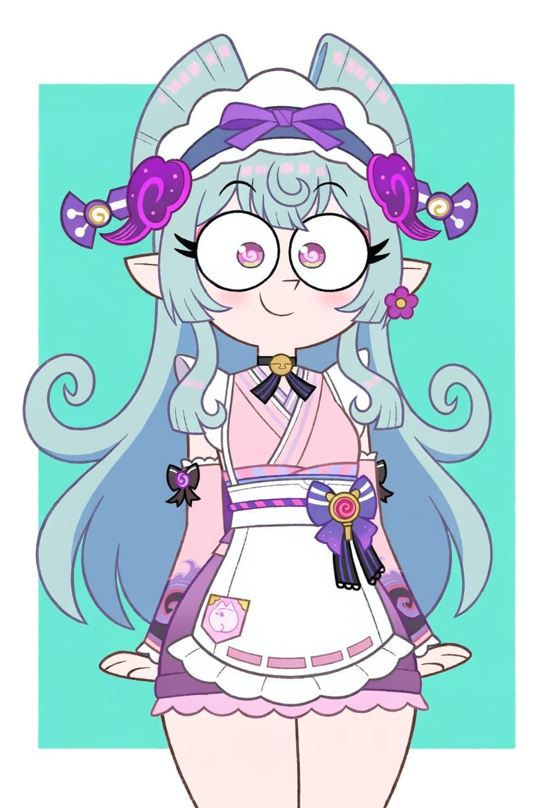

| 字段 | 内容 |
| --- | --- |
| 序号 | 0104 |
| tag | cartoonized |
| tag中文名 | 卡通化 |
| tag中文含义 | 把原本非卡通形象改成西式卡通式造型 |
| tag所属的子类 | 卡通、仿风与复古审美 |

## 104. style_parody — 画风模仿

| 字段 | 内容 |
| --- | --- |
| 序号 | 0105 |
| tag | style_parody |
| tag中文名 | 画风模仿 |
| tag中文含义 | 故意模仿另一位作者、作品或特定画风的视觉特征 |
| tag所属的子类 | 卡通、仿风与复古审美 |

## 105. fine_art_parody — 名画仿作

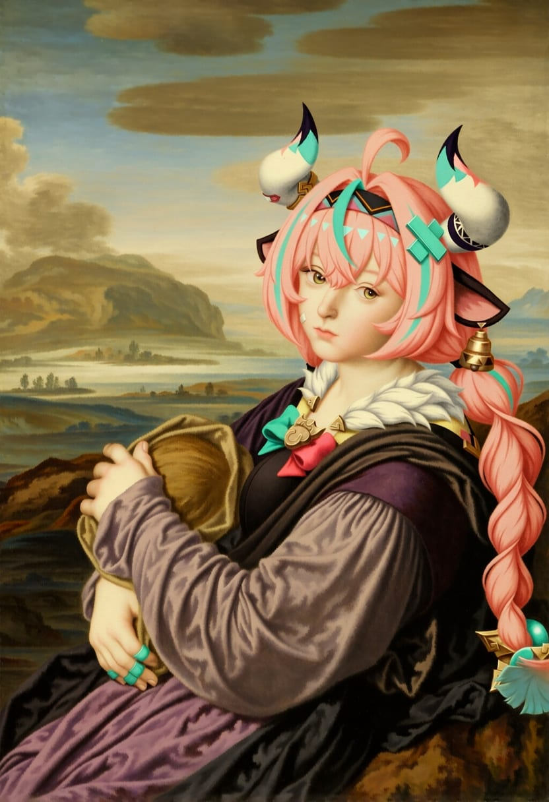

| 字段 | 内容 |
| --- | --- |
| 序号 | 0106 |
| tag | fine_art_parody |
| tag中文名 | 名画仿作 |
| tag中文含义 | 模仿或改编经典美术作品的画面、构图或表现方式 |
| tag所属的子类 | 卡通、仿风与复古审美 |

## 106. retro_artstyle — 复古画风

| 字段 | 内容 |
| --- | --- |
| 序号 | 0107 |
| tag | retro_artstyle |
| tag中文名 | 复古画风 |
| tag中文含义 | 整体画法明显像过去年代的动画、漫画或插画 |
| tag所属的子类 | 卡通、仿风与复古审美 |

## 107. faux_retro_artstyle — 现代仿复古

| 字段 | 内容 |
| --- | --- |
| 序号 | 0108 |
| tag | faux_retro_artstyle |
| tag中文名 | 现代仿复古 |
| tag中文含义 | 新作品故意画成旧年代动画或漫画的样子 |
| tag所属的子类 | 卡通、仿风与复古审美 |

## 108. 1960s_(style) — 1960年代画风

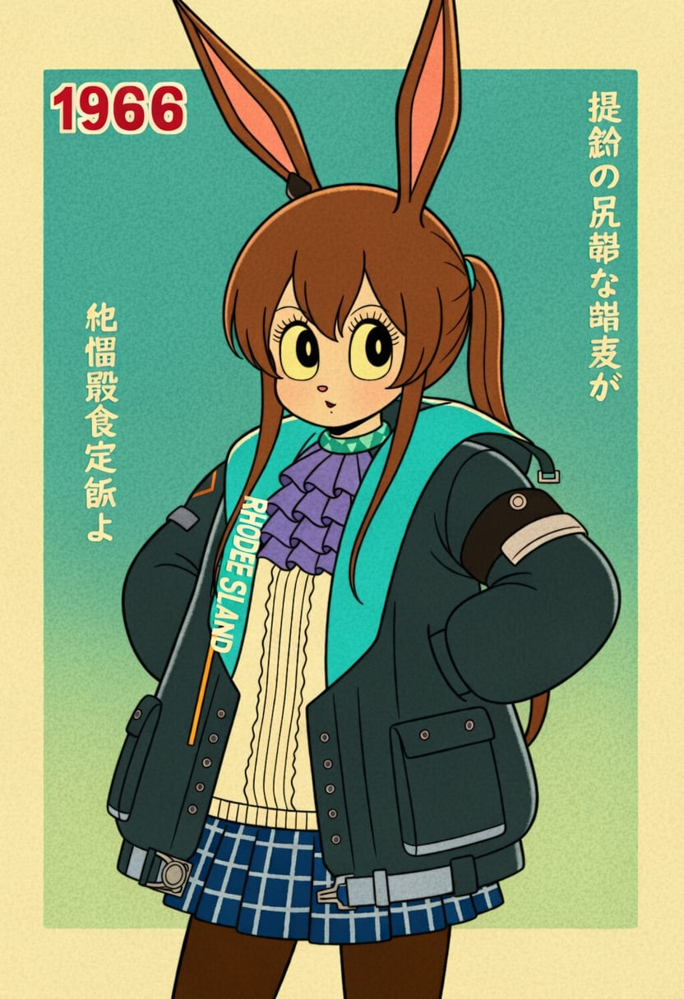

| 字段 | 内容 |
| --- | --- |
| 序号 | 0109 |
| tag | 1960s_(style) |
| tag中文名 | 1960年代画风 |
| tag中文含义 | 模仿1960年代动画、漫画和商业插画常见的造型、配色与印刷感 |
| tag所属的子类 | 卡通、仿风与复古审美 |

## 109. 1970s_(style) — 1970年代画风

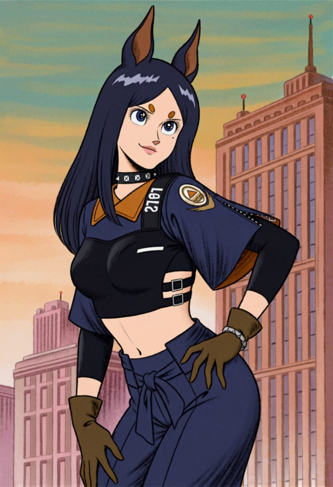

| 字段 | 内容 |
| --- | --- |
| 序号 | 0110 |
| tag | 1970s_(style) |
| tag中文名 | 1970年代画风 |
| tag中文含义 | 模仿1970年代动漫、漫画常见的角色和上色风格 |
| tag所属的子类 | 卡通、仿风与复古审美 |

## 110. 1980s_(style) — 1980年代画风

| 字段 | 内容 |
| --- | --- |
| 序号 | 0111 |
| tag | 1980s_(style) |
| tag中文名 | 1980年代画风 |
| tag中文含义 | 模仿1980年代动漫、漫画常见的线条和配色 |
| tag所属的子类 | 卡通、仿风与复古审美 |

## 111. 1990s_(style) — 1990年代画风

| 字段 | 内容 |
| --- | --- |
| 序号 | 0112 |
| tag | 1990s_(style) |
| tag中文名 | 1990年代画风 |
| tag中文含义 | 模仿1990年代动漫、漫画常见的造型和上色 |
| tag所属的子类 | 卡通、仿风与复古审美 |

## 112. 2000s_(style) — 2000年代画风

| 字段 | 内容 |
| --- | --- |
| 序号 | 0113 |
| tag | 2000s_(style) |
| tag中文名 | 2000年代画风 |
| tag中文含义 | 模仿2000年代动漫、视觉小说常见的粗黑线和赛璐璐上色 |
| tag所属的子类 | 卡通、仿风与复古审美 |

## 113. frutiger_metro — Frutiger Metro

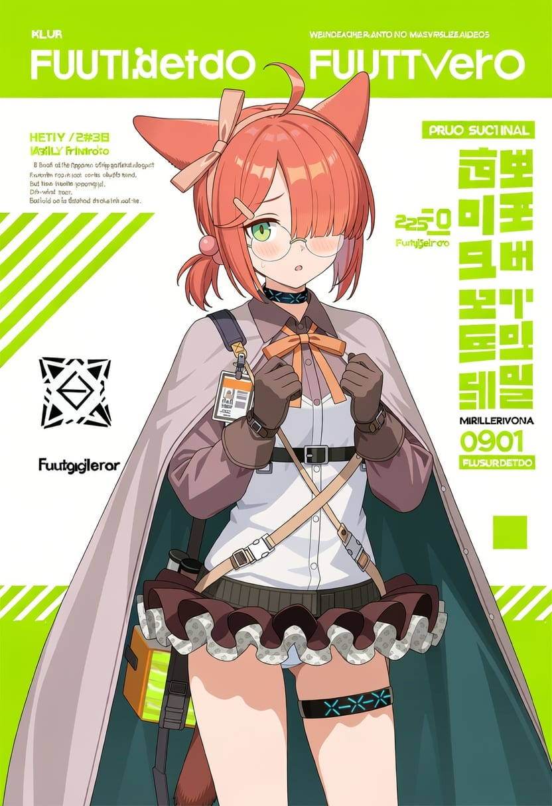

| 字段 | 内容 |
| --- | --- |
| 序号 | 0115 |
| tag | frutiger_metro |
| tag中文名 | Frutiger Metro |
| tag中文含义 | 用扁平矢量形状、亮色和城市科技图形做千禧复古设计 |
| tag所属的子类 | 卡通、仿风与复古审美 |

## 114. heisei_retro — 平成复古

| 字段 | 内容 |
| --- | --- |
| 序号 | 0116 |
| tag | heisei_retro |
| tag中文名 | 平成复古 |
| tag中文含义 | 模仿日本平成时期流行插画、广告和数码视觉的怀旧感 |
| tag所属的子类 | 卡通、仿风与复古审美 |

## 115. vaporwave — 蒸汽波

| 字段 | 内容 |
| --- | --- |
| 序号 | 0117 |
| tag | vaporwave |
| tag中文名 | 蒸汽波 |
| tag中文含义 | 粉紫霓虹、复古电脑、雕像等元素组成的怀旧数码审美 |
| tag所属的子类 | 卡通、仿风与复古审美 |

## 116. weirdcore — 怪核

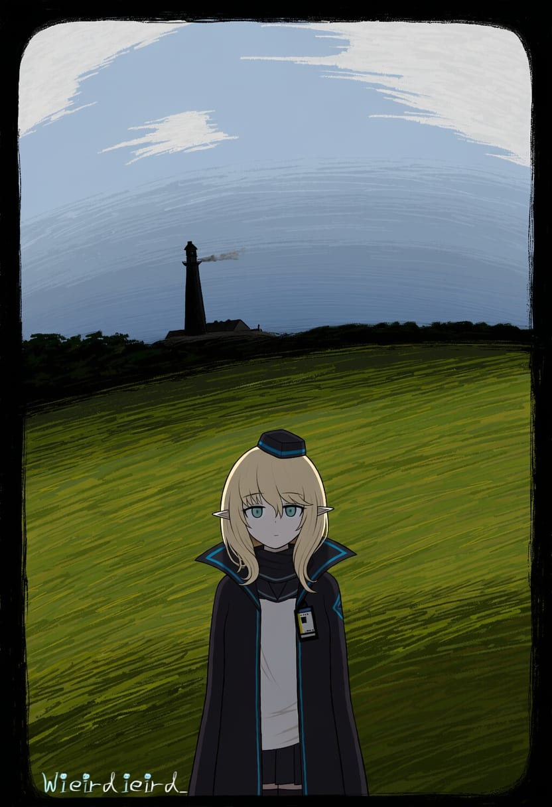

| 字段 | 内容 |
| --- | --- |
| 序号 | 0118 |
| tag | weirdcore |
| tag中文名 | 怪核 |
| tag中文含义 | 用低清、诡异空间和不安文字制造梦境般怪异感 |
| tag所属的子类 | 卡通、仿风与复古审美 |

## 117. glitch_art — 故障艺术

| 字段 | 内容 |
| --- | --- |
| 序号 | 0119 |
| tag | glitch_art |
| tag中文名 | 故障艺术 |
| tag中文含义 | 故意加入数字错位、破图、扫描错误等故障视觉 |
| tag所属的子类 | 纹理与特殊效果 |

## 118. film_grain — 胶片颗粒

| 字段 | 内容 |
| --- | --- |
| 序号 | 0120 |
| tag | film_grain |
| tag中文名 | 胶片颗粒 |
| tag中文含义 | 画面覆盖明显颗粒，像老胶片或高感光照片 |
| tag所属的子类 | 纹理与特殊效果 |

## 119. scanlines — 扫描线

| 字段 | 内容 |
| --- | --- |
| 序号 | 0121 |
| tag | scanlines |
| tag中文名 | 扫描线 |
| tag中文含义 | 画面出现CRT或旧显示器那样的横向扫描线 |
| tag所属的子类 | 纹理与特殊效果 |

## 120. paper_texture — 纸张纹理

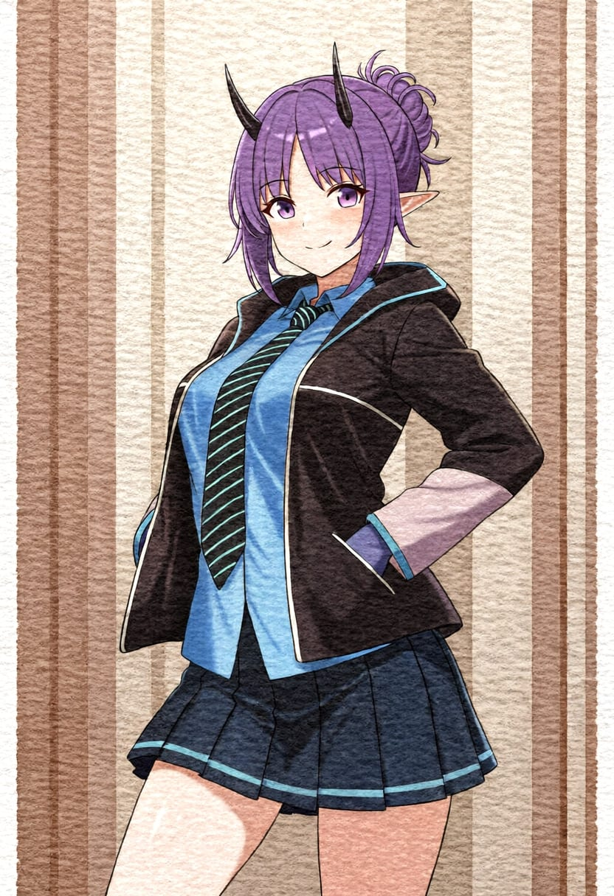

| 字段 | 内容 |
| --- | --- |
| 序号 | 0122 |
| tag | paper_texture |
| tag中文名 | 纸张纹理 |
| tag中文含义 | 画面能明显看到纸纤维、纸面颗粒或纸张底纹 |
| tag所属的子类 | 纹理与特殊效果 |

## 121. canvas_texture — 画布纹理

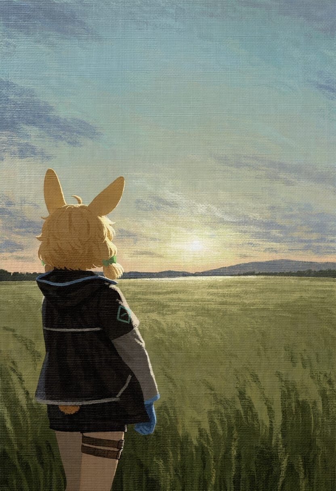

| 字段 | 内容 |
| --- | --- |
| 序号 | 0123 |
| tag | canvas_texture |
| tag中文名 | 画布纹理 |
| tag中文含义 | 画面能明显看到油画布一类的网格或织物底纹 |
| tag所属的子类 | 纹理与特殊效果 |

## 122. paint_splatter — 颜料飞溅

| 字段 | 内容 |
| --- | --- |
| 序号 | 0124 |
| tag | paint_splatter |
| tag中文名 | 颜料飞溅 |
| tag中文含义 | 画面带随机的泼墨、甩漆或颜料点 |
| tag所属的子类 | 纹理与特殊效果 |

## 123. bloom — 泛光

| 字段 | 内容 |
| --- | --- |
| 序号 | 0125 |
| tag | bloom |
| tag中文名 | 泛光 |
| tag中文含义 | 高亮区域向周围溢出柔光，形成发亮的光晕 |
| tag所属的子类 | 纹理与特殊效果 |

## 124. bokeh — 散景光斑

| 字段 | 内容 |
| --- | --- |
| 序号 | 0126 |
| tag | bokeh |
| tag中文名 | 散景光斑 |
| tag中文含义 | 背景或失焦区域出现圆形、柔软的虚化光斑 |
| tag所属的子类 | 纹理与特殊效果 |

## 125. caustics — 焦散光纹

| 字段 | 内容 |
| --- | --- |
| 序号 | 0127 |
| tag | caustics |
| tag中文名 | 焦散光纹 |
| tag中文含义 | 水面或玻璃折射后形成跳动、弯曲的亮纹 |
| tag所属的子类 | 纹理与特殊效果 |

## 126. chromatic_aberration — 色差效果

| 字段 | 内容 |
| --- | --- |
| 序号 | 0128 |
| tag | chromatic_aberration |
| tag中文名 | 色差效果 |
| tag中文含义 | 轮廓边缘出现红绿蓝分离，像镜头像差或数字故障 |
| tag所属的子类 | 纹理与特殊效果 |

## 127. silhouette — 剪影

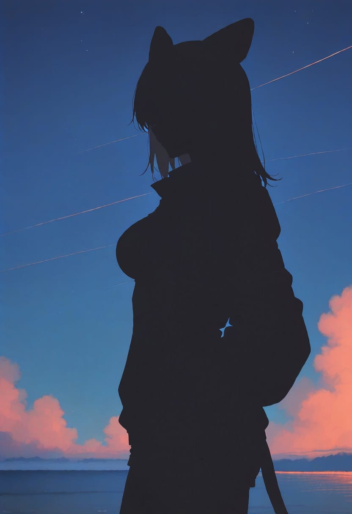

| 字段 | 内容 |
| --- | --- |
| 序号 | 0129 |
| tag | silhouette |
| tag中文名 | 剪影 |
| tag中文含义 | 主体主要表现为整块深色或纯色轮廓，内部细节很少 |
| tag所属的子类 | 纹理与特殊效果 |

## 128. vhs_artifacts — VHS录像带伪影

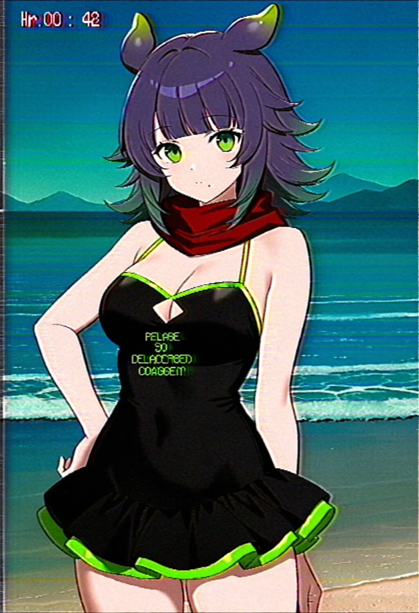

| 字段 | 内容 |
| --- | --- |
| 序号 | 0130 |
| tag | vhs_artifacts |
| tag中文名 | VHS录像带伪影 |
| tag中文含义 | 旧录像带式横纹、噪点、画面抖动和颜色错位 |
| tag所属的子类 | 纹理与特殊效果 |

## 129. vignetting — 暗角

| 字段 | 内容 |
| --- | --- |
| 序号 | 0131 |
| tag | vignetting |
| tag中文名 | 暗角 |
| tag中文含义 | 画面四周明显压暗，让视线更集中到中间 |
| tag所属的子类 | 纹理与特殊效果 |

## 130. lens_flare — 镜头眩光

| 字段 | 内容 |
| --- | --- |
| 序号 | 0132 |
| tag | lens_flare |
| tag中文名 | 镜头眩光 |
| tag中文含义 | 强光进入镜头后出现光斑、光环或横向耀光 |
| tag所属的子类 | 纹理与特殊效果 |

## 131. motion_blur — 动态模糊

| 字段 | 内容 |
| --- | --- |
| 序号 | 0133 |
| tag | motion_blur |
| tag中文名 | 动态模糊 |
| tag中文含义 | 移动方向上出现拖影和模糊，强化速度感 |
| tag所属的子类 | 纹理与特殊效果 |

## 132. backlighting — 逆光

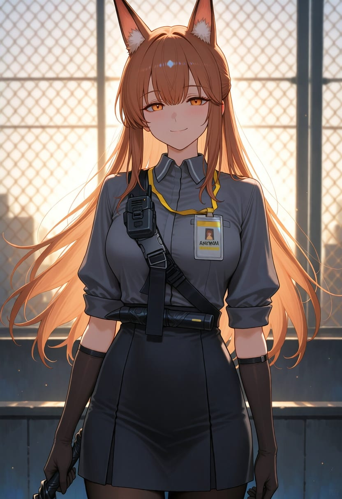

| 字段 | 内容 |
| --- | --- |
| 序号 | 0134 |
| tag | backlighting |
| tag中文名 | 逆光 |
| tag中文含义 | 光从主体背后照来，边缘发亮，正面通常更暗 |
| tag所属的子类 | 纹理与特殊效果 |

## 133. diffraction_spikes — 星芒

| 字段 | 内容 |
| --- | --- |
| 序号 | 0135 |
| tag | diffraction_spikes |
| tag中文名 | 星芒 |
| tag中文含义 | 点光源向外拉出十字或放射状尖刺，像镜头拍灯光 |
| tag所属的子类 | 纹理与特殊效果 |

## 134. depth_of_field — 景深

| 字段 | 内容 |
| --- | --- |
| 序号 | 0136 |
| tag | depth_of_field |
| tag中文名 | 景深 |
| tag中文含义 | 主体清晰，而前景或背景明显虚化，像相机大光圈效果 |
| tag所属的子类 | 纹理与特殊效果 |

## 135. light_rays — 光束

| 字段 | 内容 |
| --- | --- |
| 序号 | 0137 |
| tag | light_rays |
| tag中文名 | 光束 |
| tag中文含义 | 能直接看见一束束穿透空气的光线或放射光柱 |
| tag所属的子类 | 纹理与特殊效果 |

## 136. double_exposure — 双重曝光

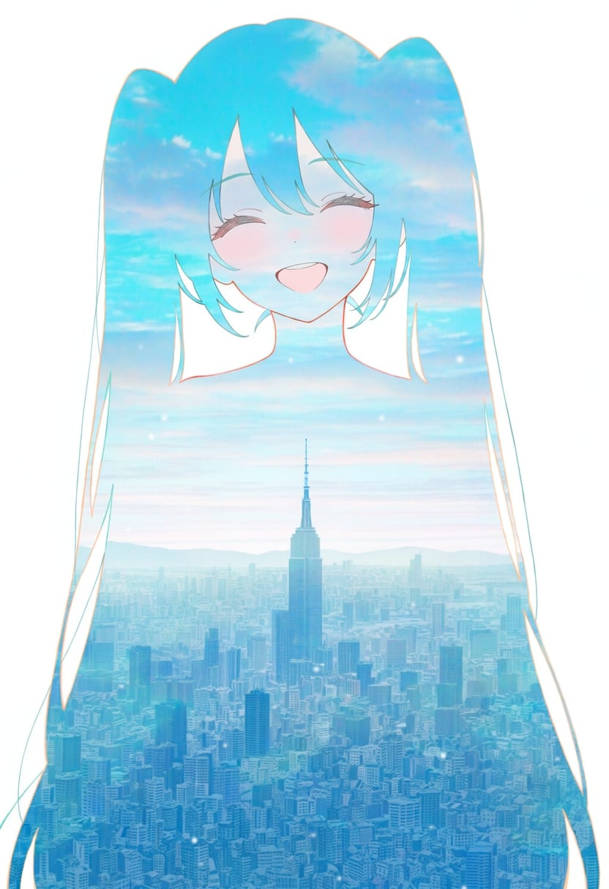

| 字段 | 内容 |
| --- | --- |
| 序号 | 0138 |
| tag | double_exposure |
| tag中文名 | 双重曝光 |
| tag中文含义 | 把两层影像半透明叠在一起，常让人物轮廓里出现另一幅场景 |
| tag所属的子类 | 纹理与特殊效果 |

## 137. drop_shadow — 投影 / 下落阴影

| 字段 | 内容 |
| --- | --- |
| 序号 | 0139 |
| tag | drop_shadow |
| tag中文名 | 投影 / 下落阴影 |
| tag中文含义 | 主体后方有一块偏移的平面阴影，常见于贴纸、海报和图形设计 |
| tag所属的子类 | 纹理与特殊效果 |

## 138. overexposure — 过曝

| 字段 | 内容 |
| --- | --- |
| 序号 | 0140 |
| tag | overexposure |
| tag中文名 | 过曝 |
| tag中文含义 | 高光亮到接近纯白，部分细节被强光吃掉 |
| tag所属的子类 | 纹理与特殊效果 |

## 139. honkai:star_rail,official_art,game_cg — 星穹铁道画风

| 字段 | 内容 |
| --- | --- |
| 序号 | 0141 |
| tag | honkai:star_rail,official_art,game_cg |
| tag中文名 | 星穹铁道画风 |
| tag中文含义 | 第一个tag为星铁的名字，更换为其他ip的tag可以模仿其他游戏的画风 |
| tag所属的子类 | up喜欢 |

---
