## 1. glasses — 眼镜

| 字段 | 内容 |
| --- | --- |
| Danbooru Tag | glasses |
| 中文名 | 眼镜 |
| 中文含义 | 普通双镜片眼镜。 |
| 子类 | 眼镜/护目镜 |
| 模特 | 1girl,furina_(genshin_impact) |
| 序号 | 0001 |

## 2. black-framed_eyewear — 黑框眼镜

| 字段 | 内容 |
| --- | --- |
| Danbooru Tag | black-framed_eyewear |
| 中文名 | 黑框眼镜 |
| 中文含义 | 黑色镜框；纯颜色镜框只留这一种代表。 |
| 子类 | 眼镜/护目镜 |
| 模特 | 1girl,yamato_(one_piece) |
| 序号 | 0002 |

## 3. two-tone_eyewear — 双色眼镜

| 字段 | 内容 |
| --- | --- |
| Danbooru Tag | two-tone_eyewear |
| 中文名 | 双色眼镜 |
| 中文含义 | 镜框或眼镜主体有两种主要颜色。 |
| 子类 | 眼镜/护目镜 |
| 模特 | 1girl,silver_wolf_(honkai:_star_rail) |
| 序号 | 0003 |

## 4. tinted_eyewear — 染色镜片眼镜

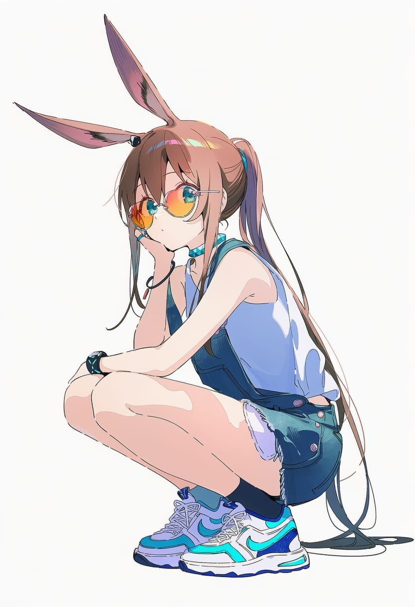

| 字段 | 内容 |
| --- | --- |
| Danbooru Tag | tinted_eyewear |
| 中文名 | 染色镜片眼镜 |
| 中文含义 | 镜片带明显颜色，但不一定是太阳镜。 |
| 子类 | 眼镜/护目镜 |
| 模特 | 1girl,amiya_(arknights) |
| 序号 | 0004 |

## 5. gradient-tinted_eyewear — 渐变镜片

| 字段 | 内容 |
| --- | --- |
| Danbooru Tag | gradient-tinted_eyewear |
| 中文名 | 渐变镜片 |
| 中文含义 | 镜片颜色呈渐变效果。 |
| 子类 | 眼镜/护目镜 |
| 模特 | 1girl,amber_(genshin_impact) |
| 序号 | 0005 |

## 6. multicolor-tinted_eyewear — 多色镜片

| 字段 | 内容 |
| --- | --- |
| Danbooru Tag | multicolor-tinted_eyewear |
| 中文名 | 多色镜片 |
| 中文含义 | 镜片同时带多种颜色。 |
| 子类 | 眼镜/护目镜 |
| 模特 | 1girl,hu_tao_(genshin_impact) |
| 序号 | 0006 |

## 7. rainbow-tinted_eyewear — 彩虹镜片

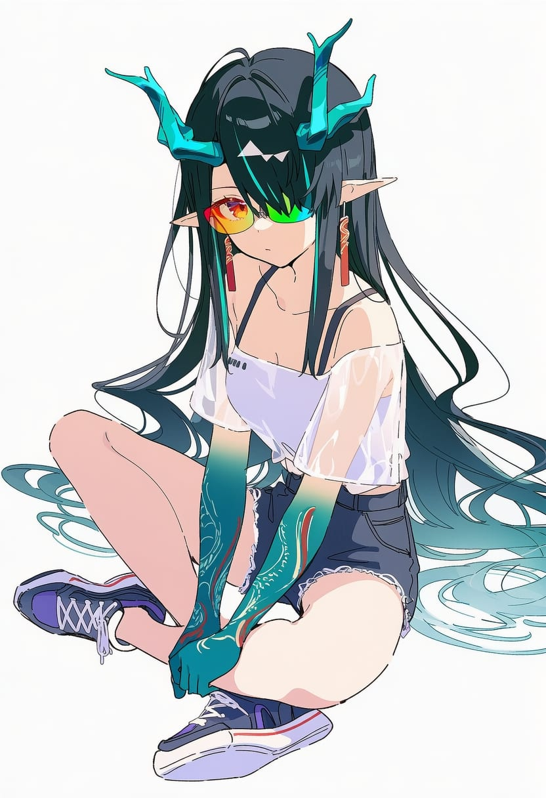

| 字段 | 内容 |
| --- | --- |
| Danbooru Tag | rainbow-tinted_eyewear |
| 中文名 | 彩虹镜片 |
| 中文含义 | 镜片呈彩虹式多色效果。 |
| 子类 | 眼镜/护目镜 |
| 模特 | 1girl,dusk_(arknights) |
| 序号 | 0007 |

## 8. round_eyewear — 圆框眼镜

| 字段 | 内容 |
| --- | --- |
| Danbooru Tag | round_eyewear |
| 中文名 | 圆框眼镜 |
| 中文含义 | 镜片或镜框明显呈圆形。 |
| 子类 | 眼镜/护目镜 |
| 模特 | 1girl,acheron_(honkai:_star_rail) |
| 序号 | 0008 |

## 9. rectangular_eyewear — 方框眼镜

| 字段 | 内容 |
| --- | --- |
| Danbooru Tag | rectangular_eyewear |
| 中文名 | 方框眼镜 |
| 中文含义 | 镜片或镜框呈矩形。 |
| 子类 | 眼镜/护目镜 |
| 模特 | 1girl,ishtar_(fate) |
| 序号 | 0009 |

## 10. semi-circular_eyewear — 半圆框眼镜

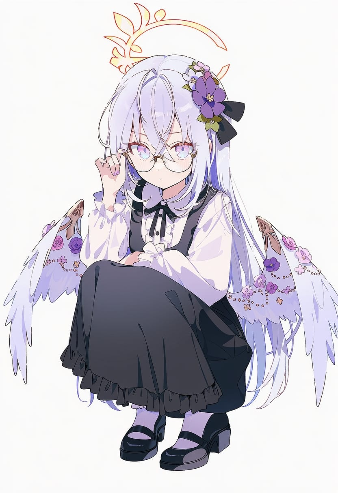

| 字段 | 内容 |
| --- | --- |
| Danbooru Tag | semi-circular_eyewear |
| 中文名 | 半圆框眼镜 |
| 中文含义 | 镜框或镜片呈明显半圆形。 |
| 子类 | 眼镜/护目镜 |
| 模特 | 1girl,azusa_(blue_archive) |
| 序号 | 0010 |

## 11. rimless_eyewear — 无框眼镜

| 字段 | 内容 |
| --- | --- |
| Danbooru Tag | rimless_eyewear |
| 中文名 | 无框眼镜 |
| 中文含义 | 镜片周围没有完整镜框。 |
| 子类 | 眼镜/护目镜 |
| 模特 | 1girl,nefertari_vivi |
| 序号 | 0011 |

## 12. semi-rimless_eyewear — 半框眼镜

| 字段 | 内容 |
| --- | --- |
| Danbooru Tag | semi-rimless_eyewear |
| 中文名 | 半框眼镜 |
| 中文含义 | 镜片只有部分边缘有镜框。 |
| 子类 | 眼镜/护目镜 |
| 模特 | 1girl,akane_(blue_archive) |
| 序号 | 0012 |

## 13. over-rim_eyewear — 上半框眼镜

| 字段 | 内容 |
| --- | --- |
| Danbooru Tag | over-rim_eyewear |
| 中文名 | 上半框眼镜 |
| 中文含义 | 镜框主要集中在镜片上缘。 |
| 子类 | 眼镜/护目镜 |
| 模特 | 1girl,nicole_demara |
| 序号 | 0013 |

## 14. under-rim_eyewear — 下半框眼镜

| 字段 | 内容 |
| --- | --- |
| Danbooru Tag | under-rim_eyewear |
| 中文名 | 下半框眼镜 |
| 中文含义 | 镜框主要集中在镜片下缘。 |
| 子类 | 眼镜/护目镜 |
| 模特 | 1girl,belle_(zenless_zone_zero) |
| 序号 | 0014 |

## 15. cat_eye-framed_eyewear — 猫眼框眼镜

| 字段 | 内容 |
| --- | --- |
| Danbooru Tag | cat_eye-framed_eyewear |
| 中文名 | 猫眼框眼镜 |
| 中文含义 | 外眼角上翘的猫眼形镜框。 |
| 子类 | 眼镜/护目镜 |
| 模特 | 1girl,monet_(one_piece) |
| 序号 | 0015 |

## 16. heart-shaped_eyewear — 爱心眼镜

| 字段 | 内容 |
| --- | --- |
| Danbooru Tag | heart-shaped_eyewear |
| 中文名 | 爱心眼镜 |
| 中文含义 | 爱心形镜框或镜片。 |
| 子类 | 眼镜/护目镜 |
| 模特 | 1girl,mika_(blue_archive) |
| 序号 | 0016 |

## 17. triangular_eyewear — 三角眼镜

| 字段 | 内容 |
| --- | --- |
| Danbooru Tag | triangular_eyewear |
| 中文名 | 三角眼镜 |
| 中文含义 | 三角形镜框或镜片。 |
| 子类 | 眼镜/护目镜 |
| 模特 | 1girl,qiqi_(genshin_impact) |
| 序号 | 0017 |

## 18. tortoiseshell-framed_eyewear — 玳瑁纹眼镜

| 字段 | 内容 |
| --- | --- |
| Danbooru Tag | tortoiseshell-framed_eyewear |
| 中文名 | 玳瑁纹眼镜 |
| 中文含义 | 带玳瑁纹理的镜框。 |
| 子类 | 眼镜/护目镜 |
| 模特 | 1girl,seele_(honkai:_star_rail) |
| 序号 | 0018 |

## 19. animal-themed_eyewear — 动物主题眼镜

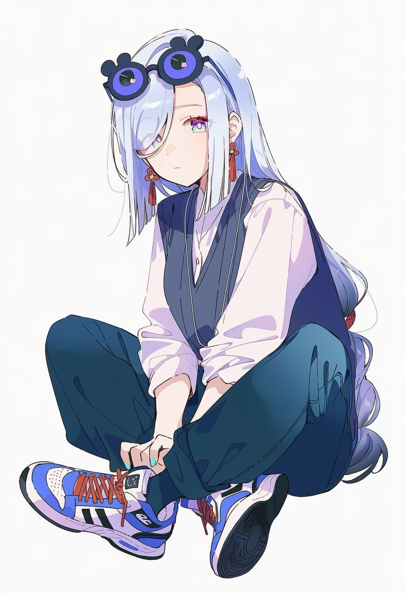

| 字段 | 内容 |
| --- | --- |
| Danbooru Tag | animal-themed_eyewear |
| 中文名 | 动物主题眼镜 |
| 中文含义 | 带动物造型或动物元素的眼镜。 |
| 子类 | 眼镜/护目镜 |
| 模特 | 1girl,shenhe_(genshin_impact) |
| 序号 | 0019 |

## 20. food-themed_eyewear — 食物主题眼镜

| 字段 | 内容 |
| --- | --- |
| Danbooru Tag | food-themed_eyewear |
| 中文名 | 食物主题眼镜 |
| 中文含义 | 带食物造型或食物元素的眼镜。 |
| 子类 | 眼镜/护目镜 |
| 模特 | 1girl,nami_(one_piece) |
| 序号 | 0020 |

## 21. teardrop-framed_glasses — 水滴框眼镜

| 字段 | 内容 |
| --- | --- |
| Danbooru Tag | teardrop-framed_glasses |
| 中文名 | 水滴框眼镜 |
| 中文含义 | 镜框呈水滴或泪滴形。 |
| 子类 | 眼镜/护目镜 |
| 模特 | 1girl,hina_(blue_archive) |
| 序号 | 0021 |

## 22. 3d_glasses — 3D眼镜

| 字段 | 内容 |
| --- | --- |
| Danbooru Tag | 3d_glasses |
| 中文名 | 3D眼镜 |
| 中文含义 | 观看立体影像使用的3D眼镜。 |
| 子类 | 眼镜/护目镜 |
| 模特 | 1girl,raiden_shogun |
| 序号 | 0022 |

## 23. aviator_glasses — 飞行员框眼镜

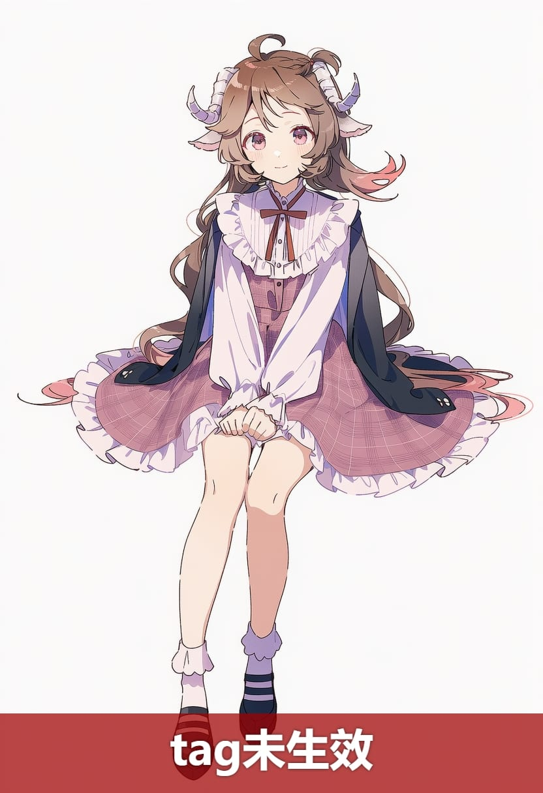

| 字段 | 内容 |
| --- | --- |
| Danbooru Tag | aviator_glasses |
| 中文名 | 飞行员框眼镜 |
| 中文含义 | 飞行员镜框造型的普通眼镜。 |
| 子类 | 眼镜/护目镜 |
| 模特 | 1girl,eyjafjalla_(arknights) |
| 序号 | 0023 |

## 24. coke-bottle_glasses — 厚底眼镜

| 字段 | 内容 |
| --- | --- |
| Danbooru Tag | coke-bottle_glasses |
| 中文名 | 厚底眼镜 |
| 中文含义 | 镜片非常厚的高度数眼镜。 |
| 子类 | 眼镜/护目镜 |
| 模特 | 1girl,yuuka_(blue_archive) |
| 序号 | 0024 |

## 25. novelty_glasses — 趣味眼镜

| 字段 | 内容 |
| --- | --- |
| Danbooru Tag | novelty_glasses |
| 中文名 | 趣味眼镜 |
| 中文含义 | 造型夸张或搞怪的装饰眼镜。 |
| 子类 | 眼镜/护目镜 |
| 模特 | 1girl,exusiai_(arknights) |
| 序号 | 0025 |

## 26. star-shaped_eyewear — 星形眼镜

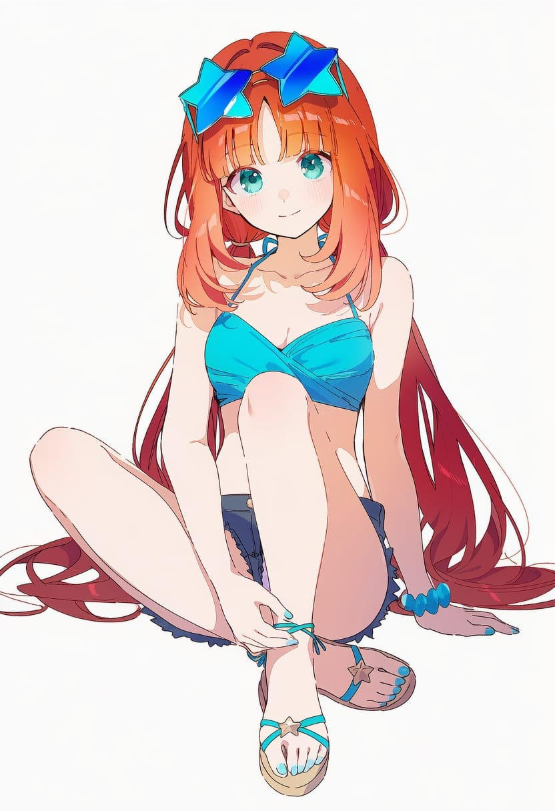

| 字段 | 内容 |
| --- | --- |
| Danbooru Tag | star-shaped_eyewear |
| 中文名 | 星形眼镜 |
| 中文含义 | 星星形镜框或镜片。 |
| 子类 | 眼镜/护目镜 |
| 模特 | 1girl,nilou_(genshin_impact) |
| 序号 | 0026 |

## 27. groucho_glasses — 搞怪伪装眼镜

| 字段 | 内容 |
| --- | --- |
| Danbooru Tag | groucho_glasses |
| 中文名 | 搞怪伪装眼镜 |
| 中文含义 | 带假鼻子、眉毛等的搞怪眼镜。 |
| 子类 | 眼镜/护目镜 |
| 模特 | 1girl,skadi_(arknights) |
| 序号 | 0027 |

## 28. lorgnette — 手柄眼镜

| 字段 | 内容 |
| --- | --- |
| Danbooru Tag | lorgnette |
| 中文名 | 手柄眼镜 |
| 中文含义 | 带手柄、拿在眼前使用的眼镜。 |
| 子类 | 眼镜/护目镜 |
| 模特 | 1girl,klee_(genshin_impact) |
| 序号 | 0028 |

## 29. opaque_glasses — 不透明眼镜

| 字段 | 内容 |
| --- | --- |
| Danbooru Tag | opaque_glasses |
| 中文名 | 不透明眼镜 |
| 中文含义 | 镜片不透明，看不到眼睛。 |
| 子类 | 眼镜/护目镜 |
| 模特 | 1girl,jean_(genshin_impact) |
| 序号 | 0029 |

## 30. pince-nez — 夹鼻眼镜

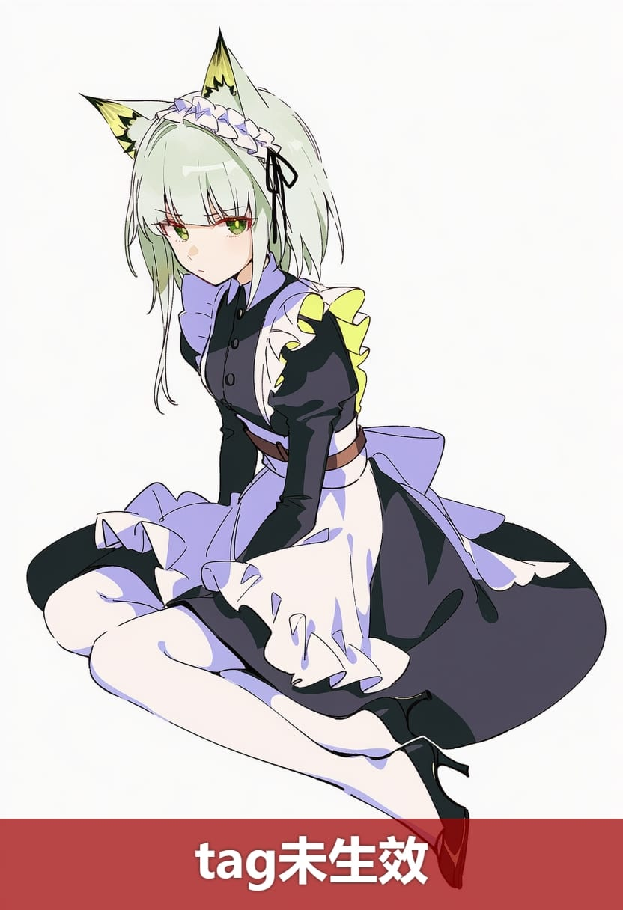

| 字段 | 内容 |
| --- | --- |
| Danbooru Tag | pince-nez |
| 中文名 | 夹鼻眼镜 |
| 中文含义 | 没有镜腿、直接夹在鼻梁上的眼镜。 |
| 子类 | 眼镜/护目镜 |
| 模特 | 1girl,kal'tsit_(arknights) |
| 序号 | 0030 |

## 31. safety_glasses — 护目安全眼镜

| 字段 | 内容 |
| --- | --- |
| Danbooru Tag | safety_glasses |
| 中文名 | 护目安全眼镜 |
| 中文含义 | 实验或工作防护用的透明眼镜。 |
| 子类 | 眼镜/护目镜 |
| 模特 | 1girl,qingque_(honkai:_star_rail) |
| 序号 | 0031 |

## 32. goggles — 护目镜

| 字段 | 内容 |
| --- | --- |
| Danbooru Tag | goggles |
| 中文名 | 护目镜 |
| 中文含义 | 贴合眼部的防护型护目镜。 |
| 子类 | 眼镜/护目镜 |
| 模特 | 1girl,rapi_(nikke) |
| 序号 | 0032 |

## 33. aviator_goggles — 飞行护目镜

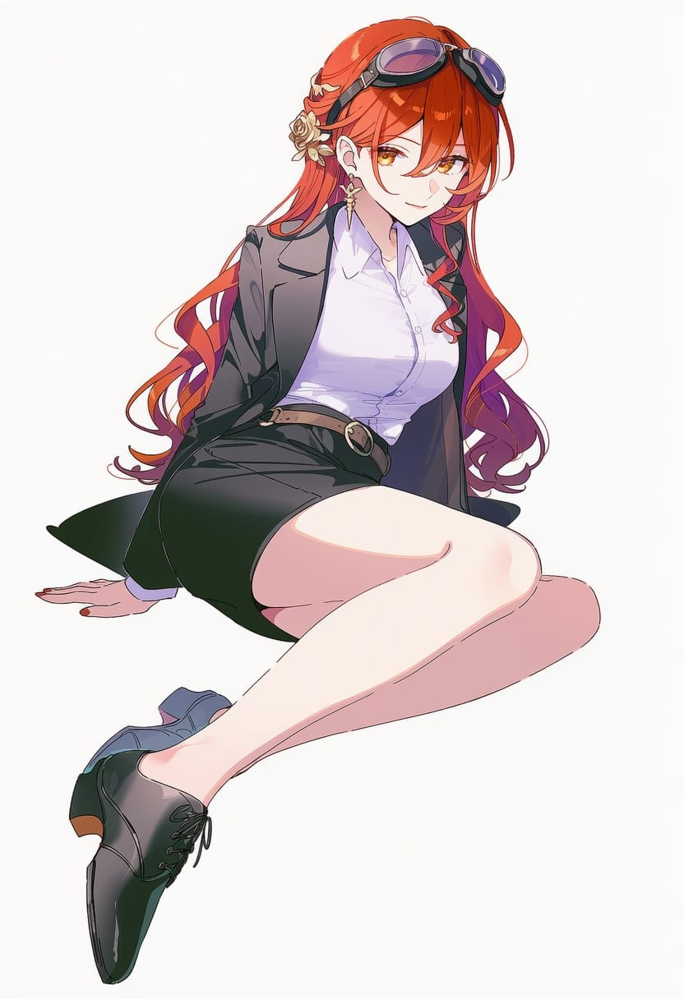

| 字段 | 内容 |
| --- | --- |
| Danbooru Tag | aviator_goggles |
| 中文名 | 飞行护目镜 |
| 中文含义 | 老式飞行员常见的护目镜。 |
| 子类 | 眼镜/护目镜 |
| 模特 | 1girl,himeko_(honkai:_star_rail) |
| 序号 | 0033 |

## 34. ski_goggles — 滑雪镜

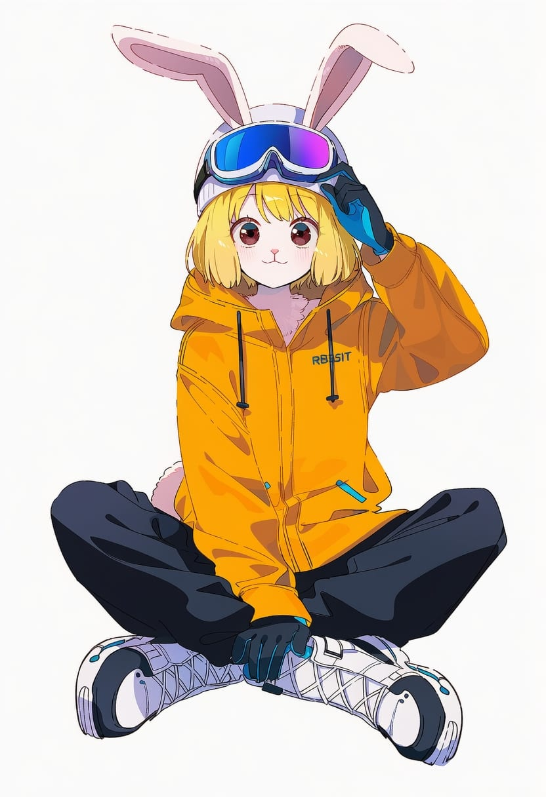

| 字段 | 内容 |
| --- | --- |
| Danbooru Tag | ski_goggles |
| 中文名 | 滑雪镜 |
| 中文含义 | 覆盖眼周的大型滑雪护目镜。 |
| 子类 | 眼镜/护目镜 |
| 模特 | 1girl,carrot_(one_piece) |
| 序号 | 0034 |

## 35. monocle — 单片眼镜

| 字段 | 内容 |
| --- | --- |
| Danbooru Tag | monocle |
| 中文名 | 单片眼镜 |
| 中文含义 | 只覆盖一只眼睛的单片镜。 |
| 子类 | 眼镜/护目镜 |
| 模特 | 1girl,soda_(nikke) |
| 序号 | 0035 |

## 36. scouter — 战斗力探测镜

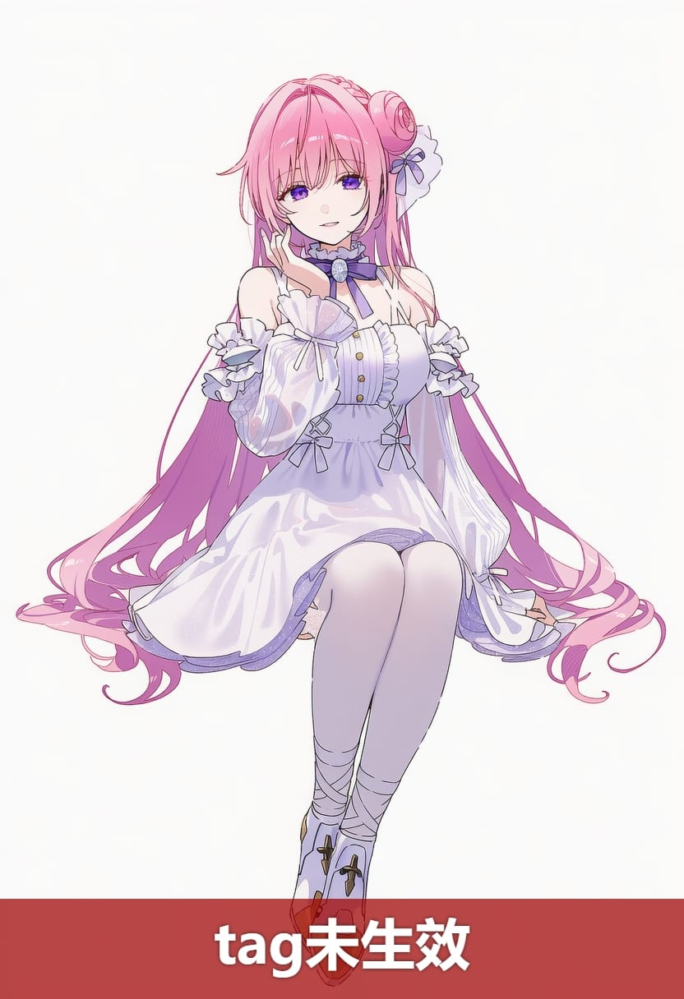

| 字段 | 内容 |
| --- | --- |
| Danbooru Tag | scouter |
| 中文名 | 战斗力探测镜 |
| 中文含义 | 单眼电子显示式镜片装置。 |
| 子类 | 眼镜/护目镜 |
| 模特 | 1girl,dorothy_(nikke) |
| 序号 | 0036 |

## 37. sunglasses — 太阳镜

| 字段 | 内容 |
| --- | --- |
| Danbooru Tag | sunglasses |
| 中文名 | 太阳镜 |
| 中文含义 | 用于遮光或隐藏眼睛的深色眼镜。 |
| 子类 | 眼镜/护目镜 |
| 模特 | 1girl,caesar_king_(zenless_zone_zero) |
| 序号 | 0037 |

## 38. aviator_sunglasses — 飞行员太阳镜

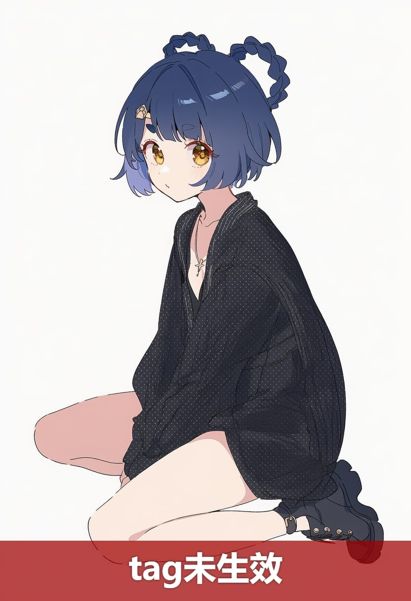

| 字段 | 内容 |
| --- | --- |
| Danbooru Tag | aviator_sunglasses |
| 中文名 | 飞行员太阳镜 |
| 中文含义 | 经典泪滴形飞行员太阳镜。 |
| 子类 | 眼镜/护目镜 |
| 模特 | 1girl,xiangling_(genshin_impact) |
| 序号 | 0038 |

## 39. shutter_shades — 百叶窗眼镜

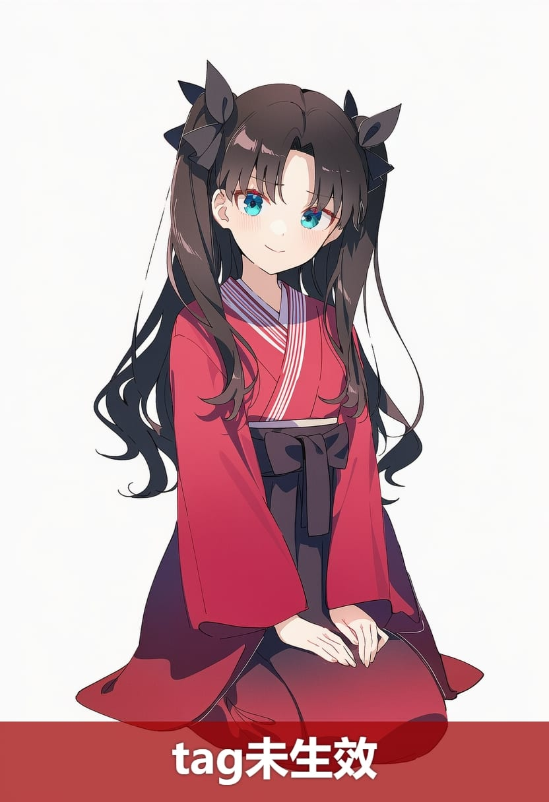

| 字段 | 内容 |
| --- | --- |
| Danbooru Tag | shutter_shades |
| 中文名 | 百叶窗眼镜 |
| 中文含义 | 镜片位置是横向条栅结构。 |
| 子类 | 眼镜/护目镜 |
| 模特 | 1girl,tohsaka_rin |
| 序号 | 0039 |

## 40. pixel_sunglasses — 像素太阳镜

| 字段 | 内容 |
| --- | --- |
| Danbooru Tag | pixel_sunglasses |
| 中文名 | 像素太阳镜 |
| 中文含义 | 像素块风格的太阳镜。 |
| 子类 | 眼镜/护目镜 |
| 模特 | 1girl,rebecca_(one_piece) |
| 序号 | 0040 |

## 41. sports_sunglasses — 运动太阳镜

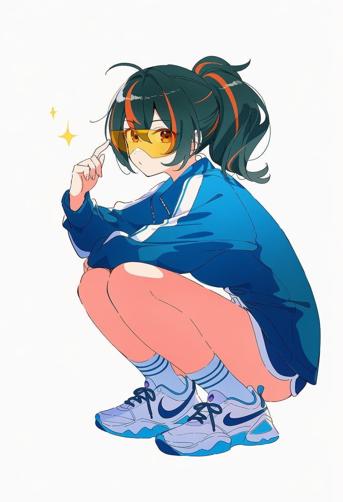

| 字段 | 内容 |
| --- | --- |
| Danbooru Tag | sports_sunglasses |
| 中文名 | 运动太阳镜 |
| 中文含义 | 包覆感较强的运动型太阳镜。 |
| 子类 | 眼镜/护目镜 |
| 模特 | 1girl,zhu_yuan |
| 序号 | 0041 |

## 42. kamina_shades — 卡米那眼镜

| 字段 | 内容 |
| --- | --- |
| Danbooru Tag | kamina_shades |
| 中文名 | 卡米那眼镜 |
| 中文含义 | 尖锐夸张的红色三角太阳镜造型。 |
| 子类 | 眼镜/护目镜 |
| 模特 | 1girl,jingliu_(honkai:_star_rail) |
| 序号 | 0042 |

## 43. eyepatch — 眼罩

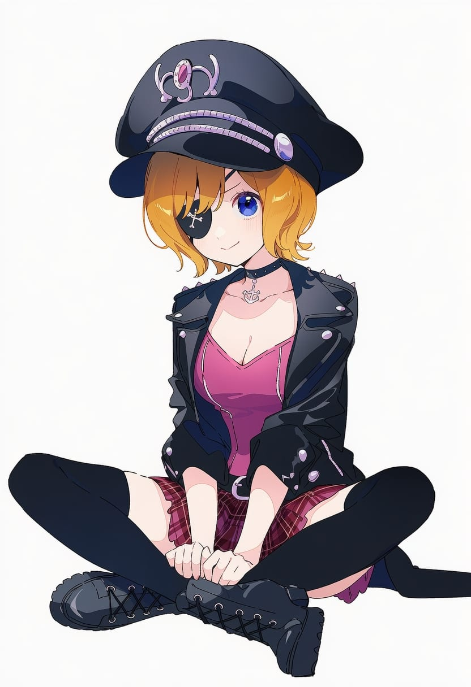

| 字段 | 内容 |
| --- | --- |
| Danbooru Tag | eyepatch |
| 中文名 | 眼罩 |
| 中文含义 | 遮住单只眼睛的小型眼罩。 |
| 子类 | 眼罩/遮眼 |
| 模特 | 1girl,koala_(one_piece) |
| 序号 | 0044 |

## 44. medical_eyepatch — 医用眼罩

| 字段 | 内容 |
| --- | --- |
| Danbooru Tag | medical_eyepatch |
| 中文名 | 医用眼罩 |
| 中文含义 | 用于保护受伤眼睛的医用眼罩。 |
| 子类 | 眼罩/遮眼 |
| 模特 | 1girl,sangonomiya_kokomi |
| 序号 | 0045 |

## 45. colored_eyepatch — 彩色眼罩

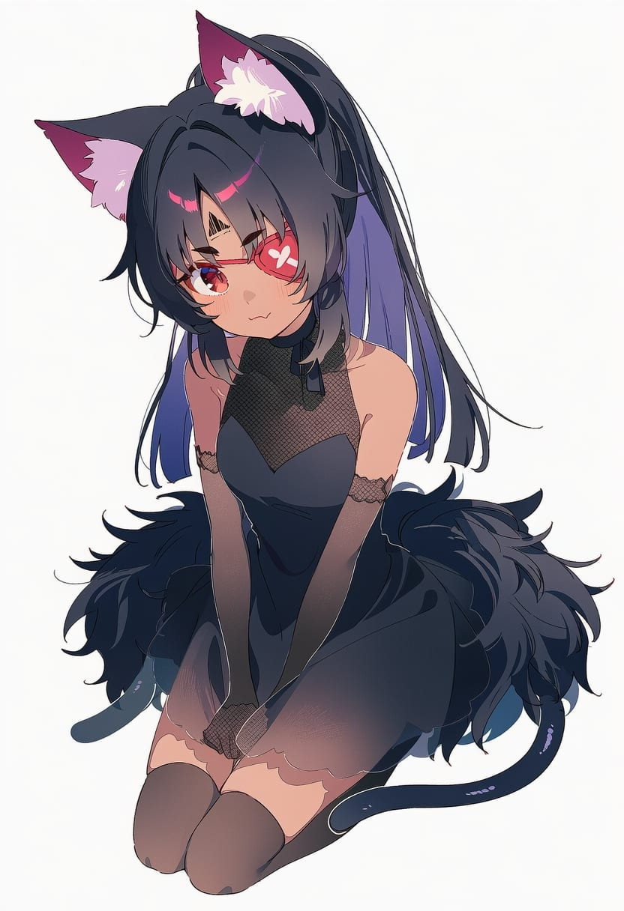

| 字段 | 内容 |
| --- | --- |
| Danbooru Tag | colored_eyepatch |
| 中文名 | 彩色眼罩 |
| 中文含义 | 带明显非普通素色设计的眼罩。 |
| 子类 | 眼罩/遮眼 |
| 模特 | 1girl,nekomiya_mana |
| 序号 | 0046 |

## 46. frilled_eyepatch — 褶边眼罩

| 字段 | 内容 |
| --- | --- |
| Danbooru Tag | frilled_eyepatch |
| 中文名 | 褶边眼罩 |
| 中文含义 | 边缘带褶边或荷叶边的眼罩。 |
| 子类 | 眼罩/遮眼 |
| 模特 | 1girl,tamamo_no_mae_(fate) |
| 序号 | 0047 |

## 47. heart_eyepatch — 爱心眼罩

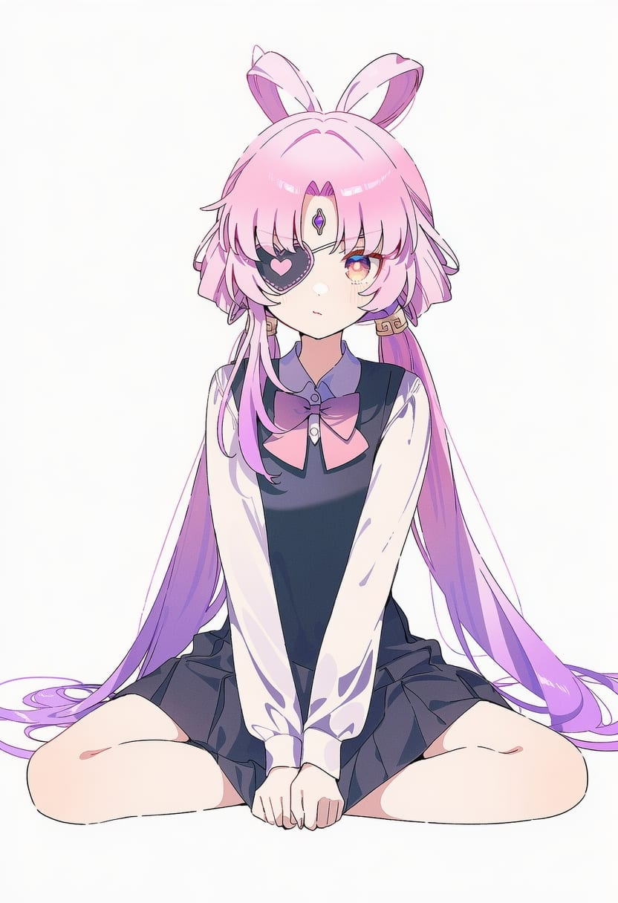

| 字段 | 内容 |
| --- | --- |
| Danbooru Tag | heart_eyepatch |
| 中文名 | 爱心眼罩 |
| 中文含义 | 爱心造型或爱心主题眼罩。 |
| 子类 | 眼罩/遮眼 |
| 模特 | 1girl,fu_xuan_(honkai:_star_rail) |
| 序号 | 0048 |

## 48. flower_eyepatch — 花朵眼罩

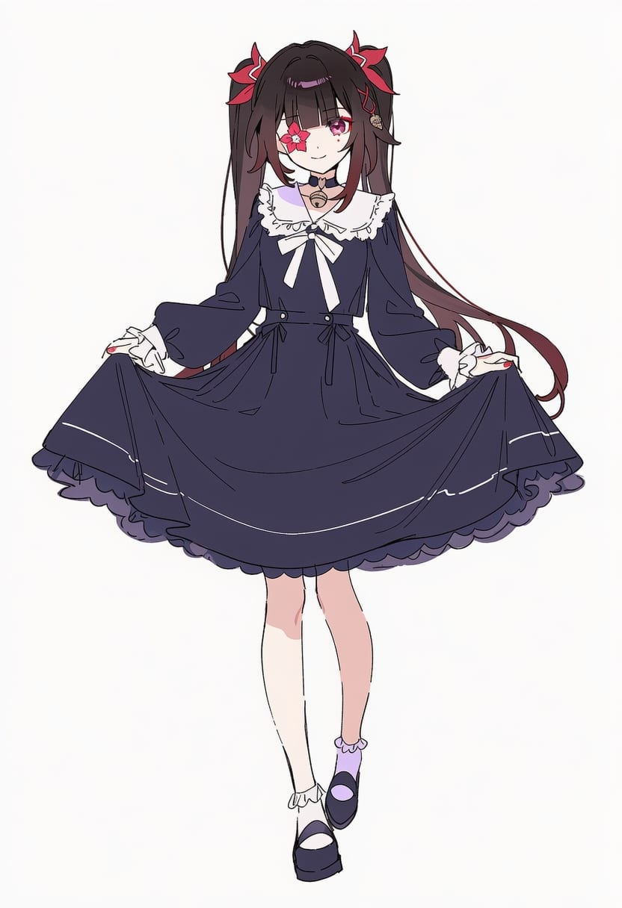

| 字段 | 内容 |
| --- | --- |
| Danbooru Tag | flower_eyepatch |
| 中文名 | 花朵眼罩 |
| 中文含义 | 花朵造型或花朵主题眼罩。 |
| 子类 | 眼罩/遮眼 |
| 模特 | 1girl,sparkle_(honkai:_star_rail) |
| 序号 | 0049 |

## 49. print_eyepatch — 印花眼罩

| 字段 | 内容 |
| --- | --- |
| Danbooru Tag | print_eyepatch |
| 中文名 | 印花眼罩 |
| 中文含义 | 表面带图案印花的眼罩。 |
| 子类 | 眼罩/遮眼 |
| 模特 | 1girl,ganyu_(genshin_impact) |
| 序号 | 0050 |

## 50. blindfold — 蒙眼布

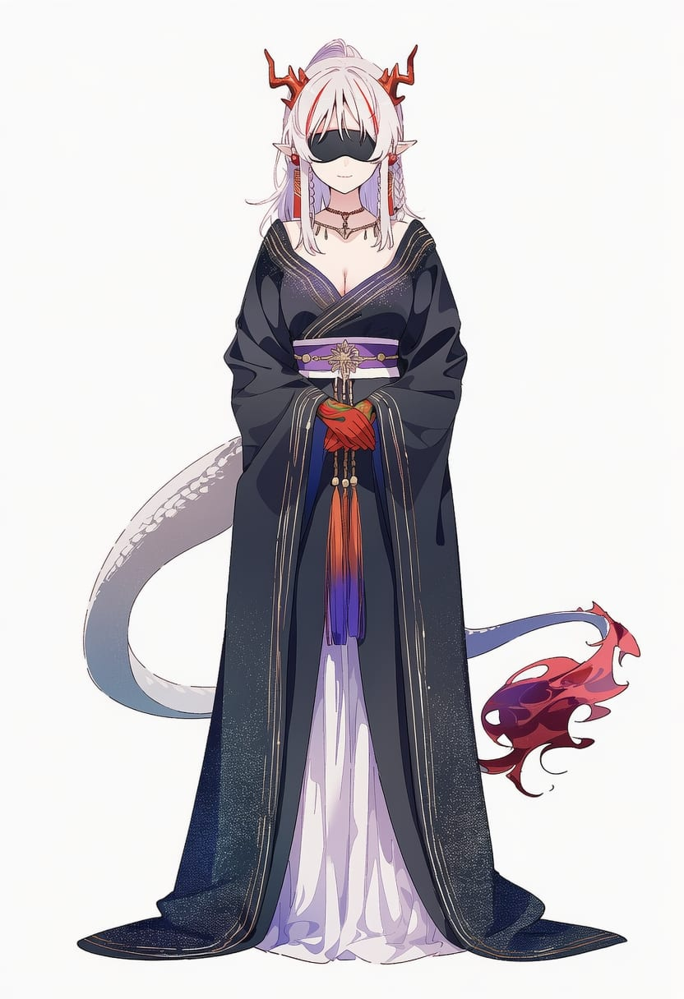

| 字段 | 内容 |
| --- | --- |
| Danbooru Tag | blindfold |
| 中文名 | 蒙眼布 |
| 中文含义 | 用布带等完全遮住双眼。 |
| 子类 | 眼罩/遮眼 |
| 模特 | 1girl,nian_(arknights) |
| 序号 | 0051 |

## 51. blindfold_mask — 蒙眼面具

| 字段 | 内容 |
| --- | --- |
| Danbooru Tag | blindfold_mask |
| 中文名 | 蒙眼面具 |
| 中文含义 | 像面具一样覆盖双眼的蒙眼装置。 |
| 子类 | 眼罩/遮眼 |
| 模特 | 1girl,firefly_(honkai:_star_rail) |
| 序号 | 0052 |

## 52. eye_mask — 眼部面具

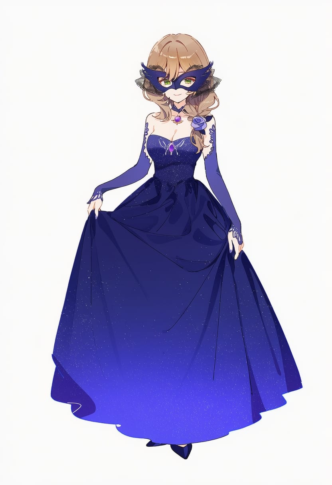

| 字段 | 内容 |
| --- | --- |
| Danbooru Tag | eye_mask |
| 中文名 | 眼部面具 |
| 中文含义 | 只覆盖眼睛周围的面具。 |
| 子类 | 眼罩/遮眼 |
| 模特 | 1girl,lisa_(genshin_impact) |
| 序号 | 0053 |

## 53. domino_mask — 多米诺眼罩

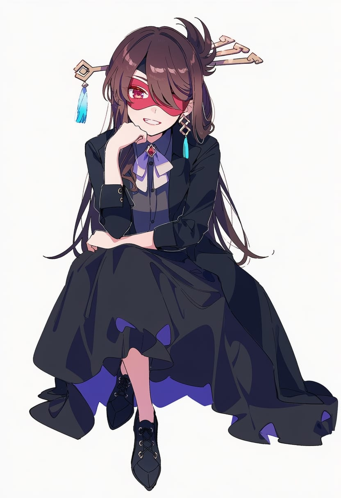

| 字段 | 内容 |
| --- | --- |
| Danbooru Tag | domino_mask |
| 中文名 | 多米诺眼罩 |
| 中文含义 | 超级英雄常见的贴合眼周小面具。 |
| 子类 | 眼罩/遮眼 |
| 模特 | 1girl,beidou_(genshin_impact) |
| 序号 | 0054 |

## 54. half_eye_mask — 半边眼部面具

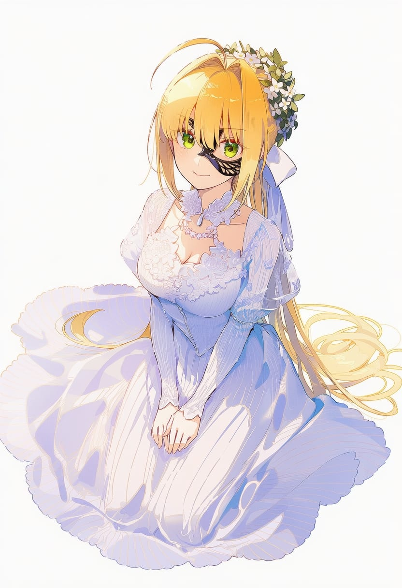

| 字段 | 内容 |
| --- | --- |
| Danbooru Tag | half_eye_mask |
| 中文名 | 半边眼部面具 |
| 中文含义 | 只覆盖部分眼周区域的面具。 |
| 子类 | 眼罩/遮眼 |
| 模特 | 1girl,nero_claudius_(fate) |
| 序号 | 0055 |

## 55. sleep_mask — 睡眠眼罩

| 字段 | 内容 |
| --- | --- |
| Danbooru Tag | sleep_mask |
| 中文名 | 睡眠眼罩 |
| 中文含义 | 睡觉时遮光用的软质眼罩。 |
| 子类 | 眼罩/遮眼 |
| 模特 | 1girl,surtr_(arknights) |
| 序号 | 0056 |

## 56. bandage_over_one_eye — 单眼绷带

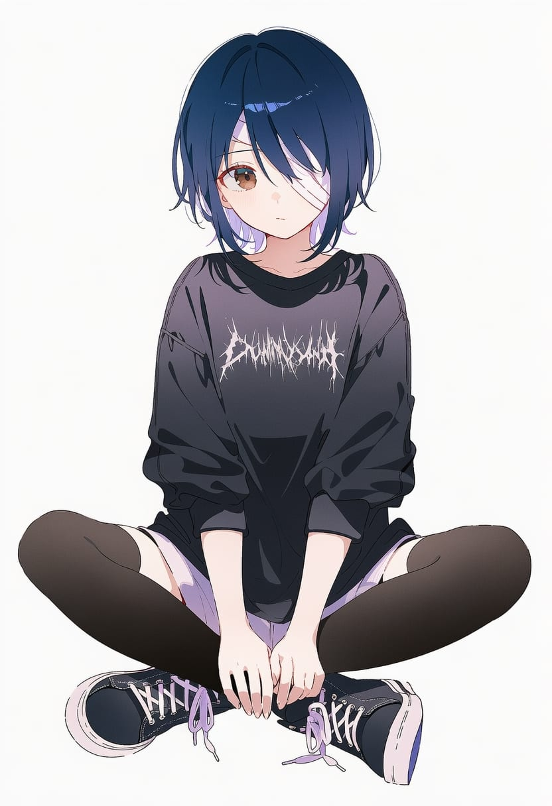

| 字段 | 内容 |
| --- | --- |
| Danbooru Tag | bandage_over_one_eye |
| 中文名 | 单眼绷带 |
| 中文含义 | 用绷带遮住一只眼睛。 |
| 子类 | 眼罩/遮眼 |
| 模特 | 1girl,tashigi |
| 序号 | 0057 |

## 57. mouth_mask — 口罩 / 口鼻面罩

| 字段 | 内容 |
| --- | --- |
| Danbooru Tag | mouth_mask |
| 中文名 | 口罩 / 口鼻面罩 |
| 中文含义 | 只覆盖口鼻区域的面罩。 |
| 子类 | 口鼻面罩 |
| 模特 | 1girl,jewelry_bonney |
| 序号 | 0058 |

## 58. black_mask — 黑色面罩

| 字段 | 内容 |
| --- | --- |
| Danbooru Tag | black_mask |
| 中文名 | 黑色面罩 |
| 中文含义 | 黑色面罩；纯颜色面罩只留这一种代表。 |
| 子类 | 口鼻面罩 |
| 模特 | 1girl,privaty_(nikke) |
| 序号 | 0059 |

## 59. surgical_mask — 医用口罩

| 字段 | 内容 |
| --- | --- |
| Danbooru Tag | surgical_mask |
| 中文名 | 医用口罩 |
| 中文含义 | 医生或日常防护使用的褶皱口罩。 |
| 子类 | 口鼻面罩 |
| 模特 | 1girl,lumine_(genshin_impact) |
| 序号 | 0060 |

## 60. ninja_mask — 忍者面罩

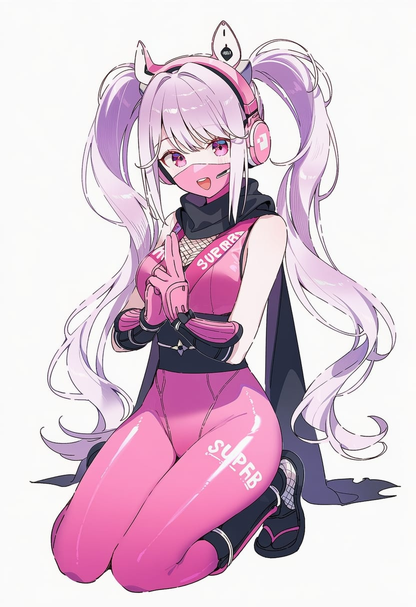

| 字段 | 内容 |
| --- | --- |
| Danbooru Tag | ninja_mask |
| 中文名 | 忍者面罩 |
| 中文含义 | 遮住口鼻、常见于忍者造型的面罩。 |
| 子类 | 口鼻面罩 |
| 模特 | 1girl,alice_(nikke) |
| 序号 | 0061 |

## 61. mouth_veil — 口部面纱

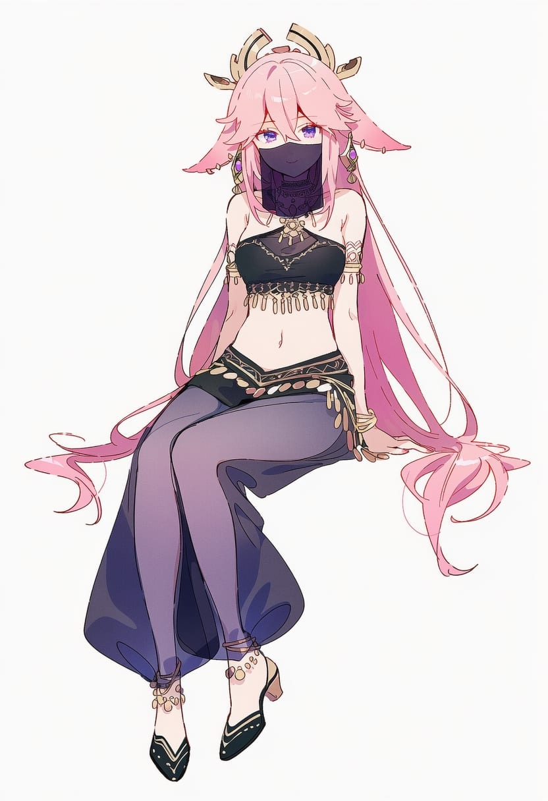

| 字段 | 内容 |
| --- | --- |
| Danbooru Tag | mouth_veil |
| 中文名 | 口部面纱 |
| 中文含义 | 覆盖嘴部的轻薄面纱。 |
| 子类 | 口鼻面罩 |
| 模特 | 1girl,yae_miko |
| 序号 | 0062 |

## 62. respirator — 呼吸防护面罩

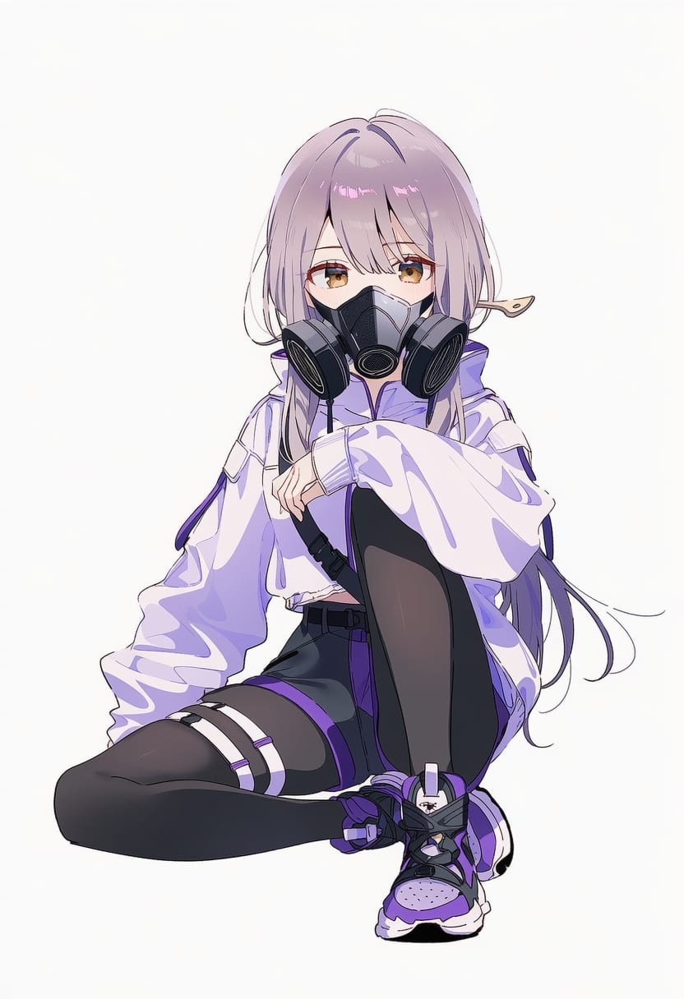

| 字段 | 内容 |
| --- | --- |
| Danbooru Tag | respirator |
| 中文名 | 呼吸防护面罩 |
| 中文含义 | 带过滤结构、主要覆盖口鼻的呼吸面罩。 |
| 子类 | 口鼻面罩 |
| 模特 | 1girl,scarlet_(nikke) |
| 序号 | 0063 |

## 63. oxygen_mask — 氧气面罩

| 字段 | 内容 |
| --- | --- |
| Danbooru Tag | oxygen_mask |
| 中文名 | 氧气面罩 |
| 中文含义 | 连接供氧设备、覆盖口鼻的面罩。 |
| 子类 | 口鼻面罩 |
| 模特 | 1girl,march_7th_(honkai:_star_rail) |
| 序号 | 0064 |

## 64. gas_mask — 防毒面具

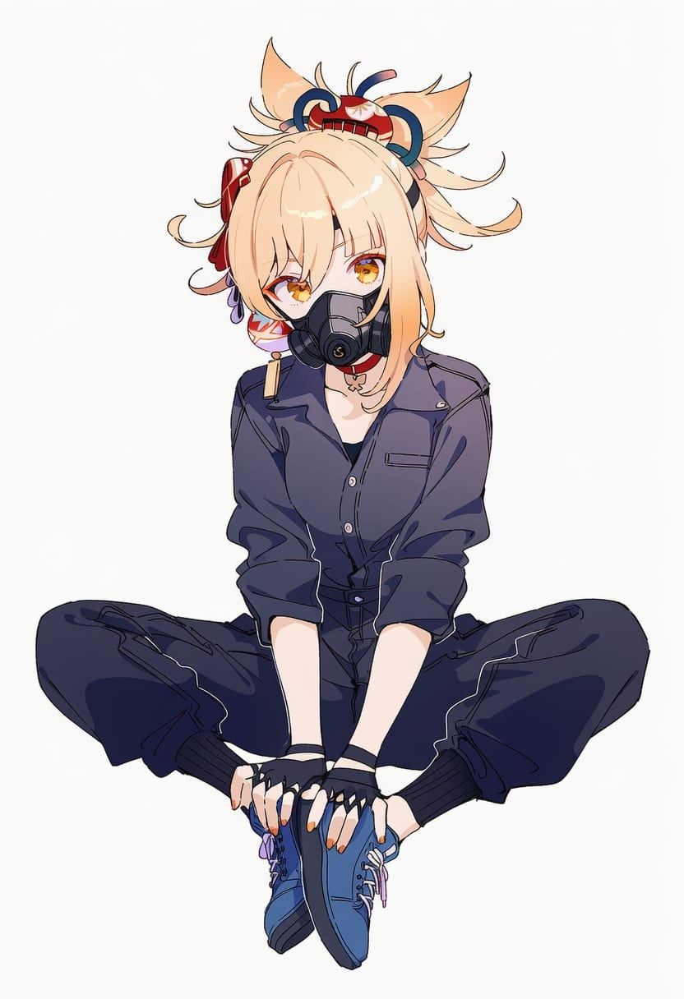

| 字段 | 内容 |
| --- | --- |
| Danbooru Tag | gas_mask |
| 中文名 | 防毒面具 |
| 中文含义 | 覆盖眼睛和口鼻并带过滤器的防毒面具。 |
| 子类 | 口鼻面罩 |
| 模特 | 1girl,yoimiya_(genshin_impact) |
| 序号 | 0065 |

## 65. diving_mask — 潜水面镜

| 字段 | 内容 |
| --- | --- |
| Danbooru Tag | diving_mask |
| 中文名 | 潜水面镜 |
| 中文含义 | 潜水时覆盖眼鼻区域的密封面镜。 |
| 子类 | 口鼻面罩 |
| 模特 | 1girl,iroha_(blue_archive) |
| 序号 | 0066 |

## 66. snorkel_mask — 浮潜面罩

| 字段 | 内容 |
| --- | --- |
| Danbooru Tag | snorkel_mask |
| 中文名 | 浮潜面罩 |
| 中文含义 | 浮潜使用的面罩。 |
| 子类 | 口鼻面罩 |
| 模特 | 1girl,nahida_(genshin_impact) |
| 序号 | 0067 |

## 67. beauty_mask — 美容面膜

| 字段 | 内容 |
| --- | --- |
| Danbooru Tag | beauty_mask |
| 中文名 | 美容面膜 |
| 中文含义 | 敷在脸上的护肤面膜。 |
| 子类 | 口鼻面罩 |
| 模特 | 1girl,w_(arknights) |
| 序号 | 0068 |

## 68. mask — 面具

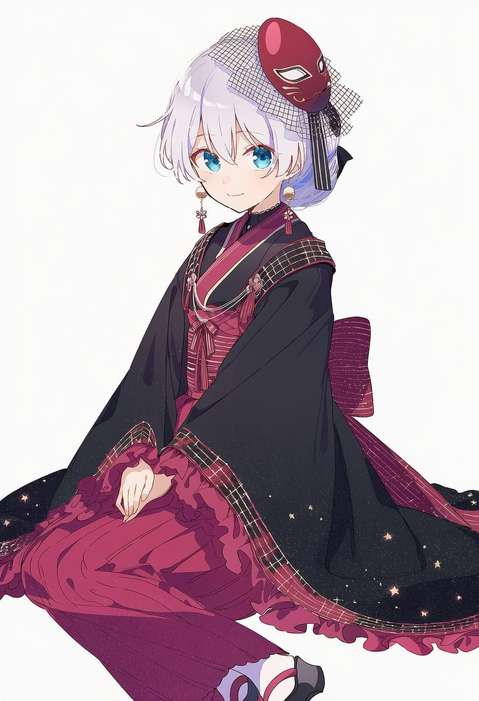

| 字段 | 内容 |
| --- | --- |
| Danbooru Tag | mask |
| 中文名 | 面具 |
| 中文含义 | 泛指用于遮挡脸部的面具。 |
| 子类 | 全脸/造型面具 |
| 模特 | 1girl,theresa_apocalypse |
| 序号 | 0069 |

## 69. multicolored_mask — 多色面具

| 字段 | 内容 |
| --- | --- |
| Danbooru Tag | multicolored_mask |
| 中文名 | 多色面具 |
| 中文含义 | 面具由多种颜色组成。 |
| 子类 | 全脸/造型面具 |
| 模特 | 1girl,shirahoshi |
| 序号 | 0070 |

## 70. print_mask — 印花面具

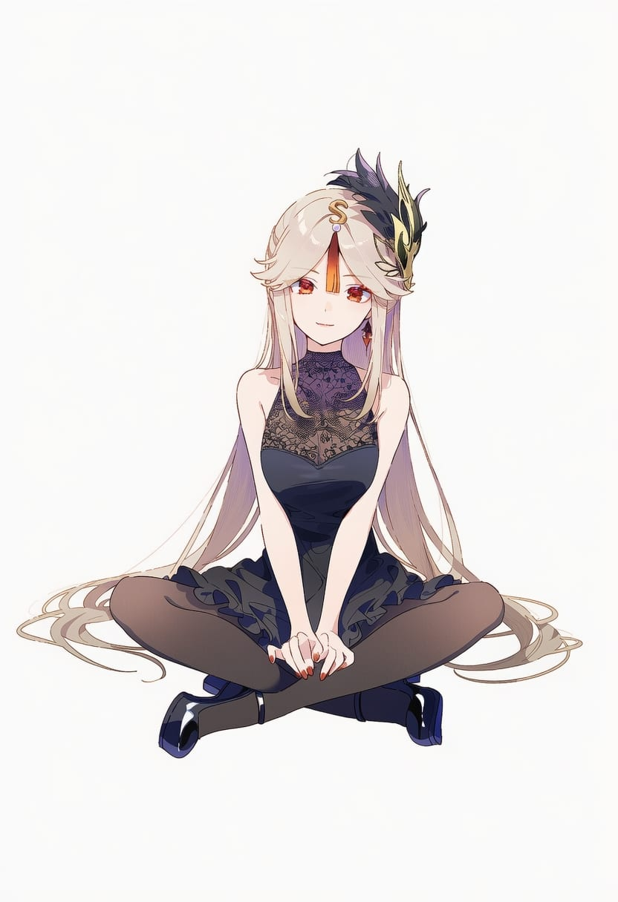

| 字段 | 内容 |
| --- | --- |
| Danbooru Tag | print_mask |
| 中文名 | 印花面具 |
| 中文含义 | 面具表面带明显图案。 |
| 子类 | 全脸/造型面具 |
| 模特 | 1girl,ningguang_(genshin_impact) |
| 序号 | 0071 |

## 71. checkered_mask — 棋盘格面具

| 字段 | 内容 |
| --- | --- |
| Danbooru Tag | checkered_mask |
| 中文名 | 棋盘格面具 |
| 中文含义 | 带棋盘格图案的面具。 |
| 子类 | 全脸/造型面具 |
| 模特 | 1girl,rio_(blue_archive) |
| 序号 | 0072 |

## 72. half_mask — 半脸面具

| 字段 | 内容 |
| --- | --- |
| Danbooru Tag | half_mask |
| 中文名 | 半脸面具 |
| 中文含义 | 只覆盖脸部一部分的面具。 |
| 子类 | 全脸/造型面具 |
| 模特 | 1girl,hina_(one_piece) |
| 序号 | 0073 |

## 73. masquerade_mask — 化装舞会面具

| 字段 | 内容 |
| --- | --- |
| Danbooru Tag | masquerade_mask |
| 中文名 | 化装舞会面具 |
| 中文含义 | 华丽的舞会式半脸面具。 |
| 子类 | 全脸/造型面具 |
| 模特 | 1girl,kafka_(honkai:_star_rail) |
| 序号 | 0074 |

## 74. character_mask — 角色面具

| 字段 | 内容 |
| --- | --- |
| Danbooru Tag | character_mask |
| 中文名 | 角色面具 |
| 中文含义 | 做成某个角色脸部造型的面具。 |
| 子类 | 全脸/造型面具 |
| 模特 | 1girl,scathach_(fate) |
| 序号 | 0075 |

## 75. clown_mask — 小丑面具

| 字段 | 内容 |
| --- | --- |
| Danbooru Tag | clown_mask |
| 中文名 | 小丑面具 |
| 中文含义 | 小丑脸造型的面具。 |
| 子类 | 全脸/造型面具 |
| 模特 | 1girl,noa_(blue_archive) |
| 序号 | 0076 |

## 76. carnival_mask — 嘉年华面具

| 字段 | 内容 |
| --- | --- |
| Danbooru Tag | carnival_mask |
| 中文名 | 嘉年华面具 |
| 中文含义 | 节庆或嘉年华风格的装饰面具。 |
| 子类 | 全脸/造型面具 |
| 模特 | 1girl,arona_(blue_archive) |
| 序号 | 0077 |

## 77. guy_fawkes_mask — 盖伊·福克斯面具

| 字段 | 内容 |
| --- | --- |
| Danbooru Tag | guy_fawkes_mask |
| 中文名 | 盖伊·福克斯面具 |
| 中文含义 | 经典笑脸胡须造型面具。 |
| 子类 | 全脸/造型面具 |
| 模特 | 1girl,bronya_rand |
| 序号 | 0078 |

## 78. hockey_mask — 曲棍球面具

| 字段 | 内容 |
| --- | --- |
| Danbooru Tag | hockey_mask |
| 中文名 | 曲棍球面具 |
| 中文含义 | 带大量透气孔的硬质曲棍球面具。 |
| 子类 | 全脸/造型面具 |
| 模特 | 1girl,qingyi_(zenless_zone_zero) |
| 序号 | 0079 |

## 79. luchador_mask — 墨西哥摔角面具

| 字段 | 内容 |
| --- | --- |
| Danbooru Tag | luchador_mask |
| 中文名 | 墨西哥摔角面具 |
| 中文含义 | 墨西哥摔角手风格的包头面具。 |
| 子类 | 全脸/造型面具 |
| 模特 | 1girl,jeanne_d'arc_(fate) |
| 序号 | 0080 |

## 80. wrestling_mask — 摔角面具

| 字段 | 内容 |
| --- | --- |
| Danbooru Tag | wrestling_mask |
| 中文名 | 摔角面具 |
| 中文含义 | 职业摔角风格的紧身面具。 |
| 子类 | 全脸/造型面具 |
| 模特 | 1girl,modernia_(nikke) |
| 序号 | 0081 |

## 81. welding_mask — 焊接面罩

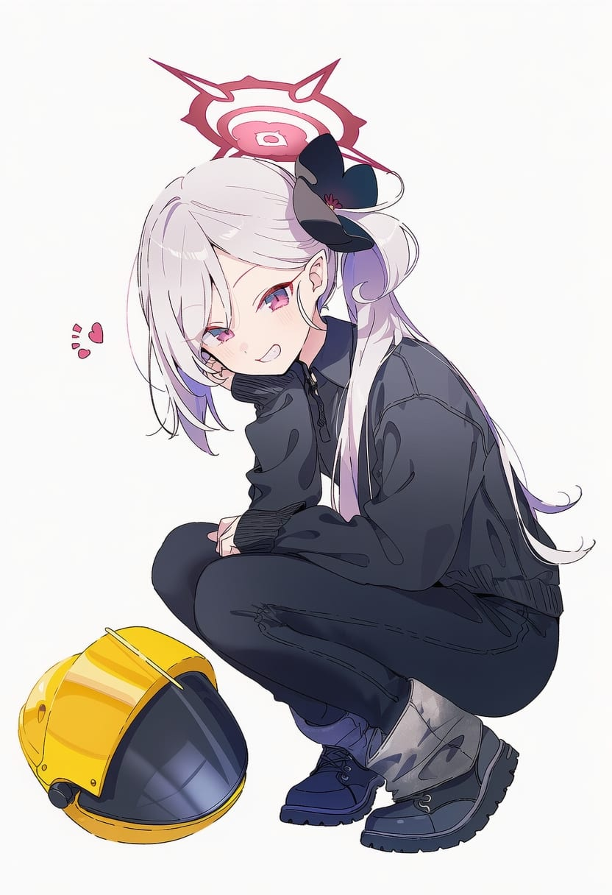

| 字段 | 内容 |
| --- | --- |
| Danbooru Tag | welding_mask |
| 中文名 | 焊接面罩 |
| 中文含义 | 焊接时保护脸部和眼睛的面罩。 |
| 子类 | 全脸/造型面具 |
| 模特 | 1girl,mutsuki_(blue_archive) |
| 序号 | 0082 |

## 82. kendo_mask — 剑道面罩

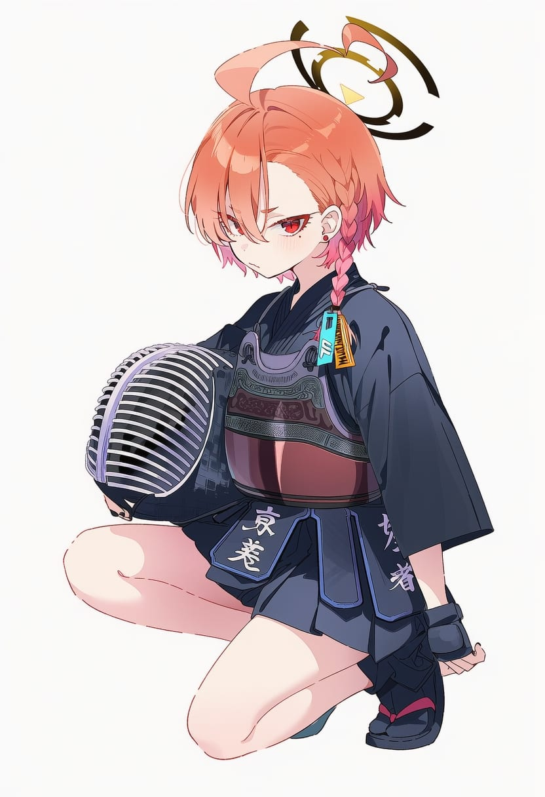

| 字段 | 内容 |
| --- | --- |
| Danbooru Tag | kendo_mask |
| 中文名 | 剑道面罩 |
| 中文含义 | 剑道护具中的面部护面。 |
| 子类 | 全脸/造型面具 |
| 模特 | 1girl,neru_(blue_archive) |
| 序号 | 0083 |

## 83. noh_mask — 能面

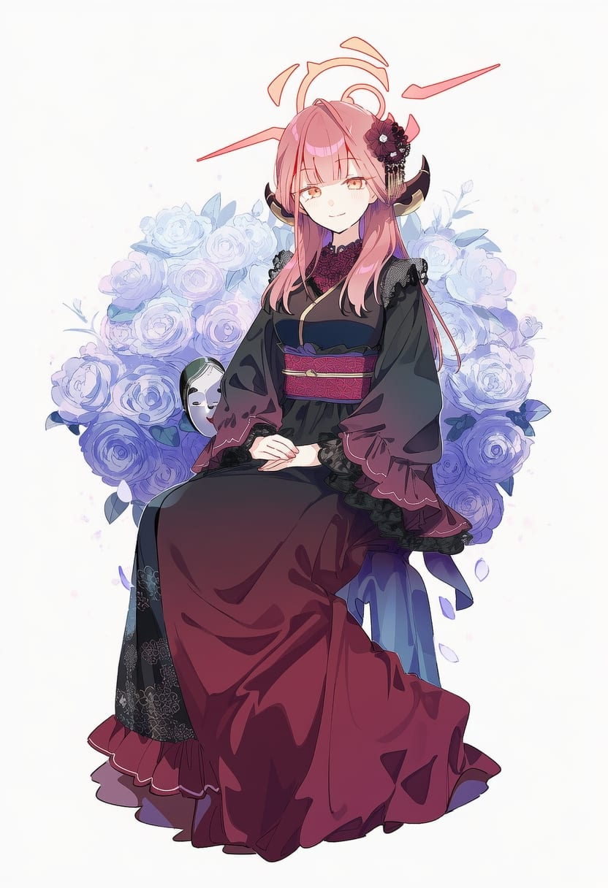

| 字段 | 内容 |
| --- | --- |
| Danbooru Tag | noh_mask |
| 中文名 | 能面 |
| 中文含义 | 日本能剧使用的传统面具。 |
| 子类 | 全脸/造型面具 |
| 模特 | 1girl,aru_(blue_archive) |
| 序号 | 0084 |

## 84. hyottoko_mask — 火男面具

| 字段 | 内容 |
| --- | --- |
| Danbooru Tag | hyottoko_mask |
| 中文名 | 火男面具 |
| 中文含义 | 歪嘴圆眼的日本传统火男面具。 |
| 子类 | 全脸/造型面具 |
| 模特 | 1girl,jeanne_d'arc_alter_(fate) |
| 序号 | 0085 |

## 85. oni_mask — 鬼面

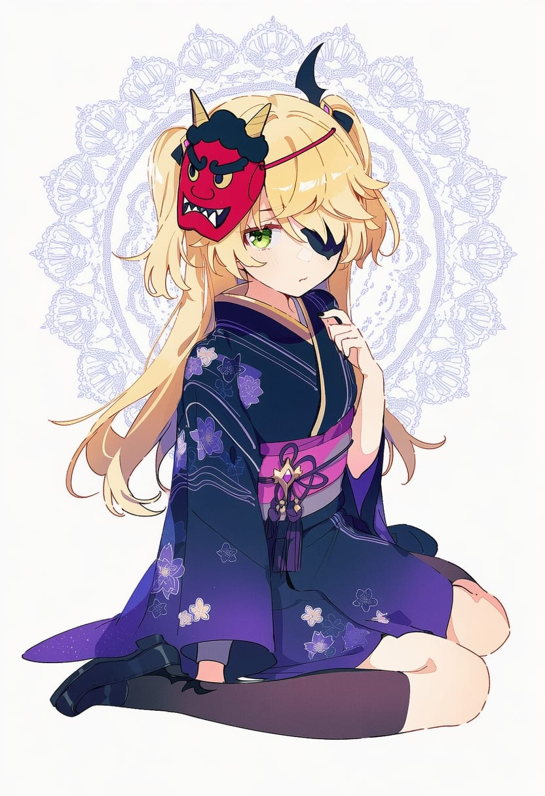

| 字段 | 内容 |
| --- | --- |
| Danbooru Tag | oni_mask |
| 中文名 | 鬼面 |
| 中文含义 | 日本鬼怪 Oni 造型的面具。 |
| 子类 | 全脸/造型面具 |
| 模特 | 1girl,fischl_(genshin_impact) |
| 序号 | 0086 |

## 86. tengu_mask — 天狗面具

| 字段 | 内容 |
| --- | --- |
| Danbooru Tag | tengu_mask |
| 中文名 | 天狗面具 |
| 中文含义 | 长鼻天狗造型的日式面具。 |
| 子类 | 全脸/造型面具 |
| 模特 | 1girl,keqing_(genshin_impact) |
| 序号 | 0087 |

## 87. fox_mask — 狐狸面具

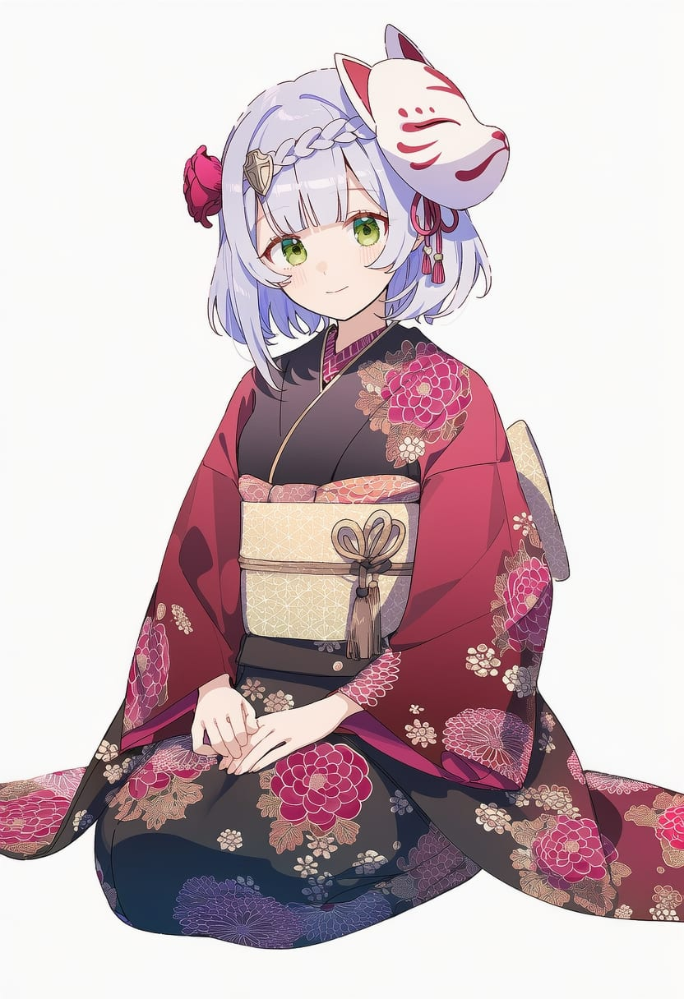

| 字段 | 内容 |
| --- | --- |
| Danbooru Tag | fox_mask |
| 中文名 | 狐狸面具 |
| 中文含义 | 狐狸脸造型的面具。 |
| 子类 | 全脸/造型面具 |
| 模特 | 1girl,noelle_(genshin_impact) |
| 序号 | 0088 |

## 88. cat_mask — 猫面具

| 字段 | 内容 |
| --- | --- |
| Danbooru Tag | cat_mask |
| 中文名 | 猫面具 |
| 中文含义 | 猫脸造型的面具。 |
| 子类 | 全脸/造型面具 |
| 模特 | 1girl,mudrock_(arknights) |
| 序号 | 0089 |

## 89. rabbit_mask — 兔子面具

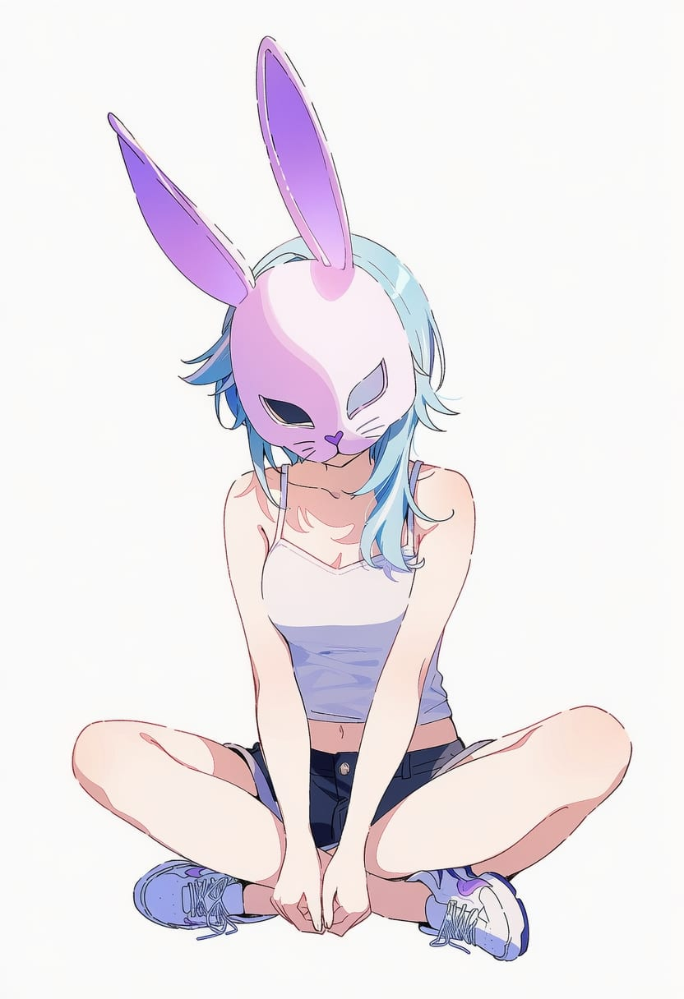

| 字段 | 内容 |
| --- | --- |
| Danbooru Tag | rabbit_mask |
| 中文名 | 兔子面具 |
| 中文含义 | 兔子脸造型的面具。 |
| 子类 | 全脸/造型面具 |
| 模特 | 1girl,eula_(genshin_impact) |
| 序号 | 0090 |

## 90. wolf_mask — 狼面具

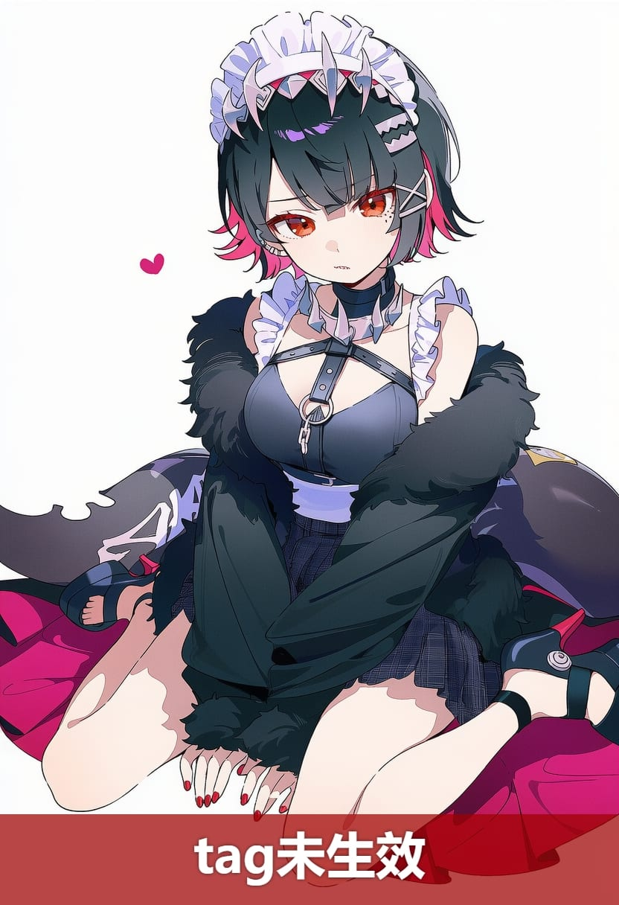

| 字段 | 内容 |
| --- | --- |
| Danbooru Tag | wolf_mask |
| 中文名 | 狼面具 |
| 中文含义 | 狼脸造型的面具。 |
| 子类 | 全脸/造型面具 |
| 模特 | 1girl,ellen_joe |
| 序号 | 0091 |

## 91. bear_mask — 熊面具

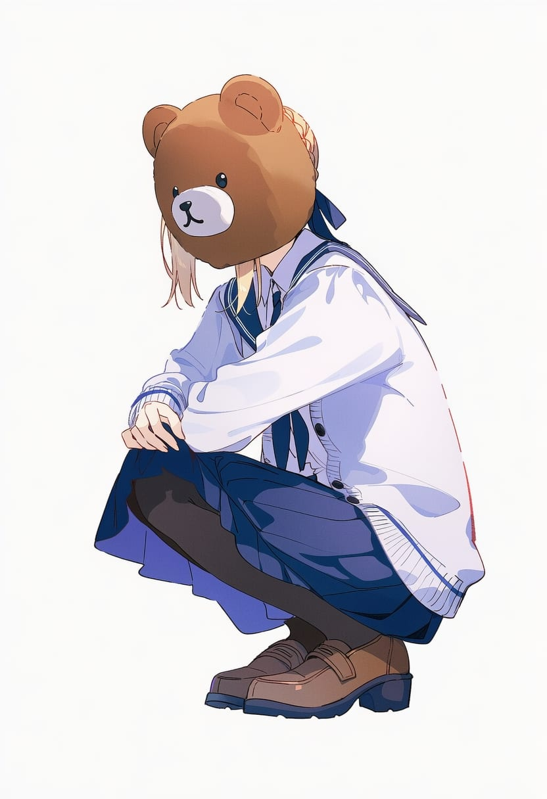

| 字段 | 内容 |
| --- | --- |
| Danbooru Tag | bear_mask |
| 中文名 | 熊面具 |
| 中文含义 | 熊脸造型的面具。 |
| 子类 | 全脸/造型面具 |
| 模特 | 1girl,artoria_pendragon_(fate) |
| 序号 | 0092 |

## 92. bird_mask — 鸟类面具

| 字段 | 内容 |
| --- | --- |
| Danbooru Tag | bird_mask |
| 中文名 | 鸟类面具 |
| 中文含义 | 鸟脸或鸟嘴造型的面具。 |
| 子类 | 全脸/造型面具 |
| 模特 | 1girl,anis_(nikke) |
| 序号 | 0093 |

## 93. horse_mask — 马头面具

| 字段 | 内容 |
| --- | --- |
| Danbooru Tag | horse_mask |
| 中文名 | 马头面具 |
| 中文含义 | 马脸或马头造型的面具。 |
| 子类 | 全脸/造型面具 |
| 模特 | 1girl,murata_himeko |
| 序号 | 0094 |

## 94. monkey_mask — 猴子面具

| 字段 | 内容 |
| --- | --- |
| Danbooru Tag | monkey_mask |
| 中文名 | 猴子面具 |
| 中文含义 | 猴脸造型的面具。 |
| 子类 | 全脸/造型面具 |
| 模特 | 1girl,stelle_(honkai:_star_rail) |
| 序号 | 0095 |

## 95. panda_mask — 熊猫面具

| 字段 | 内容 |
| --- | --- |
| Danbooru Tag | panda_mask |
| 中文名 | 熊猫面具 |
| 中文含义 | 熊猫脸造型的面具。 |
| 子类 | 全脸/造型面具 |
| 模特 | 1girl,angelina_(arknights) |
| 序号 | 0096 |

## 96. butterfly_mask — 蝴蝶面具

| 字段 | 内容 |
| --- | --- |
| Danbooru Tag | butterfly_mask |
| 中文名 | 蝴蝶面具 |
| 中文含义 | 蝴蝶造型的眼部或半脸面具。 |
| 子类 | 全脸/造型面具 |
| 模特 | 1girl,black_swan_(honkai:_star_rail) |
| 序号 | 0097 |

## 97. skull_mask — 骷髅面具

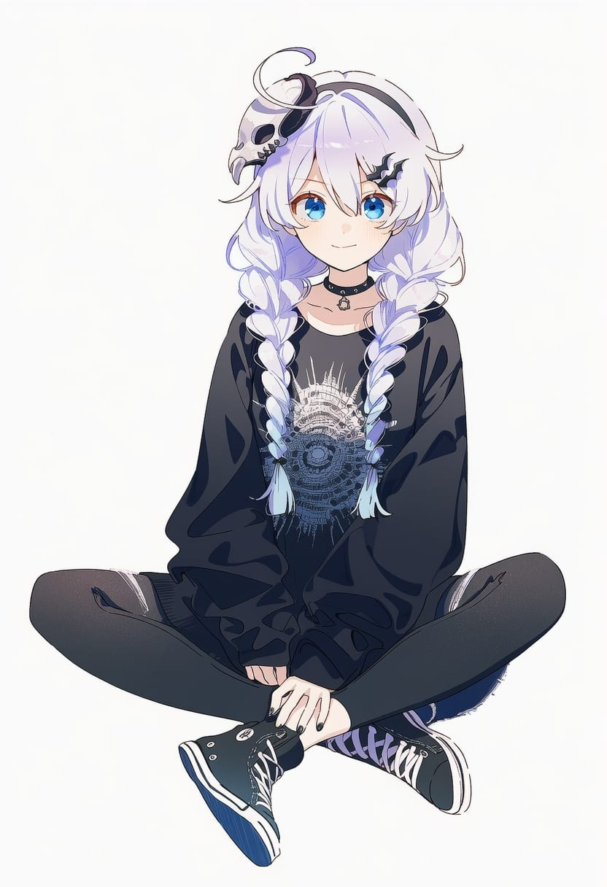

| 字段 | 内容 |
| --- | --- |
| Danbooru Tag | skull_mask |
| 中文名 | 骷髅面具 |
| 中文含义 | 骷髅脸造型的面具。 |
| 子类 | 全脸/造型面具 |
| 模特 | 1girl,kiana_kaslana |
| 序号 | 0098 |

## 98. plague_doctor_mask — 瘟疫医生面具

| 字段 | 内容 |
| --- | --- |
| Danbooru Tag | plague_doctor_mask |
| 中文名 | 瘟疫医生面具 |
| 中文含义 | 带长鸟嘴的瘟疫医生面具。 |
| 子类 | 全脸/造型面具 |
| 模特 | 1girl,matou_sakura |
| 序号 | 0099 |

## 99. asymmetrical_mask — 不对称面具

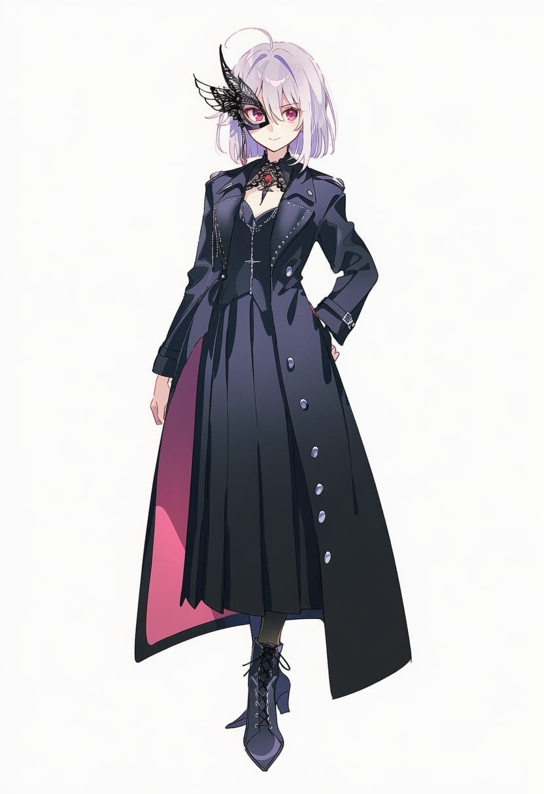

| 字段 | 内容 |
| --- | --- |
| Danbooru Tag | asymmetrical_mask |
| 中文名 | 不对称面具 |
| 中文含义 | 左右结构明显不对称的面具。 |
| 子类 | 全脸/造型面具 |
| 模特 | 1girl,charlotte_linlin |
| 序号 | 0100 |

## 100. broken_mask — 破损面具

| 字段 | 内容 |
| --- | --- |
| Danbooru Tag | broken_mask |
| 中文名 | 破损面具 |
| 中文含义 | 有明显破裂或缺损的面具。 |
| 子类 | 全脸/造型面具 |
| 模特 | 1girl,lappland_(arknights) |
| 序号 | 0101 |

## 101. cracked_mask — 裂纹面具

| 字段 | 内容 |
| --- | --- |
| Danbooru Tag | cracked_mask |
| 中文名 | 裂纹面具 |
| 中文含义 | 表面有明显裂纹的面具。 |
| 子类 | 全脸/造型面具 |
| 模特 | 1girl,ch'en_(arknights) |
| 序号 | 0102 |

## 102. bone_mask — 骨质面具

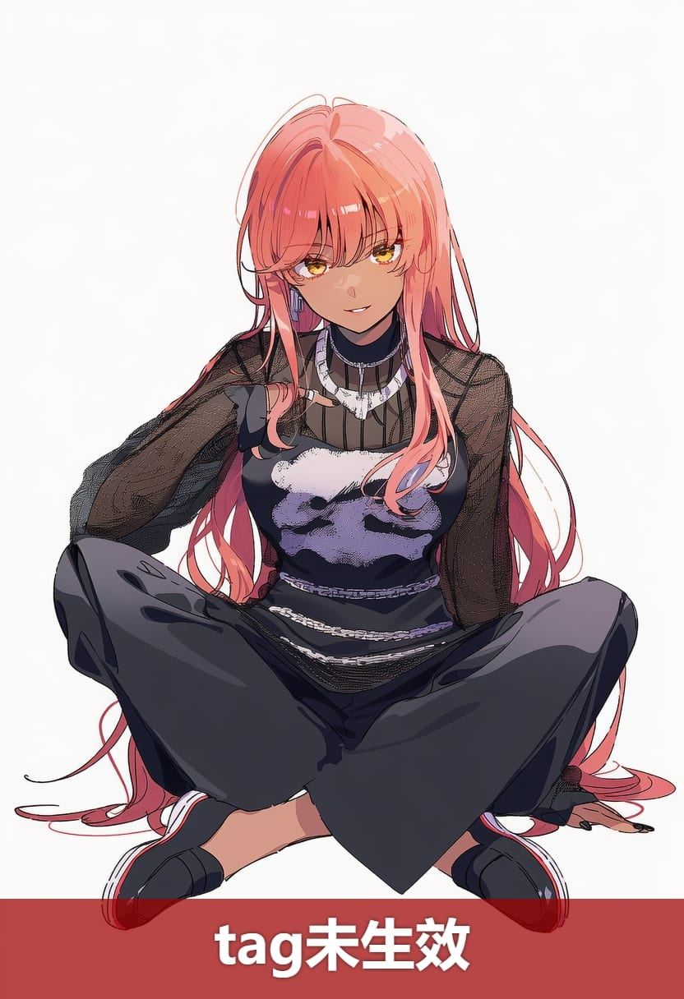

| 字段 | 内容 |
| --- | --- |
| Danbooru Tag | bone_mask |
| 中文名 | 骨质面具 |
| 中文含义 | 骨头或骨质感构成的面具。 |
| 子类 | 全脸/造型面具 |
| 模特 | 1girl,volume_(nikke) |
| 序号 | 0103 |

## 103. glowing_mask — 发光面具

| 字段 | 内容 |
| --- | --- |
| Danbooru Tag | glowing_mask |
| 中文名 | 发光面具 |
| 中文含义 | 面具本身带发光效果。 |
| 子类 | 全脸/造型面具 |
| 模特 | 1girl,texas_(arknights) |
| 序号 | 0104 |

## 104. horned_mask — 带角面具

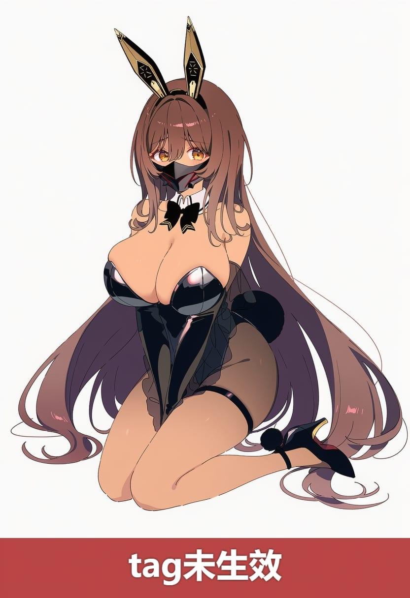

| 字段 | 内容 |
| --- | --- |
| Danbooru Tag | horned_mask |
| 中文名 | 带角面具 |
| 中文含义 | 面具上长有明显角状结构。 |
| 子类 | 全脸/造型面具 |
| 模特 | 1girl,noir_(nikke) |
| 序号 | 0105 |

## 105. metal_mask — 金属面具

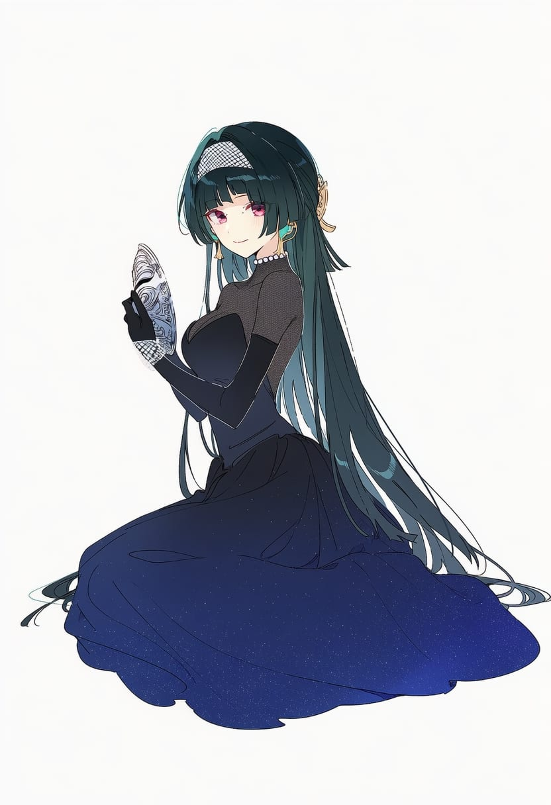

| 字段 | 内容 |
| --- | --- |
| Danbooru Tag | metal_mask |
| 中文名 | 金属面具 |
| 中文含义 | 金属材质或金属质感面具。 |
| 子类 | 全脸/造型面具 |
| 模特 | 1girl,astra_yao |
| 序号 | 0106 |

## 106. see-through_mask — 透明面具

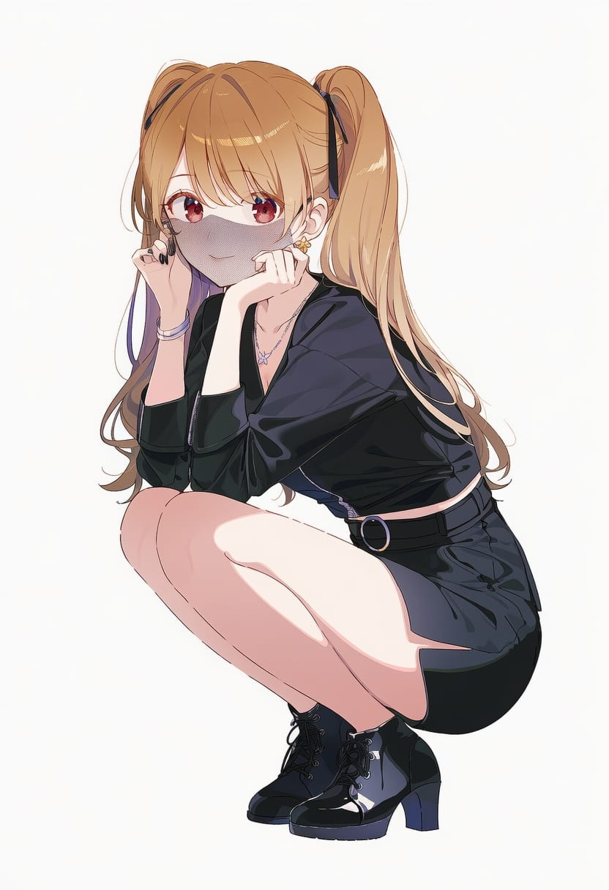

| 字段 | 内容 |
| --- | --- |
| Danbooru Tag | see-through_mask |
| 中文名 | 透明面具 |
| 中文含义 | 可以透过面具看到后方脸部。 |
| 子类 | 全脸/造型面具 |
| 模特 | 1girl,charlotte_pudding |
| 序号 | 0107 |

## 107. spiked_mask — 尖刺面具

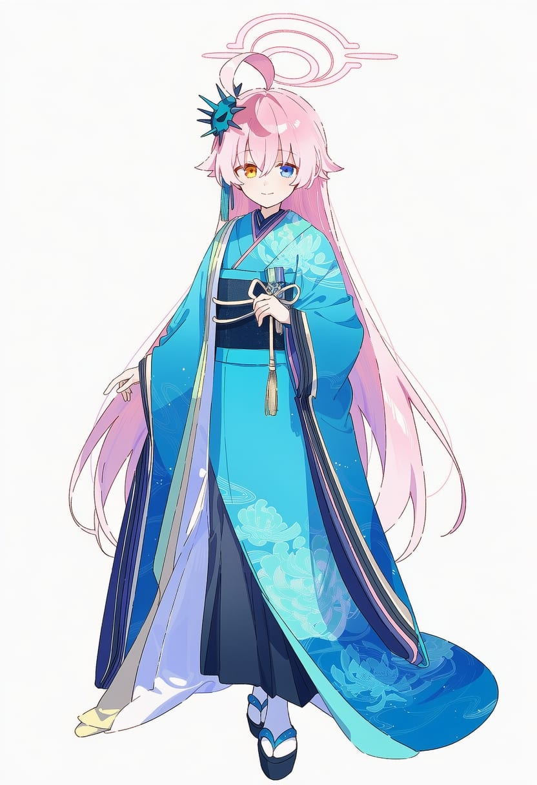

| 字段 | 内容 |
| --- | --- |
| Danbooru Tag | spiked_mask |
| 中文名 | 尖刺面具 |
| 中文含义 | 带明显尖刺结构的面具。 |
| 子类 | 全脸/造型面具 |
| 模特 | 1girl,hoshino_(blue_archive) |
| 序号 | 0108 |

## 108. bandaid_on_face — 面部创可贴

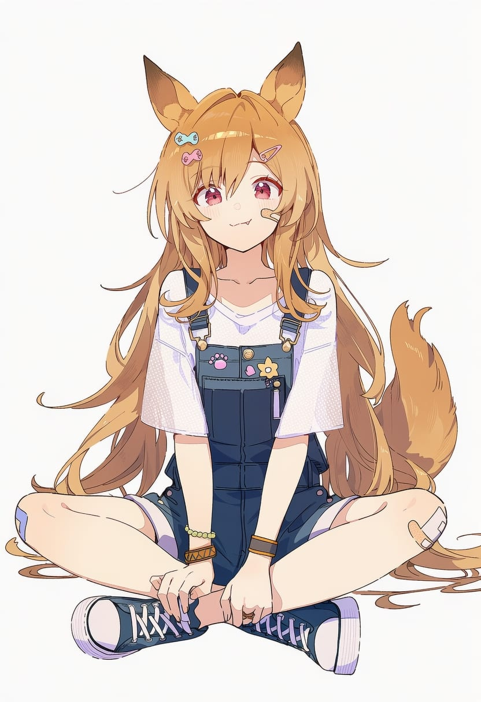

| 字段 | 内容 |
| --- | --- |
| Danbooru Tag | bandaid_on_face |
| 中文名 | 面部创可贴 |
| 中文含义 | 创可贴贴在脸上。 |
| 子类 | 贴饰/绷带 |
| 模特 | 1girl,ceobe_(arknights) |
| 序号 | 0109 |

## 109. bandaid_on_cheek — 脸颊创可贴

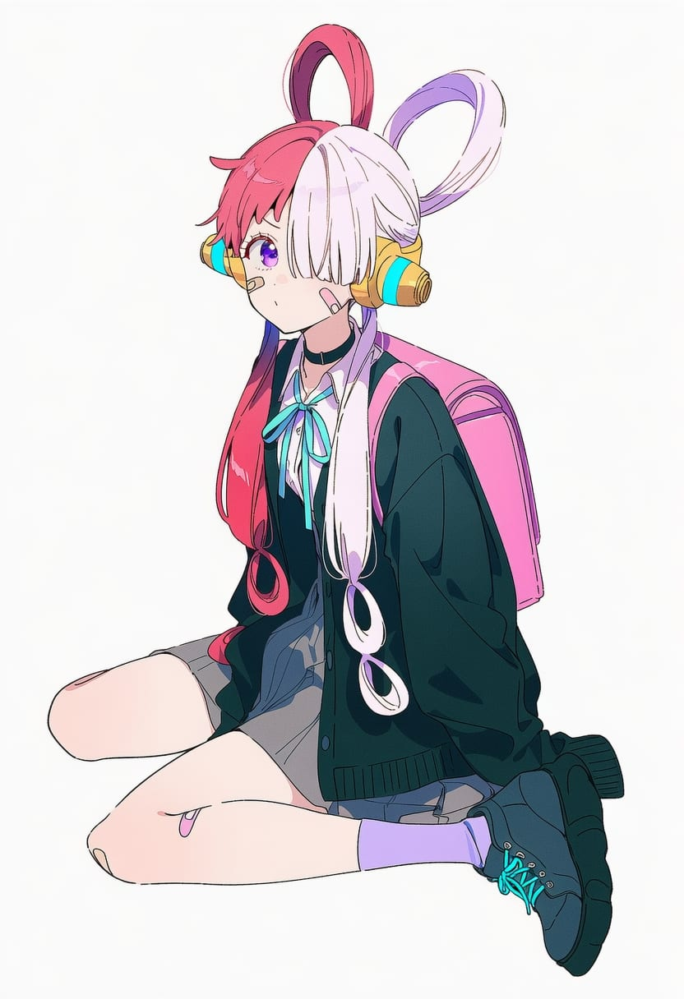

| 字段 | 内容 |
| --- | --- |
| Danbooru Tag | bandaid_on_cheek |
| 中文名 | 脸颊创可贴 |
| 中文含义 | 创可贴贴在脸颊上。 |
| 子类 | 贴饰/绷带 |
| 模特 | 1girl,uta_(one_piece) |
| 序号 | 0110 |

## 110. bandaid_on_nose — 鼻梁创可贴

| 字段 | 内容 |
| --- | --- |
| Danbooru Tag | bandaid_on_nose |
| 中文名 | 鼻梁创可贴 |
| 中文含义 | 创可贴横贴在鼻梁上。 |
| 子类 | 贴饰/绷带 |
| 模特 | 1girl,mona_(genshin_impact) |
| 序号 | 0111 |

## 111. bandaid_on_forehead — 额头创可贴

| 字段 | 内容 |
| --- | --- |
| Danbooru Tag | bandaid_on_forehead |
| 中文名 | 额头创可贴 |
| 中文含义 | 创可贴贴在额头上。 |
| 子类 | 贴饰/绷带 |
| 模特 | 1girl,anby_demara |
| 序号 | 0112 |

## 112. bandage_on_face — 面部绷带

| 字段 | 内容 |
| --- | --- |
| Danbooru Tag | bandage_on_face |
| 中文名 | 面部绷带 |
| 中文含义 | 脸部缠着或贴着绷带。 |
| 子类 | 贴饰/绷带 |
| 模特 | 1girl,barbara_(genshin_impact) |
| 序号 | 0113 |

## 113. bandage_on_cheek — 脸颊绷带

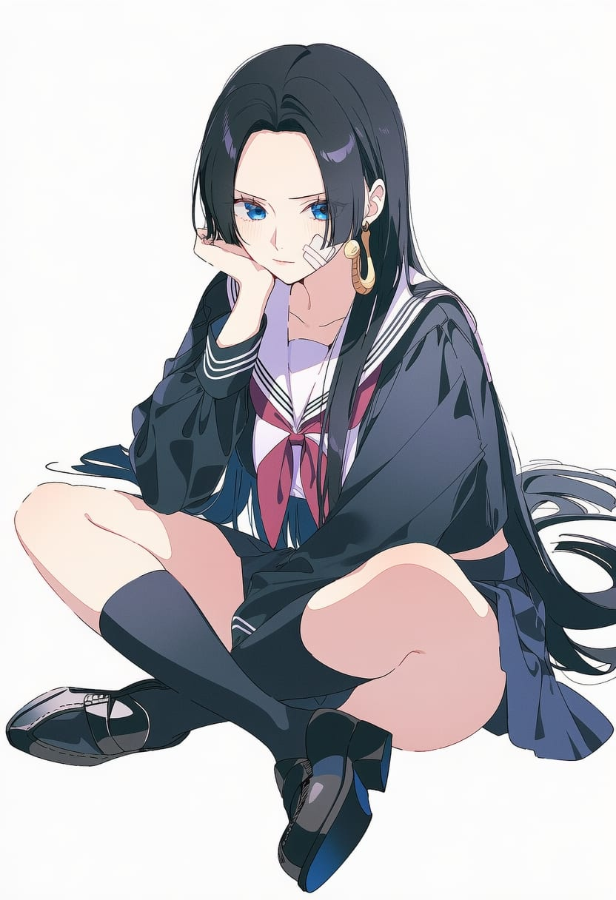

| 字段 | 内容 |
| --- | --- |
| Danbooru Tag | bandage_on_cheek |
| 中文名 | 脸颊绷带 |
| 中文含义 | 脸颊位置贴着绷带。 |
| 子类 | 贴饰/绷带 |
| 模特 | 1girl,boa_hancock |
| 序号 | 0114 |

## 114. bandage_on_nose — 鼻部绷带

| 字段 | 内容 |
| --- | --- |
| Danbooru Tag | bandage_on_nose |
| 中文名 | 鼻部绷带 |
| 中文含义 | 鼻子位置贴着或缠着绷带。 |
| 子类 | 贴饰/绷带 |
| 模特 | 1girl,shiroko_(blue_archive) |
| 序号 | 0115 |

## 115. bandages_over_mouth — 嘴部绷带

| 字段 | 内容 |
| --- | --- |
| Danbooru Tag | bandages_over_mouth |
| 中文名 | 嘴部绷带 |
| 中文含义 | 绷带横向遮住嘴巴。 |
| 子类 | 贴饰/绷带 |
| 模特 | 1girl,mash_kyrielight |
| 序号 | 0116 |

## 116. gauze_on_face — 面部纱布

| 字段 | 内容 |
| --- | --- |
| Danbooru Tag | gauze_on_face |
| 中文名 | 面部纱布 |
| 中文含义 | 脸上贴着医用纱布。 |
| 子类 | 贴饰/绷带 |
| 模特 | 1girl,burnice_white |
| 序号 | 0117 |

## 117. gauze_on_cheek — 脸颊纱布

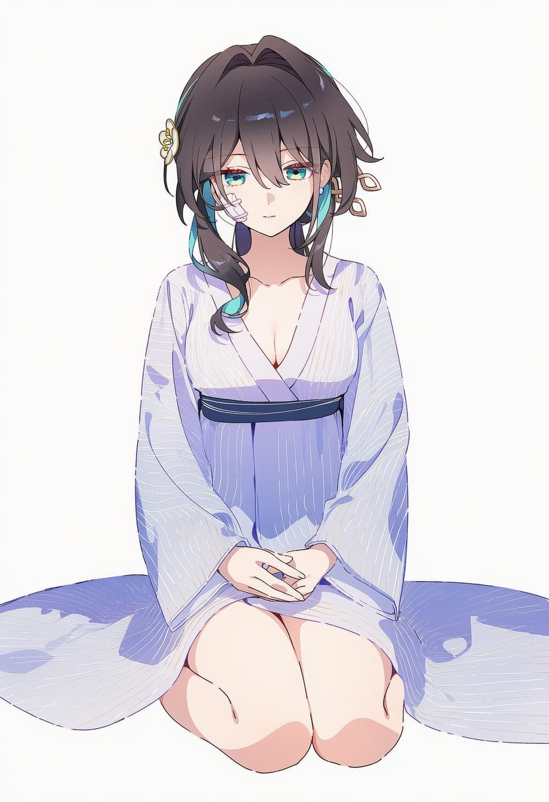

| 字段 | 内容 |
| --- | --- |
| Danbooru Tag | gauze_on_cheek |
| 中文名 | 脸颊纱布 |
| 中文含义 | 脸颊位置贴着纱布。 |
| 子类 | 贴饰/绷带 |
| 模特 | 1girl,ruan_mei_(honkai:_star_rail) |
| 序号 | 0118 |

## 118. sticker_on_face — 脸部贴纸

| 字段 | 内容 |
| --- | --- |
| Danbooru Tag | sticker_on_face |
| 中文名 | 脸部贴纸 |
| 中文含义 | 贴纸直接贴在脸上。 |
| 子类 | 贴饰/绷带 |
| 模特 | 1girl,nico_robin |
| 序号 | 0119 |

---
