## 1. walking — 行走

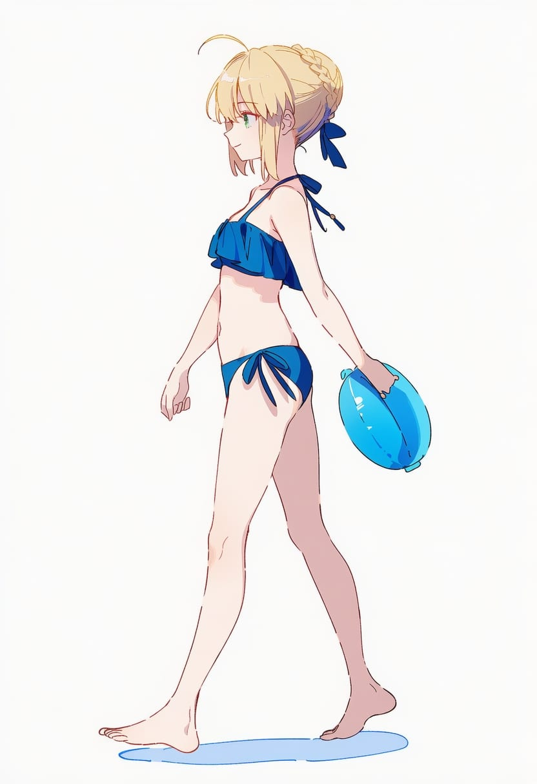

| 字段 | 内容 |
| --- | --- |
| Danbooru Tag | walking |
| 中文名 | 行走 |
| 中文含义 | 角色正在步行。 |
| 子类 | 地面移动 |
| 模特 | artoria_pendragon_(fate) |
| 序号 | 0001 |

## 2. running — 奔跑

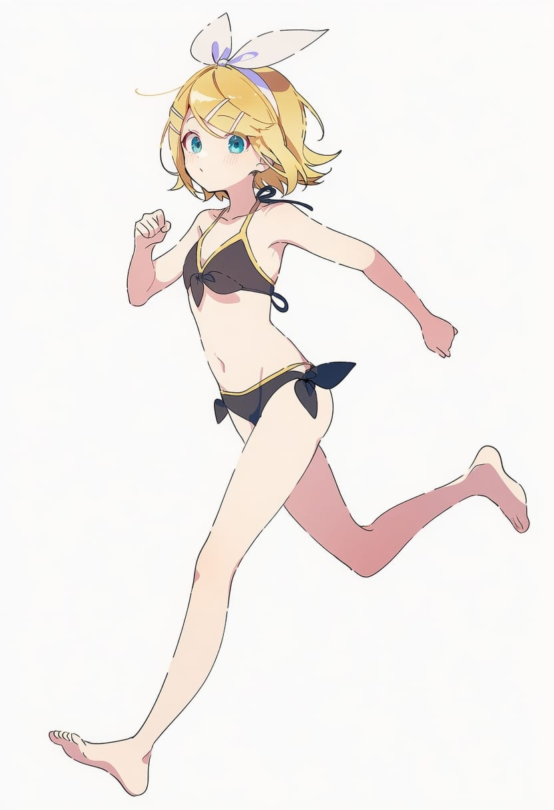

| 字段 | 内容 |
| --- | --- |
| Danbooru Tag | running |
| 中文名 | 奔跑 |
| 中文含义 | 角色正在快速跑动。 |
| 子类 | 地面移动 |
| 模特 | kagamine_rin |
| 序号 | 0002 |

## 3. marching — 行进 / 齐步走

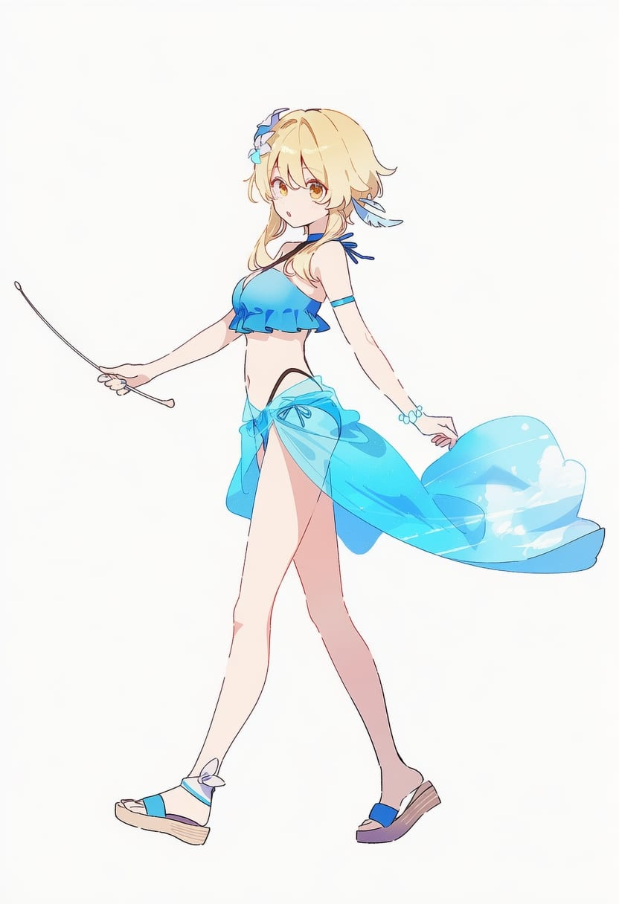

| 字段 | 内容 |
| --- | --- |
| Danbooru Tag | marching |
| 中文名 | 行进 / 齐步走 |
| 中文含义 | 以整齐或有节奏的步伐前进。 |
| 子类 | 地面移动 |
| 模特 | lumine_(genshin_impact) |
| 序号 | 0003 |

## 4. hiking — 徒步

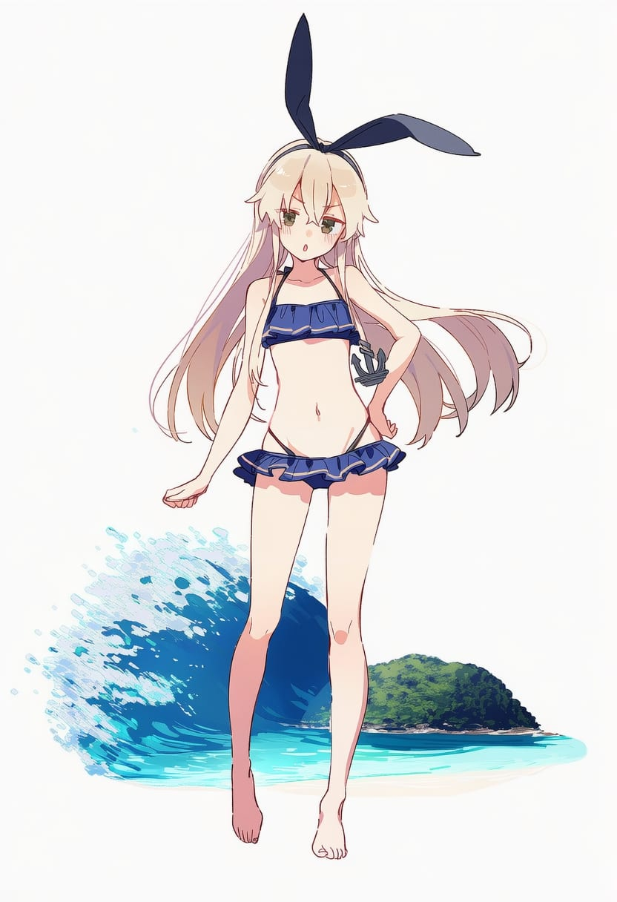

| 字段 | 内容 |
| --- | --- |
| Danbooru Tag | hiking |
| 中文名 | 徒步 |
| 中文含义 | 在户外进行较长距离步行。 |
| 子类 | 地面移动 |
| 模特 | shimakaze_(kancolle) |
| 序号 | 0004 |

## 5. skipping — 蹦跳前进

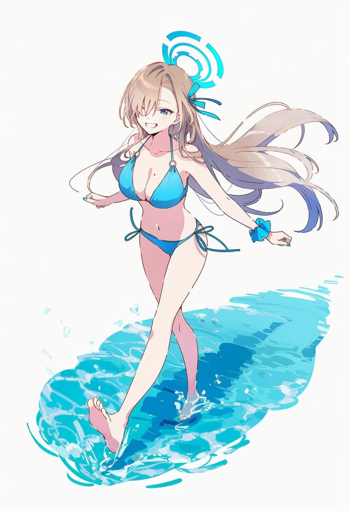

| 字段 | 内容 |
| --- | --- |
| Danbooru Tag | skipping |
| 中文名 | 蹦跳前进 |
| 中文含义 | 以轻快的跳步方式向前移动。 |
| 子类 | 地面移动 |
| 模特 | asuna_(blue_archive) |
| 序号 | 0005 |

## 6. stepping — 迈步

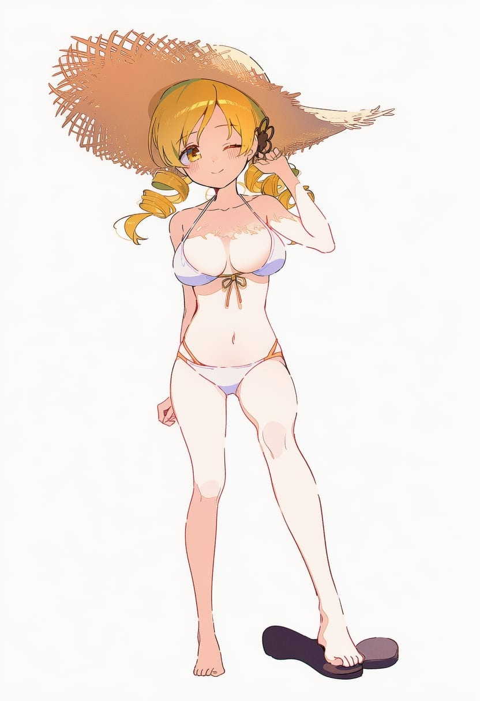

| 字段 | 内容 |
| --- | --- |
| Danbooru Tag | stepping |
| 中文名 | 迈步 |
| 中文含义 | 正在抬脚或落脚迈出一步。 |
| 子类 | 地面移动 |
| 模特 | tomoe_mami |
| 序号 | 0006 |

## 7. stomping — 跺脚

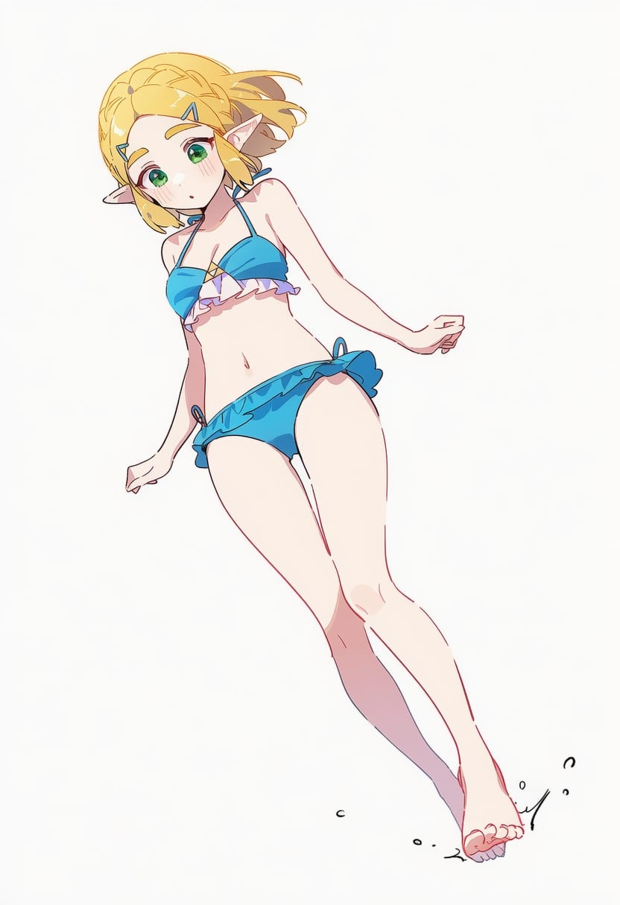

| 字段 | 内容 |
| --- | --- |
| Danbooru Tag | stomping |
| 中文名 | 跺脚 |
| 中文含义 | 用脚重重踩下。 |
| 子类 | 地面移动 |
| 模特 | princess_zelda |
| 序号 | 0007 |

## 8. crawling — 爬行

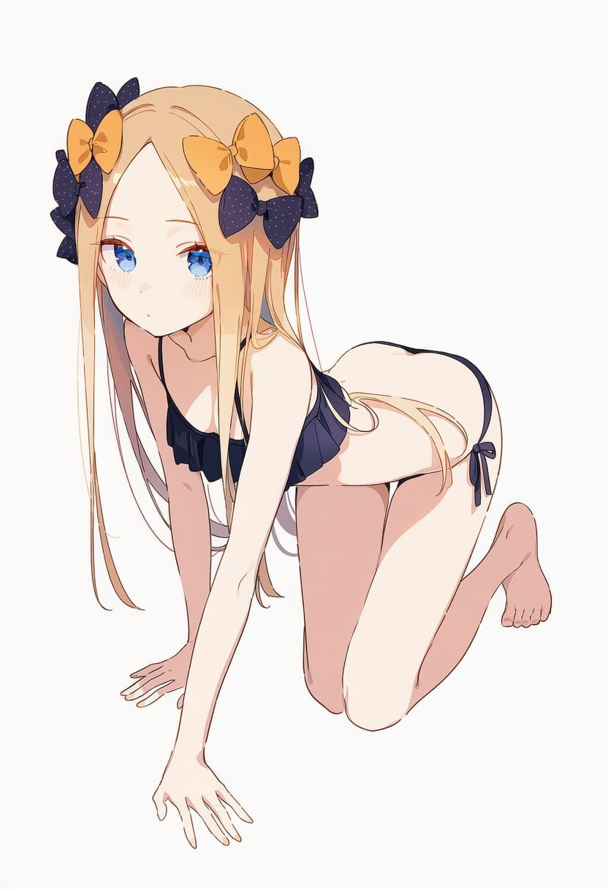

| 字段 | 内容 |
| --- | --- |
| Danbooru Tag | crawling |
| 中文名 | 爬行 |
| 中文含义 | 身体贴近地面用四肢向前移动。 |
| 子类 | 地面移动 |
| 模特 | abigail_williams_(fate) |
| 序号 | 0008 |

## 9. climbing — 攀爬

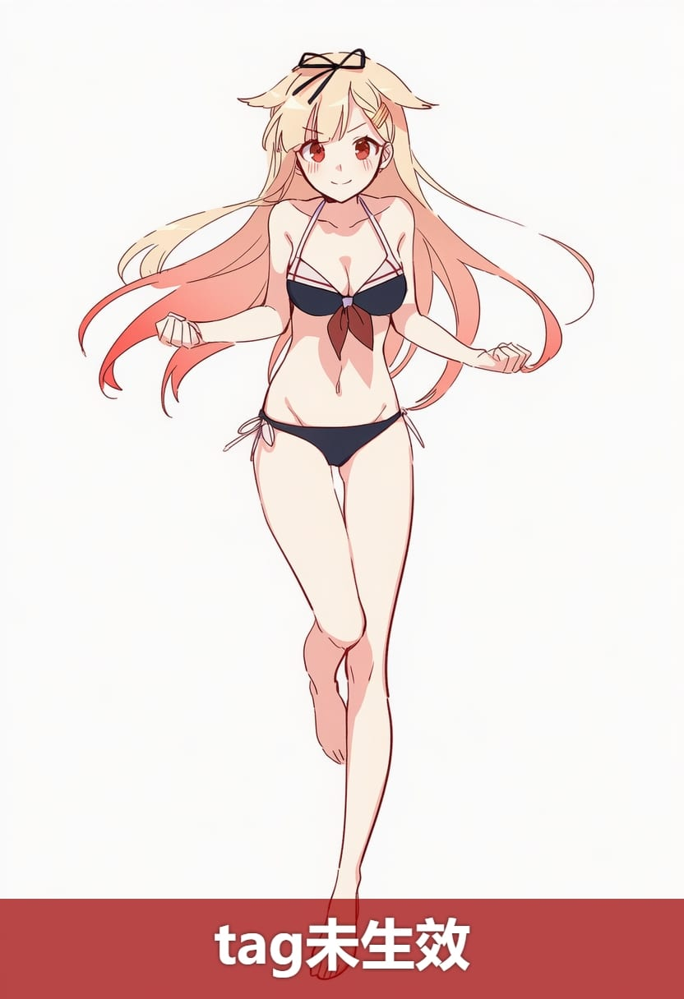

| 字段 | 内容 |
| --- | --- |
| Danbooru Tag | climbing |
| 中文名 | 攀爬 |
| 中文含义 | 借助手脚向上或沿表面移动。 |
| 子类 | 地面移动 |
| 模特 | yuudachi_(kancolle) |
| 序号 | 0009 |

## 10. rappelling — 绳降

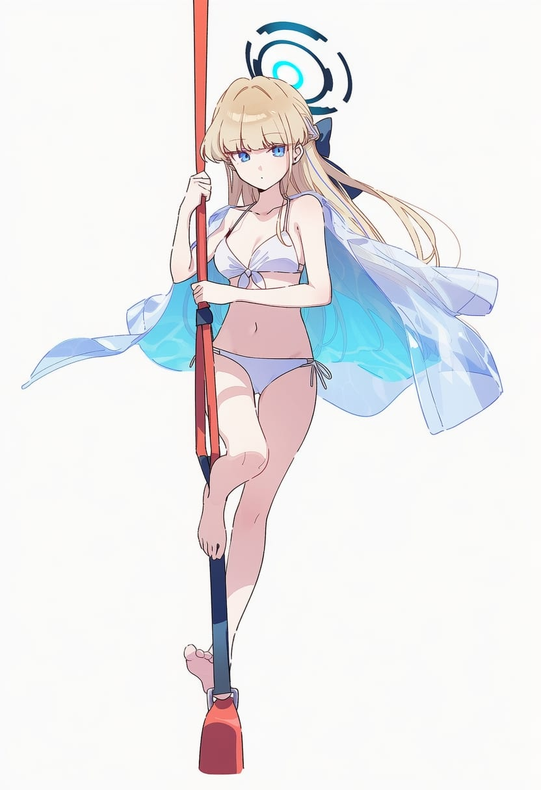

| 字段 | 内容 |
| --- | --- |
| Danbooru Tag | rappelling |
| 中文名 | 绳降 |
| 中文含义 | 借助绳索从高处向下移动。 |
| 子类 | 地面移动 |
| 模特 | toki_(blue_archive) |
| 序号 | 0010 |

## 11. chasing — 追赶

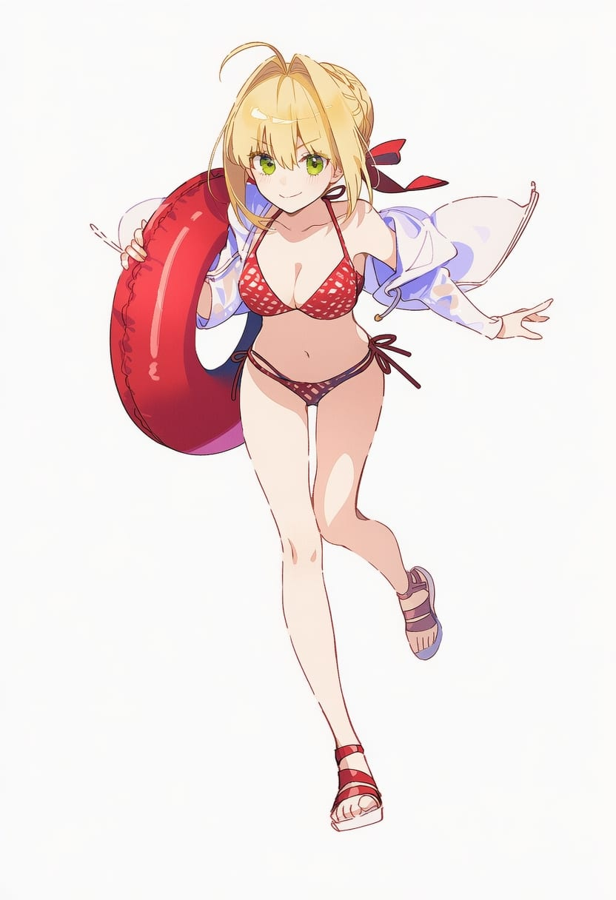

| 字段 | 内容 |
| --- | --- |
| Danbooru Tag | chasing |
| 中文名 | 追赶 |
| 中文含义 | 快速移动追逐目标。 |
| 子类 | 地面移动 |
| 模特 | nero_claudius_(fate) |
| 序号 | 0011 |

## 12. tripping — 绊倒

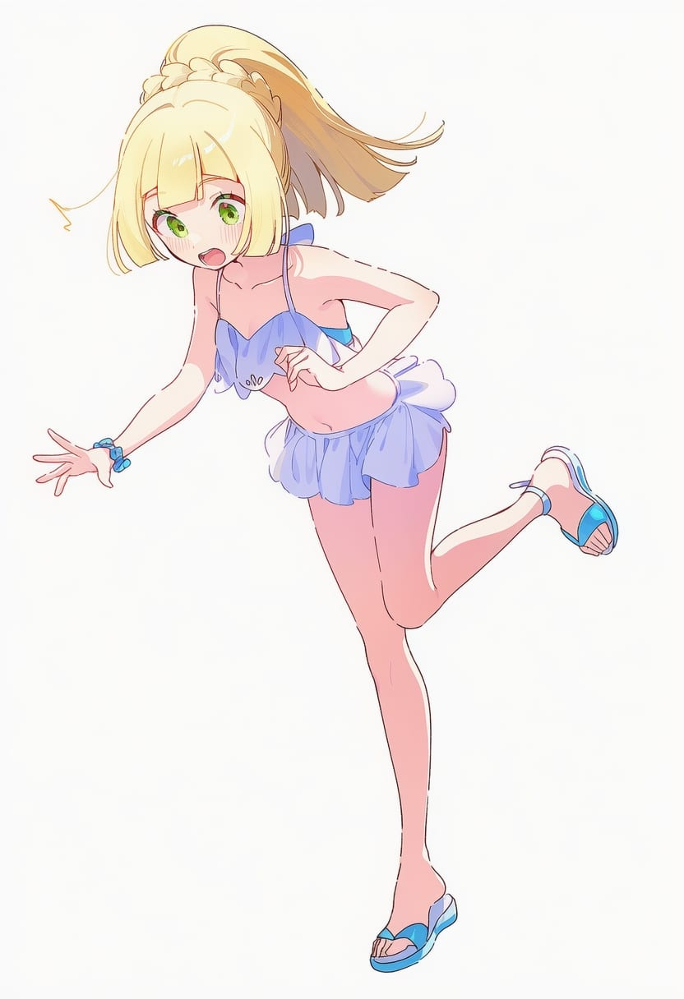

| 字段 | 内容 |
| --- | --- |
| Danbooru Tag | tripping |
| 中文名 | 绊倒 |
| 中文含义 | 走或跑时失去平衡向前跌倒。 |
| 子类 | 地面移动 |
| 模特 | lillie_(pokemon) |
| 序号 | 0012 |

## 13. slipping — 滑倒

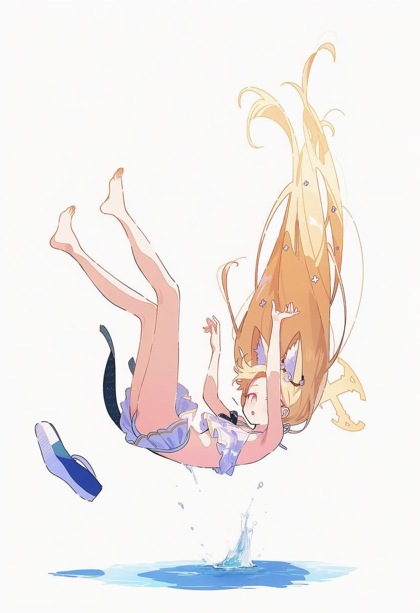

| 字段 | 内容 |
| --- | --- |
| Danbooru Tag | slipping |
| 中文名 | 滑倒 |
| 中文含义 | 因脚下打滑而失去平衡。 |
| 子类 | 地面移动 |
| 模特 | seia_(blue_archive) |
| 序号 | 0013 |

## 14. sliding — 滑行

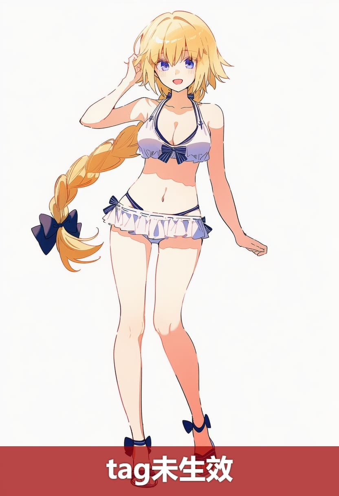

| 字段 | 内容 |
| --- | --- |
| Danbooru Tag | sliding |
| 中文名 | 滑行 |
| 中文含义 | 身体沿表面持续滑动。 |
| 子类 | 地面移动 |
| 模特 | jeanne_d'arc_(fate) |
| 序号 | 0014 |

## 15. jumping — 跳跃

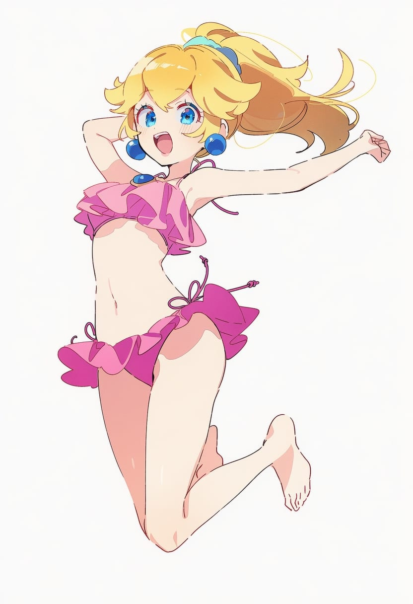

| 字段 | 内容 |
| --- | --- |
| Danbooru Tag | jumping |
| 中文名 | 跳跃 |
| 中文含义 | 身体主动离开地面跃起。 |
| 子类 | 跳跃/落下 |
| 模特 | princess_peach |
| 序号 | 0015 |

## 16. hopping — 单脚跳 / 小跳

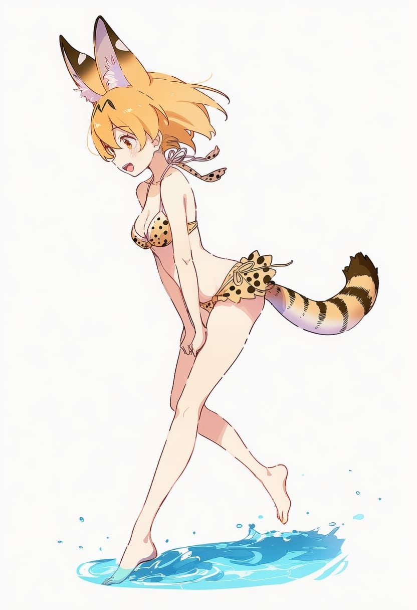

| 字段 | 内容 |
| --- | --- |
| Danbooru Tag | hopping |
| 中文名 | 单脚跳 / 小跳 |
| 中文含义 | 以单脚或短促方式跳动。 |
| 子类 | 跳跃/落下 |
| 模特 | serval_(kemono_friends) |
| 序号 | 0016 |

## 17. pouncing — 扑跃

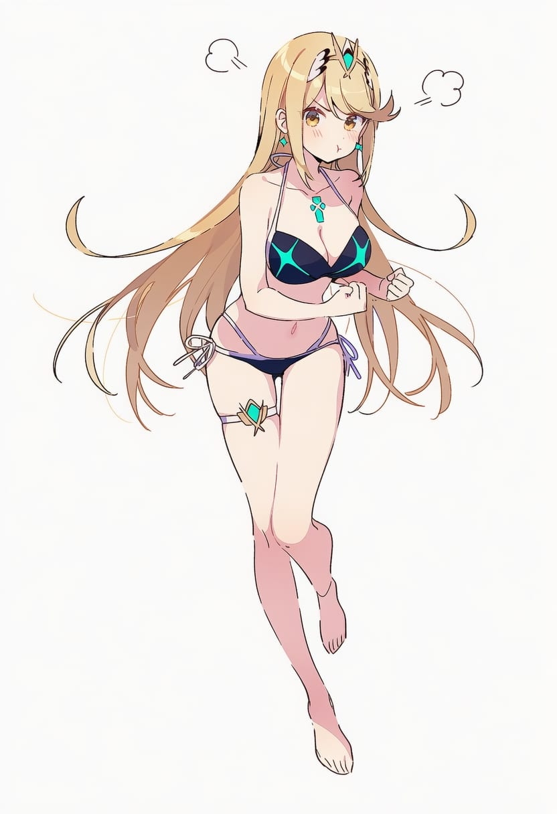

| 字段 | 内容 |
| --- | --- |
| Danbooru Tag | pouncing |
| 中文名 | 扑跃 |
| 中文含义 | 朝目标或对象猛地跳扑过去。 |
| 子类 | 跳跃/落下 |
| 模特 | mythra_(xenoblade) |
| 序号 | 0017 |

## 18. landing — 落地

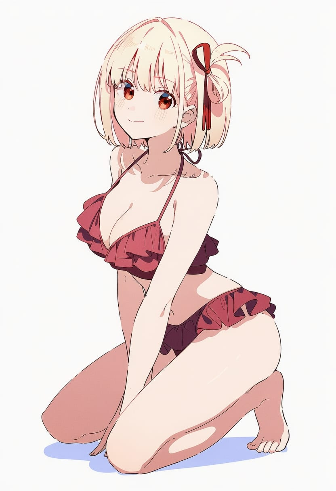

| 字段 | 内容 |
| --- | --- |
| Danbooru Tag | landing |
| 中文名 | 落地 |
| 中文含义 | 从空中下降并正在着地。 |
| 子类 | 跳跃/落下 |
| 模特 | nishikigi_chisato |
| 序号 | 0018 |

## 19. dive — 俯冲落地

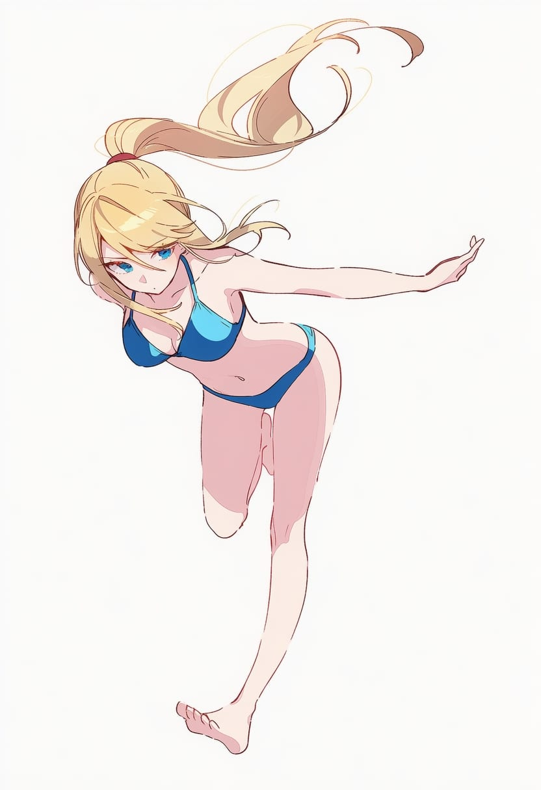

| 字段 | 内容 |
| --- | --- |
| Danbooru Tag | dive |
| 中文名 | 俯冲落地 |
| 中文含义 | 角色从空中快速下降、即将落地。 |
| 子类 | 跳跃/落下 |
| 模特 | samus_aran |
| 序号 | 0019 |

## 20. diving — 跳水 / 潜入

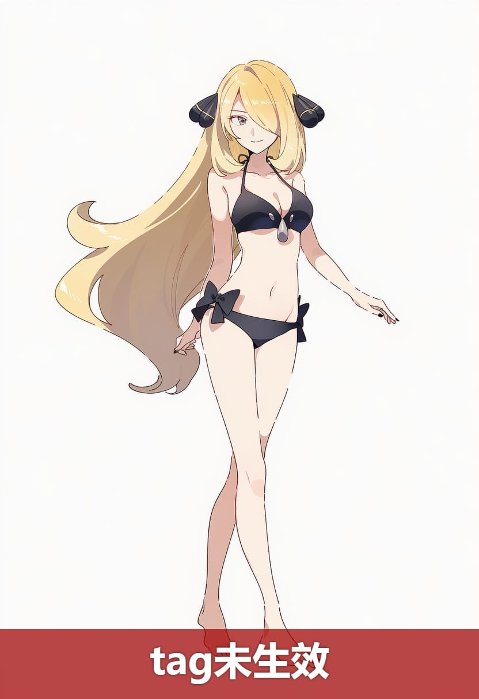

| 字段 | 内容 |
| --- | --- |
| Danbooru Tag | diving |
| 中文名 | 跳水 / 潜入 |
| 中文含义 | 身体向水中或下方俯冲进入。 |
| 子类 | 跳跃/落下 |
| 模特 | cynthia_(pokemon) |
| 序号 | 0020 |

## 21. falling — 坠落

| 字段 | 内容 |
| --- | --- |
| Danbooru Tag | falling |
| 中文名 | 坠落 |
| 中文含义 | 身体不受支撑地向下落。 |
| 子类 | 跳跃/落下 |
| 模特 | ayase_eli |
| 序号 | 0021 |

## 22. fainting — 昏倒

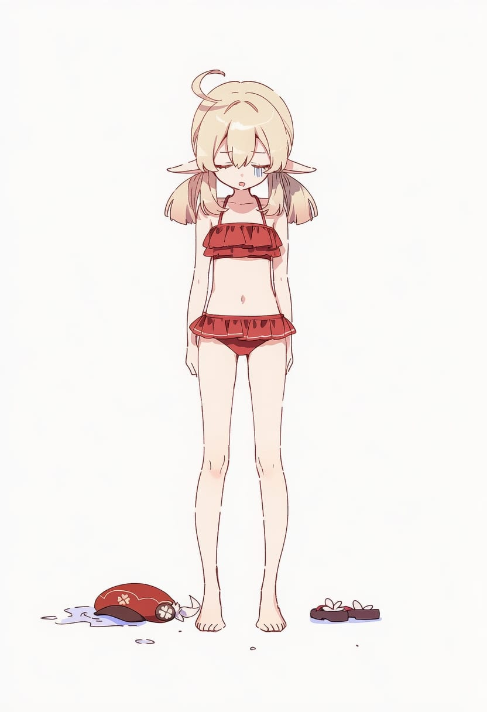

| 字段 | 内容 |
| --- | --- |
| Danbooru Tag | fainting |
| 中文名 | 昏倒 |
| 中文含义 | 因失去意识而正在倒下。 |
| 子类 | 跳跃/落下 |
| 模特 | klee_(genshin_impact) |
| 序号 | 0022 |

## 23. floating — 漂浮

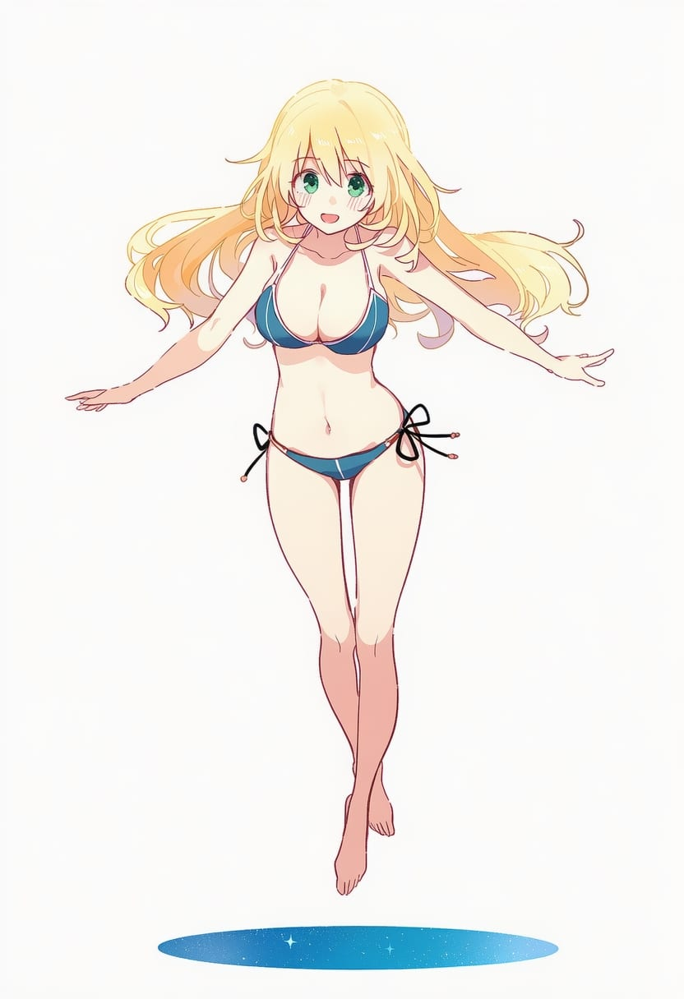

| 字段 | 内容 |
| --- | --- |
| Danbooru Tag | floating |
| 中文名 | 漂浮 |
| 中文含义 | 身体悬浮而没有明显支撑。 |
| 子类 | 空中/漂浮 |
| 模特 | atago_(kancolle) |
| 序号 | 0023 |

## 24. flying — 飞行

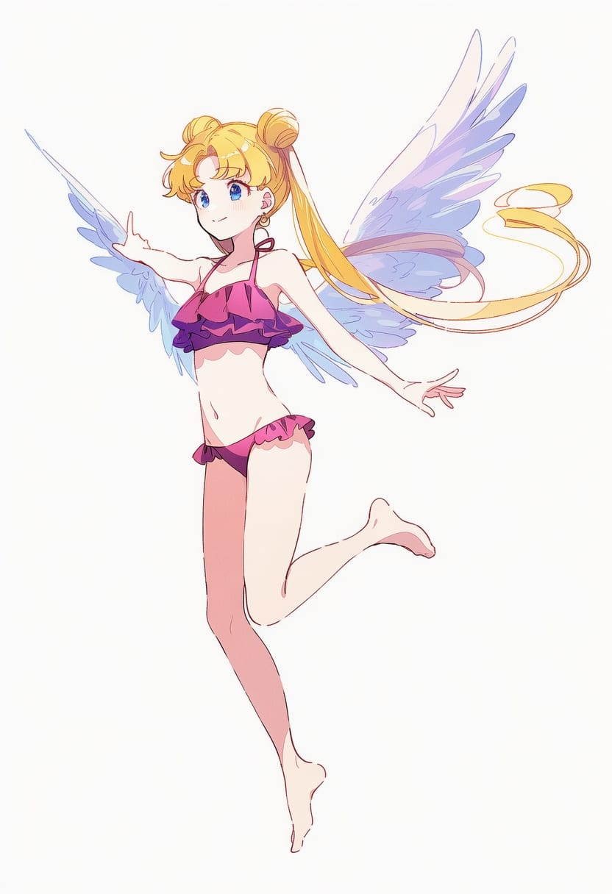

| 字段 | 内容 |
| --- | --- |
| Danbooru Tag | flying |
| 中文名 | 飞行 |
| 中文含义 | 角色主动在空中移动。 |
| 子类 | 空中/漂浮 |
| 模特 | tsukino_usagi |
| 序号 | 0024 |

## 25. flapping — 拍动

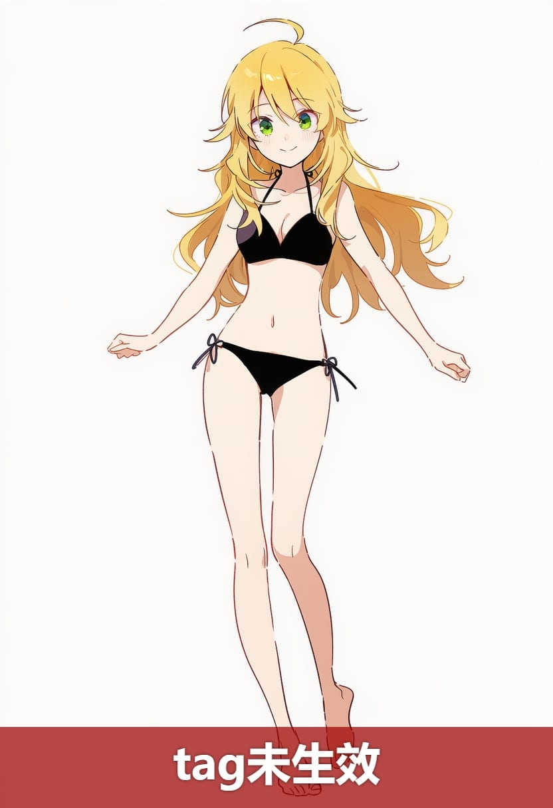

| 字段 | 内容 |
| --- | --- |
| Danbooru Tag | flapping |
| 中文名 | 拍动 |
| 中文含义 | 翅膀或类似部位反复拍动。 |
| 子类 | 空中/漂浮 |
| 模特 | hoshii_miki |
| 序号 | 0025 |

## 26. launching — 腾空 / 发射

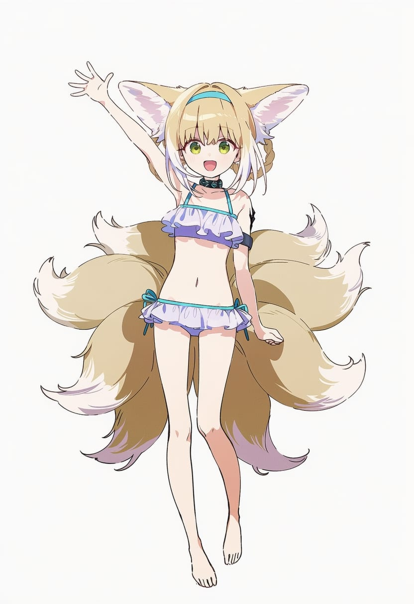

| 字段 | 内容 |
| --- | --- |
| Danbooru Tag | launching |
| 中文名 | 腾空 / 发射 |
| 中文含义 | 角色或身体被快速送入空中。 |
| 子类 | 空中/漂浮 |
| 模特 | suzuran_(arknights) |
| 序号 | 0026 |

## 27. rolling — 翻滚

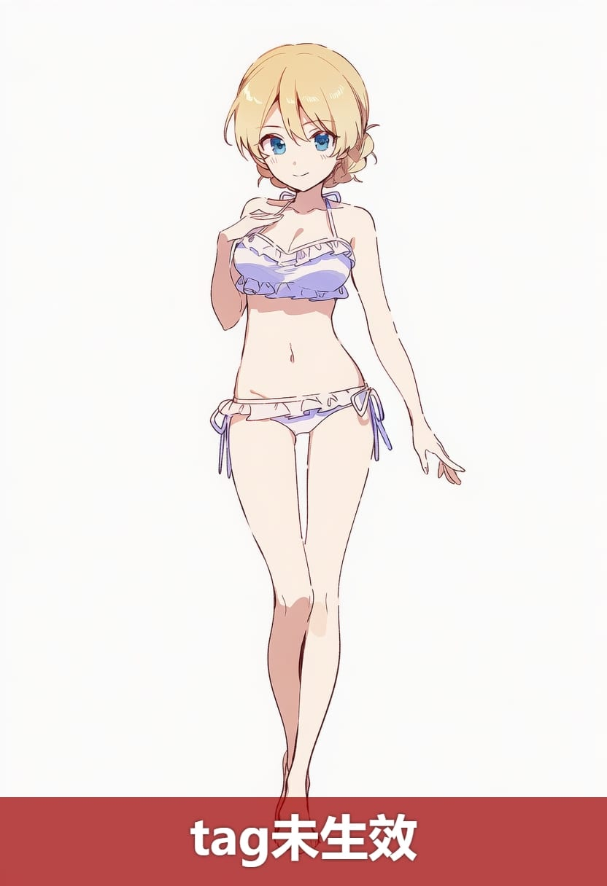

| 字段 | 内容 |
| --- | --- |
| Danbooru Tag | rolling |
| 中文名 | 翻滚 |
| 中文含义 | 身体沿地面或自身轴线滚动。 |
| 子类 | 旋转/摆动/失衡 |
| 模特 | darjeeling_(girls_und_panzer) |
| 序号 | 0027 |

## 28. spinning — 旋转

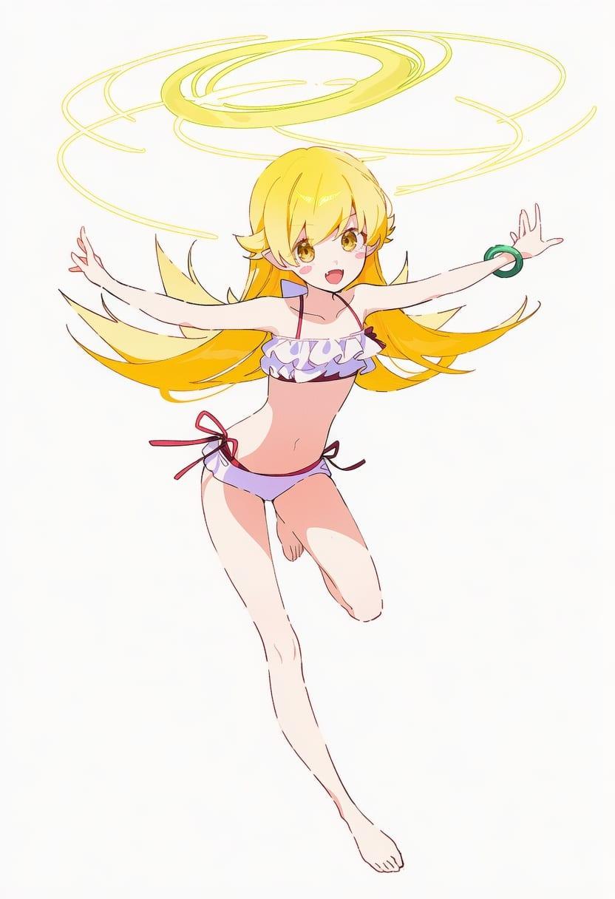

| 字段 | 内容 |
| --- | --- |
| Danbooru Tag | spinning |
| 中文名 | 旋转 |
| 中文含义 | 身体快速围绕自身轴线转动。 |
| 子类 | 旋转/摆动/失衡 |
| 模特 | oshino_shinobu |
| 序号 | 0028 |

## 29. swinging — 摆荡

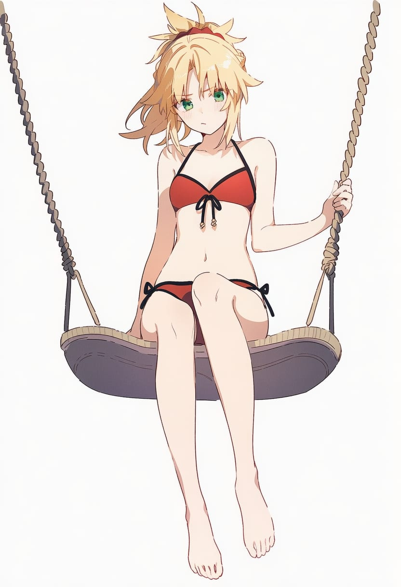

| 字段 | 内容 |
| --- | --- |
| Danbooru Tag | swinging |
| 中文名 | 摆荡 |
| 中文含义 | 身体或肢体来回摆动。 |
| 子类 | 旋转/摆动/失衡 |
| 模特 | mordred_(fate) |
| 序号 | 0029 |

## 30. swaying — 摇摆

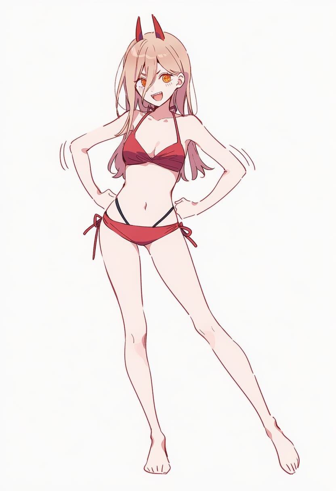

| 字段 | 内容 |
| --- | --- |
| Danbooru Tag | swaying |
| 中文名 | 摇摆 |
| 中文含义 | 身体缓慢左右或前后摆动。 |
| 子类 | 旋转/摆动/失衡 |
| 模特 | power_(chainsaw_man) |
| 序号 | 0030 |

## 31. bouncing — 弹跳

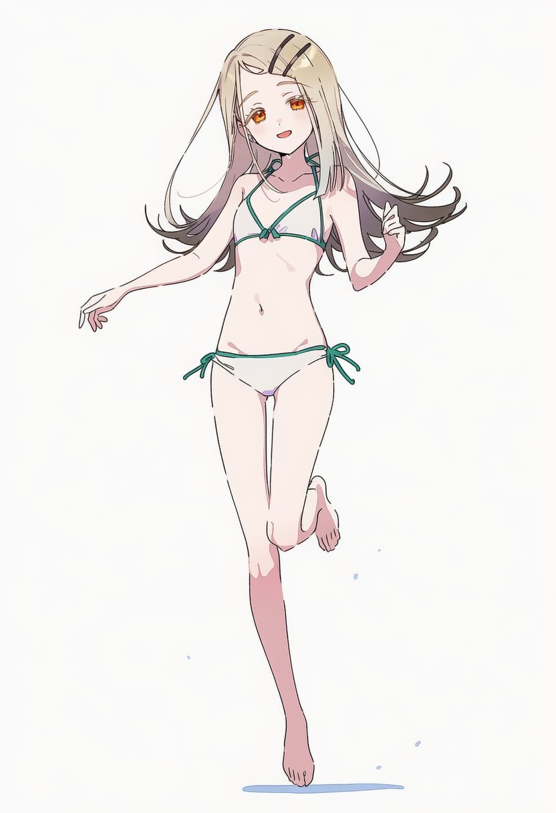

| 字段 | 内容 |
| --- | --- |
| Danbooru Tag | bouncing |
| 中文名 | 弹跳 |
| 中文含义 | 身体上下反复弹起。 |
| 子类 | 旋转/摆动/失衡 |
| 模特 | shinosawa_hiro |
| 序号 | 0031 |

## 32. flailing — 乱挥挣动

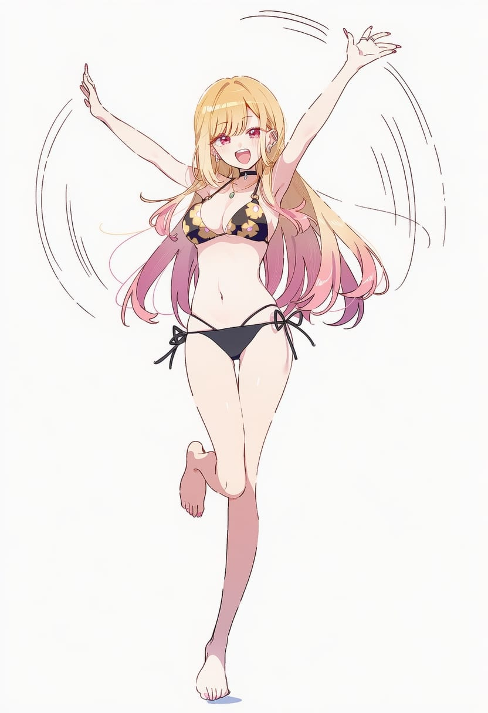

| 字段 | 内容 |
| --- | --- |
| Danbooru Tag | flailing |
| 中文名 | 乱挥挣动 |
| 中文含义 | 四肢失控般大幅挥动。 |
| 子类 | 旋转/摆动/失衡 |
| 模特 | kitagawa_marin |
| 序号 | 0032 |

## 33. shaking — 摇晃

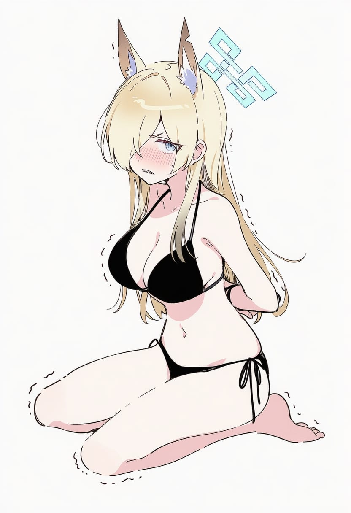

| 字段 | 内容 |
| --- | --- |
| Danbooru Tag | shaking |
| 中文名 | 摇晃 |
| 中文含义 | 身体明显快速来回晃动。 |
| 子类 | 旋转/摆动/失衡 |
| 模特 | kanna_(blue_archive) |
| 序号 | 0033 |

## 34. trembling — 发抖

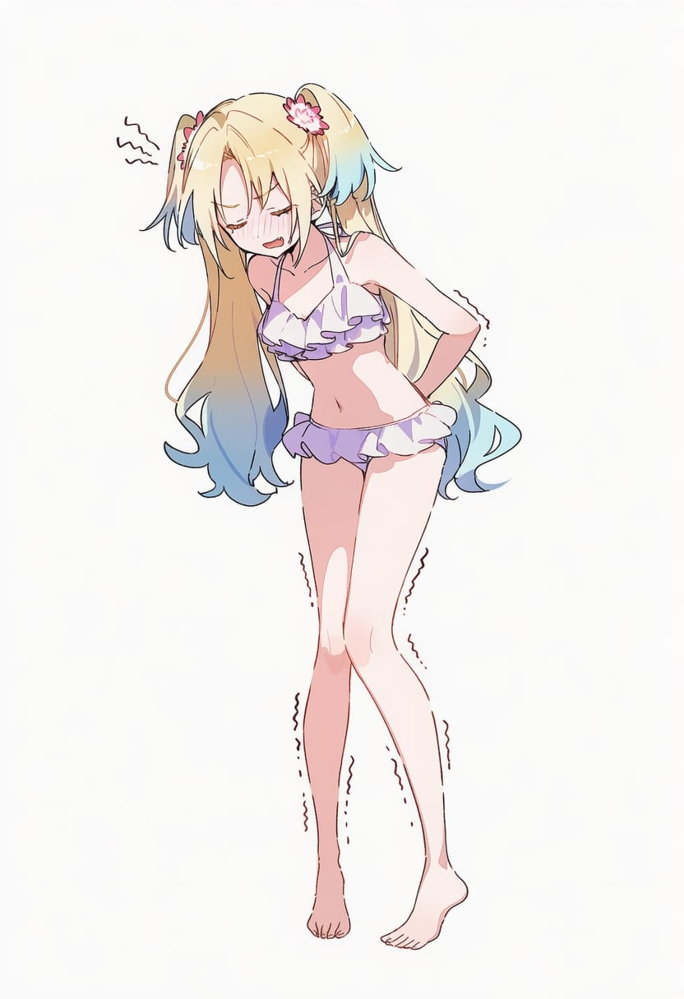

| 字段 | 内容 |
| --- | --- |
| Danbooru Tag | trembling |
| 中文名 | 发抖 |
| 中文含义 | 身体因紧张、寒冷等轻微持续颤抖。 |
| 子类 | 旋转/摆动/失衡 |
| 模特 | osawa_rurino |
| 序号 | 0034 |

## 35. twitching — 抽动

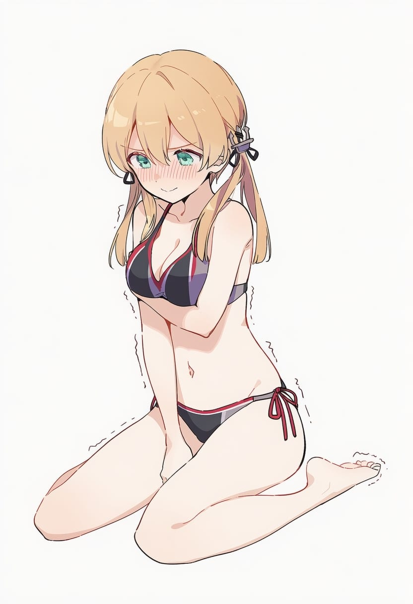

| 字段 | 内容 |
| --- | --- |
| Danbooru Tag | twitching |
| 中文名 | 抽动 |
| 中文含义 | 身体或肢体出现短促抽动。 |
| 子类 | 旋转/摆动/失衡 |
| 模特 | prinz_eugen_(kancolle) |
| 序号 | 0035 |

## 36. struggling — 挣扎

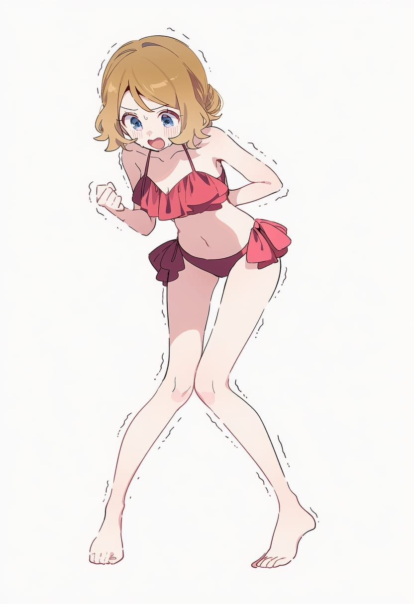

| 字段 | 内容 |
| --- | --- |
| Danbooru Tag | struggling |
| 中文名 | 挣扎 |
| 中文含义 | 身体持续用力扭动或反抗。 |
| 子类 | 旋转/摆动/失衡 |
| 模特 | serena_(pokemon) |
| 序号 | 0036 |

## 37. balancing — 保持平衡

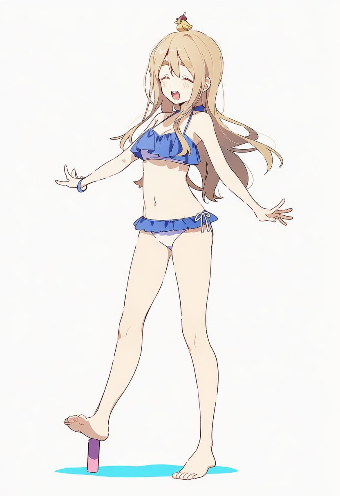

| 字段 | 内容 |
| --- | --- |
| Danbooru Tag | balancing |
| 中文名 | 保持平衡 |
| 中文含义 | 身体正在主动维持平衡。 |
| 子类 | 旋转/摆动/失衡 |
| 模特 | kotobuki_tsumugi |
| 序号 | 0037 |

## 38. swimming — 游泳

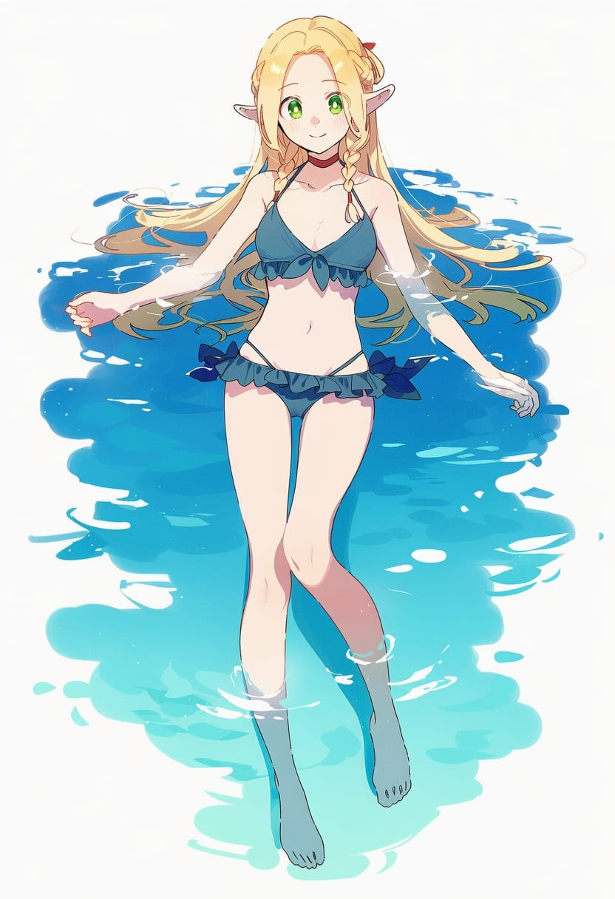

| 字段 | 内容 |
| --- | --- |
| Danbooru Tag | swimming |
| 中文名 | 游泳 |
| 中文含义 | 在水中用身体划动前进。 |
| 子类 | 水中移动 |
| 模特 | marcille_donato |
| 序号 | 0038 |

## 39. freediving — 自由潜水

| 字段 | 内容 |
| --- | --- |
| Danbooru Tag | freediving |
| 中文名 | 自由潜水 |
| 中文含义 | 不使用呼吸设备在水下潜游。 |
| 子类 | 水中移动 |
| 模特 | cammy_white |
| 序号 | 0039 |

## 40. wading — 涉水

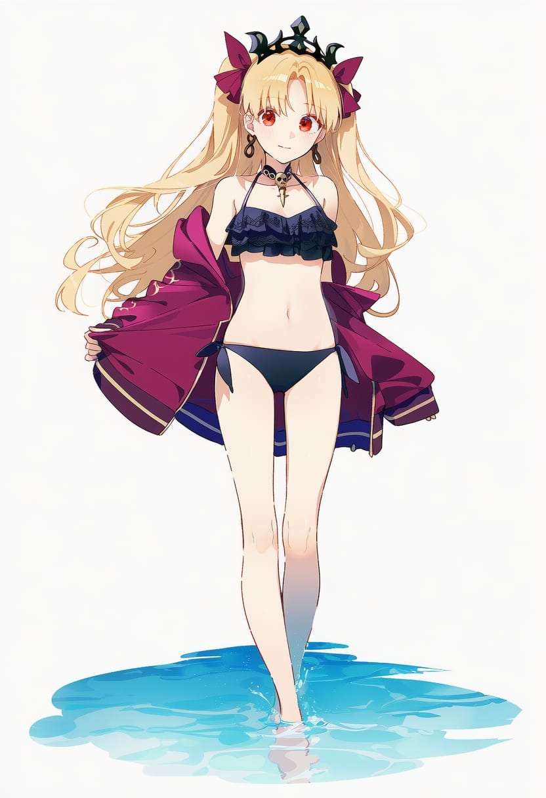

| 字段 | 内容 |
| --- | --- |
| Danbooru Tag | wading |
| 中文名 | 涉水 |
| 中文含义 | 在较浅的水中步行移动。 |
| 子类 | 水中移动 |
| 模特 | ereshkigal_(fate) |
| 序号 | 0040 |

## 41. surfing — 冲浪

| 字段 | 内容 |
| --- | --- |
| Danbooru Tag | surfing |
| 中文名 | 冲浪 |
| 中文含义 | 站在冲浪板等载体上随浪移动。 |
| 子类 | 水中移动 |
| 模特 | bismarck_(kancolle) |
| 序号 | 0041 |

## 42. broom_surfing — 扫帚冲浪

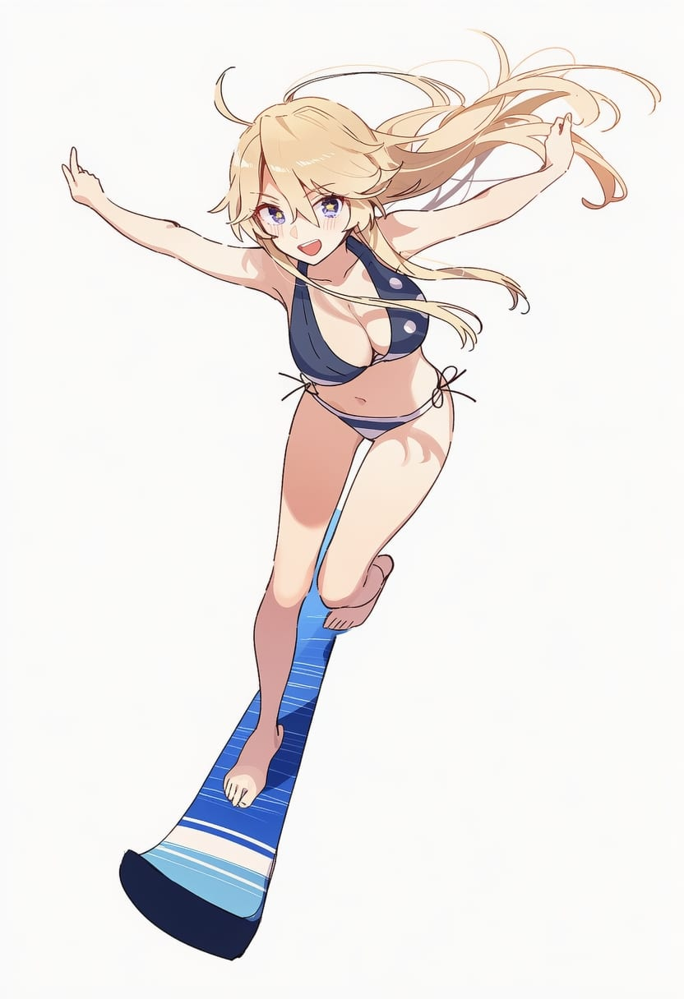

| 字段 | 内容 |
| --- | --- |
| Danbooru Tag | broom_surfing |
| 中文名 | 扫帚冲浪 |
| 中文含义 | 站在扫帚上像冲浪一样移动。 |
| 子类 | 水中移动 |
| 模特 | iowa_(kancolle) |
| 序号 | 0042 |

## 43. sky_surfing — 空中冲浪

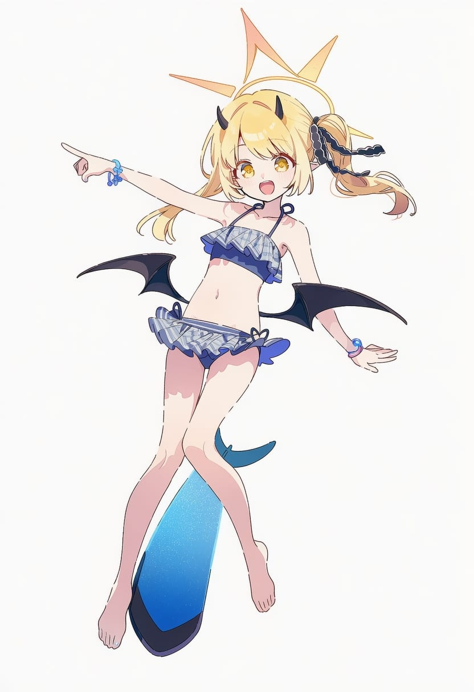

| 字段 | 内容 |
| --- | --- |
| Danbooru Tag | sky_surfing |
| 中文名 | 空中冲浪 |
| 中文含义 | 在空中以冲浪姿态滑行。 |
| 子类 | 水中移动 |
| 模特 | ibuki_(blue_archive) |
| 序号 | 0043 |

## 44. sinking — 下沉

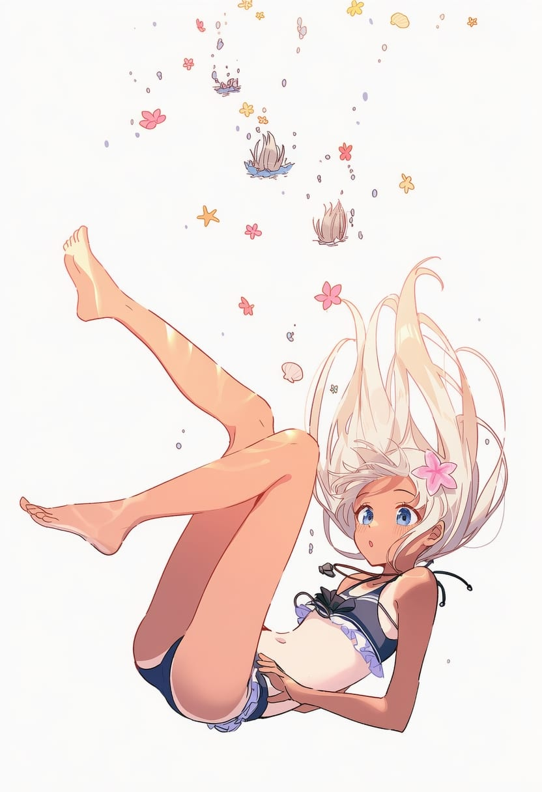

| 字段 | 内容 |
| --- | --- |
| Danbooru Tag | sinking |
| 中文名 | 下沉 |
| 中文含义 | 身体正在水中或其他介质中向下沉。 |
| 子类 | 水中移动 |
| 模特 | ro-500_(kancolle) |
| 序号 | 0044 |

## 45. splashing — 扑水 / 溅水

| 字段 | 内容 |
| --- | --- |
| Danbooru Tag | splashing |
| 中文名 | 扑水 / 溅水 |
| 中文含义 | 动作使水花明显飞溅。 |
| 子类 | 水中移动 |
| 模特 | nonomi_(blue_archive) |
| 序号 | 0045 |

## 46. skating — 滑行运动

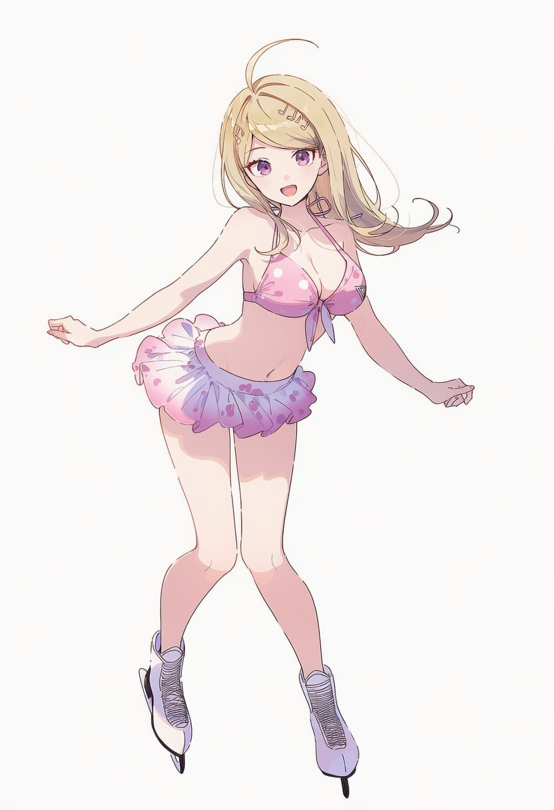

| 字段 | 内容 |
| --- | --- |
| Danbooru Tag | skating |
| 中文名 | 滑行运动 |
| 中文含义 | 穿滑冰鞋或轮滑装备滑行。 |
| 子类 | 运动型移动 |
| 模特 | akamatsu_kaede |
| 序号 | 0046 |

## 47. figure_skating — 花样滑冰

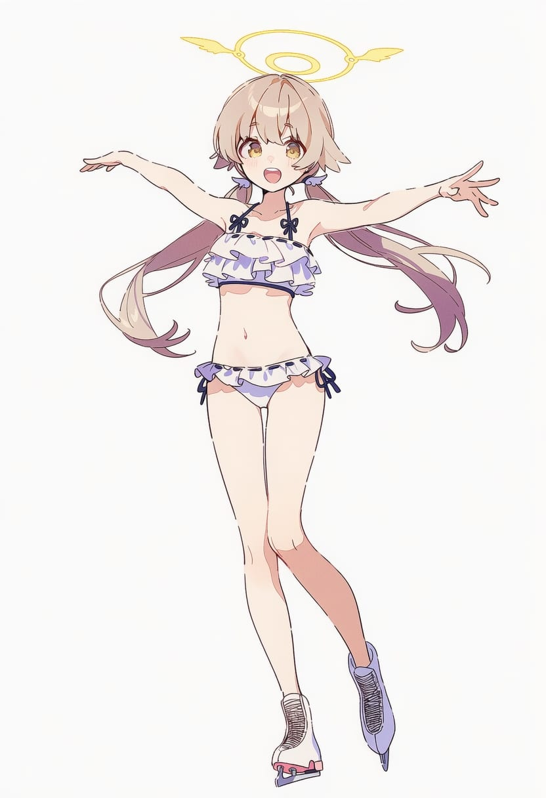

| 字段 | 内容 |
| --- | --- |
| Danbooru Tag | figure_skating |
| 中文名 | 花样滑冰 |
| 中文含义 | 进行花样滑冰动作。 |
| 子类 | 运动型移动 |
| 模特 | hifumi_(blue_archive) |
| 序号 | 0047 |

## 48. ice_skating — 滑冰

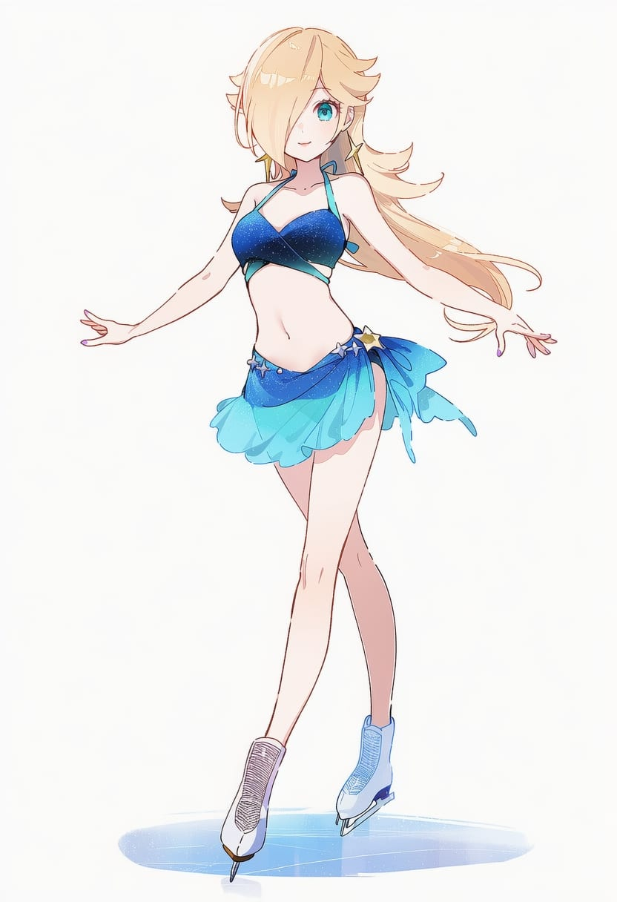

| 字段 | 内容 |
| --- | --- |
| Danbooru Tag | ice_skating |
| 中文名 | 滑冰 |
| 中文含义 | 在冰面上用冰刀鞋滑行。 |
| 子类 | 运动型移动 |
| 模特 | rosalina |
| 序号 | 0048 |

## 49. skiing — 滑雪

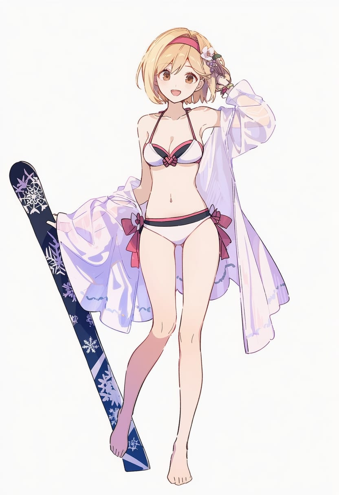

| 字段 | 内容 |
| --- | --- |
| Danbooru Tag | skiing |
| 中文名 | 滑雪 |
| 中文含义 | 使用滑雪板在雪地移动。 |
| 子类 | 运动型移动 |
| 模特 | djeeta_(granblue_fantasy) |
| 序号 | 0049 |

## 50. rowing — 划船

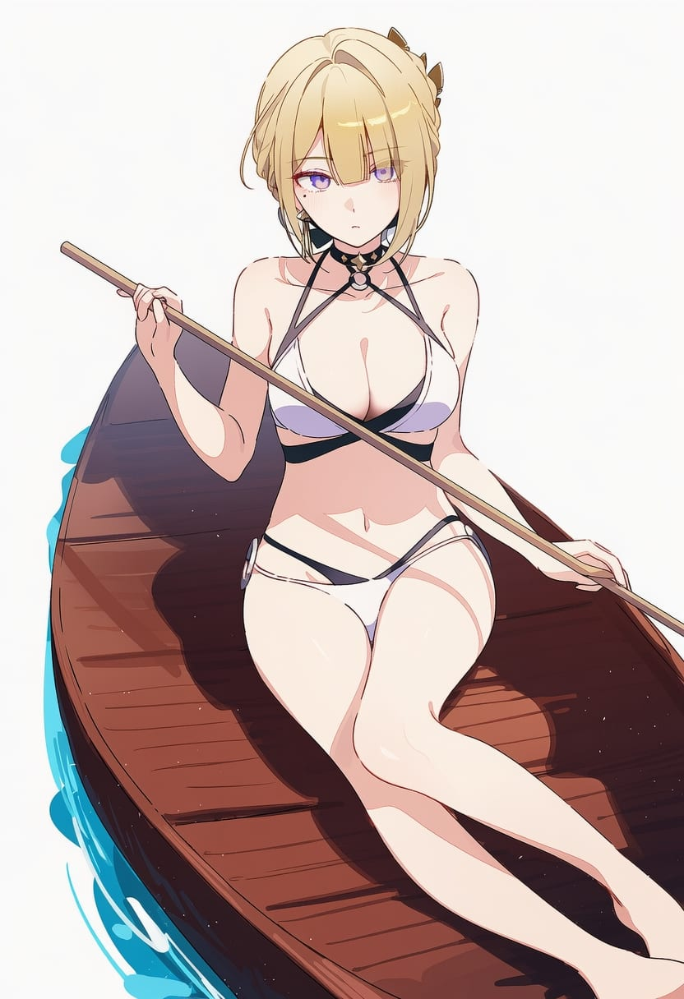

| 字段 | 内容 |
| --- | --- |
| Danbooru Tag | rowing |
| 中文名 | 划船 |
| 中文含义 | 用桨驱动船只移动。 |
| 子类 | 运动型移动 |
| 模特 | evelyn_chevalier |
| 序号 | 0050 |

## 51. racing — 竞速

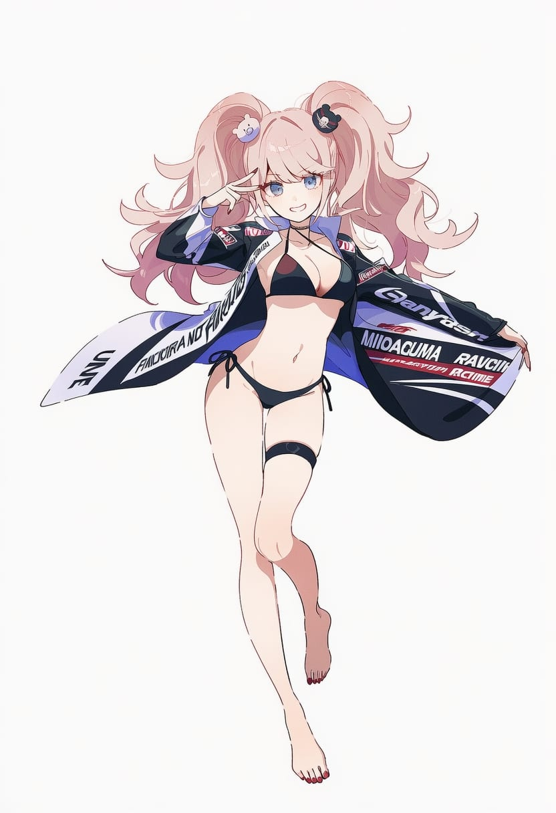

| 字段 | 内容 |
| --- | --- |
| Danbooru Tag | racing |
| 中文名 | 竞速 |
| 中文含义 | 角色正在进行速度竞赛。 |
| 子类 | 运动型移动 |
| 模特 | enoshima_junko |
| 序号 | 0051 |

## 52. dancing — 跳舞

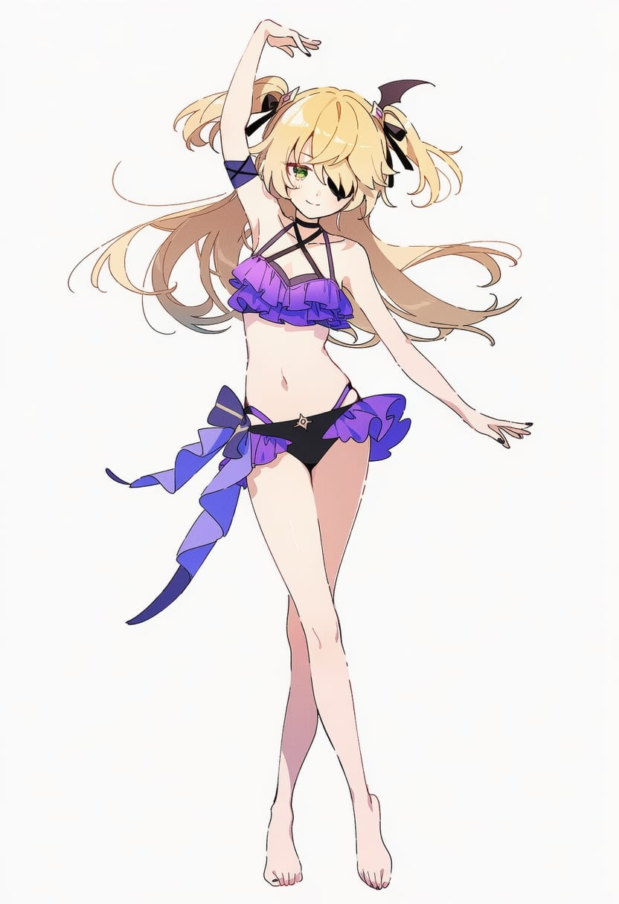

| 字段 | 内容 |
| --- | --- |
| Danbooru Tag | dancing |
| 中文名 | 跳舞 |
| 中文含义 | 身体随节奏做连续舞蹈动作。 |
| 子类 | 运动型移动 |
| 模特 | fischl_(genshin_impact) |
| 序号 | 0052 |

## 53. pole_dancing — 钢管舞

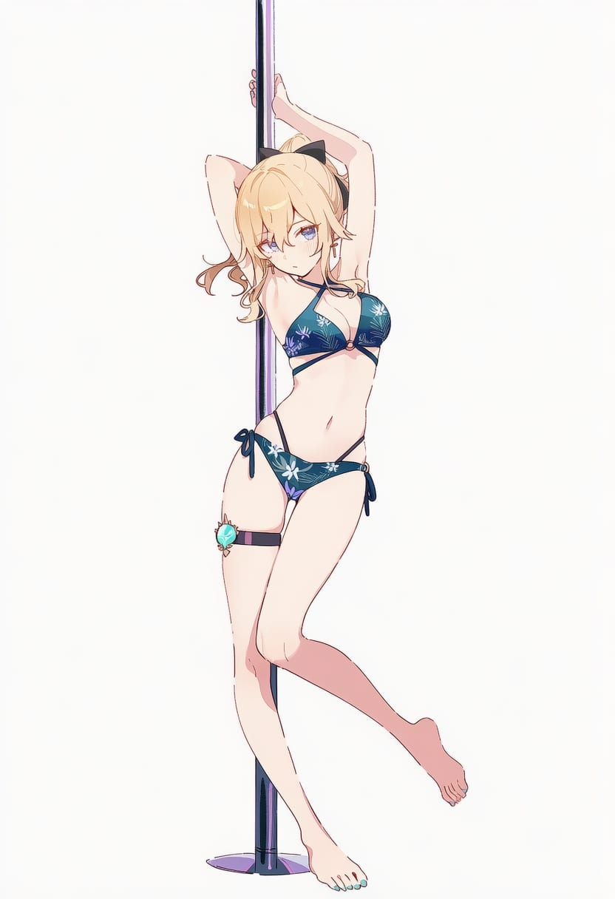

| 字段 | 内容 |
| --- | --- |
| Danbooru Tag | pole_dancing |
| 中文名 | 钢管舞 |
| 中文含义 | 围绕钢管进行舞蹈和身体动作。 |
| 子类 | 运动型移动 |
| 模特 | jean_(genshin_impact) |
| 序号 | 0053 |

## 54. kicking — 踢击

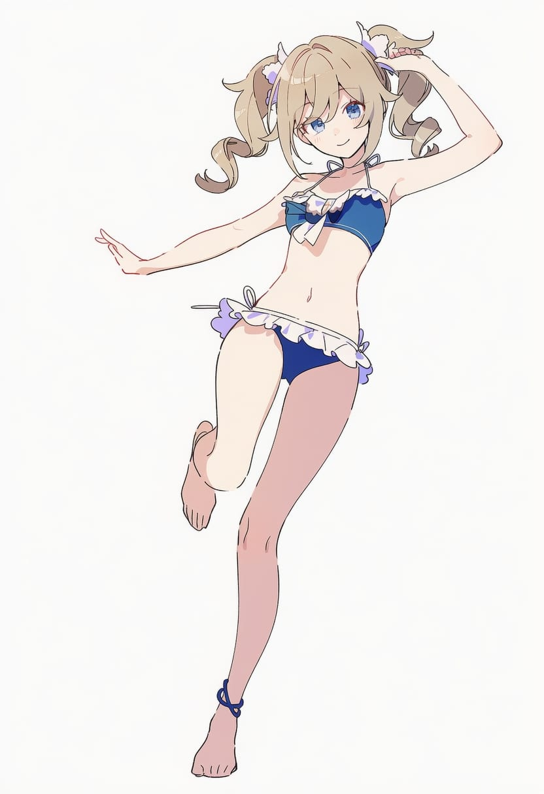

| 字段 | 内容 |
| --- | --- |
| Danbooru Tag | kicking |
| 中文名 | 踢击 |
| 中文含义 | 用腿或脚击打人物或物体的动作。 |
| 子类 | 踢击/战斗步法 |
| 模特 | barbara_(genshin_impact) |
| 序号 | 0054 |

## 55. flying_kick — 飞踢

| 字段 | 内容 |
| --- | --- |
| Danbooru Tag | flying_kick |
| 中文名 | 飞踢 |
| 中文含义 | 腾空或跃起后用腿脚进行踢击。 |
| 子类 | 踢击/战斗步法 |
| 模特 | fujita_kotone |
| 序号 | 0055 |

## 56. drop_kick — 飞身双脚踢 / Dropkick

| 字段 | 内容 |
| --- | --- |
| Danbooru Tag | drop_kick |
| 中文名 | 飞身双脚踢 / Dropkick |
| 中文含义 | 跳起后以双脚同时朝目标踢出，身体常呈后仰或近水平状态。 |
| 子类 | 踢击/战斗步法 |
| 模特 | kay_(girls_und_panzer) |
| 序号 | 0056 |

## 57. crotch_kick — 裆部踢击

| 字段 | 内容 |
| --- | --- |
| Danbooru Tag | crotch_kick |
| 中文名 | 裆部踢击 |
| 中文含义 | 踢向对方裆部的攻击动作。 |
| 子类 | 踢击/战斗步法 |
| 模特 | falin_touden |
| 序号 | 0057 |

## 58. kneeing — 膝击

| 字段 | 内容 |
| --- | --- |
| Danbooru Tag | kneeing |
| 中文名 | 膝击 |
| 中文含义 | 用膝部向目标进行撞击或攻击。 |
| 子类 | 踢击/战斗步法 |
| 模特 | yoimiya_(genshin_impact) |
| 序号 | 0058 |

## 59. kicking_viewer — 踢向观众

| 字段 | 内容 |
| --- | --- |
| Danbooru Tag | kicking_viewer |
| 中文名 | 踢向观众 |
| 中文含义 | 角色准备朝画面观看者方向踢击；Danbooru 将从下方重踩的视角区分为 stomping_viewer。 |
| 子类 | 踢击/战斗步法 |
| 模特 | katyusha_(girls_und_panzer) |
| 序号 | 0059 |

## 60. high_kick — 高踢

| 字段 | 内容 |
| --- | --- |
| Danbooru Tag | high_kick |
| 中文名 | 高踢 |
| 中文含义 | 将腿抬到较高位置进行踢击。 |
| 子类 | 踢击/战斗步法 |
| 模特 | sakurai_momoka |
| 序号 | 0060 |

## 61. fighting_stance — 战斗架势

| 字段 | 内容 |
| --- | --- |
| Danbooru Tag | fighting_stance |
| 中文名 | 战斗架势 |
| 中文含义 | 双腿分配重心，呈准备交战或防守的架势。 |
| 子类 | 踢击/战斗步法 |
| 模特 | darkness_(konosuba) |
| 序号 | 0061 |

## 62. stomping_viewer — 踩向观众

| 字段 | 内容 |
| --- | --- |
| Danbooru Tag | stomping_viewer |
| 中文名 | 踩向观众 |
| 中文含义 | 从观看者视角，角色抬脚准备或正在向镜头方向重踩，常伴随单脚站立。 |
| 子类 | 踩踏/脚部互动 |
| 模特 | mercy_(overwatch) |
| 序号 | 0062 |

## 63. stepping_on_viewer — 踩到观众

| 字段 | 内容 |
| --- | --- |
| Danbooru Tag | stepping_on_viewer |
| 中文名 | 踩到观众 |
| 中文含义 | 从观看者视角，角色的脚已经踩到画面边缘/观看者方向，强调“踩上去”而非空中重踩。 |
| 子类 | 踩踏/脚部互动 |
| 模特 | burnice_white |
| 序号 | 0063 |

## 64. stepped_on — 被踩 / 踩踏互动

| 字段 | 内容 |
| --- | --- |
| Danbooru Tag | stepped_on |
| 中文名 | 被踩 / 踩踏互动 |
| 中文含义 | 画面中一名角色正被另一名角色踩在身上，表示踩踏发生在角色之间。 |
| 子类 | 踩踏/脚部互动 |
| 模特 | jougasaki_rika |
| 序号 | 0064 |

## 65. standing_on_person — 站在他人身上

| 字段 | 内容 |
| --- | --- |
| Danbooru Tag | standing_on_person |
| 中文名 | 站在他人身上 |
| 中文含义 | 角色以双脚站在另一角色身体上。 |
| 子类 | 踩踏/脚部互动 |
| 模特 | professor_niyaniya_(blue_archive) |
| 序号 | 0065 |

## 66. standing_on_another's_head — 站在他人头上

| 字段 | 内容 |
| --- | --- |
| Danbooru Tag | standing_on_another's_head |
| 中文名 | 站在他人头上 |
| 中文含义 | 角色以脚站在另一角色头部上方或头上。 |
| 子类 | 踩踏/脚部互动 |
| 模特 | houjou_satoko |
| 序号 | 0066 |

## 67. legs_together — 双腿并拢

| 字段 | 内容 |
| --- | --- |
| Danbooru Tag | legs_together |
| 中文名 | 双腿并拢 |
| 中文含义 | 双腿整体靠拢在一起。 |
| 子类 | 腿部整体位置 |
| 模特 | shigure_ui_(vtuber) |
| 序号 | 0067 |

## 68. legs_apart — 双腿分开

| 字段 | 内容 |
| --- | --- |
| Danbooru Tag | legs_apart |
| 中文名 | 双腿分开 |
| 中文含义 | 双腿明显向两侧分开。 |
| 子类 | 腿部整体位置 |
| 模特 | beatrice_(umineko) |
| 序号 | 0068 |

## 69. crossed_legs — 交叉双腿

| 字段 | 内容 |
| --- | --- |
| Danbooru Tag | crossed_legs |
| 中文名 | 交叉双腿 |
| 中文含义 | 双腿在膝、大腿或小腿处交叉。 |
| 子类 | 腿部整体位置 |
| 模特 | fennec_(kemono_friends) |
| 序号 | 0069 |

## 70. crossed_ankles — 脚踝交叉

| 字段 | 内容 |
| --- | --- |
| Danbooru Tag | crossed_ankles |
| 中文名 | 脚踝交叉 |
| 中文含义 | 双腿主要在脚踝处交叉。 |
| 子类 | 腿部整体位置 |
| 模特 | satsuki_(kancolle) |
| 序号 | 0070 |

## 71. legs_folded — 双腿折叠

| 字段 | 内容 |
| --- | --- |
| Danbooru Tag | legs_folded |
| 中文名 | 双腿折叠 |
| 中文含义 | 膝盖完全弯曲，小腿贴近大腿。 |
| 子类 | 腿部整体位置 |
| 模特 | phoebe_(wuthering_waves) |
| 序号 | 0071 |

## 72. leg_up — 单腿抬起

| 字段 | 内容 |
| --- | --- |
| Danbooru Tag | leg_up |
| 中文名 | 单腿抬起 |
| 中文含义 | 一条腿明显抬高。 |
| 子类 | 腿部整体位置 |
| 模特 | barghest_(fate) |
| 序号 | 0072 |

## 73. legs_up — 双腿抬起

| 字段 | 内容 |
| --- | --- |
| Danbooru Tag | legs_up |
| 中文名 | 双腿抬起 |
| 中文含义 | 两条腿同时抬高。 |
| 子类 | 腿部整体位置 |
| 模特 | hachimiya_meguru |
| 序号 | 0073 |

## 74. leg_lift — 抬腿动作

| 字段 | 内容 |
| --- | --- |
| Danbooru Tag | leg_lift |
| 中文名 | 抬腿动作 |
| 中文含义 | 一条腿主动向上抬起形成明显姿态。 |
| 子类 | 腿部整体位置 |
| 模特 | orfevre_(umamusume) |
| 序号 | 0074 |

## 75. outstretched_leg — 单腿伸直

| 字段 | 内容 |
| --- | --- |
| Danbooru Tag | outstretched_leg |
| 中文名 | 单腿伸直 |
| 中文含义 | 一条腿完全向外伸直。 |
| 子类 | 腿部整体位置 |
| 模特 | navia_(genshin_impact) |
| 序号 | 0075 |

## 76. outstretched_legs — 双腿伸直

| 字段 | 内容 |
| --- | --- |
| Danbooru Tag | outstretched_legs |
| 中文名 | 双腿伸直 |
| 中文含义 | 两条腿同时向外伸直。 |
| 子类 | 腿部整体位置 |
| 模特 | ia_(vocaloid) |
| 序号 | 0076 |

## 77. standing_on_one_leg — 单腿站立

| 字段 | 内容 |
| --- | --- |
| Danbooru Tag | standing_on_one_leg |
| 中文名 | 单腿站立 |
| 中文含义 | 只用一条腿支撑身体站立。 |
| 子类 | 腿部整体位置 |
| 模特 | aino_minako |
| 序号 | 0077 |

## 78. knee_up — 单膝抬起

| 字段 | 内容 |
| --- | --- |
| Danbooru Tag | knee_up |
| 中文名 | 单膝抬起 |
| 中文含义 | 一侧膝盖明显抬高。 |
| 子类 | 膝盖位置/屈腿 |
| 模特 | ohara_mari |
| 序号 | 0078 |

## 79. knees_up — 双膝抬起

| 字段 | 内容 |
| --- | --- |
| Danbooru Tag | knees_up |
| 中文名 | 双膝抬起 |
| 中文含义 | 坐、躺或悬空时双膝弯曲抬起。 |
| 子类 | 膝盖位置/屈腿 |
| 模特 | elegg_(nikke) |
| 序号 | 0079 |

## 80. knees_to_chest — 屈膝靠胸

| 字段 | 内容 |
| --- | --- |
| Danbooru Tag | knees_to_chest |
| 中文名 | 屈膝靠胸 |
| 中文含义 | 双膝收向胸口形成蜷缩姿态。 |
| 子类 | 膝盖位置/屈腿 |
| 模特 | yoshimi_(blue_archive) |
| 序号 | 0080 |

## 81. knees_apart_feet_together — 膝分脚并

| 字段 | 内容 |
| --- | --- |
| Danbooru Tag | knees_apart_feet_together |
| 中文名 | 膝分脚并 |
| 中文含义 | 双膝向外分开，但双脚靠在一起。 |
| 子类 | 膝盖位置/屈腿 |
| 模特 | kashiwazaki_sena |
| 序号 | 0081 |

## 82. knees_together_feet_apart — 膝并脚分

| 字段 | 内容 |
| --- | --- |
| Danbooru Tag | knees_together_feet_apart |
| 中文名 | 膝并脚分 |
| 中文含义 | 双膝靠在一起，双脚向两侧分开。 |
| 子类 | 膝盖位置/屈腿 |
| 模特 | luciana_de_montefio |
| 序号 | 0082 |

## 83. kneeling — 跪姿

| 字段 | 内容 |
| --- | --- |
| Danbooru Tag | kneeling |
| 中文名 | 跪姿 |
| 中文含义 | 膝部着地，身体以跪姿支撑。 |
| 子类 | 跪姿/蹲姿/地面支撑 |
| 模特 | gambier_bay_(kancolle) |
| 序号 | 0083 |

## 84. one_knee — 单膝跪

| 字段 | 内容 |
| --- | --- |
| Danbooru Tag | one_knee |
| 中文名 | 单膝跪 |
| 中文含义 | 一侧膝盖着地或明显处于单膝姿态。 |
| 子类 | 跪姿/蹲姿/地面支撑 |
| 模特 | i-8_(kancolle) |
| 序号 | 0084 |

## 85. squatting — 蹲姿

| 字段 | 内容 |
| --- | --- |
| Danbooru Tag | squatting |
| 中文名 | 蹲姿 |
| 中文含义 | 屈膝降低重心，呈蹲下姿态。 |
| 子类 | 跪姿/蹲姿/地面支撑 |
| 模特 | abukuma_(kancolle) |
| 序号 | 0085 |

## 86. all_fours — 四肢着地

| 字段 | 内容 |
| --- | --- |
| Danbooru Tag | all_fours |
| 中文名 | 四肢着地 |
| 中文含义 | 双手与膝部或双脚共同接触地面支撑身体。 |
| 子类 | 跪姿/蹲姿/地面支撑 |
| 模特 | aglaea_(honkai:_star_rail) |
| 序号 | 0086 |

## 87. seiza — 正坐

| 字段 | 内容 |
| --- | --- |
| Danbooru Tag | seiza |
| 中文名 | 正坐 |
| 中文含义 | 日式正坐，双膝跪地并坐在脚跟附近。 |
| 子类 | 坐姿/盘腿 |
| 模特 | narita_top_road_(umamusume) |
| 序号 | 0087 |

## 88. wariza — 女子坐 / W坐

| 字段 | 内容 |
| --- | --- |
| Danbooru Tag | wariza |
| 中文名 | 女子坐 / W坐 |
| 中文含义 | 双膝朝前、双脚分向两侧，臀部落在地面。 |
| 子类 | 坐姿/盘腿 |
| 模特 | akita_neru |
| 序号 | 0088 |

## 89. yokozuwari — 横坐 / 侧坐

| 字段 | 内容 |
| --- | --- |
| Danbooru Tag | yokozuwari |
| 中文名 | 横坐 / 侧坐 |
| 中文含义 | 坐地时双腿折向身体同一侧。 |
| 子类 | 坐姿/盘腿 |
| 模特 | ramlethal_valentine |
| 序号 | 0089 |

## 90. indian_style — 盘腿坐

| 字段 | 内容 |
| --- | --- |
| Danbooru Tag | indian_style |
| 中文名 | 盘腿坐 |
| 中文含义 | 双腿交叉盘坐在地面。 |
| 子类 | 坐姿/盘腿 |
| 模特 | fletcher_(kancolle) |
| 序号 | 0090 |

## 91. butterfly_sitting — 蝴蝶坐

| 字段 | 内容 |
| --- | --- |
| Danbooru Tag | butterfly_sitting |
| 中文名 | 蝴蝶坐 |
| 中文含义 | 双脚脚掌相对、双膝向左右打开的坐姿。 |
| 子类 | 坐姿/盘腿 |
| 模特 | hoshino_ruby |
| 序号 | 0091 |

## 92. hugging_own_legs — 抱腿 / 抱膝

| 字段 | 内容 |
| --- | --- |
| Danbooru Tag | hugging_own_legs |
| 中文名 | 抱腿 / 抱膝 |
| 中文含义 | 用双臂环抱自己的腿部。 |
| 子类 | 坐姿/盘腿 |
| 模特 | konjiki_no_yami |
| 序号 | 0092 |

## 93. holding_own_leg — 抓住自己的腿

| 字段 | 内容 |
| --- | --- |
| Danbooru Tag | holding_own_leg |
| 中文名 | 抓住自己的腿 |
| 中文含义 | 用手握住、托住或拉住自己的腿。 |
| 子类 | 腿部手扶/抓握 |
| 模特 | iruma_miu |
| 序号 | 0093 |

## 94. hand_on_own_leg — 手放在自己腿上

| 字段 | 内容 |
| --- | --- |
| Danbooru Tag | hand_on_own_leg |
| 中文名 | 手放在自己腿上 |
| 中文含义 | 一只手放在自己的腿部。 |
| 子类 | 腿部手扶/抓握 |
| 模特 | bianca_(pokemon) |
| 序号 | 0094 |

## 95. hand_on_own_knee — 手放在自己膝盖上

| 字段 | 内容 |
| --- | --- |
| Danbooru Tag | hand_on_own_knee |
| 中文名 | 手放在自己膝盖上 |
| 中文含义 | 一只手搭在自己的膝盖上。 |
| 子类 | 腿部手扶/抓握 |
| 模特 | oshida_(girls_und_panzer) |
| 序号 | 0095 |

## 96. hands_on_own_knees — 双手扶膝

| 字段 | 内容 |
| --- | --- |
| Danbooru Tag | hands_on_own_knees |
| 中文名 | 双手扶膝 |
| 中文含义 | 双手分别搭在自己的膝盖上。 |
| 子类 | 腿部手扶/抓握 |
| 模特 | leafa_(sao) |
| 序号 | 0096 |

## 97. hands_on_feet — 双手扶脚 / 抓脚

| 字段 | 内容 |
| --- | --- |
| Danbooru Tag | hands_on_feet |
| 中文名 | 双手扶脚 / 抓脚 |
| 中文含义 | 双手接触、扶住或抓住自己的脚部。 |
| 子类 | 腿部手扶/抓握 |
| 模特 | siege_(arknights) |
| 序号 | 0097 |

## 98. spread_legs — 大幅分腿

| 字段 | 内容 |
| --- | --- |
| Danbooru Tag | spread_legs |
| 中文名 | 大幅分腿 |
| 中文含义 | 双腿明显向两侧张开。 |
| 子类 | 分腿/柔韧姿势 |
| 模特 | reed_(arknights) |
| 序号 | 0098 |

## 99. split — 劈叉

| 字段 | 内容 |
| --- | --- |
| Danbooru Tag | split |
| 中文名 | 劈叉 |
| 中文含义 | 双腿向相反方向展开形成劈叉。 |
| 子类 | 分腿/柔韧姿势 |
| 模特 | gold_city_(umamusume) |
| 序号 | 0099 |

## 100. sitting_split — 坐姿劈叉

| 字段 | 内容 |
| --- | --- |
| Danbooru Tag | sitting_split |
| 中文名 | 坐姿劈叉 |
| 中文含义 | 坐在地面或平面上完成劈叉。 |
| 子类 | 分腿/柔韧姿势 |
| 模特 | anila_(granblue_fantasy) |
| 序号 | 0100 |

## 101. standing_split — 站立劈叉

| 字段 | 内容 |
| --- | --- |
| Danbooru Tag | standing_split |
| 中文名 | 站立劈叉 |
| 中文含义 | 站立时将一条腿大幅抬高形成劈叉。 |
| 子类 | 分腿/柔韧姿势 |
| 模特 | marie_(girls_und_panzer) |
| 序号 | 0101 |

## 102. legs_over_head — 双腿越过头部

| 字段 | 内容 |
| --- | --- |
| Danbooru Tag | legs_over_head |
| 中文名 | 双腿越过头部 |
| 中文含义 | 双腿向上或向后翻过头部。 |
| 子类 | 分腿/柔韧姿势 |
| 模特 | zeta_(granblue_fantasy) |
| 序号 | 0102 |

## 103. flexible — 高柔韧姿势

| 字段 | 内容 |
| --- | --- |
| Danbooru Tag | flexible |
| 中文名 | 高柔韧姿势 |
| 中文含义 | 身体呈现明显的大幅度柔韧或拉伸能力。 |
| 子类 | 分腿/柔韧姿势 |
| 模特 | cagliostro_(granblue_fantasy) |
| 序号 | 0103 |

## 104. upright_straddle — 直身分腿

| 字段 | 内容 |
| --- | --- |
| Danbooru Tag | upright_straddle |
| 中文名 | 直身分腿 |
| 中文含义 | 上身较直立，双腿向左右大幅分开。 |
| 子类 | 分腿/柔韧姿势 |
| 模特 | assam_(girls_und_panzer) |
| 序号 | 0104 |

## 105. stretching — 拉伸

| 字段 | 内容 |
| --- | --- |
| Danbooru Tag | stretching |
| 中文名 | 拉伸 |
| 中文含义 | 正在进行腿部或全身拉伸动作。 |
| 子类 | 分腿/柔韧姿势 |
| 模特 | lucy_heartfilia |
| 序号 | 0105 |

## 106. handstand — 手倒立

| 字段 | 内容 |
| --- | --- |
| Danbooru Tag | handstand |
| 中文名 | 手倒立 |
| 中文含义 | 以双手支撑身体倒立，双腿位于身体上方。 |
| 子类 | 分腿/柔韧姿势 |
| 模特 | ingrid_brandl_galatea |
| 序号 | 0106 |

## 107. watson_cross — Watson交叉腿

| 字段 | 内容 |
| --- | --- |
| Danbooru Tag | watson_cross |
| 中文名 | Watson交叉腿 |
| 中文含义 | 站立时双腿在小腿、膝或大腿处交叉。 |
| 子类 | 站姿/特殊腿姿 |
| 模特 | juo_sena |
| 序号 | 0107 |

## 108. captain_morgan_pose — 摩根船长姿势

| 字段 | 内容 |
| --- | --- |
| Danbooru Tag | captain_morgan_pose |
| 中文名 | 摩根船长姿势 |
| 中文含义 | 一脚站地，另一只脚踩在较高物体或平面上。 |
| 子类 | 站姿/特殊腿姿 |
| 模特 | yusa_kozue |
| 序号 | 0108 |

## 109. pigeon-toed — 内八字

| 字段 | 内容 |
| --- | --- |
| Danbooru Tag | pigeon-toed |
| 中文名 | 内八字 |
| 中文含义 | 脚尖向内靠拢形成内八站姿。 |
| 子类 | 站姿/特殊腿姿 |
| 模特 | reines_el-melloi_archisorte |
| 序号 | 0109 |

## 110. tiptoes — 踮脚

| 字段 | 内容 |
| --- | --- |
| Danbooru Tag | tiptoes |
| 中文名 | 踮脚 |
| 中文含义 | 脚跟抬起，以前脚掌或脚趾支撑。 |
| 子类 | 脚部/脚踝姿态 |
| 模特 | nearl_(arknights) |
| 序号 | 0110 |

## 111. plantar_flexion — 绷脚背

| 字段 | 内容 |
| --- | --- |
| Danbooru Tag | plantar_flexion |
| 中文名 | 绷脚背 |
| 中文含义 | 脚尖向下延伸，脚背与小腿方向拉长。 |
| 子类 | 脚部/脚踝姿态 |
| 模特 | tanya_degurechaff |
| 序号 | 0111 |

## 112. dorsiflexion — 勾脚

| 字段 | 内容 |
| --- | --- |
| Danbooru Tag | dorsiflexion |
| 中文名 | 勾脚 |
| 中文含义 | 脚背向小腿方向抬起。 |
| 子类 | 脚部/脚踝姿态 |
| 模特 | elise_(fire_emblem) |
| 序号 | 0112 |

## 113. feet_up — 双脚抬起

| 字段 | 内容 |
| --- | --- |
| Danbooru Tag | feet_up |
| 中文名 | 双脚抬起 |
| 中文含义 | 两只脚离开原本支撑面并抬高。 |
| 子类 | 脚部/脚踝姿态 |
| 模特 | piper_wheel |
| 序号 | 0113 |

## 114. heels_up — 脚跟抬起

| 字段 | 内容 |
| --- | --- |
| Danbooru Tag | heels_up |
| 中文名 | 脚跟抬起 |
| 中文含义 | 脚跟明显离开地面或支撑面。 |
| 子类 | 脚部/脚踝姿态 |
| 模特 | neo_universe_(umamusume) |
| 序号 | 0114 |

## 115. feet_up_heels_up — 双脚后翘

| 字段 | 内容 |
| --- | --- |
| Danbooru Tag | feet_up_heels_up |
| 中文名 | 双脚后翘 |
| 中文含义 | 屈膝后双脚和脚跟向后上方翘起。 |
| 子类 | 脚部/脚踝姿态 |
| 模特 | carpaccio_(girls_und_panzer) |
| 序号 | 0115 |

## 116. toe-point — 绷脚尖

| 字段 | 内容 |
| --- | --- |
| Danbooru Tag | toe-point |
| 中文名 | 绷脚尖 |
| 中文含义 | 脚背下压、脚尖向外延伸，形成明显绷脚形态。 |
| 子类 | 脚部/脚踝姿态 |
| 模特 | sonia_nevermind |
| 序号 | 0116 |

---
