## 1. air_quotes — 空气引号

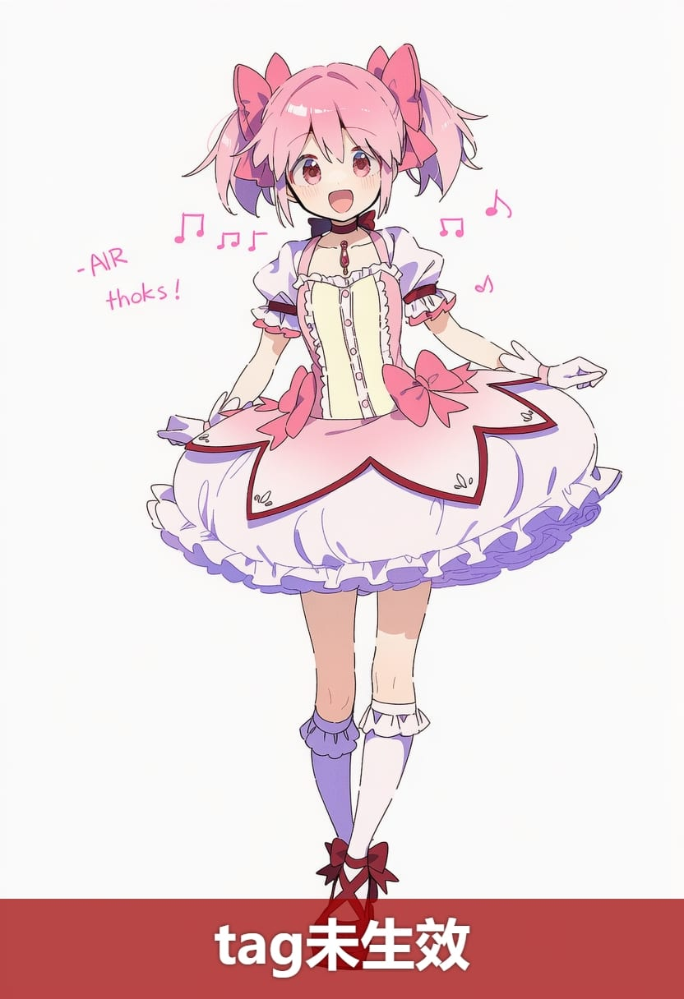

| 字段 | 内容 |
| --- | --- |
| Danbooru Tag | air_quotes |
| 中文名 | 空气引号 |
| 中文含义 | 双手用手指做出引号动作。 |
| 子类 | 双手/组合手势 |
| 模特 | kaname_madoka |
| 序号 | 0001 |

## 2. circle_hands — 圆圈手势

| 字段 | 内容 |
| --- | --- |
| Danbooru Tag | circle_hands |
| 中文名 | 圆圈手势 |
| 中文含义 | 双手围成圆形。 |
| 子类 | 双手/组合手势 |
| 模特 | mash_kyrielight |
| 序号 | 0002 |

## 3. clenched_hands — 双手紧握

| 字段 | 内容 |
| --- | --- |
| Danbooru Tag | clenched_hands |
| 中文名 | 双手紧握 |
| 中文含义 | 双手彼此紧紧握在一起。 |
| 子类 | 双手/组合手势 |
| 模特 | gotoh_hitori |
| 序号 | 0003 |

## 4. cupping_hands — 双手捧起

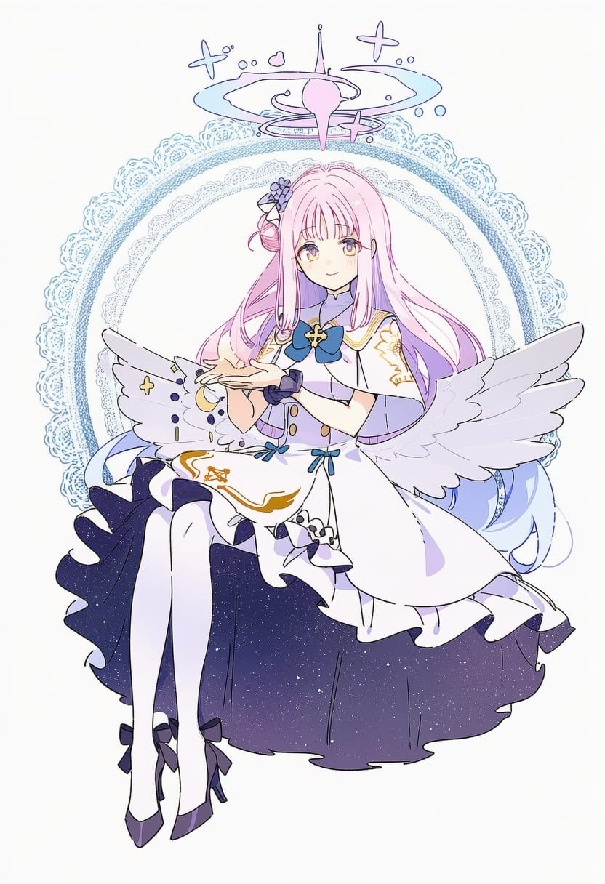

| 字段 | 内容 |
| --- | --- |
| Danbooru Tag | cupping_hands |
| 中文名 | 双手捧起 |
| 中文含义 | 双手并拢形成捧物状。 |
| 子类 | 双手/组合手势 |
| 模特 | mika_(blue_archive) |
| 序号 | 0004 |

## 5. double_finger_gun — 双手手枪

| 字段 | 内容 |
| --- | --- |
| Danbooru Tag | double_finger_gun |
| 中文名 | 双手手枪 |
| 中文含义 | 两只手同时做手枪手势。 |
| 子类 | 双手/组合手势 |
| 模特 | hoshino_(blue_archive) |
| 序号 | 0005 |

## 6. double_finger_heart — 双手指心

| 字段 | 内容 |
| --- | --- |
| Danbooru Tag | double_finger_heart |
| 中文名 | 双手指心 |
| 中文含义 | 两只手分别做韩式指心。 |
| 子类 | 双手/组合手势 |
| 模特 | megurine_luka |
| 序号 | 0006 |

## 7. double_thumbs_down — 双手倒赞

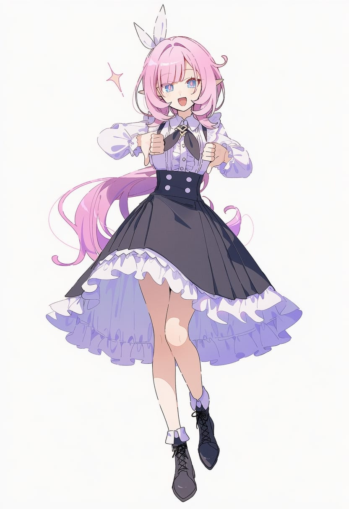

| 字段 | 内容 |
| --- | --- |
| Danbooru Tag | double_thumbs_down |
| 中文名 | 双手倒赞 |
| 中文含义 | 两只手同时竖起向下的大拇指。 |
| 子类 | 双手/组合手势 |
| 模特 | elysia_(honkai_impact) |
| 序号 | 0007 |

## 8. double_thumbs_up — 双手点赞

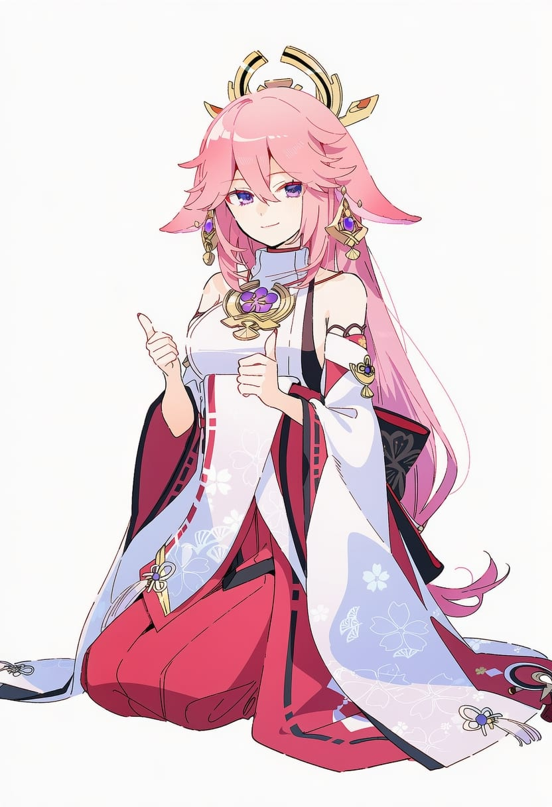

| 字段 | 内容 |
| --- | --- |
| Danbooru Tag | double_thumbs_up |
| 中文名 | 双手点赞 |
| 中文含义 | 两只手同时竖起大拇指。 |
| 子类 | 双手/组合手势 |
| 模特 | yae_miko |
| 序号 | 0008 |

## 9. double_v — 双V手势

| 字段 | 内容 |
| --- | --- |
| Danbooru Tag | double_v |
| 中文名 | 双V手势 |
| 中文含义 | 两只手同时做 V 字手势。 |
| 子类 | 双手/组合手势 |
| 模特 | chihaya_anon |
| 序号 | 0009 |

## 10. heart_hands — 双手爱心

| 字段 | 内容 |
| --- | --- |
| Danbooru Tag | heart_hands |
| 中文名 | 双手爱心 |
| 中文含义 | 用双手共同组成爱心形。 |
| 子类 | 双手/组合手势 |
| 模特 | koharu_(blue_archive) |
| 序号 | 0010 |

## 11. heart_hands_duo — 双人爱心手

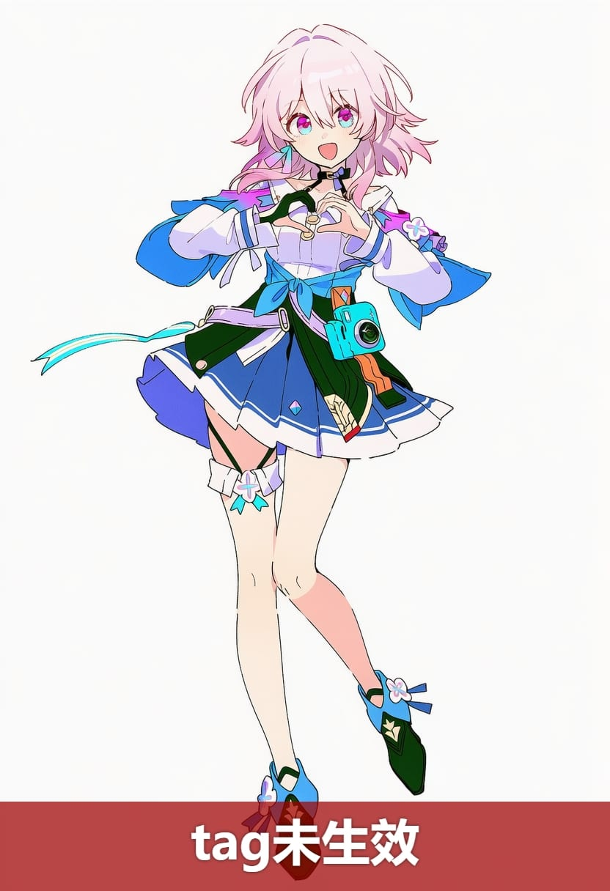

| 字段 | 内容 |
| --- | --- |
| Danbooru Tag | heart_hands_duo |
| 中文名 | 双人爱心手 |
| 中文含义 | 两个人各用一只手共同组成爱心。 |
| 子类 | 双手/组合手势 |
| 模特 | march_7th_(honkai:_star_rail) |
| 序号 | 0011 |

## 12. star_hands — 星形手势

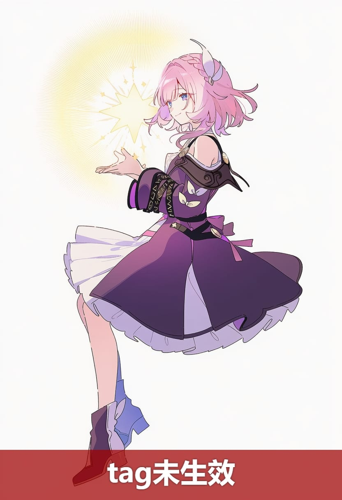

| 字段 | 内容 |
| --- | --- |
| Danbooru Tag | star_hands |
| 中文名 | 星形手势 |
| 中文含义 | 用手指组合出星形图案。 |
| 子类 | 双手/组合手势 |
| 模特 | cyrene_(honkai:_star_rail) |
| 序号 | 0012 |

## 13. index_finger_raised — 竖食指

| 字段 | 内容 |
| --- | --- |
| Danbooru Tag | index_finger_raised |
| 中文名 | 竖食指 |
| 中文含义 | 单独竖起食指。 |
| 子类 | 单指/指向 |
| 模特 | hanako_(blue_archive) |
| 序号 | 0013 |

## 14. middle_finger — 竖中指

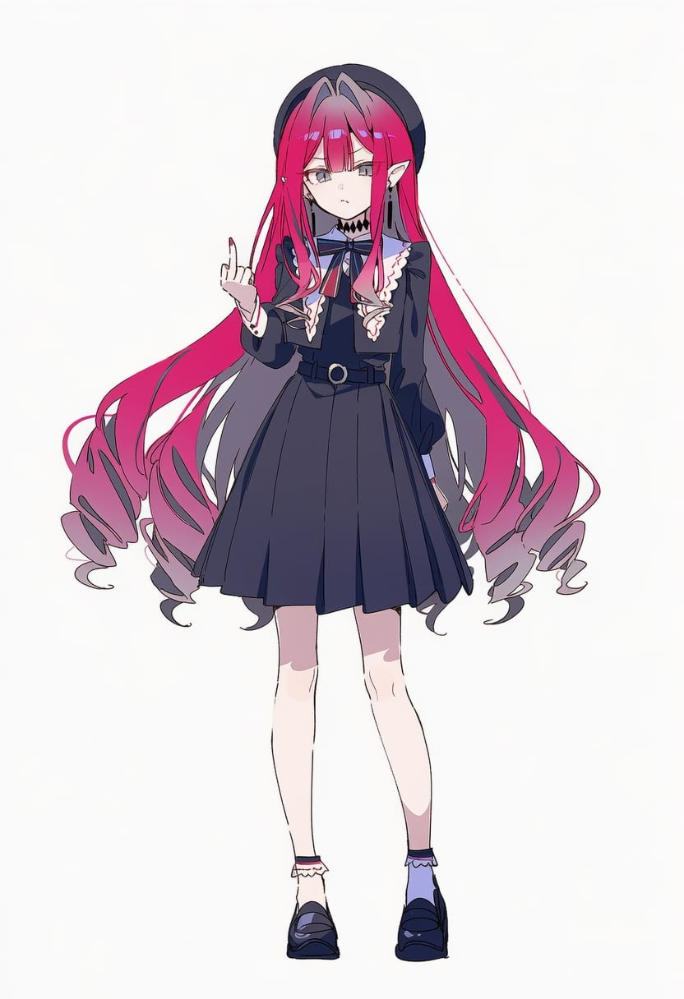

| 字段 | 内容 |
| --- | --- |
| Danbooru Tag | middle_finger |
| 中文名 | 竖中指 |
| 中文含义 | 单独竖起中指。 |
| 子类 | 单指/指向 |
| 模特 | baobhan_sith_(fate) |
| 序号 | 0014 |

## 15. pinky_out — 翘小指

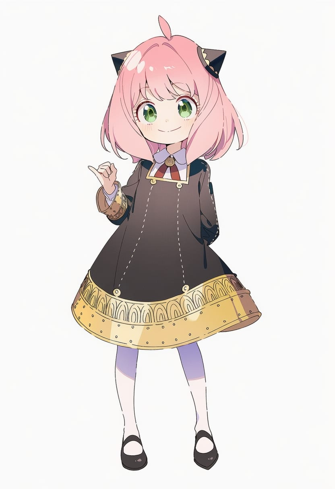

| 字段 | 内容 |
| --- | --- |
| Danbooru Tag | pinky_out |
| 中文名 | 翘小指 |
| 中文含义 | 小拇指单独向外伸出。 |
| 子类 | 单指/指向 |
| 模特 | anya_(spy_x_family) |
| 序号 | 0015 |

## 16. thumbs_up — 点赞

| 字段 | 内容 |
| --- | --- |
| Danbooru Tag | thumbs_up |
| 中文名 | 点赞 |
| 中文含义 | 竖起大拇指表示赞同或很好。 |
| 子类 | 单指/指向 |
| 模特 | akashi_(kancolle) |
| 序号 | 0016 |

## 17. thumbs_down — 倒赞

| 字段 | 内容 |
| --- | --- |
| Danbooru Tag | thumbs_down |
| 中文名 | 倒赞 |
| 中文含义 | 大拇指朝下表示否定或不满。 |
| 子类 | 单指/指向 |
| 模特 | bremerton_(azur_lane) |
| 序号 | 0017 |

## 18. pointing — 指向

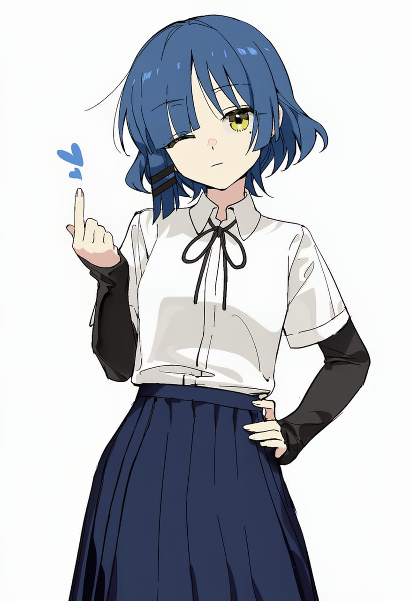

| 字段 | 内容 |
| --- | --- |
| Danbooru Tag | pointing |
| 中文名 | 指向 |
| 中文含义 | 用手指指向某个方向或对象。 |
| 子类 | 单指/指向 |
| 模特 | Yamada Ryo |
| 序号 | 0018 |

## 19. pointing_at_self — 指自己

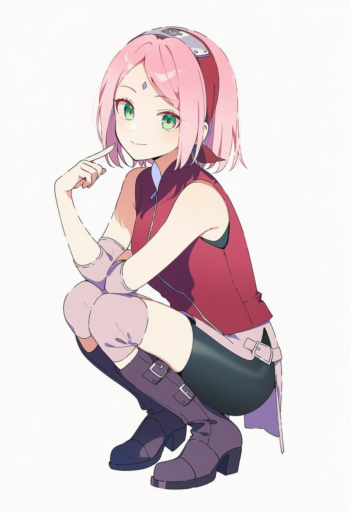

| 字段 | 内容 |
| --- | --- |
| Danbooru Tag | pointing_at_self |
| 中文名 | 指自己 |
| 中文含义 | 用手指指向自己。 |
| 子类 | 单指/指向 |
| 模特 | haruno_sakura |
| 序号 | 0020 |

## 20. pointing_at_viewer — 指向观众

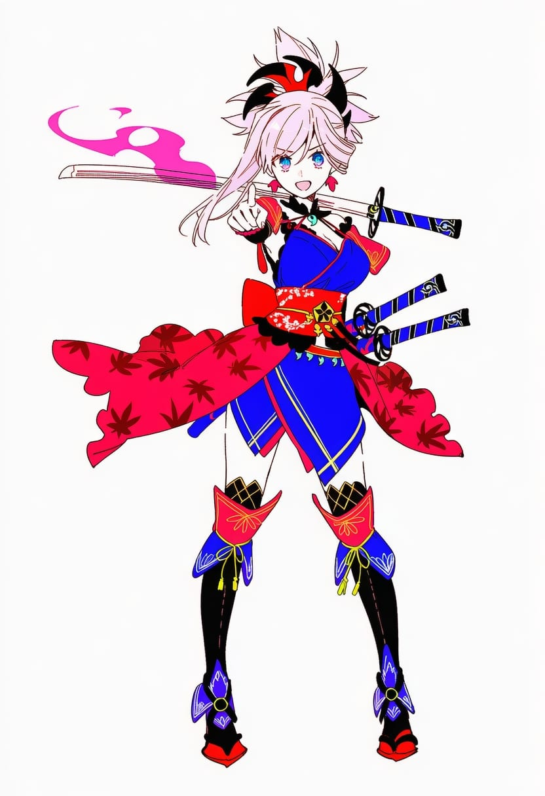

| 字段 | 内容 |
| --- | --- |
| Danbooru Tag | pointing_at_viewer |
| 中文名 | 指向观众 |
| 中文含义 | 手指直接指向画面观看者。 |
| 子类 | 单指/指向 |
| 模特 | miyamoto_musashi_(fate) |
| 序号 | 0021 |

## 21. pointing_down — 向下指

| 字段 | 内容 |
| --- | --- |
| Danbooru Tag | pointing_down |
| 中文名 | 向下指 |
| 中文含义 | 手指朝下方指。 |
| 子类 | 单指/指向 |
| 模特 | nakano_nino |
| 序号 | 0022 |

## 22. pointing_forward — 向前指

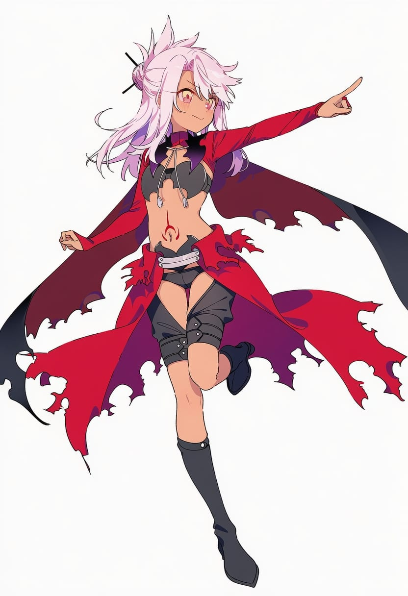

| 字段 | 内容 |
| --- | --- |
| Danbooru Tag | pointing_forward |
| 中文名 | 向前指 |
| 中文含义 | 手指朝角色前方指。 |
| 子类 | 单指/指向 |
| 模特 | chloe_von_einzbern |
| 序号 | 0023 |

## 23. pointing_up — 向上指

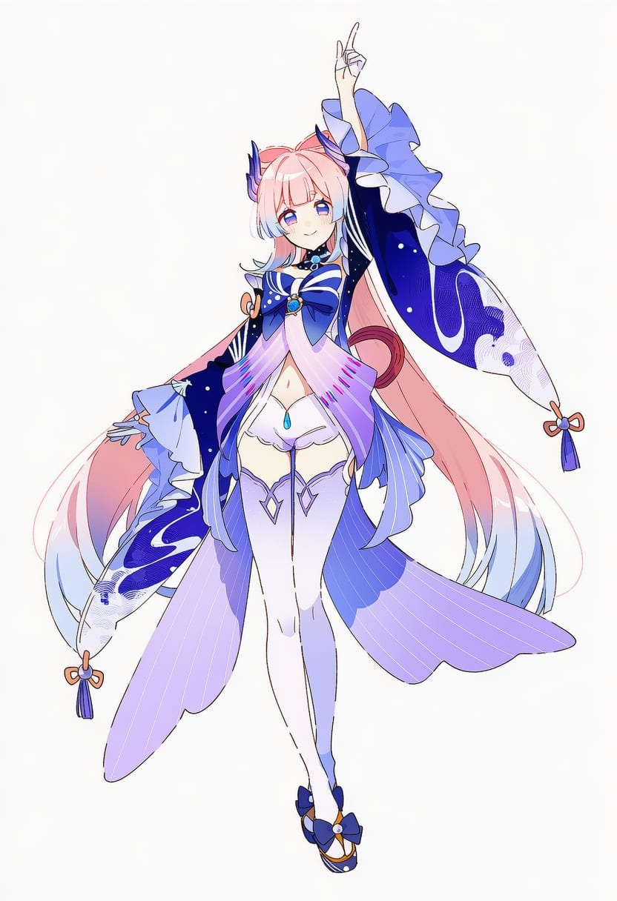

| 字段 | 内容 |
| --- | --- |
| Danbooru Tag | pointing_up |
| 中文名 | 向上指 |
| 中文含义 | 手指朝上方指。 |
| 子类 | 单指/指向 |
| 模特 | sangonomiya_kokomi |
| 序号 | 0024 |

## 24. crossed_fingers — 交叉手指

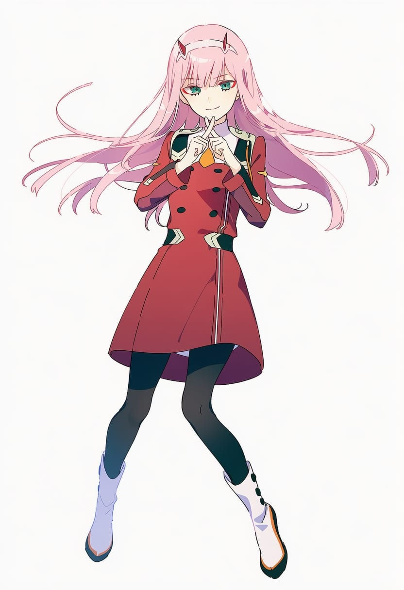

| 字段 | 内容 |
| --- | --- |
| Danbooru Tag | crossed_fingers |
| 中文名 | 交叉手指 |
| 中文含义 | 两根手指交叉，常表示祈愿或好运。 |
| 子类 | 双指/三指手势 |
| 模特 | zero_two_(darling_in_the_franxx) |
| 序号 | 0025 |

## 25. finger_gun — 手枪手势

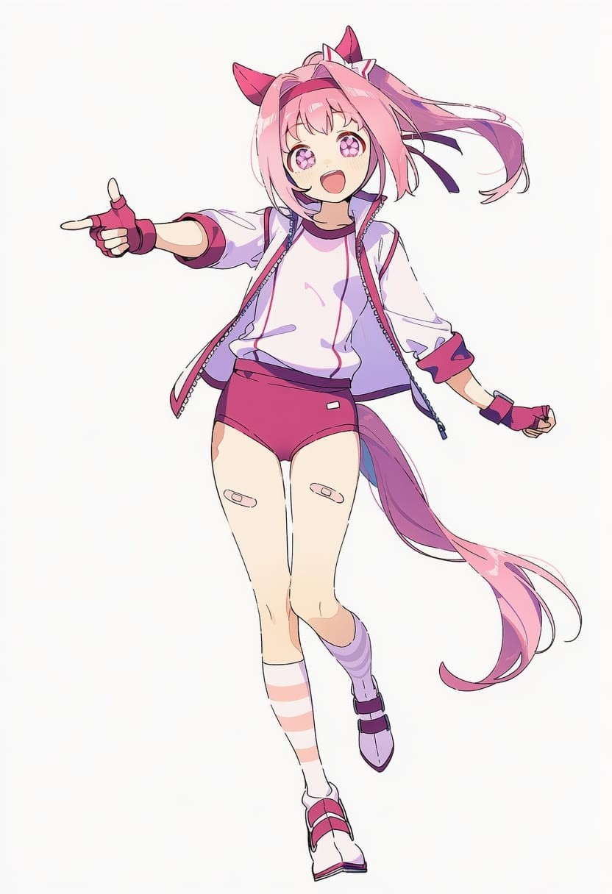

| 字段 | 内容 |
| --- | --- |
| Danbooru Tag | finger_gun |
| 中文名 | 手枪手势 |
| 中文含义 | 用手指模仿手枪形状。 |
| 子类 | 双指/三指手势 |
| 模特 | haru_urara_(umamusume) |
| 序号 | 0026 |

## 26. finger_heart — 指心

| 字段 | 内容 |
| --- | --- |
| Danbooru Tag | finger_heart |
| 中文名 | 指心 |
| 中文含义 | 拇指和食指交叉形成小爱心。 |
| 子类 | 双指/三指手势 |
| 模特 | nicole_demara |
| 序号 | 0027 |

## 27. shaka_sign — Shaka手势

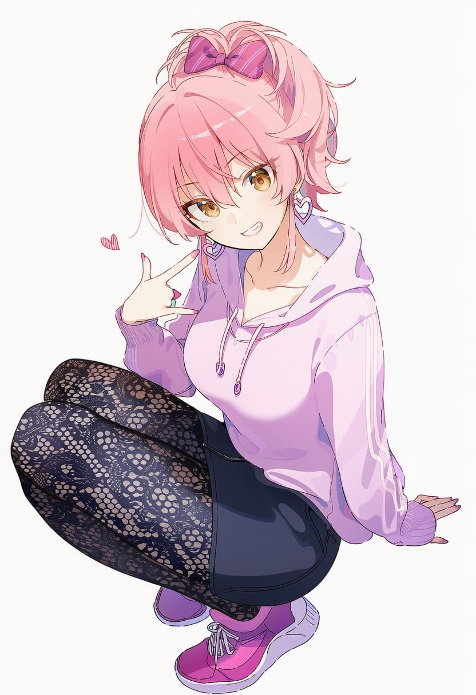

| 字段 | 内容 |
| --- | --- |
| Danbooru Tag | shaka_sign |
| 中文名 | Shaka手势 |
| 中文含义 | 伸出拇指和小指的手势。 |
| 子类 | 双指/三指手势 |
| 模特 | jougasaki_mika |
| 序号 | 0028 |

## 28. two-finger_salute — 双指敬礼

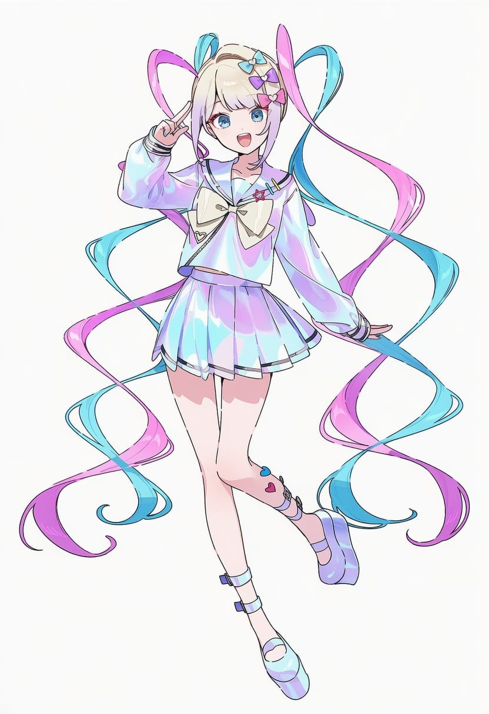

| 字段 | 内容 |
| --- | --- |
| Danbooru Tag | two-finger_salute |
| 中文名 | 双指敬礼 |
| 中文含义 | 用两根手指做敬礼动作。 |
| 子类 | 双指/三指手势 |
| 模特 | chouzetsusaikawa_tenshi-chan |
| 序号 | 0029 |

## 29. v — V字手势

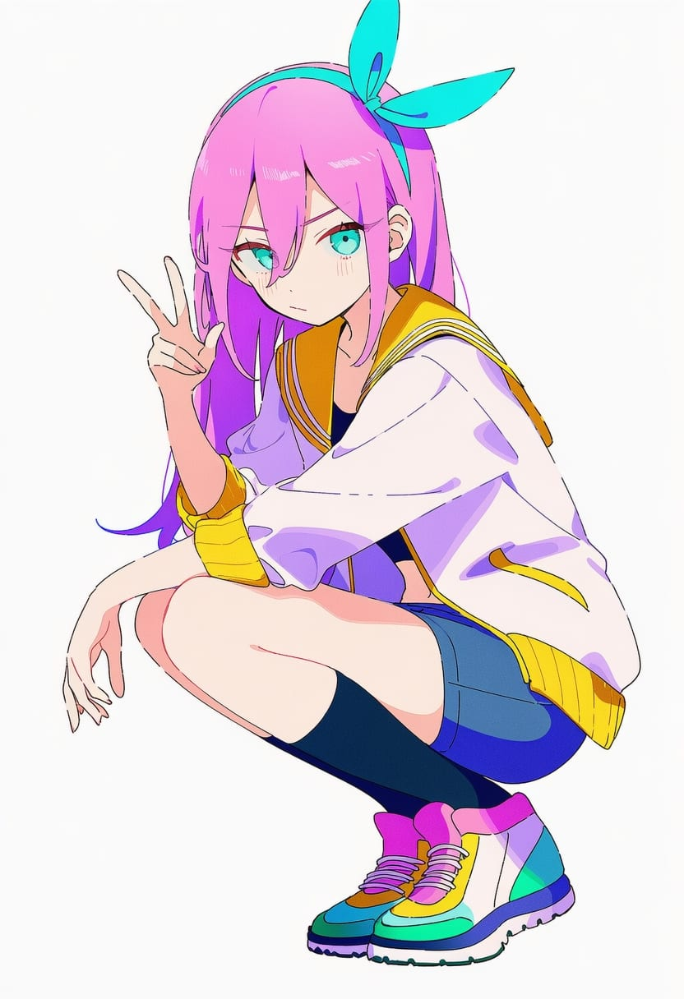

| 字段 | 内容 |
| --- | --- |
| Danbooru Tag | v |
| 中文名 | V字手势 |
| 中文含义 | 食指和中指张开形成 V 字。 |
| 子类 | 双指/三指手势 |
| 模特 | aubrey_(faraway)_(omori) |
| 序号 | 0030 |

## 30. gyaru_v — 辣妹V手势

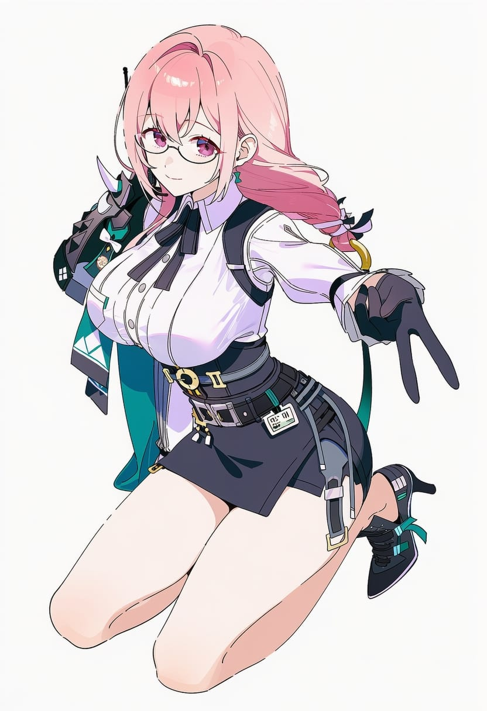

| 字段 | 内容 |
| --- | --- |
| Danbooru Tag | gyaru_v |
| 中文名 | 辣妹V手势 |
| 中文含义 | 带明显辣妹风格的 V 字手势。 |
| 子类 | 双指/三指手势 |
| 模特 | tsukishiro_yanagi |
| 序号 | 0031 |

## 31. inward_v — 反向V手势

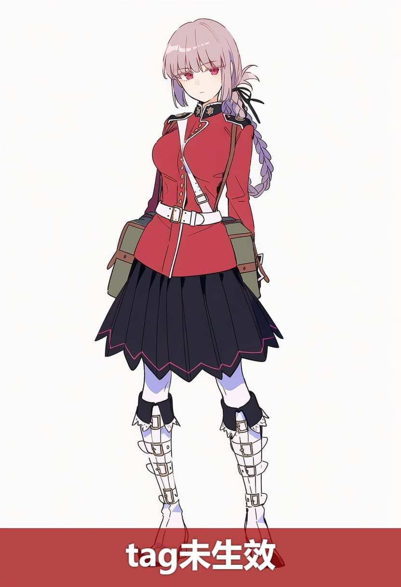

| 字段 | 内容 |
| --- | --- |
| Danbooru Tag | inward_v |
| 中文名 | 反向V手势 |
| 中文含义 | 手背朝外或 V 字朝向脸部的手势。 |
| 子类 | 双指/三指手势 |
| 模特 | florence_nightingale_(fate) |
| 序号 | 0032 |

## 32. v_over_eye — V遮眼

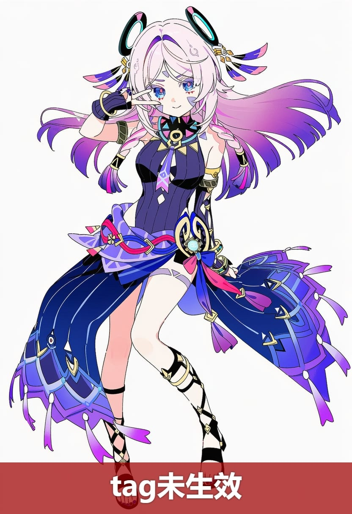

| 字段 | 内容 |
| --- | --- |
| Danbooru Tag | v_over_eye |
| 中文名 | V遮眼 |
| 中文含义 | 用 V 字手势框住或遮住一只眼睛。 |
| 子类 | 双指/三指手势 |
| 模特 | citlali_(genshin_impact) |
| 序号 | 0033 |

## 33. v_over_mouth — V遮嘴

| 字段 | 内容 |
| --- | --- |
| Danbooru Tag | v_over_mouth |
| 中文名 | V遮嘴 |
| 中文含义 | 用 V 字手势放在嘴边或嘴前。 |
| 子类 | 双指/三指手势 |
| 模特 | uehara_ayumu |
| 序号 | 0034 |

## 34. hand_of_benediction — 祝福手势

| 字段 | 内容 |
| --- | --- |
| Danbooru Tag | hand_of_benediction |
| 中文名 | 祝福手势 |
| 中文含义 | 类似宗教祝福姿态的三指手势。 |
| 子类 | 双指/三指手势 |
| 模特 | natsu_(blue_archive) |
| 序号 | 0035 |

## 35. money_gesture — 搓钱手势

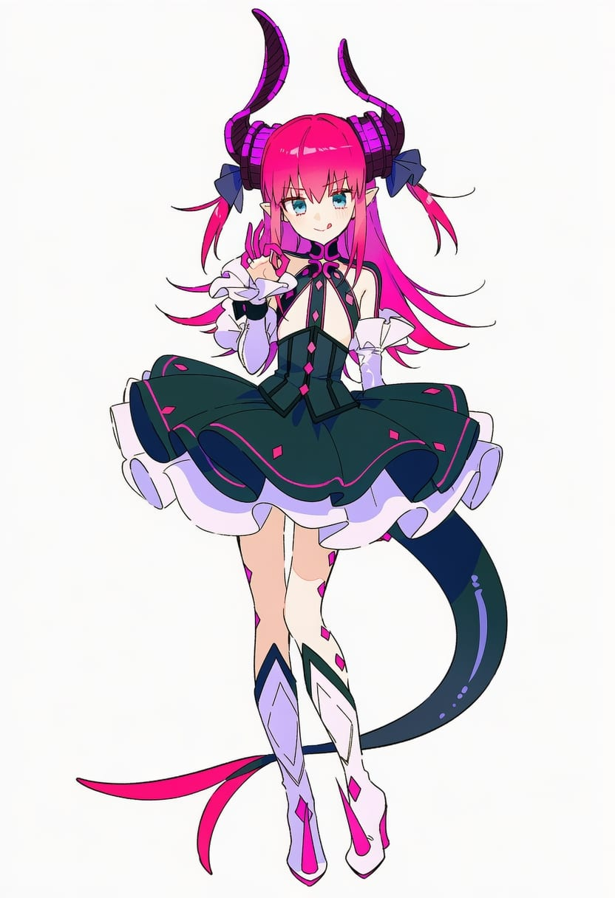

| 字段 | 内容 |
| --- | --- |
| Danbooru Tag | money_gesture |
| 中文名 | 搓钱手势 |
| 中文含义 | 手指做出表示钱或索要钱的动作。 |
| 子类 | 双指/三指手势 |
| 模特 | elizabeth_bathory_(fate) |
| 序号 | 0036 |

## 36. ok_sign — OK手势

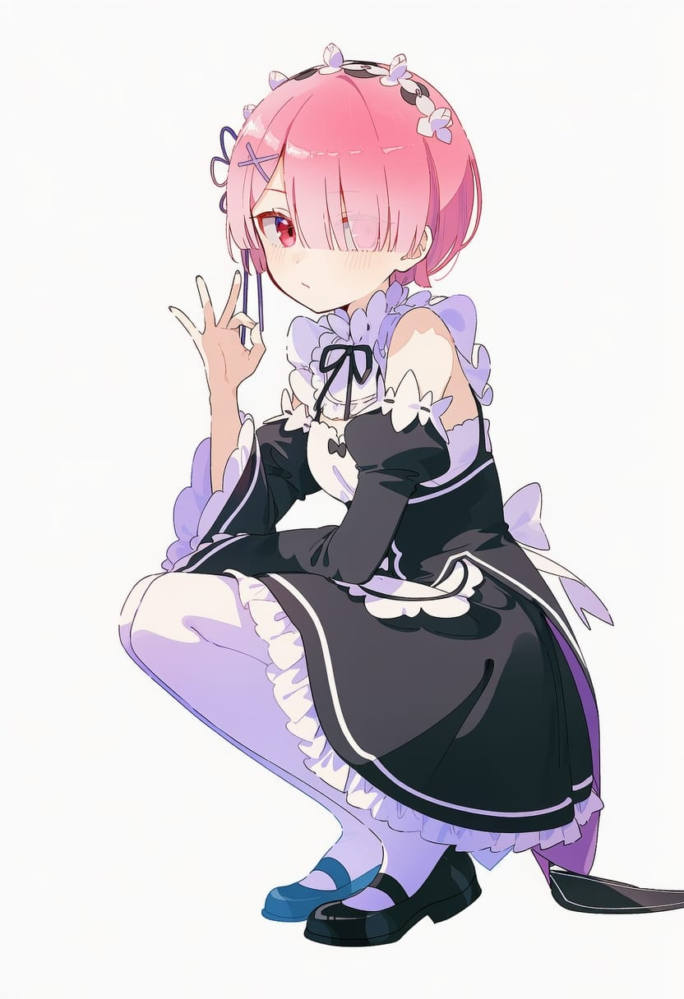

| 字段 | 内容 |
| --- | --- |
| Danbooru Tag | ok_sign |
| 中文名 | OK手势 |
| 中文含义 | 拇指和食指围成圆圈的 OK 手势。 |
| 子类 | 双指/三指手势 |
| 模特 | ram_(re:zero) |
| 序号 | 0037 |

## 37. pinching_gesture — 捏取手势

| 字段 | 内容 |
| --- | --- |
| Danbooru Tag | pinching_gesture |
| 中文名 | 捏取手势 |
| 中文含义 | 拇指与手指靠近形成捏取动作。 |
| 子类 | 双指/三指手势 |
| 模特 | i-58_(kancolle) |
| 序号 | 0038 |

## 38. w — W手势

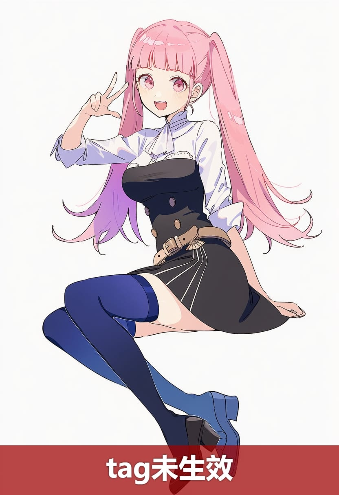

| 字段 | 内容 |
| --- | --- |
| Danbooru Tag | w |
| 中文名 | W手势 |
| 中文含义 | 手指排列形成 W 形。 |
| 子类 | 双指/三指手势 |
| 模特 | hilda_valentine_goneril |
| 序号 | 0039 |

## 39. claw_pose — 爪子手

| 字段 | 内容 |
| --- | --- |
| Danbooru Tag | claw_pose |
| 中文名 | 爪子手 |
| 中文含义 | 张开并弯曲手指，像爪子一样。 |
| 子类 | 张手/掌部手势 |
| 模特 | kanroji_mitsuri |
| 序号 | 0040 |

## 40. facepalm — 扶额

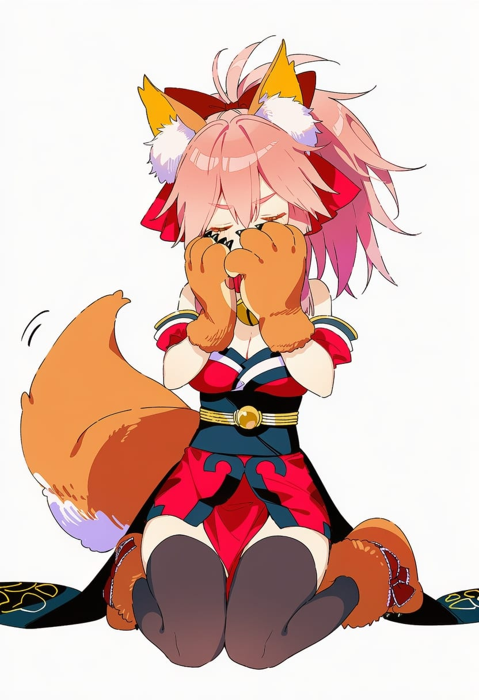

| 字段 | 内容 |
| --- | --- |
| Danbooru Tag | facepalm |
| 中文名 | 扶额 |
| 中文含义 | 用手掌或手指捂住自己的脸或额头。 |
| 子类 | 张手/掌部手势 |
| 模特 | tamamo_cat_(fate) |
| 序号 | 0041 |

## 41. open_hand — 张开手掌

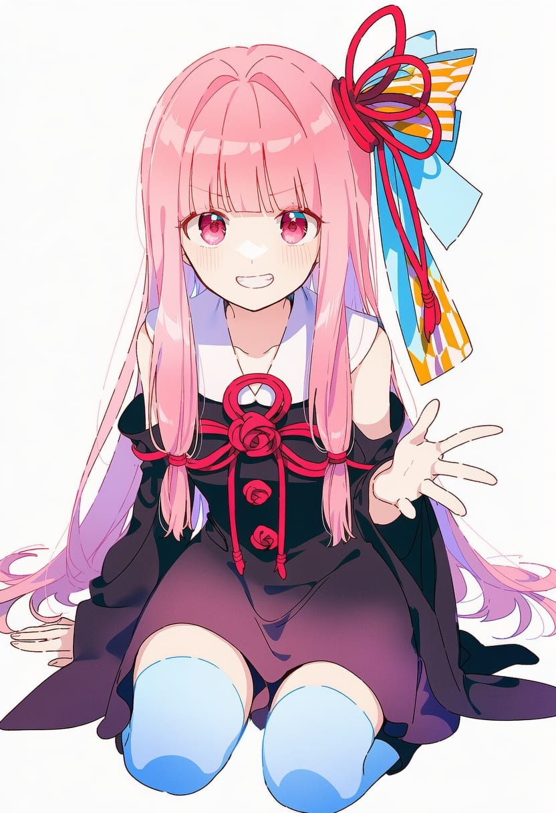

| 字段 | 内容 |
| --- | --- |
| Danbooru Tag | open_hand |
| 中文名 | 张开手掌 |
| 中文含义 | 整只手完全张开。 |
| 子类 | 张手/掌部手势 |
| 模特 | kotonoha_akane |
| 序号 | 0042 |

## 42. reaching — 伸手

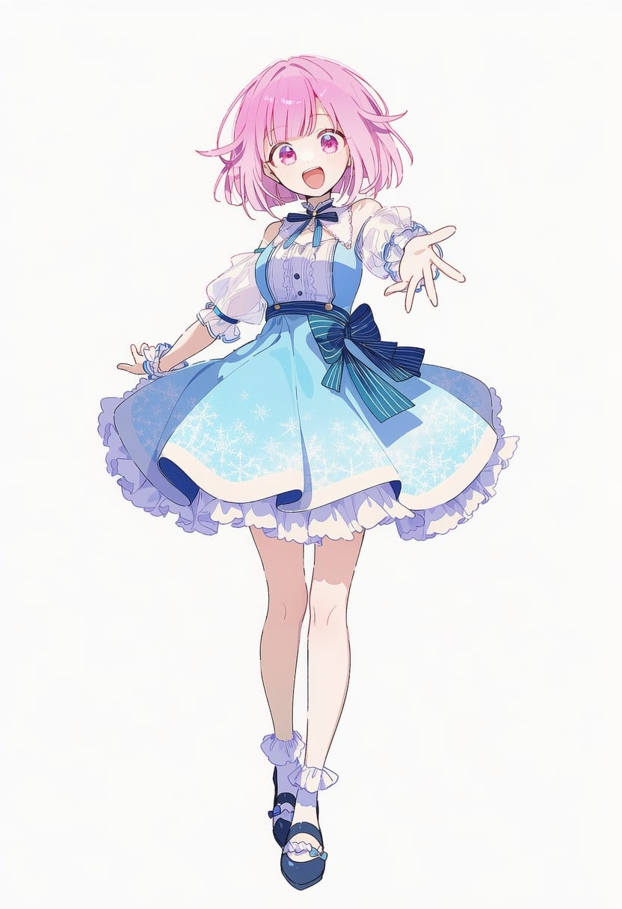

| 字段 | 内容 |
| --- | --- |
| Danbooru Tag | reaching |
| 中文名 | 伸手 |
| 中文含义 | 张手向某个方向或对象伸过去。 |
| 子类 | 张手/掌部手势 |
| 模特 | ootori_emu |
| 序号 | 0043 |

## 43. salute — 敬礼

| 字段 | 内容 |
| --- | --- |
| Danbooru Tag | salute |
| 中文名 | 敬礼 |
| 中文含义 | 手抬到额头附近做敬礼动作。 |
| 子类 | 张手/掌部手势 |
| 模特 | firefly_(honkai:_star_rail) |
| 序号 | 0044 |

## 44. spread_fingers — 五指张开

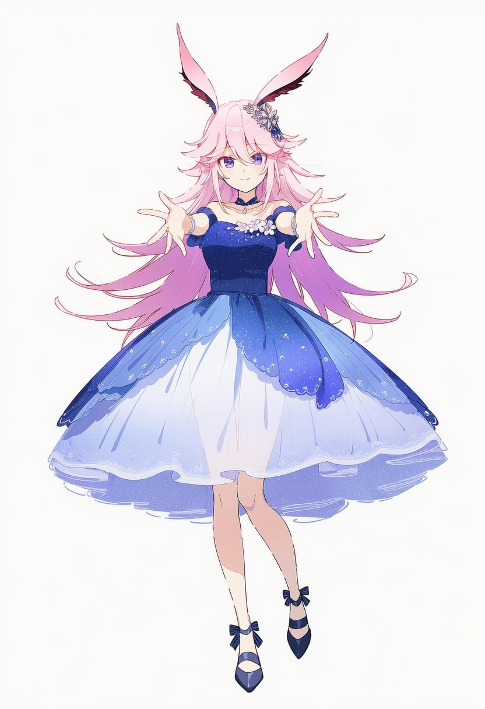

| 字段 | 内容 |
| --- | --- |
| Danbooru Tag | spread_fingers |
| 中文名 | 五指张开 |
| 中文含义 | 手掌张开并明显分开手指。 |
| 子类 | 张手/掌部手势 |
| 模特 | yae_sakura |
| 序号 | 0045 |

## 45. stop_(gesture) — 停止手势

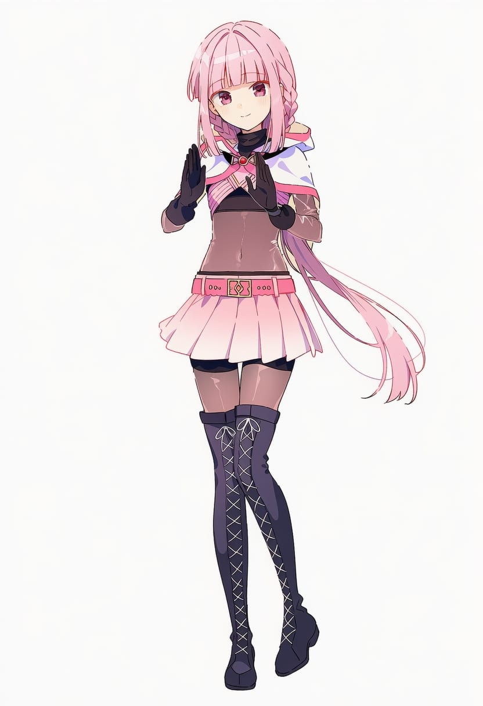

| 字段 | 内容 |
| --- | --- |
| Danbooru Tag | stop_(gesture) |
| 中文名 | 停止手势 |
| 中文含义 | 手掌朝外做“停”的动作。 |
| 子类 | 张手/掌部手势 |
| 模特 | tamaki_iroha |
| 序号 | 0046 |

## 46. straight-arm_salute — 直臂礼

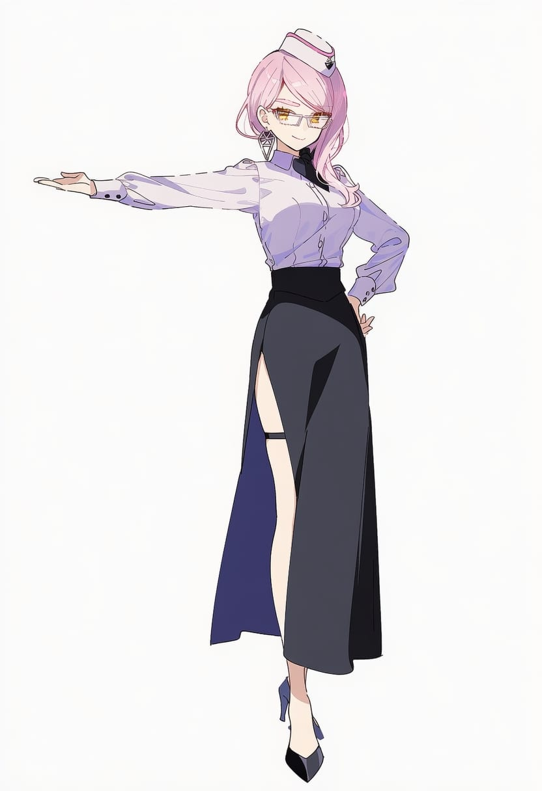

| 字段 | 内容 |
| --- | --- |
| Danbooru Tag | straight-arm_salute |
| 中文名 | 直臂礼 |
| 中文含义 | 手臂伸直向前上方做礼式动作。 |
| 子类 | 张手/掌部手势 |
| 模特 | koyanskaya_(fate) |
| 序号 | 0047 |

## 47. vulcan_salute — 瓦肯举手礼

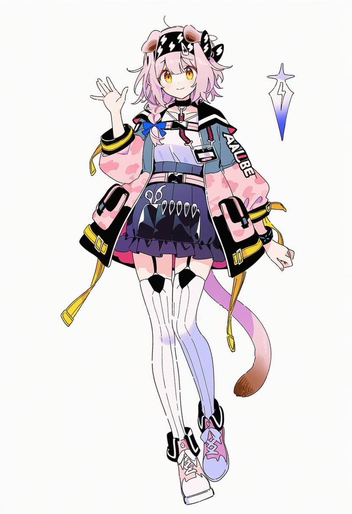

| 字段 | 内容 |
| --- | --- |
| Danbooru Tag | vulcan_salute |
| 中文名 | 瓦肯举手礼 |
| 中文含义 | 中间两指分开形成经典瓦肯手势。 |
| 子类 | 张手/掌部手势 |
| 模特 | goldenglow_(arknights) |
| 序号 | 0048 |

## 48. waving — 挥手

| 字段 | 内容 |
| --- | --- |
| Danbooru Tag | waving |
| 中文名 | 挥手 |
| 中文含义 | 张手挥动，常用于打招呼或告别。 |
| 子类 | 张手/掌部手势 |
| 模特 | louise_francoise_le_blanc_de_la_valliere |
| 序号 | 0049 |

## 49. shushing — 噤声手势

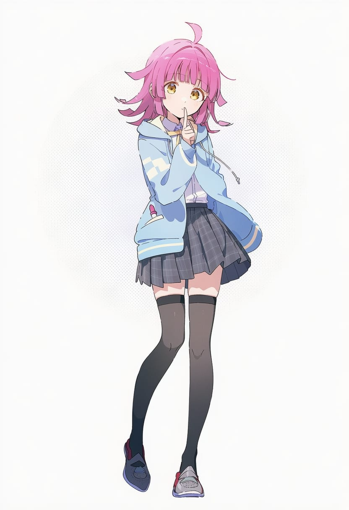

| 字段 | 内容 |
| --- | --- |
| Danbooru Tag | shushing |
| 中文名 | 噤声手势 |
| 中文含义 | 食指放在嘴唇前示意安静。 |
| 子类 | 张手/掌部手势 |
| 模特 | tennoji_rina |
| 序号 | 0050 |

## 50. clenched_hand — 握拳

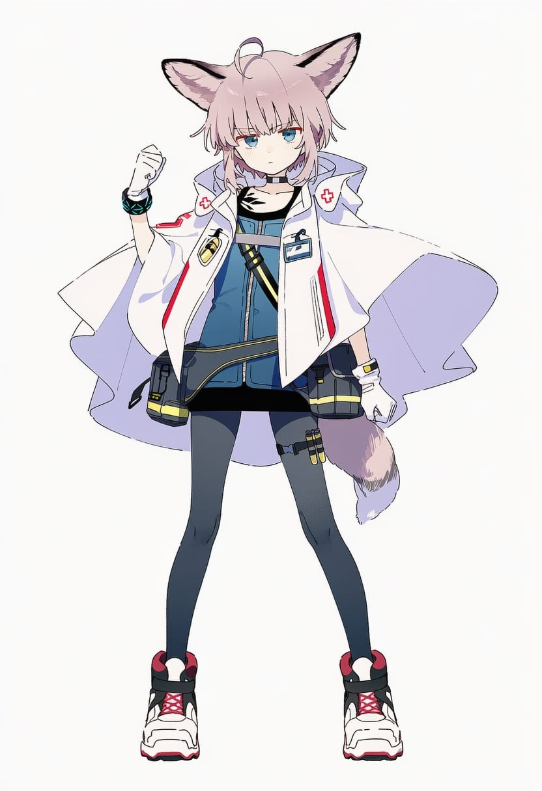

| 字段 | 内容 |
| --- | --- |
| Danbooru Tag | clenched_hand |
| 中文名 | 握拳 |
| 中文含义 | 手掌完全握成拳头。 |
| 子类 | 握拳/弯指手势 |
| 模特 | sussurro_(arknights) |
| 序号 | 0051 |

## 51. curled_fingers — 蜷曲手指

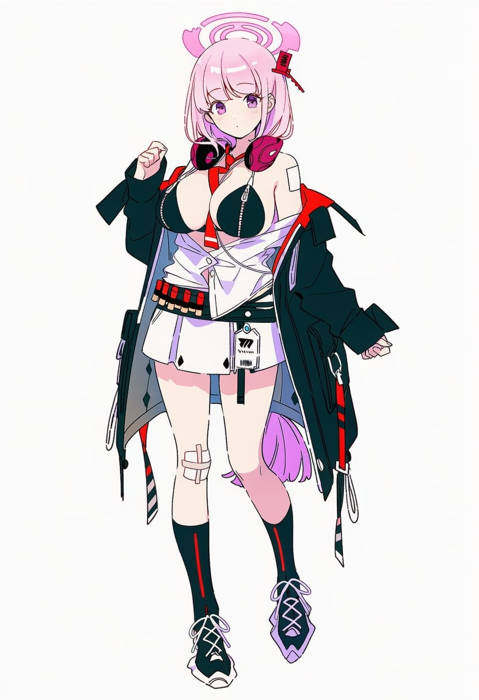

| 字段 | 内容 |
| --- | --- |
| Danbooru Tag | curled_fingers |
| 中文名 | 蜷曲手指 |
| 中文含义 | 手指明显弯曲收拢。 |
| 子类 | 握拳/弯指手势 |
| 模特 | eimi_(blue_archive) |
| 序号 | 0052 |

## 52. dojikko_pose — 冒失娘手势

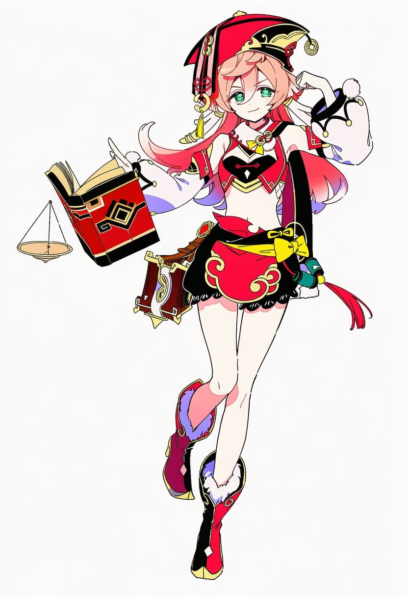

| 字段 | 内容 |
| --- | --- |
| Danbooru Tag | dojikko_pose |
| 中文名 | 冒失娘手势 |
| 中文含义 | 握拳靠近头部的经典冒失娘姿势。 |
| 子类 | 握拳/弯指手势 |
| 模特 | yanfei_(genshin_impact) |
| 序号 | 0053 |

## 53. fig_sign — 拇指夹拳手势

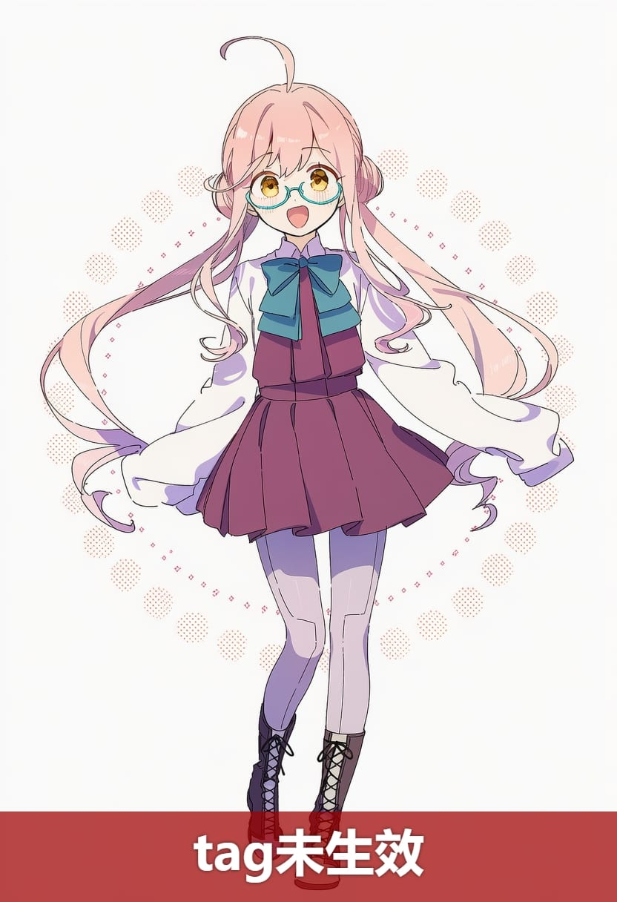

| 字段 | 内容 |
| --- | --- |
| Danbooru Tag | fig_sign |
| 中文名 | 拇指夹拳手势 |
| 中文含义 | 拇指夹在手指之间的拳形手势。 |
| 子类 | 握拳/弯指手势 |
| 模特 | makigumo_(kancolle) |
| 序号 | 0054 |

## 54. fist_pump — 振臂握拳

| 字段 | 内容 |
| --- | --- |
| Danbooru Tag | fist_pump |
| 中文名 | 振臂握拳 |
| 中文含义 | 握拳向上或向前挥动表示兴奋。 |
| 子类 | 握拳/弯指手势 |
| 模特 | nakano_ichika |
| 序号 | 0055 |

## 55. paw_pose — 猫爪手

| 字段 | 内容 |
| --- | --- |
| Danbooru Tag | paw_pose |
| 中文名 | 猫爪手 |
| 中文含义 | 双手或单手弯曲成可爱的动物爪姿。 |
| 子类 | 握拳/弯指手势 |
| 模特 | aida_mana |
| 序号 | 0056 |

## 56. power_fist — 力量拳

| 字段 | 内容 |
| --- | --- |
| Danbooru Tag | power_fist |
| 中文名 | 力量拳 |
| 中文含义 | 高举紧握的拳头，常表现团结或力量。 |
| 子类 | 握拳/弯指手势 |
| 模特 | fujiwara_chika |
| 序号 | 0057 |

## 57. raised_fist — 举拳

| 字段 | 内容 |
| --- | --- |
| Danbooru Tag | raised_fist |
| 中文名 | 举拳 |
| 中文含义 | 将握紧的拳头举起。 |
| 子类 | 握拳/弯指手势 |
| 模特 | koyuki_(blue_archive) |
| 序号 | 0058 |

## 58. beckoning — 招手示意过来

| 字段 | 内容 |
| --- | --- |
| Danbooru Tag | beckoning |
| 中文名 | 招手示意过来 |
| 中文含义 | 用手指或手掌做“过来”的招呼动作。 |
| 子类 | 握拳/弯指手势 |
| 模特 | natsuki_(doki_doki_literature_club) |
| 序号 | 0059 |

## 59. bowing — 鞠躬

| 字段 | 内容 |
| --- | --- |
| Danbooru Tag | bowing |
| 中文名 | 鞠躬 |
| 中文含义 | 上身前倾表示礼貌、感谢或道歉。 |
| 子类 | 身体礼仪/其他手势 |
| 模特 | takara_miyuki |
| 序号 | 0060 |

## 60. curtsey — 屈膝礼

| 字段 | 内容 |
| --- | --- |
| Danbooru Tag | curtsey |
| 中文名 | 屈膝礼 |
| 中文含义 | 女性式屈膝行礼动作。 |
| 子类 | 身体礼仪/其他手势 |
| 模特 | yuzuriha_inori |
| 序号 | 0061 |

## 61. shrugging — 耸肩

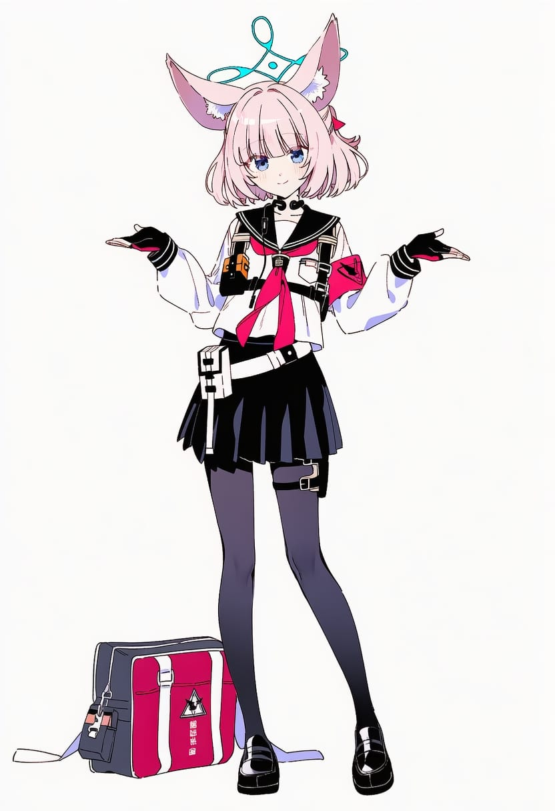

| 字段 | 内容 |
| --- | --- |
| Danbooru Tag | shrugging |
| 中文名 | 耸肩 |
| 中文含义 | 抬起肩膀，常配合摊手表示不知道或无奈。 |
| 子类 | 身体礼仪/其他手势 |
| 模特 | niko_(blue_archive) |
| 序号 | 0062 |

## 62. victory_pose — 胜利姿势

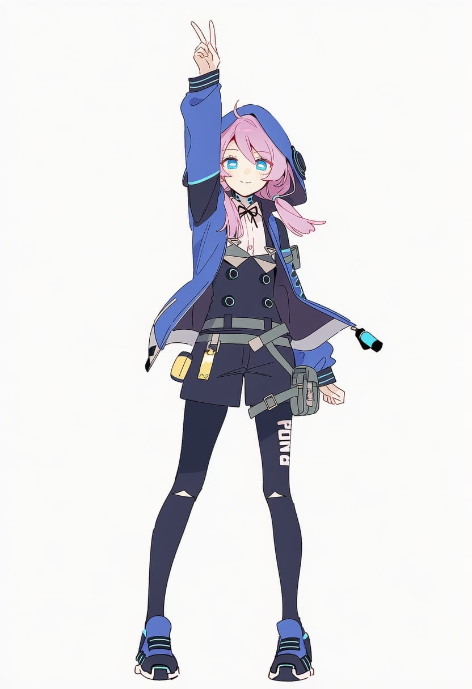

| 字段 | 内容 |
| --- | --- |
| Danbooru Tag | victory_pose |
| 中文名 | 胜利姿势 |
| 中文含义 | 表现胜利、成功或庆祝的姿势。 |
| 子类 | 身体礼仪/其他手势 |
| 模特 | blue_poison_(arknights) |
| 序号 | 0063 |

## 63. no_(gesture) — 否定手势

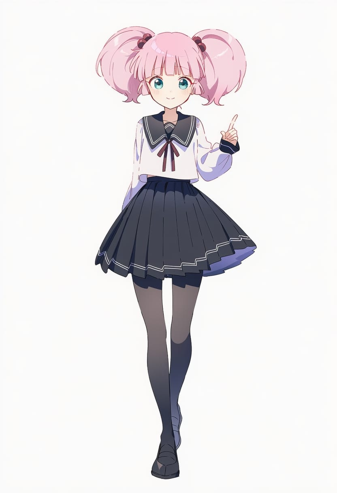

| 字段 | 内容 |
| --- | --- |
| Danbooru Tag | no_(gesture) |
| 中文名 | 否定手势 |
| 中文含义 | 用动作明确表示“不”或拒绝。 |
| 子类 | 身体礼仪/其他手势 |
| 模特 | yoshikawa_chinatsu |
| 序号 | 0064 |

## 64. hat_tip — 轻触帽檐致意

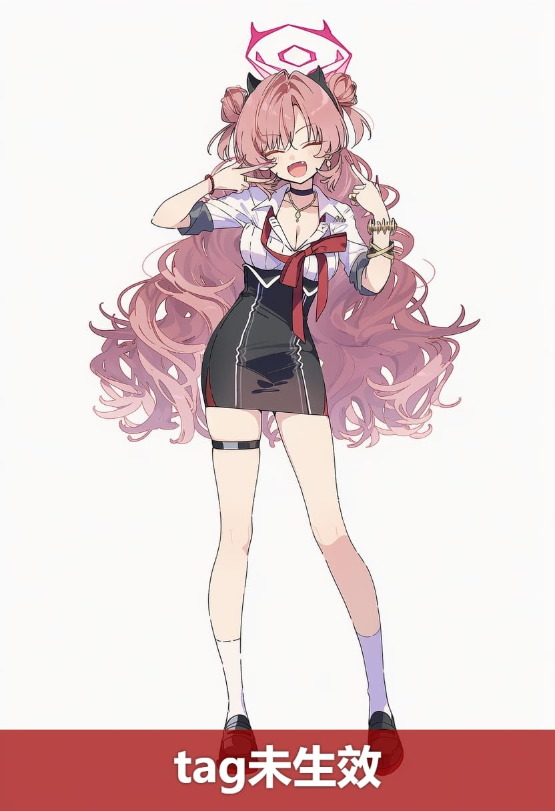

| 字段 | 内容 |
| --- | --- |
| Danbooru Tag | hat_tip |
| 中文名 | 轻触帽檐致意 |
| 中文含义 | 用手碰帽檐做简短致意。 |
| 子类 | 身体礼仪/其他手势 |
| 模特 | kirara_(blue_archive) |
| 序号 | 0065 |

## 65. stroking_own_chin — 摸下巴

| 字段 | 内容 |
| --- | --- |
| Danbooru Tag | stroking_own_chin |
| 中文名 | 摸下巴 |
| 中文含义 | 用手抚摸自己的下巴，常表示思考。 |
| 子类 | 身体礼仪/其他手势 |
| 模特 | serina_(blue_archive) |
| 序号 | 0066 |

## 66. carry_me — 求抱手势

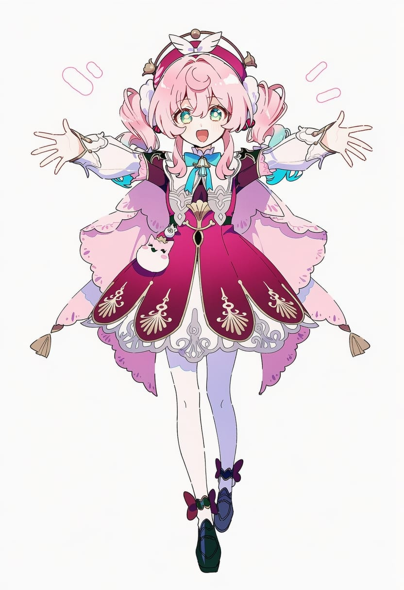

| 字段 | 内容 |
| --- | --- |
| Danbooru Tag | carry_me |
| 中文名 | 求抱手势 |
| 中文含义 | 张开手臂或伸手示意让别人抱起自己。 |
| 子类 | 身体礼仪/其他手势 |
| 模特 | hyacine_(honkai:_star_rail) |
| 序号 | 0068 |

## 67. fidgeting — 手部小动作

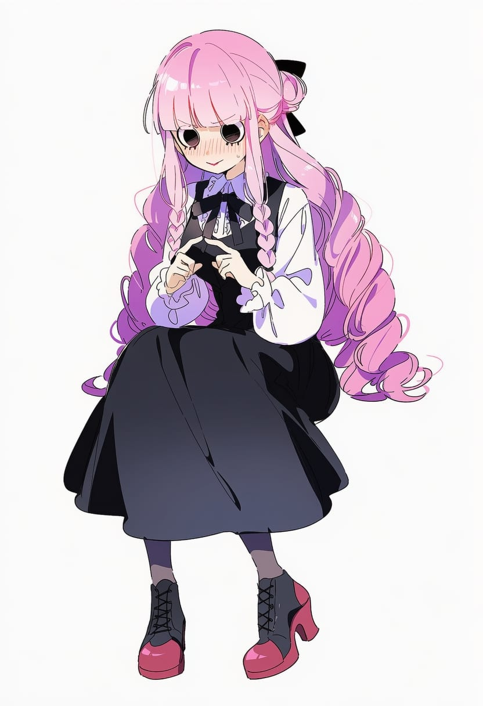

| 字段 | 内容 |
| --- | --- |
| Danbooru Tag | fidgeting |
| 中文名 | 手部小动作 |
| 中文含义 | 因紧张或不安反复摆弄手指或双手。 |
| 子类 | 身体礼仪/其他手势 |
| 模特 | perona |
| 序号 | 0069 |

---
