## 1. side-by-side — 并肩

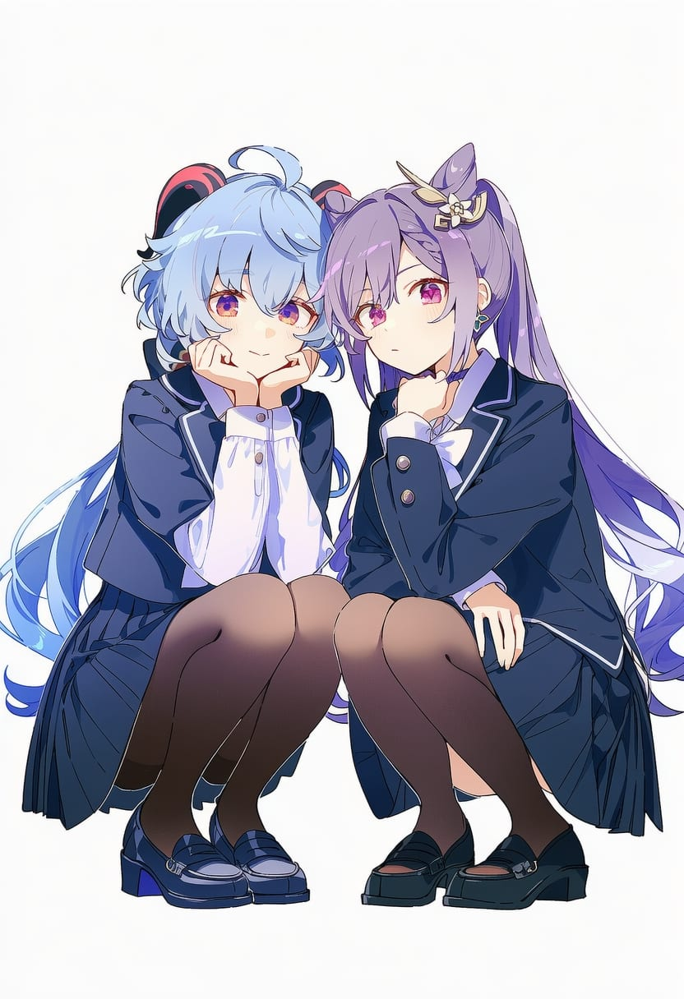

| 字段 | 内容 |
| --- | --- |
| Danbooru Tag | side-by-side |
| 中文名 | 并肩 |
| 中文含义 | 两个或更多角色紧挨着并排。 |
| 子类 | 站位/靠近/依靠 |
| 模特 | 2girls,ganyu_(genshin_impact),keqing_(genshin_impact) |
| 序号 | 0001 |

## 2. back-to-back — 背靠背

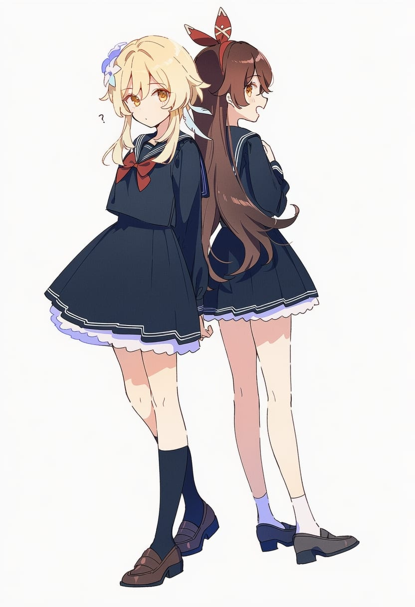

| 字段 | 内容 |
| --- | --- |
| Danbooru Tag | back-to-back |
| 中文名 | 背靠背 |
| 中文含义 | 两个角色背部相对或贴靠。 |
| 子类 | 站位/靠近/依靠 |
| 模特 | 2girls,lumine_(genshin_impact),amber_(genshin_impact) |
| 序号 | 0002 |

## 3. face-to-face — 面对面

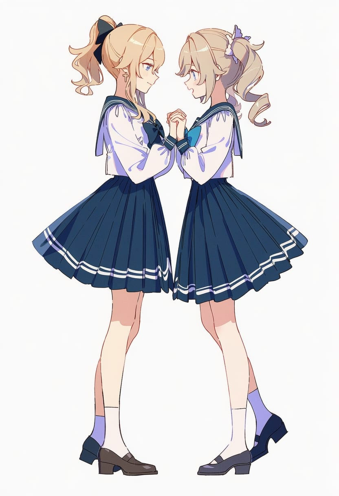

| 字段 | 内容 |
| --- | --- |
| Danbooru Tag | face-to-face |
| 中文名 | 面对面 |
| 中文含义 | 两个角色正面朝向彼此。 |
| 子类 | 站位/靠近/依靠 |
| 模特 | 2girls,jean_(genshin_impact),barbara_(genshin_impact) |
| 序号 | 0003 |

## 4. front-to-back — 前后贴靠

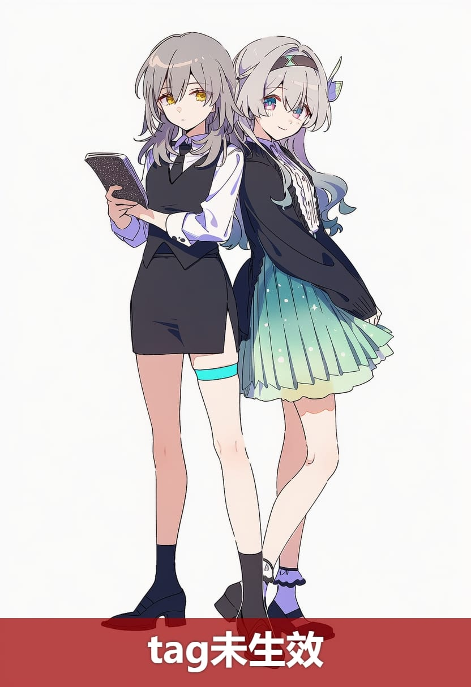

| 字段 | 内容 |
| --- | --- |
| Danbooru Tag | front-to-back |
| 中文名 | 前后贴靠 |
| 中文含义 | 一个角色的正面靠着另一个角色的背面。 |
| 子类 | 站位/靠近/依靠 |
| 模特 | 2girls,firefly_(honkai:_star_rail),stelle_(honkai:_star_rail) |
| 序号 | 0004 |

## 5. behind_another — 站在他人身后

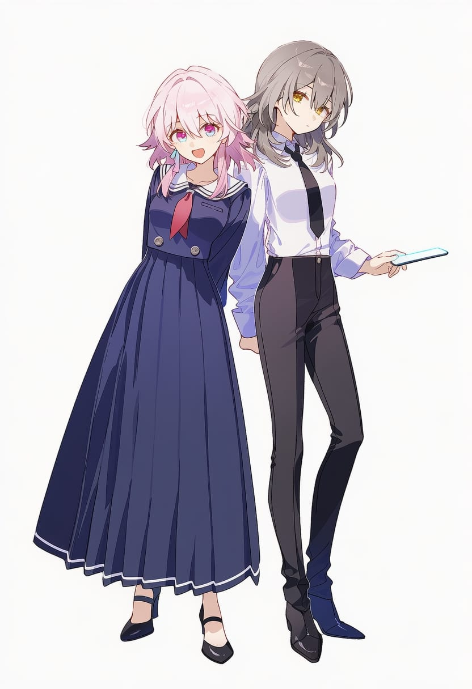

| 字段 | 内容 |
| --- | --- |
| Danbooru Tag | behind_another |
| 中文名 | 站在他人身后 |
| 中文含义 | 一个角色位于另一个角色后方。 |
| 子类 | 站位/靠近/依靠 |
| 模特 | 2girls,march_7th_(honkai:_star_rail),stelle_(honkai:_star_rail) |
| 序号 | 0005 |

## 6. leaning_on_person — 靠在别人身上

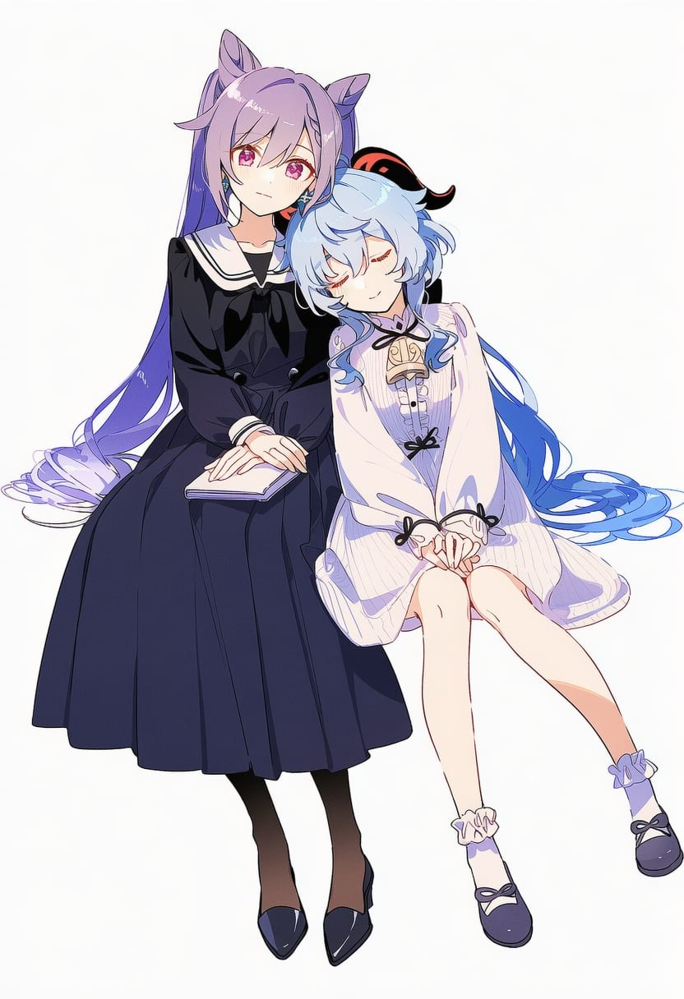

| 字段 | 内容 |
| --- | --- |
| Danbooru Tag | leaning_on_person |
| 中文名 | 靠在别人身上 |
| 中文含义 | 把身体重量或身体一部分倚靠在另一角色身上。 |
| 子类 | 站位/靠近/依靠 |
| 模特 | 2girls,ganyu_(genshin_impact),keqing_(genshin_impact) |
| 序号 | 0006 |

## 7. head_on_another's_shoulder — 头靠肩

| 字段 | 内容 |
| --- | --- |
| Danbooru Tag | head_on_another's_shoulder |
| 中文名 | 头靠肩 |
| 中文含义 | 把头靠在另一角色肩膀上。 |
| 子类 | 站位/靠近/依靠 |
| 模特 | 2girls,kiana_kaslana,raiden_mei_(apho) |
| 序号 | 0007 |

## 8. head_on_another's_head — 头靠头顶

| 字段 | 内容 |
| --- | --- |
| Danbooru Tag | head_on_another's_head |
| 中文名 | 头靠头顶 |
| 中文含义 | 把头放在另一角色头部上。 |
| 子类 | 站位/靠近/依靠 |
| 模特 | 2girls,beidou_(genshin_impact),ningguang_(genshin_impact) |
| 序号 | 0008 |

## 9. shoulder-to-shoulder — 肩并肩

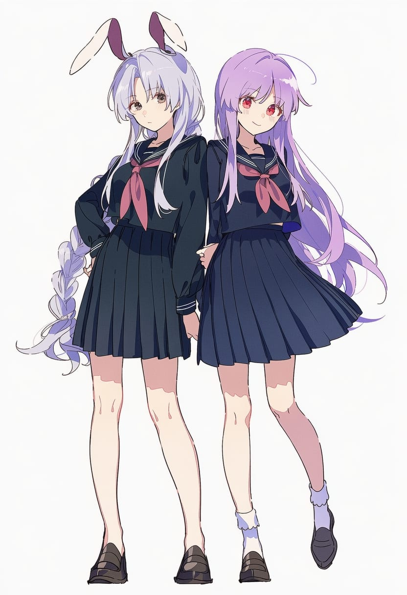

| 字段 | 内容 |
| --- | --- |
| Danbooru Tag | shoulder-to-shoulder |
| 中文名 | 肩并肩 |
| 中文含义 | 两人的肩部彼此紧靠。 |
| 子类 | 站位/靠近/依靠 |
| 模特 | 2girls,yagokoro_eirin,reisen_udongein_inaba |
| 序号 | 0009 |

## 10. forehead-to-forehead — 额头贴额头

| 字段 | 内容 |
| --- | --- |
| Danbooru Tag | forehead-to-forehead |
| 中文名 | 额头贴额头 |
| 中文含义 | 两人的额头彼此贴近或接触。 |
| 子类 | 站位/靠近/依靠 |
| 模特 | 2girls,kiana_kaslana,raiden_mei_(apho) |
| 序号 | 0010 |

## 11. nose-to-nose — 鼻尖贴鼻尖

| 字段 | 内容 |
| --- | --- |
| Danbooru Tag | nose-to-nose |
| 中文名 | 鼻尖贴鼻尖 |
| 中文含义 | 两人的鼻子彼此靠近或接触。 |
| 子类 | 站位/靠近/依靠 |
| 模特 | 2girls,ganyu_(genshin_impact),keqing_(genshin_impact) |
| 序号 | 0011 |

## 12. cheek-to-cheek — 脸颊贴脸颊

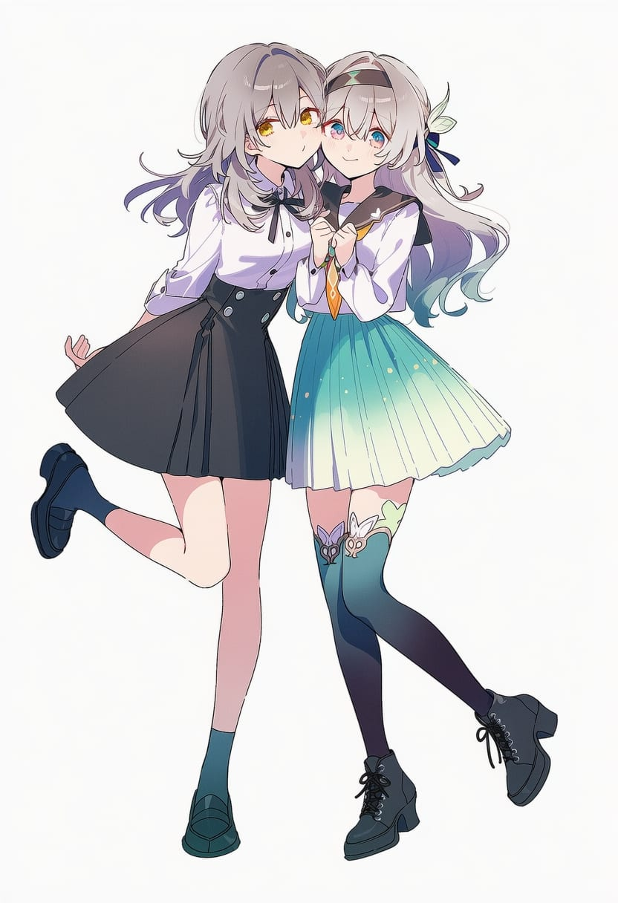

| 字段 | 内容 |
| --- | --- |
| Danbooru Tag | cheek-to-cheek |
| 中文名 | 脸颊贴脸颊 |
| 中文含义 | 两人的脸颊彼此贴近。 |
| 子类 | 站位/靠近/依靠 |
| 模特 | 2girls,firefly_(honkai:_star_rail),stelle_(honkai:_star_rail) |
| 序号 | 0012 |

## 13. holding_hands — 牵手

| 字段 | 内容 |
| --- | --- |
| Danbooru Tag | holding_hands |
| 中文名 | 牵手 |
| 中文含义 | 角色彼此握住对方的手。 |
| 子类 | 牵手/手臂互动 |
| 模特 | 2girls,firefly_(honkai:_star_rail),stelle_(honkai:_star_rail) |
| 序号 | 0013 |

## 14. interlocked_fingers — 十指相扣

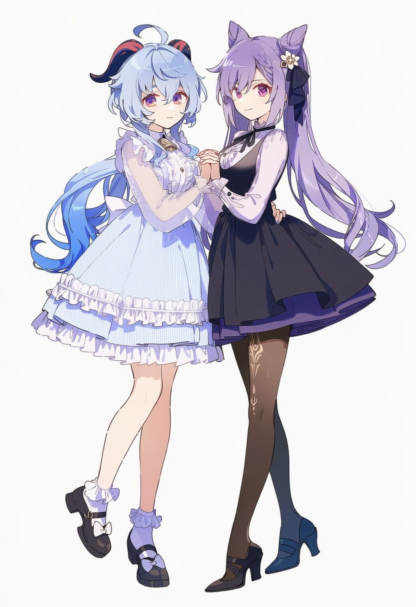

| 字段 | 内容 |
| --- | --- |
| Danbooru Tag | interlocked_fingers |
| 中文名 | 十指相扣 |
| 中文含义 | 两人的手指彼此交错扣住。 |
| 子类 | 牵手/手臂互动 |
| 模特 | 2girls,ganyu_(genshin_impact),keqing_(genshin_impact) |
| 序号 | 0014 |

## 15. handshake — 握手

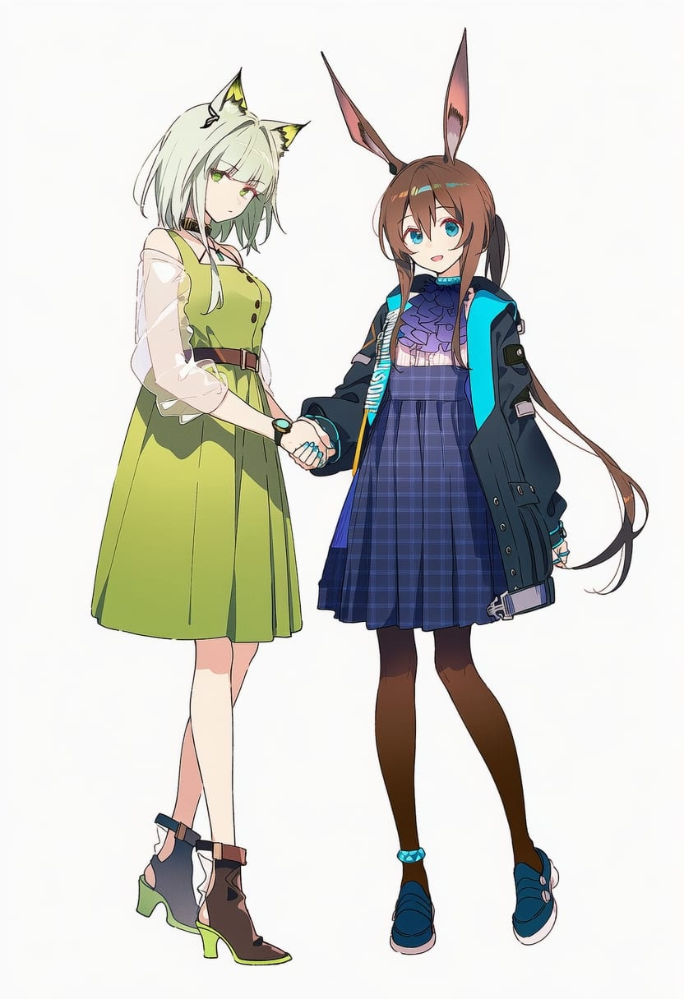

| 字段 | 内容 |
| --- | --- |
| Danbooru Tag | handshake |
| 中文名 | 握手 |
| 中文含义 | 两人以握手方式互动。 |
| 子类 | 牵手/手臂互动 |
| 模特 | 2girls,amiya_(arknights),kal'tsit_(arknights) |
| 序号 | 0015 |

## 16. high_five — 击掌

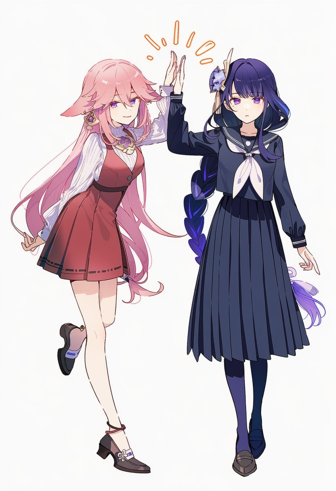

| 字段 | 内容 |
| --- | --- |
| Danbooru Tag | high_five |
| 中文名 | 击掌 |
| 中文含义 | 两人抬手互相击掌。 |
| 子类 | 牵手/手臂互动 |
| 模特 | 2girls,raiden_shogun,yae_miko |
| 序号 | 0016 |

## 17. fist_bump — 碰拳

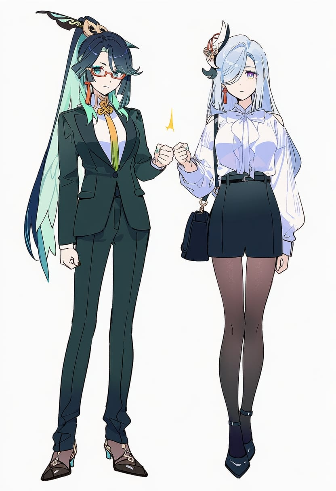

| 字段 | 内容 |
| --- | --- |
| Danbooru Tag | fist_bump |
| 中文名 | 碰拳 |
| 中文含义 | 两人用拳头互相轻碰。 |
| 子类 | 牵手/手臂互动 |
| 模特 | 2girls,xianyun_(genshin_impact),shenhe_(genshin_impact) |
| 序号 | 0017 |

## 18. pinky_swear — 拉钩

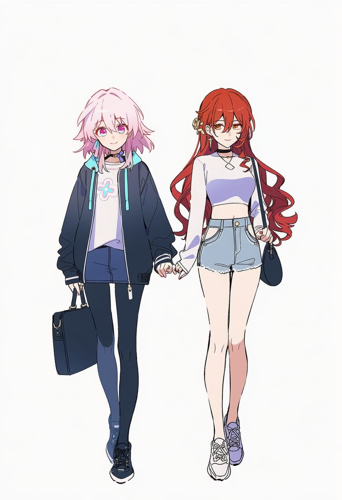

| 字段 | 内容 |
| --- | --- |
| Danbooru Tag | pinky_swear |
| 中文名 | 拉钩 |
| 中文含义 | 两人用小拇指勾在一起。 |
| 子类 | 牵手/手臂互动 |
| 模特 | 2girls,himeko_(honkai:_star_rail),march_7th_(honkai:_star_rail) |
| 序号 | 0018 |

## 19. hand_on_another's_arm — 手放他人手臂

| 字段 | 内容 |
| --- | --- |
| Danbooru Tag | hand_on_another's_arm |
| 中文名 | 手放他人手臂 |
| 中文含义 | 一只手放在另一角色的手臂上。 |
| 子类 | 牵手/手臂互动 |
| 模特 | 2girls,lumine_(genshin_impact),amber_(genshin_impact) |
| 序号 | 0019 |

## 20. hands_on_another's_arm — 双手放他人单臂

| 字段 | 内容 |
| --- | --- |
| Danbooru Tag | hands_on_another's_arm |
| 中文名 | 双手放他人单臂 |
| 中文含义 | 双手都放在另一角色的一只手臂上。 |
| 子类 | 牵手/手臂互动 |
| 模特 | 2girls,jean_(genshin_impact),barbara_(genshin_impact) |
| 序号 | 0020 |

## 21. hands_on_another's_arms — 双手放他人双臂

| 字段 | 内容 |
| --- | --- |
| Danbooru Tag | hands_on_another's_arms |
| 中文名 | 双手放他人双臂 |
| 中文含义 | 双手分别接触另一角色的手臂。 |
| 子类 | 牵手/手臂互动 |
| 模特 | 2girls,march_7th_(honkai:_star_rail),stelle_(honkai:_star_rail) |
| 序号 | 0021 |

## 22. hand_on_another's_shoulder — 手搭他人肩

| 字段 | 内容 |
| --- | --- |
| Danbooru Tag | hand_on_another's_shoulder |
| 中文名 | 手搭他人肩 |
| 中文含义 | 一只手放在另一角色肩膀上。 |
| 子类 | 牵手/手臂互动 |
| 模特 | 2girls,yagokoro_eirin,reisen_udongein_inaba |
| 序号 | 0022 |

## 23. hands_on_another's_shoulders — 双手搭肩

| 字段 | 内容 |
| --- | --- |
| Danbooru Tag | hands_on_another's_shoulders |
| 中文名 | 双手搭肩 |
| 中文含义 | 双手放在另一角色双肩上。 |
| 子类 | 牵手/手臂互动 |
| 模特 | 2girls,amiya_(arknights),kal'tsit_(arknights) |
| 序号 | 0023 |

## 24. holding_another's_arm — 抓/握他人手臂

| 字段 | 内容 |
| --- | --- |
| Danbooru Tag | holding_another's_arm |
| 中文名 | 抓/握他人手臂 |
| 中文含义 | 用手握住另一角色的手臂。 |
| 子类 | 牵手/手臂互动 |
| 模特 | 2girls,hu_tao_(genshin_impact),qiqi_(genshin_impact) |
| 序号 | 0024 |

## 25. holding_another's_wrist — 握住他人手腕

| 字段 | 内容 |
| --- | --- |
| Danbooru Tag | holding_another's_wrist |
| 中文名 | 握住他人手腕 |
| 中文含义 | 用手握住另一角色的手腕。 |
| 子类 | 牵手/手臂互动 |
| 模特 | 2girls,kal'tsit_(arknights),w_(arknights) |
| 序号 | 0025 |

## 26. holding_another's_hand — 握住他人的手

| 字段 | 内容 |
| --- | --- |
| Danbooru Tag | holding_another's_hand |
| 中文名 | 握住他人的手 |
| 中文含义 | 用手握住另一角色的一只手。 |
| 子类 | 牵手/手臂互动 |
| 模特 | 2girls,raiden_shogun,yae_miko |
| 序号 | 0026 |

## 27. arm_around_shoulder — 搂肩

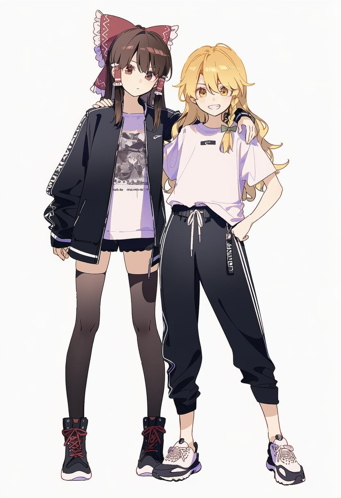

| 字段 | 内容 |
| --- | --- |
| Danbooru Tag | arm_around_shoulder |
| 中文名 | 搂肩 |
| 中文含义 | 用一只手臂环在另一角色肩膀周围。 |
| 子类 | 牵手/手臂互动 |
| 模特 | 2girls,hakurei_reimu,kirisame_marisa |
| 序号 | 0027 |

## 28. arm_around_neck — 搂住脖子

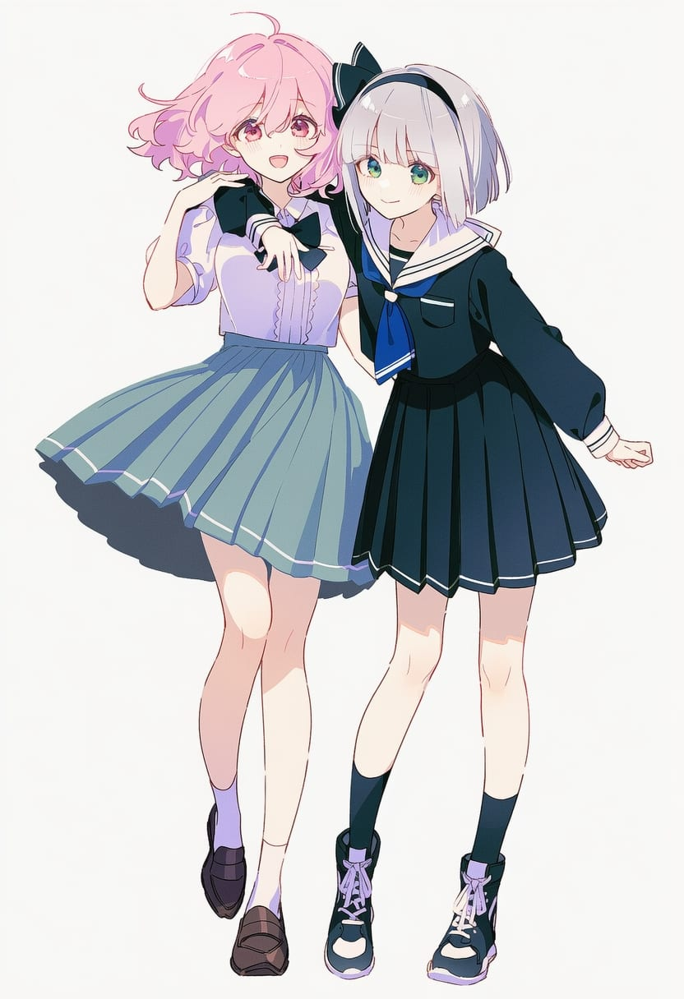

| 字段 | 内容 |
| --- | --- |
| Danbooru Tag | arm_around_neck |
| 中文名 | 搂住脖子 |
| 中文含义 | 用手臂环在另一角色颈部周围。 |
| 子类 | 牵手/手臂互动 |
| 模特 | 2girls,konpaku_youmu,saigyouji_yuyuko |
| 序号 | 0028 |

## 29. arm_around_another's_waist — 单臂搂腰

| 字段 | 内容 |
| --- | --- |
| Danbooru Tag | arm_around_another's_waist |
| 中文名 | 单臂搂腰 |
| 中文含义 | 用一只手臂环住另一角色腰部。 |
| 子类 | 牵手/手臂互动 |
| 模特 | 2girls,komeiji_satori,komeiji_koishi |
| 序号 | 0029 |

## 30. arms_around_another's_waist — 双臂搂腰

| 字段 | 内容 |
| --- | --- |
| Danbooru Tag | arms_around_another's_waist |
| 中文名 | 双臂搂腰 |
| 中文含义 | 用双臂环住另一角色腰部。 |
| 子类 | 牵手/手臂互动 |
| 模特 | 2girls,tohsaka_rin,matou_sakura |
| 序号 | 0030 |

## 31. linking_arms — 挽手臂

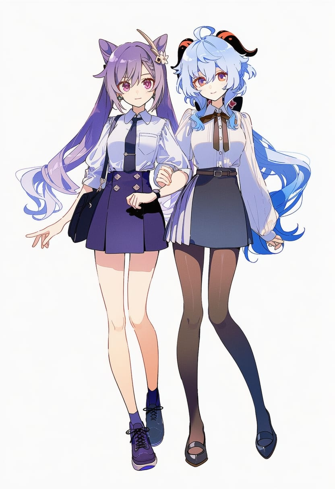

| 字段 | 内容 |
| --- | --- |
| Danbooru Tag | linking_arms |
| 中文名 | 挽手臂 |
| 中文含义 | 两人把手臂互相挽在一起。 |
| 子类 | 牵手/手臂互动 |
| 模特 | 2girls,ganyu_(genshin_impact),keqing_(genshin_impact) |
| 序号 | 0031 |

## 32. offering_hand — 伸手邀请

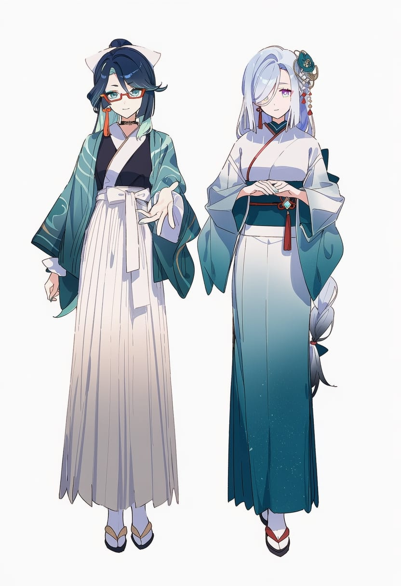

| 字段 | 内容 |
| --- | --- |
| Danbooru Tag | offering_hand |
| 中文名 | 伸手邀请 |
| 中文含义 | 向对方或观众伸出手，常用于牵手或扶起。 |
| 子类 | 牵手/手臂互动 |
| 模特 | 2girls,xianyun_(genshin_impact),shenhe_(genshin_impact) |
| 序号 | 0033 |

## 33. offering_hand_to_another — 向他人伸手

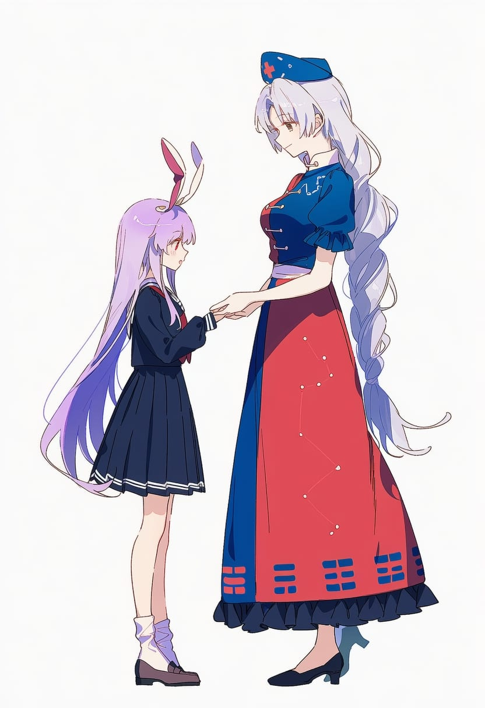

| 字段 | 内容 |
| --- | --- |
| Danbooru Tag | offering_hand_to_another |
| 中文名 | 向他人伸手 |
| 中文含义 | 明确向另一个角色伸出手邀请互动。 |
| 子类 | 牵手/手臂互动 |
| 模特 | 2girls,yagokoro_eirin,reisen_udongein_inaba |
| 序号 | 0034 |

## 34. hug — 拥抱

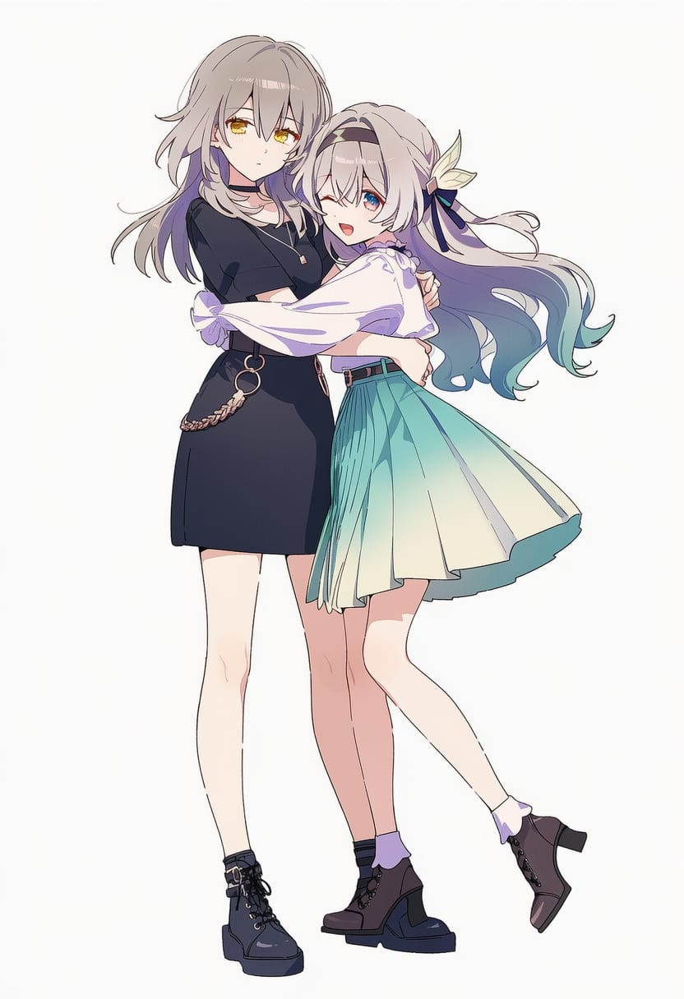

| 字段 | 内容 |
| --- | --- |
| Danbooru Tag | hug |
| 中文名 | 拥抱 |
| 中文含义 | 一个角色用手臂抱住另一个角色。 |
| 子类 | 拥抱/贴靠 |
| 模特 | 2girls,firefly_(honkai:_star_rail),stelle_(honkai:_star_rail) |
| 序号 | 0035 |

## 35. mutual_hug — 相互拥抱

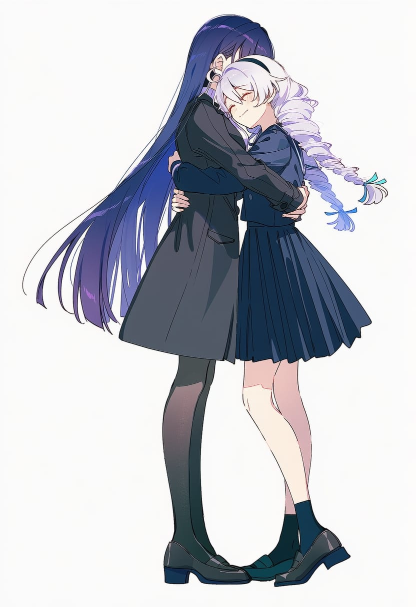

| 字段 | 内容 |
| --- | --- |
| Danbooru Tag | mutual_hug |
| 中文名 | 相互拥抱 |
| 中文含义 | 双方都用手臂抱住彼此。 |
| 子类 | 拥抱/贴靠 |
| 模特 | 2girls,kiana_kaslana,raiden_mei_(apho) |
| 序号 | 0036 |

## 36. hug_from_behind — 背后拥抱

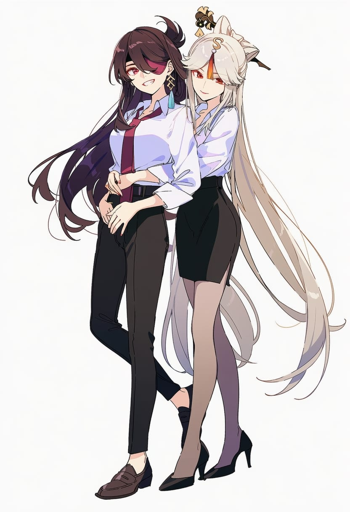

| 字段 | 内容 |
| --- | --- |
| Danbooru Tag | hug_from_behind |
| 中文名 | 背后拥抱 |
| 中文含义 | 从另一角色身后抱住对方。 |
| 子类 | 拥抱/贴靠 |
| 模特 | 2girls,beidou_(genshin_impact),ningguang_(genshin_impact) |
| 序号 | 0037 |

## 37. hug_from_side — 侧面拥抱

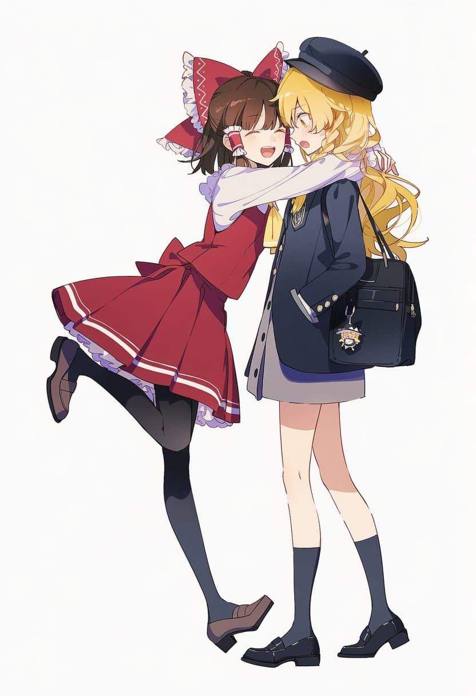

| 字段 | 内容 |
| --- | --- |
| Danbooru Tag | hug_from_side |
| 中文名 | 侧面拥抱 |
| 中文含义 | 从另一角色侧面抱住对方。 |
| 子类 | 拥抱/贴靠 |
| 模特 | 2girls,hakurei_reimu,kirisame_marisa |
| 序号 | 0038 |

## 38. surprise_hug — 突然拥抱

| 字段 | 内容 |
| --- | --- |
| Danbooru Tag | surprise_hug |
| 中文名 | 突然拥抱 |
| 中文含义 | 在对方没有预料时突然抱住。 |
| 子类 | 拥抱/贴靠 |
| 模特 | 2girls,konpaku_youmu,saigyouji_yuyuko |
| 序号 | 0039 |

## 39. forced_hug — 强行拥抱

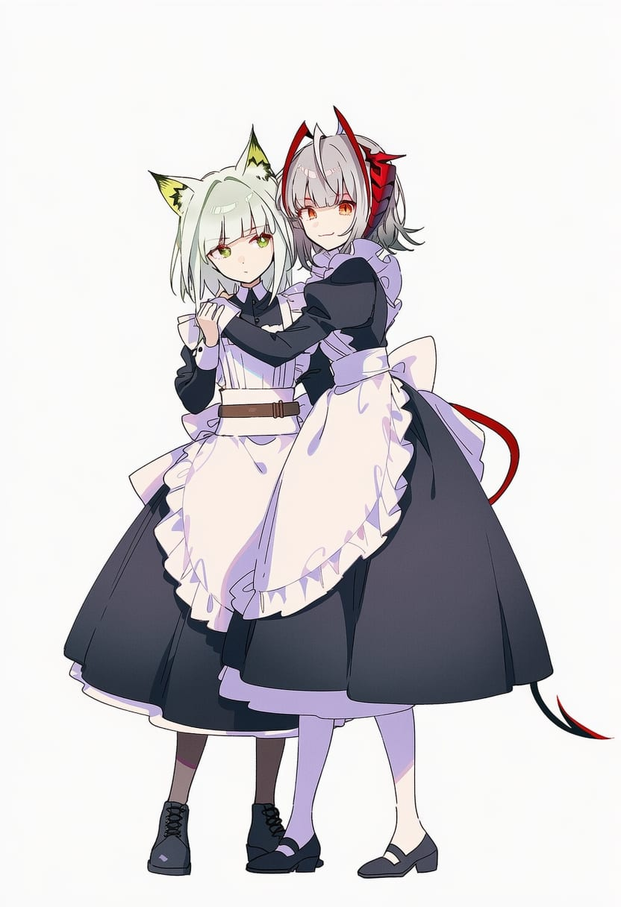

| 字段 | 内容 |
| --- | --- |
| Danbooru Tag | forced_hug |
| 中文名 | 强行拥抱 |
| 中文含义 | 一方在另一方不情愿时抱住对方。 |
| 子类 | 拥抱/贴靠 |
| 模特 | 2girls,kal'tsit_(arknights),w_(arknights) |
| 序号 | 0040 |

## 40. rejected_hug — 拒绝拥抱

| 字段 | 内容 |
| --- | --- |
| Danbooru Tag | rejected_hug |
| 中文名 | 拒绝拥抱 |
| 中文含义 | 一方试图拥抱但被另一方拒绝。 |
| 子类 | 拥抱/贴靠 |
| 模特 | 2girls,hu_tao_(genshin_impact),qiqi_(genshin_impact) |
| 序号 | 0041 |

## 41. imminent_hug — 即将拥抱

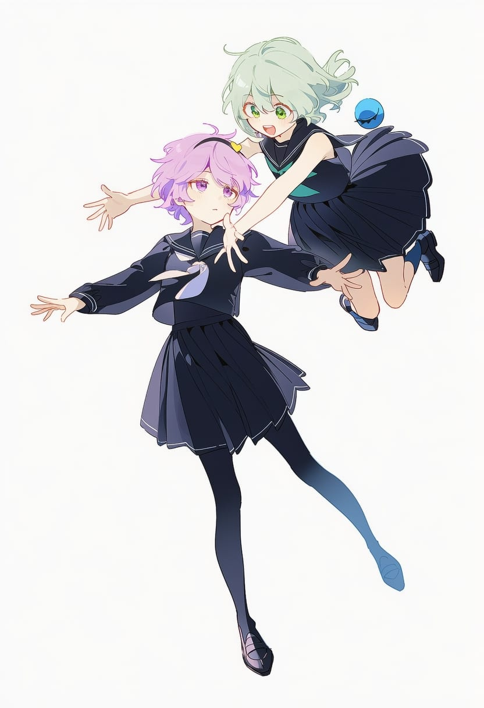

| 字段 | 内容 |
| --- | --- |
| Danbooru Tag | imminent_hug |
| 中文名 | 即将拥抱 |
| 中文含义 | 两人正处于马上要抱在一起的状态。 |
| 子类 | 拥抱/贴靠 |
| 模特 | 2girls,komeiji_satori,komeiji_koishi |
| 序号 | 0042 |

## 42. glomp — 飞扑拥抱

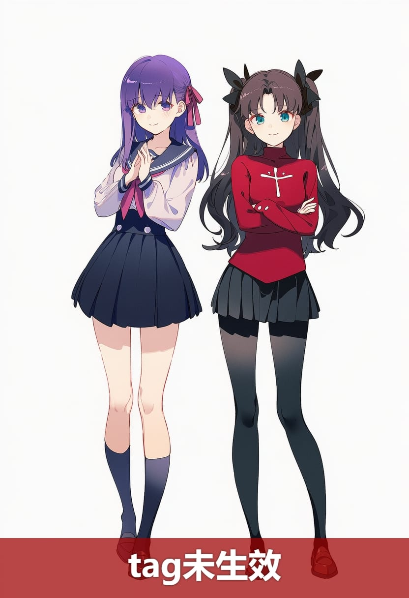

| 字段 | 内容 |
| --- | --- |
| Danbooru Tag | glomp |
| 中文名 | 飞扑拥抱 |
| 中文含义 | 带扑跃感的猛烈拥抱。 |
| 子类 | 拥抱/贴靠 |
| 模特 | 2girls,tohsaka_rin,matou_sakura |
| 序号 | 0043 |

## 43. cuddling — 依偎

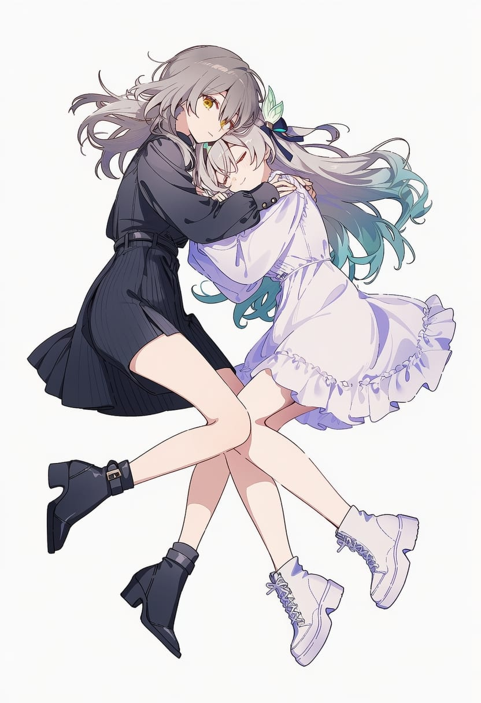

| 字段 | 内容 |
| --- | --- |
| Danbooru Tag | cuddling |
| 中文名 | 依偎 |
| 中文含义 | 角色亲密地抱在一起或贴靠取暖。 |
| 子类 | 拥抱/贴靠 |
| 模特 | 2girls,firefly_(honkai:_star_rail),stelle_(honkai:_star_rail) |
| 序号 | 0044 |

## 44. arm_hug — 抱住手臂

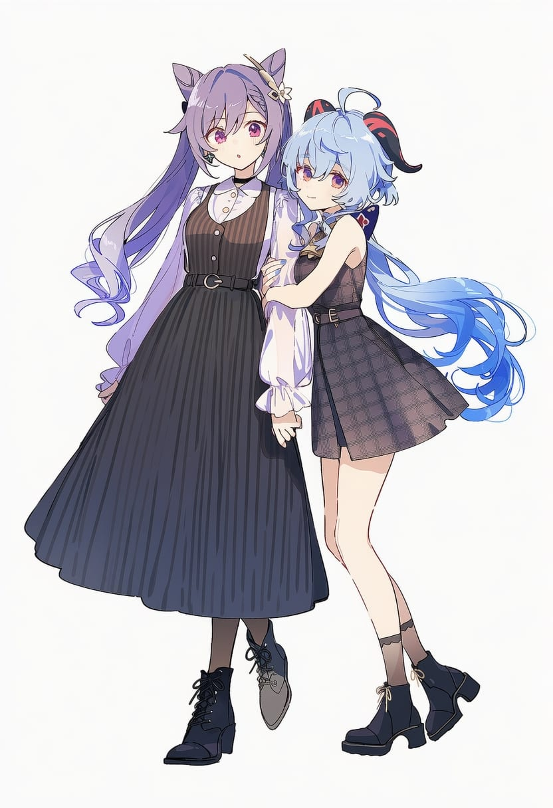

| 字段 | 内容 |
| --- | --- |
| Danbooru Tag | arm_hug |
| 中文名 | 抱住手臂 |
| 中文含义 | 抱住另一角色的一只手臂。 |
| 子类 | 拥抱/贴靠 |
| 模特 | 2girls,ganyu_(genshin_impact),keqing_(genshin_impact) |
| 序号 | 0045 |

## 45. hugging_another's_arm — 抱他人手臂

| 字段 | 内容 |
| --- | --- |
| Danbooru Tag | hugging_another's_arm |
| 中文名 | 抱他人手臂 |
| 中文含义 | 双手或手臂抱住另一角色的手臂。 |
| 子类 | 拥抱/贴靠 |
| 模特 | 2girls,firefly_(honkai:_star_rail),stelle_(honkai:_star_rail) |
| 序号 | 0047 |

## 46. hugging_another's_leg — 抱他人单腿

| 字段 | 内容 |
| --- | --- |
| Danbooru Tag | hugging_another's_leg |
| 中文名 | 抱他人单腿 |
| 中文含义 | 抱住另一角色的一条腿。 |
| 子类 | 拥抱/贴靠 |
| 模特 | 2girls,himeko_(honkai:_star_rail),march_7th_(honkai:_star_rail) |
| 序号 | 0048 |

## 47. headpat — 摸头

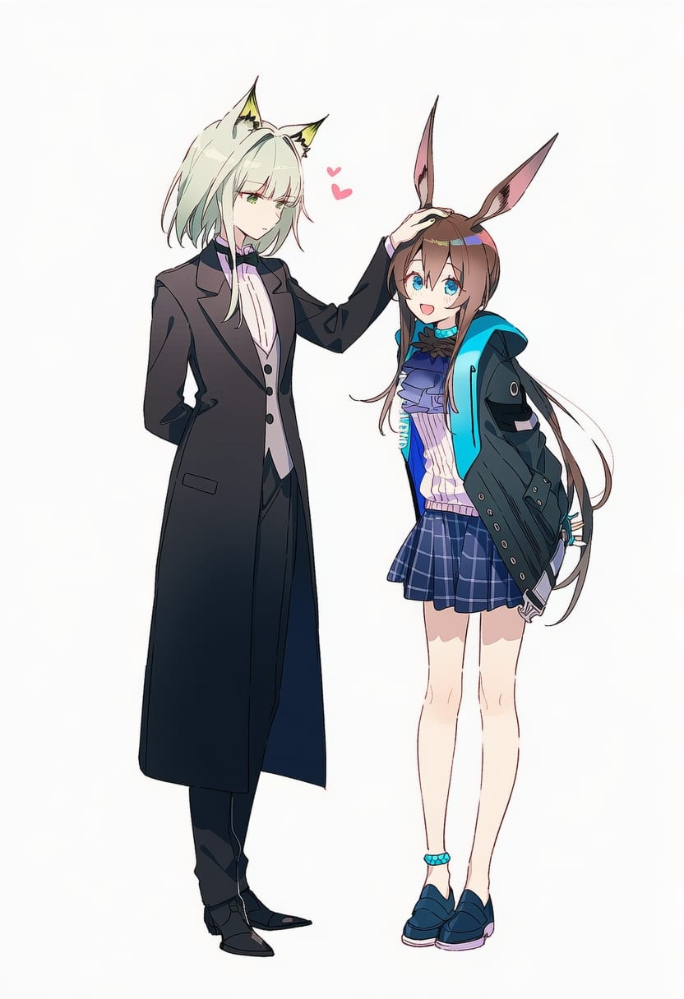

| 字段 | 内容 |
| --- | --- |
| Danbooru Tag | headpat |
| 中文名 | 摸头 |
| 中文含义 | 用手轻拍或抚摸另一角色的头。 |
| 子类 | 头脸/身体触碰 |
| 模特 | 2girls,kal'tsit_(arknights),amiya_(arknights) |
| 序号 | 0050 |

## 48. guided_headpat — 引导摸头

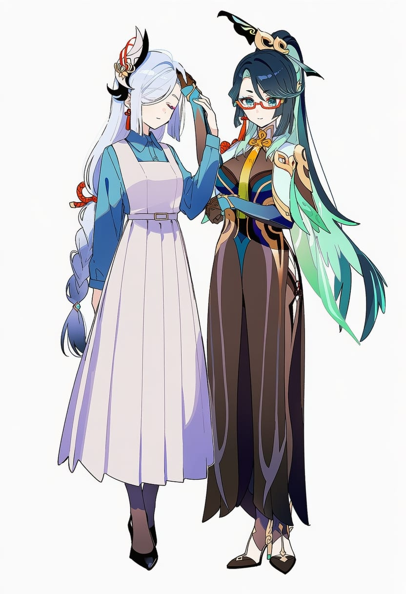

| 字段 | 内容 |
| --- | --- |
| Danbooru Tag | guided_headpat |
| 中文名 | 引导摸头 |
| 中文含义 | 拉着对方的手引导其摸自己的头。 |
| 子类 | 头脸/身体触碰 |
| 模特 | 2girls,xianyun_(genshin_impact),shenhe_(genshin_impact) |
| 序号 | 0051 |

## 49. patting — 轻拍

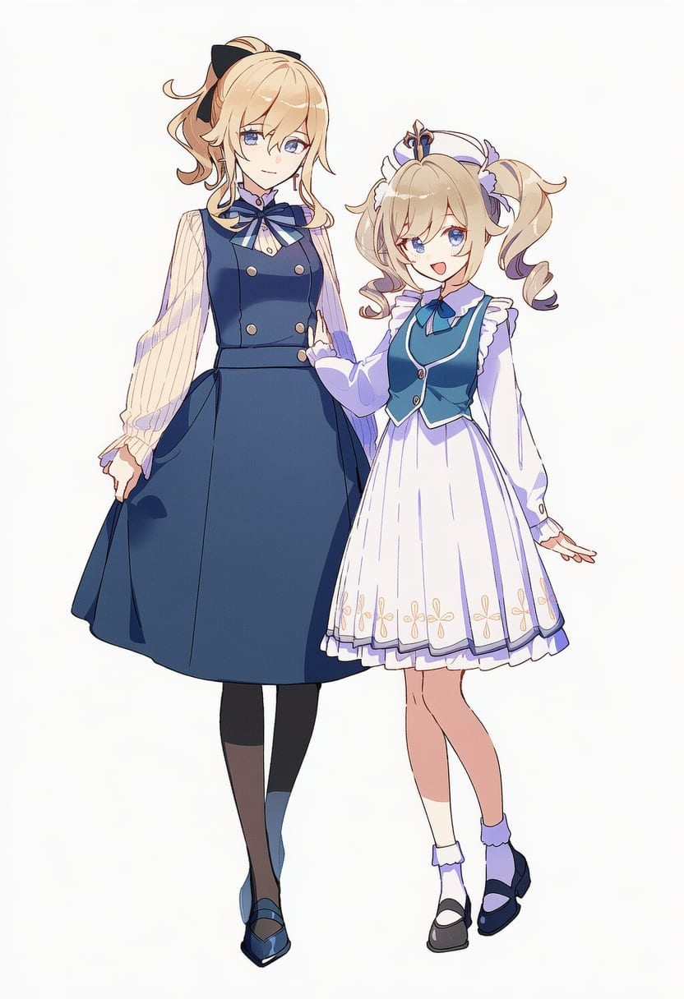

| 字段 | 内容 |
| --- | --- |
| Danbooru Tag | patting |
| 中文名 | 轻拍 |
| 中文含义 | 用手轻轻拍另一角色或对象。 |
| 子类 | 头脸/身体触碰 |
| 模特 | 2girls,jean_(genshin_impact),barbara_(genshin_impact) |
| 序号 | 0052 |

## 50. cheek_pinching — 捏脸颊

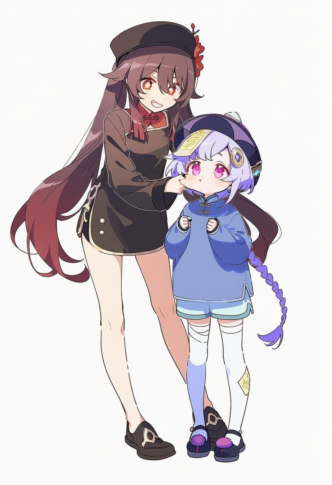

| 字段 | 内容 |
| --- | --- |
| Danbooru Tag | cheek_pinching |
| 中文名 | 捏脸颊 |
| 中文含义 | 用手指捏住另一角色的脸颊。 |
| 子类 | 头脸/身体触碰 |
| 模特 | 2girls,hu_tao_(genshin_impact),qiqi_(genshin_impact) |
| 序号 | 0053 |

## 51. cheek_poking — 戳脸颊

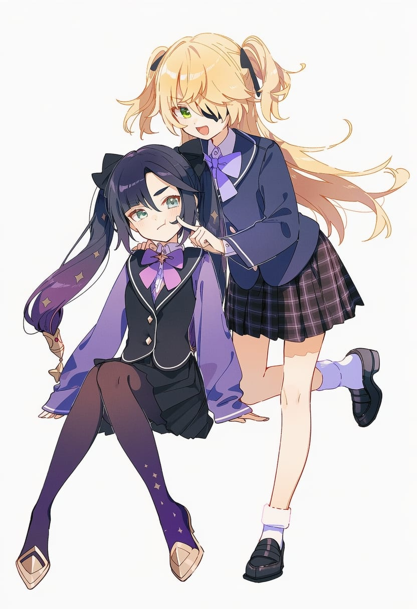

| 字段 | 内容 |
| --- | --- |
| Danbooru Tag | cheek_poking |
| 中文名 | 戳脸颊 |
| 中文含义 | 用手指戳另一角色的脸颊。 |
| 子类 | 头脸/身体触碰 |
| 模特 | 2girls,mona_(genshin_impact),fischl_(genshin_impact) |
| 序号 | 0054 |

## 52. nose_poking — 戳鼻子

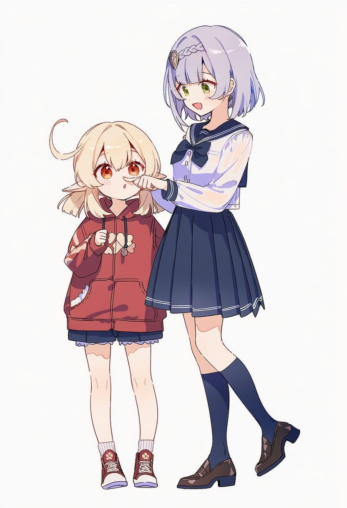

| 字段 | 内容 |
| --- | --- |
| Danbooru Tag | nose_poking |
| 中文名 | 戳鼻子 |
| 中文含义 | 用手指轻戳另一角色的鼻子。 |
| 子类 | 头脸/身体触碰 |
| 模特 | 2girls,klee_(genshin_impact),noelle_(genshin_impact) |
| 序号 | 0055 |

## 53. hand_on_another's_head — 手放他人头上

| 字段 | 内容 |
| --- | --- |
| Danbooru Tag | hand_on_another's_head |
| 中文名 | 手放他人头上 |
| 中文含义 | 一只手放在另一角色头部。 |
| 子类 | 头脸/身体触碰 |
| 模特 | 2girls,murata_himeko,kiana_kaslana |
| 序号 | 0056 |

## 54. hands_on_another's_head — 双手放他人头上

| 字段 | 内容 |
| --- | --- |
| Danbooru Tag | hands_on_another's_head |
| 中文名 | 双手放他人头上 |
| 中文含义 | 双手放在另一角色头部。 |
| 子类 | 头脸/身体触碰 |
| 模特 | 2girls,theresa_apocalypse,kiana_kaslana |
| 序号 | 0057 |

## 55. hand_on_another's_face — 手碰他人脸

| 字段 | 内容 |
| --- | --- |
| Danbooru Tag | hand_on_another's_face |
| 中文名 | 手碰他人脸 |
| 中文含义 | 一只手放在另一角色脸部。 |
| 子类 | 头脸/身体触碰 |
| 模特 | 2girls,march_7th_(honkai:_star_rail),stelle_(honkai:_star_rail) |
| 序号 | 0058 |

## 56. hands_on_another's_face — 双手捧脸

| 字段 | 内容 |
| --- | --- |
| Danbooru Tag | hands_on_another's_face |
| 中文名 | 双手捧脸 |
| 中文含义 | 双手放在另一角色脸部两侧。 |
| 子类 | 头脸/身体触碰 |
| 模特 | 2girls,hakurei_reimu,kirisame_marisa |
| 序号 | 0059 |

## 57. hand_on_another's_cheek — 手抚他人脸颊

| 字段 | 内容 |
| --- | --- |
| Danbooru Tag | hand_on_another's_cheek |
| 中文名 | 手抚他人脸颊 |
| 中文含义 | 一只手放在另一角色脸颊。 |
| 子类 | 头脸/身体触碰 |
| 模特 | 2girls,nero_claudius_(fate),tamamo_no_mae_(fate) |
| 序号 | 0060 |

## 58. hands_on_another's_cheeks — 双手捧脸颊

| 字段 | 内容 |
| --- | --- |
| Danbooru Tag | hands_on_another's_cheeks |
| 中文名 | 双手捧脸颊 |
| 中文含义 | 双手分别放在另一角色两侧脸颊。 |
| 子类 | 头脸/身体触碰 |
| 模特 | 2girls,cirno,shameimaru_aya |
| 序号 | 0061 |

## 59. hand_on_another's_chin — 手托他人下巴

| 字段 | 内容 |
| --- | --- |
| Danbooru Tag | hand_on_another's_chin |
| 中文名 | 手托他人下巴 |
| 中文含义 | 一只手接触或托住另一角色下巴。 |
| 子类 | 头脸/身体触碰 |
| 模特 | 2girls,jeanne_d'arc_(fate),jeanne_d'arc_alter_(fate) |
| 序号 | 0062 |

## 60. hand_on_another's_neck — 手放他人颈部

| 字段 | 内容 |
| --- | --- |
| Danbooru Tag | hand_on_another's_neck |
| 中文名 | 手放他人颈部 |
| 中文含义 | 一只手放在另一角色颈部。 |
| 子类 | 头脸/身体触碰 |
| 模特 | 2girls,hu_tao_(genshin_impact),qiqi_(genshin_impact) |
| 序号 | 0063 |

## 61. hand_on_another's_chest — 手放他人胸前

| 字段 | 内容 |
| --- | --- |
| Danbooru Tag | hand_on_another's_chest |
| 中文名 | 手放他人胸前 |
| 中文含义 | 一只手放在另一角色胸部或胸前。 |
| 子类 | 头脸/身体触碰 |
| 模特 | 2girls,mona_(genshin_impact),fischl_(genshin_impact) |
| 序号 | 0064 |

## 62. hand_on_another's_back — 手放他人背部

| 字段 | 内容 |
| --- | --- |
| Danbooru Tag | hand_on_another's_back |
| 中文名 | 手放他人背部 |
| 中文含义 | 一只手放在另一角色背部。 |
| 子类 | 头脸/身体触碰 |
| 模特 | 2girls,klee_(genshin_impact),noelle_(genshin_impact) |
| 序号 | 0065 |

## 63. hands_on_another's_back — 双手放他人背部

| 字段 | 内容 |
| --- | --- |
| Danbooru Tag | hands_on_another's_back |
| 中文名 | 双手放他人背部 |
| 中文含义 | 双手都放在另一角色背部。 |
| 子类 | 头脸/身体触碰 |
| 模特 | 2girls,march_7th_(honkai:_star_rail),stelle_(honkai:_star_rail) |
| 序号 | 0066 |

## 64. hand_on_another's_waist — 手扶他人腰

| 字段 | 内容 |
| --- | --- |
| Danbooru Tag | hand_on_another's_waist |
| 中文名 | 手扶他人腰 |
| 中文含义 | 一只手放在另一角色腰侧。 |
| 子类 | 头脸/身体触碰 |
| 模特 | 2girls,hakurei_reimu,kirisame_marisa |
| 序号 | 0067 |

## 65. hands_on_another's_waist — 双手扶腰

| 字段 | 内容 |
| --- | --- |
| Danbooru Tag | hands_on_another's_waist |
| 中文名 | 双手扶腰 |
| 中文含义 | 双手放在另一角色腰部。 |
| 子类 | 头脸/身体触碰 |
| 模特 | 2girls,nero_claudius_(fate),tamamo_no_mae_(fate) |
| 序号 | 0068 |

## 66. hands_on_another's_hips — 双手扶他人胯

| 字段 | 内容 |
| --- | --- |
| Danbooru Tag | hands_on_another's_hips |
| 中文名 | 双手扶他人胯 |
| 中文含义 | 双手放在另一角色髋部。 |
| 子类 | 头脸/身体触碰 |
| 模特 | 2girls,cirno,shameimaru_aya |
| 序号 | 0069 |

## 67. hand_on_another's_leg — 手放他人腿上

| 字段 | 内容 |
| --- | --- |
| Danbooru Tag | hand_on_another's_leg |
| 中文名 | 手放他人腿上 |
| 中文含义 | 一只手放在另一角色腿部。 |
| 子类 | 头脸/身体触碰 |
| 模特 | 2girls,jeanne_d'arc_(fate),jeanne_d'arc_alter_(fate) |
| 序号 | 0070 |

## 68. hands_on_another's_leg — 双手放他人单腿

| 字段 | 内容 |
| --- | --- |
| Danbooru Tag | hands_on_another's_leg |
| 中文名 | 双手放他人单腿 |
| 中文含义 | 双手都放在另一角色的一条腿上。 |
| 子类 | 头脸/身体触碰 |
| 模特 | 2girls,hu_tao_(genshin_impact),qiqi_(genshin_impact) |
| 序号 | 0071 |

## 69. hand_on_another's_knee — 手放他人膝盖

| 字段 | 内容 |
| --- | --- |
| Danbooru Tag | hand_on_another's_knee |
| 中文名 | 手放他人膝盖 |
| 中文含义 | 一只手放在另一角色膝盖上。 |
| 子类 | 头脸/身体触碰 |
| 模特 | 2girls,klee_(genshin_impact),noelle_(genshin_impact) |
| 序号 | 0073 |

## 70. hand_on_another's_thigh — 手放他人大腿

| 字段 | 内容 |
| --- | --- |
| Danbooru Tag | hand_on_another's_thigh |
| 中文名 | 手放他人大腿 |
| 中文含义 | 一只手放在另一角色大腿上。 |
| 子类 | 头脸/身体触碰 |
| 模特 | 2girls,march_7th_(honkai:_star_rail),stelle_(honkai:_star_rail) |
| 序号 | 0074 |

## 71. hands_on_another's_thighs — 双手放他人大腿

| 字段 | 内容 |
| --- | --- |
| Danbooru Tag | hands_on_another's_thighs |
| 中文名 | 双手放他人大腿 |
| 中文含义 | 双手放在另一角色的大腿上。 |
| 子类 | 头脸/身体触碰 |
| 模特 | 2girls,hakurei_reimu,kirisame_marisa |
| 序号 | 0075 |

## 72. holding_another's_legs — 握住他人双腿

| 字段 | 内容 |
| --- | --- |
| Danbooru Tag | holding_another's_legs |
| 中文名 | 握住他人双腿 |
| 中文含义 | 用手握住另一角色的两条腿。 |
| 子类 | 头脸/身体触碰 |
| 模特 | 2girls,artoria_pendragon_(fate),mordred_(fate) |
| 序号 | 0077 |

## 73. grabbing_another's_thighs — 抓住他人大腿

| 字段 | 内容 |
| --- | --- |
| Danbooru Tag | grabbing_another's_thighs |
| 中文名 | 抓住他人大腿 |
| 中文含义 | 用手抓住另一角色的大腿。 |
| 子类 | 头脸/身体触碰 |
| 模特 | 2girls,mona_(genshin_impact),fischl_(genshin_impact) |
| 序号 | 0080 |

## 74. carrying_person — 抱/背着人

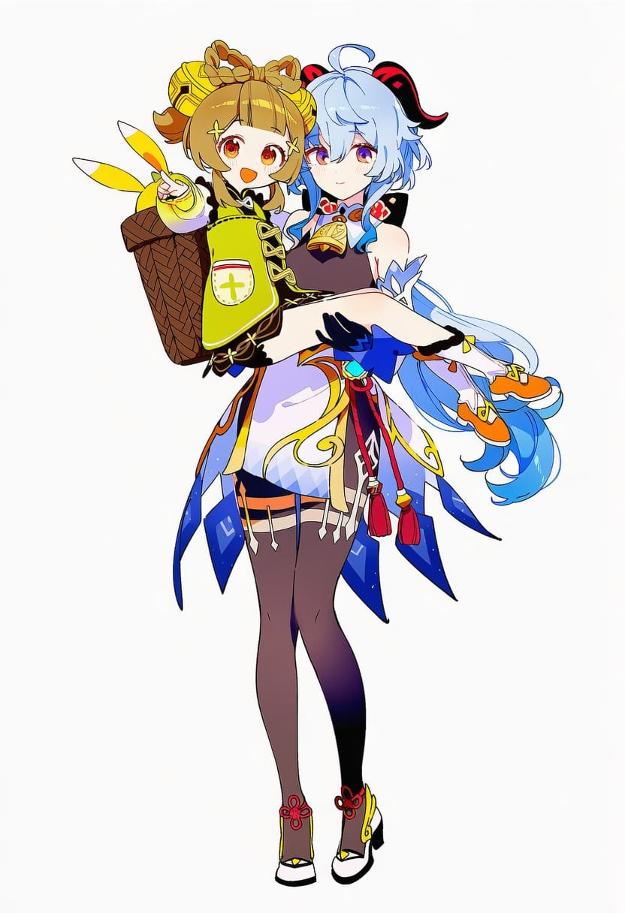

| 字段 | 内容 |
| --- | --- |
| Danbooru Tag | carrying_person |
| 中文名 | 抱/背着人 |
| 中文含义 | 一个角色正在支撑并搬运另一个角色。 |
| 子类 | 背负/抱起/支撑 |
| 模特 | 2girls,ganyu_(genshin_impact),yaoyao_(genshin_impact) |
| 序号 | 0081 |

## 75. carrying_multiple_people — 同时搬多人

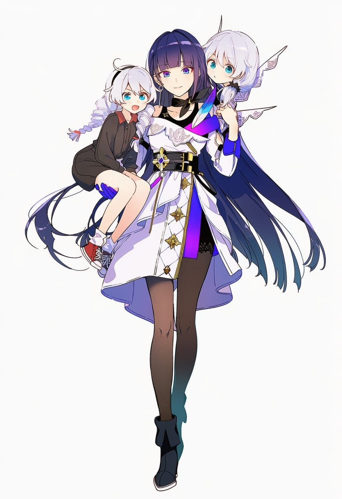

| 字段 | 内容 |
| --- | --- |
| Danbooru Tag | carrying_multiple_people |
| 中文名 | 同时搬多人 |
| 中文含义 | 一个角色同时背、抱或扛着多个人。 |
| 子类 | 背负/抱起/支撑 |
| 模特 | 3girls,kiana_kaslana,raiden_mei_(apho),theresa_apocalypse |
| 序号 | 0082 |

## 76. princess_carry — 公主抱

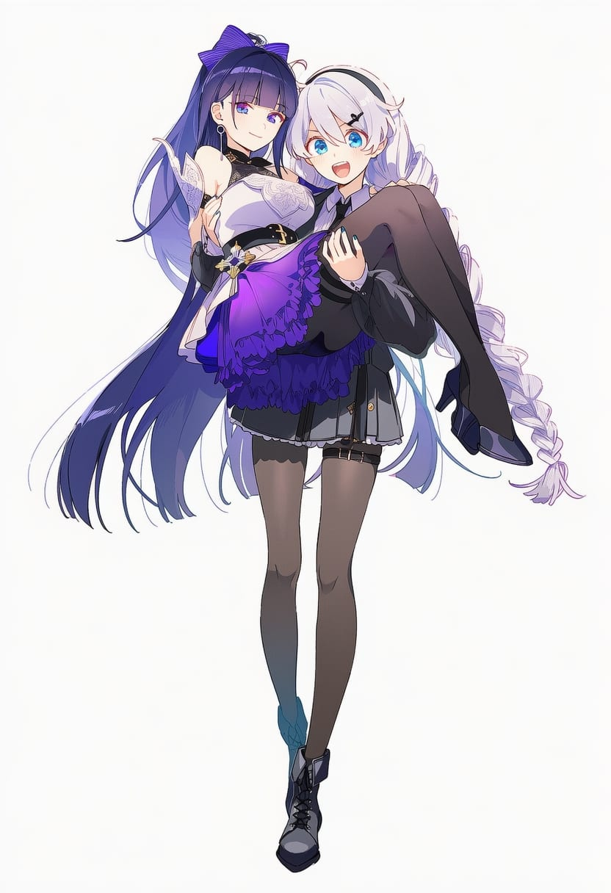

| 字段 | 内容 |
| --- | --- |
| Danbooru Tag | princess_carry |
| 中文名 | 公主抱 |
| 中文含义 | 一只手托上身、一只手托腿横抱对方。 |
| 子类 | 背负/抱起/支撑 |
| 模特 | 2girls,kiana_kaslana,raiden_mei_(apho) |
| 序号 | 0083 |

## 77. piggyback — 背人

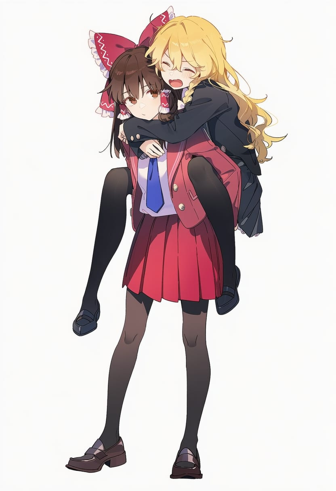

| 字段 | 内容 |
| --- | --- |
| Danbooru Tag | piggyback |
| 中文名 | 背人 |
| 中文含义 | 一个角色趴在另一个角色背上被背着。 |
| 子类 | 背负/抱起/支撑 |
| 模特 | 2girls,hakurei_reimu,kirisame_marisa |
| 序号 | 0085 |

## 78. fireman's_carry — 消防员扛法

| 字段 | 内容 |
| --- | --- |
| Danbooru Tag | fireman's_carry |
| 中文名 | 消防员扛法 |
| 中文含义 | 把另一角色横扛在肩部。 |
| 子类 | 背负/抱起/支撑 |
| 模特 | 2girls,nero_claudius_(fate),tamamo_no_mae_(fate) |
| 序号 | 0086 |

## 79. shoulder_carry — 肩扛

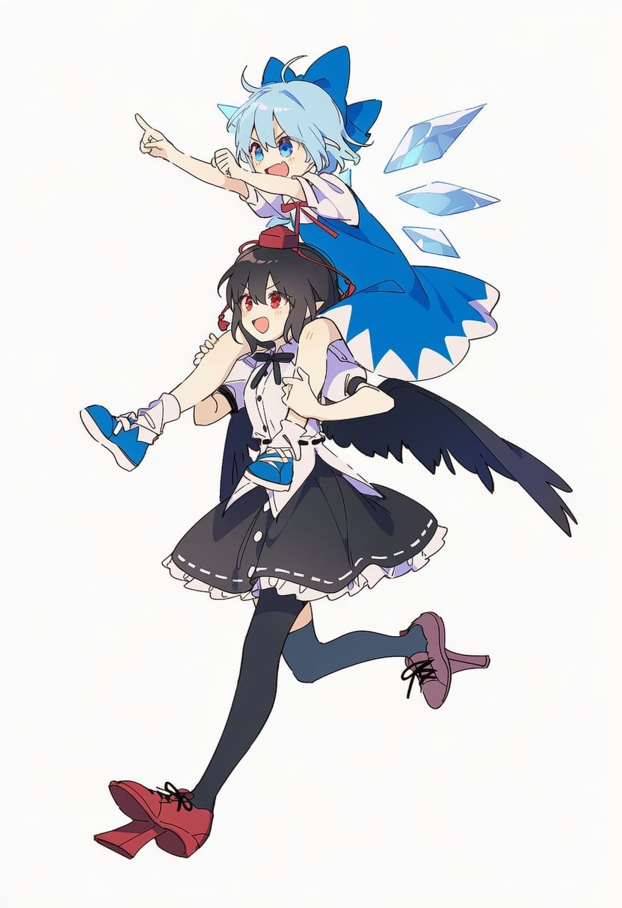

| 字段 | 内容 |
| --- | --- |
| Danbooru Tag | shoulder_carry |
| 中文名 | 肩扛 |
| 中文含义 | 把另一角色放在肩上搬运。 |
| 子类 | 背负/抱起/支撑 |
| 模特 | 2girls,cirno,shameimaru_aya |
| 序号 | 0087 |

## 80. armpit_carry — 腋下提抱

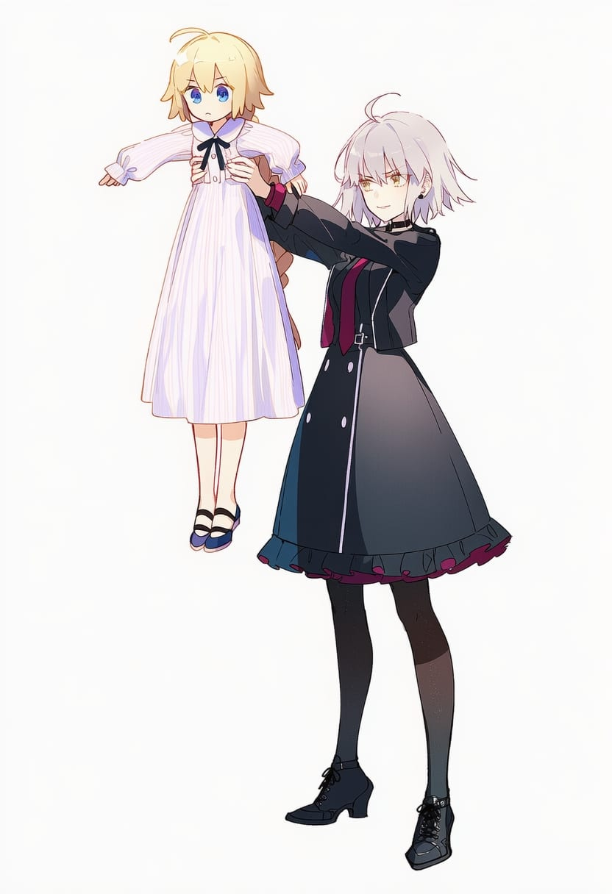

| 字段 | 内容 |
| --- | --- |
| Danbooru Tag | armpit_carry |
| 中文名 | 腋下提抱 |
| 中文含义 | 从腋下托住或提起另一角色。 |
| 子类 | 背负/抱起/支撑 |
| 模特 | 2girls,jeanne_d'arc_(fate),jeanne_d'arc_alter_(fate) |
| 序号 | 0088 |

## 81. baby_carry — 抱婴儿

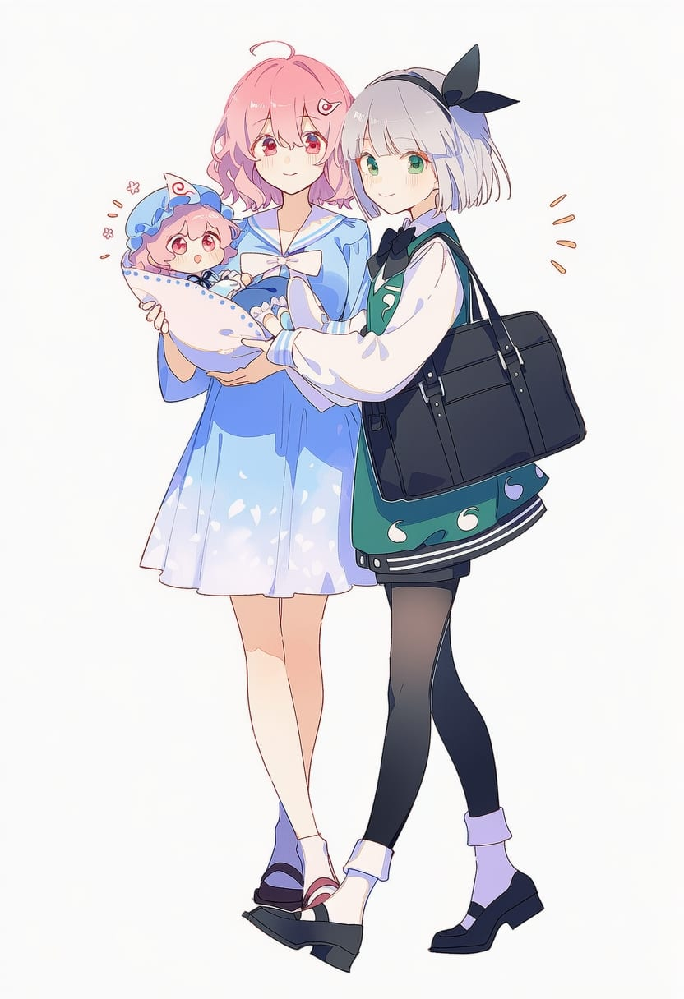

| 字段 | 内容 |
| --- | --- |
| Danbooru Tag | baby_carry |
| 中文名 | 抱婴儿 |
| 中文含义 | 以抱婴儿的方式抱住小孩或较小角色。 |
| 子类 | 背负/抱起/支撑 |
| 模特 | 2girls,saigyouji_yuyuko,konpaku_youmu |
| 序号 | 0089 |

## 82. child_carry — 抱小孩

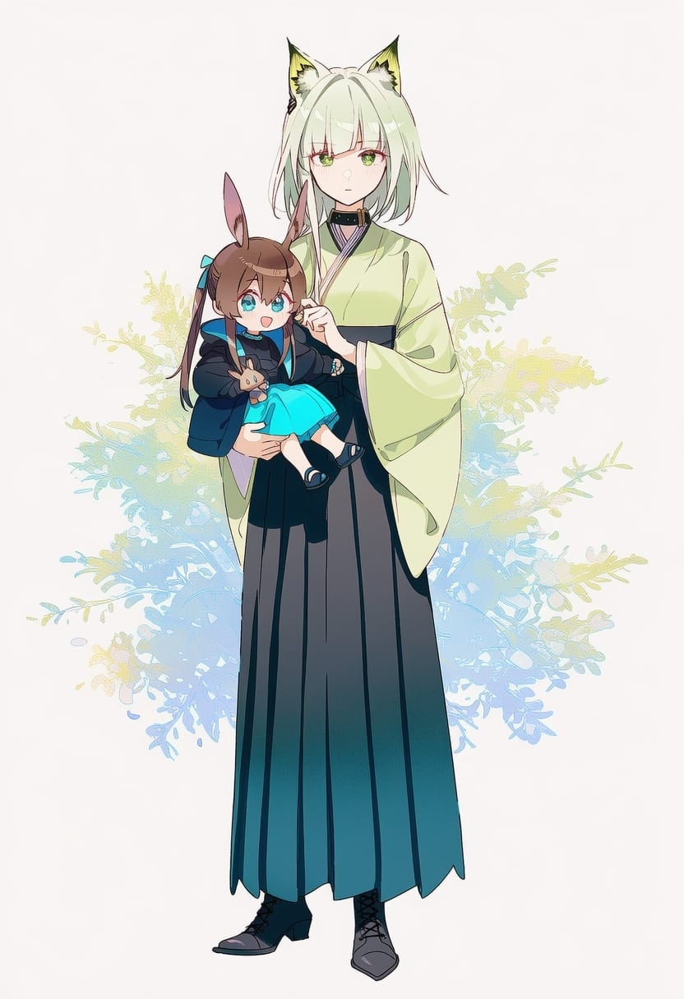

| 字段 | 内容 |
| --- | --- |
| Danbooru Tag | child_carry |
| 中文名 | 抱小孩 |
| 中文含义 | 把儿童角色抱起或携带。 |
| 子类 | 背负/抱起/支撑 |
| 模特 | 2girls,kal'tsit_(arknights),amiya_(arknights) |
| 序号 | 0090 |

## 83. hug_carry — 拥抱式抱起

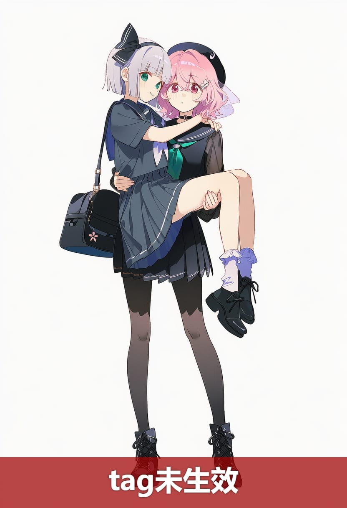

| 字段 | 内容 |
| --- | --- |
| Danbooru Tag | hug_carry |
| 中文名 | 拥抱式抱起 |
| 中文含义 | 抱住对方身体并同时将其抱起。 |
| 子类 | 背负/抱起/支撑 |
| 模特 | 2girls,konpaku_youmu,saigyouji_yuyuko |
| 序号 | 0091 |

## 84. sitting_on_shoulder — 坐在肩上

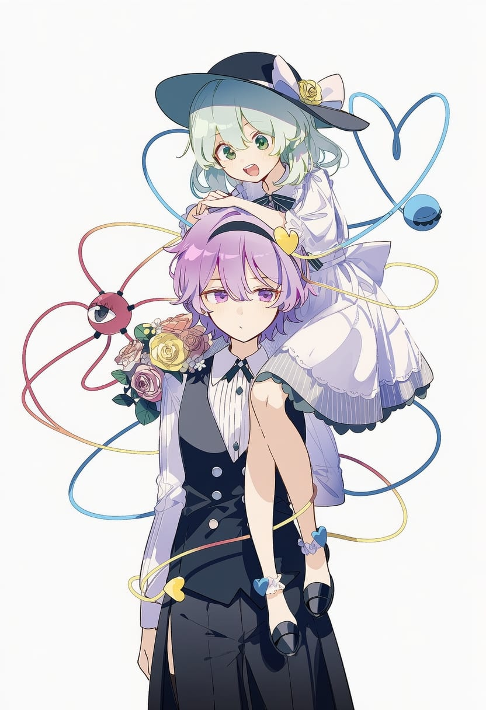

| 字段 | 内容 |
| --- | --- |
| Danbooru Tag | sitting_on_shoulder |
| 中文名 | 坐在肩上 |
| 中文含义 | 一个角色坐在另一个角色肩膀上。 |
| 子类 | 背负/抱起/支撑 |
| 模特 | 2girls,komeiji_satori,komeiji_koishi |
| 序号 | 0092 |

## 85. supporting_another's_weight — 支撑他人体重

| 字段 | 内容 |
| --- | --- |
| Danbooru Tag | supporting_another's_weight |
| 中文名 | 支撑他人体重 |
| 中文含义 | 托住或扶住另一角色以防其倒下。 |
| 子类 | 背负/抱起/支撑 |
| 模特 | 2girls,xianyun_(genshin_impact),shenhe_(genshin_impact) |
| 序号 | 0093 |

## 86. helping_up — 扶起

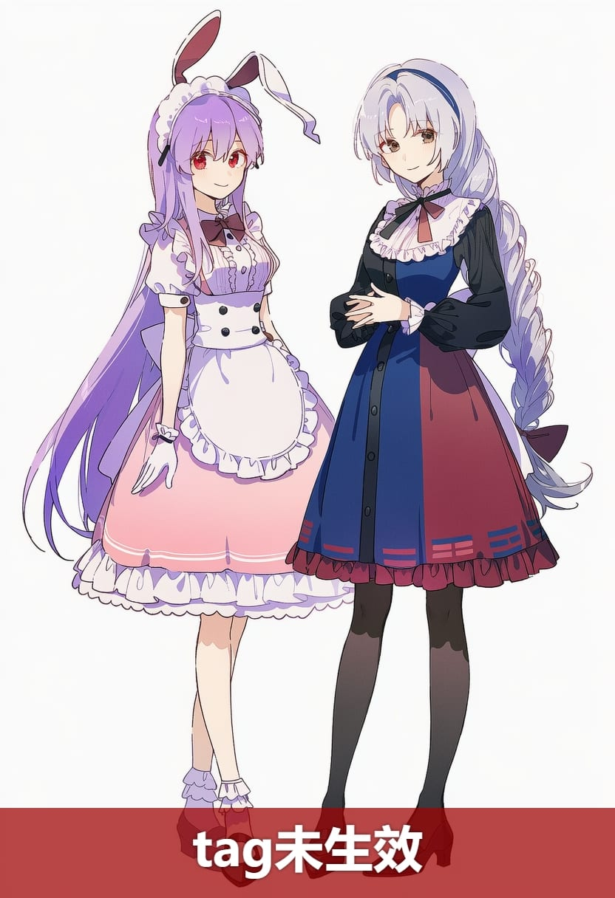

| 字段 | 内容 |
| --- | --- |
| Danbooru Tag | helping_up |
| 中文名 | 扶起 |
| 中文含义 | 伸手或用身体帮助另一角色站起来。 |
| 子类 | 背负/抱起/支撑 |
| 模特 | 2girls,yagokoro_eirin,reisen_udongein_inaba |
| 序号 | 0094 |

## 87. sitting_on_lap — 坐在腿上

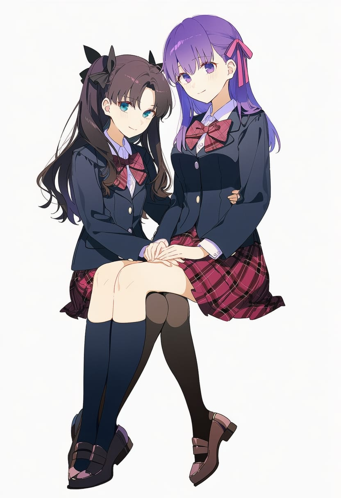

| 字段 | 内容 |
| --- | --- |
| Danbooru Tag | sitting_on_lap |
| 中文名 | 坐在腿上 |
| 中文含义 | 一个角色坐在另一个角色的大腿或膝上。 |
| 子类 | 坐卧/群体互动 |
| 模特 | 2girls,tohsaka_rin,matou_sakura |
| 序号 | 0095 |

## 88. lap_pillow — 膝枕

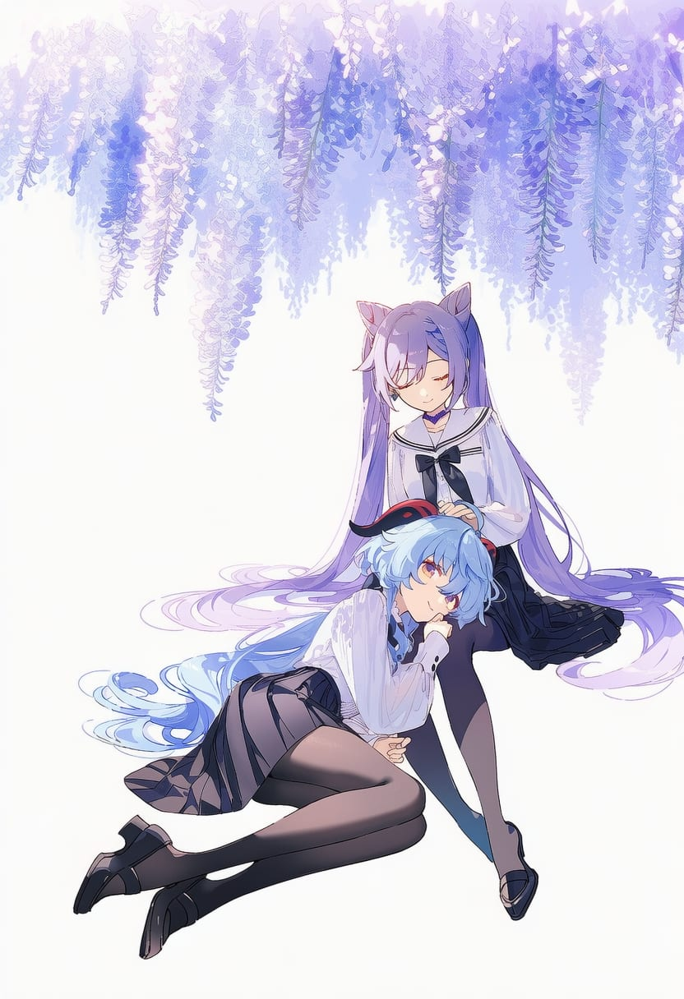

| 字段 | 内容 |
| --- | --- |
| Danbooru Tag | lap_pillow |
| 中文名 | 膝枕 |
| 中文含义 | 一个角色把头枕在另一角色的大腿上。 |
| 子类 | 坐卧/群体互动 |
| 模特 | 2girls,ganyu_(genshin_impact),keqing_(genshin_impact) |
| 序号 | 0096 |

## 89. head_in_lap — 头枕腿上

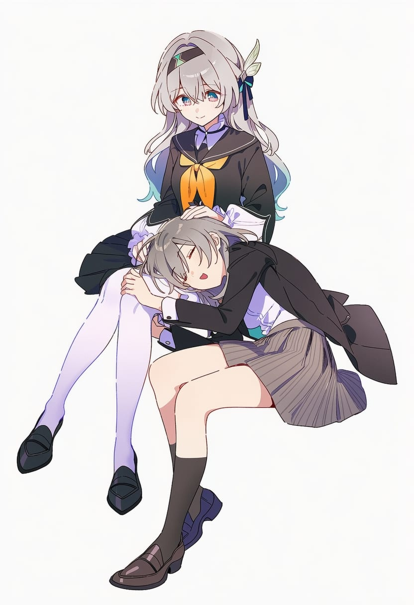

| 字段 | 内容 |
| --- | --- |
| Danbooru Tag | head_in_lap |
| 中文名 | 头枕腿上 |
| 中文含义 | 头部放在另一角色腿上休息。 |
| 子类 | 坐卧/群体互动 |
| 模特 | 2girls,firefly_(honkai:_star_rail),stelle_(honkai:_star_rail) |
| 序号 | 0097 |

## 90. sleeping_together — 一起睡觉

| 字段 | 内容 |
| --- | --- |
| Danbooru Tag | sleeping_together |
| 中文名 | 一起睡觉 |
| 中文含义 | 多个角色靠在一起睡觉。 |
| 子类 | 坐卧/群体互动 |
| 模特 | 2girls,kiana_kaslana,raiden_mei_(apho) |
| 序号 | 0098 |

## 91. huddling — 挤在一起

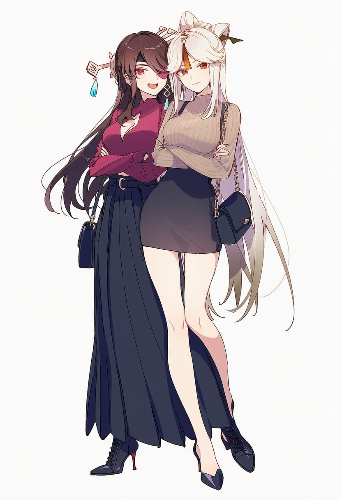

| 字段 | 内容 |
| --- | --- |
| Danbooru Tag | huddling |
| 中文名 | 挤在一起 |
| 中文含义 | 多个角色紧密聚拢在一起。 |
| 子类 | 坐卧/群体互动 |
| 模特 | 2girls,beidou_(genshin_impact),ningguang_(genshin_impact) |
| 序号 | 0099 |

## 92. group_hug — 多人拥抱

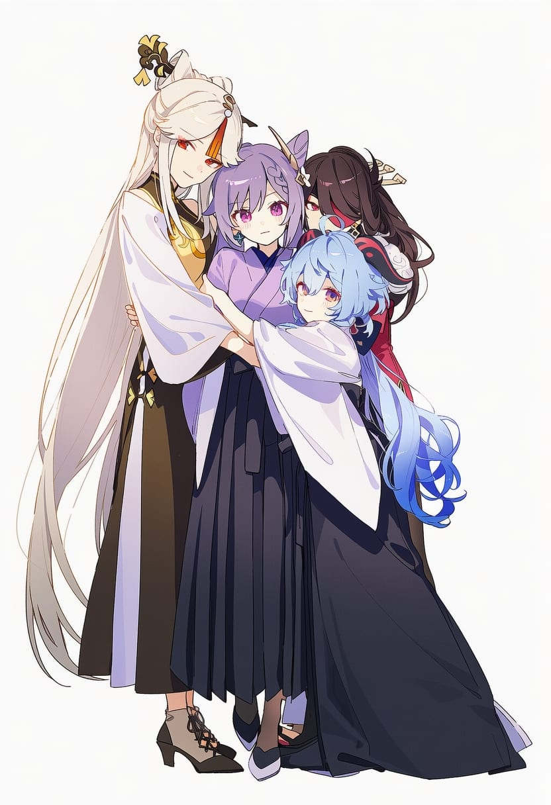

| 字段 | 内容 |
| --- | --- |
| Danbooru Tag | group_hug |
| 中文名 | 多人拥抱 |
| 中文含义 | 三人或更多角色共同拥抱。 |
| 子类 | 坐卧/群体互动 |
| 模特 | 4girls,ganyu_(genshin_impact),keqing_(genshin_impact),ningguang_(genshin_impact),beidou_(genshin_impact) |
| 序号 | 0100 |

## 93. group_hugging — 群体抱在一起

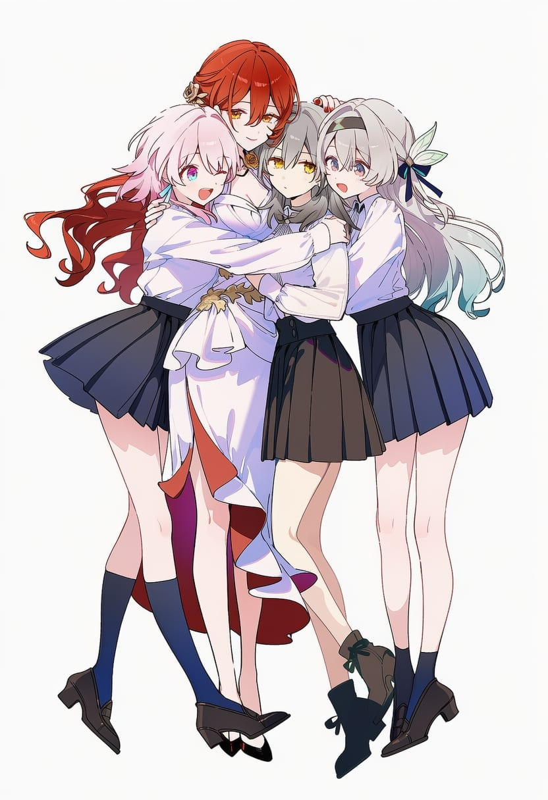

| 字段 | 内容 |
| --- | --- |
| Danbooru Tag | group_hugging |
| 中文名 | 群体抱在一起 |
| 中文含义 | 多个角色形成集体拥抱状态。 |
| 子类 | 坐卧/群体互动 |
| 模特 | 4girls,stelle_(honkai:_star_rail),firefly_(honkai:_star_rail),march_7th_(honkai:_star_rail),himeko_(honkai:_star_rail) |
| 序号 | 0101 |

## 94. forming_a_circle — 围成一圈

| 字段 | 内容 |
| --- | --- |
| Danbooru Tag | forming_a_circle |
| 中文名 | 围成一圈 |
| 中文含义 | 多个角色共同围成圆圈。 |
| 子类 | 坐卧/群体互动 |
| 模特 | 4girls,hakurei_reimu,kirisame_marisa,konpaku_youmu,saigyouji_yuyuko |
| 序号 | 0102 |

## 95. human_pyramid — 叠罗汉

| 字段 | 内容 |
| --- | --- |
| Danbooru Tag | human_pyramid |
| 中文名 | 叠罗汉 |
| 中文含义 | 多人用身体堆叠成人体金字塔。 |
| 子类 | 坐卧/群体互动 |
| 模特 | 4girls,cirno,shameimaru_aya,hakurei_reimu,kirisame_marisa |
| 序号 | 0103 |

## 96. stacked_on_top_of_each_other — 叠在一起

| 字段 | 内容 |
| --- | --- |
| Danbooru Tag | stacked_on_top_of_each_other |
| 中文名 | 叠在一起 |
| 中文含义 | 多个角色上下堆叠或压在一起。 |
| 子类 | 坐卧/群体互动 |
| 模特 | 3girls,hu_tao_(genshin_impact),qiqi_(genshin_impact),yaoyao_(genshin_impact) |
| 序号 | 0104 |

## 97. multiple_riders — 多人同乘

| 字段 | 内容 |
| --- | --- |
| Danbooru Tag | multiple_riders |
| 中文名 | 多人同乘 |
| 中文含义 | 多个角色同时骑乘同一载具或动物。 |
| 子类 | 坐卧/群体互动 |
| 模特 | 3girls,stelle_(honkai:_star_rail),march_7th_(honkai:_star_rail),himeko_(honkai:_star_rail) |
| 序号 | 0105 |

## 98. kiss — 亲吻

| 字段 | 内容 |
| --- | --- |
| Danbooru Tag | kiss |
| 中文名 | 亲吻 |
| 中文含义 | 角色之间发生亲吻。 |
| 子类 | 亲昵/浪漫互动 |
| 模特 | 2girls,ganyu_(genshin_impact),keqing_(genshin_impact) |
| 序号 | 0106 |

## 99. kissing — 接吻

| 字段 | 内容 |
| --- | --- |
| Danbooru Tag | kissing |
| 中文名 | 接吻 |
| 中文含义 | 两个角色正在亲吻彼此。 |
| 子类 | 亲昵/浪漫互动 |
| 模特 | 2girls,firefly_(honkai:_star_rail),stelle_(honkai:_star_rail) |
| 序号 | 0107 |

## 100. kiss_on_cheek — 亲脸颊

| 字段 | 内容 |
| --- | --- |
| Danbooru Tag | kiss_on_cheek |
| 中文名 | 亲脸颊 |
| 中文含义 | 亲吻另一角色的脸颊。 |
| 子类 | 亲昵/浪漫互动 |
| 模特 | 2girls,kiana_kaslana,raiden_mei_(apho) |
| 序号 | 0108 |

## 101. cheek_kiss — 脸颊吻

| 字段 | 内容 |
| --- | --- |
| Danbooru Tag | cheek_kiss |
| 中文名 | 脸颊吻 |
| 中文含义 | 以脸颊为目标的亲吻互动。 |
| 子类 | 亲昵/浪漫互动 |
| 模特 | 2girls,beidou_(genshin_impact),ningguang_(genshin_impact) |
| 序号 | 0109 |

## 102. forehead_kiss — 亲额头

| 字段 | 内容 |
| --- | --- |
| Danbooru Tag | forehead_kiss |
| 中文名 | 亲额头 |
| 中文含义 | 亲吻另一角色的额头。 |
| 子类 | 亲昵/浪漫互动 |
| 模特 | 2girls,ganyu_(genshin_impact),keqing_(genshin_impact) |
| 序号 | 0110 |

## 103. hand_kiss — 吻手

| 字段 | 内容 |
| --- | --- |
| Danbooru Tag | hand_kiss |
| 中文名 | 吻手 |
| 中文含义 | 亲吻另一角色的手。 |
| 子类 | 亲昵/浪漫互动 |
| 模特 | 2girls,tohsaka_rin,matou_sakura |
| 序号 | 0111 |

## 104. indirect_kiss — 间接接吻

| 字段 | 内容 |
| --- | --- |
| Danbooru Tag | indirect_kiss |
| 中文名 | 间接接吻 |
| 中文含义 | 通过共同接触物品等形成间接亲吻。 |
| 子类 | 亲昵/浪漫互动 |
| 模特 | 2girls,firefly_(honkai:_star_rail),stelle_(honkai:_star_rail) |
| 序号 | 0112 |

## 105. imminent_kiss — 即将接吻

| 字段 | 内容 |
| --- | --- |
| Danbooru Tag | imminent_kiss |
| 中文名 | 即将接吻 |
| 中文含义 | 两人靠得很近，马上要亲吻。 |
| 子类 | 亲昵/浪漫互动 |
| 模特 | 2girls,kiana_kaslana,raiden_mei_(apho) |
| 序号 | 0113 |

## 106. rejected_kiss — 拒绝亲吻

| 字段 | 内容 |
| --- | --- |
| Danbooru Tag | rejected_kiss |
| 中文名 | 拒绝亲吻 |
| 中文含义 | 一方尝试亲吻但被另一方拒绝。 |
| 子类 | 亲昵/浪漫互动 |
| 模特 | 2girls,hu_tao_(genshin_impact),qiqi_(genshin_impact) |
| 序号 | 0114 |

## 107. blowing_a_kiss — 飞吻

| 字段 | 内容 |
| --- | --- |
| Danbooru Tag | blowing_a_kiss |
| 中文名 | 飞吻 |
| 中文含义 | 用手和嘴做出把吻送出去的动作。 |
| 子类 | 亲昵/浪漫互动 |
| 模特 | 2girls,hakurei_reimu,kirisame_marisa |
| 序号 | 0115 |

## 108. nuzzling — 蹭脸 / 依偎摩擦

| 字段 | 内容 |
| --- | --- |
| Danbooru Tag | nuzzling |
| 中文名 | 蹭脸 / 依偎摩擦 |
| 中文含义 | 用脸或头部亲昵地蹭另一角色。 |
| 子类 | 亲昵/浪漫互动 |
| 模特 | 2girls,ganyu_(genshin_impact),keqing_(genshin_impact) |
| 序号 | 0116 |

## 109. licking_another's_cheek — 舔脸颊

| 字段 | 内容 |
| --- | --- |
| Danbooru Tag | licking_another's_cheek |
| 中文名 | 舔脸颊 |
| 中文含义 | 舔另一角色的脸颊。 |
| 子类 | 亲昵/浪漫互动 |
| 模特 | 2girls,konpaku_youmu,saigyouji_yuyuko |
| 序号 | 0117 |

## 110. licking_another's_face — 舔脸

| 字段 | 内容 |
| --- | --- |
| Danbooru Tag | licking_another's_face |
| 中文名 | 舔脸 |
| 中文含义 | 舔另一角色的脸部。 |
| 子类 | 亲昵/浪漫互动 |
| 模特 | 2girls,komeiji_satori,komeiji_koishi |
| 序号 | 0118 |

## 111. whispering_in_ear — 耳边低语

| 字段 | 内容 |
| --- | --- |
| Danbooru Tag | whispering_in_ear |
| 中文名 | 耳边低语 |
| 中文含义 | 靠近另一角色耳边小声说话。 |
| 子类 | 亲昵/浪漫互动 |
| 模特 | 2girls,beidou_(genshin_impact),ningguang_(genshin_impact) |
| 序号 | 0119 |

## 112. tickling — 挠痒

| 字段 | 内容 |
| --- | --- |
| Danbooru Tag | tickling |
| 中文名 | 挠痒 |
| 中文含义 | 用手挠另一角色使其发痒。 |
| 子类 | 嬉闹/对抗互动 |
| 模特 | 2girls,remilia_scarlet,flandre_scarlet |
| 序号 | 0120 |

## 113. noogie — 拳揉头

| 字段 | 内容 |
| --- | --- |
| Danbooru Tag | noogie |
| 中文名 | 拳揉头 |
| 中文含义 | 用拳头或手臂夹住对方头部嬉闹摩擦。 |
| 子类 | 嬉闹/对抗互动 |
| 模特 | 2girls,hu_tao_(genshin_impact),qiqi_(genshin_impact) |
| 序号 | 0121 |

## 114. play_fighting — 嬉闹打斗

| 字段 | 内容 |
| --- | --- |
| Danbooru Tag | play_fighting |
| 中文名 | 嬉闹打斗 |
| 中文含义 | 以玩闹性质进行打斗互动。 |
| 子类 | 嬉闹/对抗互动 |
| 模特 | 2girls,nero_claudius_(fate),tamamo_no_mae_(fate) |
| 序号 | 0122 |

## 115. arm_wrestling — 掰手腕

| 字段 | 内容 |
| --- | --- |
| Danbooru Tag | arm_wrestling |
| 中文名 | 掰手腕 |
| 中文含义 | 两人进行手臂力量较量。 |
| 子类 | 嬉闹/对抗互动 |
| 模特 | 2girls,fujiwara_no_mokou,houraisan_kaguya |
| 序号 | 0123 |

## 116. wrestling — 摔跤

| 字段 | 内容 |
| --- | --- |
| Danbooru Tag | wrestling |
| 中文名 | 摔跤 |
| 中文含义 | 角色彼此进行摔跤或扭打。 |
| 子类 | 嬉闹/对抗互动 |
| 模特 | 2girls,kal'tsit_(arknights),w_(arknights) |
| 序号 | 0124 |

## 117. pillow_fight — 枕头大战

| 字段 | 内容 |
| --- | --- |
| Danbooru Tag | pillow_fight |
| 中文名 | 枕头大战 |
| 中文含义 | 角色用枕头互相打闹。 |
| 子类 | 嬉闹/对抗互动 |
| 模特 | 4girls,stelle_(honkai:_star_rail),march_7th_(honkai:_star_rail),himeko_(honkai:_star_rail),firefly_(honkai:_star_rail) |
| 序号 | 0125 |

## 118. chasing — 追逐

| 字段 | 内容 |
| --- | --- |
| Danbooru Tag | chasing |
| 中文名 | 追逐 |
| 中文含义 | 一个角色追赶另一个角色。 |
| 子类 | 嬉闹/对抗互动 |
| 模特 | 2girls,kal'tsit_(arknights),w_(arknights) |
| 序号 | 0126 |

## 119. pushing_away — 推开

| 字段 | 内容 |
| --- | --- |
| Danbooru Tag | pushing_away |
| 中文名 | 推开 |
| 中文含义 | 用手把另一角色推离自己。 |
| 子类 | 嬉闹/对抗互动 |
| 模特 | 2girls,kal'tsit_(arknights),w_(arknights) |
| 序号 | 0127 |

## 120. restraining — 制止 / 控制

| 字段 | 内容 |
| --- | --- |
| Danbooru Tag | restraining |
| 中文名 | 制止 / 控制 |
| 中文含义 | 用身体或手臂限制另一角色行动。 |
| 子类 | 嬉闹/对抗互动 |
| 模特 | 2girls,artoria_pendragon_(fate),mordred_(fate) |
| 序号 | 0128 |

## 121. grabbing_another — 抓住他人

| 字段 | 内容 |
| --- | --- |
| Danbooru Tag | grabbing_another |
| 中文名 | 抓住他人 |
| 中文含义 | 用手抓住另一角色。 |
| 子类 | 嬉闹/对抗互动 |
| 模特 | 2girls,fujiwara_no_mokou,houraisan_kaguya |
| 序号 | 0129 |

## 122. pulling_another — 拉着他人

| 字段 | 内容 |
| --- | --- |
| Danbooru Tag | pulling_another |
| 中文名 | 拉着他人 |
| 中文含义 | 拉动另一角色朝自己或某方向移动。 |
| 子类 | 嬉闹/对抗互动 |
| 模特 | 2girls,hu_tao_(genshin_impact),qiqi_(genshin_impact) |
| 序号 | 0130 |

## 123. feeding_another — 喂别人

| 字段 | 内容 |
| --- | --- |
| Danbooru Tag | feeding_another |
| 中文名 | 喂别人 |
| 中文含义 | 把食物送到另一角色嘴边。 |
| 子类 | 嬉闹/对抗互动 |
| 模特 | 2girls,ganyu_(genshin_impact),keqing_(genshin_impact) |
| 序号 | 0132 |

## 124. sharing_food — 分享食物

| 字段 | 内容 |
| --- | --- |
| Danbooru Tag | sharing_food |
| 中文名 | 分享食物 |
| 中文含义 | 多个角色共同分享同一份食物。 |
| 子类 | 嬉闹/对抗互动 |
| 模特 | 2girls,hakurei_reimu,kirisame_marisa |
| 序号 | 0133 |

## 125. sharing_drink — 分享饮料

| 字段 | 内容 |
| --- | --- |
| Danbooru Tag | sharing_drink |
| 中文名 | 分享饮料 |
| 中文含义 | 多个角色共同分享饮料。 |
| 子类 | 嬉闹/对抗互动 |
| 模特 | 2girls,firefly_(honkai:_star_rail),stelle_(honkai:_star_rail) |
| 序号 | 0134 |

---
