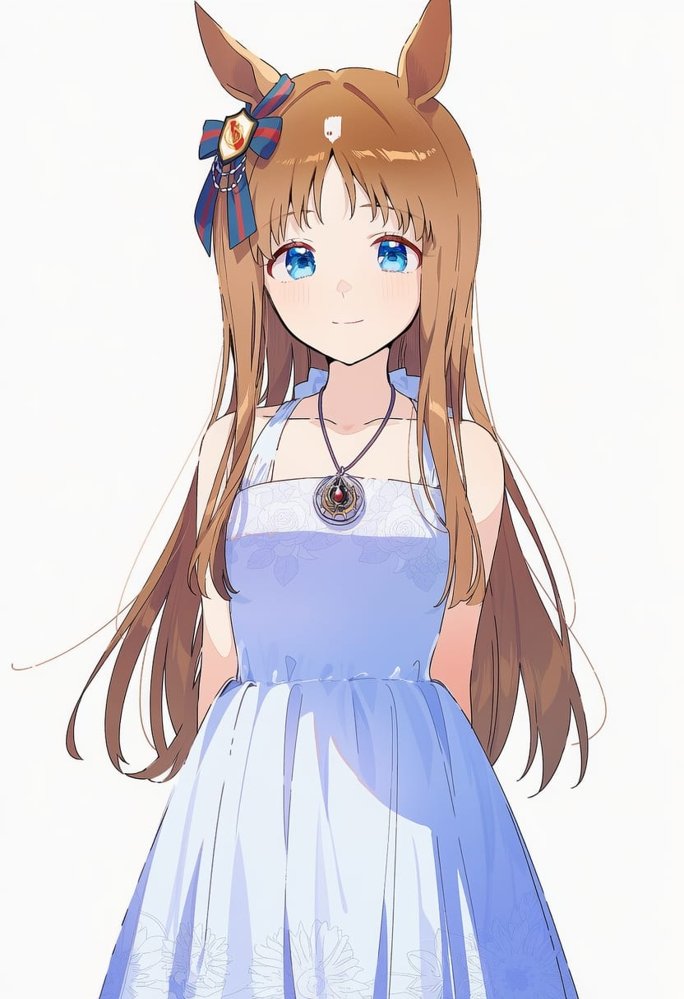
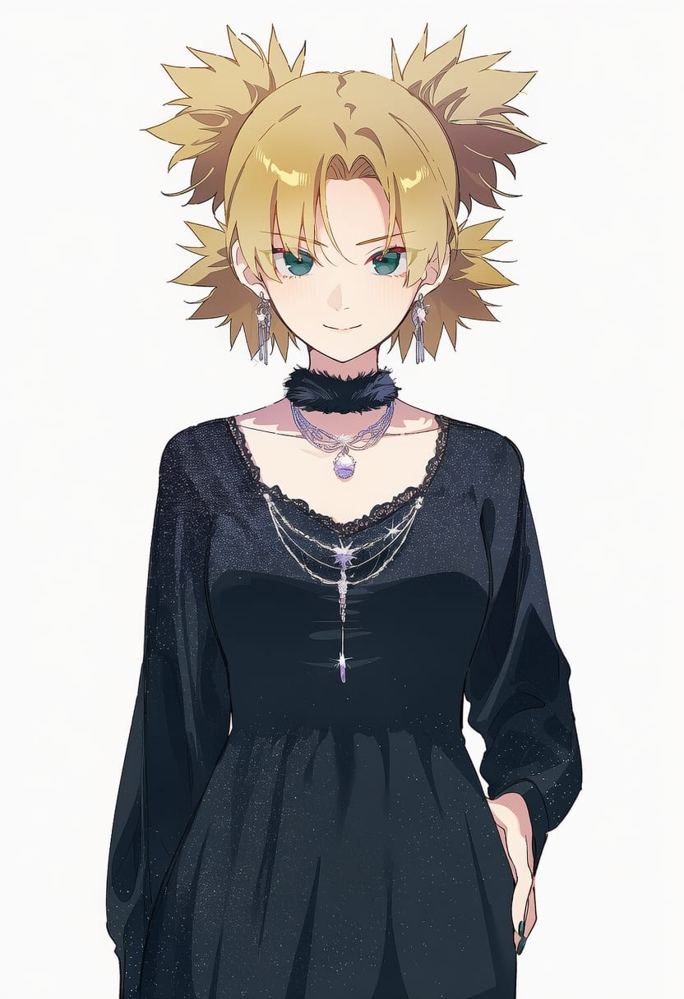
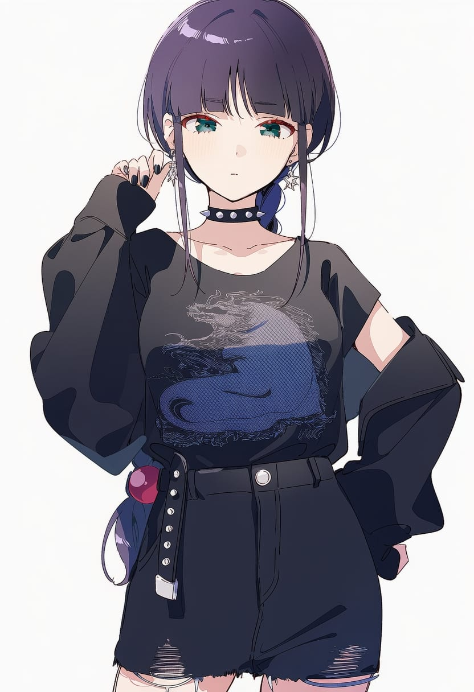
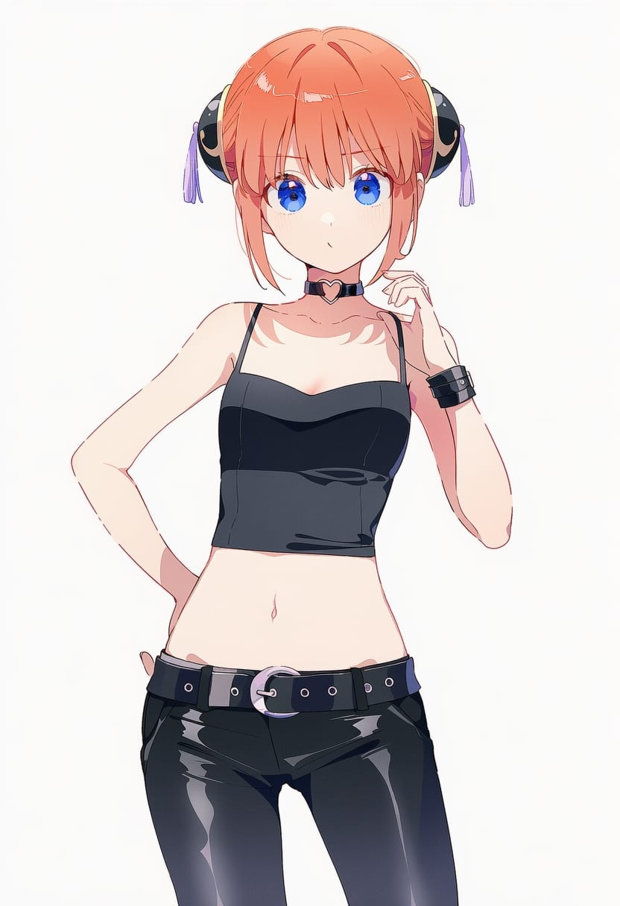
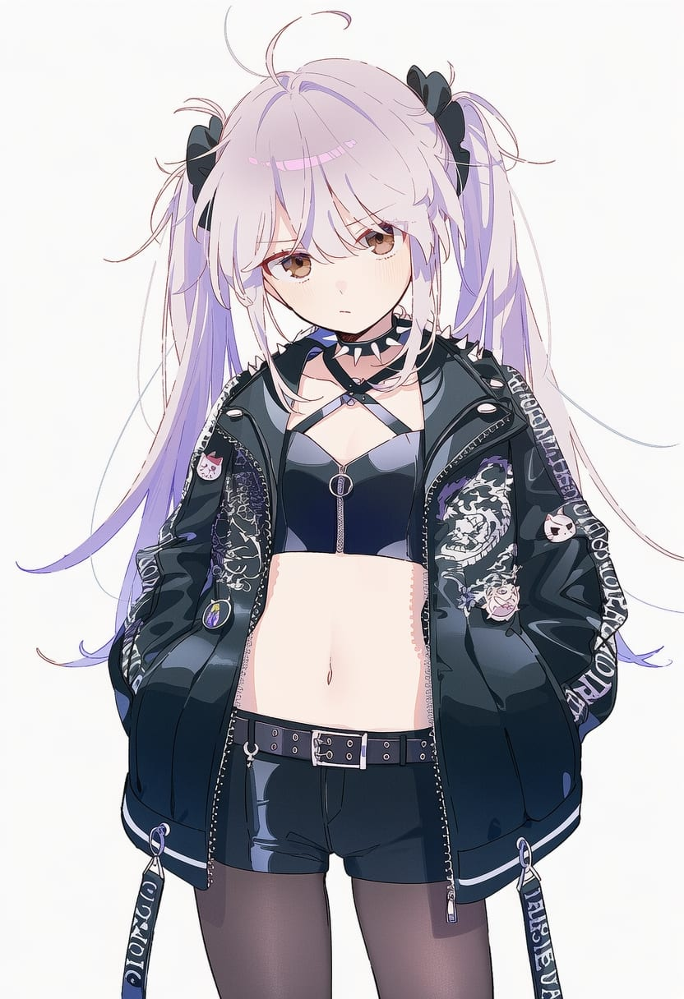
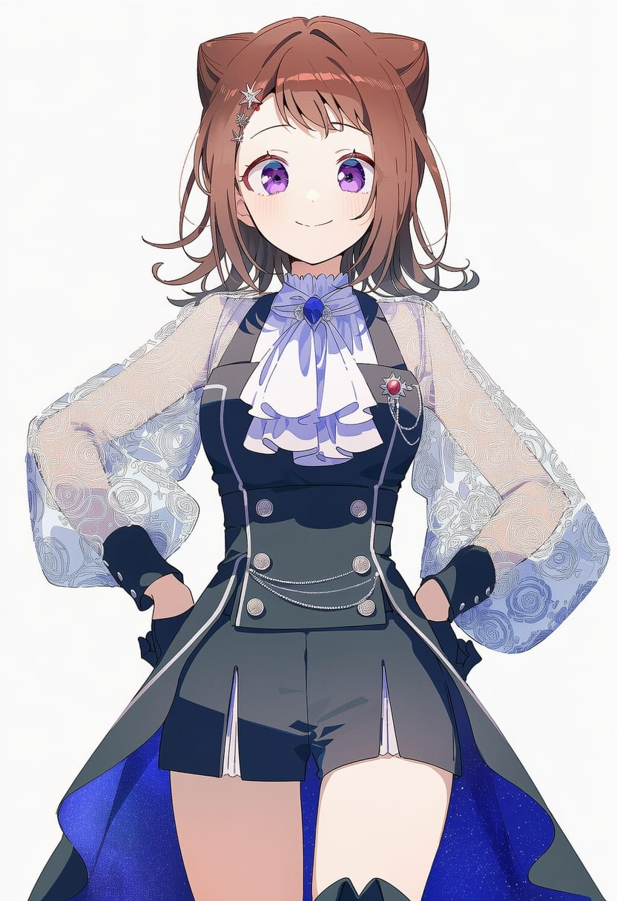
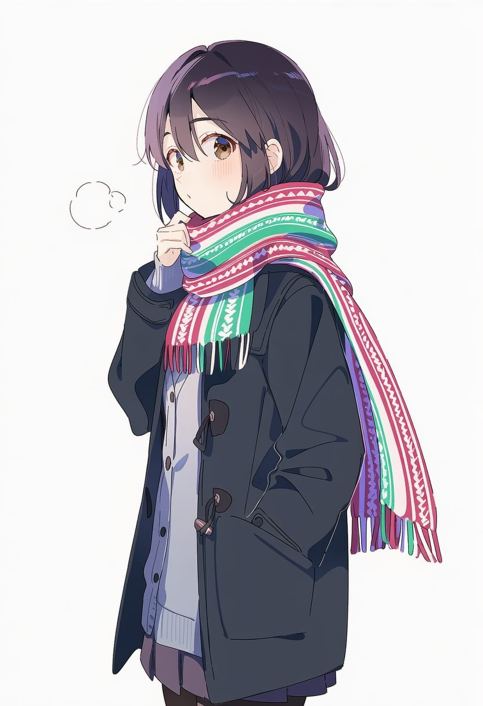
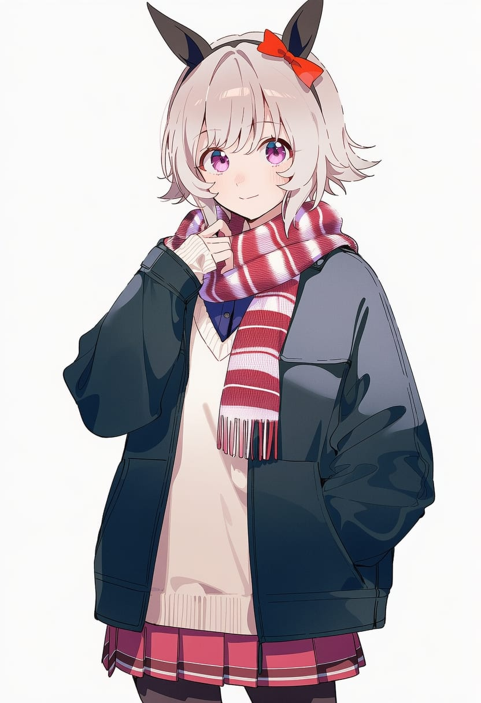
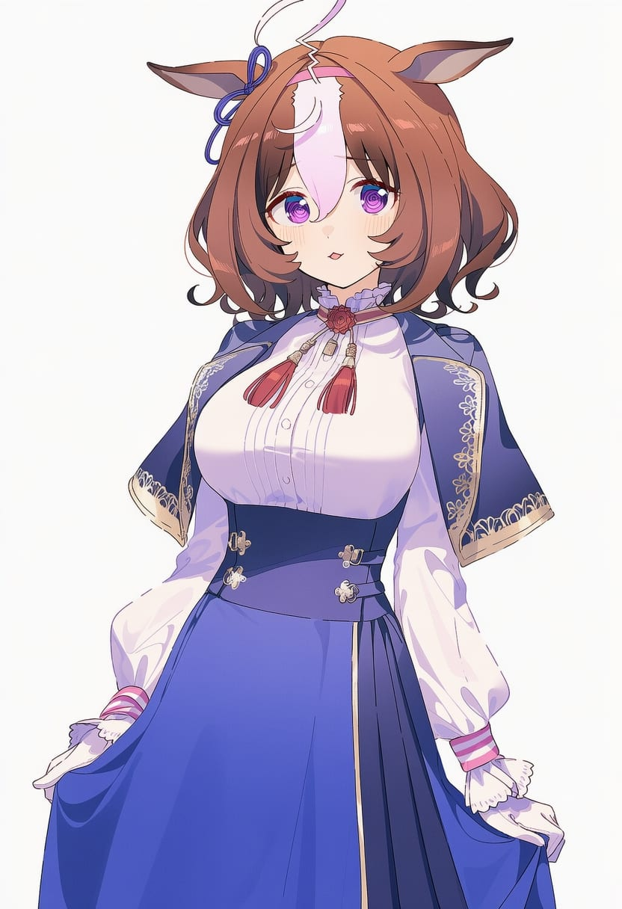
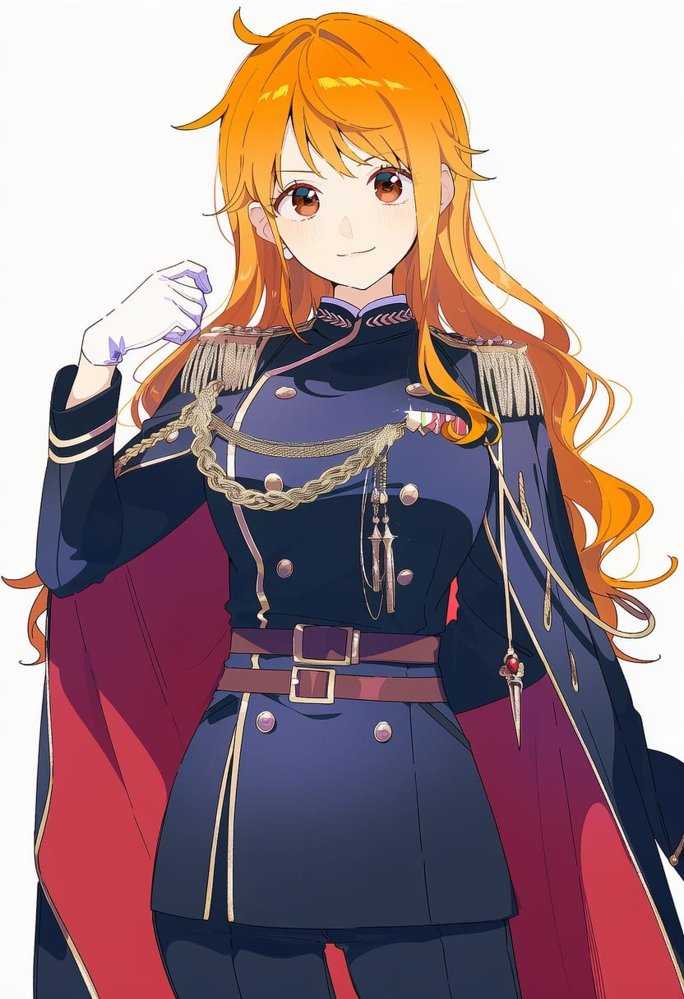

## 1. necklace — 项链

| 字段 | 内容 |
| --- | --- |
| Danbooru Tag | necklace |
| 中文名 | 项链 |
| 中文含义 | 泛指戴在颈部的项链。 |
| 子类 | 项链/吊坠 |
| 模特 | 1girl,hikawa_hina |
| 序号 | 0001 |

---

## 2. multiple_necklaces — 多层项链

| 字段 | 内容 |
| --- | --- |
| Danbooru Tag | multiple_necklaces |
| 中文名 | 多层项链 |
| 中文含义 | 同时佩戴多条项链。 |
| 子类 | 项链/吊坠 |
| 模特 | 1girl,rupa_(girls_band_cry) |
| 序号 | 0002 |

---

## 3. chain_necklace — 链条项链

| 字段 | 内容 |
| --- | --- |
| Danbooru Tag | chain_necklace |
| 中文名 | 链条项链 |
| 中文含义 | 以金属链条为主体的项链。 |
| 子类 | 项链/吊坠 |
| 模特 | 1girl,kaname_raana |
| 序号 | 0003 |

---

## 4. bead_necklace — 珠串项链

| 字段 | 内容 |
| --- | --- |
| Danbooru Tag | bead_necklace |
| 中文名 | 珠串项链 |
| 中文含义 | 由珠子串成的项链。 |
| 子类 | 项链/吊坠 |
| 模特 | 1girl,togawa_sakiko |
| 序号 | 0004 |

---

## 5. pearl_necklace — 珍珠项链

| 字段 | 内容 |
| --- | --- |
| Danbooru Tag | pearl_necklace |
| 中文名 | 珍珠项链 |
| 中文含义 | 由珍珠串成的项链。 |
| 子类 | 项链/吊坠 |
| 模特 | 1girl,tier_harribel |
| 序号 | 0005 |

---

## 6. pendant — 吊坠

| 字段 | 内容 |
| --- | --- |
| Danbooru Tag | pendant |
| 中文名 | 吊坠 |
| 中文含义 | 挂在颈部链条上的主要坠饰。 |
| 子类 | 项链/吊坠 |
| 模特 | 1girl,uzumaki_kushina |
| 序号 | 0006 |

---

## 7. locket — 盒式吊坠

| 字段 | 内容 |
| --- | --- |
| Danbooru Tag | locket |
| 中文名 | 盒式吊坠 |
| 中文含义 | 可以打开的小盒式吊坠。 |
| 子类 | 项链/吊坠 |
| 模特 | 1girl,matsumoto_rangiku |
| 序号 | 0007 |

---

## 8. amulet — 护身符项链

| 字段 | 内容 |
| --- | --- |
| Danbooru Tag | amulet |
| 中文名 | 护身符项链 |
| 中文含义 | 挂在颈部的护身符或符牌。 |
| 子类 | 项链/吊坠 |
| 模特 | 1girl,grass_wonder_(umamusume) |
| 序号 | 0008 |

---

## 9. dog_tags — 军牌项链

| 字段 | 内容 |
| --- | --- |
| Danbooru Tag | dog_tags |
| 中文名 | 军牌项链 |
| 中文含义 | 军用身份牌式项链。 |
| 子类 | 项链/吊坠 |
| 模特 | 1girl,special_week_(umamusume) |
| 序号 | 0009 |

---

## 10. rosary — 念珠

| 字段 | 内容 |
| --- | --- |
| Danbooru Tag | rosary |
| 中文名 | 念珠 |
| 中文含义 | 宗教念珠或念珠项链。 |
| 子类 | 项链/吊坠 |
| 模特 | 1girl,matikanetannhauser_(umamusume) |
| 序号 | 0010 |

---

## 11. gold_chain — 金链

| 字段 | 内容 |
| --- | --- |
| Danbooru Tag | gold_chain |
| 中文名 | 金链 |
| 中文含义 | 金色或金质感的粗链条；链条颜色款只留这一种代表。 |
| 子类 | 项链/吊坠 |
| 模特 | 1girl,mihono_bourbon_(umamusume) |
| 序号 | 0011 |

---

## 12. anchor_necklace — 船锚项链

| 字段 | 内容 |
| --- | --- |
| Danbooru Tag | anchor_necklace |
| 中文名 | 船锚项链 |
| 中文含义 | 带船锚造型吊坠的项链。 |
| 子类 | 项链/吊坠 |
| 模特 | 1girl,yui_(angel_beats!) |
| 序号 | 0012 |

---

## 13. dice_necklace — 骰子项链

| 字段 | 内容 |
| --- | --- |
| Danbooru Tag | dice_necklace |
| 中文名 | 骰子项链 |
| 中文含义 | 带骰子造型吊坠的项链。 |
| 子类 | 项链/吊坠 |
| 模特 | 1girl,wendy_marvell |
| 序号 | 0013 |

---

## 14. cross_necklace — 十字架项链

| 字段 | 内容 |
| --- | --- |
| Danbooru Tag | cross_necklace |
| 中文名 | 十字架项链 |
| 中文含义 | 带十字架吊坠的项链。 |
| 子类 | 项链/吊坠 |
| 模特 | 1girl,jungle_pocket_(umamusume) |
| 序号 | 0014 |

---

## 15. heart_necklace — 爱心项链

| 字段 | 内容 |
| --- | --- |
| Danbooru Tag | heart_necklace |
| 中文名 | 爱心项链 |
| 中文含义 | 带爱心吊坠或爱心宝石的项链。 |
| 子类 | 项链/吊坠 |
| 模特 | 1girl,mr.c.b.(umamusume) |
| 序号 | 0016 |

---

## 16. ring_necklace — 戒指项链

| 字段 | 内容 |
| --- | --- |
| Danbooru Tag | ring_necklace |
| 中文名 | 戒指项链 |
| 中文含义 | 项链上挂着戒指。 |
| 子类 | 项链/吊坠 |
| 模特 | 1girl,shirasagi_chisato |
| 序号 | 0017 |

---

## 17. skull_necklace — 骷髅项链

| 字段 | 内容 |
| --- | --- |
| Danbooru Tag | skull_necklace |
| 中文名 | 骷髅项链 |
| 中文含义 | 带骷髅造型吊坠的项链。 |
| 子类 | 项链/吊坠 |
| 模特 | 1girl,oumae_kumiko |
| 序号 | 0018 |

---

## 18. choker — 颈链 / Choker

| 字段 | 内容 |
| --- | --- |
| Danbooru Tag | choker |
| 中文名 | 颈链 / Choker |
| 中文含义 | 紧贴脖子的短颈链。 |
| 子类 | 颈圈/项圈 |
| 模特 | 1girl,charlotte_linlin |
| 序号 | 0019 |

---

## 19. black_choker — 黑色颈链

| 字段 | 内容 |
| --- | --- |
| Danbooru Tag | black_choker |
| 中文名 | 黑色颈链 |
| 中文含义 | 黑色 Choker；纯颜色款只留这一种代表。 |
| 子类 | 颈圈/项圈 |
| 模特 | 1girl,kawaragi_momoka |
| 序号 | 0020 |

---

## 20. lace_choker — 蕾丝颈链

| 字段 | 内容 |
| --- | --- |
| Danbooru Tag | lace_choker |
| 中文名 | 蕾丝颈链 |
| 中文含义 | 主要由蕾丝构成的 Choker。 |
| 子类 | 颈圈/项圈 |
| 模特 | 1girl,gold_ship_(umamusume) |
| 序号 | 0021 |

---

## 21. lace-trimmed_choker — 蕾丝边颈链

| 字段 | 内容 |
| --- | --- |
| Danbooru Tag | lace-trimmed_choker |
| 中文名 | 蕾丝边颈链 |
| 中文含义 | 边缘带蕾丝装饰的 Choker。 |
| 子类 | 颈圈/项圈 |
| 模特 | 1girl,fine_motion_(umamusume) |
| 序号 | 0022 |

---

## 22. frilled_choker — 褶边颈链

| 字段 | 内容 |
| --- | --- |
| Danbooru Tag | frilled_choker |
| 中文名 | 褶边颈链 |
| 中文含义 | 带褶边或荷叶边的 Choker。 |
| 子类 | 颈圈/项圈 |
| 模特 | 1girl,lucy_heartfilia |
| 序号 | 0023 |

---

## 23. fur_choker — 毛绒颈链

| 字段 | 内容 |
| --- | --- |
| Danbooru Tag | fur_choker |
| 中文名 | 毛绒颈链 |
| 中文含义 | 主要由毛皮或毛绒构成的 Choker。 |
| 子类 | 颈圈/项圈 |
| 模特 | 1girl,temari_(naruto) |
| 序号 | 0024 |

---

## 24. spiked_choker — 尖刺颈链

| 字段 | 内容 |
| --- | --- |
| Danbooru Tag | spiked_choker |
| 中文名 | 尖刺颈链 |
| 中文含义 | 带明显尖刺的 Choker。 |
| 子类 | 颈圈/项圈 |
| 模特 | 1girl,kurotsuchi_nemu |
| 序号 | 0025 |

---

## 25. ribbon_choker — 丝带颈链

| 字段 | 内容 |
| --- | --- |
| Danbooru Tag | ribbon_choker |
| 中文名 | 丝带颈链 |
| 中文含义 | 用丝带紧贴脖子形成的 Choker。 |
| 子类 | 颈圈/项圈 |
| 模特 | 1girl,narita_brian_(umamusume) |
| 序号 | 0026 |

---

## 26. bow_choker — 蝴蝶结颈链

| 字段 | 内容 |
| --- | --- |
| Danbooru Tag | bow_choker |
| 中文名 | 蝴蝶结颈链 |
| 中文含义 | 带蝴蝶结装饰的 Choker。 |
| 子类 | 颈圈/项圈 |
| 模特 | 1girl,udagawa_tomoe |
| 序号 | 0027 |

---

## 27. heart_choker — 爱心颈链

| 字段 | 内容 |
| --- | --- |
| Danbooru Tag | heart_choker |
| 中文名 | 爱心颈链 |
| 中文含义 | 带爱心元素的 Choker。 |
| 子类 | 颈圈/项圈 |
| 模特 | 1girl,tainaka_ritsu |
| 序号 | 0028 |

---

## 28. cross_choker — 十字颈链

| 字段 | 内容 |
| --- | --- |
| Danbooru Tag | cross_choker |
| 中文名 | 十字颈链 |
| 中文含义 | 带十字架吊坠的 Choker。 |
| 子类 | 颈圈/项圈 |
| 模特 | 1girl,silence_suzuka_(umamusume) |
| 序号 | 0029 |

---

## 29. heart_ring_choker — 爱心环颈链

| 字段 | 内容 |
| --- | --- |
| Danbooru Tag | heart_ring_choker |
| 中文名 | 爱心环颈链 |
| 中文含义 | 带爱心形 O 环的 Choker。 |
| 子类 | 颈圈/项圈 |
| 模特 | 1girl,kagura_(gintama) |
| 序号 | 0030 |

---

## 30. o-ring_choker — O环颈链

| 字段 | 内容 |
| --- | --- |
| Danbooru Tag | o-ring_choker |
| 中文名 | O环颈链 |
| 中文含义 | 正面带圆形金属环的 Choker。 |
| 子类 | 颈圈/项圈 |
| 模特 | 1girl,ikuno_dictus_(umamusume) |
| 序号 | 0031 |

---

## 31. pendant_choker — 吊坠颈链

| 字段 | 内容 |
| --- | --- |
| Danbooru Tag | pendant_choker |
| 中文名 | 吊坠颈链 |
| 中文含义 | 正面带明显吊坠的 Choker。 |
| 子类 | 颈圈/项圈 |
| 模特 | 1girl,hinomori_shiho |
| 序号 | 0032 |

---

## 32. string_choker — 细绳颈链

| 字段 | 内容 |
| --- | --- |
| Danbooru Tag | string_choker |
| 中文名 | 细绳颈链 |
| 中文含义 | 由一根或多根细绳组成的 Choker。 |
| 子类 | 颈圈/项圈 |
| 模特 | 1girl,taiki_shuttle_(umamusume) |
| 序号 | 0033 |

---

## 33. collar — 独立项圈

| 字段 | 内容 |
| --- | --- |
| Danbooru Tag | collar |
| 中文名 | 独立项圈 |
| 中文含义 | 单独戴在脖子上的项圈，不是衣服领子。 |
| 子类 | 颈圈/项圈 |
| 模特 | 1girl,air_groove_(umamusume) |
| 序号 | 0034 |

---

## 34. black_collar — 黑色项圈

| 字段 | 内容 |
| --- | --- |
| Danbooru Tag | black_collar |
| 中文名 | 黑色项圈 |
| 中文含义 | 黑色独立项圈；纯颜色款只留这一种代表。 |
| 子类 | 颈圈/项圈 |
| 模特 | 1girl,shirahoshi |
| 序号 | 0035 |

---

## 35. detached_collar — 独立衣领

| 字段 | 内容 |
| --- | --- |
| Danbooru Tag | detached_collar |
| 中文名 | 独立衣领 |
| 中文含义 | 与上衣分开的独立领子。 |
| 子类 | 颈圈/项圈 |
| 模特 | 1girl,inoue_orihime |
| 序号 | 0036 |

---

## 36. frilled_collar — 褶边领圈

| 字段 | 内容 |
| --- | --- |
| Danbooru Tag | frilled_collar |
| 中文名 | 褶边领圈 |
| 中文含义 | 带明显褶边或荷叶边的独立领圈。 |
| 子类 | 颈圈/项圈 |
| 模特 | 1girl,tsurumaki_kokoro |
| 序号 | 0037 |

---

## 37. lace_collar — 蕾丝领圈

| 字段 | 内容 |
| --- | --- |
| Danbooru Tag | lace_collar |
| 中文名 | 蕾丝领圈 |
| 中文含义 | 主要由蕾丝构成的独立领圈。 |
| 子类 | 颈圈/项圈 |
| 模特 | 1girl,hiroi_kikuri |
| 序号 | 0038 |

---

## 38. lace-trimmed_collar — 蕾丝边领圈

| 字段 | 内容 |
| --- | --- |
| Danbooru Tag | lace-trimmed_collar |
| 中文名 | 蕾丝边领圈 |
| 中文含义 | 边缘带蕾丝装饰的领圈。 |
| 子类 | 颈圈/项圈 |
| 模特 | 1girl,yoroizuka_mizore |
| 序号 | 0039 |

---

## 39. metal_collar — 金属项圈

| 字段 | 内容 |
| --- | --- |
| Danbooru Tag | metal_collar |
| 中文名 | 金属项圈 |
| 中文含义 | 金属材质或金属质感的项圈。 |
| 子类 | 颈圈/项圈 |
| 模特 | 1girl,mirajane_strauss |
| 序号 | 0040 |

---

## 40. spiked_collar — 尖刺项圈

| 字段 | 内容 |
| --- | --- |
| Danbooru Tag | spiked_collar |
| 中文名 | 尖刺项圈 |
| 中文含义 | 带尖刺的项圈。 |
| 子类 | 颈圈/项圈 |
| 模特 | 1girl,charle_(fairy_tail) |
| 序号 | 0041 |

---

## 41. animal_collar — 宠物项圈

| 字段 | 内容 |
| --- | --- |
| Danbooru Tag | animal_collar |
| 中文名 | 宠物项圈 |
| 中文含义 | 猫狗等宠物风格的项圈。 |
| 子类 | 颈圈/项圈 |
| 模特 | 1girl,awa_subaru |
| 序号 | 0042 |

---

## 42. o-ring_collar — O环项圈

| 字段 | 内容 |
| --- | --- |
| Danbooru Tag | o-ring_collar |
| 中文名 | O环项圈 |
| 中文含义 | 正面带圆形金属环的项圈。 |
| 子类 | 颈圈/项圈 |
| 模特 | 1girl,kuchiki_rukia |
| 序号 | 0043 |

---

## 43. checkered_collar — 棋盘格项圈

| 字段 | 内容 |
| --- | --- |
| Danbooru Tag | checkered_collar |
| 中文名 | 棋盘格项圈 |
| 中文含义 | 带棋盘格图案的项圈。 |
| 子类 | 颈圈/项圈 |
| 模特 | 1girl,haruno_sakura |
| 序号 | 0044 |

---

## 44. neck_bell — 颈铃

| 字段 | 内容 |
| --- | --- |
| Danbooru Tag | neck_bell |
| 中文名 | 颈铃 |
| 中文含义 | 项圈或颈部饰品上挂着铃铛。 |
| 子类 | 颈圈/项圈 |
| 模特 | 1girl,super_creek_(umamusume) |
| 序号 | 0045 |

---

## 45. necktie — 领带

| 字段 | 内容 |
| --- | --- |
| Danbooru Tag | necktie |
| 中文名 | 领带 |
| 中文含义 | 普通长领带。 |
| 子类 | 领带/领结 |
| 模特 | 1girl,sui-feng |
| 序号 | 0046 |

---

## 46. black_necktie — 黑色领带

| 字段 | 内容 |
| --- | --- |
| Danbooru Tag | black_necktie |
| 中文名 | 黑色领带 |
| 中文含义 | 黑色领带；纯颜色款只留这一种代表。 |
| 子类 | 领带/领结 |
| 模特 | 1girl,uta_(one_piece) |
| 序号 | 0047 |

---

## 47. multicolored_necktie — 多色领带

| 字段 | 内容 |
| --- | --- |
| Danbooru Tag | multicolored_necktie |
| 中文名 | 多色领带 |
| 中文含义 | 同一条领带带多种颜色。 |
| 子类 | 领带/领结 |
| 模特 | 1girl,nefertari_vivi |
| 序号 | 0048 |

---

## 48. two-tone_necktie — 双色领带

| 字段 | 内容 |
| --- | --- |
| Danbooru Tag | two-tone_necktie |
| 中文名 | 双色领带 |
| 中文含义 | 由两种主要颜色组成的领带。 |
| 子类 | 领带/领结 |
| 模特 | 1girl,kitasan_black_(umamusume) |
| 序号 | 0049 |

---

## 49. gradient_necktie — 渐变领带

| 字段 | 内容 |
| --- | --- |
| Danbooru Tag | gradient_necktie |
| 中文名 | 渐变领带 |
| 中文含义 | 颜色呈渐变效果的领带。 |
| 子类 | 领带/领结 |
| 模特 | 1girl,uchiha_sarada |
| 序号 | 0050 |

---

## 50. striped_necktie — 条纹领带

| 字段 | 内容 |
| --- | --- |
| Danbooru Tag | striped_necktie |
| 中文名 | 条纹领带 |
| 中文含义 | 带条纹图案的领带。 |
| 子类 | 领带/领结 |
| 模特 | 1girl,jewelry_bonney |
| 序号 | 0051 |

---

## 51. checkered_necktie — 棋盘格领带

| 字段 | 内容 |
| --- | --- |
| Danbooru Tag | checkered_necktie |
| 中文名 | 棋盘格领带 |
| 中文含义 | 带棋盘格图案的领带。 |
| 子类 | 领带/领结 |
| 模特 | 1girl,ebizuka_tomo |
| 序号 | 0052 |

---

## 52. plaid_necktie — 格纹领带

| 字段 | 内容 |
| --- | --- |
| Danbooru Tag | plaid_necktie |
| 中文名 | 格纹领带 |
| 中文含义 | 带格纹图案的领带。 |
| 子类 | 领带/领结 |
| 模特 | 1girl,haru_urara_(umamusume) |
| 序号 | 0053 |

---

## 53. short_necktie — 短领带

| 字段 | 内容 |
| --- | --- |
| Danbooru Tag | short_necktie |
| 中文名 | 短领带 |
| 中文含义 | 长度明显偏短的领带。 |
| 子类 | 领带/领结 |
| 模特 | 1girl,shizune_(naruto) |
| 序号 | 0054 |

---

## 54. square-end_necktie — 平头领带

| 字段 | 内容 |
| --- | --- |
| Danbooru Tag | square-end_necktie |
| 中文名 | 平头领带 |
| 中文含义 | 底端平直、不是尖头的领带。 |
| 子类 | 领带/领结 |
| 模特 | 1girl,satono_diamond_(umamusume) |
| 序号 | 0055 |

---

## 55. bowtie — 领结

| 字段 | 内容 |
| --- | --- |
| Danbooru Tag | bowtie |
| 中文名 | 领结 |
| 中文含义 | 系在颈部的蝴蝶结式领结。 |
| 子类 | 领带/领结 |
| 模特 | 1girl,yahata_umiri |
| 序号 | 0056 |

---

## 56. black_bowtie — 黑色领结

| 字段 | 内容 |
| --- | --- |
| Danbooru Tag | black_bowtie |
| 中文名 | 黑色领结 |
| 中文含义 | 黑色领结；纯颜色款只留这一种代表。 |
| 子类 | 领带/领结 |
| 模特 | 1girl,still_in_love_(umamusume) |
| 序号 | 0057 |

---

## 57. multicolored_bowtie — 多色领结

| 字段 | 内容 |
| --- | --- |
| Danbooru Tag | multicolored_bowtie |
| 中文名 | 多色领结 |
| 中文含义 | 同一个领结带多种颜色。 |
| 子类 | 领带/领结 |
| 模特 | 1girl,katsuragi_ace_(umamusume) |
| 序号 | 0058 |

---

## 58. striped_bowtie — 条纹领结

| 字段 | 内容 |
| --- | --- |
| Danbooru Tag | striped_bowtie |
| 中文名 | 条纹领结 |
| 中文含义 | 带条纹图案的领结。 |
| 子类 | 领带/领结 |
| 模特 | 1girl,shiba_kuukaku |
| 序号 | 0059 |

---

## 59. bolo_tie — 波洛领带

| 字段 | 内容 |
| --- | --- |
| Danbooru Tag | bolo_tie |
| 中文名 | 波洛领带 |
| 中文含义 | 细绳配装饰滑扣的西部风领带。 |
| 子类 | 领带/领结 |
| 模特 | 1girl,narita_top_road_(umamusume) |
| 序号 | 0060 |

---

## 60. tie_clip — 领带夹

| 字段 | 内容 |
| --- | --- |
| Danbooru Tag | tie_clip |
| 中文名 | 领带夹 |
| 中文含义 | 夹在领带上的金属固定夹。 |
| 子类 | 领带/领结 |
| 模特 | 1girl,hirasawa_yui |
| 序号 | 0061 |

---

## 61. neck_ribbon — 颈部丝带

| 字段 | 内容 |
| --- | --- |
| Danbooru Tag | neck_ribbon |
| 中文名 | 颈部丝带 |
| 中文含义 | 系在脖子上的装饰丝带。 |
| 子类 | 领巾/丝带 |
| 模特 | 1girl,tsunade_(naruto) |
| 序号 | 0062 |

---

## 62. neckerchief — 领巾

| 字段 | 内容 |
| --- | --- |
| Danbooru Tag | neckerchief |
| 中文名 | 领巾 |
| 中文含义 | 系在颈部的小方巾或水手领巾。 |
| 子类 | 领巾/丝带 |
| 模特 | 1girl,mayano_top_gun_(umamusume) |
| 序号 | 0063 |

---

## 63. black_neckerchief — 黑色领巾

| 字段 | 内容 |
| --- | --- |
| Danbooru Tag | black_neckerchief |
| 中文名 | 黑色领巾 |
| 中文含义 | 黑色领巾；纯颜色款只留这一种代表。 |
| 子类 | 领巾/丝带 |
| 模特 | 1girl,shihouin_yoruichi |
| 序号 | 0064 |

---

## 64. ascot — 阿斯科特领巾

| 字段 | 内容 |
| --- | --- |
| Danbooru Tag | ascot |
| 中文名 | 阿斯科特领巾 |
| 中文含义 | 颈部打结、下方垂出宽尾的领巾。 |
| 子类 | 领巾/丝带 |
| 模特 | 1girl,tanaka_asuka |
| 序号 | 0065 |

---

## 65. black_ascot — 黑色阿斯科特领巾

| 字段 | 内容 |
| --- | --- |
| Danbooru Tag | black_ascot |
| 中文名 | 黑色阿斯科特领巾 |
| 中文含义 | 黑色 Ascot；纯颜色款只留这一种代表。 |
| 子类 | 领巾/丝带 |
| 模特 | 1girl,kotobuki_tsumugi |
| 序号 | 0066 |

---

## 66. plaid_ascot — 格纹阿斯科特领巾

| 字段 | 内容 |
| --- | --- |
| Danbooru Tag | plaid_ascot |
| 中文名 | 格纹阿斯科特领巾 |
| 中文含义 | 带格纹图案的 Ascot。 |
| 子类 | 领巾/丝带 |
| 模特 | 1girl,hokko_tarumae_(umamusume) |
| 序号 | 0067 |

---

## 67. checkered_ascot — 棋盘格阿斯科特领巾

| 字段 | 内容 |
| --- | --- |
| Danbooru Tag | checkered_ascot |
| 中文名 | 棋盘格阿斯科特领巾 |
| 中文含义 | 带棋盘格图案的 Ascot。 |
| 子类 | 领巾/丝带 |
| 模特 | 1girl,shimura_tae |
| 序号 | 0068 |

---

## 68. frilled_ascot — 褶边阿斯科特领巾

| 字段 | 内容 |
| --- | --- |
| Danbooru Tag | frilled_ascot |
| 中文名 | 褶边阿斯科特领巾 |
| 中文含义 | 带多层褶边的 Ascot。 |
| 子类 | 领巾/丝带 |
| 模特 | 1girl,uehara_himari |
| 序号 | 0069 |

---

## 69. striped_ascot — 条纹阿斯科特领巾

| 字段 | 内容 |
| --- | --- |
| Danbooru Tag | striped_ascot |
| 中文名 | 条纹阿斯科特领巾 |
| 中文含义 | 带条纹图案的 Ascot。 |
| 子类 | 领巾/丝带 |
| 模特 | 1girl,hazawa_tsugumi |
| 序号 | 0070 |

---

## 70. layered_ascot — 多层阿斯科特领巾

| 字段 | 内容 |
| --- | --- |
| Danbooru Tag | layered_ascot |
| 中文名 | 多层阿斯科特领巾 |
| 中文含义 | 由多层布料叠成的 Ascot。 |
| 子类 | 领巾/丝带 |
| 模特 | 1girl,toyama_kasumi |
| 序号 | 0071 |

---

## 71. scarf — 围巾

| 字段 | 内容 |
| --- | --- |
| Danbooru Tag | scarf |
| 中文名 | 围巾 |
| 中文含义 | 围在脖子上的长条布料。 |
| 子类 | 围巾/披肩 |
| 模特 | 1girl,ijichi_seika |
| 序号 | 0072 |

---

## 72. black_scarf — 黑色围巾

| 字段 | 内容 |
| --- | --- |
| Danbooru Tag | black_scarf |
| 中文名 | 黑色围巾 |
| 中文含义 | 黑色围巾；纯颜色款只留这一种代表。 |
| 子类 | 围巾/披肩 |
| 模特 | 1girl,super_sonico |
| 序号 | 0073 |

---

## 73. multicolored_scarf — 多色围巾

| 字段 | 内容 |
| --- | --- |
| Danbooru Tag | multicolored_scarf |
| 中文名 | 多色围巾 |
| 中文含义 | 同一条围巾带多种颜色。 |
| 子类 | 围巾/披肩 |
| 模特 | 1girl,hinamori_momo |
| 序号 | 0074 |

---

## 74. gradient_scarf — 渐变围巾

| 字段 | 内容 |
| --- | --- |
| Danbooru Tag | gradient_scarf |
| 中文名 | 渐变围巾 |
| 中文含义 | 颜色呈渐变效果的围巾。 |
| 子类 | 围巾/披肩 |
| 模特 | 1girl,shiina_taki |
| 序号 | 0075 |

---

## 75. two-tone_scarf — 双色围巾

| 字段 | 内容 |
| --- | --- |
| Danbooru Tag | two-tone_scarf |
| 中文名 | 双色围巾 |
| 中文含义 | 由两种主要颜色组成的围巾。 |
| 子类 | 围巾/披肩 |
| 模特 | 1girl,manabe_nodoka |
| 序号 | 0076 |

---

## 76. two-sided_scarf — 双面围巾

| 字段 | 内容 |
| --- | --- |
| Danbooru Tag | two-sided_scarf |
| 中文名 | 双面围巾 |
| 中文含义 | 正反两面的设计或颜色不同。 |
| 子类 | 围巾/披肩 |
| 模特 | 1girl,narita_taishin_(umamusume) |
| 序号 | 0077 |

---

## 77. rainbow_scarf — 彩虹围巾

| 字段 | 内容 |
| --- | --- |
| Danbooru Tag | rainbow_scarf |
| 中文名 | 彩虹围巾 |
| 中文含义 | 带彩虹式多色设计的围巾。 |
| 子类 | 围巾/披肩 |
| 模特 | 1girl,juvia_lockser |
| 序号 | 0078 |

---

## 78. argyle_scarf — 菱格围巾

| 字段 | 内容 |
| --- | --- |
| Danbooru Tag | argyle_scarf |
| 中文名 | 菱格围巾 |
| 中文含义 | 带 Argyle 菱格图案的围巾。 |
| 子类 | 围巾/披肩 |
| 模特 | 1girl,mochizuki_honami |
| 序号 | 0079 |

---

## 79. checkered_scarf — 棋盘格围巾

| 字段 | 内容 |
| --- | --- |
| Danbooru Tag | checkered_scarf |
| 中文名 | 棋盘格围巾 |
| 中文含义 | 带棋盘格图案的围巾。 |
| 子类 | 围巾/披肩 |
| 模特 | 1girl,hoshino_ichika_(project_sekai) |
| 序号 | 0080 |

---

## 80. plaid_scarf — 格纹围巾

| 字段 | 内容 |
| --- | --- |
| Danbooru Tag | plaid_scarf |
| 中文名 | 格纹围巾 |
| 中文含义 | 带格纹图案的围巾。 |
| 子类 | 围巾/披肩 |
| 模特 | 1girl,kusajishi_yachiru |
| 序号 | 0081 |

---

## 81. print_scarf — 印花围巾

| 字段 | 内容 |
| --- | --- |
| Danbooru Tag | print_scarf |
| 中文名 | 印花围巾 |
| 中文含义 | 表面带明显印花图案的围巾。 |
| 子类 | 围巾/披肩 |
| 模特 | 1girl,nohara_rin |
| 序号 | 0082 |

---

## 82. polka_dot_scarf — 波点围巾

| 字段 | 内容 |
| --- | --- |
| Danbooru Tag | polka_dot_scarf |
| 中文名 | 波点围巾 |
| 中文含义 | 带波点图案的围巾。 |
| 子类 | 围巾/披肩 |
| 模特 | 1girl,minato_yukina |
| 序号 | 0083 |

---

## 83. striped_scarf — 条纹围巾

| 字段 | 内容 |
| --- | --- |
| Danbooru Tag | striped_scarf |
| 中文名 | 条纹围巾 |
| 中文含义 | 带条纹图案的围巾。 |
| 子类 | 围巾/披肩 |
| 模特 | 1girl,curren_chan_(umamusume) |
| 序号 | 0084 |

---

## 84. knit_scarf — 针织围巾

| 字段 | 内容 |
| --- | --- |
| Danbooru Tag | knit_scarf |
| 中文名 | 针织围巾 |
| 中文含义 | 针织材质的围巾。 |
| 子类 | 围巾/披肩 |
| 模特 | 1girl,nagasaki_soyo |
| 序号 | 0085 |

---

## 85. long_scarf — 长围巾

| 字段 | 内容 |
| --- | --- |
| Danbooru Tag | long_scarf |
| 中文名 | 长围巾 |
| 中文含义 | 长度明显很长的围巾。 |
| 子类 | 围巾/披肩 |
| 模特 | 1girl,hyuuga_hinata |
| 序号 | 0086 |

---

## 86. scarf_bow — 蝴蝶结围巾

| 字段 | 内容 |
| --- | --- |
| Danbooru Tag | scarf_bow |
| 中文名 | 蝴蝶结围巾 |
| 中文含义 | 围巾在颈部系成明显蝴蝶结。 |
| 子类 | 围巾/披肩 |
| 模特 | 1girl,agnes_tachyon_(umamusume) |
| 序号 | 0087 |

---

## 87. see-through_scarf — 透明围巾

| 字段 | 内容 |
| --- | --- |
| Danbooru Tag | see-through_scarf |
| 中文名 | 透明围巾 |
| 中文含义 | 轻薄到能透出后方轮廓的围巾。 |
| 子类 | 围巾/披肩 |
| 模特 | 1girl,yuutenji_nyamu |
| 序号 | 0088 |

---

## 88. torn_scarf — 破损围巾

| 字段 | 内容 |
| --- | --- |
| Danbooru Tag | torn_scarf |
| 中文名 | 破损围巾 |
| 中文含义 | 有撕裂或破损边缘的围巾。 |
| 子类 | 围巾/披肩 |
| 模特 | 1girl,karin_(naruto) |
| 序号 | 0089 |

---

## 89. stole — 披肩围巾

| 字段 | 内容 |
| --- | --- |
| Danbooru Tag | stole |
| 中文名 | 披肩围巾 |
| 中文含义 | 较宽、披在肩颈位置的长条披巾。 |
| 子类 | 围巾/披肩 |
| 模特 | 1girl,kita_ikuyo |
| 序号 | 0090 |

---

## 90. feather_boa — 羽毛围巾

| 字段 | 内容 |
| --- | --- |
| Danbooru Tag | feather_boa |
| 中文名 | 羽毛围巾 |
| 中文含义 | 由羽毛组成的蓬松长围巾。 |
| 子类 | 围巾/披肩 |
| 模特 | 1girl,nakagawa_natsuki |
| 序号 | 0091 |

---

## 91. shawl — 披肩

| 字段 | 内容 |
| --- | --- |
| Danbooru Tag | shawl |
| 中文名 | 披肩 |
| 中文含义 | 披在肩膀和颈部周围的大片布料。 |
| 子类 | 围巾/披肩 |
| 模特 | 1girl,t.m.opera_o(umamusume) |
| 序号 | 0092 |

---

## 92. neck_ruff — 轮状皱领

| 字段 | 内容 |
| --- | --- |
| Danbooru Tag | neck_ruff |
| 中文名 | 轮状皱领 |
| 中文含义 | 环绕脖子的多层褶皱圆领。 |
| 子类 | 围巾/披肩 |
| 模特 | 1girl,sweep_tosho_(umamusume) |
| 序号 | 0093 |

---

## 93. neck_flower — 颈花

| 字段 | 内容 |
| --- | --- |
| Danbooru Tag | neck_flower |
| 中文名 | 颈花 |
| 中文含义 | 花朵直接装饰在颈部位置。 |
| 子类 | 其他颈饰 |
| 模特 | 1girl,tamamo_cross_(umamusume) |
| 序号 | 0094 |

---

## 94. neck_tassel — 颈部流苏

| 字段 | 内容 |
| --- | --- |
| Danbooru Tag | neck_tassel |
| 中文名 | 颈部流苏 |
| 中文含义 | 颈部饰品上垂着明显流苏。 |
| 子类 | 其他颈饰 |
| 模特 | 1girl,meisho_doto_(umamusume) |
| 序号 | 0095 |

---

## 95. lanyard — 挂绳

| 字段 | 内容 |
| --- | --- |
| Danbooru Tag | lanyard |
| 中文名 | 挂绳 |
| 中文含义 | 挂在脖子上的证件或物品挂绳。 |
| 子类 | 其他颈饰 |
| 模特 | 1girl,nice_nature_(umamusume) |
| 序号 | 0096 |

---

## 96. goggles_around_neck — 挂颈护目镜

| 字段 | 内容 |
| --- | --- |
| Danbooru Tag | goggles_around_neck |
| 中文名 | 挂颈护目镜 |
| 中文含义 | 护目镜挂在脖子上。 |
| 子类 | 其他颈饰 |
| 模特 | 1girl,iseri_nina |
| 序号 | 0097 |

---

## 97. headphones_around_neck — 挂颈耳机

| 字段 | 内容 |
| --- | --- |
| Danbooru Tag | headphones_around_neck |
| 中文名 | 挂颈耳机 |
| 中文含义 | 头戴式耳机挂在脖子上。 |
| 子类 | 其他颈饰 |
| 模特 | 1girl,cana_alberona |
| 序号 | 0098 |

---

## 98. fourragere — 肩颈绶带

| 字段 | 内容 |
| --- | --- |
| Danbooru Tag | fourragere |
| 中文名 | 肩颈绶带 |
| 中文含义 | 军服上绕过肩颈的编织绶带。 |
| 子类 | 其他颈饰 |
| 模特 | 1girl,uzumaki_himawari |
| 序号 | 0099 |

---

## 99. aiguillette — 军礼饰绳

| 字段 | 内容 |
| --- | --- |
| Danbooru Tag | aiguillette |
| 中文名 | 军礼饰绳 |
| 中文含义 | 军礼服肩颈位置的装饰编绳。 |
| 子类 | 其他颈饰 |
| 模特 | 1girl,nami_(one_piece) |
| 序号 | 0100 |

---
