## 1. eating — 吃东西

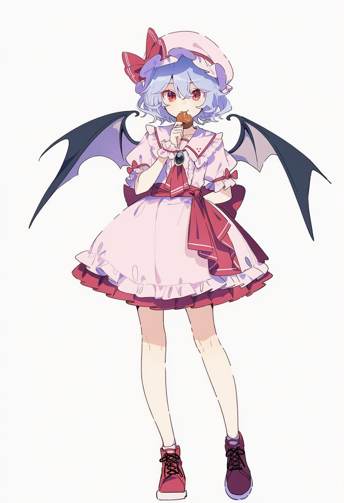

| 字段 | 内容 |
| --- | --- |
| Danbooru Tag | eating |
| 中文名 | 吃东西 |
| 中文含义 | 正在进食。 |
| 子类 | 饮食/烹饪 |
| 模特 | remilia_scarlet |
| 序号 | 0001 |

## 2. drinking — 喝东西

| 字段 | 内容 |
| --- | --- |
| Danbooru Tag | drinking |
| 中文名 | 喝东西 |
| 中文含义 | 正在饮用饮料或其他液体。 |
| 子类 | 饮食/烹饪 |
| 模特 | cirno |
| 序号 | 0002 |

## 3. chewing — 咀嚼

| 字段 | 内容 |
| --- | --- |
| Danbooru Tag | chewing |
| 中文名 | 咀嚼 |
| 中文含义 | 正在用牙齿咀嚼食物。 |
| 子类 | 饮食/烹饪 |
| 模特 | ganyu_(genshin_impact) |
| 序号 | 0003 |

## 4. swallowing — 吞咽

| 字段 | 内容 |
| --- | --- |
| Danbooru Tag | swallowing |
| 中文名 | 吞咽 |
| 中文含义 | 正在把食物或饮料咽下。 |
| 子类 | 饮食/烹饪 |
| 模特 | miki_sayaka |
| 序号 | 0004 |

## 5. tasting — 品尝

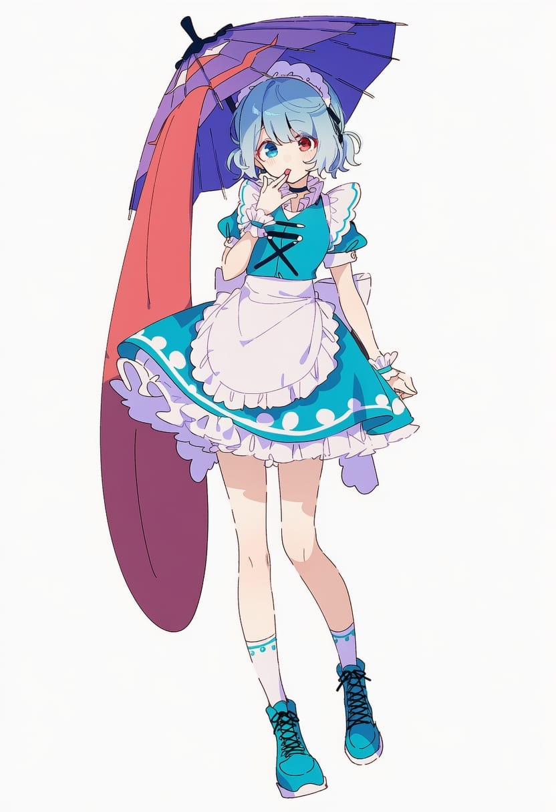

| 字段 | 内容 |
| --- | --- |
| Danbooru Tag | tasting |
| 中文名 | 品尝 |
| 中文含义 | 尝一小口食物或饮料判断味道。 |
| 子类 | 饮食/烹饪 |
| 模特 | tatara_kogasa |
| 序号 | 0005 |

## 6. cooking — 做饭

| 字段 | 内容 |
| --- | --- |
| Danbooru Tag | cooking |
| 中文名 | 做饭 |
| 中文含义 | 正在烹饪食物。 |
| 子类 | 饮食/烹饪 |
| 模特 | kawashiro_nitori |
| 序号 | 0006 |

## 7. baking — 烘焙

| 字段 | 内容 |
| --- | --- |
| Danbooru Tag | baking |
| 中文名 | 烘焙 |
| 中文含义 | 用烤箱等方式制作面包或甜点。 |
| 子类 | 饮食/烹饪 |
| 模特 | hibiki_(kancolle) |
| 序号 | 0007 |

## 8. grilling — 烧烤

| 字段 | 内容 |
| --- | --- |
| Danbooru Tag | grilling |
| 中文名 | 烧烤 |
| 中文含义 | 正在烤制食物。 |
| 子类 | 饮食/烹饪 |
| 模特 | hinanawi_tenshi |
| 序号 | 0008 |

## 9. roasting — 烘烤

| 字段 | 内容 |
| --- | --- |
| Danbooru Tag | roasting |
| 中文名 | 烘烤 |
| 中文含义 | 通过火或高温烘烤食物。 |
| 子类 | 饮食/烹饪 |
| 模特 | rio_(blue_archive) |
| 序号 | 0009 |

## 10. stirring — 搅拌

| 字段 | 内容 |
| --- | --- |
| Danbooru Tag | stirring |
| 中文名 | 搅拌 |
| 中文含义 | 用工具搅动食物或液体。 |
| 子类 | 饮食/烹饪 |
| 模特 | aris_(blue_archive) |
| 序号 | 0010 |

## 11. whisking — 打发 / 搅打

| 字段 | 内容 |
| --- | --- |
| Danbooru Tag | whisking |
| 中文名 | 打发 / 搅打 |
| 中文含义 | 用打蛋器快速搅打食材。 |
| 子类 | 饮食/烹饪 |
| 模特 | ayanami_rei |
| 序号 | 0011 |

## 12. pouring — 倾倒液体

| 字段 | 内容 |
| --- | --- |
| Danbooru Tag | pouring |
| 中文名 | 倾倒液体 |
| 中文含义 | 把液体从一个容器倒向另一个容器。 |
| 子类 | 饮食/烹饪 |
| 模特 | rem_(re:zero) |
| 序号 | 0012 |

## 13. dishwashing — 洗碗

| 字段 | 内容 |
| --- | --- |
| Danbooru Tag | dishwashing |
| 中文名 | 洗碗 |
| 中文含义 | 正在清洗餐具。 |
| 子类 | 饮食/烹饪 |
| 模特 | sonoda_umi |
| 序号 | 0013 |

## 14. peeling — 削皮 / 剥皮

| 字段 | 内容 |
| --- | --- |
| Danbooru Tag | peeling |
| 中文名 | 削皮 / 剥皮 |
| 中文含义 | 去除食材外皮。 |
| 子类 | 饮食/烹饪 |
| 模特 | arona_(blue_archive) |
| 序号 | 0014 |

## 15. flipping_food — 翻动食物

| 字段 | 内容 |
| --- | --- |
| Danbooru Tag | flipping_food |
| 中文名 | 翻动食物 |
| 中文含义 | 烹饪时把食物翻面或抛起。 |
| 子类 | 饮食/烹饪 |
| 模特 | kumoi_ichirin |
| 序号 | 0015 |

## 16. decorating_baked_goods — 装饰烘焙食品

| 字段 | 内容 |
| --- | --- |
| Danbooru Tag | decorating_baked_goods |
| 中文名 | 装饰烘焙食品 |
| 中文含义 | 给蛋糕、饼干等添加装饰。 |
| 子类 | 饮食/烹饪 |
| 模特 | ako_(blue_archive) |
| 序号 | 0016 |

## 17. kneading_dough — 揉面

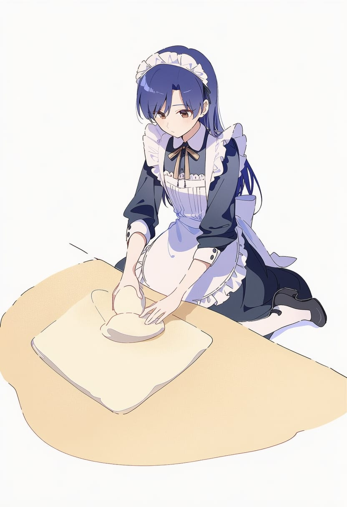

| 字段 | 内容 |
| --- | --- |
| Danbooru Tag | kneading_dough |
| 中文名 | 揉面 |
| 中文含义 | 用手揉压面团。 |
| 子类 | 饮食/烹饪 |
| 模特 | kisaragi_chihaya |
| 序号 | 0017 |

## 18. feeding — 喂食

| 字段 | 内容 |
| --- | --- |
| Danbooru Tag | feeding |
| 中文名 | 喂食 |
| 中文含义 | 把食物送到别人或动物嘴边。 |
| 子类 | 饮食/烹饪 |
| 模特 | aqua_(konosuba) |
| 序号 | 0018 |

## 19. bathing — 洗澡 / 泡澡

| 字段 | 内容 |
| --- | --- |
| Danbooru Tag | bathing |
| 中文名 | 洗澡 / 泡澡 |
| 中文含义 | 正在洗澡或泡澡。 |
| 子类 | 洗漱/护理 |
| 模特 | hk416_(girls'_frontline) |
| 序号 | 0019 |

## 20. showering — 淋浴

| 字段 | 内容 |
| --- | --- |
| Danbooru Tag | showering |
| 中文名 | 淋浴 |
| 中文含义 | 站在花洒下冲洗身体。 |
| 子类 | 洗漱/护理 |
| 模特 | yamada_ryo |
| 序号 | 0020 |

## 21. washing — 清洗

| 字段 | 内容 |
| --- | --- |
| Danbooru Tag | washing |
| 中文名 | 清洗 |
| 中文含义 | 用水清洗身体或物品。 |
| 子类 | 洗漱/护理 |
| 模特 | izumi_konata |
| 序号 | 0021 |

## 22. body_soaping — 给身体打肥皂

| 字段 | 内容 |
| --- | --- |
| Danbooru Tag | body_soaping |
| 中文名 | 给身体打肥皂 |
| 中文含义 | 在身体上涂抹肥皂或沐浴泡沫。 |
| 子类 | 洗漱/护理 |
| 模特 | lucina_(fire_emblem) |
| 序号 | 0022 |

## 23. drying — 擦干 / 晾干

| 字段 | 内容 |
| --- | --- |
| Danbooru Tag | drying |
| 中文名 | 擦干 / 晾干 |
| 中文含义 | 正在去除水分或把东西弄干。 |
| 子类 | 洗漱/护理 |
| 模特 | tendou_akane |
| 序号 | 0023 |

## 24. drying_hair — 吹干头发

| 字段 | 内容 |
| --- | --- |
| Danbooru Tag | drying_hair |
| 中文名 | 吹干头发 |
| 中文含义 | 正在把湿头发弄干。 |
| 子类 | 洗漱/护理 |
| 模特 | souryuu_(kancolle) |
| 序号 | 0024 |

## 25. drying_own_hair — 吹干自己头发

| 字段 | 内容 |
| --- | --- |
| Danbooru Tag | drying_own_hair |
| 中文名 | 吹干自己头发 |
| 中文含义 | 角色正在擦干或吹干自己的头发。 |
| 子类 | 洗漱/护理 |
| 模特 | samidare_(kancolle) |
| 序号 | 0025 |

## 26. brushing_teeth — 刷牙

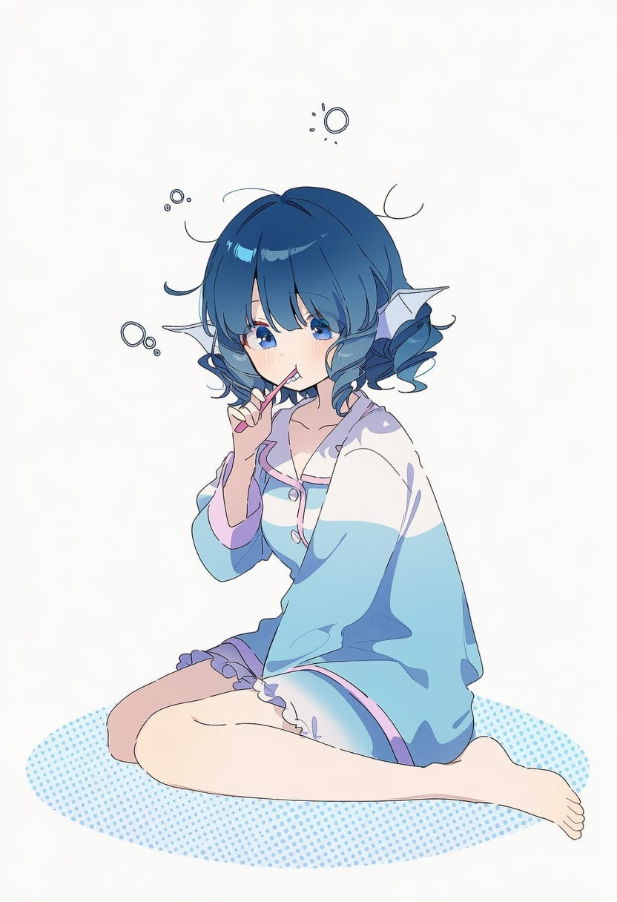

| 字段 | 内容 |
| --- | --- |
| Danbooru Tag | brushing_teeth |
| 中文名 | 刷牙 |
| 中文含义 | 正在使用牙刷清洁牙齿。 |
| 子类 | 洗漱/护理 |
| 模特 | wakasagihime |
| 序号 | 0026 |

## 27. shaving — 剃毛 / 刮胡子

| 字段 | 内容 |
| --- | --- |
| Danbooru Tag | shaving |
| 中文名 | 剃毛 / 刮胡子 |
| 中文含义 | 使用剃刀等去除毛发。 |
| 子类 | 洗漱/护理 |
| 模特 | yelan_(genshin_impact) |
| 序号 | 0027 |

## 28. applying_makeup — 化妆

| 字段 | 内容 |
| --- | --- |
| Danbooru Tag | applying_makeup |
| 中文名 | 化妆 |
| 中文含义 | 正在给自己或他人上妆。 |
| 子类 | 洗漱/护理 |
| 模特 | ch'en_(arknights) |
| 序号 | 0028 |

## 29. applying_own_makeup — 给自己化妆

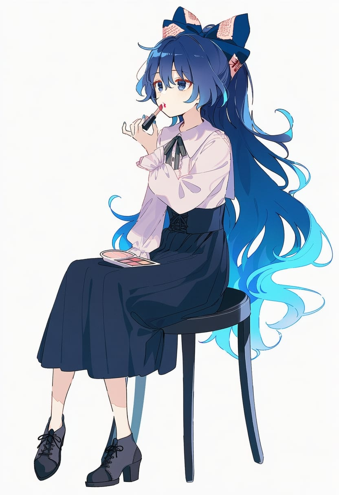

| 字段 | 内容 |
| --- | --- |
| Danbooru Tag | applying_own_makeup |
| 中文名 | 给自己化妆 |
| 中文含义 | 角色正在给自己上妆。 |
| 子类 | 洗漱/护理 |
| 模特 | yorigami_shion |
| 序号 | 0029 |

## 30. hairdressing — 整理发型

| 字段 | 内容 |
| --- | --- |
| Danbooru Tag | hairdressing |
| 中文名 | 整理发型 |
| 中文含义 | 正在打理、修剪或造型头发。 |
| 子类 | 洗漱/护理 |
| 模特 | mostima_(arknights) |
| 序号 | 0030 |

## 31. brushing_hair — 梳头

| 字段 | 内容 |
| --- | --- |
| Danbooru Tag | brushing_hair |
| 中文名 | 梳头 |
| 中文含义 | 用梳子或刷子梳理头发。 |
| 子类 | 洗漱/护理 |
| 模特 | seele_vollerei |
| 序号 | 0031 |

## 32. brushing_own_hair — 自己梳头

| 字段 | 内容 |
| --- | --- |
| Danbooru Tag | brushing_own_hair |
| 中文名 | 自己梳头 |
| 中文含义 | 角色正在梳理自己的头发。 |
| 子类 | 洗漱/护理 |
| 模特 | miura_azusa |
| 序号 | 0032 |

## 33. tying_hair — 扎头发

| 字段 | 内容 |
| --- | --- |
| Danbooru Tag | tying_hair |
| 中文名 | 扎头发 |
| 中文含义 | 把头发扎成马尾等发型。 |
| 子类 | 洗漱/护理 |
| 模特 | twin_turbo_(umamusume) |
| 序号 | 0033 |

## 34. cutting_hair — 剪头发

| 字段 | 内容 |
| --- | --- |
| Danbooru Tag | cutting_hair |
| 中文名 | 剪头发 |
| 中文含义 | 正在修剪头发。 |
| 子类 | 洗漱/护理 |
| 模特 | mizuno_ami |
| 序号 | 0034 |

## 35. cutting_own_hair — 自己剪头发

| 字段 | 内容 |
| --- | --- |
| Danbooru Tag | cutting_own_hair |
| 中文名 | 自己剪头发 |
| 中文含义 | 角色正在剪自己的头发。 |
| 子类 | 洗漱/护理 |
| 模特 | clorinde_(genshin_impact) |
| 序号 | 0035 |

## 36. ear_cleaning — 清理耳朵

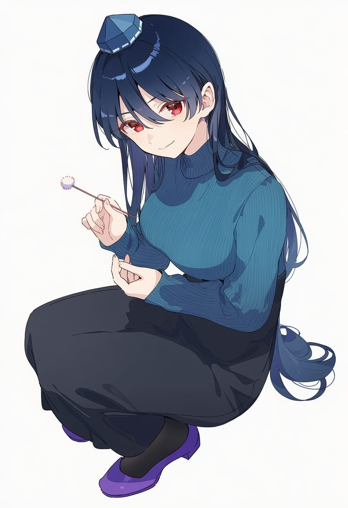

| 字段 | 内容 |
| --- | --- |
| Danbooru Tag | ear_cleaning |
| 中文名 | 清理耳朵 |
| 中文含义 | 正在清洁耳朵或掏耳朵。 |
| 子类 | 洗漱/护理 |
| 模特 | iizunamaru_megumu |
| 序号 | 0036 |

## 37. nose_picking — 挖鼻孔

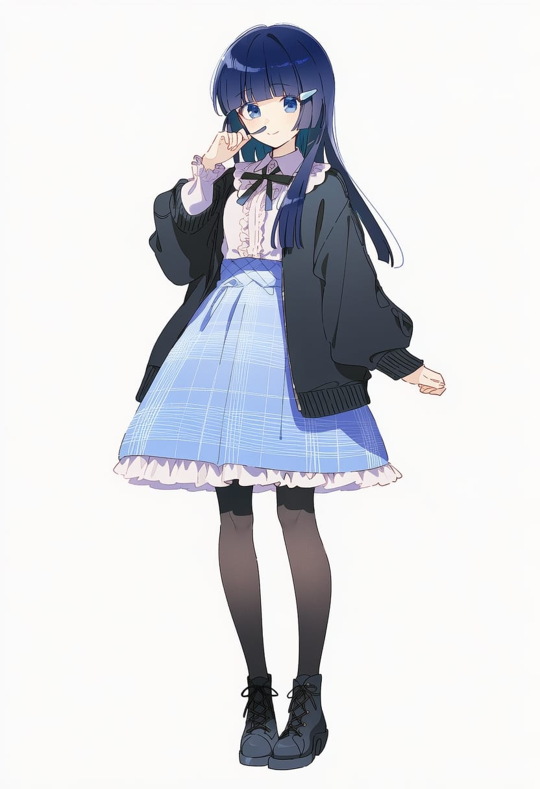

| 字段 | 内容 |
| --- | --- |
| Danbooru Tag | nose_picking |
| 中文名 | 挖鼻孔 |
| 中文含义 | 用手指挖鼻孔。 |
| 子类 | 洗漱/护理 |
| 模特 | aoki_reika |
| 序号 | 0037 |

## 38. nail_biting — 咬指甲

| 字段 | 内容 |
| --- | --- |
| Danbooru Tag | nail_biting |
| 中文名 | 咬指甲 |
| 中文含义 | 用牙齿咬自己的指甲。 |
| 子类 | 洗漱/护理 |
| 模特 | shorekeeper_(wuthering_waves) |
| 序号 | 0038 |

## 39. dressing — 穿衣服

| 字段 | 内容 |
| --- | --- |
| Danbooru Tag | dressing |
| 中文名 | 穿衣服 |
| 中文含义 | 正在把衣物穿到身上。 |
| 子类 | 穿衣/整理 |
| 模特 | seiran_(touhou) |
| 序号 | 0039 |

## 40. undressing — 脱衣服

| 字段 | 内容 |
| --- | --- |
| Danbooru Tag | undressing |
| 中文名 | 脱衣服 |
| 中文含义 | 正在脱下衣物。 |
| 子类 | 穿衣/整理 |
| 模特 | roxy_migurdia |
| 序号 | 0040 |

## 41. changing_clothes — 换衣服

| 字段 | 内容 |
| --- | --- |
| Danbooru Tag | changing_clothes |
| 中文名 | 换衣服 |
| 中文含义 | 正在更换身上的衣物。 |
| 子类 | 穿衣/整理 |
| 模特 | ciel_(tsukihime) |
| 序号 | 0041 |

## 42. trying_on_clothes — 试穿衣服

| 字段 | 内容 |
| --- | --- |
| Danbooru Tag | trying_on_clothes |
| 中文名 | 试穿衣服 |
| 中文含义 | 正在试穿衣物查看效果。 |
| 子类 | 穿衣/整理 |
| 模特 | bulma |
| 序号 | 0042 |

## 43. putting_on_gloves — 戴手套

| 字段 | 内容 |
| --- | --- |
| Danbooru Tag | putting_on_gloves |
| 中文名 | 戴手套 |
| 中文含义 | 正在把手套戴到手上。 |
| 子类 | 穿衣/整理 |
| 模特 | shiver_(splatoon) |
| 序号 | 0043 |

## 44. putting_on_footwear — 穿鞋

| 字段 | 内容 |
| --- | --- |
| Danbooru Tag | putting_on_footwear |
| 中文名 | 穿鞋 |
| 中文含义 | 正在穿鞋、靴等鞋类。 |
| 子类 | 穿衣/整理 |
| 模特 | gotland_(kancolle) |
| 序号 | 0044 |

## 45. putting_on_headwear — 戴帽子

| 字段 | 内容 |
| --- | --- |
| Danbooru Tag | putting_on_headwear |
| 中文名 | 戴帽子 |
| 中文含义 | 正在把帽子或头部穿戴物戴上。 |
| 子类 | 穿衣/整理 |
| 模特 | shima_rin |
| 序号 | 0045 |

## 46. putting_on_legwear — 穿腿部衣物

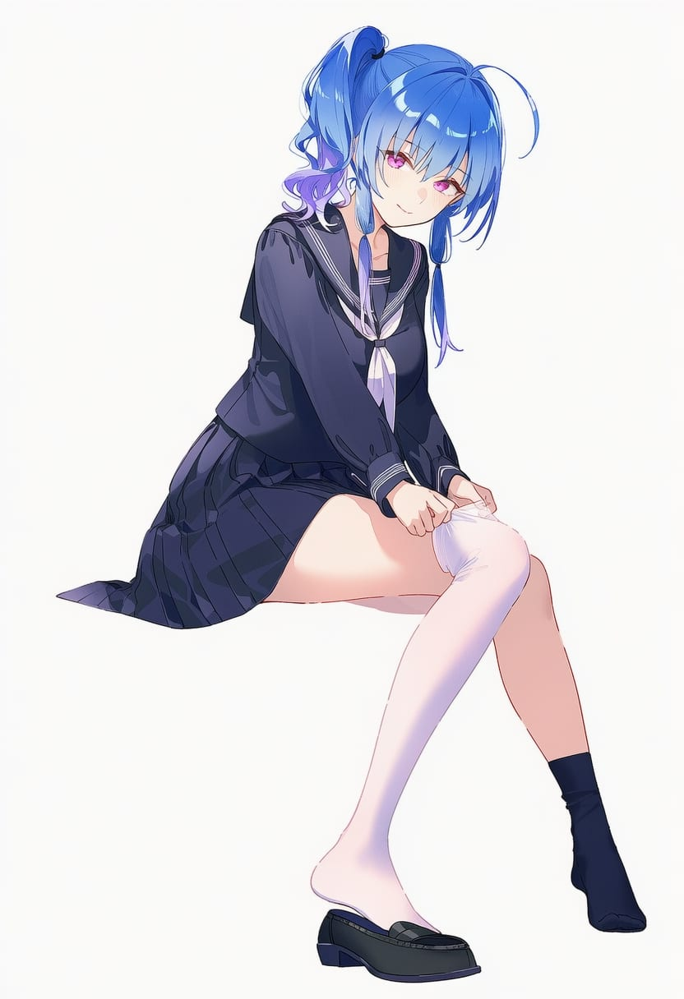

| 字段 | 内容 |
| --- | --- |
| Danbooru Tag | putting_on_legwear |
| 中文名 | 穿腿部衣物 |
| 中文含义 | 正在穿袜子、丝袜等腿部服饰。 |
| 子类 | 穿衣/整理 |
| 模特 | st._louis_(azur_lane) |
| 序号 | 0046 |

## 47. putting_on_jacket — 穿外套

| 字段 | 内容 |
| --- | --- |
| Danbooru Tag | putting_on_jacket |
| 中文名 | 穿外套 |
| 中文含义 | 正在把夹克或外套穿上。 |
| 子类 | 穿衣/整理 |
| 模特 | verxina_(umamusume) |
| 序号 | 0047 |

## 48. tying_footwear — 系鞋带

| 字段 | 内容 |
| --- | --- |
| Danbooru Tag | tying_footwear |
| 中文名 | 系鞋带 |
| 中文含义 | 正在系鞋或靴子的鞋带。 |
| 子类 | 穿衣/整理 |
| 模特 | felicia_(darkstalkers) |
| 序号 | 0048 |

## 49. untying — 解开结

| 字段 | 内容 |
| --- | --- |
| Danbooru Tag | untying |
| 中文名 | 解开结 |
| 中文含义 | 正在解开绳结、系带等。 |
| 子类 | 穿衣/整理 |
| 模特 | kurumi_erika |
| 序号 | 0049 |

## 50. zipping — 拉上拉链

| 字段 | 内容 |
| --- | --- |
| Danbooru Tag | zipping |
| 中文名 | 拉上拉链 |
| 中文含义 | 正在把拉链拉上。 |
| 子类 | 穿衣/整理 |
| 模特 | ling_(arknights) |
| 序号 | 0050 |

## 51. unzipping — 拉开拉链

| 字段 | 内容 |
| --- | --- |
| Danbooru Tag | unzipping |
| 中文名 | 拉开拉链 |
| 中文含义 | 正在把拉链拉开。 |
| 子类 | 穿衣/整理 |
| 模特 | suzukaze_(kancolle) |
| 序号 | 0051 |

## 52. scarf_tying — 系围巾

| 字段 | 内容 |
| --- | --- |
| Danbooru Tag | scarf_tying |
| 中文名 | 系围巾 |
| 中文含义 | 正在把围巾围好或打结。 |
| 子类 | 穿衣/整理 |
| 模特 | maizono_sayaka |
| 序号 | 0052 |

## 53. adjusting_clothes — 整理衣服

| 字段 | 内容 |
| --- | --- |
| Danbooru Tag | adjusting_clothes |
| 中文名 | 整理衣服 |
| 中文含义 | 正在调整身上的衣物位置。 |
| 子类 | 穿衣/整理 |
| 模特 | leona_heidern |
| 序号 | 0053 |

## 54. sleeping — 睡觉

| 字段 | 内容 |
| --- | --- |
| Danbooru Tag | sleeping |
| 中文名 | 睡觉 |
| 中文含义 | 角色处于睡眠状态。 |
| 子类 | 休息/睡眠 |
| 模特 | azura_(fire_emblem) |
| 序号 | 0054 |

## 55. dreaming — 做梦

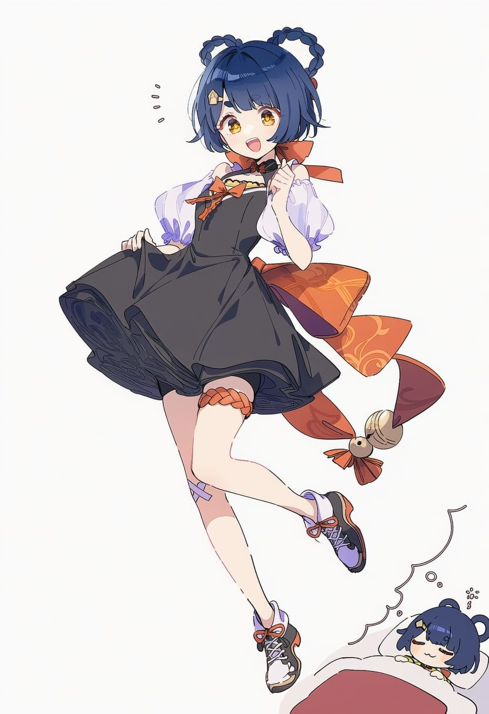

| 字段 | 内容 |
| --- | --- |
| Danbooru Tag | dreaming |
| 中文名 | 做梦 |
| 中文含义 | 画面表现角色正在梦境中或做梦。 |
| 子类 | 休息/睡眠 |
| 模特 | xiangling_(genshin_impact) |
| 序号 | 0055 |

## 56. yawning — 打哈欠

| 字段 | 内容 |
| --- | --- |
| Danbooru Tag | yawning |
| 中文名 | 打哈欠 |
| 中文含义 | 张嘴打哈欠，常表示困倦。 |
| 子类 | 休息/睡眠 |
| 模特 | kiritani_haruka |
| 序号 | 0056 |

## 57. resting — 休息

| 字段 | 内容 |
| --- | --- |
| Danbooru Tag | resting |
| 中文名 | 休息 |
| 中文含义 | 角色正在放松休息。 |
| 子类 | 休息/睡眠 |
| 模特 | hinata_(blue_archive) |
| 序号 | 0057 |

## 58. sunbathing — 晒太阳

| 字段 | 内容 |
| --- | --- |
| Danbooru Tag | sunbathing |
| 中文名 | 晒太阳 |
| 中文含义 | 躺着或坐着享受阳光。 |
| 子类 | 休息/睡眠 |
| 模特 | faruzan_(genshin_impact) |
| 序号 | 0058 |

## 59. sleep_talking — 说梦话

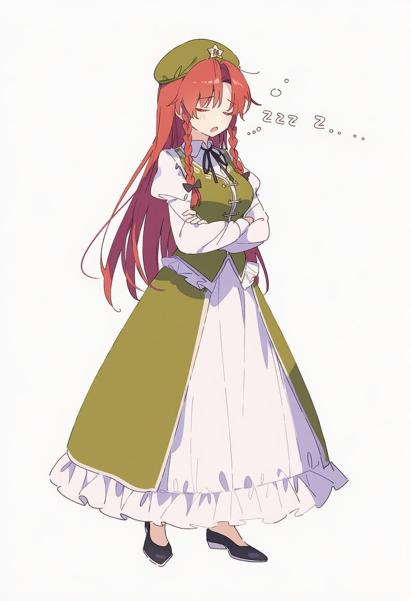

| 字段 | 内容 |
| --- | --- |
| Danbooru Tag | sleep_talking |
| 中文名 | 说梦话 |
| 中文含义 | 睡眠中开口说话。 |
| 子类 | 休息/睡眠 |
| 模特 | hong_meiling |
| 序号 | 0059 |

## 60. waiting — 等待

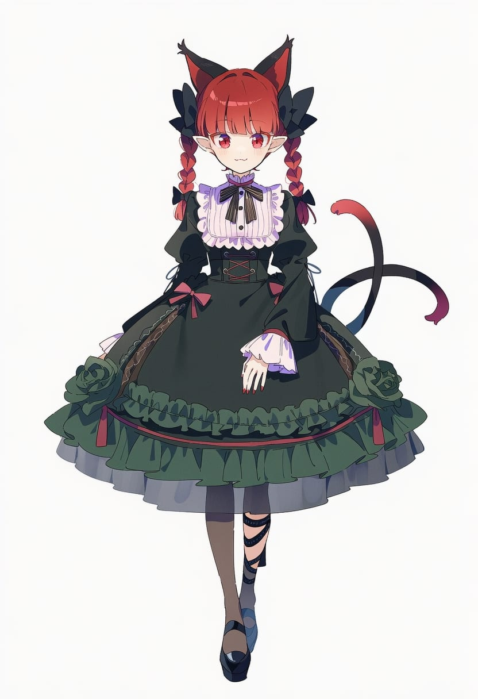

| 字段 | 内容 |
| --- | --- |
| Danbooru Tag | waiting |
| 中文名 | 等待 |
| 中文含义 | 角色正在等待某人或某件事。 |
| 子类 | 休息/睡眠 |
| 模特 | kaenbyou_rin |
| 序号 | 0060 |

## 61. fidgeting — 坐立不安

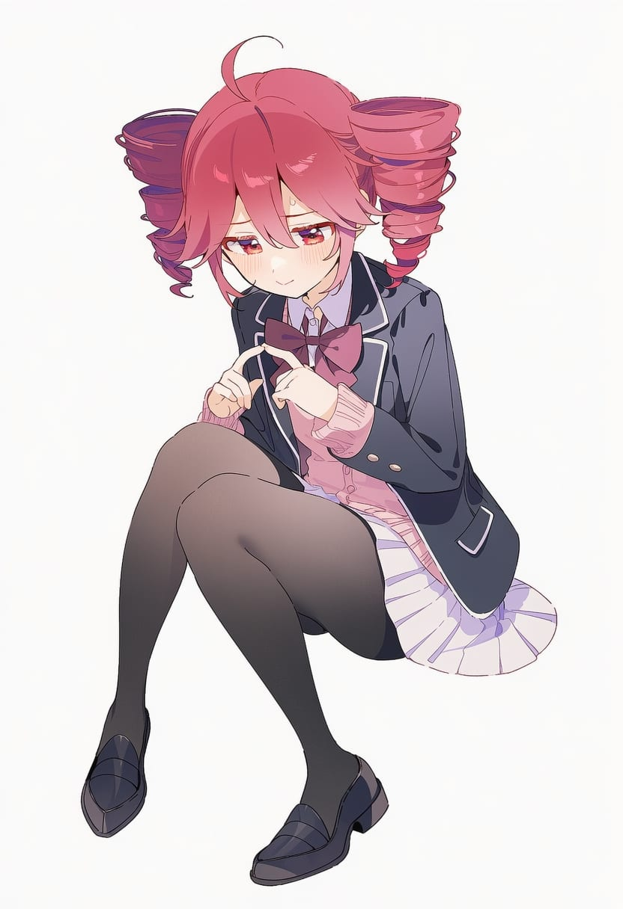

| 字段 | 内容 |
| --- | --- |
| Danbooru Tag | fidgeting |
| 中文名 | 坐立不安 |
| 中文含义 | 因紧张或无聊做反复的小动作。 |
| 子类 | 休息/睡眠 |
| 模特 | kasane_teto |
| 序号 | 0061 |

## 62. reading — 阅读

| 字段 | 内容 |
| --- | --- |
| Danbooru Tag | reading |
| 中文名 | 阅读 |
| 中文含义 | 正在看书、纸张或文字内容。 |
| 子类 | 学习/工作/交流 |
| 模特 | souryuu_asuka_langley |
| 序号 | 0062 |

## 63. writing — 书写

| 字段 | 内容 |
| --- | --- |
| Danbooru Tag | writing |
| 中文名 | 书写 |
| 中文含义 | 正在用笔等进行书写。 |
| 子类 | 学习/工作/交流 |
| 模特 | sakura_kyoko |
| 序号 | 0063 |

## 64. studying — 学习

| 字段 | 内容 |
| --- | --- |
| Danbooru Tag | studying |
| 中文名 | 学习 |
| 中文含义 | 正在学习、复习或做功课。 |
| 子类 | 学习/工作/交流 |
| 模特 | koakuma |
| 序号 | 0064 |

## 65. teaching — 教学

| 字段 | 内容 |
| --- | --- |
| Danbooru Tag | teaching |
| 中文名 | 教学 |
| 中文含义 | 正在向别人讲解或教授内容。 |
| 子类 | 学习/工作/交流 |
| 模特 | makima_(chainsaw_man) |
| 序号 | 0065 |

## 66. working — 工作

| 字段 | 内容 |
| --- | --- |
| Danbooru Tag | working |
| 中文名 | 工作 |
| 中文含义 | 角色正在进行工作。 |
| 子类 | 学习/工作/交流 |
| 模特 | onozuka_komachi |
| 序号 | 0066 |

## 67. programming — 编程

| 字段 | 内容 |
| --- | --- |
| Danbooru Tag | programming |
| 中文名 | 编程 |
| 中文含义 | 正在写代码或进行程序开发。 |
| 子类 | 学习/工作/交流 |
| 模特 | pyra_(xenoblade) |
| 序号 | 0067 |

## 68. typing — 打字

| 字段 | 内容 |
| --- | --- |
| Danbooru Tag | typing |
| 中文名 | 打字 |
| 中文含义 | 正在键盘等设备上输入文字。 |
| 子类 | 学习/工作/交流 |
| 模特 | kita_ikuyo |
| 序号 | 0068 |

## 69. text_messaging — 发消息

| 字段 | 内容 |
| --- | --- |
| Danbooru Tag | text_messaging |
| 中文名 | 发消息 |
| 中文含义 | 正在用手机等设备发送文字消息。 |
| 子类 | 学习/工作/交流 |
| 模特 | daiwa_scarlet_(umamusume) |
| 序号 | 0069 |

## 70. talking — 说话

| 字段 | 内容 |
| --- | --- |
| Danbooru Tag | talking |
| 中文名 | 说话 |
| 中文含义 | 角色正在交谈或讲话。 |
| 子类 | 学习/工作/交流 |
| 模特 | nishikino_maki |
| 序号 | 0070 |

## 71. whispering — 耳语

| 字段 | 内容 |
| --- | --- |
| Danbooru Tag | whispering |
| 中文名 | 耳语 |
| 中文含义 | 压低声音小声说话。 |
| 子类 | 学习/工作/交流 |
| 模特 | sekibanki |
| 序号 | 0071 |

## 72. thinking — 思考

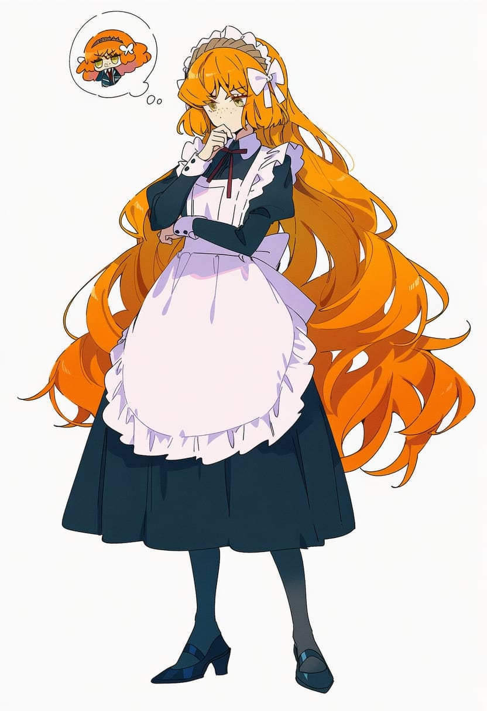

| 字段 | 内容 |
| --- | --- |
| Danbooru Tag | thinking |
| 中文名 | 思考 |
| 中文含义 | 角色正在思考问题。 |
| 子类 | 学习/工作/交流 |
| 模特 | ishmael_(project_moon) |
| 序号 | 0072 |

## 73. concentrating — 专注

| 字段 | 内容 |
| --- | --- |
| Danbooru Tag | concentrating |
| 中文名 | 专注 |
| 中文含义 | 角色正在集中注意力做某件事。 |
| 子类 | 学习/工作/交流 |
| 模特 | nilou_(genshin_impact) |
| 序号 | 0073 |

## 74. searching — 寻找

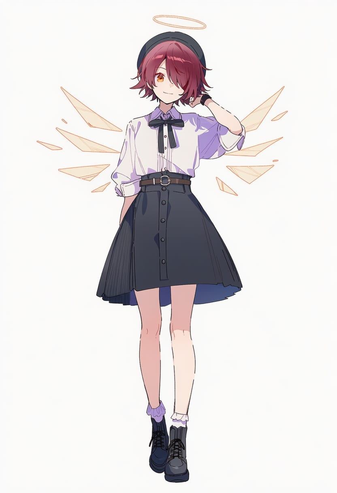

| 字段 | 内容 |
| --- | --- |
| Danbooru Tag | searching |
| 中文名 | 寻找 |
| 中文含义 | 正在寻找物品、人物或信息。 |
| 子类 | 学习/工作/交流 |
| 模特 | exusiai_(arknights) |
| 序号 | 0074 |

## 75. recording — 录制

| 字段 | 内容 |
| --- | --- |
| Danbooru Tag | recording |
| 中文名 | 录制 |
| 中文含义 | 正在录音、录像或记录内容。 |
| 子类 | 学习/工作/交流 |
| 模特 | yoko_littner |
| 序号 | 0075 |

## 76. drawing — 画画

| 字段 | 内容 |
| --- | --- |
| Danbooru Tag | drawing |
| 中文名 | 画画 |
| 中文含义 | 正在绘制图画。 |
| 子类 | 学习/工作/交流 |
| 模特 | surtr_(arknights) |
| 序号 | 0076 |

## 77. sketching — 素描 / 草绘

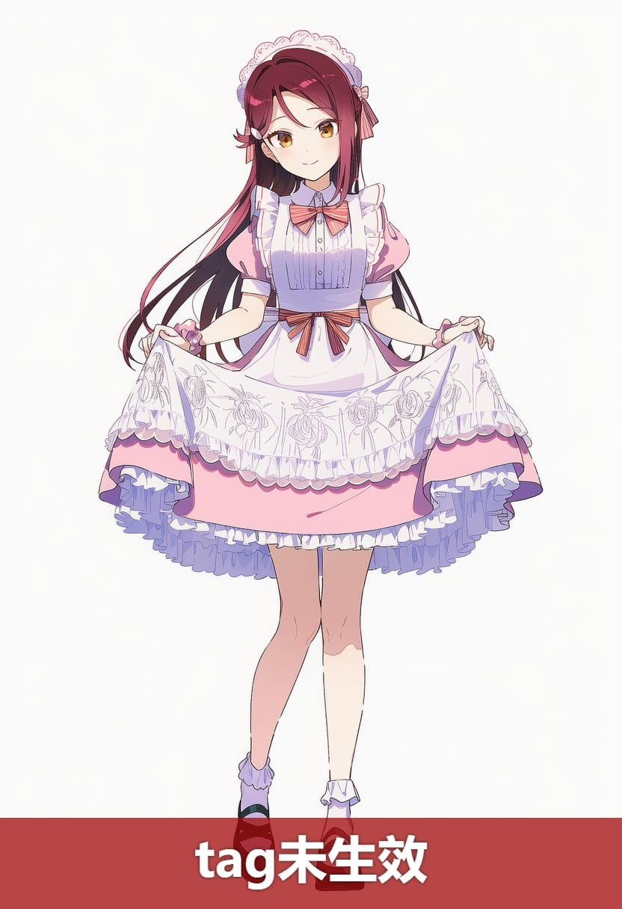

| 字段 | 内容 |
| --- | --- |
| Danbooru Tag | sketching |
| 中文名 | 素描 / 草绘 |
| 中文含义 | 正在快速画草图或素描。 |
| 子类 | 学习/工作/交流 |
| 模特 | sakurauchi_riko |
| 序号 | 0077 |

## 78. painting — 绘画

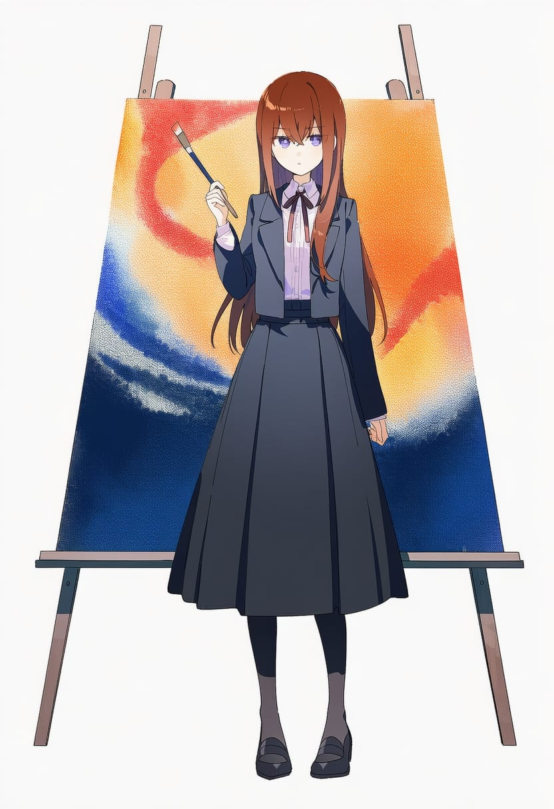

| 字段 | 内容 |
| --- | --- |
| Danbooru Tag | painting |
| 中文名 | 绘画 |
| 中文含义 | 正在使用颜料作画。 |
| 子类 | 学习/工作/交流 |
| 模特 | makise_kurisu |
| 序号 | 0078 |

## 79. measuring — 测量

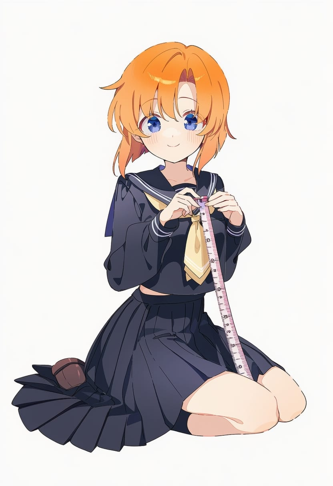

| 字段 | 内容 |
| --- | --- |
| Danbooru Tag | measuring |
| 中文名 | 测量 |
| 中文含义 | 正在测量尺寸或长度。 |
| 子类 | 学习/工作/交流 |
| 模特 | ryuuguu_rena |
| 序号 | 0079 |

## 80. calculating — 计算

| 字段 | 内容 |
| --- | --- |
| Danbooru Tag | calculating |
| 中文名 | 计算 |
| 中文含义 | 正在进行数学或数值计算。 |
| 子类 | 学习/工作/交流 |
| 模特 | iroha_(blue_archive) |
| 序号 | 0080 |

## 81. multitasking — 同时做多件事

| 字段 | 内容 |
| --- | --- |
| Danbooru Tag | multitasking |
| 中文名 | 同时做多件事 |
| 中文含义 | 角色同时进行多个任务。 |
| 子类 | 学习/工作/交流 |
| 模特 | changli_(wuthering_waves) |
| 序号 | 0081 |

## 82. cleaning — 打扫

| 字段 | 内容 |
| --- | --- |
| Danbooru Tag | cleaning |
| 中文名 | 打扫 |
| 中文含义 | 正在清洁环境或物品。 |
| 子类 | 家务/生活事务 |
| 模特 | kouzuki_kallen |
| 序号 | 0082 |

## 83. sweeping — 扫地

| 字段 | 内容 |
| --- | --- |
| Danbooru Tag | sweeping |
| 中文名 | 扫地 |
| 中文含义 | 使用扫帚等清扫地面。 |
| 子类 | 家务/生活事务 |
| 模特 | skyla_(pokemon) |
| 序号 | 0083 |

## 84. gardening — 园艺

| 字段 | 内容 |
| --- | --- |
| Danbooru Tag | gardening |
| 中文名 | 园艺 |
| 中文含义 | 正在照料花草或进行园艺活动。 |
| 子类 | 家务/生活事务 |
| 模特 | kurosawa_ruby |
| 序号 | 0084 |

## 85. watering — 浇水

| 字段 | 内容 |
| --- | --- |
| Danbooru Tag | watering |
| 中文名 | 浇水 |
| 中文含义 | 正在给植物浇水。 |
| 子类 | 家务/生活事务 |
| 模特 | shana |
| 序号 | 0085 |

## 86. shopping — 购物

| 字段 | 内容 |
| --- | --- |
| Danbooru Tag | shopping |
| 中文名 | 购物 |
| 中文含义 | 正在商店或市场选购商品。 |
| 子类 | 家务/生活事务 |
| 模特 | nakano_itsuki |
| 序号 | 0086 |

## 87. repairing — 修理

| 字段 | 内容 |
| --- | --- |
| Danbooru Tag | repairing |
| 中文名 | 修理 |
| 中文含义 | 正在修复损坏的物品。 |
| 子类 | 家务/生活事务 |
| 模特 | eris_greyrat |
| 序号 | 0087 |

## 88. polishing — 擦亮

| 字段 | 内容 |
| --- | --- |
| Danbooru Tag | polishing |
| 中文名 | 擦亮 |
| 中文含义 | 正在擦拭并抛光物品表面。 |
| 子类 | 家务/生活事务 |
| 模特 | jessie_(pokemon) |
| 序号 | 0088 |

## 89. wringing — 拧干

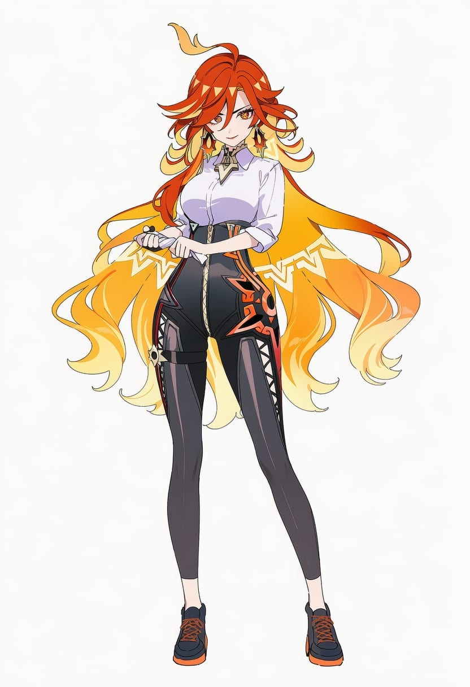

| 字段 | 内容 |
| --- | --- |
| Danbooru Tag | wringing |
| 中文名 | 拧干 |
| 中文含义 | 用手扭拧布料等挤出水分。 |
| 子类 | 家务/生活事务 |
| 模特 | mavuika_(genshin_impact) |
| 序号 | 0089 |

## 90. stacking — 堆叠

| 字段 | 内容 |
| --- | --- |
| Danbooru Tag | stacking |
| 中文名 | 堆叠 |
| 中文含义 | 把多个物品一个个叠起来。 |
| 子类 | 家务/生活事务 |
| 模特 | i-168_(kancolle) |
| 序号 | 0090 |

## 91. opening — 打开

| 字段 | 内容 |
| --- | --- |
| Danbooru Tag | opening |
| 中文名 | 打开 |
| 中文含义 | 正在打开容器、门或其他物体。 |
| 子类 | 家务/生活事务 |
| 模特 | osaki_amana |
| 序号 | 0091 |

## 92. digging — 挖掘

| 字段 | 内容 |
| --- | --- |
| Danbooru Tag | digging |
| 中文名 | 挖掘 |
| 中文含义 | 正在挖土或挖洞。 |
| 子类 | 家务/生活事务 |
| 模特 | kirijou_mitsuru |
| 序号 | 0092 |

## 93. sewing — 缝纫

| 字段 | 内容 |
| --- | --- |
| Danbooru Tag | sewing |
| 中文名 | 缝纫 |
| 中文含义 | 使用针线或缝纫机缝制布料。 |
| 子类 | 家务/生活事务 |
| 模特 | horikawa_raiko |
| 序号 | 0093 |

## 94. knitting — 编织

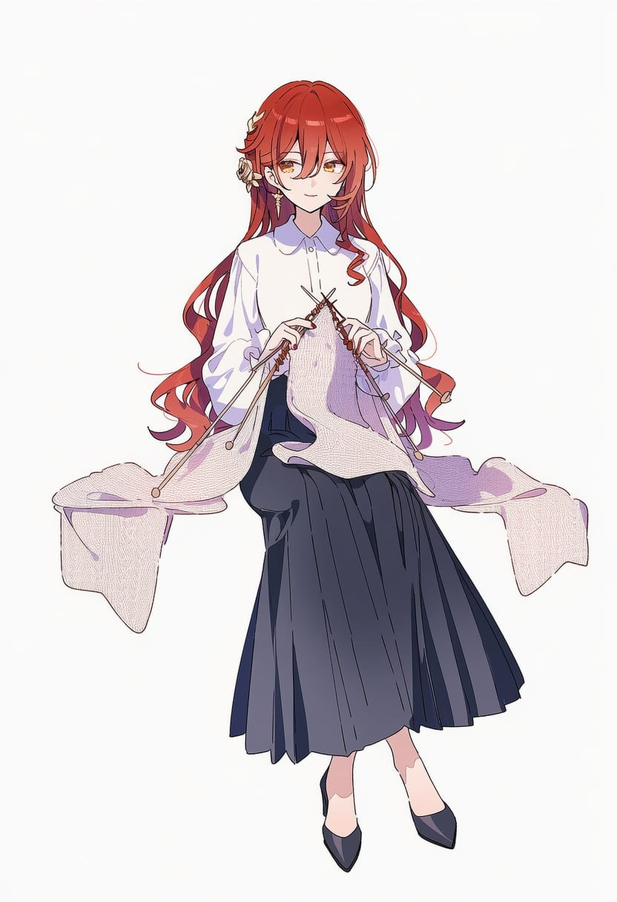

| 字段 | 内容 |
| --- | --- |
| Danbooru Tag | knitting |
| 中文名 | 编织 |
| 中文含义 | 用毛线和针进行编织。 |
| 子类 | 家务/生活事务 |
| 模特 | himeko_(honkai:_star_rail) |
| 序号 | 0094 |

## 95. carving — 雕刻

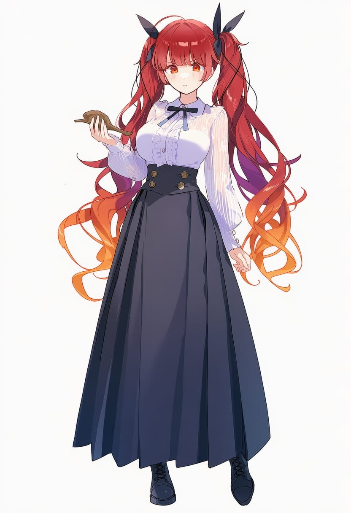

| 字段 | 内容 |
| --- | --- |
| Danbooru Tag | carving |
| 中文名 | 雕刻 |
| 中文含义 | 正在切削材料制作形状或图案。 |
| 子类 | 家务/生活事务 |
| 模特 | honolulu_(azur_lane) |
| 序号 | 0095 |

## 96. building — 制作 / 建造

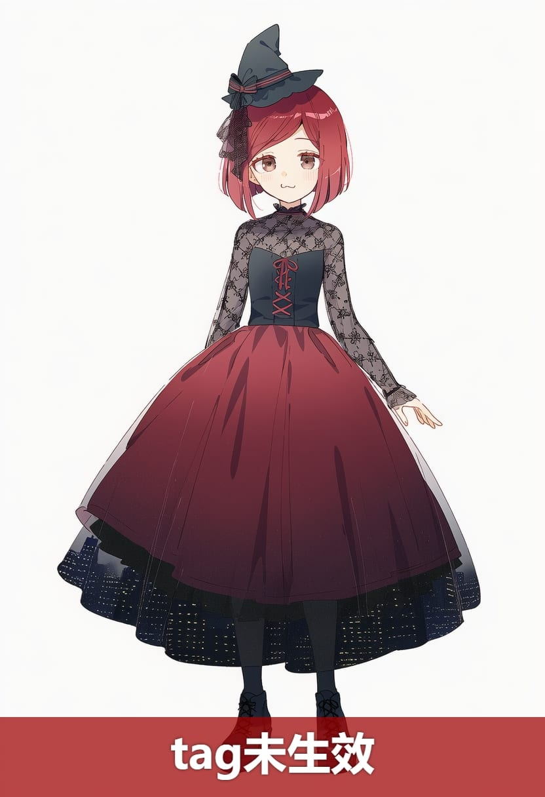

| 字段 | 内容 |
| --- | --- |
| Danbooru Tag | building |
| 中文名 | 制作 / 建造 |
| 中文含义 | 正在组装或建造某种东西。 |
| 子类 | 家务/生活事务 |
| 模特 | yumeno_himiko |
| 序号 | 0096 |

## 97. model_building — 制作模型

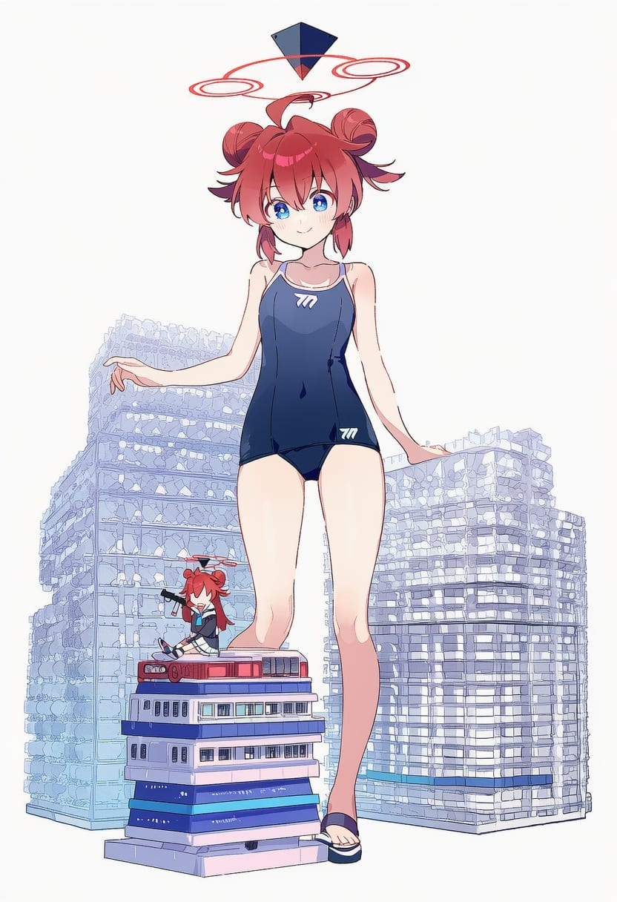

| 字段 | 内容 |
| --- | --- |
| Danbooru Tag | model_building |
| 中文名 | 制作模型 |
| 中文含义 | 正在拼装或制作模型。 |
| 子类 | 家务/生活事务 |
| 模特 | maki_(blue_archive) |
| 序号 | 0097 |

## 98. playing — 玩耍

| 字段 | 内容 |
| --- | --- |
| Danbooru Tag | playing |
| 中文名 | 玩耍 |
| 中文含义 | 角色正在玩或参与娱乐活动。 |
| 子类 | 娱乐/兴趣/社交 |
| 模特 | rias_gremory |
| 序号 | 0098 |

## 99. playing_games — 玩游戏

| 字段 | 内容 |
| --- | --- |
| Danbooru Tag | playing_games |
| 中文名 | 玩游戏 |
| 中文含义 | 正在进行桌游、牌类等游戏。 |
| 子类 | 娱乐/兴趣/社交 |
| 模特 | kohaku_(tsukihime) |
| 序号 | 0099 |

## 100. playing_video_games — 玩电子游戏

| 字段 | 内容 |
| --- | --- |
| Danbooru Tag | playing_video_games |
| 中文名 | 玩电子游戏 |
| 中文含义 | 正在使用游戏机或电脑玩电子游戏。 |
| 子类 | 娱乐/兴趣/社交 |
| 模特 | malenia_blade_of_miquella |
| 序号 | 0100 |

## 101. playing_instrument — 演奏乐器

| 字段 | 内容 |
| --- | --- |
| Danbooru Tag | playing_instrument |
| 中文名 | 演奏乐器 |
| 中文含义 | 正在演奏某种乐器。 |
| 子类 | 娱乐/兴趣/社交 |
| 模特 | red_hood_(nikke) |
| 序号 | 0101 |

## 102. playing_sports — 进行体育运动

| 字段 | 内容 |
| --- | --- |
| Danbooru Tag | playing_sports |
| 中文名 | 进行体育运动 |
| 中文含义 | 正在参加体育活动。 |
| 子类 | 娱乐/兴趣/社交 |
| 模特 | etorofu_(kancolle) |
| 序号 | 0102 |

## 103. watching — 观看

| 字段 | 内容 |
| --- | --- |
| Danbooru Tag | watching |
| 中文名 | 观看 |
| 中文含义 | 正在观看某个对象或事件。 |
| 子类 | 娱乐/兴趣/社交 |
| 模特 | boudica_(fate) |
| 序号 | 0103 |

## 104. watching_television — 看电视

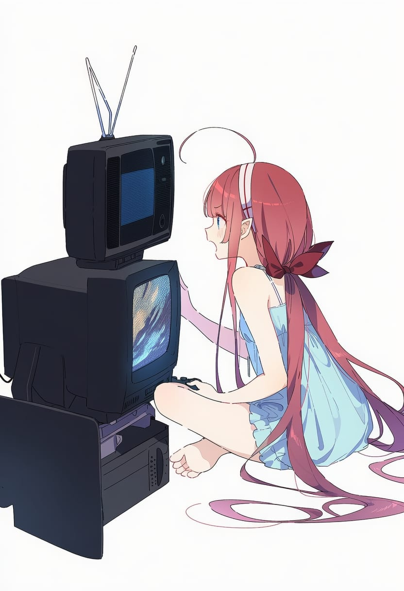

| 字段 | 内容 |
| --- | --- |
| Danbooru Tag | watching_television |
| 中文名 | 看电视 |
| 中文含义 | 正在观看电视节目。 |
| 子类 | 娱乐/兴趣/社交 |
| 模特 | kawakaze_(kancolle) |
| 序号 | 0104 |

## 105. singing — 唱歌

| 字段 | 内容 |
| --- | --- |
| Danbooru Tag | singing |
| 中文名 | 唱歌 |
| 中文含义 | 正在开口歌唱。 |
| 子类 | 娱乐/兴趣/社交 |
| 模特 | yoshizawa_kasumi |
| 序号 | 0105 |

## 106. whistling — 吹口哨

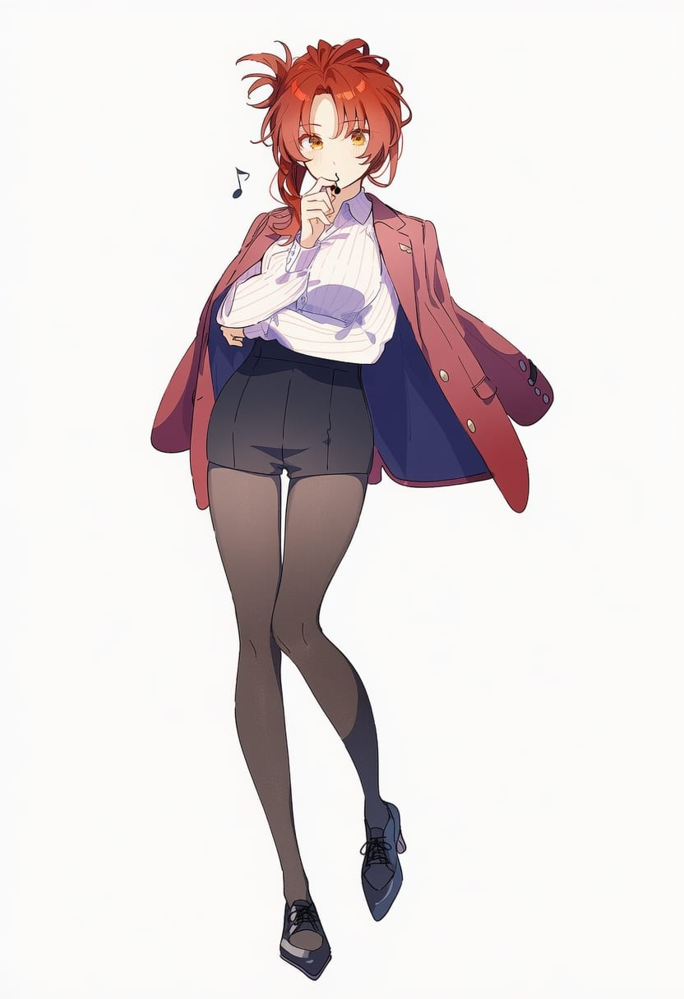

| 字段 | 内容 |
| --- | --- |
| Danbooru Tag | whistling |
| 中文名 | 吹口哨 |
| 中文含义 | 用嘴吹出哨声。 |
| 子类 | 娱乐/兴趣/社交 |
| 模特 | murata_himeko |
| 序号 | 0106 |

## 107. laughing — 大笑

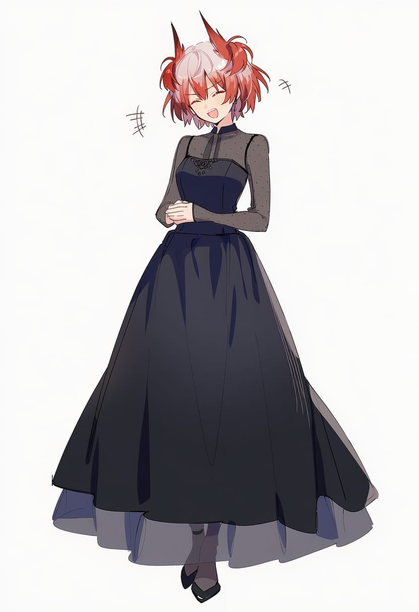

| 字段 | 内容 |
| --- | --- |
| Danbooru Tag | laughing |
| 中文名 | 大笑 |
| 中文含义 | 正在明显发笑。 |
| 子类 | 娱乐/兴趣/社交 |
| 模特 | fiammetta_(arknights) |
| 序号 | 0107 |

## 108. giggling — 咯咯笑

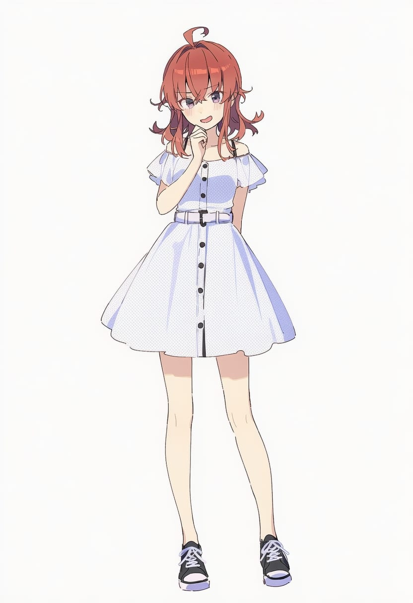

| 字段 | 内容 |
| --- | --- |
| Danbooru Tag | giggling |
| 中文名 | 咯咯笑 |
| 中文含义 | 轻声、连续地笑。 |
| 子类 | 娱乐/兴趣/社交 |
| 模特 | arashi_(kancolle) |
| 序号 | 0108 |

## 109. cheering — 欢呼

| 字段 | 内容 |
| --- | --- |
| Danbooru Tag | cheering |
| 中文名 | 欢呼 |
| 中文含义 | 正在为某人或某事加油欢呼。 |
| 子类 | 娱乐/兴趣/社交 |
| 模特 | zara_(azur_lane) |
| 序号 | 0109 |

## 110. clapping — 鼓掌

| 字段 | 内容 |
| --- | --- |
| Danbooru Tag | clapping |
| 中文名 | 鼓掌 |
| 中文含义 | 双手反复拍击表示赞赏或庆祝。 |
| 子类 | 娱乐/兴趣/社交 |
| 模特 | win_variation_(umamusume) |
| 序号 | 0110 |

## 111. juggling — 杂耍抛接

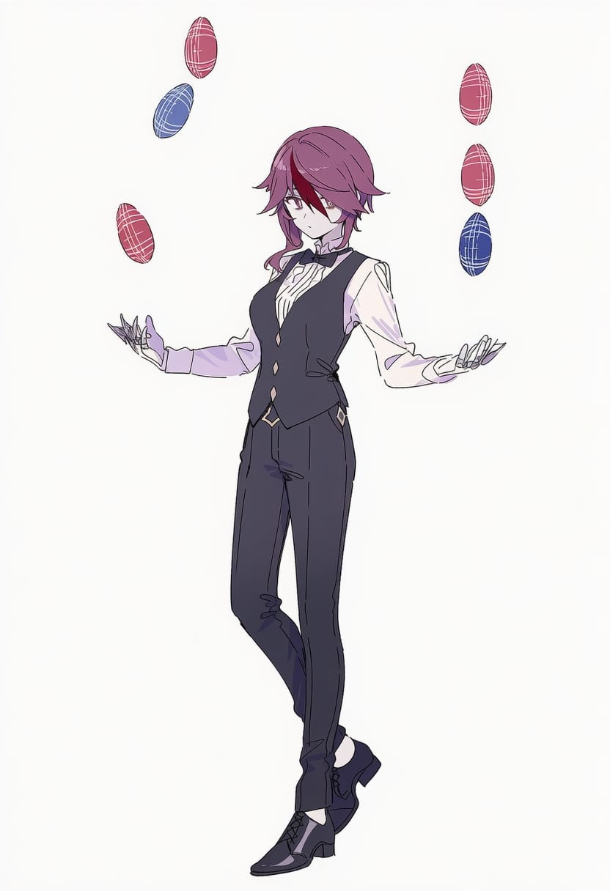

| 字段 | 内容 |
| --- | --- |
| Danbooru Tag | juggling |
| 中文名 | 杂耍抛接 |
| 中文含义 | 连续抛接多个物体。 |
| 子类 | 娱乐/兴趣/社交 |
| 模特 | rosaria_(genshin_impact) |
| 序号 | 0111 |

## 112. fishing — 钓鱼

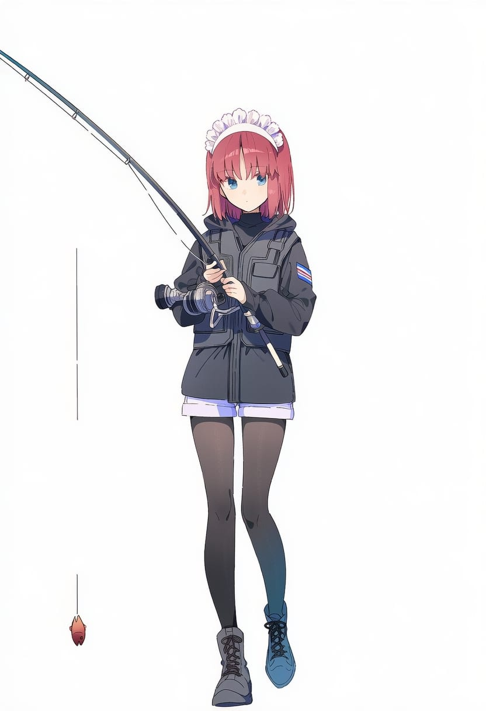

| 字段 | 内容 |
| --- | --- |
| Danbooru Tag | fishing |
| 中文名 | 钓鱼 |
| 中文含义 | 使用鱼竿等进行钓鱼。 |
| 子类 | 娱乐/兴趣/社交 |
| 模特 | hisui_(tsukihime) |
| 序号 | 0112 |

## 113. camping — 露营

| 字段 | 内容 |
| --- | --- |
| Danbooru Tag | camping |
| 中文名 | 露营 |
| 中文含义 | 正在进行露营活动。 |
| 子类 | 娱乐/兴趣/社交 |
| 模特 | okazaki_yumemi |
| 序号 | 0113 |

## 114. bowling — 打保龄球

| 字段 | 内容 |
| --- | --- |
| Danbooru Tag | bowling |
| 中文名 | 打保龄球 |
| 中文含义 | 正在进行保龄球运动。 |
| 子类 | 娱乐/兴趣/社交 |
| 模特 | erza_scarlet |
| 序号 | 0114 |

## 115. dating — 约会

| 字段 | 内容 |
| --- | --- |
| Danbooru Tag | dating |
| 中文名 | 约会 |
| 中文含义 | 角色处于约会场景或活动中。 |
| 子类 | 娱乐/兴趣/社交 |
| 模特 | miia_(monster_musume) |
| 序号 | 0115 |

## 116. praying — 祈祷

| 字段 | 内容 |
| --- | --- |
| Danbooru Tag | praying |
| 中文名 | 祈祷 |
| 中文含义 | 双手合拢等进行祈祷。 |
| 子类 | 娱乐/兴趣/社交 |
| 模特 | myrtle_(arknights) |
| 序号 | 0116 |

## 117. smoking — 吸烟

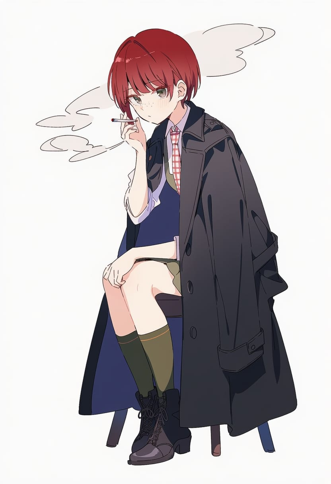

| 字段 | 内容 |
| --- | --- |
| Danbooru Tag | smoking |
| 中文名 | 吸烟 |
| 中文含义 | 正在吸香烟、烟斗等。 |
| 子类 | 娱乐/兴趣/社交 |
| 模特 | koizumi_mahiru |
| 序号 | 0117 |

---
