## 1. jewelry — 首饰

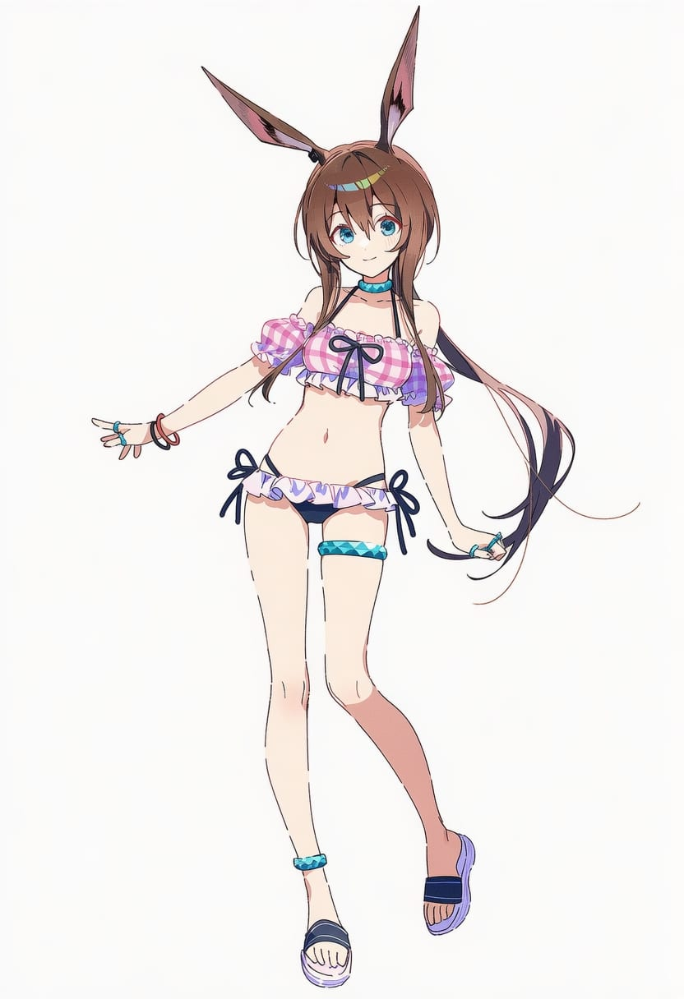

| 字段 | 内容 |
| --- | --- |
| Danbooru Tag | jewelry |
| 中文名 | 首饰 |
| 中文含义 | 泛指角色佩戴的珠宝首饰。 |
| 子类 | 不固定部位 |
| 模特 | amiya_(arknights) |
| 序号 | 0001 |

## 2. body_jewelry — 身体珠宝

| 字段 | 内容 |
| --- | --- |
| Danbooru Tag | body_jewelry |
| 中文名 | 身体珠宝 |
| 中文含义 | 直接装饰在身体上的珠宝或宝石。 |
| 子类 | 不固定部位 |
| 模特 | dobermann_(arknights) |
| 序号 | 0002 |

## 3. buckle — 装饰扣

| 字段 | 内容 |
| --- | --- |
| Danbooru Tag | buckle |
| 中文名 | 装饰扣 |
| 中文含义 | 衣物或配饰上的明显扣件。 |
| 子类 | 不固定部位 |
| 模特 | firewatch_(arknights) |
| 序号 | 0003 |

## 4. sash — 饰带 / 宽腰带

| 字段 | 内容 |
| --- | --- |
| Danbooru Tag | sash |
| 中文名 | 饰带 / 宽腰带 |
| 中文含义 | 宽布带围在腰部或斜跨身体。 |
| 子类 | 不固定部位 |
| 模特 | frostleaf_(arknights) |
| 序号 | 0004 |

## 5. black_sash — 黑色饰带

| 字段 | 内容 |
| --- | --- |
| Danbooru Tag | black_sash |
| 中文名 | 黑色饰带 |
| 中文含义 | 黑色 sash；纯颜色款只留这一种代表。 |
| 子类 | 不固定部位 |
| 模特 | gavial_(arknights) |
| 序号 | 0005 |

## 6. print_sash — 印花饰带

| 字段 | 内容 |
| --- | --- |
| Danbooru Tag | print_sash |
| 中文名 | 印花饰带 |
| 中文含义 | 带明显印花图案的 sash。 |
| 子类 | 不固定部位 |
| 模特 | meteorite_(arknights) |
| 序号 | 0006 |

## 7. striped_sash — 条纹饰带

| 字段 | 内容 |
| --- | --- |
| Danbooru Tag | striped_sash |
| 中文名 | 条纹饰带 |
| 中文含义 | 带条纹图案的 sash。 |
| 子类 | 不固定部位 |
| 模特 | myrrh_(arknights) |
| 序号 | 0007 |

## 8. vertical-striped_sash — 竖条纹饰带

| 字段 | 内容 |
| --- | --- |
| Danbooru Tag | vertical-striped_sash |
| 中文名 | 竖条纹饰带 |
| 中文含义 | 带竖向条纹的 sash。 |
| 子类 | 不固定部位 |
| 模特 | perfumer_(arknights) |
| 序号 | 0008 |

## 9. shimenawa — 注连绳

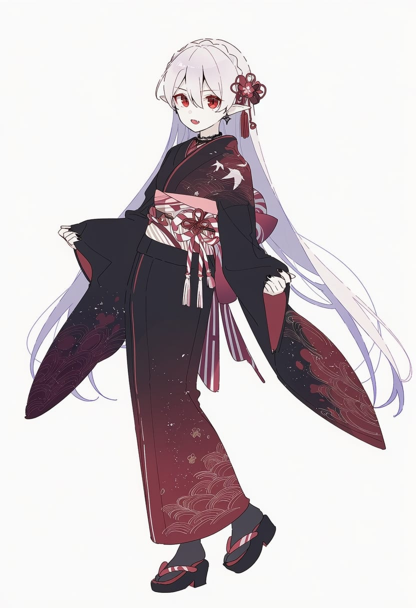

| 字段 | 内容 |
| --- | --- |
| Danbooru Tag | shimenawa |
| 中文名 | 注连绳 |
| 中文含义 | 粗绳式装饰，可环绕腰部或身体。 |
| 子类 | 不固定部位 |
| 模特 | warfarin_(arknights) |
| 序号 | 0009 |

## 10. bag — 包

| 字段 | 内容 |
| --- | --- |
| Danbooru Tag | bag |
| 中文名 | 包 |
| 中文含义 | 泛指随身携带的包。 |
| 子类 | 不固定部位 |
| 模特 | durin_(arknights) |
| 序号 | 0010 |

## 11. animal_bag — 动物造型包

| 字段 | 内容 |
| --- | --- |
| Danbooru Tag | animal_bag |
| 中文名 | 动物造型包 |
| 中文含义 | 做成动物外形或动物脸的包。 |
| 子类 | 不固定部位 |
| 模特 | yato_(arknights) |
| 序号 | 0011 |

## 12. bear_bag — 熊熊包

| 字段 | 内容 |
| --- | --- |
| Danbooru Tag | bear_bag |
| 中文名 | 熊熊包 |
| 中文含义 | 熊造型的包。 |
| 子类 | 不固定部位 |
| 模特 | beagle_(arknights) |
| 序号 | 0012 |

## 13. school_bag — 学生包

| 字段 | 内容 |
| --- | --- |
| Danbooru Tag | school_bag |
| 中文名 | 学生包 |
| 中文含义 | 学校场景常见的学生书包。 |
| 子类 | 不固定部位 |
| 模特 | fang_(arknights) |
| 序号 | 0013 |

## 14. pouch — 小包 / 收纳袋

| 字段 | 内容 |
| --- | --- |
| Danbooru Tag | pouch |
| 中文名 | 小包 / 收纳袋 |
| 中文含义 | 小型软质收纳包。 |
| 子类 | 不固定部位 |
| 模特 | hibiscus_(arknights) |
| 序号 | 0014 |

## 15. food-themed_bag — 食物主题包

| 字段 | 内容 |
| --- | --- |
| Danbooru Tag | food-themed_bag |
| 中文名 | 食物主题包 |
| 中文含义 | 做成食物造型或带食物主题的包。 |
| 子类 | 不固定部位 |
| 模特 | kroos_(arknights) |
| 序号 | 0015 |

## 16. shoulder_sash — 肩斜绶带

| 字段 | 内容 |
| --- | --- |
| Danbooru Tag | shoulder_sash |
| 中文名 | 肩斜绶带 |
| 中文含义 | 从肩部斜跨到腰侧的饰带。 |
| 子类 | 肩部 |
| 模特 | lava_(arknights) |
| 序号 | 0016 |

## 17. epaulettes — 流苏肩章

| 字段 | 内容 |
| --- | --- |
| Danbooru Tag | epaulettes |
| 中文名 | 流苏肩章 |
| 中文含义 | 军礼服常见的装饰性肩章。 |
| 子类 | 肩部 |
| 模特 | cardigan_(arknights) |
| 序号 | 0017 |

## 18. single_epaulette — 单侧肩章

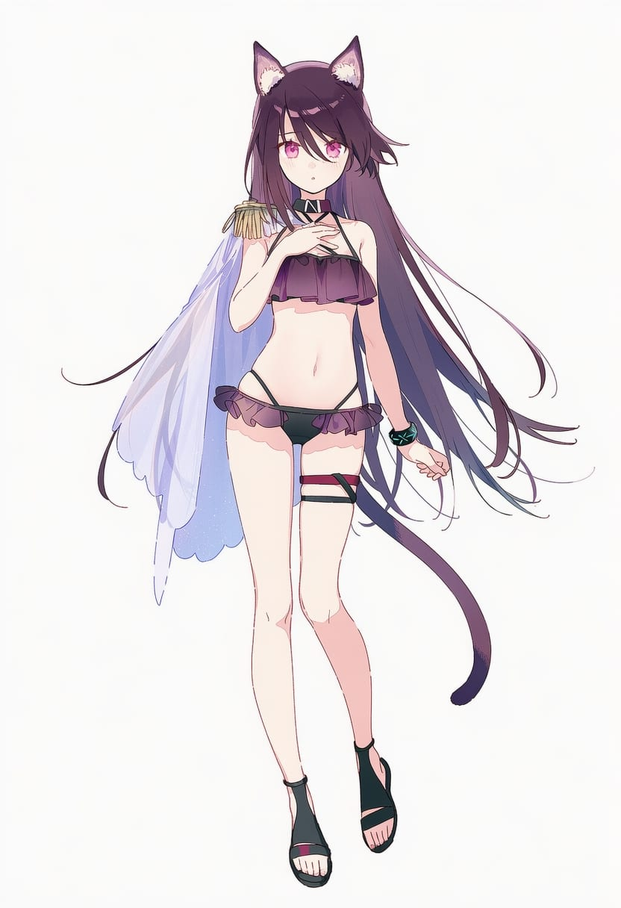

| 字段 | 内容 |
| --- | --- |
| Danbooru Tag | single_epaulette |
| 中文名 | 单侧肩章 |
| 中文含义 | 只有一边肩膀佩戴装饰肩章。 |
| 子类 | 肩部 |
| 模特 | melantha_(arknights) |
| 序号 | 0018 |

## 19. shoulder_boards — 肩章牌

| 字段 | 内容 |
| --- | --- |
| Danbooru Tag | shoulder_boards |
| 中文名 | 肩章牌 |
| 中文含义 | 肩部的长方形军衔肩章。 |
| 子类 | 肩部 |
| 模特 | orchid_(arknights) |
| 序号 | 0019 |

## 20. aiguillette — 军礼饰绳

| 字段 | 内容 |
| --- | --- |
| Danbooru Tag | aiguillette |
| 中文名 | 军礼饰绳 |
| 中文含义 | 从肩部垂下的军礼装饰绳。 |
| 子类 | 肩部 |
| 模特 | projekt_red_(arknights) |
| 序号 | 0020 |

## 21. fourragere — 编织绶带

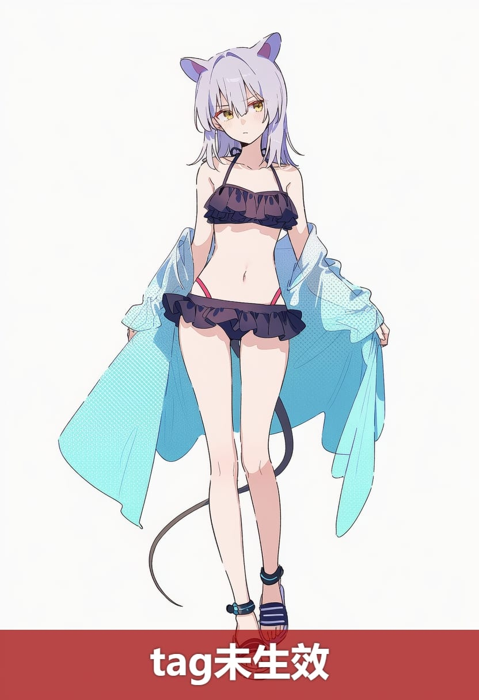

| 字段 | 内容 |
| --- | --- |
| Danbooru Tag | fourragere |
| 中文名 | 编织绶带 |
| 中文含义 | 绕过肩部的编织军礼绶带。 |
| 子类 | 肩部 |
| 模特 | scavenger_(arknights) |
| 序号 | 0021 |

## 22. bandolier — 斜挎弹带

| 字段 | 内容 |
| --- | --- |
| Danbooru Tag | bandolier |
| 中文名 | 斜挎弹带 |
| 中文含义 | 斜跨胸前的带状配件。 |
| 子类 | 肩部 |
| 模特 | deepcolor_(arknights) |
| 序号 | 0022 |

## 23. suspenders — 背带

| 字段 | 内容 |
| --- | --- |
| Danbooru Tag | suspenders |
| 中文名 | 背带 |
| 中文含义 | 从肩部连接裤腰的背带。 |
| 子类 | 肩部 |
| 模特 | specter_(arknights) |
| 序号 | 0023 |

## 24. shoulder_belt — 肩带式腰带

| 字段 | 内容 |
| --- | --- |
| Danbooru Tag | shoulder_belt |
| 中文名 | 肩带式腰带 |
| 中文含义 | 从肩部斜跨身体的宽带。 |
| 子类 | 肩部 |
| 模特 | cuora_(arknights) |
| 序号 | 0024 |

## 25. shoulder_bag — 单肩包

| 字段 | 内容 |
| --- | --- |
| Danbooru Tag | shoulder_bag |
| 中文名 | 单肩包 |
| 中文含义 | 用一条肩带挂在肩上的包。 |
| 子类 | 肩部 |
| 模特 | vigna_(arknights) |
| 序号 | 0025 |

## 26. messenger_bag — 邮差包

| 字段 | 内容 |
| --- | --- |
| Danbooru Tag | messenger_bag |
| 中文名 | 邮差包 |
| 中文含义 | 斜挎佩戴、带大翻盖的肩包。 |
| 子类 | 肩部 |
| 模特 | franka_(arknights) |
| 序号 | 0026 |

## 27. crossbody_bag — 斜挎包

| 字段 | 内容 |
| --- | --- |
| Danbooru Tag | crossbody_bag |
| 中文名 | 斜挎包 |
| 中文含义 | 肩带斜跨身体佩戴的包。 |
| 子类 | 肩部 |
| 模特 | jessica_(arknights) |
| 序号 | 0027 |

## 28. body_chain — 身体链

| 字段 | 内容 |
| --- | --- |
| Danbooru Tag | body_chain |
| 中文名 | 身体链 |
| 中文含义 | 链条跨过胸腹等身体部位形成装饰。 |
| 子类 | 胸腹部 |
| 模特 | liskarm_(arknights) |
| 序号 | 0028 |

## 29. chest_jewel — 胸前宝石

| 字段 | 内容 |
| --- | --- |
| Danbooru Tag | chest_jewel |
| 中文名 | 胸前宝石 |
| 中文含义 | 胸口位置有明显宝石装饰。 |
| 子类 | 胸腹部 |
| 模特 | vanilla_(arknights) |
| 序号 | 0029 |

## 30. brooch — 胸针

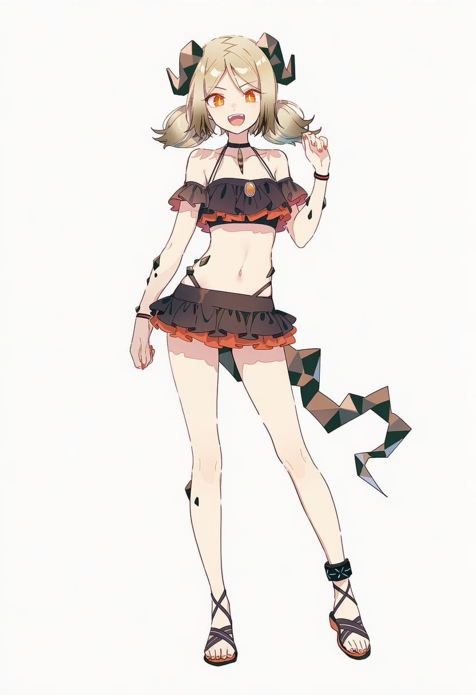

| 字段 | 内容 |
| --- | --- |
| Danbooru Tag | brooch |
| 中文名 | 胸针 |
| 中文含义 | 别在衣服上的装饰胸针。 |
| 子类 | 胸腹部 |
| 模特 | ifrit_(arknights) |
| 序号 | 0030 |

## 31. heart_brooch — 爱心胸针

| 字段 | 内容 |
| --- | --- |
| Danbooru Tag | heart_brooch |
| 中文名 | 爱心胸针 |
| 中文含义 | 爱心造型的胸针。 |
| 子类 | 胸腹部 |
| 模特 | mayer_(arknights) |
| 序号 | 0031 |

## 32. star_brooch — 星星胸针

| 字段 | 内容 |
| --- | --- |
| Danbooru Tag | star_brooch |
| 中文名 | 星星胸针 |
| 中文含义 | 星形造型的胸针。 |
| 子类 | 胸腹部 |
| 模特 | ptilopsis_(arknights) |
| 序号 | 0032 |

## 33. flower_brooch — 花朵胸针

| 字段 | 内容 |
| --- | --- |
| Danbooru Tag | flower_brooch |
| 中文名 | 花朵胸针 |
| 中文含义 | 花朵造型的胸针。 |
| 子类 | 胸腹部 |
| 模特 | saria_(arknights) |
| 序号 | 0033 |

## 34. wing_brooch — 翅膀胸针

| 字段 | 内容 |
| --- | --- |
| Danbooru Tag | wing_brooch |
| 中文名 | 翅膀胸针 |
| 中文含义 | 翅膀造型的胸针。 |
| 子类 | 胸腹部 |
| 模特 | silence_(arknights) |
| 序号 | 0034 |

## 35. shell_brooch — 贝壳胸针

| 字段 | 内容 |
| --- | --- |
| Danbooru Tag | shell_brooch |
| 中文名 | 贝壳胸针 |
| 中文含义 | 贝壳造型的胸针。 |
| 子类 | 胸腹部 |
| 模特 | nearl_(arknights) |
| 序号 | 0035 |

## 36. diamond_brooch — 菱形胸针

| 字段 | 内容 |
| --- | --- |
| Danbooru Tag | diamond_brooch |
| 中文名 | 菱形胸针 |
| 中文含义 | 菱形造型的胸针。 |
| 子类 | 胸腹部 |
| 模特 | nightingale_(arknights) |
| 序号 | 0036 |

## 37. jack-o'-lantern_brooch — 南瓜灯胸针

| 字段 | 内容 |
| --- | --- |
| Danbooru Tag | jack-o'-lantern_brooch |
| 中文名 | 南瓜灯胸针 |
| 中文含义 | 南瓜灯造型的胸针。 |
| 子类 | 胸腹部 |
| 模特 | shining_(arknights) |
| 序号 | 0037 |

## 38. badge — 徽章

| 字段 | 内容 |
| --- | --- |
| Danbooru Tag | badge |
| 中文名 | 徽章 |
| 中文含义 | 别在衣服上的徽章或标识。 |
| 子类 | 胸腹部 |
| 模特 | matoimaru_(arknights) |
| 序号 | 0038 |

## 39. button_badge — 圆形徽章

| 字段 | 内容 |
| --- | --- |
| Danbooru Tag | button_badge |
| 中文名 | 圆形徽章 |
| 中文含义 | 圆形纽扣式徽章。 |
| 子类 | 胸腹部 |
| 模特 | shirayuki_(arknights) |
| 序号 | 0039 |

## 40. lapel_pin — 翻领别针

| 字段 | 内容 |
| --- | --- |
| Danbooru Tag | lapel_pin |
| 中文名 | 翻领别针 |
| 中文含义 | 别在西装或外套翻领上的小饰针。 |
| 子类 | 胸腹部 |
| 模特 | blue_poison_(arknights) |
| 序号 | 0040 |

## 41. boutonniere — 襟花

| 字段 | 内容 |
| --- | --- |
| Danbooru Tag | boutonniere |
| 中文名 | 襟花 |
| 中文含义 | 别在西装翻领位置的花朵装饰。 |
| 子类 | 胸腹部 |
| 模特 | gravel_(arknights) |
| 序号 | 0041 |

## 42. medal — 奖章

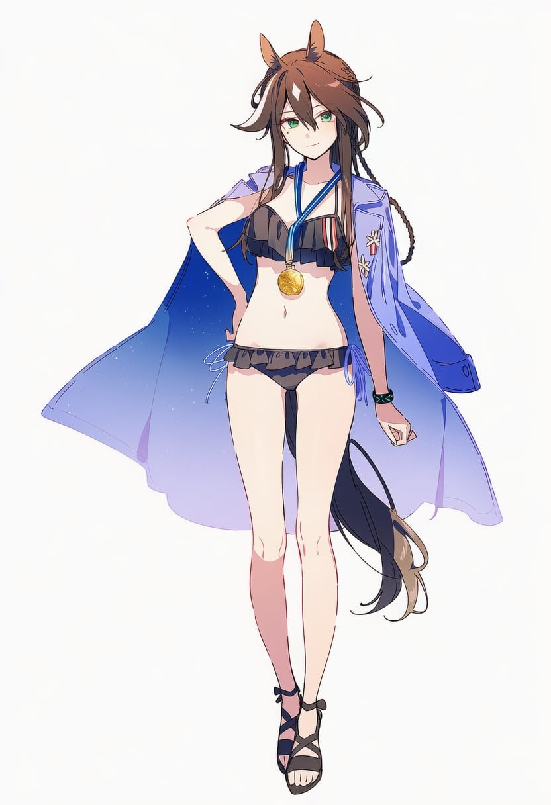

| 字段 | 内容 |
| --- | --- |
| Danbooru Tag | medal |
| 中文名 | 奖章 |
| 中文含义 | 佩戴在胸前的奖章或勋章。 |
| 子类 | 胸腹部 |
| 模特 | meteor_(arknights) |
| 序号 | 0042 |

## 43. award_ribbon — 奖章绶带

| 字段 | 内容 |
| --- | --- |
| Danbooru Tag | award_ribbon |
| 中文名 | 奖章绶带 |
| 中文含义 | 胸前佩戴的条形奖章绶带。 |
| 子类 | 胸腹部 |
| 模特 | platinum_(arknights) |
| 序号 | 0043 |

## 44. corsage — 胸花

| 字段 | 内容 |
| --- | --- |
| Danbooru Tag | corsage |
| 中文名 | 胸花 |
| 中文含义 | 佩戴在胸前或肩部的花朵装饰。 |
| 子类 | 胸腹部 |
| 模特 | cliffheart_(arknights) |
| 序号 | 0044 |

## 45. pocket_square — 西装口袋巾

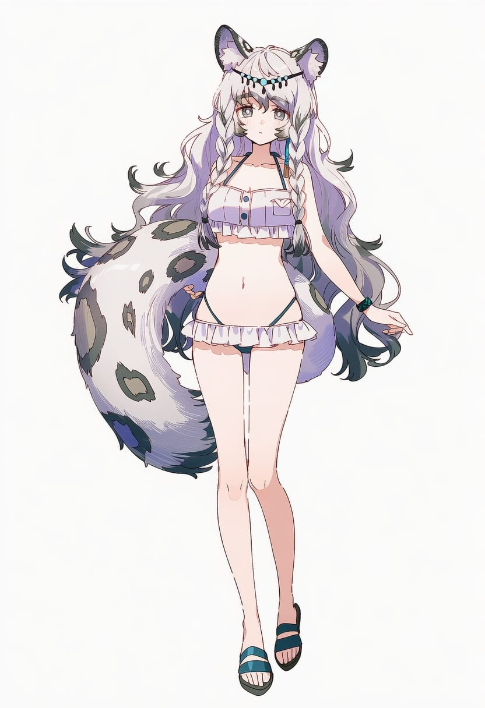

| 字段 | 内容 |
| --- | --- |
| Danbooru Tag | pocket_square |
| 中文名 | 西装口袋巾 |
| 中文含义 | 插在西装胸袋里的装饰方巾。 |
| 子类 | 胸腹部 |
| 模特 | pramanix_(arknights) |
| 序号 | 0045 |

## 46. harness — 身体束带

| 字段 | 内容 |
| --- | --- |
| Danbooru Tag | harness |
| 中文名 | 身体束带 |
| 中文含义 | 多条带子环绕胸腰形成的束带。 |
| 子类 | 胸腹部 |
| 模特 | plume_(arknights) |
| 序号 | 0046 |

## 47. chest_harness — 胸部束带

| 字段 | 内容 |
| --- | --- |
| Danbooru Tag | chest_harness |
| 中文名 | 胸部束带 |
| 中文含义 | 主要环绕胸口位置的束带。 |
| 子类 | 胸腹部 |
| 模特 | earthspirit_(arknights) |
| 序号 | 0047 |

## 48. chest_belt — 胸带

| 字段 | 内容 |
| --- | --- |
| Danbooru Tag | chest_belt |
| 中文名 | 胸带 |
| 中文含义 | 横跨或环绕胸部的带子。 |
| 子类 | 胸腹部 |
| 模特 | eyjafjalla_(arknights) |
| 序号 | 0048 |

## 49. backpack — 双肩包

| 字段 | 内容 |
| --- | --- |
| Danbooru Tag | backpack |
| 中文名 | 双肩包 |
| 中文含义 | 背在双肩上的背包。 |
| 子类 | 背部 |
| 模特 | vulcan_(arknights) |
| 序号 | 0049 |

## 50. randoseru — 日式书包

| 字段 | 内容 |
| --- | --- |
| Danbooru Tag | randoseru |
| 中文名 | 日式书包 |
| 中文含义 | 日本小学生常见的硬质双肩书包。 |
| 子类 | 背部 |
| 模特 | savage_(arknights) |
| 序号 | 0050 |

## 51. belly_chain — 腰链 / 腹链

| 字段 | 内容 |
| --- | --- |
| Danbooru Tag | belly_chain |
| 中文名 | 腰链 / 腹链 |
| 中文含义 | 环绕腰部或腹部佩戴的装饰链。 |
| 子类 | 腰部 |
| 模特 | gitano_(arknights) |
| 序号 | 0051 |

## 52. belt — 腰带

| 字段 | 内容 |
| --- | --- |
| Danbooru Tag | belt |
| 中文名 | 腰带 |
| 中文含义 | 泛指围在腰部的腰带。 |
| 子类 | 腰部 |
| 模特 | estelle_(arknights) |
| 序号 | 0052 |

## 53. black_belt — 黑色腰带

| 字段 | 内容 |
| --- | --- |
| Danbooru Tag | black_belt |
| 中文名 | 黑色腰带 |
| 中文含义 | 黑色腰带；纯颜色款只留这一种代表。 |
| 子类 | 腰部 |
| 模特 | manticore_(arknights) |
| 序号 | 0053 |

## 54. belt_buckle — 腰带扣

| 字段 | 内容 |
| --- | --- |
| Danbooru Tag | belt_buckle |
| 中文名 | 腰带扣 |
| 中文含义 | 腰带正面的明显扣件。 |
| 子类 | 腰部 |
| 模特 | angelina_(arknights) |
| 序号 | 0054 |

## 55. chain_belt — 链条腰带

| 字段 | 内容 |
| --- | --- |
| Danbooru Tag | chain_belt |
| 中文名 | 链条腰带 |
| 中文含义 | 主要由链条构成的腰带。 |
| 子类 | 腰部 |
| 模特 | lappland_(arknights) |
| 序号 | 0055 |

## 56. loose_belt — 松垮腰带

| 字段 | 内容 |
| --- | --- |
| Danbooru Tag | loose_belt |
| 中文名 | 松垮腰带 |
| 中文含义 | 腰带明显松垮地挂在腰间。 |
| 子类 | 腰部 |
| 模特 | provence_(arknights) |
| 序号 | 0056 |

## 57. multiple_belts — 多条腰带

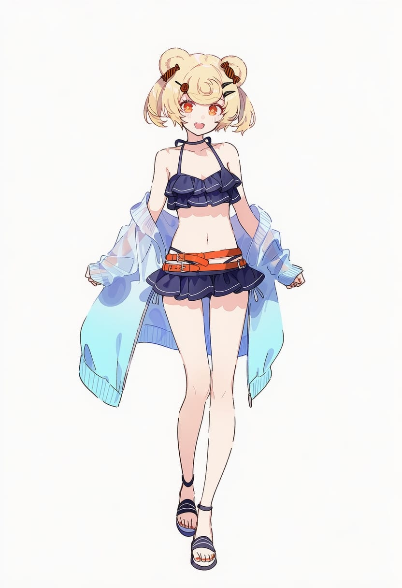

| 字段 | 内容 |
| --- | --- |
| Danbooru Tag | multiple_belts |
| 中文名 | 多条腰带 |
| 中文含义 | 同时佩戴多条腰带。 |
| 子类 | 腰部 |
| 模特 | gummy_(arknights) |
| 序号 | 0057 |

## 58. too_many_belts — 大量腰带

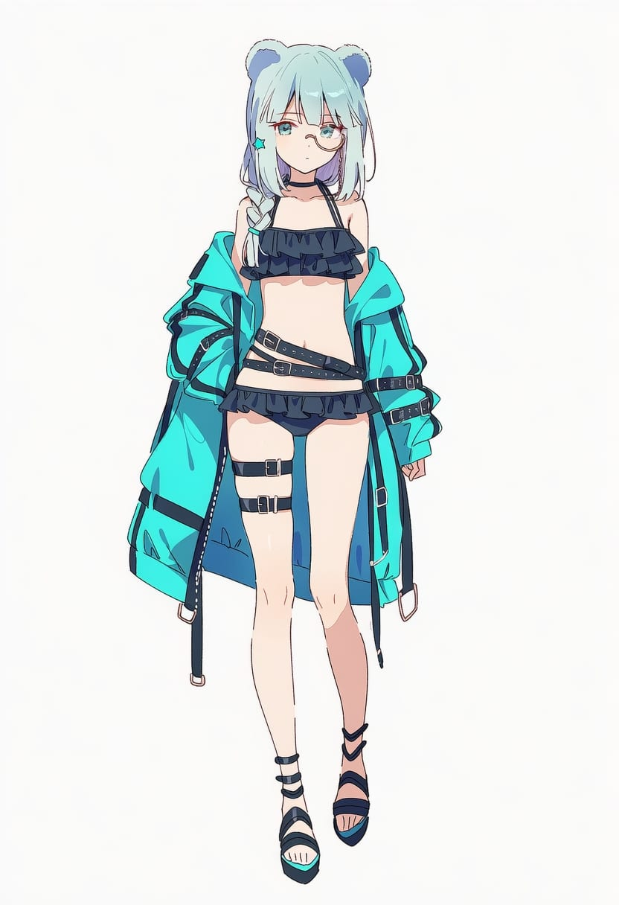

| 字段 | 内容 |
| --- | --- |
| Danbooru Tag | too_many_belts |
| 中文名 | 大量腰带 |
| 中文含义 | 身上佩戴夸张数量的腰带。 |
| 子类 | 腰部 |
| 模特 | istina_(arknights) |
| 序号 | 0058 |

## 59. studded_belt — 铆钉腰带

| 字段 | 内容 |
| --- | --- |
| Danbooru Tag | studded_belt |
| 中文名 | 铆钉腰带 |
| 中文含义 | 带大量铆钉装饰的腰带。 |
| 子类 | 腰部 |
| 模特 | zima_(arknights) |
| 序号 | 0059 |

## 60. o-ring_belt — O环腰带

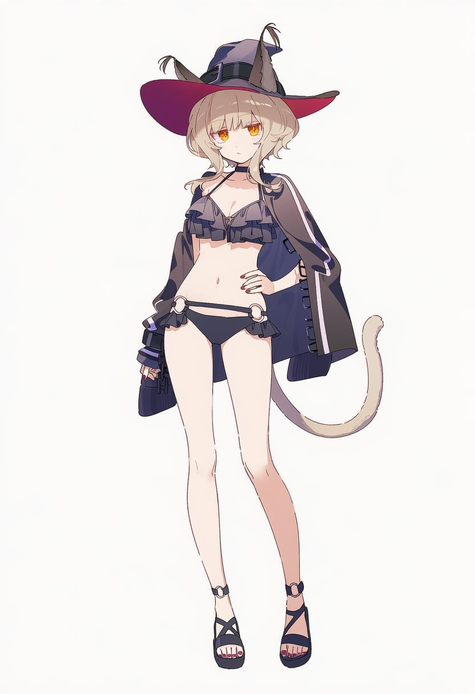

| 字段 | 内容 |
| --- | --- |
| Danbooru Tag | o-ring_belt |
| 中文名 | O环腰带 |
| 中文含义 | 腰带上带明显圆形金属环。 |
| 子类 | 腰部 |
| 模特 | haze_(arknights) |
| 序号 | 0060 |

## 61. waist_bow — 腰部蝴蝶结

| 字段 | 内容 |
| --- | --- |
| Danbooru Tag | waist_bow |
| 中文名 | 腰部蝴蝶结 |
| 中文含义 | 腰部位置有明显蝴蝶结装饰。 |
| 子类 | 腰部 |
| 模特 | mousse_(arknights) |
| 序号 | 0061 |

## 62. waist_cape — 腰披

| 字段 | 内容 |
| --- | --- |
| Danbooru Tag | waist_cape |
| 中文名 | 腰披 |
| 中文含义 | 从腰部垂下的小披布或装饰披片。 |
| 子类 | 腰部 |
| 模特 | skyfire_(arknights) |
| 序号 | 0062 |

## 63. waist_sash — 腰部饰带

| 字段 | 内容 |
| --- | --- |
| Danbooru Tag | waist_sash |
| 中文名 | 腰部饰带 |
| 中文含义 | 明确围在腰部的宽布带。 |
| 子类 | 腰部 |
| 模特 | indra_(arknights) |
| 序号 | 0063 |

## 64. obi — 腰带 / Obi

| 字段 | 内容 |
| --- | --- |
| Danbooru Tag | obi |
| 中文名 | 腰带 / Obi |
| 中文含义 | 和服外侧使用的宽腰带。 |
| 子类 | 腰部 |
| 模特 | siege_(arknights) |
| 序号 | 0064 |

## 65. obiage — 带扬

| 字段 | 内容 |
| --- | --- |
| Danbooru Tag | obiage |
| 中文名 | 带扬 |
| 中文含义 | 从 Obi 上缘露出的装饰布。 |
| 子类 | 腰部 |
| 模特 | feater_(arknights) |
| 序号 | 0065 |

## 66. obijime — 带締

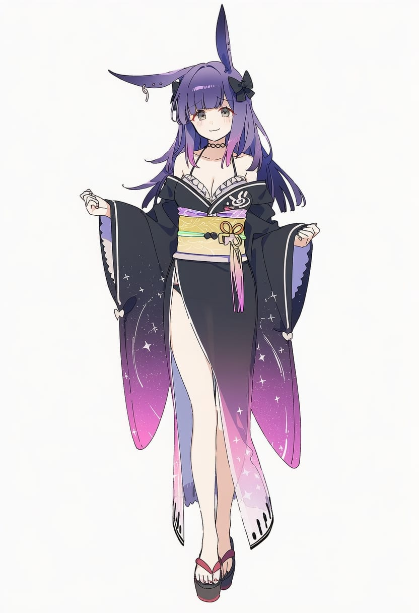

| 字段 | 内容 |
| --- | --- |
| Danbooru Tag | obijime |
| 中文名 | 带締 |
| 中文含义 | 系在 Obi 外侧的细装饰绳。 |
| 子类 | 腰部 |
| 模特 | rope_(arknights) |
| 序号 | 0066 |

## 67. garter_belt — 吊袜腰带

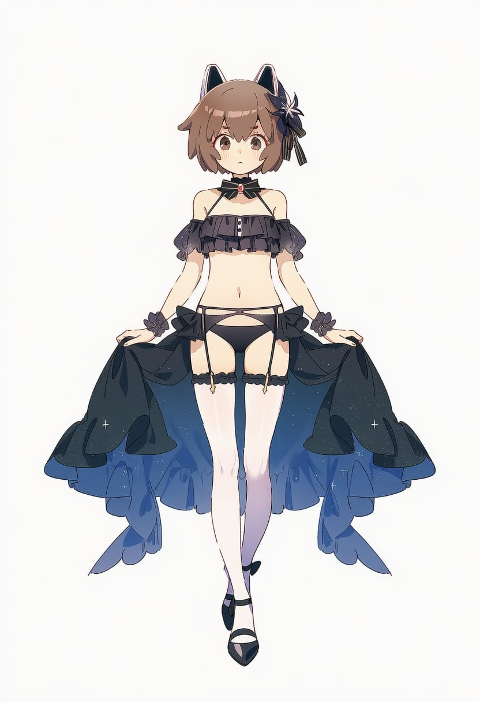

| 字段 | 内容 |
| --- | --- |
| Danbooru Tag | garter_belt |
| 中文名 | 吊袜腰带 |
| 中文含义 | 腰部佩戴并连接吊袜带的腰带。 |
| 子类 | 腰部 |
| 模特 | shaw_(arknights) |
| 序号 | 0067 |

## 68. belt_pouch — 腰带小包

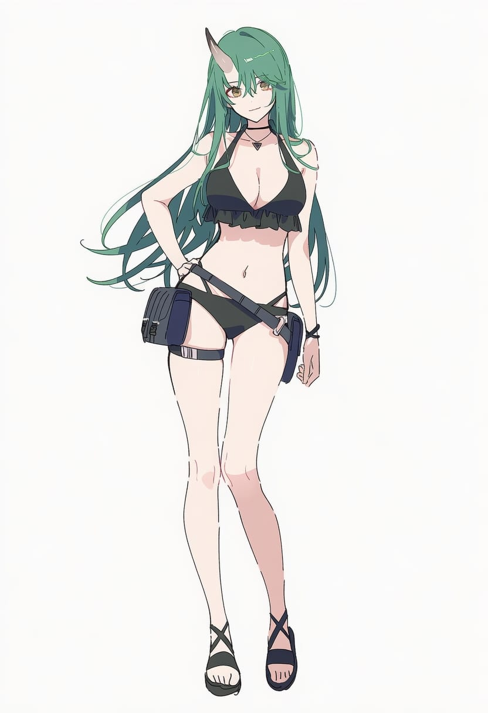

| 字段 | 内容 |
| --- | --- |
| Danbooru Tag | belt_pouch |
| 中文名 | 腰带小包 |
| 中文含义 | 固定在腰带上的小型收纳包。 |
| 子类 | 腰部 |
| 模特 | hoshiguma_(arknights) |
| 序号 | 0068 |

## 69. fanny_pack — 腰包

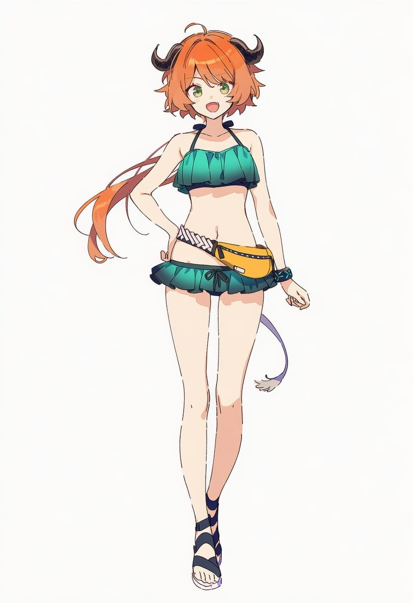

| 字段 | 内容 |
| --- | --- |
| Danbooru Tag | fanny_pack |
| 中文名 | 腰包 |
| 中文含义 | 系在腰部或斜挎佩戴的小包。 |
| 子类 | 腰部 |
| 模特 | croissant_(arknights) |
| 序号 | 0069 |

## 70. leg_belt — 腿部腰带

| 字段 | 内容 |
| --- | --- |
| Danbooru Tag | leg_belt |
| 中文名 | 腿部腰带 |
| 中文含义 | 扣在腿上的腰带式装饰。 |
| 子类 | 腿部 |
| 模特 | exusiai_(arknights) |
| 序号 | 0070 |

## 71. leg_ribbon — 腿部丝带

| 字段 | 内容 |
| --- | --- |
| Danbooru Tag | leg_ribbon |
| 中文名 | 腿部丝带 |
| 中文含义 | 系在腿上的装饰丝带。 |
| 子类 | 腿部 |
| 模特 | sora_(arknights) |
| 序号 | 0071 |

## 72. thighlet — 大腿环饰

| 字段 | 内容 |
| --- | --- |
| Danbooru Tag | thighlet |
| 中文名 | 大腿环饰 |
| 中文含义 | 环绕大腿佩戴的金属或珠宝环饰。 |
| 子类 | 腿部 |
| 模特 | texas_(arknights) |
| 序号 | 0072 |

## 73. gold_thighlet — 金色大腿环饰

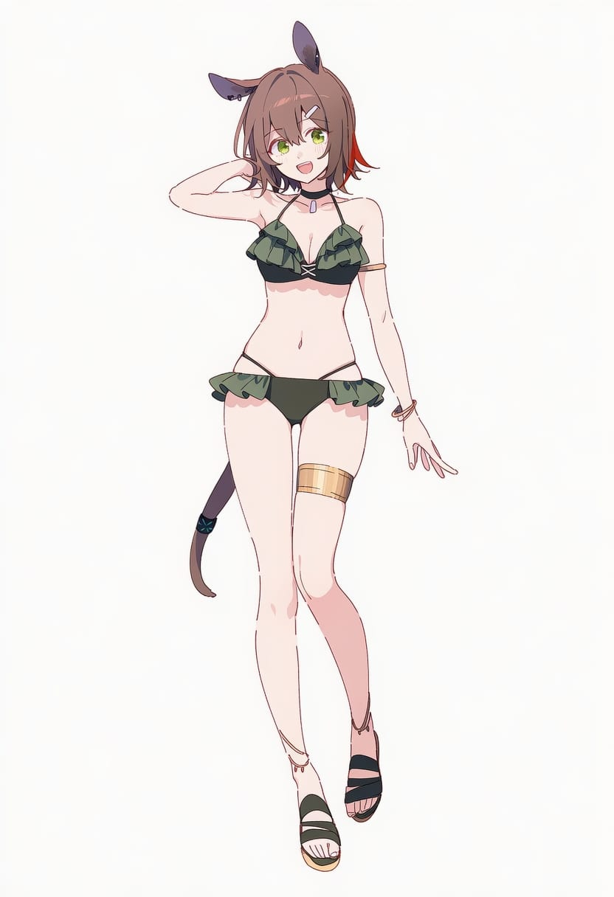

| 字段 | 内容 |
| --- | --- |
| Danbooru Tag | gold_thighlet |
| 中文名 | 金色大腿环饰 |
| 中文含义 | 金色或金质感大腿环；纯颜色款只留这一种代表。 |
| 子类 | 腿部 |
| 模特 | catapult_(arknights) |
| 序号 | 0073 |

## 74. thigh_strap — 大腿带

| 字段 | 内容 |
| --- | --- |
| Danbooru Tag | thigh_strap |
| 中文名 | 大腿带 |
| 中文含义 | 环绕大腿的布带或皮带。 |
| 子类 | 腿部 |
| 模特 | skadi_(arknights) |
| 序号 | 0074 |

## 75. o-ring_thigh_strap — O环大腿带

| 字段 | 内容 |
| --- | --- |
| Danbooru Tag | o-ring_thigh_strap |
| 中文名 | O环大腿带 |
| 中文含义 | 带圆形金属环的大腿带。 |
| 子类 | 腿部 |
| 模特 | beehunter_(arknights) |
| 序号 | 0075 |

## 76. frilled_thigh_strap — 褶边大腿带

| 字段 | 内容 |
| --- | --- |
| Danbooru Tag | frilled_thigh_strap |
| 中文名 | 褶边大腿带 |
| 中文含义 | 带褶边或荷叶边的大腿带。 |
| 子类 | 腿部 |
| 模特 | grani_(arknights) |
| 序号 | 0076 |

## 77. studded_thigh_strap — 铆钉大腿带

| 字段 | 内容 |
| --- | --- |
| Danbooru Tag | studded_thigh_strap |
| 中文名 | 铆钉大腿带 |
| 中文含义 | 带铆钉装饰的大腿带。 |
| 子类 | 腿部 |
| 模特 | nightmare_(arknights) |
| 序号 | 0077 |

## 78. thigh_belt — 大腿腰带式绑带

| 字段 | 内容 |
| --- | --- |
| Danbooru Tag | thigh_belt |
| 中文名 | 大腿腰带式绑带 |
| 中文含义 | 像腰带一样扣在大腿上的带子。 |
| 子类 | 腿部 |
| 模特 | popukar_(arknights) |
| 序号 | 0078 |

## 79. multiple_thigh_straps — 多条大腿带

| 字段 | 内容 |
| --- | --- |
| Danbooru Tag | multiple_thigh_straps |
| 中文名 | 多条大腿带 |
| 中文含义 | 同一条腿或双腿佩戴多条大腿带。 |
| 子类 | 腿部 |
| 模特 | ch'en_(arknights) |
| 序号 | 0079 |

## 80. thigh_ribbon — 大腿丝带

| 字段 | 内容 |
| --- | --- |
| Danbooru Tag | thigh_ribbon |
| 中文名 | 大腿丝带 |
| 中文含义 | 系在大腿位置的丝带。 |
| 子类 | 腿部 |
| 模特 | swire_(arknights) |
| 序号 | 0080 |

## 81. legwear_garter — 袜口吊带环

| 字段 | 内容 |
| --- | --- |
| Danbooru Tag | legwear_garter |
| 中文名 | 袜口吊带环 |
| 中文含义 | 用于固定长袜的腿部吊袜环。 |
| 子类 | 腿部 |
| 模特 | sussurro_(arknights) |
| 序号 | 0081 |

## 82. garter_straps — 吊袜带

| 字段 | 内容 |
| --- | --- |
| Danbooru Tag | garter_straps |
| 中文名 | 吊袜带 |
| 中文含义 | 连接腰部与长袜的细吊带。 |
| 子类 | 腿部 |
| 模特 | ceylon_(arknights) |
| 序号 | 0082 |

## 83. single_garter_strap — 单侧吊袜带

| 字段 | 内容 |
| --- | --- |
| Danbooru Tag | single_garter_strap |
| 中文名 | 单侧吊袜带 |
| 中文含义 | 只有一侧或一条明显的吊袜带。 |
| 子类 | 腿部 |
| 模特 | schwarz_(arknights) |
| 序号 | 0083 |

## 84. knee_strap — 膝部绑带

| 字段 | 内容 |
| --- | --- |
| Danbooru Tag | knee_strap |
| 中文名 | 膝部绑带 |
| 中文含义 | 环绕膝盖位置的装饰带。 |
| 子类 | 腿部 |
| 模特 | glaucus_(arknights) |
| 序号 | 0084 |

## 85. calflet — 小腿环饰

| 字段 | 内容 |
| --- | --- |
| Danbooru Tag | calflet |
| 中文名 | 小腿环饰 |
| 中文含义 | 环绕小腿佩戴的金属或珠宝环饰。 |
| 子类 | 腿部 |
| 模特 | myrtle_(arknights) |
| 序号 | 0085 |

## 86. shin_strap — 小腿绑带

| 字段 | 内容 |
| --- | --- |
| Danbooru Tag | shin_strap |
| 中文名 | 小腿绑带 |
| 中文含义 | 环绕胫骨或小腿位置的绑带。 |
| 子类 | 腿部 |
| 模特 | astesia_(arknights) |
| 序号 | 0086 |

## 87. anklet — 脚链

| 字段 | 内容 |
| --- | --- |
| Danbooru Tag | anklet |
| 中文名 | 脚链 |
| 中文含义 | 戴在脚踝上的首饰。 |
| 子类 | 足部 |
| 模特 | dur-nar_(arknights) |
| 序号 | 0087 |

## 88. gold_anklet — 金色脚链

| 字段 | 内容 |
| --- | --- |
| Danbooru Tag | gold_anklet |
| 中文名 | 金色脚链 |
| 中文含义 | 金色或金质感脚链；纯颜色款只留这一种代表。 |
| 子类 | 足部 |
| 模特 | magallan_(arknights) |
| 序号 | 0088 |

## 89. bead_anklet — 珠串脚链

| 字段 | 内容 |
| --- | --- |
| Danbooru Tag | bead_anklet |
| 中文名 | 珠串脚链 |
| 中文含义 | 由珠子串成的脚链。 |
| 子类 | 足部 |
| 模特 | vermeil_(arknights) |
| 序号 | 0089 |

## 90. pearl_anklet — 珍珠脚链

| 字段 | 内容 |
| --- | --- |
| Danbooru Tag | pearl_anklet |
| 中文名 | 珍珠脚链 |
| 中文含义 | 由珍珠组成的脚链。 |
| 子类 | 足部 |
| 模特 | breeze_(arknights) |
| 序号 | 0090 |

## 91. spiked_anklet — 尖刺脚链

| 字段 | 内容 |
| --- | --- |
| Danbooru Tag | spiked_anklet |
| 中文名 | 尖刺脚链 |
| 中文含义 | 带明显尖刺的脚链。 |
| 子类 | 足部 |
| 模特 | mostima_(arknights) |
| 序号 | 0091 |

## 92. frilled_anklet — 褶边脚链

| 字段 | 内容 |
| --- | --- |
| Danbooru Tag | frilled_anklet |
| 中文名 | 褶边脚链 |
| 中文含义 | 带褶边或荷叶边装饰的脚链。 |
| 子类 | 足部 |
| 模特 | may_(arknights) |
| 序号 | 0092 |

## 93. ankle_bell — 脚踝铃铛

| 字段 | 内容 |
| --- | --- |
| Danbooru Tag | ankle_bell |
| 中文名 | 脚踝铃铛 |
| 中文含义 | 脚踝位置佩戴的铃铛饰品。 |
| 子类 | 足部 |
| 模特 | waai_fu_(arknights) |
| 序号 | 0093 |

## 94. ankle_bow — 脚踝蝴蝶结

| 字段 | 内容 |
| --- | --- |
| Danbooru Tag | ankle_bow |
| 中文名 | 脚踝蝴蝶结 |
| 中文含义 | 脚踝位置的蝴蝶结装饰。 |
| 子类 | 足部 |
| 模特 | reed_(arknights) |
| 序号 | 0094 |

## 95. ankle_garter — 脚踝褶边环

| 字段 | 内容 |
| --- | --- |
| Danbooru Tag | ankle_garter |
| 中文名 | 脚踝褶边环 |
| 中文含义 | 戴在脚踝上的褶边弹性环。 |
| 子类 | 足部 |
| 模特 | greythroat_(arknights) |
| 序号 | 0095 |

## 96. ankle_strap — 脚踝带

| 字段 | 内容 |
| --- | --- |
| Danbooru Tag | ankle_strap |
| 中文名 | 脚踝带 |
| 中文含义 | 环绕脚踝的装饰带。 |
| 子类 | 足部 |
| 模特 | blaze_(arknights) |
| 序号 | 0096 |

## 97. barefoot_sandals_(jewelry) — 足链 / 裸足凉鞋首饰

| 字段 | 内容 |
| --- | --- |
| Danbooru Tag | barefoot_sandals_(jewelry) |
| 中文名 | 足链 / 裸足凉鞋首饰 |
| 中文含义 | 脚链与脚趾环相连的足部链饰。 |
| 子类 | 足部 |
| 模特 | ambriel_(arknights) |
| 序号 | 0097 |

## 98. toe_ring — 脚趾戒

| 字段 | 内容 |
| --- | --- |
| Danbooru Tag | toe_ring |
| 中文名 | 脚趾戒 |
| 中文含义 | 戴在脚趾上的戒指。 |
| 子类 | 足部 |
| 模特 | snowsant_(arknights) |
| 序号 | 0098 |

## 99. briefcase — 公文包

| 字段 | 内容 |
| --- | --- |
| Danbooru Tag | briefcase |
| 中文名 | 公文包 |
| 中文含义 | 硬挺的手提公文包。 |
| 子类 | 手持 |
| 模特 | nian_(arknights) |
| 序号 | 0099 |

## 100. handbag — 手提包

| 字段 | 内容 |
| --- | --- |
| Danbooru Tag | handbag |
| 中文名 | 手提包 |
| 中文含义 | 主要用手提着的小型包。 |
| 子类 | 手持 |
| 模特 | ceobe_(arknights) |
| 序号 | 0100 |

## 101. duffel_bag — 旅行筒包

| 字段 | 内容 |
| --- | --- |
| Danbooru Tag | duffel_bag |
| 中文名 | 旅行筒包 |
| 中文含义 | 长筒形或软质的大型旅行包。 |
| 子类 | 手持 |
| 模特 | leizi_(arknights) |
| 序号 | 0101 |

## 102. tote_bag — 托特包

| 字段 | 内容 |
| --- | --- |
| Danbooru Tag | tote_bag |
| 中文名 | 托特包 |
| 中文含义 | 顶部敞口、双提手的布包。 |
| 子类 | 手持 |
| 模特 | purestream_(arknights) |
| 序号 | 0102 |

## 103. suitcase — 行李箱

| 字段 | 内容 |
| --- | --- |
| Danbooru Tag | suitcase |
| 中文名 | 行李箱 |
| 中文含义 | 旅行使用的硬质或软质行李箱。 |
| 子类 | 手持 |
| 模特 | utage_(arknights) |
| 序号 | 0103 |

## 104. shopping_bag — 购物袋

| 字段 | 内容 |
| --- | --- |
| Danbooru Tag | shopping_bag |
| 中文名 | 购物袋 |
| 中文含义 | 商店购物时使用的手提袋。 |
| 子类 | 手持 |
| 模特 | bibeak_(arknights) |
| 序号 | 0104 |

## 105. tail_ornament — 尾巴装饰

| 字段 | 内容 |
| --- | --- |
| Danbooru Tag | tail_ornament |
| 中文名 | 尾巴装饰 |
| 中文含义 | 佩戴在尾巴上的装饰物。 |
| 子类 | 尾部 |
| 模特 | suzuran_(arknights) |
| 序号 | 0105 |

## 106. tail_bow — 尾巴蝴蝶结

| 字段 | 内容 |
| --- | --- |
| Danbooru Tag | tail_bow |
| 中文名 | 尾巴蝴蝶结 |
| 中文含义 | 系在尾巴上的蝴蝶结。 |
| 子类 | 尾部 |
| 模特 | rosmontis_(arknights) |
| 序号 | 0106 |

## 107. charm_(object) — 挂件

| 字段 | 内容 |
| --- | --- |
| Danbooru Tag | charm_(object) |
| 中文名 | 挂件 |
| 中文含义 | 挂在包、腰带或其他物件上的小装饰。 |
| 子类 | 物件挂饰 |
| 模特 | sideroca_(arknights) |
| 序号 | 0107 |

## 108. cellphone_strap — 手机挂绳

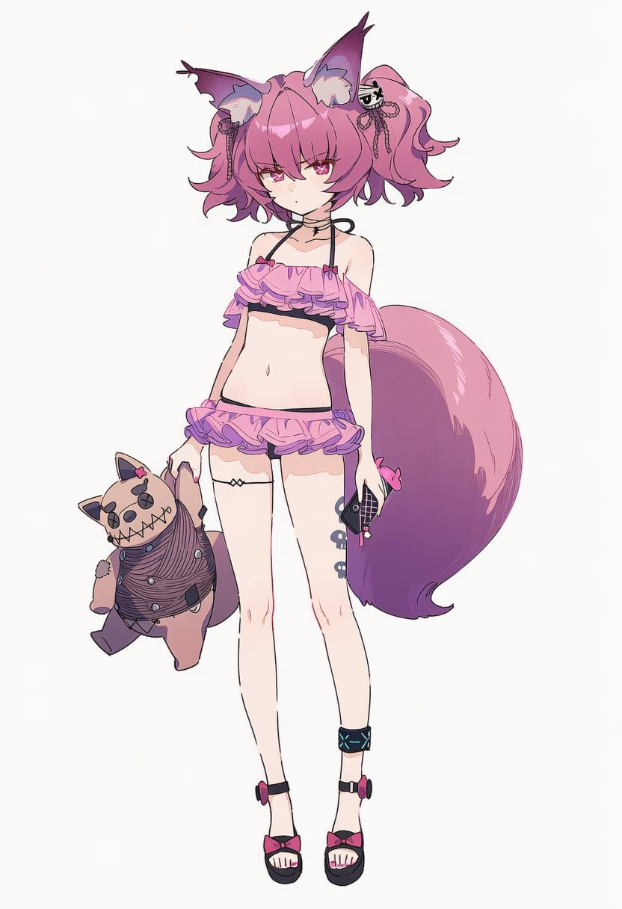

| 字段 | 内容 |
| --- | --- |
| Danbooru Tag | cellphone_strap |
| 中文名 | 手机挂绳 |
| 中文含义 | 连接手机的装饰挂绳。 |
| 子类 | 物件挂饰 |
| 模特 | shamare_(arknights) |
| 序号 | 0108 |

---
