## 1. holding — 持物

| 字段 | 内容 |
| --- | --- |
| Danbooru Tag | holding |
| 中文tag | 持物 |
| 含义 | 角色用手拿着可携带物体。 |
| 子类 | 通用持物/拿取 |
| 角色 | 1girl,ruan_mei_(honkai:_star_rail) |
| 序号 | 0001 |

## 2. two-handed — 双手握持

| 字段 | 内容 |
| --- | --- |
| Danbooru Tag | two-handed |
| 中文tag | 双手握持 |
| 含义 | 用双手握持同一个物体。 |
| 子类 | 通用持物/拿取 |
| 角色 | 1girl,midori_(blue_archive) |
| 序号 | 0002 |

## 3. between_fingers — 夹在手指间

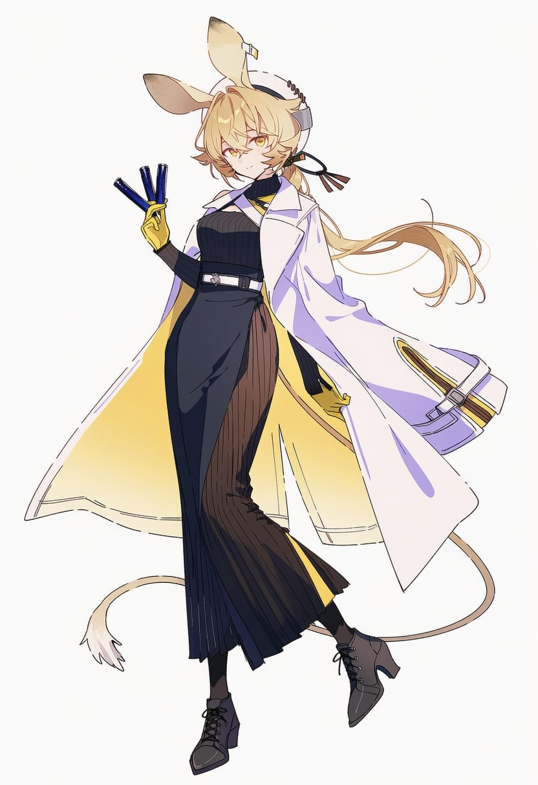

| 字段 | 内容 |
| --- | --- |
| Danbooru Tag | between_fingers |
| 中文tag | 夹在手指间 |
| 含义 | 把小物体夹在手指之间。 |
| 子类 | 通用持物/拿取 |
| 角色 | 1girl,dorothy_(arknights) |
| 序号 | 0003 |

## 4. grabbing — 抓取

| 字段 | 内容 |
| --- | --- |
| Danbooru Tag | grabbing |
| 中文tag | 抓取 |
| 含义 | 主动伸手抓住物体。 |
| 子类 | 通用持物/拿取 |
| 角色 | 1girl,silver_wolf_(honkai:_star_rail) |
| 序号 | 0004 |

## 5. carrying — 携带

| 字段 | 内容 |
| --- | --- |
| Danbooru Tag | carrying |
| 中文tag | 携带 |
| 含义 | 角色正在携带物体。 |
| 子类 | 通用持物/拿取 |
| 角色 | 1girl,ines_(arknights) |
| 序号 | 0005 |

## 6. carrying_over_shoulder — 扛在肩上

| 字段 | 内容 |
| --- | --- |
| Danbooru Tag | carrying_over_shoulder |
| 中文tag | 扛在肩上 |
| 含义 | 把物体扛在肩膀上携带。 |
| 子类 | 通用持物/拿取 |
| 角色 | 1girl,pallas_(arknights) |
| 序号 | 0006 |

## 7. carrying_under_arm — 夹在腋下

| 字段 | 内容 |
| --- | --- |
| Danbooru Tag | carrying_under_arm |
| 中文tag | 夹在腋下 |
| 含义 | 把物体夹在腋下携带。 |
| 子类 | 通用持物/拿取 |
| 角色 | 1girl,kayoko_(blue_archive) |
| 序号 | 0007 |

## 8. reaching_for — 伸手去拿

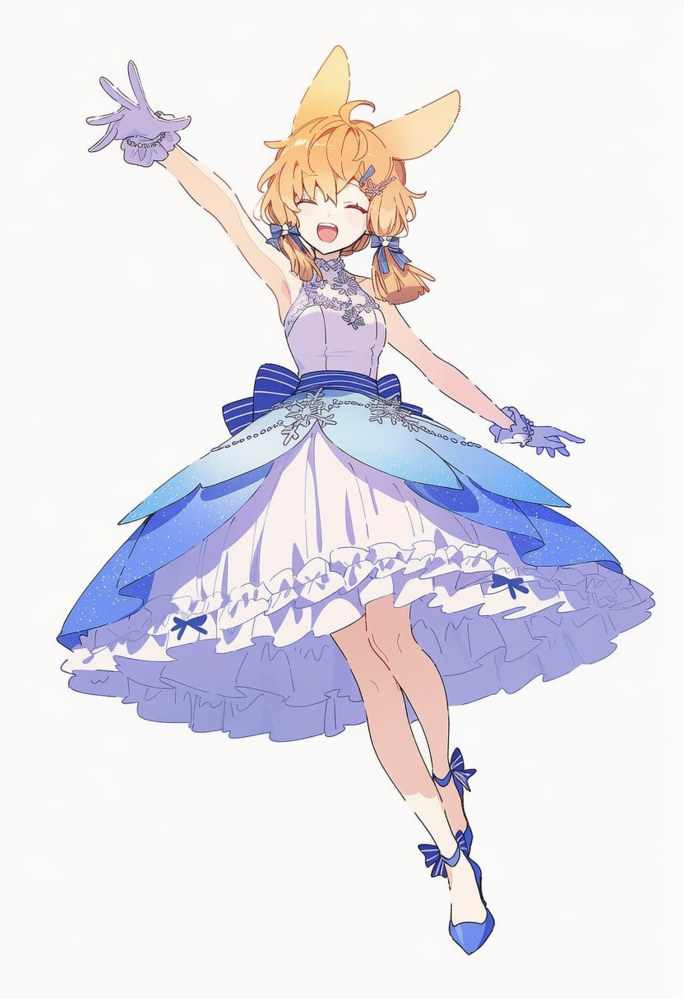

| 字段 | 内容 |
| --- | --- |
| Danbooru Tag | reaching_for |
| 中文tag | 伸手去拿 |
| 含义 | 伸手朝某个物体去拿。 |
| 子类 | 通用持物/拿取 |
| 角色 | 1girl,kroos_(arknights) |
| 序号 | 0008 |

## 9. picking_up — 捡起

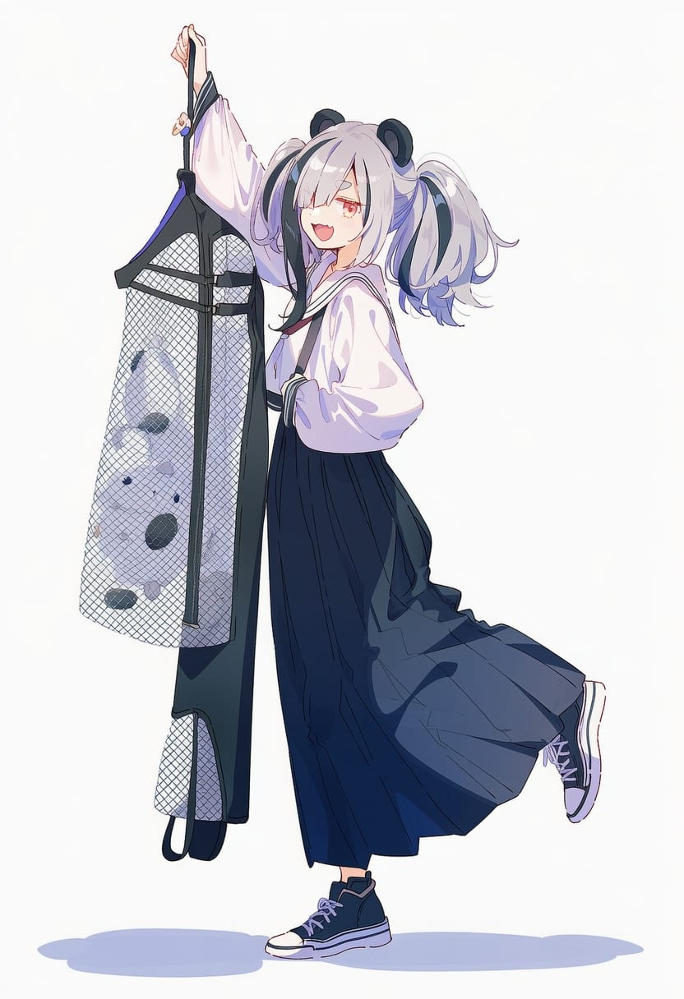

| 字段 | 内容 |
| --- | --- |
| Danbooru Tag | picking_up |
| 中文tag | 捡起 |
| 含义 | 把物体从表面或地面拿起来。 |
| 子类 | 通用持物/拿取 |
| 角色 | 1girl,feater_(arknights) |
| 序号 | 0009 |

## 10. putting_down — 放下

| 字段 | 内容 |
| --- | --- |
| Danbooru Tag | putting_down |
| 中文tag | 放下 |
| 含义 | 把手中的物体放下。 |
| 子类 | 通用持物/拿取 |
| 角色 | 1girl,acheron_(honkai:_star_rail) |
| 序号 | 0010 |

## 11. passing — 递交

| 字段 | 内容 |
| --- | --- |
| Danbooru Tag | passing |
| 中文tag | 递交 |
| 含义 | 把物体递给另一方。 |
| 子类 | 通用持物/拿取 |
| 角色 | 1girl,aris_(blue_archive) |
| 序号 | 0011 |

## 12. offering — 递出 / 提供

| 字段 | 内容 |
| --- | --- |
| Danbooru Tag | offering |
| 中文tag | 递出 / 提供 |
| 含义 | 把物体向别人递出或展示。 |
| 子类 | 通用持物/拿取 |
| 角色 | 1girl,kafka_(honkai:_star_rail) |
| 序号 | 0012 |

## 13. holding_book — 手持书

| 字段 | 内容 |
| --- | --- |
| Danbooru Tag | holding_book |
| 中文tag | 手持书 |
| 含义 | 角色用手拿着书。 |
| 子类 | 书写/纸张/电子设备 |
| 角色 | 1girl,jingliu_(honkai:_star_rail) |
| 序号 | 0013 |

## 14. holding_magazine — 手持杂志

| 字段 | 内容 |
| --- | --- |
| Danbooru Tag | holding_magazine |
| 中文tag | 手持杂志 |
| 含义 | 角色用手拿着杂志。 |
| 子类 | 书写/纸张/电子设备 |
| 角色 | 1girl,iroha_(blue_archive) |
| 序号 | 0014 |

## 15. holding_newspaper — 手持报纸

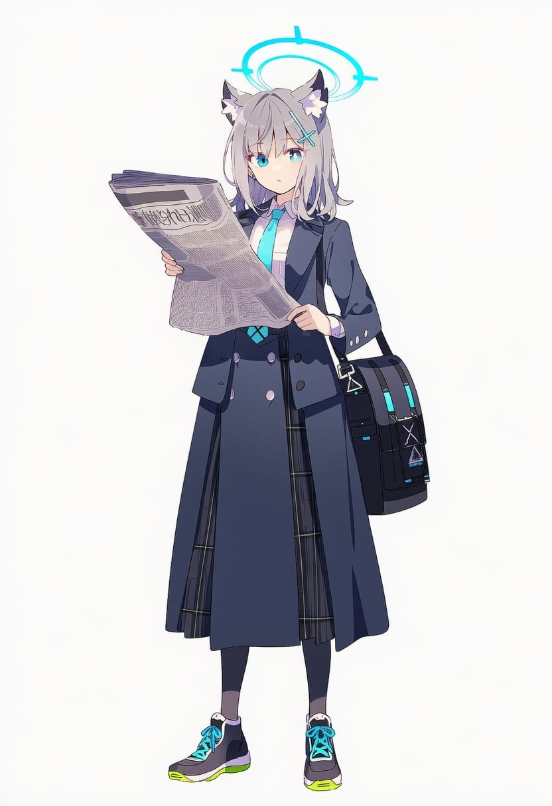

| 字段 | 内容 |
| --- | --- |
| Danbooru Tag | holding_newspaper |
| 中文tag | 手持报纸 |
| 含义 | 角色用手拿着报纸。 |
| 子类 | 书写/纸张/电子设备 |
| 角色 | 1girl,shiroko_(blue_archive) |
| 序号 | 0015 |

## 16. holding_notebook — 手持笔记本

| 字段 | 内容 |
| --- | --- |
| Danbooru Tag | holding_notebook |
| 中文tag | 手持笔记本 |
| 含义 | 角色用手拿着笔记本。 |
| 子类 | 书写/纸张/电子设备 |
| 角色 | 1girl,blaze_(arknights) |
| 序号 | 0016 |

## 17. holding_notepad — 手持便笺本

| 字段 | 内容 |
| --- | --- |
| Danbooru Tag | holding_notepad |
| 中文tag | 手持便笺本 |
| 含义 | 角色用手拿着便笺本。 |
| 子类 | 书写/纸张/电子设备 |
| 角色 | 1girl,yunli_(honkai:_star_rail) |
| 序号 | 0017 |

## 18. holding_paper — 手持纸

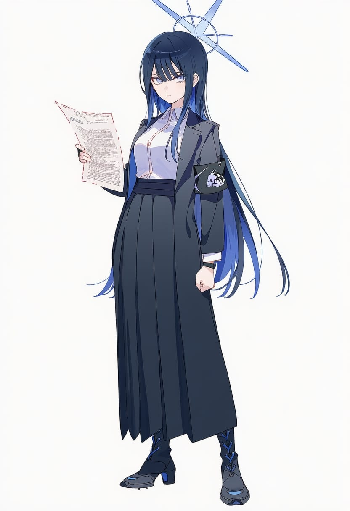

| 字段 | 内容 |
| --- | --- |
| Danbooru Tag | holding_paper |
| 中文tag | 手持纸 |
| 含义 | 角色用手拿着纸。 |
| 子类 | 书写/纸张/电子设备 |
| 角色 | 1girl,saori_(blue_archive) |
| 序号 | 0018 |

## 19. holding_letter — 手持信

| 字段 | 内容 |
| --- | --- |
| Danbooru Tag | holding_letter |
| 中文tag | 手持信 |
| 含义 | 角色用手拿着信。 |
| 子类 | 书写/纸张/电子设备 |
| 角色 | 1girl,whisperain_(arknights) |
| 序号 | 0019 |

## 20. holding_envelope — 手持信封

| 字段 | 内容 |
| --- | --- |
| Danbooru Tag | holding_envelope |
| 中文tag | 手持信封 |
| 含义 | 角色用手拿着信封。 |
| 子类 | 书写/纸张/电子设备 |
| 角色 | 1girl,mari_(blue_archive) |
| 序号 | 0020 |

## 21. holding_scroll — 手持卷轴

| 字段 | 内容 |
| --- | --- |
| Danbooru Tag | holding_scroll |
| 中文tag | 手持卷轴 |
| 含义 | 角色用手拿着卷轴。 |
| 子类 | 书写/纸张/电子设备 |
| 角色 | 1girl,march_7th_(honkai:_star_rail) |
| 序号 | 0021 |

## 22. holding_map — 手持地图

| 字段 | 内容 |
| --- | --- |
| Danbooru Tag | holding_map |
| 中文tag | 手持地图 |
| 含义 | 角色用手拿着地图。 |
| 子类 | 书写/纸张/电子设备 |
| 角色 | 1girl,vigna_(arknights) |
| 序号 | 0022 |

## 23. holding_photo — 手持照片

| 字段 | 内容 |
| --- | --- |
| Danbooru Tag | holding_photo |
| 中文tag | 手持照片 |
| 含义 | 角色用手拿着照片。 |
| 子类 | 书写/纸张/电子设备 |
| 角色 | 1girl,warfarin_(arknights) |
| 序号 | 0023 |

## 24. holding_picture_frame — 手持相框

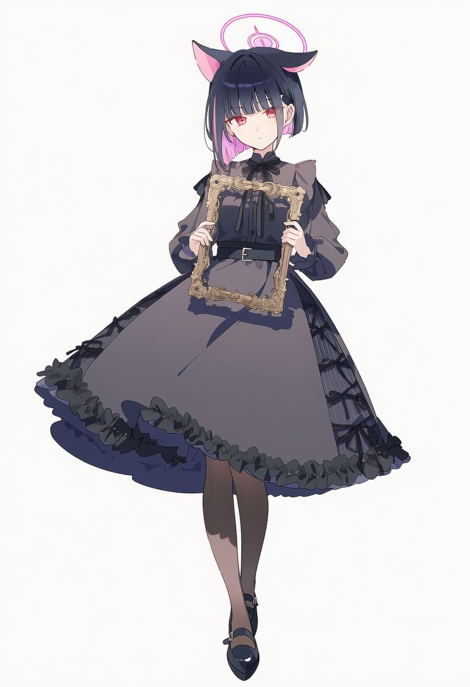

| 字段 | 内容 |
| --- | --- |
| Danbooru Tag | holding_picture_frame |
| 中文tag | 手持相框 |
| 含义 | 角色用手拿着相框。 |
| 子类 | 书写/纸张/电子设备 |
| 角色 | 1girl,kazusa_(blue_archive) |
| 序号 | 0024 |

## 25. holding_drawing — 手持画作

| 字段 | 内容 |
| --- | --- |
| Danbooru Tag | holding_drawing |
| 中文tag | 手持画作 |
| 含义 | 角色用手拿着画作。 |
| 子类 | 书写/纸张/电子设备 |
| 角色 | 1girl,fuuka_(blue_archive) |
| 序号 | 0025 |

## 26. holding_sketchbook — 手持速写本

| 字段 | 内容 |
| --- | --- |
| Danbooru Tag | holding_sketchbook |
| 中文tag | 手持速写本 |
| 含义 | 角色用手拿着速写本。 |
| 子类 | 书写/纸张/电子设备 |
| 角色 | 1girl,firefly_(honkai:_star_rail) |
| 序号 | 0026 |

## 27. holding_clipboard — 手持写字板

| 字段 | 内容 |
| --- | --- |
| Danbooru Tag | holding_clipboard |
| 中文tag | 手持写字板 |
| 含义 | 角色用手拿着写字板。 |
| 子类 | 书写/纸张/电子设备 |
| 角色 | 1girl,serika_(blue_archive) |
| 序号 | 0027 |

## 28. holding_card — 手持卡片

| 字段 | 内容 |
| --- | --- |
| Danbooru Tag | holding_card |
| 中文tag | 手持卡片 |
| 含义 | 角色用手拿着卡片。 |
| 子类 | 书写/纸张/电子设备 |
| 角色 | 1girl,sparkle_(honkai:_star_rail) |
| 序号 | 0028 |

## 29. holding_ticket — 手持票

| 字段 | 内容 |
| --- | --- |
| Danbooru Tag | holding_ticket |
| 中文tag | 手持票 |
| 含义 | 角色用手拿着票。 |
| 子类 | 书写/纸张/电子设备 |
| 角色 | 1girl,swire_(arknights) |
| 序号 | 0029 |

## 30. holding_id_card — 手持证件

| 字段 | 内容 |
| --- | --- |
| Danbooru Tag | holding_id_card |
| 中文tag | 手持证件 |
| 含义 | 角色用手拿着证件。 |
| 子类 | 书写/纸张/电子设备 |
| 角色 | 1girl,serina_(blue_archive) |
| 序号 | 0030 |

## 31. holding_pen — 手持笔

| 字段 | 内容 |
| --- | --- |
| Danbooru Tag | holding_pen |
| 中文tag | 手持笔 |
| 含义 | 角色用手拿着笔。 |
| 子类 | 书写/纸张/电子设备 |
| 角色 | 1girl,astesia_(arknights) |
| 序号 | 0031 |

## 32. holding_pencil — 手持铅笔

| 字段 | 内容 |
| --- | --- |
| Danbooru Tag | holding_pencil |
| 中文tag | 手持铅笔 |
| 含义 | 角色用手拿着铅笔。 |
| 子类 | 书写/纸张/电子设备 |
| 角色 | 1girl,fu_xuan_(honkai:_star_rail) |
| 序号 | 0032 |

## 33. holding_marker — 手持马克笔

| 字段 | 内容 |
| --- | --- |
| Danbooru Tag | holding_marker |
| 中文tag | 手持马克笔 |
| 含义 | 角色用手拿着马克笔。 |
| 子类 | 书写/纸张/电子设备 |
| 角色 | 1girl,ruan_mei_(honkai:_star_rail) |
| 序号 | 0033 |

## 34. holding_chalk — 手持粉笔

| 字段 | 内容 |
| --- | --- |
| Danbooru Tag | holding_chalk |
| 中文tag | 手持粉笔 |
| 含义 | 角色用手拿着粉笔。 |
| 子类 | 书写/纸张/电子设备 |
| 角色 | 1girl,robin_(honkai:_star_rail) |
| 序号 | 0034 |

## 35. holding_quill — 手持羽毛笔

| 字段 | 内容 |
| --- | --- |
| Danbooru Tag | holding_quill |
| 中文tag | 手持羽毛笔 |
| 含义 | 角色用手拿着羽毛笔。 |
| 子类 | 书写/纸张/电子设备 |
| 角色 | 1girl,midori_(blue_archive) |
| 序号 | 0035 |

## 36. holding_phone — 手持手机

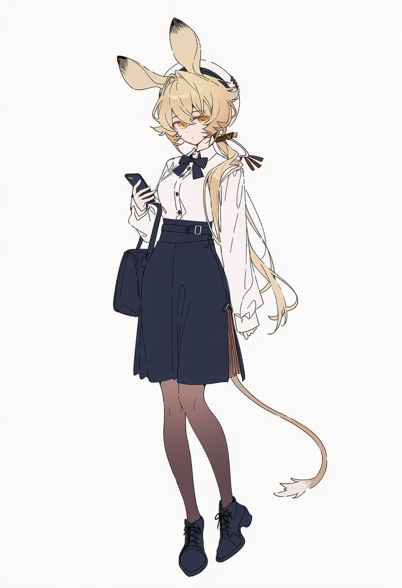

| 字段 | 内容 |
| --- | --- |
| Danbooru Tag | holding_phone |
| 中文tag | 手持手机 |
| 含义 | 角色用手拿着手机。 |
| 子类 | 书写/纸张/电子设备 |
| 角色 | 1girl,dorothy_(arknights) |
| 序号 | 0036 |

## 37. holding_tablet_pc — 手持平板电脑

| 字段 | 内容 |
| --- | --- |
| Danbooru Tag | holding_tablet_pc |
| 中文tag | 手持平板电脑 |
| 含义 | 角色用手拿着平板电脑。 |
| 子类 | 书写/纸张/电子设备 |
| 角色 | 1girl,silver_wolf_(honkai:_star_rail) |
| 序号 | 0037 |

## 38. holding_laptop — 手持笔记本电脑

| 字段 | 内容 |
| --- | --- |
| Danbooru Tag | holding_laptop |
| 中文tag | 手持笔记本电脑 |
| 含义 | 角色用手拿着笔记本电脑。 |
| 子类 | 书写/纸张/电子设备 |
| 角色 | 1girl,stelle_(honkai:_star_rail) |
| 序号 | 0038 |

## 39. holding_controller — 手持游戏手柄

| 字段 | 内容 |
| --- | --- |
| Danbooru Tag | holding_controller |
| 中文tag | 手持游戏手柄 |
| 含义 | 角色用手拿着游戏手柄。 |
| 子类 | 书写/纸张/电子设备 |
| 角色 | 1girl,ines_(arknights) |
| 序号 | 0039 |

## 40. holding_handheld_game_console — 手持掌机

| 字段 | 内容 |
| --- | --- |
| Danbooru Tag | holding_handheld_game_console |
| 中文tag | 手持掌机 |
| 含义 | 角色用手拿着掌机。 |
| 子类 | 书写/纸张/电子设备 |
| 角色 | 1girl,pallas_(arknights) |
| 序号 | 0040 |

## 41. holding_camera — 手持相机

| 字段 | 内容 |
| --- | --- |
| Danbooru Tag | holding_camera |
| 中文tag | 手持相机 |
| 含义 | 角色用手拿着相机。 |
| 子类 | 书写/纸张/电子设备 |
| 角色 | 1girl,kayoko_(blue_archive) |
| 序号 | 0041 |

## 42. holding_binoculars — 手持望远镜

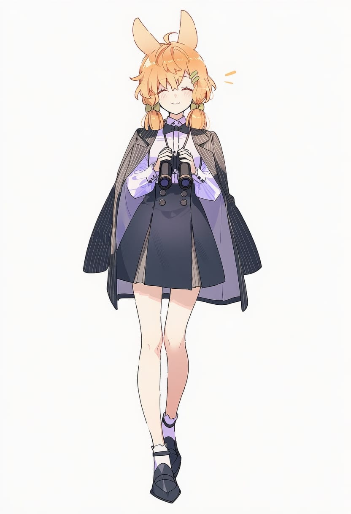

| 字段 | 内容 |
| --- | --- |
| Danbooru Tag | holding_binoculars |
| 中文tag | 手持望远镜 |
| 含义 | 角色用手拿着望远镜。 |
| 子类 | 书写/纸张/电子设备 |
| 角色 | 1girl,kroos_(arknights) |
| 序号 | 0042 |

## 43. holding_flashlight — 手持手电筒

| 字段 | 内容 |
| --- | --- |
| Danbooru Tag | holding_flashlight |
| 中文tag | 手持手电筒 |
| 含义 | 角色用手拿着手电筒。 |
| 子类 | 书写/纸张/电子设备 |
| 角色 | 1girl,acheron_(honkai:_star_rail) |
| 序号 | 0043 |

## 44. holding_microphone — 手持麦克风

| 字段 | 内容 |
| --- | --- |
| Danbooru Tag | holding_microphone |
| 中文tag | 手持麦克风 |
| 含义 | 角色用手拿着麦克风。 |
| 子类 | 书写/纸张/电子设备 |
| 角色 | 1girl,aris_(blue_archive) |
| 序号 | 0044 |

## 45. holding_megaphone — 手持扩音器

| 字段 | 内容 |
| --- | --- |
| Danbooru Tag | holding_megaphone |
| 中文tag | 手持扩音器 |
| 含义 | 角色用手拿着扩音器。 |
| 子类 | 书写/纸张/电子设备 |
| 角色 | 1girl,kafka_(honkai:_star_rail) |
| 序号 | 0045 |

## 46. holding_food — 手持食物

| 字段 | 内容 |
| --- | --- |
| Danbooru Tag | holding_food |
| 中文tag | 手持食物 |
| 含义 | 角色用手拿着食物。 |
| 子类 | 饮食/餐具/容器 |
| 角色 | 1girl,jingliu_(honkai:_star_rail) |
| 序号 | 0046 |

## 47. holding_drink — 手持饮料

| 字段 | 内容 |
| --- | --- |
| Danbooru Tag | holding_drink |
| 中文tag | 手持饮料 |
| 含义 | 角色用手拿着饮料。 |
| 子类 | 饮食/餐具/容器 |
| 角色 | 1girl,utage_(arknights) |
| 序号 | 0047 |

## 48. holding_cup — 手持杯子

| 字段 | 内容 |
| --- | --- |
| Danbooru Tag | holding_cup |
| 中文tag | 手持杯子 |
| 含义 | 角色用手拿着杯子。 |
| 子类 | 饮食/餐具/容器 |
| 角色 | 1girl,iroha_(blue_archive) |
| 序号 | 0048 |

## 49. holding_bottle — 手持瓶子

| 字段 | 内容 |
| --- | --- |
| Danbooru Tag | holding_bottle |
| 中文tag | 手持瓶子 |
| 含义 | 角色用手拿着瓶子。 |
| 子类 | 饮食/餐具/容器 |
| 角色 | 1girl,shiroko_(blue_archive) |
| 序号 | 0049 |

## 50. holding_can — 手持罐子

| 字段 | 内容 |
| --- | --- |
| Danbooru Tag | holding_can |
| 中文tag | 手持罐子 |
| 含义 | 角色用手拿着罐子。 |
| 子类 | 饮食/餐具/容器 |
| 角色 | 1girl,blaze_(arknights) |
| 序号 | 0050 |

## 51. holding_bowl — 手持碗

| 字段 | 内容 |
| --- | --- |
| Danbooru Tag | holding_bowl |
| 中文tag | 手持碗 |
| 含义 | 角色用手拿着碗。 |
| 子类 | 饮食/餐具/容器 |
| 角色 | 1girl,yunli_(honkai:_star_rail) |
| 序号 | 0051 |

## 52. holding_plate — 手持盘子

| 字段 | 内容 |
| --- | --- |
| Danbooru Tag | holding_plate |
| 中文tag | 手持盘子 |
| 含义 | 角色用手拿着盘子。 |
| 子类 | 饮食/餐具/容器 |
| 角色 | 1girl,saori_(blue_archive) |
| 序号 | 0052 |

## 53. holding_saucer — 手持茶托

| 字段 | 内容 |
| --- | --- |
| Danbooru Tag | holding_saucer |
| 中文tag | 手持茶托 |
| 含义 | 角色用手拿着茶托。 |
| 子类 | 饮食/餐具/容器 |
| 角色 | 1girl,whisperain_(arknights) |
| 序号 | 0053 |

## 54. holding_tray — 手持托盘

| 字段 | 内容 |
| --- | --- |
| Danbooru Tag | holding_tray |
| 中文tag | 手持托盘 |
| 含义 | 角色用手拿着托盘。 |
| 子类 | 饮食/餐具/容器 |
| 角色 | 1girl,mari_(blue_archive) |
| 序号 | 0054 |

## 55. holding_chopsticks — 手持筷子

| 字段 | 内容 |
| --- | --- |
| Danbooru Tag | holding_chopsticks |
| 中文tag | 手持筷子 |
| 含义 | 角色用手拿着筷子。 |
| 子类 | 饮食/餐具/容器 |
| 角色 | 1girl,march_7th_(honkai:_star_rail) |
| 序号 | 0055 |

## 56. holding_fork — 手持叉子

| 字段 | 内容 |
| --- | --- |
| Danbooru Tag | holding_fork |
| 中文tag | 手持叉子 |
| 含义 | 角色用手拿着叉子。 |
| 子类 | 饮食/餐具/容器 |
| 角色 | 1girl,vigna_(arknights) |
| 序号 | 0056 |

## 57. holding_spoon — 手持勺子

| 字段 | 内容 |
| --- | --- |
| Danbooru Tag | holding_spoon |
| 中文tag | 手持勺子 |
| 含义 | 角色用手拿着勺子。 |
| 子类 | 饮食/餐具/容器 |
| 角色 | 1girl,warfarin_(arknights) |
| 序号 | 0057 |

## 58. holding_spork — 手持叉勺

| 字段 | 内容 |
| --- | --- |
| Danbooru Tag | holding_spork |
| 中文tag | 手持叉勺 |
| 含义 | 角色用手拿着叉勺。 |
| 子类 | 饮食/餐具/容器 |
| 角色 | 1girl,kazusa_(blue_archive) |
| 序号 | 0058 |

## 59. holding_drinking_straw — 手持吸管

| 字段 | 内容 |
| --- | --- |
| Danbooru Tag | holding_drinking_straw |
| 中文tag | 手持吸管 |
| 含义 | 角色用手拿着吸管。 |
| 子类 | 饮食/餐具/容器 |
| 角色 | 1girl,fuuka_(blue_archive) |
| 序号 | 0059 |

## 60. holding_ice_cream_cone — 手持冰淇淋甜筒

| 字段 | 内容 |
| --- | --- |
| Danbooru Tag | holding_ice_cream_cone |
| 中文tag | 手持冰淇淋甜筒 |
| 含义 | 角色用手拿着冰淇淋甜筒。 |
| 子类 | 饮食/餐具/容器 |
| 角色 | 1girl,firefly_(honkai:_star_rail) |
| 序号 | 0060 |

## 61. holding_egg — 手持蛋

| 字段 | 内容 |
| --- | --- |
| Danbooru Tag | holding_egg |
| 中文tag | 手持蛋 |
| 含义 | 角色用手拿着蛋。 |
| 子类 | 饮食/餐具/容器 |
| 角色 | 1girl,serika_(blue_archive) |
| 序号 | 0061 |

## 62. holding_bento — 手持便当

| 字段 | 内容 |
| --- | --- |
| Danbooru Tag | holding_bento |
| 中文tag | 手持便当 |
| 含义 | 角色用手拿着便当。 |
| 子类 | 饮食/餐具/容器 |
| 角色 | 1girl,mimori_(blue_archive) |
| 序号 | 0062 |

## 63. holding_juice_box — 手持果汁盒

| 字段 | 内容 |
| --- | --- |
| Danbooru Tag | holding_juice_box |
| 中文tag | 手持果汁盒 |
| 含义 | 角色用手拿着果汁盒。 |
| 子类 | 饮食/餐具/容器 |
| 角色 | 1girl,sparkle_(honkai:_star_rail) |
| 序号 | 0063 |

## 64. holding_milk_carton — 手持牛奶盒

| 字段 | 内容 |
| --- | --- |
| Danbooru Tag | holding_milk_carton |
| 中文tag | 手持牛奶盒 |
| 含义 | 角色用手拿着牛奶盒。 |
| 子类 | 饮食/餐具/容器 |
| 角色 | 1girl,swire_(arknights) |
| 序号 | 0064 |

## 65. holding_teapot — 手持茶壶

| 字段 | 内容 |
| --- | --- |
| Danbooru Tag | holding_teapot |
| 中文tag | 手持茶壶 |
| 含义 | 角色用手拿着茶壶。 |
| 子类 | 饮食/餐具/容器 |
| 角色 | 1girl,serina_(blue_archive) |
| 序号 | 0065 |

## 66. holding_cooking_pot — 手持锅

| 字段 | 内容 |
| --- | --- |
| Danbooru Tag | holding_cooking_pot |
| 中文tag | 手持锅 |
| 含义 | 角色用手拿着锅。 |
| 子类 | 饮食/餐具/容器 |
| 角色 | 1girl,ruan_mei_(honkai:_star_rail) |
| 序号 | 0066 |

## 67. holding_frying_pan — 手持平底锅

| 字段 | 内容 |
| --- | --- |
| Danbooru Tag | holding_frying_pan |
| 中文tag | 手持平底锅 |
| 含义 | 角色用手拿着平底锅。 |
| 子类 | 饮食/餐具/容器 |
| 角色 | 1girl,robin_(honkai:_star_rail) |
| 序号 | 0067 |

## 68. holding_spatula — 手持锅铲

| 字段 | 内容 |
| --- | --- |
| Danbooru Tag | holding_spatula |
| 中文tag | 手持锅铲 |
| 含义 | 角色用手拿着锅铲。 |
| 子类 | 饮食/餐具/容器 |
| 角色 | 1girl,midori_(blue_archive) |
| 序号 | 0068 |

## 69. holding_ladle — 手持汤勺

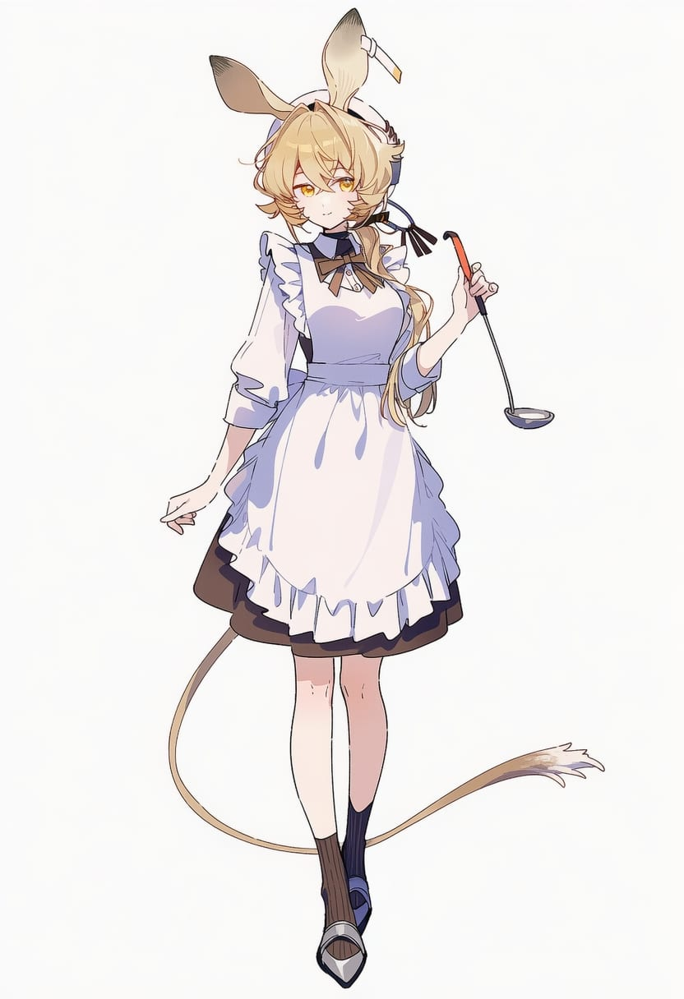

| 字段 | 内容 |
| --- | --- |
| Danbooru Tag | holding_ladle |
| 中文tag | 手持汤勺 |
| 含义 | 角色用手拿着汤勺。 |
| 子类 | 饮食/餐具/容器 |
| 角色 | 1girl,dorothy_(arknights) |
| 序号 | 0069 |

## 70. holding_whisk — 手持打蛋器

| 字段 | 内容 |
| --- | --- |
| Danbooru Tag | holding_whisk |
| 中文tag | 手持打蛋器 |
| 含义 | 角色用手拿着打蛋器。 |
| 子类 | 饮食/餐具/容器 |
| 角色 | 1girl,silver_wolf_(honkai:_star_rail) |
| 序号 | 0070 |

## 71. holding_tongs — 手持夹子

| 字段 | 内容 |
| --- | --- |
| Danbooru Tag | holding_tongs |
| 中文tag | 手持夹子 |
| 含义 | 角色用手拿着夹子。 |
| 子类 | 饮食/餐具/容器 |
| 角色 | 1girl,stelle_(honkai:_star_rail) |
| 序号 | 0071 |

## 72. holding_bag — 手持包

| 字段 | 内容 |
| --- | --- |
| Danbooru Tag | holding_bag |
| 中文tag | 手持包 |
| 含义 | 角色用手拿着包。 |
| 子类 | 日用品/衣物/装饰 |
| 角色 | 1girl,ines_(arknights) |
| 序号 | 0072 |

## 73. holding_basket — 手持篮子

| 字段 | 内容 |
| --- | --- |
| Danbooru Tag | holding_basket |
| 中文tag | 手持篮子 |
| 含义 | 角色用手拿着篮子。 |
| 子类 | 日用品/衣物/装饰 |
| 角色 | 1girl,pallas_(arknights) |
| 序号 | 0073 |

## 74. holding_box — 手持盒子

| 字段 | 内容 |
| --- | --- |
| Danbooru Tag | holding_box |
| 中文tag | 手持盒子 |
| 含义 | 角色用手拿着盒子。 |
| 子类 | 日用品/衣物/装饰 |
| 角色 | 1girl,kayoko_(blue_archive) |
| 序号 | 0074 |

## 75. holding_bucket — 手持桶

| 字段 | 内容 |
| --- | --- |
| Danbooru Tag | holding_bucket |
| 中文tag | 手持桶 |
| 含义 | 角色用手拿着桶。 |
| 子类 | 日用品/衣物/装饰 |
| 角色 | 1girl,kroos_(arknights) |
| 序号 | 0075 |

## 76. holding_broom — 手持扫帚

| 字段 | 内容 |
| --- | --- |
| Danbooru Tag | holding_broom |
| 中文tag | 手持扫帚 |
| 含义 | 角色用手拿着扫帚。 |
| 子类 | 日用品/衣物/装饰 |
| 角色 | 1girl,feater_(arknights) |
| 序号 | 0076 |

## 77. holding_brush — 手持刷子

| 字段 | 内容 |
| --- | --- |
| Danbooru Tag | holding_brush |
| 中文tag | 手持刷子 |
| 含义 | 角色用手拿着刷子。 |
| 子类 | 日用品/衣物/装饰 |
| 角色 | 1girl,acheron_(honkai:_star_rail) |
| 序号 | 0077 |

## 78. holding_comb — 手持梳子

| 字段 | 内容 |
| --- | --- |
| Danbooru Tag | holding_comb |
| 中文tag | 手持梳子 |
| 含义 | 角色用手拿着梳子。 |
| 子类 | 日用品/衣物/装饰 |
| 角色 | 1girl,aris_(blue_archive) |
| 序号 | 0078 |

## 79. holding_hair_brush — 手持发刷

| 字段 | 内容 |
| --- | --- |
| Danbooru Tag | holding_hair_brush |
| 中文tag | 手持发刷 |
| 含义 | 角色用手拿着发刷。 |
| 子类 | 日用品/衣物/装饰 |
| 角色 | 1girl,kafka_(honkai:_star_rail) |
| 序号 | 0079 |

## 80. holding_hair_dryer — 手持吹风机

| 字段 | 内容 |
| --- | --- |
| Danbooru Tag | holding_hair_dryer |
| 中文tag | 手持吹风机 |
| 含义 | 角色用手拿着吹风机。 |
| 子类 | 日用品/衣物/装饰 |
| 角色 | 1girl,jingliu_(honkai:_star_rail) |
| 序号 | 0080 |

## 81. holding_towel — 手持毛巾

| 字段 | 内容 |
| --- | --- |
| Danbooru Tag | holding_towel |
| 中文tag | 手持毛巾 |
| 含义 | 角色用手拿着毛巾。 |
| 子类 | 日用品/衣物/装饰 |
| 角色 | 1girl,utage_(arknights) |
| 序号 | 0081 |

## 82. holding_blanket — 手持毯子

| 字段 | 内容 |
| --- | --- |
| Danbooru Tag | holding_blanket |
| 中文tag | 手持毯子 |
| 含义 | 角色用手拿着毯子。 |
| 子类 | 日用品/衣物/装饰 |
| 角色 | 1girl,iroha_(blue_archive) |
| 序号 | 0082 |

## 83. holding_pillow — 手持枕头

| 字段 | 内容 |
| --- | --- |
| Danbooru Tag | holding_pillow |
| 中文tag | 手持枕头 |
| 含义 | 角色用手拿着枕头。 |
| 子类 | 日用品/衣物/装饰 |
| 角色 | 1girl,shiroko_(blue_archive) |
| 序号 | 0083 |

## 84. holding_umbrella — 手持伞

| 字段 | 内容 |
| --- | --- |
| Danbooru Tag | holding_umbrella |
| 中文tag | 手持伞 |
| 含义 | 角色用手拿着伞。 |
| 子类 | 日用品/衣物/装饰 |
| 角色 | 1girl,blaze_(arknights) |
| 序号 | 0084 |

## 85. holding_fan — 手持扇子

| 字段 | 内容 |
| --- | --- |
| Danbooru Tag | holding_fan |
| 中文tag | 手持扇子 |
| 含义 | 角色用手拿着扇子。 |
| 子类 | 日用品/衣物/装饰 |
| 角色 | 1girl,yunli_(honkai:_star_rail) |
| 序号 | 0085 |

## 86. holding_mask — 手持面具

| 字段 | 内容 |
| --- | --- |
| Danbooru Tag | holding_mask |
| 中文tag | 手持面具 |
| 含义 | 角色用手拿着面具。 |
| 子类 | 日用品/衣物/装饰 |
| 角色 | 1girl,saori_(blue_archive) |
| 序号 | 0086 |

## 87. holding_mirror — 手持镜子

| 字段 | 内容 |
| --- | --- |
| Danbooru Tag | holding_mirror |
| 中文tag | 手持镜子 |
| 含义 | 角色用手拿着镜子。 |
| 子类 | 日用品/衣物/装饰 |
| 角色 | 1girl,whisperain_(arknights) |
| 序号 | 0087 |

## 88. holding_key — 手持钥匙

| 字段 | 内容 |
| --- | --- |
| Danbooru Tag | holding_key |
| 中文tag | 手持钥匙 |
| 含义 | 角色用手拿着钥匙。 |
| 子类 | 日用品/衣物/装饰 |
| 角色 | 1girl,mari_(blue_archive) |
| 序号 | 0088 |

## 89. holding_wallet — 手持钱包

| 字段 | 内容 |
| --- | --- |
| Danbooru Tag | holding_wallet |
| 中文tag | 手持钱包 |
| 含义 | 角色用手拿着钱包。 |
| 子类 | 日用品/衣物/装饰 |
| 角色 | 1girl,march_7th_(honkai:_star_rail) |
| 序号 | 0089 |

## 90. holding_money — 手持钱

| 字段 | 内容 |
| --- | --- |
| Danbooru Tag | holding_money |
| 中文tag | 手持钱 |
| 含义 | 角色用手拿着钱。 |
| 子类 | 日用品/衣物/装饰 |
| 角色 | 1girl,vigna_(arknights) |
| 序号 | 0090 |

## 91. holding_coin — 手持硬币

| 字段 | 内容 |
| --- | --- |
| Danbooru Tag | holding_coin |
| 中文tag | 手持硬币 |
| 含义 | 角色用手拿着硬币。 |
| 子类 | 日用品/衣物/装饰 |
| 角色 | 1girl,warfarin_(arknights) |
| 序号 | 0091 |

## 92. holding_gift — 手持礼物

| 字段 | 内容 |
| --- | --- |
| Danbooru Tag | holding_gift |
| 中文tag | 手持礼物 |
| 含义 | 角色用手拿着礼物。 |
| 子类 | 日用品/衣物/装饰 |
| 角色 | 1girl,kazusa_(blue_archive) |
| 序号 | 0092 |

## 93. holding_balloon — 手持气球

| 字段 | 内容 |
| --- | --- |
| Danbooru Tag | holding_balloon |
| 中文tag | 手持气球 |
| 含义 | 角色用手拿着气球。 |
| 子类 | 日用品/衣物/装饰 |
| 角色 | 1girl,fuuka_(blue_archive) |
| 序号 | 0093 |

## 94. holding_flower — 手持花

| 字段 | 内容 |
| --- | --- |
| Danbooru Tag | holding_flower |
| 中文tag | 手持花 |
| 含义 | 角色用手拿着花。 |
| 子类 | 日用品/衣物/装饰 |
| 角色 | 1girl,firefly_(honkai:_star_rail) |
| 序号 | 0094 |

## 95. holding_bouquet — 手持花束

| 字段 | 内容 |
| --- | --- |
| Danbooru Tag | holding_bouquet |
| 中文tag | 手持花束 |
| 含义 | 角色用手拿着花束。 |
| 子类 | 日用品/衣物/装饰 |
| 角色 | 1girl,serika_(blue_archive) |
| 序号 | 0095 |

## 96. holding_plant — 手持植物

| 字段 | 内容 |
| --- | --- |
| Danbooru Tag | holding_plant |
| 中文tag | 手持植物 |
| 含义 | 角色用手拿着植物。 |
| 子类 | 日用品/衣物/装饰 |
| 角色 | 1girl,mimori_(blue_archive) |
| 序号 | 0096 |

## 97. holding_flower_pot — 手持花盆

| 字段 | 内容 |
| --- | --- |
| Danbooru Tag | holding_flower_pot |
| 中文tag | 手持花盆 |
| 含义 | 角色用手拿着花盆。 |
| 子类 | 日用品/衣物/装饰 |
| 角色 | 1girl,sparkle_(honkai:_star_rail) |
| 序号 | 0097 |

## 98. holding_leaf — 手持叶子

| 字段 | 内容 |
| --- | --- |
| Danbooru Tag | holding_leaf |
| 中文tag | 手持叶子 |
| 含义 | 角色用手拿着叶子。 |
| 子类 | 日用品/衣物/装饰 |
| 角色 | 1girl,swire_(arknights) |
| 序号 | 0098 |

## 99. holding_feather — 手持羽毛

| 字段 | 内容 |
| --- | --- |
| Danbooru Tag | holding_feather |
| 中文tag | 手持羽毛 |
| 含义 | 角色用手拿着羽毛。 |
| 子类 | 日用品/衣物/装饰 |
| 角色 | 1girl,serina_(blue_archive) |
| 序号 | 0099 |

## 100. holding_ribbon — 手持丝带

| 字段 | 内容 |
| --- | --- |
| Danbooru Tag | holding_ribbon |
| 中文tag | 手持丝带 |
| 含义 | 角色用手拿着丝带。 |
| 子类 | 日用品/衣物/装饰 |
| 角色 | 1girl,fu_xuan_(honkai:_star_rail) |
| 序号 | 0100 |

## 101. holding_jewelry — 手持首饰

| 字段 | 内容 |
| --- | --- |
| Danbooru Tag | holding_jewelry |
| 中文tag | 手持首饰 |
| 含义 | 角色用手拿着首饰。 |
| 子类 | 日用品/衣物/装饰 |
| 角色 | 1girl,ruan_mei_(honkai:_star_rail) |
| 序号 | 0101 |

## 102. holding_unworn_clothes — 手持未穿衣物

| 字段 | 内容 |
| --- | --- |
| Danbooru Tag | holding_unworn_clothes |
| 中文tag | 手持未穿衣物 |
| 含义 | 角色用手拿着未穿衣物。 |
| 子类 | 日用品/衣物/装饰 |
| 角色 | 1girl,robin_(honkai:_star_rail) |
| 序号 | 0102 |

## 103. holding_clothes_hanger — 手持衣架

| 字段 | 内容 |
| --- | --- |
| Danbooru Tag | holding_clothes_hanger |
| 中文tag | 手持衣架 |
| 含义 | 角色用手拿着衣架。 |
| 子类 | 日用品/衣物/装饰 |
| 角色 | 1girl,midori_(blue_archive) |
| 序号 | 0103 |

## 104. holding_removed_eyewear — 手持摘下的眼镜

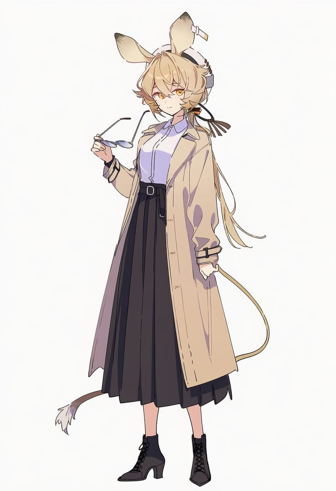

| 字段 | 内容 |
| --- | --- |
| Danbooru Tag | holding_removed_eyewear |
| 中文tag | 手持摘下的眼镜 |
| 含义 | 角色用手拿着摘下的眼镜。 |
| 子类 | 日用品/衣物/装饰 |
| 角色 | 1girl,dorothy_(arknights) |
| 序号 | 0104 |

## 105. holding_headphones — 手持耳机

| 字段 | 内容 |
| --- | --- |
| Danbooru Tag | holding_headphones |
| 中文tag | 手持耳机 |
| 含义 | 角色用手拿着耳机。 |
| 子类 | 日用品/衣物/装饰 |
| 角色 | 1girl,silver_wolf_(honkai:_star_rail) |
| 序号 | 0105 |

## 106. holding_earphones — 手持入耳式耳机

| 字段 | 内容 |
| --- | --- |
| Danbooru Tag | holding_earphones |
| 中文tag | 手持入耳式耳机 |
| 含义 | 角色用手拿着入耳式耳机。 |
| 子类 | 日用品/衣物/装饰 |
| 角色 | 1girl,stelle_(honkai:_star_rail) |
| 序号 | 0106 |

## 107. holding_hammer — 手持锤子

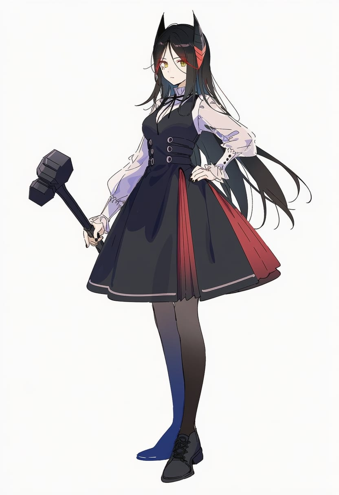

| 字段 | 内容 |
| --- | --- |
| Danbooru Tag | holding_hammer |
| 中文tag | 手持锤子 |
| 含义 | 角色用手拿着锤子。 |
| 子类 | 工具/运动/户外 |
| 角色 | 1girl,ines_(arknights) |
| 序号 | 0107 |

## 108. holding_screwdriver — 手持螺丝刀

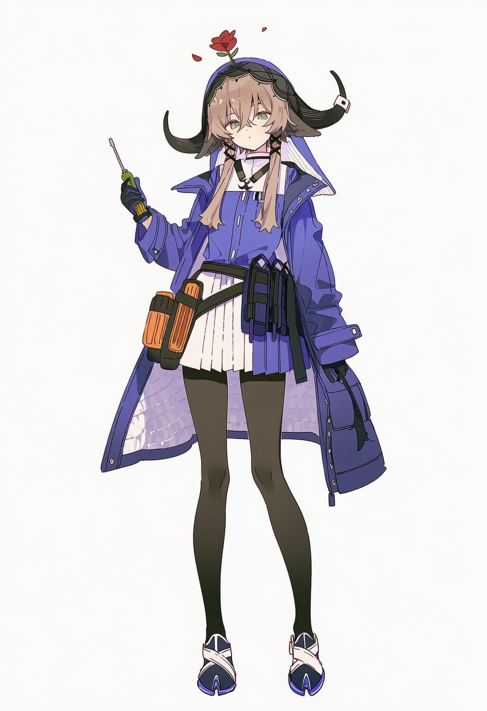

| 字段 | 内容 |
| --- | --- |
| Danbooru Tag | holding_screwdriver |
| 中文tag | 手持螺丝刀 |
| 含义 | 角色用手拿着螺丝刀。 |
| 子类 | 工具/运动/户外 |
| 角色 | 1girl,pallas_(arknights) |
| 序号 | 0108 |

## 109. holding_wrench — 手持扳手

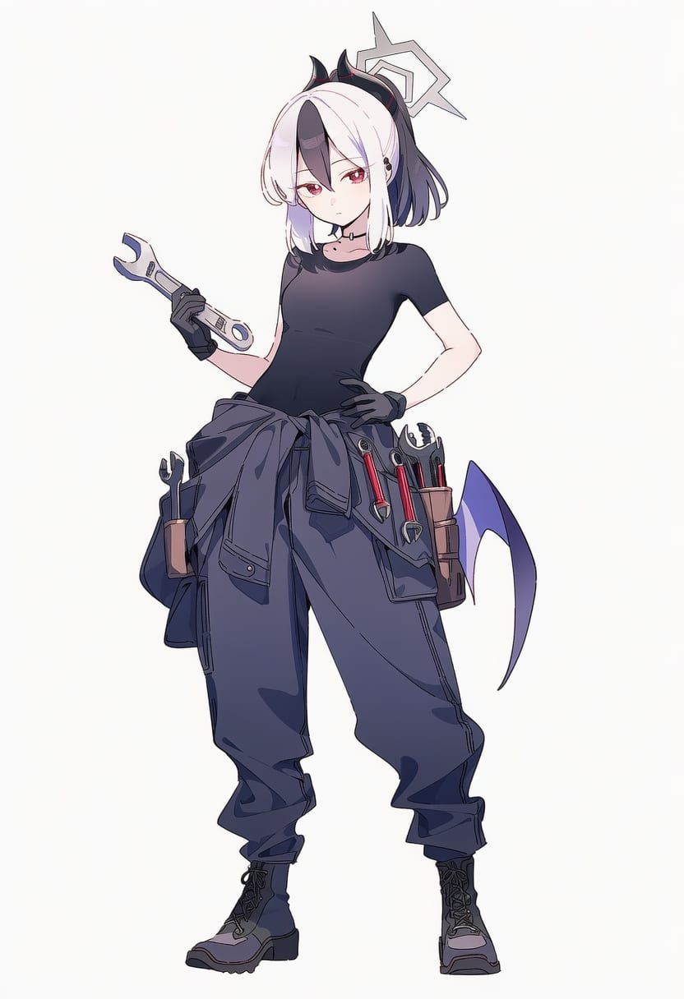

| 字段 | 内容 |
| --- | --- |
| Danbooru Tag | holding_wrench |
| 中文tag | 手持扳手 |
| 含义 | 角色用手拿着扳手。 |
| 子类 | 工具/运动/户外 |
| 角色 | 1girl,kayoko_(blue_archive) |
| 序号 | 0109 |

## 110. holding_scissors — 手持剪刀

| 字段 | 内容 |
| --- | --- |
| Danbooru Tag | holding_scissors |
| 中文tag | 手持剪刀 |
| 含义 | 角色用手拿着剪刀。 |
| 子类 | 工具/运动/户外 |
| 角色 | 1girl,kroos_(arknights) |
| 序号 | 0110 |

## 111. holding_needle — 手持针

| 字段 | 内容 |
| --- | --- |
| Danbooru Tag | holding_needle |
| 中文tag | 手持针 |
| 含义 | 角色用手拿着针。 |
| 子类 | 工具/运动/户外 |
| 角色 | 1girl,feater_(arknights) |
| 序号 | 0111 |

## 112. holding_shovel — 手持铲子

| 字段 | 内容 |
| --- | --- |
| Danbooru Tag | holding_shovel |
| 中文tag | 手持铲子 |
| 含义 | 角色用手拿着铲子。 |
| 子类 | 工具/运动/户外 |
| 角色 | 1girl,aris_(blue_archive) |
| 序号 | 0112 |

## 113. holding_pickaxe — 手持镐

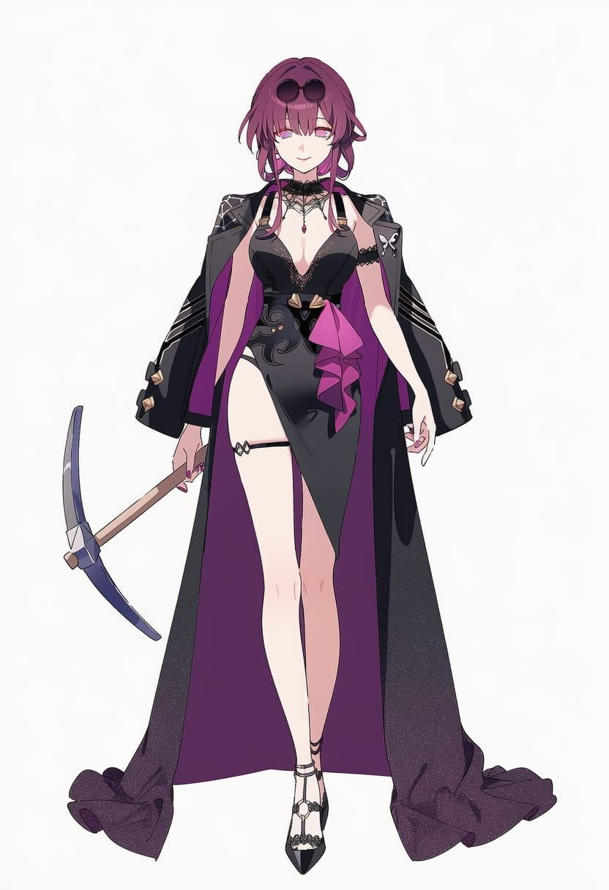

| 字段 | 内容 |
| --- | --- |
| Danbooru Tag | holding_pickaxe |
| 中文tag | 手持镐 |
| 含义 | 角色用手拿着镐。 |
| 子类 | 工具/运动/户外 |
| 角色 | 1girl,kafka_(honkai:_star_rail) |
| 序号 | 0113 |

## 114. holding_scythe — 手持长柄镰刀

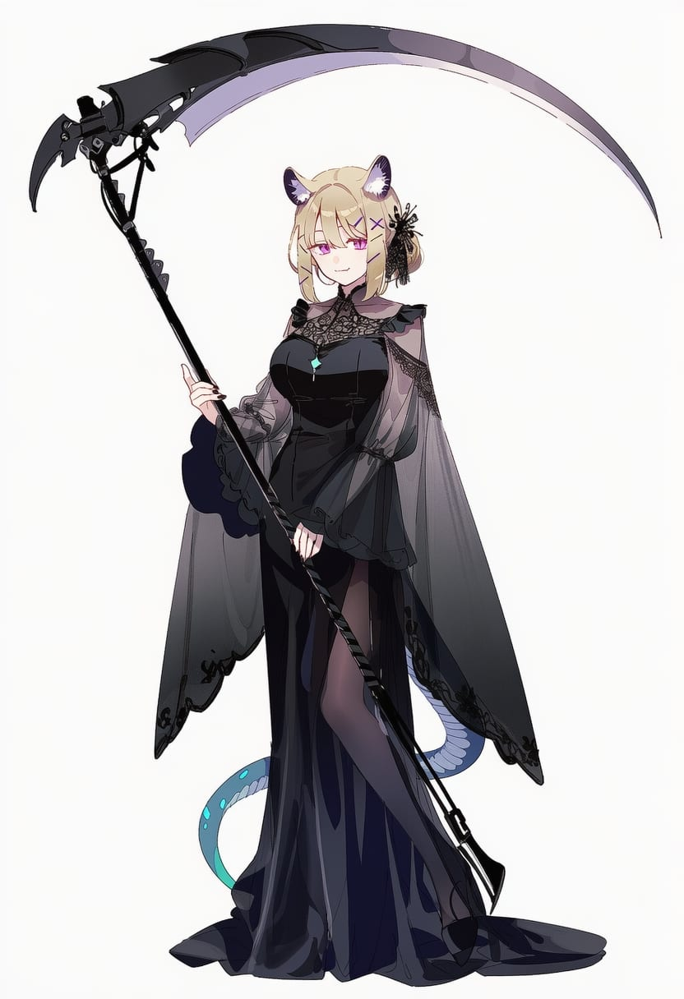

| 字段 | 内容 |
| --- | --- |
| Danbooru Tag | holding_scythe |
| 中文tag | 手持长柄镰刀 |
| 含义 | 角色用手拿着长柄镰刀。 |
| 子类 | 工具/运动/户外 |
| 角色 | 1girl,utage_(arknights) |
| 序号 | 0114 |

## 115. holding_axe — 手持斧头

| 字段 | 内容 |
| --- | --- |
| Danbooru Tag | holding_axe |
| 中文tag | 手持斧头 |
| 含义 | 角色用手拿着斧头。 |
| 子类 | 工具/运动/户外 |
| 角色 | 1girl,iroha_(blue_archive) |
| 序号 | 0115 |

## 116. holding_chainsaw — 手持电锯

| 字段 | 内容 |
| --- | --- |
| Danbooru Tag | holding_chainsaw |
| 中文tag | 手持电锯 |
| 含义 | 角色用手拿着电锯。 |
| 子类 | 工具/运动/户外 |
| 角色 | 1girl,shiroko_(blue_archive) |
| 序号 | 0116 |

## 117. holding_mop — 手持拖把

| 字段 | 内容 |
| --- | --- |
| Danbooru Tag | holding_mop |
| 中文tag | 手持拖把 |
| 含义 | 角色用手拿着拖把。 |
| 子类 | 工具/运动/户外 |
| 角色 | 1girl,blaze_(arknights) |
| 序号 | 0117 |

## 118. holding_duster — 手持掸子

| 字段 | 内容 |
| --- | --- |
| Danbooru Tag | holding_duster |
| 中文tag | 手持掸子 |
| 含义 | 角色用手拿着掸子。 |
| 子类 | 工具/运动/户外 |
| 角色 | 1girl,yunli_(honkai:_star_rail) |
| 序号 | 0118 |

## 119. holding_watering_can — 手持浇水壶

| 字段 | 内容 |
| --- | --- |
| Danbooru Tag | holding_watering_can |
| 中文tag | 手持浇水壶 |
| 含义 | 角色用手拿着浇水壶。 |
| 子类 | 工具/运动/户外 |
| 角色 | 1girl,whisperain_(arknights) |
| 序号 | 0119 |

## 120. holding_hose — 手持水管

| 字段 | 内容 |
| --- | --- |
| Danbooru Tag | holding_hose |
| 中文tag | 手持水管 |
| 含义 | 角色用手拿着水管。 |
| 子类 | 工具/运动/户外 |
| 角色 | 1girl,mari_(blue_archive) |
| 序号 | 0120 |

## 121. holding_fishing_rod — 手持鱼竿

| 字段 | 内容 |
| --- | --- |
| Danbooru Tag | holding_fishing_rod |
| 中文tag | 手持鱼竿 |
| 含义 | 角色用手拿着鱼竿。 |
| 子类 | 工具/运动/户外 |
| 角色 | 1girl,march_7th_(honkai:_star_rail) |
| 序号 | 0121 |

## 122. holding_butterfly_net — 手持捕虫网

| 字段 | 内容 |
| --- | --- |
| Danbooru Tag | holding_butterfly_net |
| 中文tag | 手持捕虫网 |
| 含义 | 角色用手拿着捕虫网。 |
| 子类 | 工具/运动/户外 |
| 角色 | 1girl,vigna_(arknights) |
| 序号 | 0122 |

## 123. holding_rope — 手持绳子

| 字段 | 内容 |
| --- | --- |
| Danbooru Tag | holding_rope |
| 中文tag | 手持绳子 |
| 含义 | 角色用手拿着绳子。 |
| 子类 | 工具/运动/户外 |
| 角色 | 1girl,warfarin_(arknights) |
| 序号 | 0123 |

## 124. holding_chain — 手持链条

| 字段 | 内容 |
| --- | --- |
| Danbooru Tag | holding_chain |
| 中文tag | 手持链条 |
| 含义 | 角色用手拿着链条。 |
| 子类 | 工具/运动/户外 |
| 角色 | 1girl,kazusa_(blue_archive) |
| 序号 | 0124 |

## 125. holding_leash — 手持牵引绳

| 字段 | 内容 |
| --- | --- |
| Danbooru Tag | holding_leash |
| 中文tag | 手持牵引绳 |
| 含义 | 角色用手拿着牵引绳。 |
| 子类 | 工具/运动/户外 |
| 角色 | 1girl,fuuka_(blue_archive) |
| 序号 | 0125 |

## 126. holding_reins — 手持缰绳

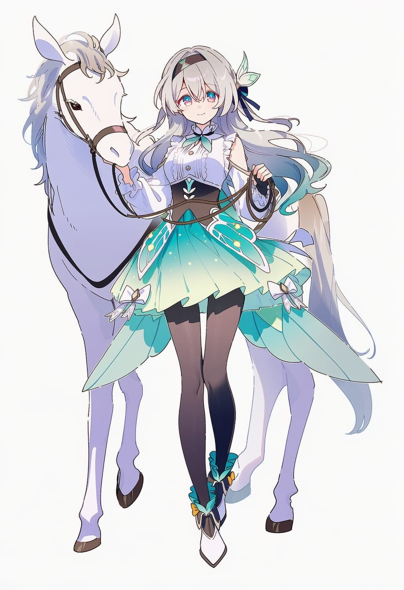

| 字段 | 内容 |
| --- | --- |
| Danbooru Tag | holding_reins |
| 中文tag | 手持缰绳 |
| 含义 | 角色用手拿着缰绳。 |
| 子类 | 工具/运动/户外 |
| 角色 | 1girl,firefly_(honkai:_star_rail) |
| 序号 | 0126 |

## 127. holding_oar — 手持船桨

| 字段 | 内容 |
| --- | --- |
| Danbooru Tag | holding_oar |
| 中文tag | 手持船桨 |
| 含义 | 角色用手拿着船桨。 |
| 子类 | 工具/运动/户外 |
| 角色 | 1girl,serika_(blue_archive) |
| 序号 | 0127 |

## 128. holding_paddle — 手持桨

| 字段 | 内容 |
| --- | --- |
| Danbooru Tag | holding_paddle |
| 中文tag | 手持桨 |
| 含义 | 角色用手拿着桨。 |
| 子类 | 工具/运动/户外 |
| 角色 | 1girl,mimori_(blue_archive) |
| 序号 | 0128 |

## 129. holding_racket — 手持球拍

| 字段 | 内容 |
| --- | --- |
| Danbooru Tag | holding_racket |
| 中文tag | 手持球拍 |
| 含义 | 角色用手拿着球拍。 |
| 子类 | 工具/运动/户外 |
| 角色 | 1girl,sparkle_(honkai:_star_rail) |
| 序号 | 0129 |

## 130. holding_tennis_racket — 手持网球拍

| 字段 | 内容 |
| --- | --- |
| Danbooru Tag | holding_tennis_racket |
| 中文tag | 手持网球拍 |
| 含义 | 角色用手拿着网球拍。 |
| 子类 | 工具/运动/户外 |
| 角色 | 1girl,swire_(arknights) |
| 序号 | 0130 |

## 131. holding_golf_club — 手持高尔夫球杆

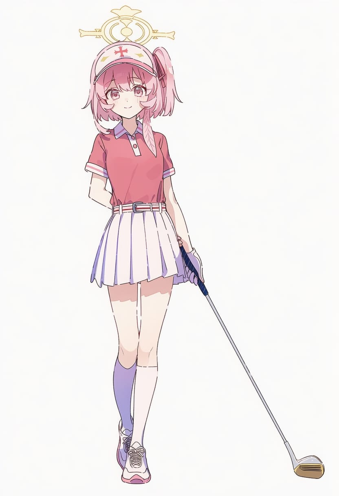

| 字段 | 内容 |
| --- | --- |
| Danbooru Tag | holding_golf_club |
| 中文tag | 手持高尔夫球杆 |
| 含义 | 角色用手拿着高尔夫球杆。 |
| 子类 | 工具/运动/户外 |
| 角色 | 1girl,serina_(blue_archive) |
| 序号 | 0131 |

## 132. holding_baseball_bat — 手持棒球棒

| 字段 | 内容 |
| --- | --- |
| Danbooru Tag | holding_baseball_bat |
| 中文tag | 手持棒球棒 |
| 含义 | 角色用手拿着棒球棒。 |
| 子类 | 工具/运动/户外 |
| 角色 | 1girl,fu_xuan_(honkai:_star_rail) |
| 序号 | 0132 |

## 133. holding_skateboard — 手持滑板

| 字段 | 内容 |
| --- | --- |
| Danbooru Tag | holding_skateboard |
| 中文tag | 手持滑板 |
| 含义 | 角色用手拿着滑板。 |
| 子类 | 工具/运动/户外 |
| 角色 | 1girl,ruan_mei_(honkai:_star_rail) |
| 序号 | 0133 |

## 134. holding_surfboard — 手持冲浪板

| 字段 | 内容 |
| --- | --- |
| Danbooru Tag | holding_surfboard |
| 中文tag | 手持冲浪板 |
| 含义 | 角色用手拿着冲浪板。 |
| 子类 | 工具/运动/户外 |
| 角色 | 1girl,robin_(honkai:_star_rail) |
| 序号 | 0134 |

## 135. holding_dumbbell — 手持哑铃

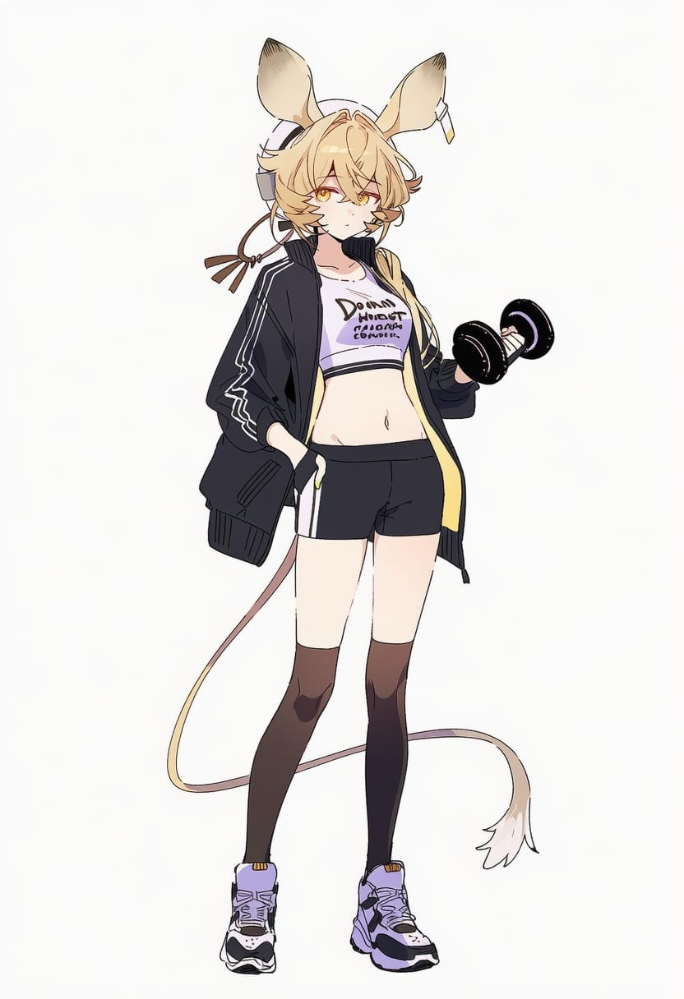

| 字段 | 内容 |
| --- | --- |
| Danbooru Tag | holding_dumbbell |
| 中文tag | 手持哑铃 |
| 含义 | 角色用手拿着哑铃。 |
| 子类 | 工具/运动/户外 |
| 角色 | 1girl,dorothy_(arknights) |
| 序号 | 0135 |

## 136. holding_weapon — 手持武器

| 字段 | 内容 |
| --- | --- |
| Danbooru Tag | holding_weapon |
| 中文tag | 手持武器 |
| 含义 | 角色用手拿着武器。 |
| 子类 | 武器/战斗持物 |
| 角色 | 1girl,silver_wolf_(honkai:_star_rail) |
| 序号 | 0136 |

## 137. holding_sword — 手持剑

| 字段 | 内容 |
| --- | --- |
| Danbooru Tag | holding_sword |
| 中文tag | 手持剑 |
| 含义 | 角色用手拿着剑。 |
| 子类 | 武器/战斗持物 |
| 角色 | 1girl,stelle_(honkai:_star_rail) |
| 序号 | 0137 |

## 138. holding_knife — 手持刀

| 字段 | 内容 |
| --- | --- |
| Danbooru Tag | holding_knife |
| 中文tag | 手持刀 |
| 含义 | 角色用手拿着刀。 |
| 子类 | 武器/战斗持物 |
| 角色 | 1girl,ines_(arknights) |
| 序号 | 0138 |

## 139. holding_bow_(weapon) — 手持弓

| 字段 | 内容 |
| --- | --- |
| Danbooru Tag | holding_bow_(weapon) |
| 中文tag | 手持弓 |
| 含义 | 角色用手拿着弓。 |
| 子类 | 武器/战斗持物 |
| 角色 | 1girl,pallas_(arknights) |
| 序号 | 0139 |

## 140. holding_arrow — 手持箭

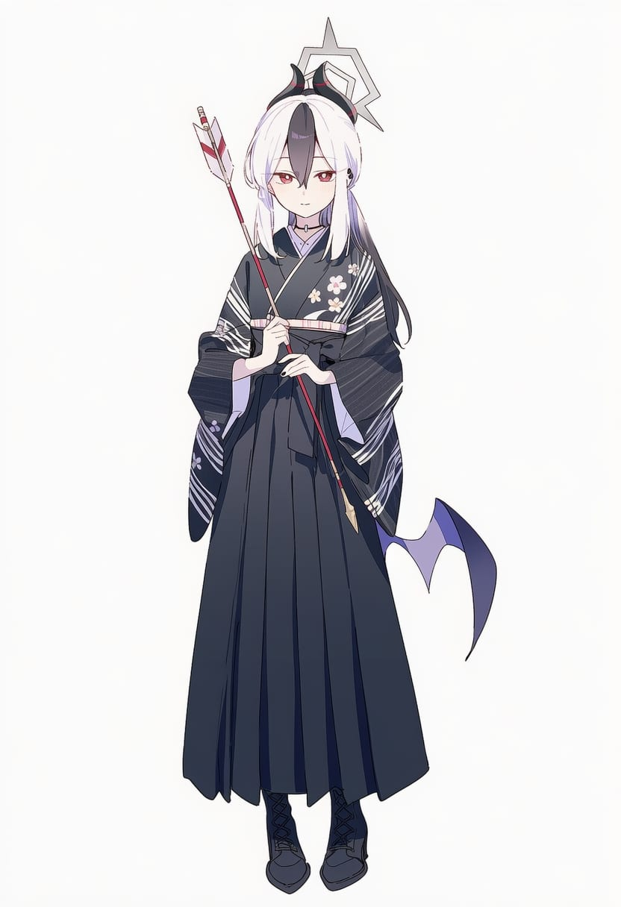

| 字段 | 内容 |
| --- | --- |
| Danbooru Tag | holding_arrow |
| 中文tag | 手持箭 |
| 含义 | 角色用手拿着箭。 |
| 子类 | 武器/战斗持物 |
| 角色 | 1girl,kayoko_(blue_archive) |
| 序号 | 0140 |

## 141. holding_shield — 手持盾牌

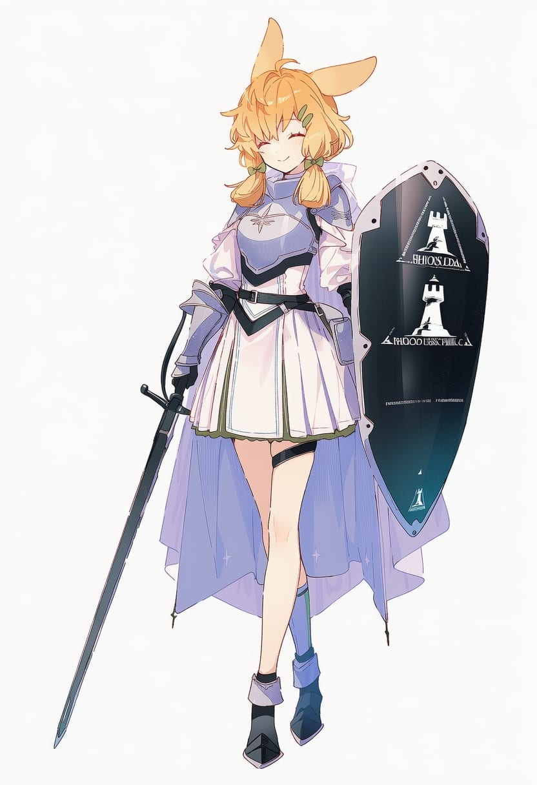

| 字段 | 内容 |
| --- | --- |
| Danbooru Tag | holding_shield |
| 中文tag | 手持盾牌 |
| 含义 | 角色用手拿着盾牌。 |
| 子类 | 武器/战斗持物 |
| 角色 | 1girl,kroos_(arknights) |
| 序号 | 0141 |

## 142. holding_staff — 手持法杖 / 长杖

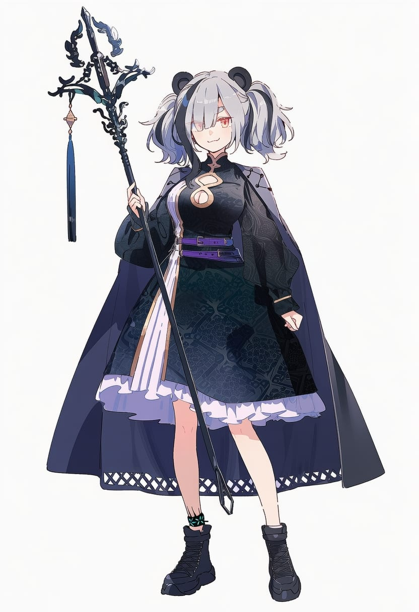

| 字段 | 内容 |
| --- | --- |
| Danbooru Tag | holding_staff |
| 中文tag | 手持法杖 / 长杖 |
| 含义 | 角色用手拿着法杖 / 长杖。 |
| 子类 | 武器/战斗持物 |
| 角色 | 1girl,feater_(arknights) |
| 序号 | 0142 |

## 143. holding_wand — 手持魔杖

| 字段 | 内容 |
| --- | --- |
| Danbooru Tag | holding_wand |
| 中文tag | 手持魔杖 |
| 含义 | 角色用手拿着魔杖。 |
| 子类 | 武器/战斗持物 |
| 角色 | 1girl,acheron_(honkai:_star_rail) |
| 序号 | 0143 |

## 144. holding_spear — 手持长枪

| 字段 | 内容 |
| --- | --- |
| Danbooru Tag | holding_spear |
| 中文tag | 手持长枪 |
| 含义 | 角色用手拿着长枪。 |
| 子类 | 武器/战斗持物 |
| 角色 | 1girl,aris_(blue_archive) |
| 序号 | 0144 |

## 145. holding_gun — 手持枪械

| 字段 | 内容 |
| --- | --- |
| Danbooru Tag | holding_gun |
| 中文tag | 手持枪械 |
| 含义 | 角色用手拿着枪械。 |
| 子类 | 武器/战斗持物 |
| 角色 | 1girl,kafka_(honkai:_star_rail) |
| 序号 | 0145 |

## 146. holding_rifle — 手持步枪

| 字段 | 内容 |
| --- | --- |
| Danbooru Tag | holding_rifle |
| 中文tag | 手持步枪 |
| 含义 | 角色用手拿着步枪。 |
| 子类 | 武器/战斗持物 |
| 角色 | 1girl,jingliu_(honkai:_star_rail) |
| 序号 | 0146 |

## 147. holding_pistol — 手持手枪

| 字段 | 内容 |
| --- | --- |
| Danbooru Tag | holding_pistol |
| 中文tag | 手持手枪 |
| 含义 | 角色用手拿着手枪。 |
| 子类 | 武器/战斗持物 |
| 角色 | 1girl,utage_(arknights) |
| 序号 | 0147 |

## 148. holding_water_gun — 手持水枪

| 字段 | 内容 |
| --- | --- |
| Danbooru Tag | holding_water_gun |
| 中文tag | 手持水枪 |
| 含义 | 角色用手拿着水枪。 |
| 子类 | 武器/战斗持物 |
| 角色 | 1girl,shiroko_(blue_archive) |
| 序号 | 0148 |

## 149. holding_whip — 手持鞭子

| 字段 | 内容 |
| --- | --- |
| Danbooru Tag | holding_whip |
| 中文tag | 手持鞭子 |
| 含义 | 角色用手拿着鞭子。 |
| 子类 | 武器/战斗持物 |
| 角色 | 1girl,blaze_(arknights) |
| 序号 | 0149 |

## 150. dual_wielding — 双持

| 字段 | 内容 |
| --- | --- |
| Danbooru Tag | dual_wielding |
| 中文tag | 双持 |
| 含义 | 左右手分别持有武器或物体。 |
| 子类 | 武器/战斗持物 |
| 角色 | 1girl,yunli_(honkai:_star_rail) |
| 序号 | 0150 |

## 151. wielding — 挥持武器

| 字段 | 内容 |
| --- | --- |
| Danbooru Tag | wielding |
| 中文tag | 挥持武器 |
| 含义 | 以可使用、攻击的姿态握持武器。 |
| 子类 | 武器/战斗持物 |
| 角色 | 1girl,saori_(blue_archive) |
| 序号 | 0151 |

## 152. brandishing — 挥舞 / 炫示武器

| 字段 | 内容 |
| --- | --- |
| Danbooru Tag | brandishing |
| 中文tag | 挥舞 / 炫示武器 |
| 含义 | 明显挥舞或展示手中的武器。 |
| 子类 | 武器/战斗持物 |
| 角色 | 1girl,whisperain_(arknights) |
| 序号 | 0152 |

## 153. aiming — 瞄准

| 字段 | 内容 |
| --- | --- |
| Danbooru Tag | aiming |
| 中文tag | 瞄准 |
| 含义 | 用武器或器具对准目标。 |
| 子类 | 武器/战斗持物 |
| 角色 | 1girl,mari_(blue_archive) |
| 序号 | 0153 |

## 154. drawing_weapon — 拔出武器

| 字段 | 内容 |
| --- | --- |
| Danbooru Tag | drawing_weapon |
| 中文tag | 拔出武器 |
| 含义 | 正在把武器从收纳位置拔出。 |
| 子类 | 武器/战斗持物 |
| 角色 | 1girl,march_7th_(honkai:_star_rail) |
| 序号 | 0154 |

## 155. sheathing — 收刀入鞘

| 字段 | 内容 |
| --- | --- |
| Danbooru Tag | sheathing |
| 中文tag | 收刀入鞘 |
| 含义 | 正在把刀剑等收入鞘中。 |
| 子类 | 武器/战斗持物 |
| 角色 | 1girl,vigna_(arknights) |
| 序号 | 0155 |

## 156. unsheathing — 拔刀出鞘

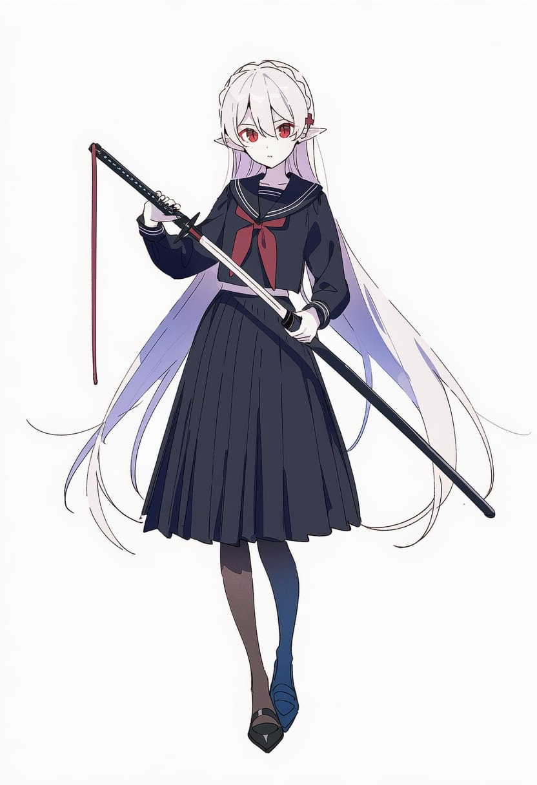

| 字段 | 内容 |
| --- | --- |
| Danbooru Tag | unsheathing |
| 中文tag | 拔刀出鞘 |
| 含义 | 正在从鞘中拔出刀剑等武器。 |
| 子类 | 武器/战斗持物 |
| 角色 | 1girl,warfarin_(arknights) |
| 序号 | 0156 |

## 157. holding_animal — 手持动物

| 字段 | 内容 |
| --- | --- |
| Danbooru Tag | holding_animal |
| 中文tag | 手持动物 |
| 含义 | 角色用手拿着动物。 |
| 子类 | 生物/玩具/特殊物件 |
| 角色 | 1girl,kazusa_(blue_archive) |
| 序号 | 0157 |

## 158. holding_creature — 手持生物

| 字段 | 内容 |
| --- | --- |
| Danbooru Tag | holding_creature |
| 中文tag | 手持生物 |
| 含义 | 角色用手拿着生物。 |
| 子类 | 生物/玩具/特殊物件 |
| 角色 | 1girl,fuuka_(blue_archive) |
| 序号 | 0158 |

## 159. holding_pokemon — 手持宝可梦

| 字段 | 内容 |
| --- | --- |
| Danbooru Tag | holding_pokemon |
| 中文tag | 手持宝可梦 |
| 含义 | 角色用手拿着宝可梦。 |
| 子类 | 生物/玩具/特殊物件 |
| 角色 | 1girl,firefly_(honkai:_star_rail) |
| 序号 | 0159 |

## 160. holding_doll — 手持人偶

| 字段 | 内容 |
| --- | --- |
| Danbooru Tag | holding_doll |
| 中文tag | 手持人偶 |
| 含义 | 角色用手拿着人偶。 |
| 子类 | 生物/玩具/特殊物件 |
| 角色 | 1girl,serika_(blue_archive) |
| 序号 | 0160 |

## 161. holding_stuffed_toy — 手持毛绒玩具

| 字段 | 内容 |
| --- | --- |
| Danbooru Tag | holding_stuffed_toy |
| 中文tag | 手持毛绒玩具 |
| 含义 | 角色用手拿着毛绒玩具。 |
| 子类 | 生物/玩具/特殊物件 |
| 角色 | 1girl,mimori_(blue_archive) |
| 序号 | 0161 |

## 162. holding_toy — 手持玩具

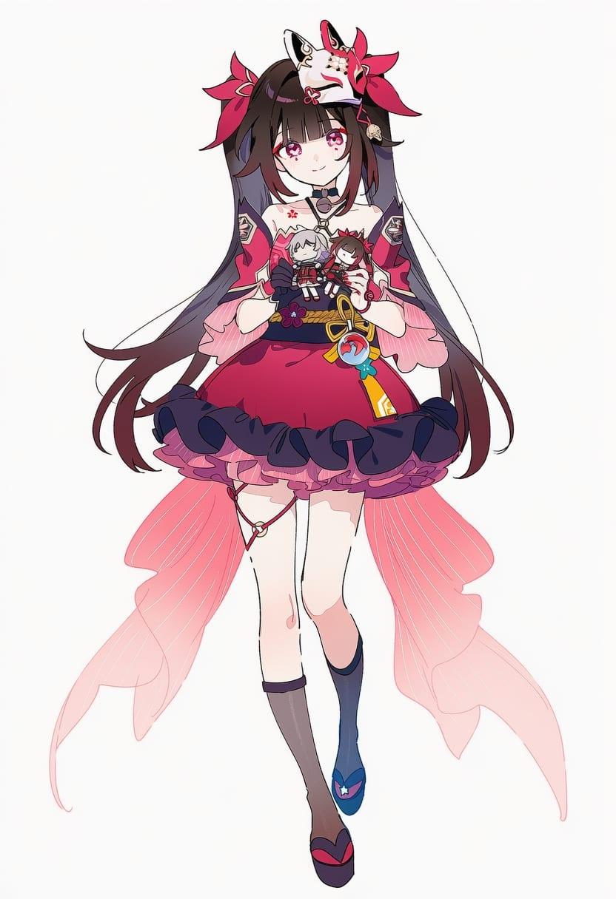

| 字段 | 内容 |
| --- | --- |
| Danbooru Tag | holding_toy |
| 中文tag | 手持玩具 |
| 含义 | 角色用手拿着玩具。 |
| 子类 | 生物/玩具/特殊物件 |
| 角色 | 1girl,sparkle_(honkai:_star_rail) |
| 序号 | 0162 |

## 163. holding_skull — 手持头骨

| 字段 | 内容 |
| --- | --- |
| Danbooru Tag | holding_skull |
| 中文tag | 手持头骨 |
| 含义 | 角色用手拿着头骨。 |
| 子类 | 生物/玩具/特殊物件 |
| 角色 | 1girl,swire_(arknights) |
| 序号 | 0163 |

## 164. holding_bone — 手持骨头

| 字段 | 内容 |
| --- | --- |
| Danbooru Tag | holding_bone |
| 中文tag | 手持骨头 |
| 含义 | 角色用手拿着骨头。 |
| 子类 | 生物/玩具/特殊物件 |
| 角色 | 1girl,serina_(blue_archive) |
| 序号 | 0164 |

## 165. holding_heart — 手持心形物

| 字段 | 内容 |
| --- | --- |
| Danbooru Tag | holding_heart |
| 中文tag | 手持心形物 |
| 含义 | 角色用手拿着心形物。 |
| 子类 | 生物/玩具/特殊物件 |
| 角色 | 1girl,astesia_(arknights) |
| 序号 | 0165 |

## 166. holding_orb — 手持球体 / 宝珠

| 字段 | 内容 |
| --- | --- |
| Danbooru Tag | holding_orb |
| 中文tag | 手持球体 / 宝珠 |
| 含义 | 角色用手拿着球体 / 宝珠。 |
| 子类 | 生物/玩具/特殊物件 |
| 角色 | 1girl,fu_xuan_(honkai:_star_rail) |
| 序号 | 0166 |

## 167. holding_gem — 手持宝石

| 字段 | 内容 |
| --- | --- |
| Danbooru Tag | holding_gem |
| 中文tag | 手持宝石 |
| 含义 | 角色用手拿着宝石。 |
| 子类 | 生物/玩具/特殊物件 |
| 角色 | 1girl,robin_(honkai:_star_rail) |
| 序号 | 0167 |

## 168. holding_star — 手持星形物

| 字段 | 内容 |
| --- | --- |
| Danbooru Tag | holding_star |
| 中文tag | 手持星形物 |
| 含义 | 角色用手拿着星形物。 |
| 子类 | 生物/玩具/特殊物件 |
| 角色 | 1girl,midori_(blue_archive) |
| 序号 | 0168 |

## 169. holding_candle — 手持蜡烛

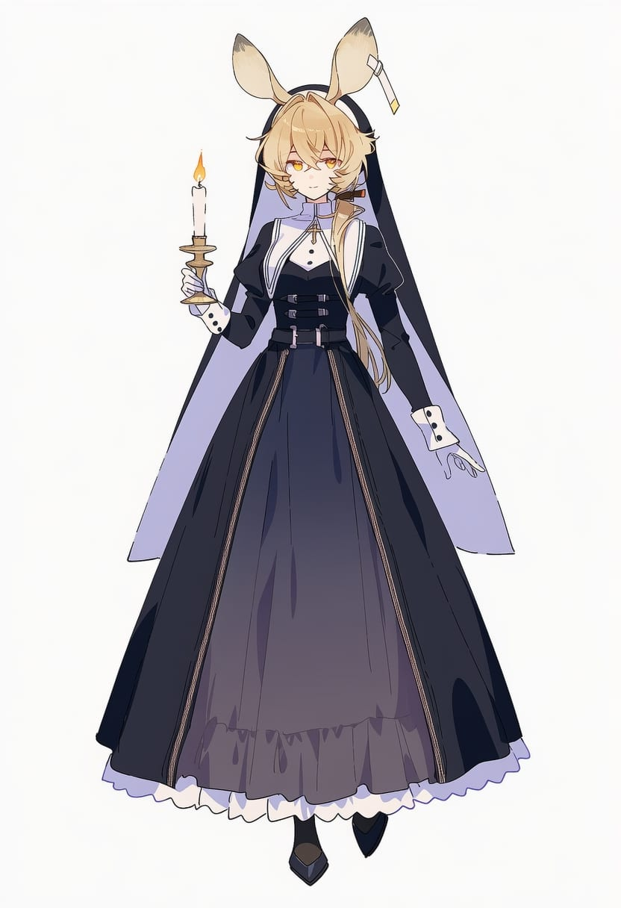

| 字段 | 内容 |
| --- | --- |
| Danbooru Tag | holding_candle |
| 中文tag | 手持蜡烛 |
| 含义 | 角色用手拿着蜡烛。 |
| 子类 | 生物/玩具/特殊物件 |
| 角色 | 1girl,dorothy_(arknights) |
| 序号 | 0169 |

## 170. holding_lantern — 手持灯笼

| 字段 | 内容 |
| --- | --- |
| Danbooru Tag | holding_lantern |
| 中文tag | 手持灯笼 |
| 含义 | 角色用手拿着灯笼。 |
| 子类 | 生物/玩具/特殊物件 |
| 角色 | 1girl,silver_wolf_(honkai:_star_rail) |
| 序号 | 0170 |

## 171. holding_glowstick — 手持荧光棒

| 字段 | 内容 |
| --- | --- |
| Danbooru Tag | holding_glowstick |
| 中文tag | 手持荧光棒 |
| 含义 | 角色用手拿着荧光棒。 |
| 子类 | 生物/玩具/特殊物件 |
| 角色 | 1girl,stelle_(honkai:_star_rail) |
| 序号 | 0171 |

## 172. holding_flag — 手持旗帜

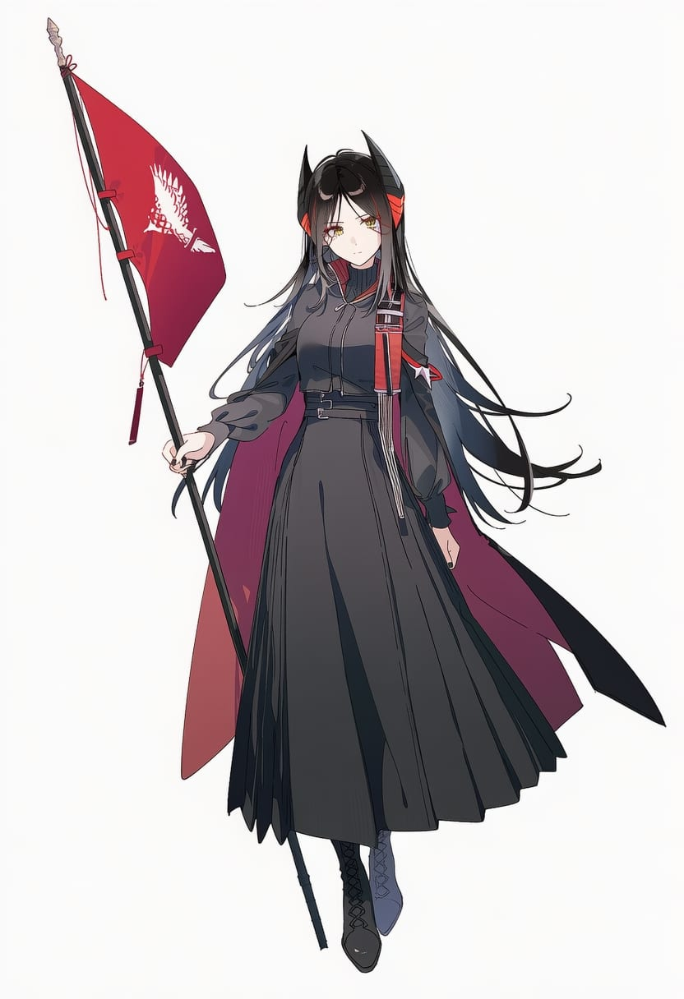

| 字段 | 内容 |
| --- | --- |
| Danbooru Tag | holding_flag |
| 中文tag | 手持旗帜 |
| 含义 | 角色用手拿着旗帜。 |
| 子类 | 生物/玩具/特殊物件 |
| 角色 | 1girl,ines_(arknights) |
| 序号 | 0172 |

## 173. holding_sign — 手持标牌

| 字段 | 内容 |
| --- | --- |
| Danbooru Tag | holding_sign |
| 中文tag | 手持标牌 |
| 含义 | 角色用手拿着标牌。 |
| 子类 | 生物/玩具/特殊物件 |
| 角色 | 1girl,kayoko_(blue_archive) |
| 序号 | 0173 |

## 174. holding_trophy — 手持奖杯

| 字段 | 内容 |
| --- | --- |
| Danbooru Tag | holding_trophy |
| 中文tag | 手持奖杯 |
| 含义 | 角色用手拿着奖杯。 |
| 子类 | 生物/玩具/特殊物件 |
| 角色 | 1girl,kroos_(arknights) |
| 序号 | 0174 |

## 175. holding_crown — 手持王冠

| 字段 | 内容 |
| --- | --- |
| Danbooru Tag | holding_crown |
| 中文tag | 手持王冠 |
| 含义 | 角色用手拿着王冠。 |
| 子类 | 生物/玩具/特殊物件 |
| 角色 | 1girl,acheron_(honkai:_star_rail) |
| 序号 | 0175 |

## 176. holding_scepter — 手持权杖

| 字段 | 内容 |
| --- | --- |
| Danbooru Tag | holding_scepter |
| 中文tag | 手持权杖 |
| 含义 | 角色用手拿着权杖。 |
| 子类 | 生物/玩具/特殊物件 |
| 角色 | 1girl,aris_(blue_archive) |
| 序号 | 0176 |

## 177. holding_cross — 手持十字架

| 字段 | 内容 |
| --- | --- |
| Danbooru Tag | holding_cross |
| 中文tag | 手持十字架 |
| 含义 | 角色用手拿着十字架。 |
| 子类 | 生物/玩具/特殊物件 |
| 角色 | 1girl,kafka_(honkai:_star_rail) |
| 序号 | 0177 |

## 178. holding_ofuda — 手持御札

| 字段 | 内容 |
| --- | --- |
| Danbooru Tag | holding_ofuda |
| 中文tag | 手持御札 |
| 含义 | 角色用手拿着御札。 |
| 子类 | 生物/玩具/特殊物件 |
| 角色 | 1girl,jingliu_(honkai:_star_rail) |
| 序号 | 0178 |

## 179. holding_poke_ball — 手持精灵球

| 字段 | 内容 |
| --- | --- |
| Danbooru Tag | holding_poke_ball |
| 中文tag | 手持精灵球 |
| 含义 | 角色用手拿着精灵球。 |
| 子类 | 生物/玩具/特殊物件 |
| 角色 | 1girl,shiroko_(blue_archive) |
| 序号 | 0179 |

## 180. throwing — 投掷

| 字段 | 内容 |
| --- | --- |
| Danbooru Tag | throwing |
| 中文tag | 投掷 |
| 含义 | 把物体从手中投出去。 |
| 子类 | 操作/推动/投掷 |
| 角色 | 1girl,blaze_(arknights) |
| 序号 | 0180 |

## 181. catching — 接住

| 字段 | 内容 |
| --- | --- |
| Danbooru Tag | catching |
| 中文tag | 接住 |
| 含义 | 用手接住飞来或落下的物体。 |
| 子类 | 操作/推动/投掷 |
| 角色 | 1girl,yunli_(honkai:_star_rail) |
| 序号 | 0181 |

## 182. tossing — 抛起

| 字段 | 内容 |
| --- | --- |
| Danbooru Tag | tossing |
| 中文tag | 抛起 |
| 含义 | 轻抛或向上抛动物体。 |
| 子类 | 操作/推动/投掷 |
| 角色 | 1girl,saori_(blue_archive) |
| 序号 | 0182 |

## 183. pulling — 拉

| 字段 | 内容 |
| --- | --- |
| Danbooru Tag | pulling |
| 中文tag | 拉 |
| 含义 | 拉动物体使其朝自己移动。 |
| 子类 | 操作/推动/投掷 |
| 角色 | 1girl,whisperain_(arknights) |
| 序号 | 0183 |

## 184. pushing — 推

| 字段 | 内容 |
| --- | --- |
| Danbooru Tag | pushing |
| 中文tag | 推 |
| 含义 | 推物体使其远离自己。 |
| 子类 | 操作/推动/投掷 |
| 角色 | 1girl,mari_(blue_archive) |
| 序号 | 0184 |

## 185. dragging — 拖拽

| 字段 | 内容 |
| --- | --- |
| Danbooru Tag | dragging |
| 中文tag | 拖拽 |
| 含义 | 拖着物体沿地面移动。 |
| 子类 | 操作/推动/投掷 |
| 角色 | 1girl,march_7th_(honkai:_star_rail) |
| 序号 | 0185 |

## 186. lifting — 抬起

| 字段 | 内容 |
| --- | --- |
| Danbooru Tag | lifting |
| 中文tag | 抬起 |
| 含义 | 把物体向上抬起。 |
| 子类 | 操作/推动/投掷 |
| 角色 | 1girl,vigna_(arknights) |
| 序号 | 0186 |

## 187. lowering — 放低

| 字段 | 内容 |
| --- | --- |
| Danbooru Tag | lowering |
| 中文tag | 放低 |
| 含义 | 把物体向下放低。 |
| 子类 | 操作/推动/投掷 |
| 角色 | 1girl,warfarin_(arknights) |
| 序号 | 0187 |

## 188. raising — 举起

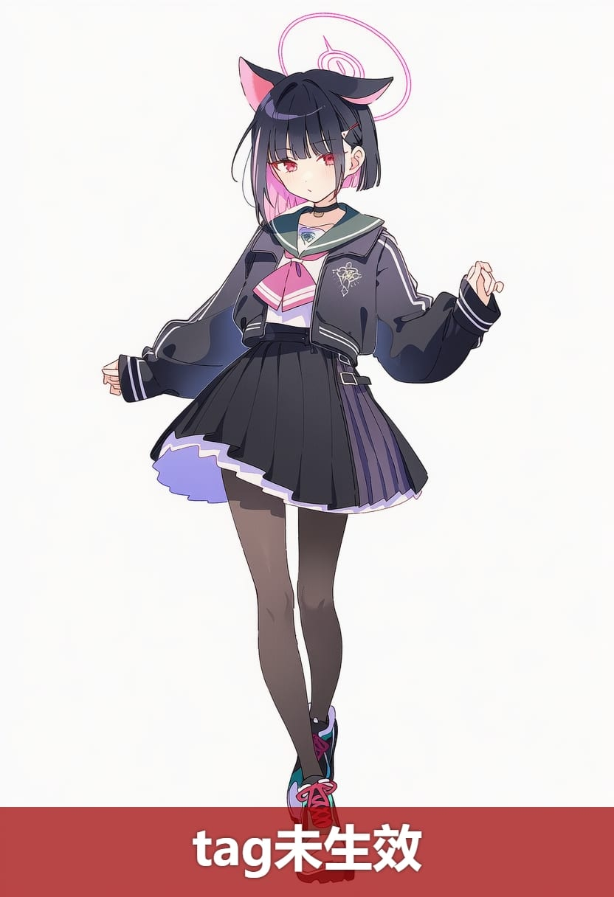

| 字段 | 内容 |
| --- | --- |
| Danbooru Tag | raising |
| 中文tag | 举起 |
| 含义 | 把物体举高。 |
| 子类 | 操作/推动/投掷 |
| 角色 | 1girl,kazusa_(blue_archive) |
| 序号 | 0188 |

## 189. closing — 关闭

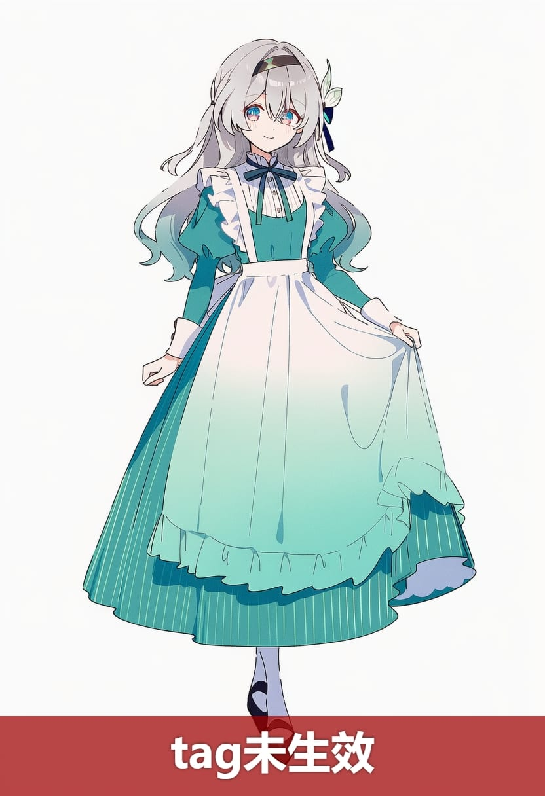

| 字段 | 内容 |
| --- | --- |
| Danbooru Tag | closing |
| 中文tag | 关闭 |
| 含义 | 正在把物体关闭。 |
| 子类 | 操作/推动/投掷 |
| 角色 | 1girl,firefly_(honkai:_star_rail) |
| 序号 | 0189 |

## 190. turning — 转动

| 字段 | 内容 |
| --- | --- |
| Danbooru Tag | turning |
| 中文tag | 转动 |
| 含义 | 正在旋转或转动物体。 |
| 子类 | 操作/推动/投掷 |
| 角色 | 1girl,serika_(blue_archive) |
| 序号 | 0190 |

## 191. pressing — 按压

| 字段 | 内容 |
| --- | --- |
| Danbooru Tag | pressing |
| 中文tag | 按压 |
| 含义 | 用手对物体施加按压力。 |
| 子类 | 操作/推动/投掷 |
| 角色 | 1girl,mimori_(blue_archive) |
| 序号 | 0191 |

## 192. poking — 戳

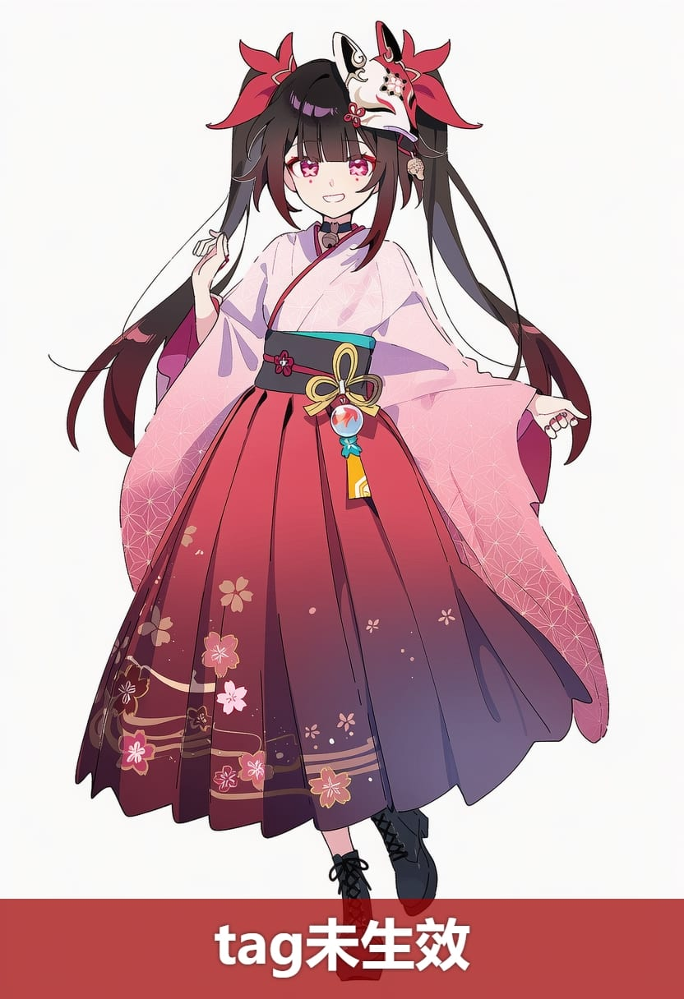

| 字段 | 内容 |
| --- | --- |
| Danbooru Tag | poking |
| 中文tag | 戳 |
| 含义 | 用手指或细长物体戳碰目标。 |
| 子类 | 操作/推动/投掷 |
| 角色 | 1girl,sparkle_(honkai:_star_rail) |
| 序号 | 0192 |

## 193. tapping — 轻敲

| 字段 | 内容 |
| --- | --- |
| Danbooru Tag | tapping |
| 中文tag | 轻敲 |
| 含义 | 用手指轻轻敲击物体。 |
| 子类 | 操作/推动/投掷 |
| 角色 | 1girl,swire_(arknights) |
| 序号 | 0193 |

## 194. touching — 触碰

| 字段 | 内容 |
| --- | --- |
| Danbooru Tag | touching |
| 中文tag | 触碰 |
| 含义 | 用手接触物体表面。 |
| 子类 | 操作/推动/投掷 |
| 角色 | 1girl,serina_(blue_archive) |
| 序号 | 0194 |

## 195. squeezing — 挤压

| 字段 | 内容 |
| --- | --- |
| Danbooru Tag | squeezing |
| 中文tag | 挤压 |
| 含义 | 用手挤压物体。 |
| 子类 | 操作/推动/投掷 |
| 角色 | 1girl,astesia_(arknights) |
| 序号 | 0195 |

## 196. pinching — 捏

| 字段 | 内容 |
| --- | --- |
| Danbooru Tag | pinching |
| 中文tag | 捏 |
| 含义 | 用手指捏住物体。 |
| 子类 | 操作/推动/投掷 |
| 角色 | 1girl,fu_xuan_(honkai:_star_rail) |
| 序号 | 0196 |

---
