# 图片展示文档

## 1. pink_theme — 粉色主题

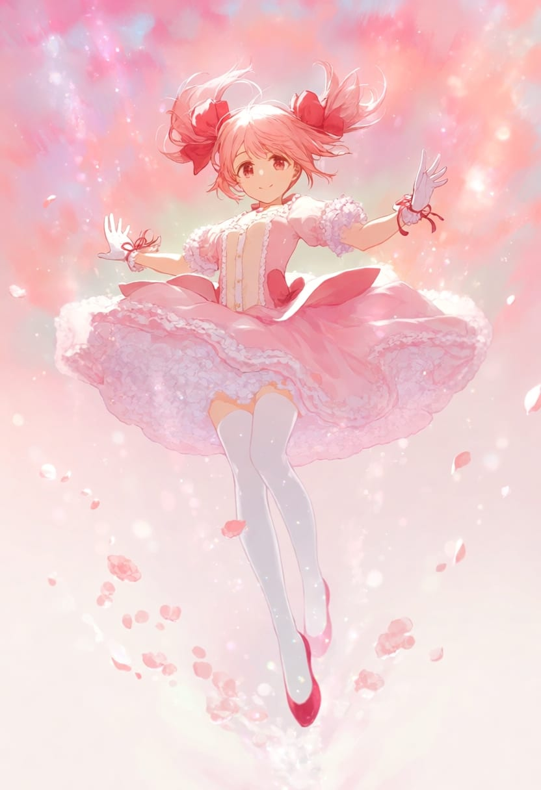

| 字段 | 内容 |
| --- | --- |
| 序号 | 0001 |
| tag | pink_theme |
| tag中文名 | 粉色主题 |
| tag中文含义 | 画面整体以粉色为主色。 |
| tag所属的子类 | 单色主题 |
| 角色 | kaname_madoka |

## 2. red_theme — 红色主题

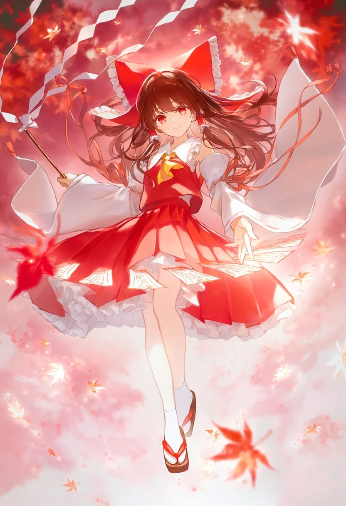

| 字段 | 内容 |
| --- | --- |
| 序号 | 0002 |
| tag | red_theme |
| tag中文名 | 红色主题 |
| tag中文含义 | 画面整体以红色为主色。 |
| tag所属的子类 | 单色主题 |
| 角色 | hakurei_reimu |

## 3. orange_theme — 橙色主题

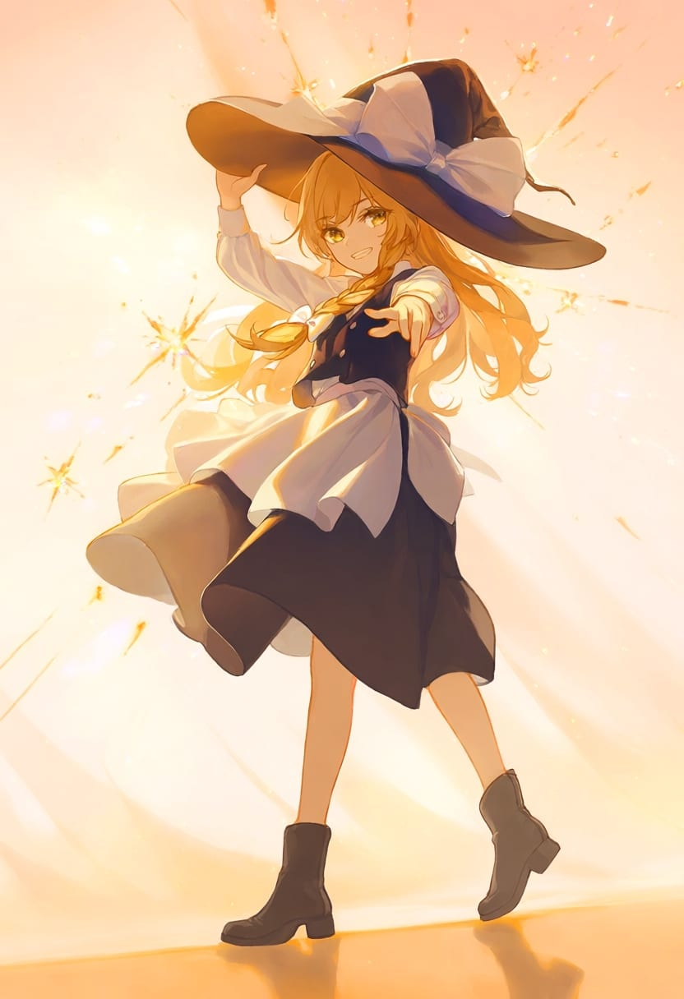

| 字段 | 内容 |
| --- | --- |
| 序号 | 0003 |
| tag | orange_theme |
| tag中文名 | 橙色主题 |
| tag中文含义 | 画面整体以橙色为主色。 |
| tag所属的子类 | 单色主题 |
| 角色 | kirisame_marisa |

## 4. brown_theme — 棕色主题

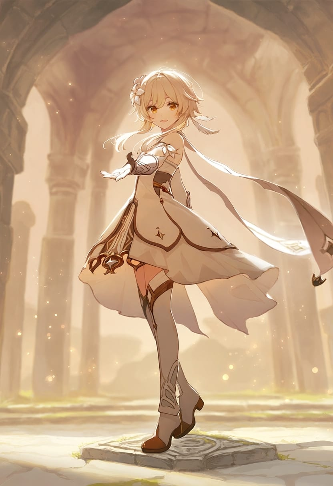

| 字段 | 内容 |
| --- | --- |
| 序号 | 0004 |
| tag | brown_theme |
| tag中文名 | 棕色主题 |
| tag中文含义 | 画面整体以棕色为主色。 |
| tag所属的子类 | 单色主题 |
| 角色 | lumine_(genshin_impact) |

## 5. yellow_theme — 黄色主题

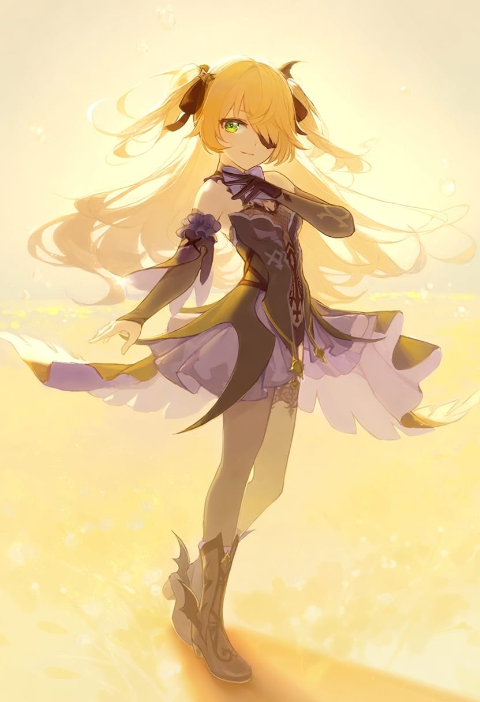

| 字段 | 内容 |
| --- | --- |
| 序号 | 0005 |
| tag | yellow_theme |
| tag中文名 | 黄色主题 |
| tag中文含义 | 画面整体以黄色为主色。 |
| tag所属的子类 | 单色主题 |
| 角色 | fischl_(genshin_impact) |

## 6. green_theme — 绿色主题

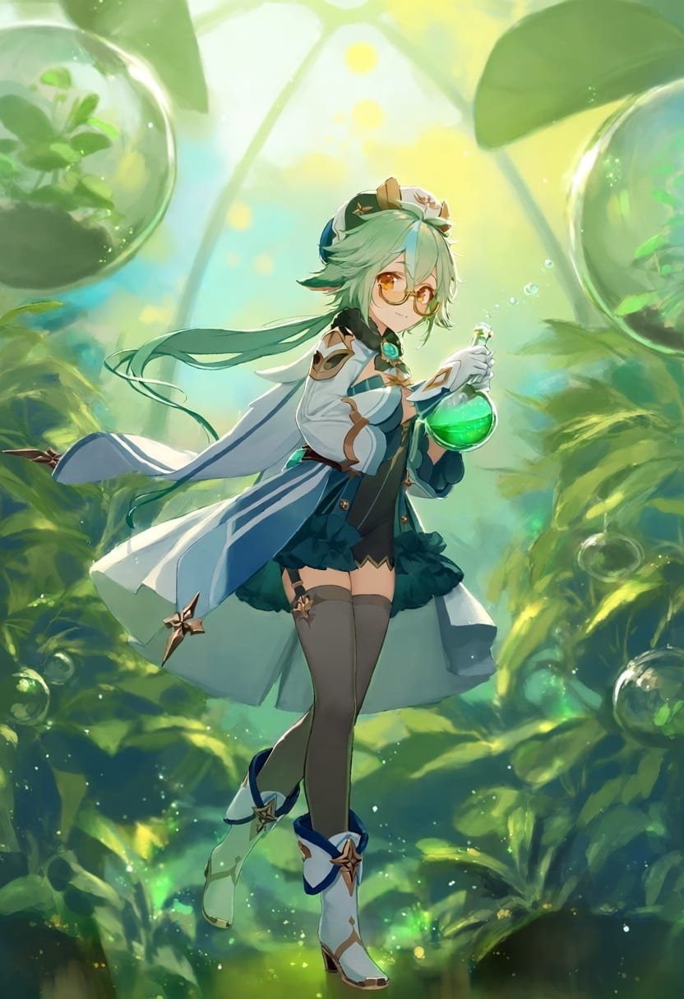

| 字段 | 内容 |
| --- | --- |
| 序号 | 0006 |
| tag | green_theme |
| tag中文名 | 绿色主题 |
| tag中文含义 | 画面整体以绿色为主色。 |
| tag所属的子类 | 单色主题 |
| 角色 | sucrose_(genshin_impact) |

## 7. aqua_theme — 水青色主题

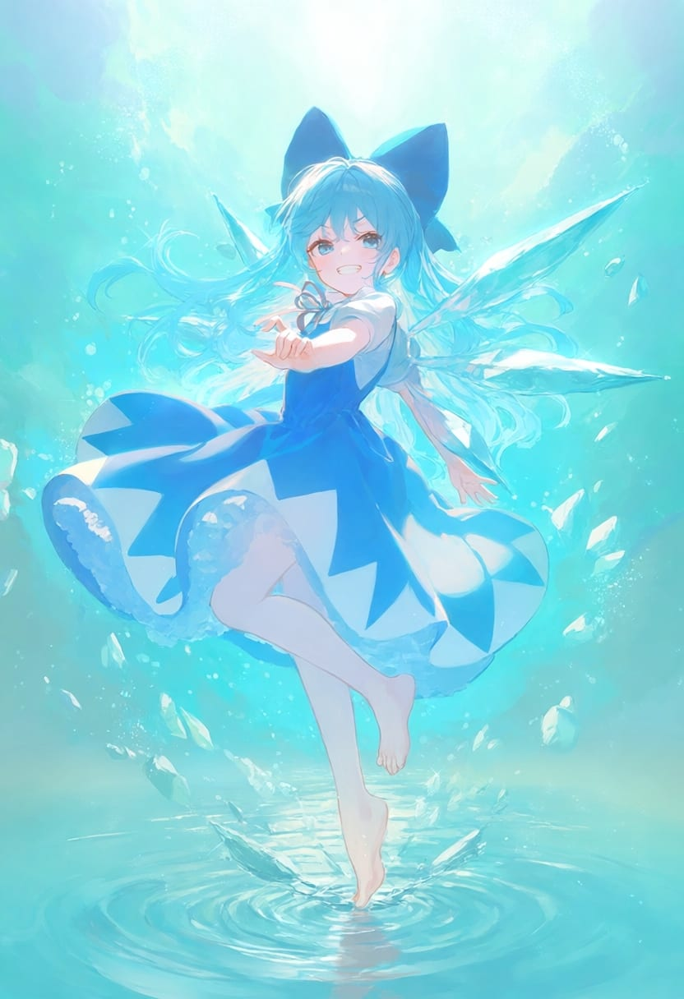

| 字段 | 内容 |
| --- | --- |
| 序号 | 0007 |
| tag | aqua_theme |
| tag中文名 | 水青色主题 |
| tag中文含义 | 画面整体以青蓝或水青色为主色。 |
| tag所属的子类 | 单色主题 |
| 角色 | cirno |

## 8. blue_theme — 蓝色主题

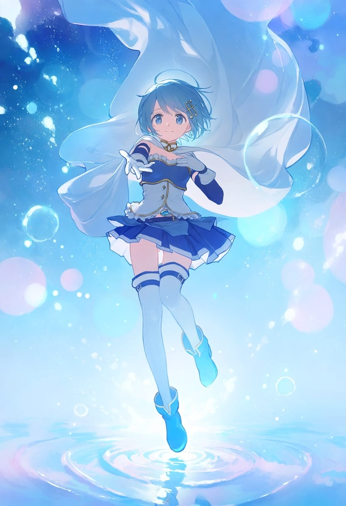

| 字段 | 内容 |
| --- | --- |
| 序号 | 0008 |
| tag | blue_theme |
| tag中文名 | 蓝色主题 |
| tag中文含义 | 画面整体以蓝色为主色。 |
| tag所属的子类 | 单色主题 |
| 角色 | miki_sayaka |

## 9. purple_theme — 紫色主题

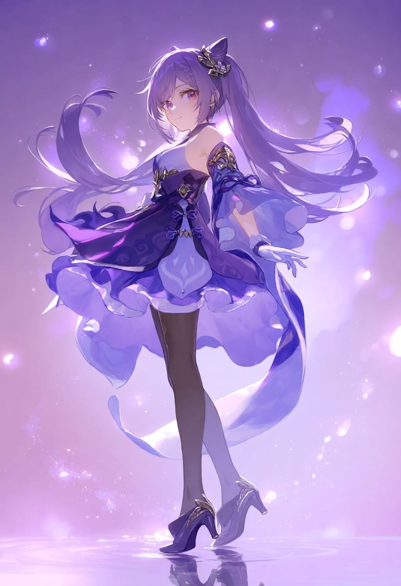

| 字段 | 内容 |
| --- | --- |
| 序号 | 0009 |
| tag | purple_theme |
| tag中文名 | 紫色主题 |
| tag中文含义 | 画面整体以紫色为主色。 |
| tag所属的子类 | 单色主题 |
| 角色 | keqing_(genshin_impact) |

## 10. black_theme — 黑色主题

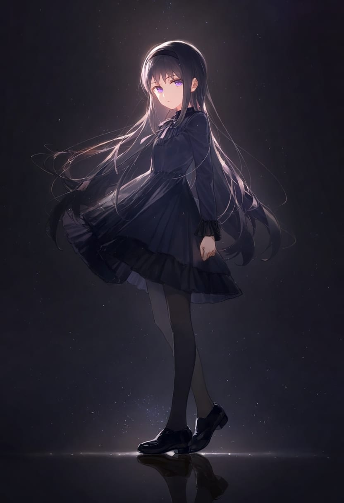

| 字段 | 内容 |
| --- | --- |
| 序号 | 0010 |
| tag | black_theme |
| tag中文名 | 黑色主题 |
| tag中文含义 | 画面整体以黑色为主色。 |
| tag所属的子类 | 单色主题 |
| 角色 | akemi_homura |

## 11. grey_theme — 灰色主题

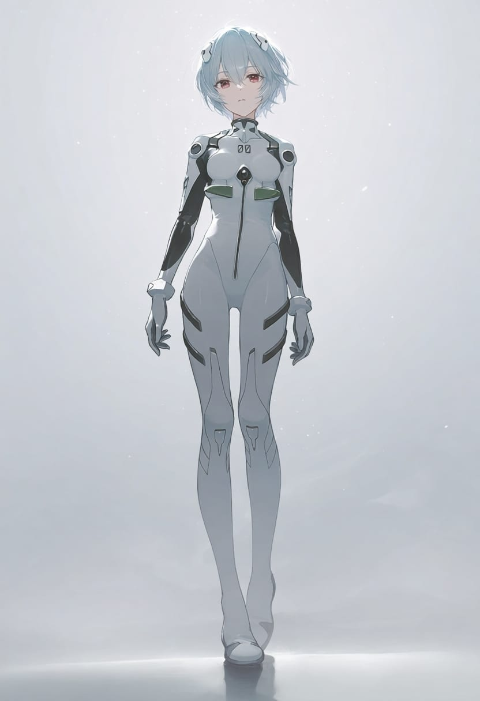

| 字段 | 内容 |
| --- | --- |
| 序号 | 0011 |
| tag | grey_theme |
| tag中文名 | 灰色主题 |
| tag中文含义 | 画面整体以灰色为主色。 |
| tag所属的子类 | 单色主题 |
| 角色 | ayanami_rei |

## 12. white_theme — 白色主题

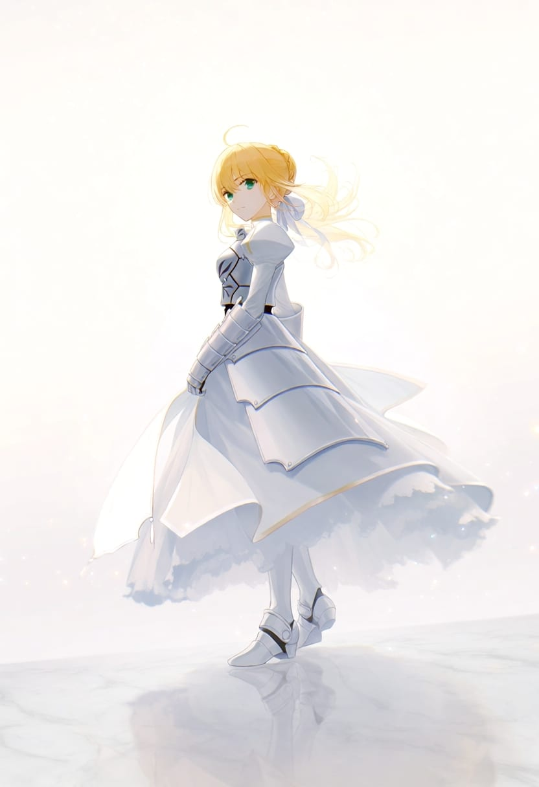

| 字段 | 内容 |
| --- | --- |
| 序号 | 0012 |
| tag | white_theme |
| tag中文名 | 白色主题 |
| tag中文含义 | 画面整体以白色为主色。 |
| tag所属的子类 | 单色主题 |
| 角色 | saber_(fate) |

## 13. monochrome — 单色画

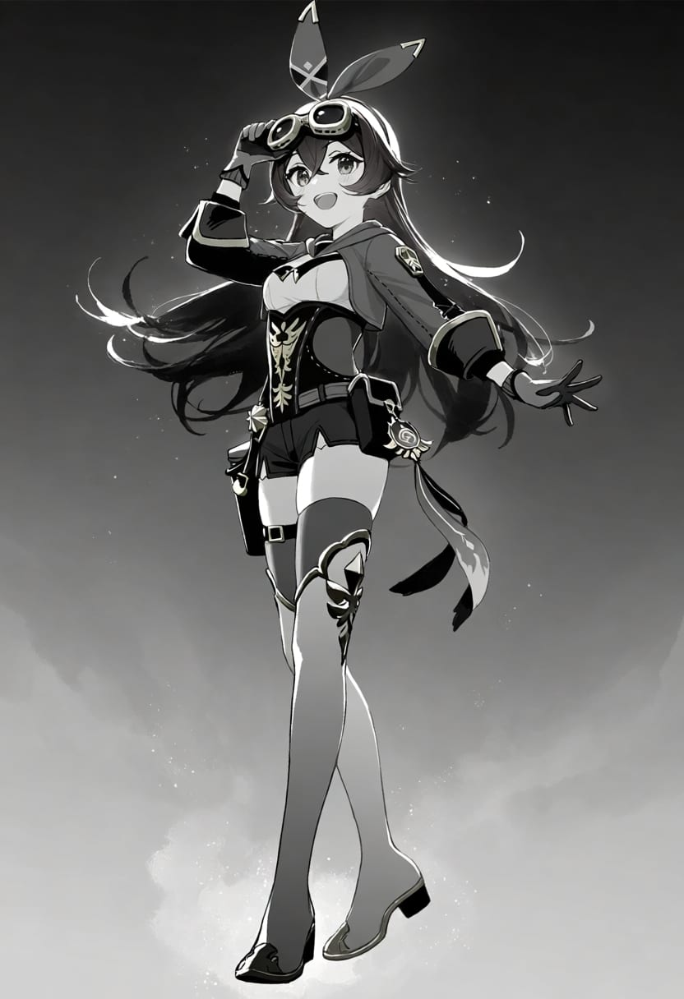

| 字段 | 内容 |
| --- | --- |
| 序号 | 0013 |
| tag | monochrome |
| tag中文名 | 单色画 |
| tag中文含义 | 主要用一种色相及其明暗变化。 |
| tag所属的子类 | 黑白与局部上色 |
| 角色 | amber_(genshin_impact) |

## 14. greyscale — 灰度 / 黑白灰

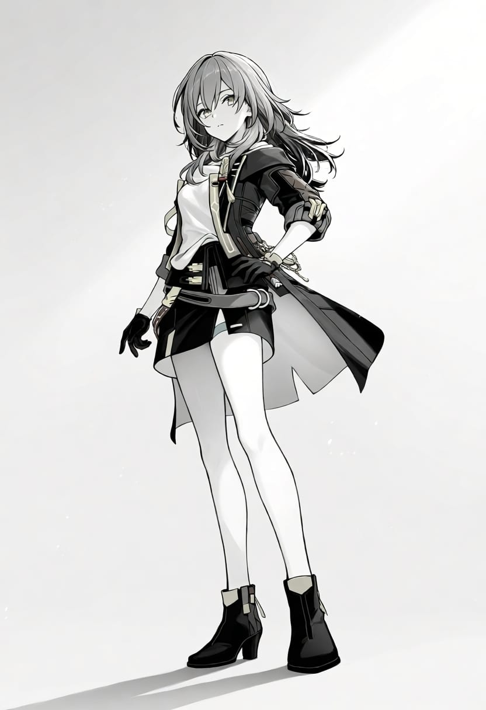

| 字段 | 内容 |
| --- | --- |
| 序号 | 0014 |
| tag | greyscale |
| tag中文名 | 灰度 / 黑白灰 |
| tag中文含义 | 只有黑白灰，没有彩色。 |
| tag所属的子类 | 黑白与局部上色 |
| 角色 | stelle_(honkai:_star_rail) |

## 15. lineart — 线稿

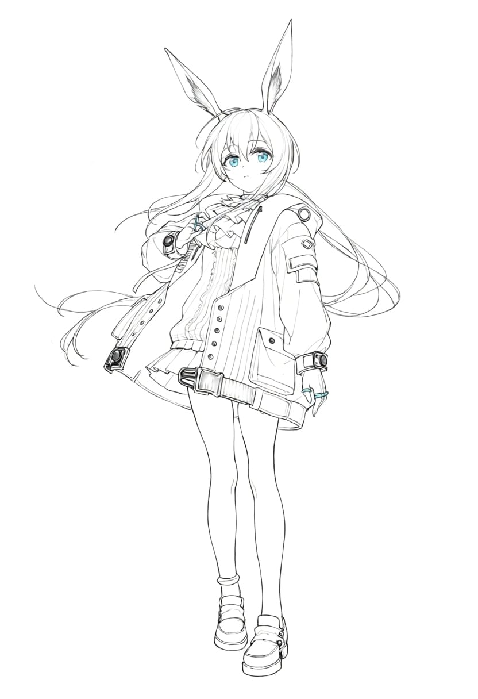

| 字段 | 内容 |
| --- | --- |
| 序号 | 0015 |
| tag | lineart |
| tag中文名 | 线稿 |
| tag中文含义 | 主要由线条构成，基本没有上色。 |
| tag所属的子类 | 黑白与局部上色 |
| 角色 | amiya_(arknights) |

## 16. partially_colored — 局部上色

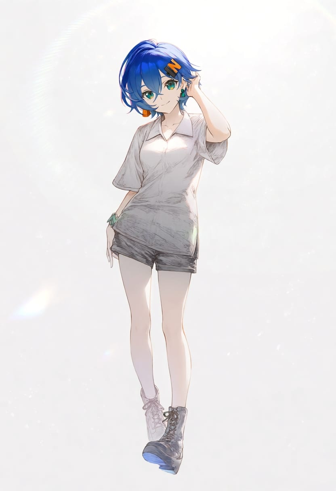

| 字段 | 内容 |
| --- | --- |
| 序号 | 0016 |
| tag | partially_colored |
| tag中文名 | 局部上色 |
| tag中文含义 | 大部分无彩或单色，只有部分区域有颜色。 |
| tag所属的子类 | 黑白与局部上色 |
| 角色 | belle_(zenless_zone_zero) |

## 17. greyscale_with_colored_background — 彩色背景灰度主体

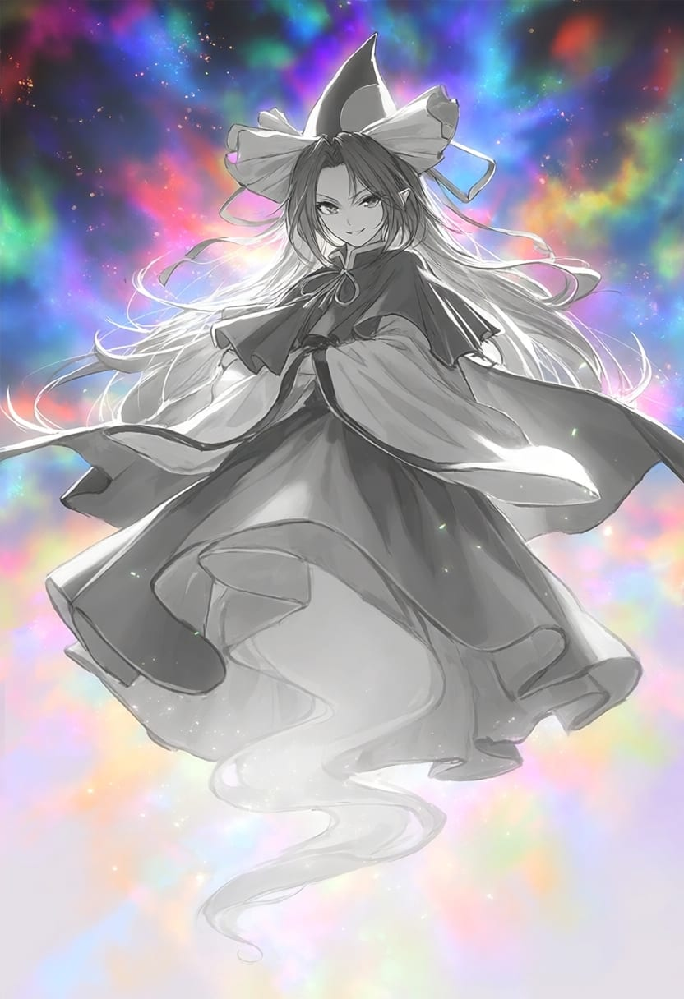

| 字段 | 内容 |
| --- | --- |
| 序号 | 0017 |
| tag | greyscale_with_colored_background |
| tag中文名 | 彩色背景灰度主体 |
| tag中文含义 | 主体是灰度，背景保留彩色。 |
| tag所属的子类 | 黑白与局部上色 |
| 角色 | mima_(touhou) |

## 18. monochrome_background — 单色背景

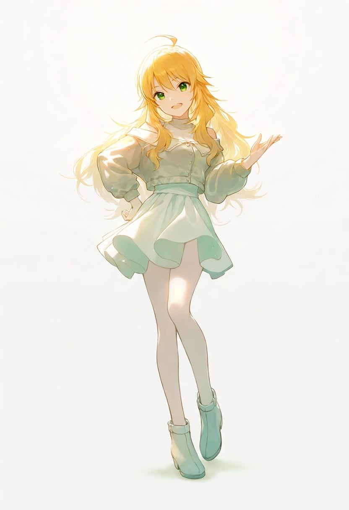

| 字段 | 内容 |
| --- | --- |
| 序号 | 0018 |
| tag | monochrome_background |
| tag中文名 | 单色背景 |
| tag中文含义 | 背景用单一色调，主体可以正常上色。 |
| tag所属的子类 | 黑白与局部上色 |
| 角色 | hoshii_miki |

## 19. spot_color — 强调色 / 点色

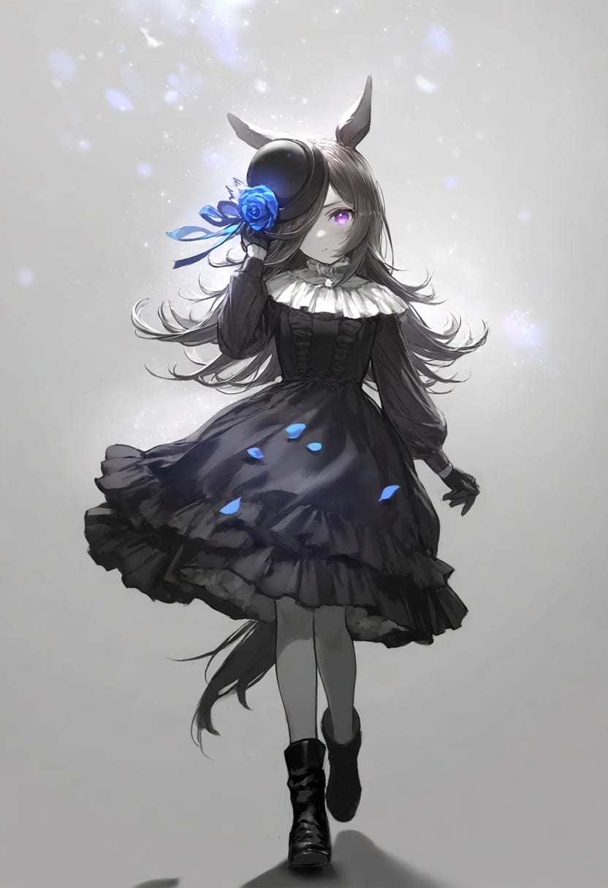

| 字段 | 内容 |
| --- | --- |
| 序号 | 0019 |
| tag | spot_color |
| tag中文名 | 强调色 / 点色 |
| tag中文含义 | 大部分低彩或无彩，只用少量颜色突出重点。 |
| tag所属的子类 | 黑白与局部上色 |
| 角色 | rice_shower_(umamusume) |

## 20. multiple_monochrome — 多重单色

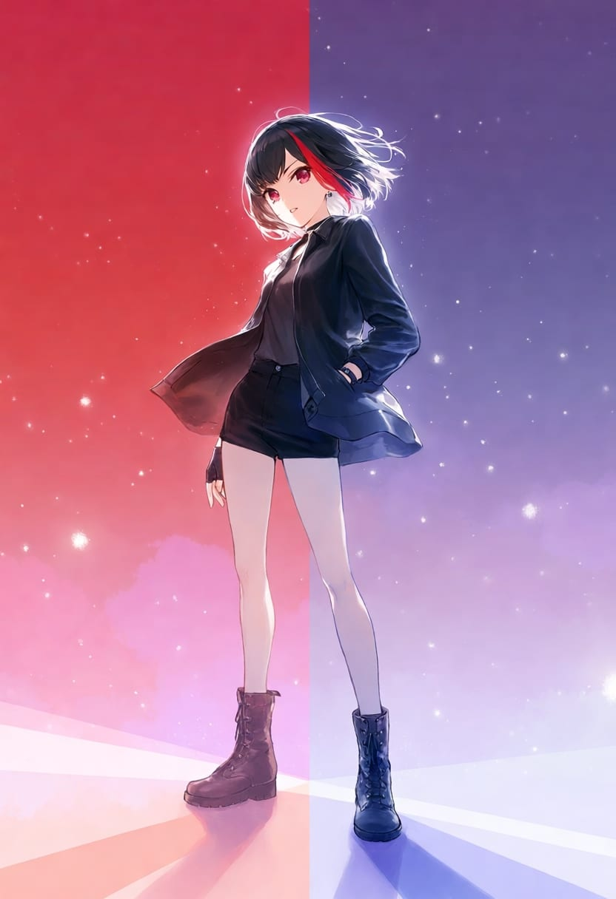

| 字段 | 内容 |
| --- | --- |
| 序号 | 0020 |
| tag | multiple_monochrome |
| tag中文名 | 多重单色 |
| tag中文含义 | 多个区域或人物各自使用不同的单色色调。 |
| tag所属的子类 | 黑白与局部上色 |
| 角色 | mitake_ran |

## 21. limited_palette — 限定色板

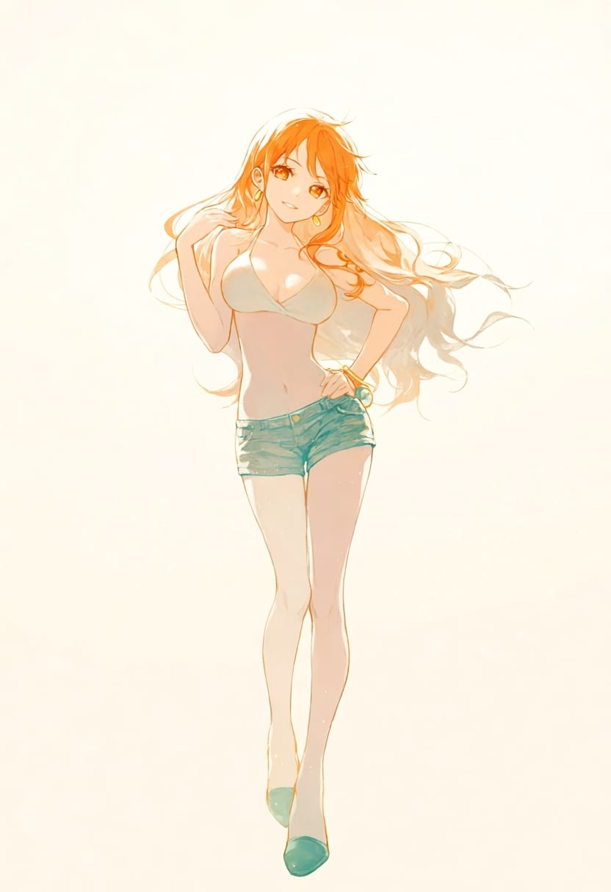

| 字段 | 内容 |
| --- | --- |
| 序号 | 0021 |
| tag | limited_palette |
| tag中文名 | 限定色板 |
| tag中文含义 | 整张图只使用少量几种颜色。 |
| tag所属的子类 | 黑白与局部上色 |
| 角色 | nami_(one_piece) |

## 22. dark — 暗色调

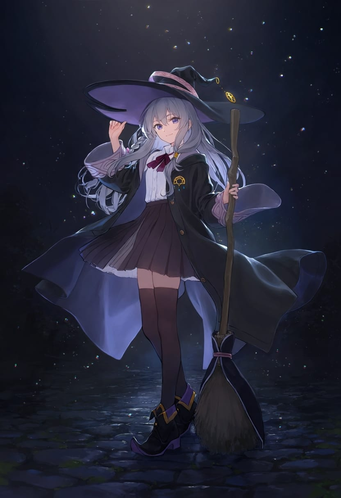

| 字段 | 内容 |
| --- | --- |
| 序号 | 0022 |
| tag | dark |
| tag中文名 | 暗色调 |
| tag中文含义 | 整体亮度很低，画面偏暗。 |
| tag所属的子类 | 整体色调与配色 |
| 角色 | elaina_(majo_no_tabitabi) |

## 23. muted_colors — 低饱和柔和色

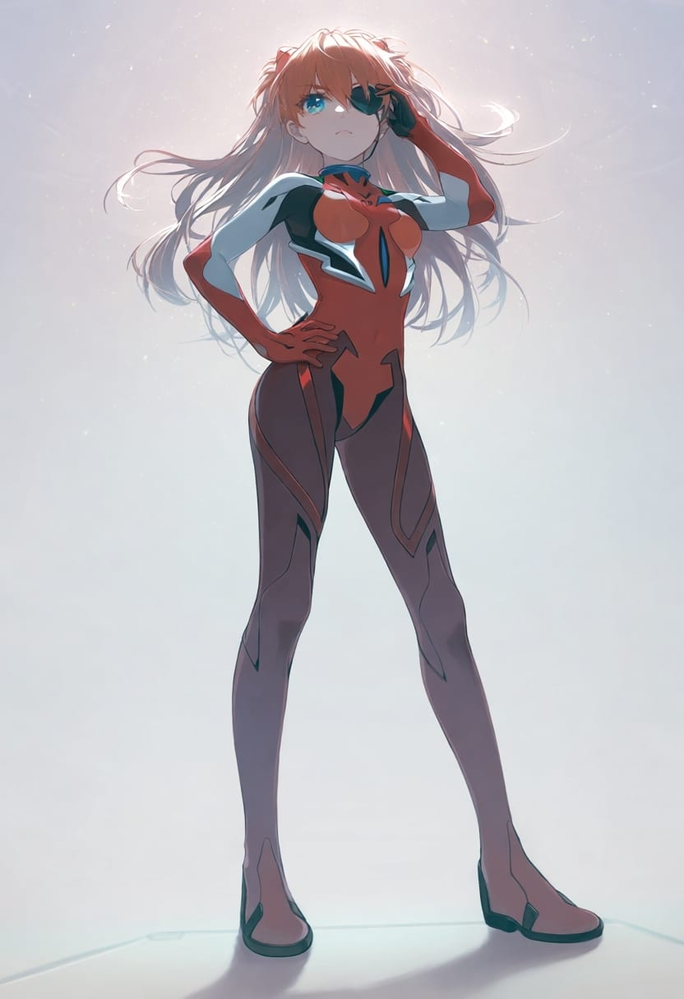

| 字段 | 内容 |
| --- | --- |
| 序号 | 0023 |
| tag | muted_colors |
| tag中文名 | 低饱和柔和色 |
| tag中文含义 | 颜色压灰、不鲜艳。 |
| tag所属的子类 | 整体色调与配色 |
| 角色 | souryuu_asuka_langley |

## 24. pale_colors — 淡色调

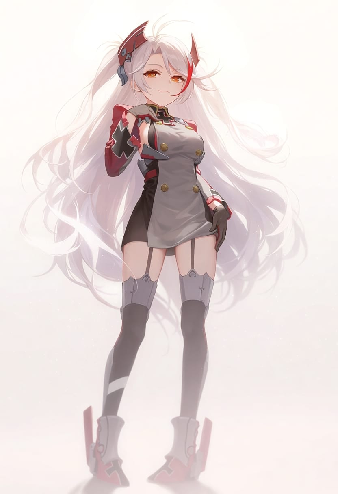

| 字段 | 内容 |
| --- | --- |
| 序号 | 0024 |
| tag | pale_colors |
| tag中文名 | 淡色调 |
| tag中文含义 | 颜色很浅，整体接近白色。 |
| tag所属的子类 | 整体色调与配色 |
| 角色 | prinz_eugen_(azur_lane) |

## 25. sepia — 棕褐色调

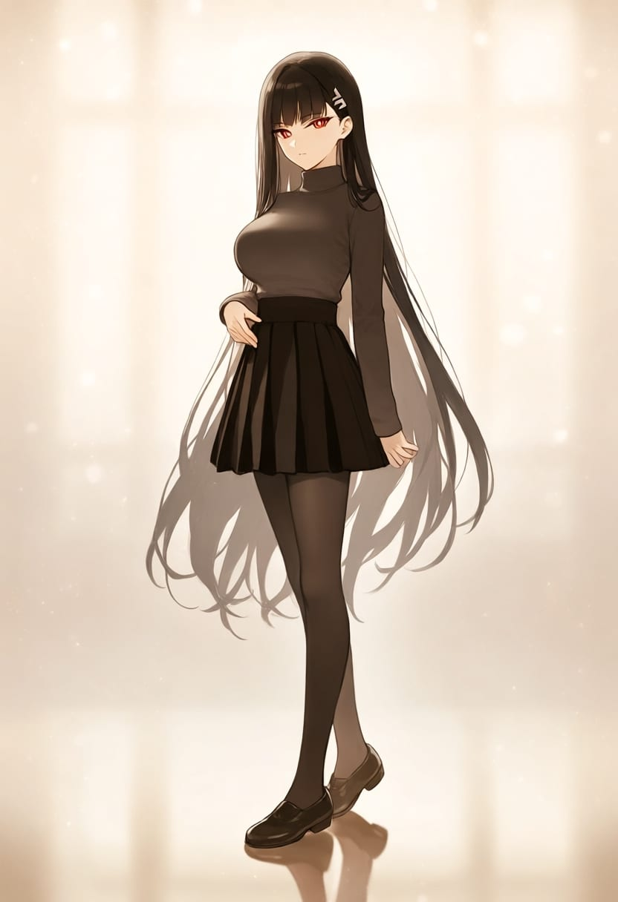

| 字段 | 内容 |
| --- | --- |
| 序号 | 0025 |
| tag | sepia |
| tag中文名 | 棕褐色调 |
| tag中文含义 | 整体像老照片一样偏棕黄。 |
| tag所属的子类 | 整体色调与配色 |
| 角色 | rio_(blue_archive) |

## 26. pastel_colors — 粉彩色

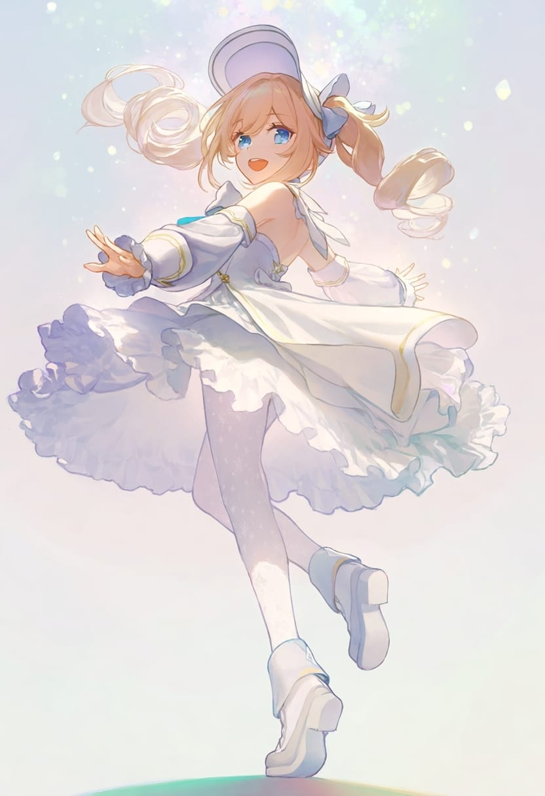

| 字段 | 内容 |
| --- | --- |
| 序号 | 0026 |
| tag | pastel_colors |
| tag中文名 | 粉彩色 |
| tag中文含义 | 颜色浅而柔和，有粉彩或奶油感。 |
| tag所属的子类 | 整体色调与配色 |
| 角色 | barbara_(genshin_impact) |

## 27. high_contrast — 高对比

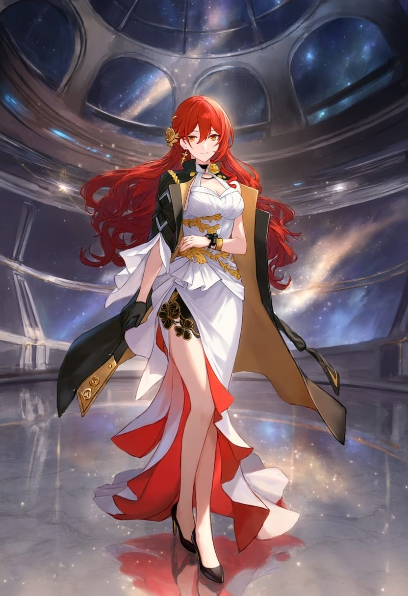

| 字段 | 内容 |
| --- | --- |
| 序号 | 0027 |
| tag | high_contrast |
| tag中文名 | 高对比 |
| tag中文含义 | 明暗或颜色差异很大。 |
| tag所属的子类 | 整体色调与配色 |
| 角色 | himeko_(honkai:_star_rail) |

## 28. saturated — 高饱和

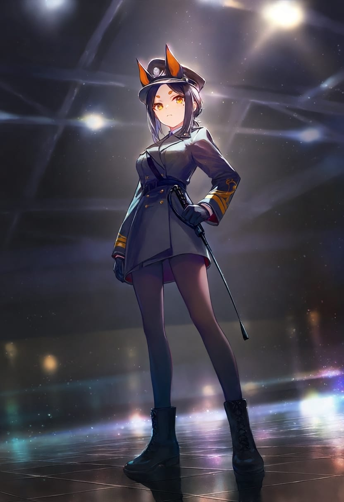

| 字段 | 内容 |
| --- | --- |
| 序号 | 0028 |
| tag | saturated |
| tag中文名 | 高饱和 |
| tag中文含义 | 颜色浓烈、鲜艳。 |
| tag所属的子类 | 整体色调与配色 |
| 角色 | dobermann_(arknights) |

## 29. colorful — 多彩

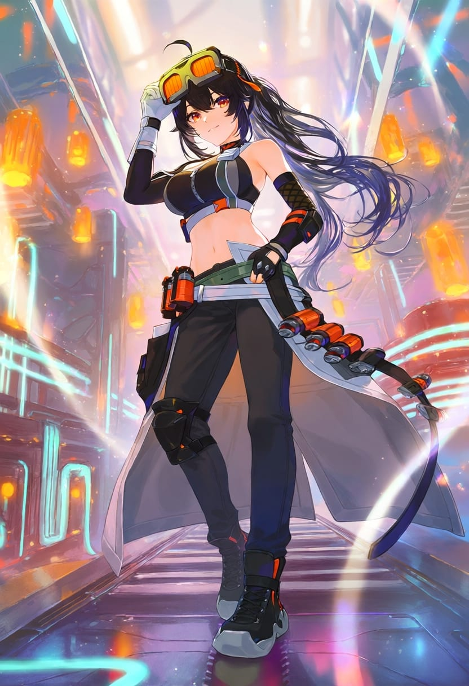

| 字段 | 内容 |
| --- | --- |
| 序号 | 0029 |
| tag | colorful |
| tag中文名 | 多彩 |
| tag中文含义 | 画面同时有很多明显不同的颜色。 |
| tag所属的子类 | 整体色调与配色 |
| 角色 | grace_howard |

## 30. neon_palette — 霓虹配色

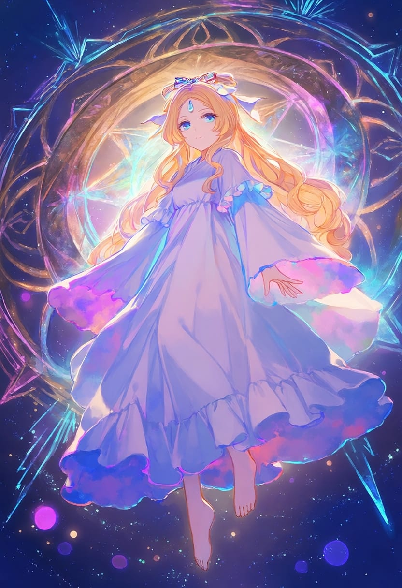

| 字段 | 内容 |
| --- | --- |
| 序号 | 0030 |
| tag | neon_palette |
| tag中文名 | 霓虹配色 |
| tag中文含义 | 以高饱和、荧光感的霓虹色为主。 |
| tag所属的子类 | 整体色调与配色 |
| 角色 | kikuri_(touhou) |

## 31. saturated_background — 高饱和背景

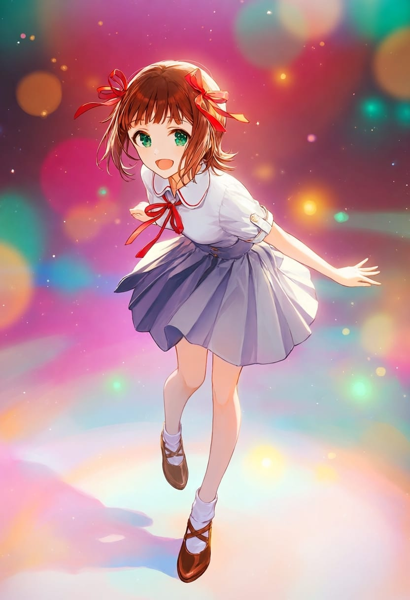

| 字段 | 内容 |
| --- | --- |
| 序号 | 0031 |
| tag | saturated_background |
| tag中文名 | 高饱和背景 |
| tag中文含义 | 背景颜色特别鲜艳浓烈。 |
| tag所属的子类 | 整体色调与配色 |
| 角色 | amami_haruka |

## 32. split_theme — 分割配色

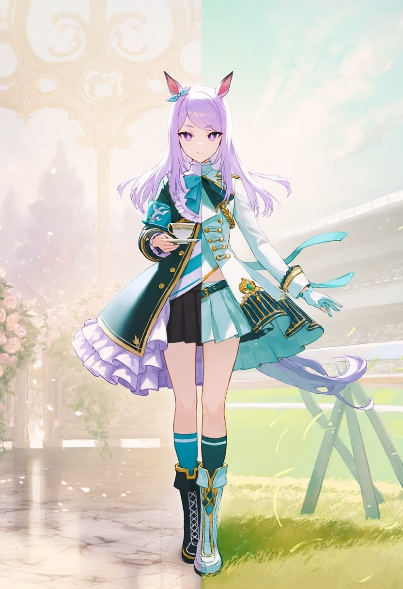

| 字段 | 内容 |
| --- | --- |
| 序号 | 0032 |
| tag | split_theme |
| tag中文名 | 分割配色 |
| tag中文含义 | 画面明显分成两种或多种不同色调区域。 |
| tag所属的子类 | 整体色调与配色 |
| 角色 | mejiro_mcqueen_(umamusume) |

## 33. imageboard_colors — 图站配色

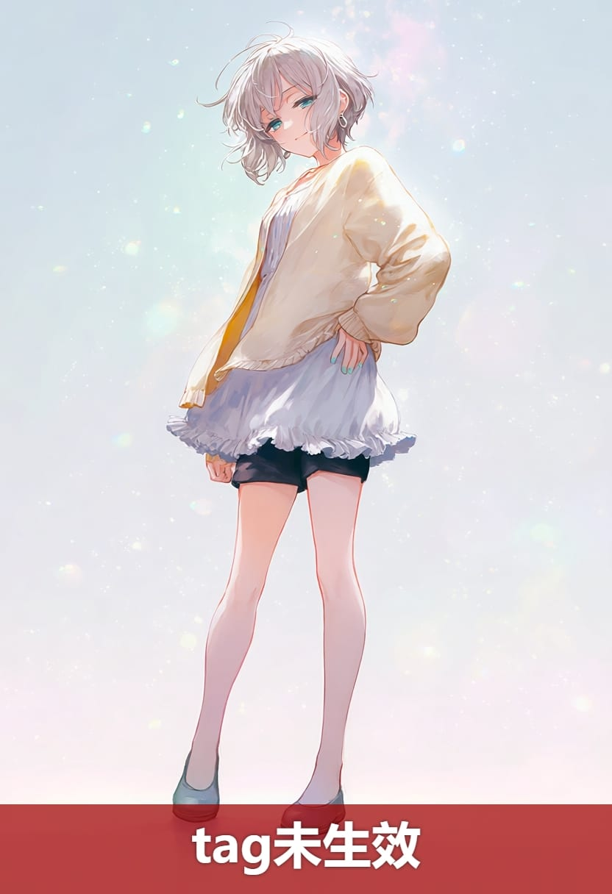

| 字段 | 内容 |
| --- | --- |
| 序号 | 0033 |
| tag | imageboard_colors |
| tag中文名 | 图站配色 |
| tag中文含义 | 用图站页面色做背景，常做出融进网页或假透明的感觉。 |
| tag所属的子类 | 整体色调与配色 |
| 角色 | aoba_moca |

## 34. hue_shifting — 色相偏移

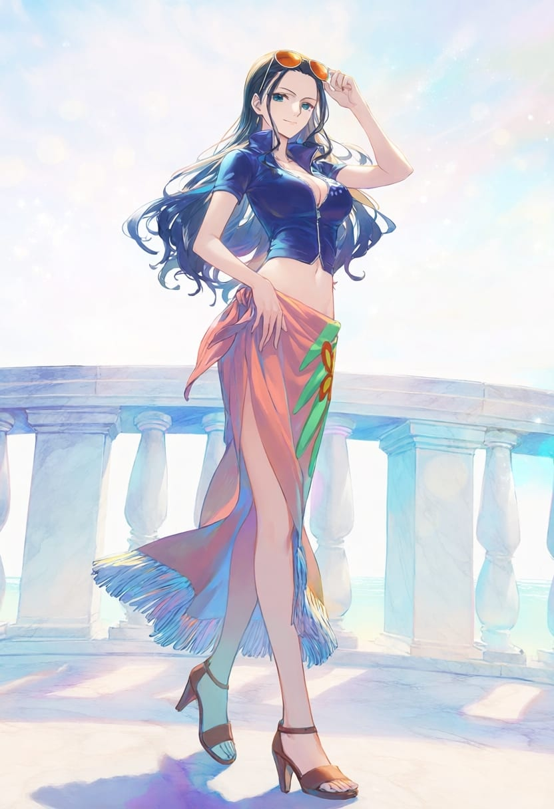

| 字段 | 内容 |
| --- | --- |
| 序号 | 0034 |
| tag | hue_shifting |
| tag中文名 | 色相偏移 |
| tag中文含义 | 同一物体的明暗区域会往不同色相偏移，而不只是变亮变暗。 |
| tag所属的子类 | 整体色调与配色 |
| 角色 | nico_robin |

## 35. multiple_theme_colors — 多主题色

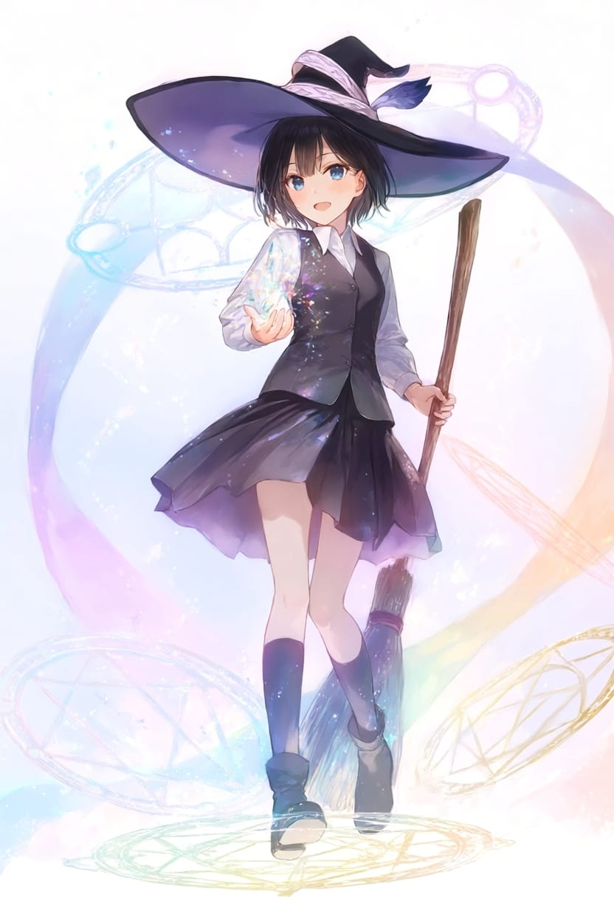

| 字段 | 内容 |
| --- | --- |
| 序号 | 0035 |
| tag | multiple_theme_colors |
| tag中文名 | 多主题色 |
| tag中文含义 | 画面同时明确使用多种主题色。 |
| tag所属的子类 | 整体色调与配色 |
| 角色 | saya_(majo_no_tabitabi) |

## 36. cool_colors — 冷色调

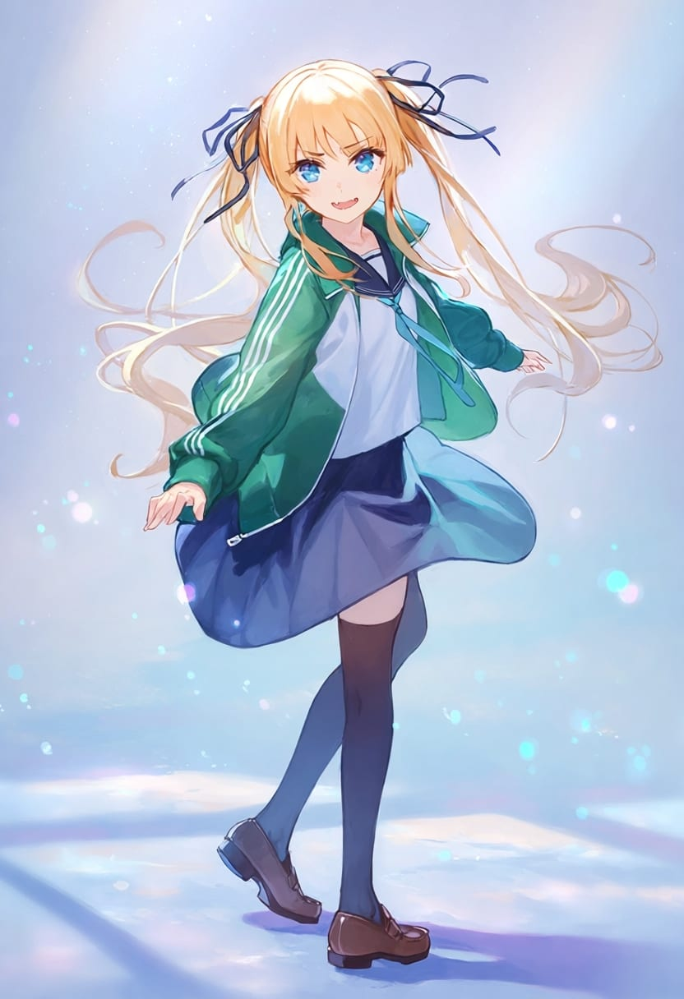

| 字段 | 内容 |
| --- | --- |
| 序号 | 0036 |
| tag | cool_colors |
| tag中文名 | 冷色调 |
| tag中文含义 | 以蓝、青、紫等偏冷颜色为主。 |
| tag所属的子类 | 配色关系与颜色规则 |
| 角色 | sawamura_spencer_eriri |

## 37. warm_colors — 暖色调

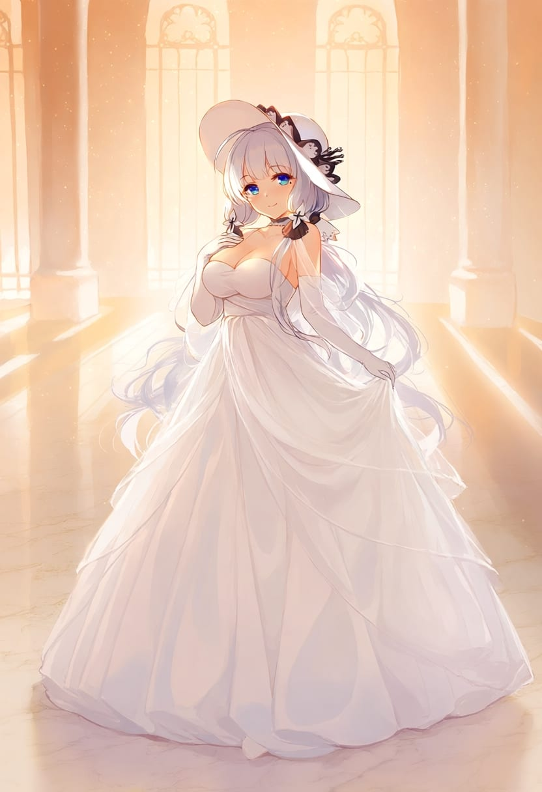

| 字段 | 内容 |
| --- | --- |
| 序号 | 0037 |
| tag | warm_colors |
| tag中文名 | 暖色调 |
| tag中文含义 | 以红、橙、黄等偏暖颜色为主。 |
| tag所属的子类 | 配色关系与颜色规则 |
| 角色 | illustrious_(azur_lane) |

## 38. analogous_colors — 类似色配色

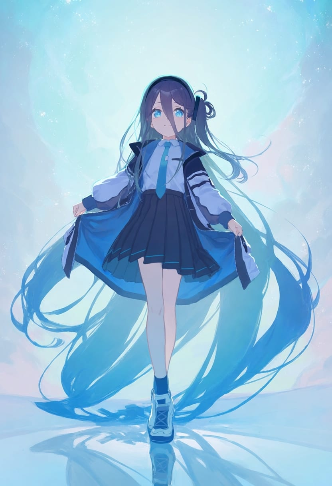

| 字段 | 内容 |
| --- | --- |
| 序号 | 0038 |
| tag | analogous_colors |
| tag中文名 | 类似色配色 |
| tag中文含义 | 主要使用色轮上相邻的颜色。 |
| tag所属的子类 | 配色关系与颜色规则 |
| 角色 | aris_(blue_archive) |

## 39. complementary_colors — 互补色配色

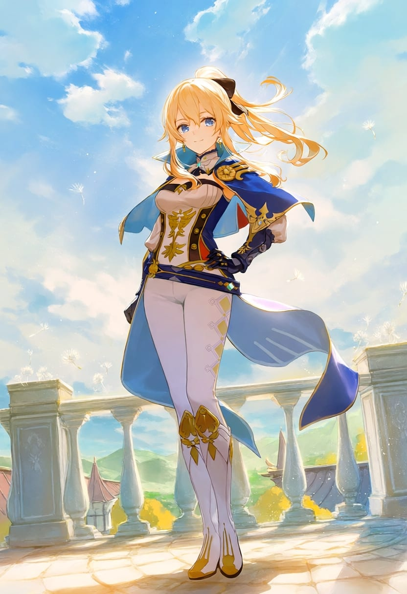

| 字段 | 内容 |
| --- | --- |
| 序号 | 0039 |
| tag | complementary_colors |
| tag中文名 | 互补色配色 |
| tag中文含义 | 主要使用色轮上相对的颜色形成强对比。 |
| tag所属的子类 | 配色关系与颜色规则 |
| 角色 | jean_(genshin_impact) |

## 40. color_guide — 色板 / 配色条

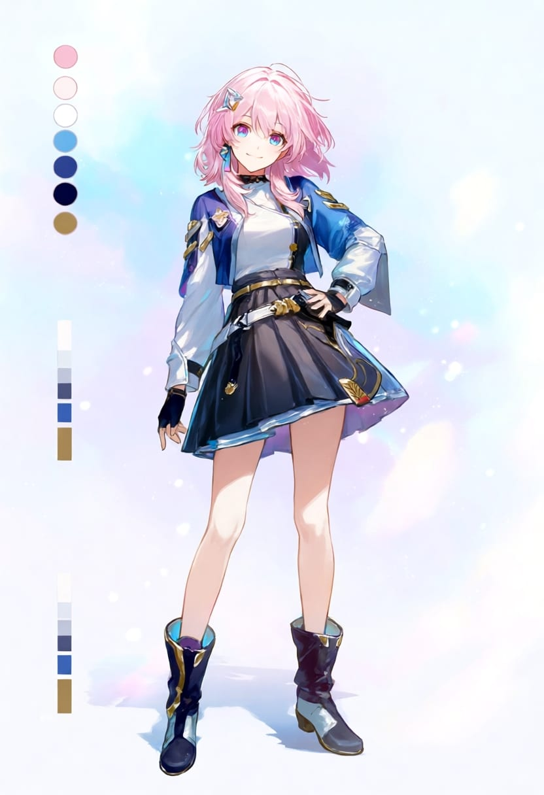

| 字段 | 内容 |
| --- | --- |
| 序号 | 0040 |
| tag | color_guide |
| tag中文名 | 色板 / 配色条 |
| tag中文含义 | 画面里直接放出本图使用的颜色色块或色条。 |
| tag所属的子类 | 配色关系与颜色规则 |
| 角色 | march_7th_(honkai:_star_rail) |

## 41. color_drain — 色彩流失

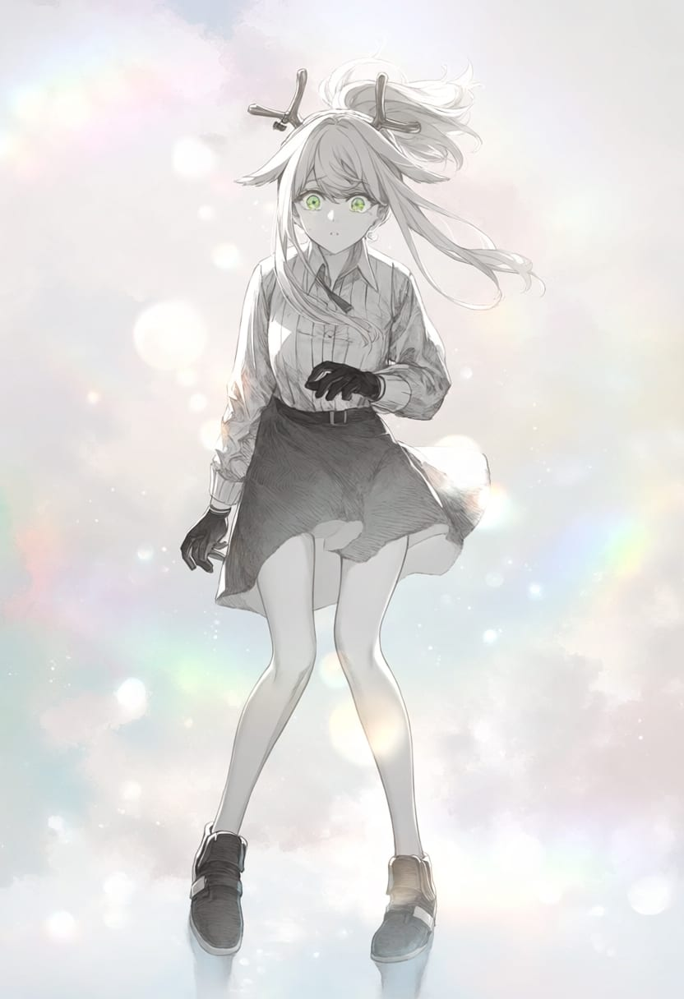

| 字段 | 内容 |
| --- | --- |
| 序号 | 0041 |
| tag | color_drain |
| tag中文名 | 色彩流失 |
| tag中文含义 | 人物或分镜突然变成黑白灰来表现强烈情绪反应。 |
| tag所属的子类 | 配色关系与颜色规则 |
| 角色 | firewatch_(arknights) |

## 42. color_connection — 同色关联

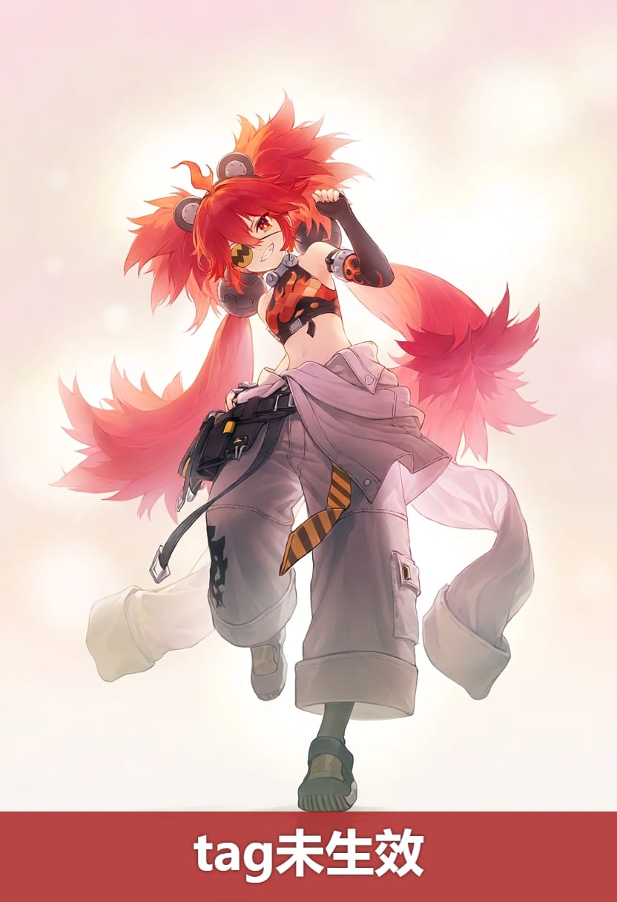

| 字段 | 内容 |
| --- | --- |
| 序号 | 0042 |
| tag | color_connection |
| tag中文名 | 同色关联 |
| tag中文含义 | 用相同主题色把人物或物体联系、分组起来。 |
| tag所属的子类 | 配色关系与颜色规则 |
| 角色 | koleda_belobog |

## 43. color_coordination — 色彩呼应

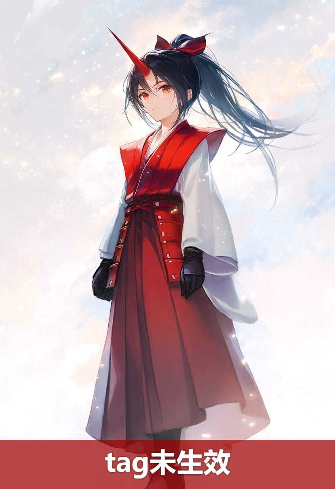

| 字段 | 内容 |
| --- | --- |
| 序号 | 0043 |
| tag | color_coordination |
| tag中文名 | 色彩呼应 |
| tag中文含义 | 人物或物体的颜色相互匹配，形成配套或对称感。 |
| tag所属的子类 | 配色关系与颜色规则 |
| 角色 | konngara_(touhou) |

## 44. color-coded — 颜色编码

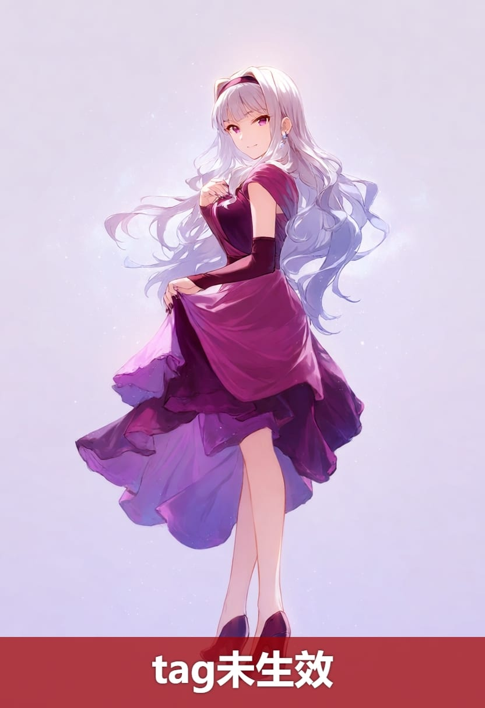

| 字段 | 内容 |
| --- | --- |
| 序号 | 0044 |
| tag | color-coded |
| tag中文名 | 颜色编码 |
| tag中文含义 | 一组角色或对象分别用自己的代表色来区分。 |
| tag所属的子类 | 配色关系与颜色规则 |
| 角色 | shijou_takane |

## 45. palette_swap — 调色盘替换

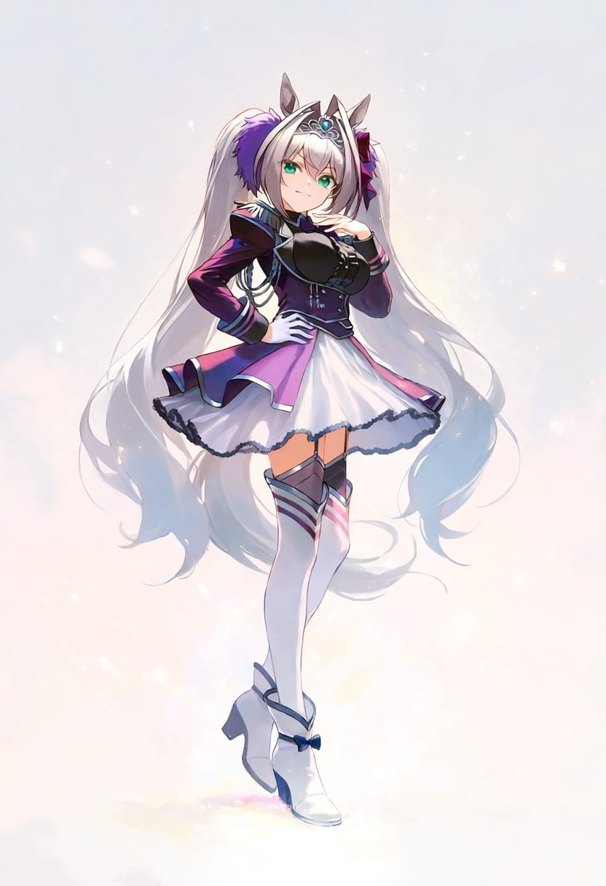

| 字段 | 内容 |
| --- | --- |
| 序号 | 0045 |
| tag | palette_swap |
| tag中文名 | 调色盘替换 |
| tag中文含义 | 同一角色或物体造型不变，只把整体配色换掉。 |
| tag所属的子类 | 配色关系与颜色规则 |
| 角色 | daiwa_scarlet_(umamusume) |

## 46. color_switch — 配色互换

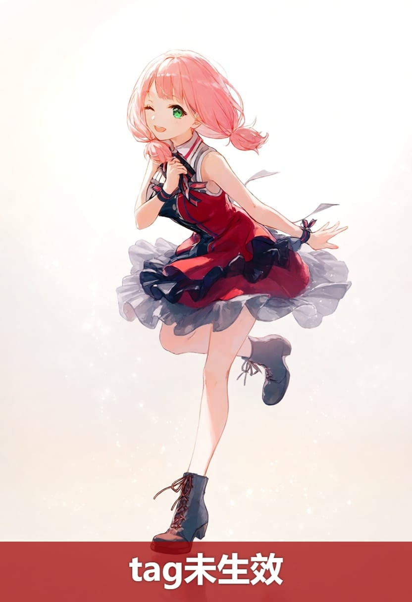

| 字段 | 内容 |
| --- | --- |
| 序号 | 0046 |
| tag | color_switch |
| tag中文名 | 配色互换 |
| tag中文含义 | 角色服装样式不变，但把彼此的颜色方案交换。 |
| tag所属的子类 | 配色关系与颜色规则 |
| 角色 | uehara_himari |

## 47. rainbow_order — 彩虹顺序

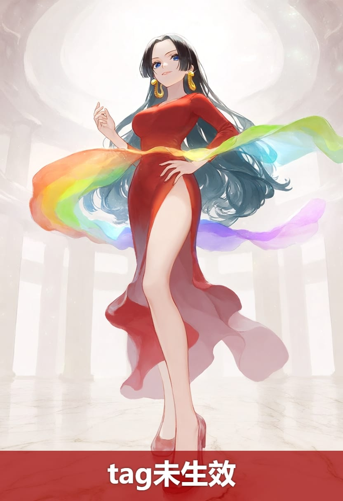

| 字段 | 内容 |
| --- | --- |
| 序号 | 0047 |
| tag | rainbow_order |
| tag中文名 | 彩虹顺序 |
| tag中文含义 | 颜色按红橙黄绿青蓝紫等彩虹顺序排列。 |
| tag所属的子类 | 配色关系与颜色规则 |
| 角色 | boa_hancock |

## 48. gradient_filter — 渐变滤镜

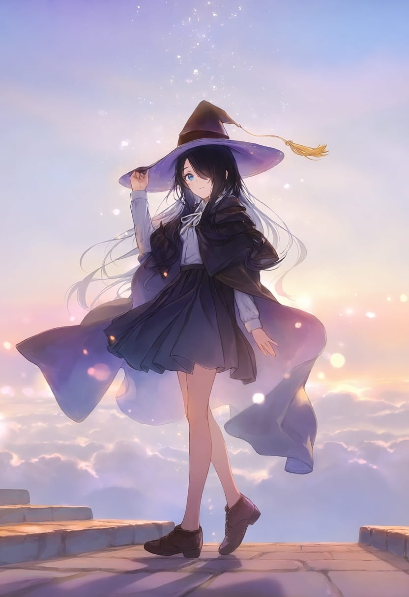

| 字段 | 内容 |
| --- | --- |
| 序号 | 0048 |
| tag | gradient_filter |
| tag中文名 | 渐变滤镜 |
| tag中文含义 | 整张图叠一层随位置渐变的颜色或明暗滤镜。 |
| tag所属的子类 | 滤镜与色彩后期 |
| 角色 | fran_(majo_no_tabitabi) |

## 49. inverted_colors — 反相色

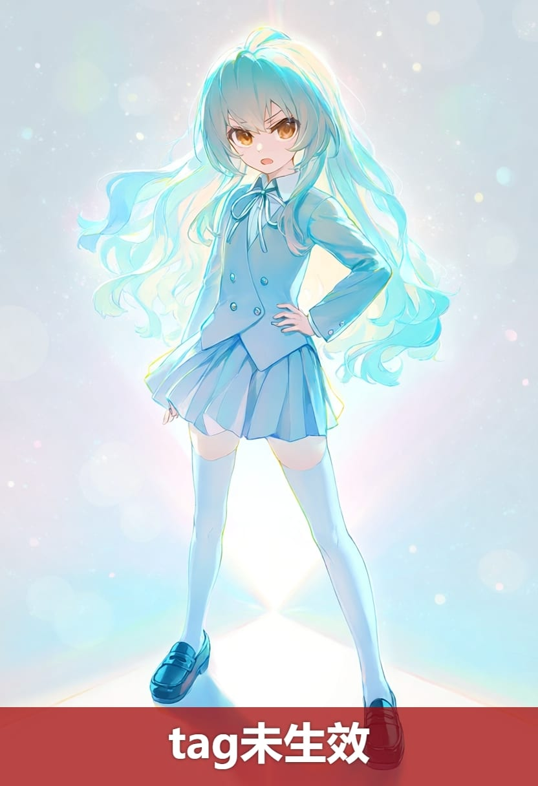

| 字段 | 内容 |
| --- | --- |
| 序号 | 0049 |
| tag | inverted_colors |
| tag中文名 | 反相色 |
| tag中文含义 | 把颜色像底片一样反转成反相效果。 |
| tag所属的子类 | 滤镜与色彩后期 |
| 角色 | aisaka_taiga |

## 50. vignetting — 暗角

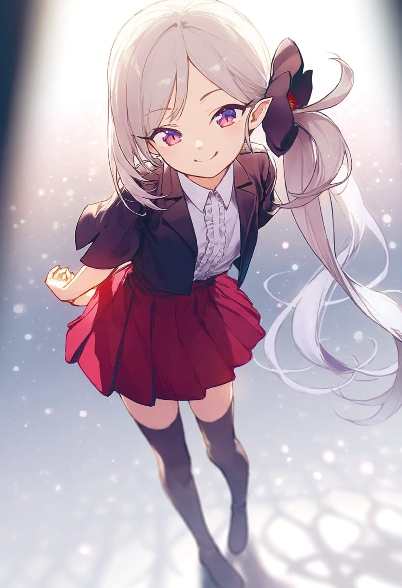

| 字段 | 内容 |
| --- | --- |
| 序号 | 0050 |
| tag | vignetting |
| tag中文名 | 暗角 |
| tag中文含义 | 画面边缘比中心更暗，像镜头暗角。 |
| tag所属的子类 | 滤镜与色彩后期 |
| 角色 | mutsuki_(blue_archive) |

## 51. double_exposure — 双重曝光

| 字段 | 内容 |
| --- | --- |
| 序号 | 0051 |
| tag | double_exposure |
| tag中文名 | 双重曝光 |
| tag中文含义 | 把两幅影像半透明叠在一起。 |
| tag所属的子类 | 滤镜与色彩后期 |
| 角色 | rem_(re:zero) |

## 52. overexposure — 过曝

| 字段 | 内容 |
| --- | --- |
| 序号 | 0052 |
| tag | overexposure |
| tag中文名 | 过曝 |
| tag中文含义 | 亮部亮到发白，细节被冲掉。 |
| tag所属的子类 | 滤镜与色彩后期 |
| 角色 | mona_(genshin_impact) |

## 53. chromatic_aberration — 色差 / 彩边

| 字段 | 内容 |
| --- | --- |
| 序号 | 0053 |
| tag | chromatic_aberration |
| tag中文名 | 色差 / 彩边 |
| tag中文含义 | 物体边缘出现红蓝等颜色错位。 |
| tag所属的子类 | 滤镜与色彩后期 |
| 角色 | bronya_rand |

## 54. heavy_chromatic_aberration — 强烈色差

| 字段 | 内容 |
| --- | --- |
| 序号 | 0054 |
| tag | heavy_chromatic_aberration |
| tag中文名 | 强烈色差 |
| tag中文含义 | 色差错位很重，红蓝或彩边非常明显。 |
| tag所属的子类 | 滤镜与色彩后期 |
| 角色 | frostleaf_(arknights) |

## 55. iridescent — 虹彩

| 字段 | 内容 |
| --- | --- |
| 序号 | 0055 |
| tag | iridescent |
| tag中文名 | 虹彩 |
| tag中文含义 | 表面出现随角度或光线变化的彩虹色泽。 |
| tag所属的子类 | 滤镜与色彩后期 |
| 角色 | qingyi_(zenless_zone_zero) |

## 56. colored_lineart — 彩色线稿

| 字段 | 内容 |
| --- | --- |
| 序号 | 0056 |
| tag | colored_lineart |
| tag中文名 | 彩色线稿 |
| tag中文含义 | 轮廓线不是纯黑，而是用彩色线。 |
| tag所属的子类 | 上色与绘画技法 |
| 角色 | elis_(touhou) |

## 57. color_trace — 彩线勾边

| 字段 | 内容 |
| --- | --- |
| 序号 | 0057 |
| tag | color_trace |
| tag中文名 | 彩线勾边 |
| tag中文含义 | 线稿颜色贴近相邻色块，让线条融进上色。 |
| tag所属的子类 | 上色与绘画技法 |
| 角色 | kisaragi_chihaya |

## 58. flat_color — 平涂

| 字段 | 内容 |
| --- | --- |
| 序号 | 0058 |
| tag | flat_color |
| tag中文名 | 平涂 |
| tag中文含义 | 用大块均匀颜色上色，阴影和渐变很少。 |
| tag所属的子类 | 上色与绘画技法 |
| 角色 | gold_ship_(umamusume) |

## 59. blending — 渐混 / 柔和混色

| 字段 | 内容 |
| --- | --- |
| 序号 | 0059 |
| tag | blending |
| tag中文名 | 渐混 / 柔和混色 |
| tag中文含义 | 颜色或明暗之间平滑过渡，没有明显硬边。 |
| tag所属的子类 | 上色与绘画技法 |
| 角色 | udagawa_tomoe |

## 60. anime_coloring — 动画式上色

| 字段 | 内容 |
| --- | --- |
| 序号 | 0060 |
| tag | anime_coloring |
| tag中文名 | 动画式上色 |
| tag中文含义 | 像动画赛璐璐那样用清晰色块和硬边阴影。 |
| tag所属的子类 | 上色与绘画技法 |
| 角色 | uta_(one_piece) |

## 61. watercolor_effect — 水彩效果

| 字段 | 内容 |
| --- | --- |
| 序号 | 0061 |
| tag | watercolor_effect |
| tag中文名 | 水彩效果 |
| tag中文含义 | 模拟水彩的透明、晕染和纸面感。 |
| tag所属的子类 | 上色与绘画技法 |
| 角色 | aizawa_azusa |

## 62. ligne_claire — 清线风格

| 字段 | 内容 |
| --- | --- |
| 序号 | 0062 |
| tag | ligne_claire |
| tag中文名 | 清线风格 |
| tag中文含义 | 线条干净均匀、轮廓清楚，上色较平整。 |
| tag所属的子类 | 上色与绘画技法 |
| 角色 | shana |

## 63. backlighting — 逆光

| 字段 | 内容 |
| --- | --- |
| 序号 | 0063 |
| tag | backlighting |
| tag中文名 | 逆光 |
| tag中文含义 | 光从人物背后照来，边缘容易出现亮轮廓。 |
| tag所属的子类 | 光照方向 |
| 角色 | kujikawa_rise |

## 64. overlighting — 顶光

| 字段 | 内容 |
| --- | --- |
| 序号 | 0064 |
| tag | overlighting |
| tag中文名 | 顶光 |
| tag中文含义 | 光从上方照下，脸和身体下侧更容易变暗。 |
| tag所属的子类 | 光照方向 |
| 角色 | sonoda_umi |

## 65. sidelighting — 侧光

| 字段 | 内容 |
| --- | --- |
| 序号 | 0065 |
| tag | sidelighting |
| tag中文名 | 侧光 |
| tag中文含义 | 光从左或右侧照来，一侧亮一侧暗。 |
| tag所属的子类 | 光照方向 |
| 角色 | noelle_(genshin_impact) |

## 66. underlighting — 底光

| 字段 | 内容 |
| --- | --- |
| 序号 | 0066 |
| tag | underlighting |
| tag中文名 | 底光 |
| tag中文含义 | 光从下方向上照，常有诡异或戏剧感。 |
| tag所属的子类 | 光照方向 |
| 角色 | clara_(honkai:_star_rail) |

## 67. bloom — 泛光

| 字段 | 内容 |
| --- | --- |
| 序号 | 0067 |
| tag | bloom |
| tag中文名 | 泛光 |
| tag中文含义 | 很亮的区域向周围溢出柔光。 |
| tag所属的子类 | 光线形态与光学效果 |
| 角色 | gavial_(arknights) |

## 68. spotlight — 聚光灯

| 字段 | 内容 |
| --- | --- |
| 序号 | 0068 |
| tag | spotlight |
| tag中文名 | 聚光灯 |
| tag中文含义 | 一束集中的光只照亮目标区域。 |
| tag所属的子类 | 光线形态与光学效果 |
| 角色 | zhu_yuan |

## 69. light_rays — 光束 / 光线

| 字段 | 内容 |
| --- | --- |
| 序号 | 0069 |
| tag | light_rays |
| tag中文名 | 光束 / 光线 |
| tag中文含义 | 能明显看到一束束传播中的光。 |
| tag所属的子类 | 光线形态与光学效果 |
| 角色 | sariel_(touhou) |

## 70. sunbeam — 阳光束

| 字段 | 内容 |
| --- | --- |
| 序号 | 0070 |
| tag | sunbeam |
| tag中文名 | 阳光束 |
| tag中文含义 | 从太阳方向射入、清晰可见的光束。 |
| tag所属的子类 | 光线形态与光学效果 |
| 角色 | kikuchi_makoto |

## 71. dim_lighting — 昏暗照明

| 字段 | 内容 |
| --- | --- |
| 序号 | 0071 |
| tag | dim_lighting |
| tag中文名 | 昏暗照明 |
| tag中文含义 | 有光但很弱，场景没有完全黑掉。 |
| tag所属的子类 | 光线形态与光学效果 |
| 角色 | agnes_tachyon_(umamusume) |

## 72. moonlight — 月光

| 字段 | 内容 |
| --- | --- |
| 序号 | 0072 |
| tag | moonlight |
| tag中文名 | 月光 |
| tag中文含义 | 场景主要由月亮的冷光照亮。 |
| tag所属的子类 | 光线形态与光学效果 |
| 角色 | hazawa_tsugumi |

## 73. sunlight — 阳光

| 字段 | 内容 |
| --- | --- |
| 序号 | 0073 |
| tag | sunlight |
| tag中文名 | 阳光 |
| tag中文含义 | 场景明显被太阳光照亮。 |
| tag所属的子类 | 光线形态与光学效果 |
| 角色 | nefertari_vivi |

## 74. crack_of_light — 缝隙光

| 字段 | 内容 |
| --- | --- |
| 序号 | 0074 |
| tag | crack_of_light |
| tag中文名 | 缝隙光 |
| tag中文含义 | 黑暗环境里从门缝等小缝隙透进一条光。 |
| tag所属的子类 | 光线形态与光学效果 |
| 角色 | chiyoda_momo |

## 75. dappled_sunlight — 斑驳阳光

| 字段 | 内容 |
| --- | --- |
| 序号 | 0075 |
| tag | dappled_sunlight |
| tag中文名 | 斑驳阳光 |
| tag中文含义 | 阳光被树叶等遮挡后形成碎片状明暗光斑。 |
| tag所属的子类 | 光线形态与光学效果 |
| 角色 | louise_francoise_le_blanc_de_la_valliere |

## 76. caustics — 焦散光纹

| 字段 | 内容 |
| --- | --- |
| 序号 | 0076 |
| tag | caustics |
| tag中文名 | 焦散光纹 |
| tag中文含义 | 光穿过水或透明物后，在表面形成波纹状亮斑。 |
| tag所属的子类 | 光线形态与光学效果 |
| 角色 | sparkle_(honkai:_star_rail) |

## 77. refraction — 折射

| 字段 | 内容 |
| --- | --- |
| 序号 | 0077 |
| tag | refraction |
| tag中文名 | 折射 |
| tag中文含义 | 光穿过玻璃、水等后方向改变，产生折弯或镜片感。 |
| tag所属的子类 | 光线形态与光学效果 |
| 角色 | arona_(blue_archive) |

## 78. chiaroscuro — 明暗对照

| 字段 | 内容 |
| --- | --- |
| 序号 | 0078 |
| tag | chiaroscuro |
| tag中文名 | 明暗对照 |
| tag中文含义 | 用很强的亮暗反差塑造戏剧化体积和氛围。 |
| tag所属的子类 | 光线形态与光学效果 |
| 角色 | beidou_(genshin_impact) |

## 79. muzzle_flash — 枪口火光

| 字段 | 内容 |
| --- | --- |
| 序号 | 0079 |
| tag | muzzle_flash |
| tag中文名 | 枪口火光 |
| tag中文含义 | 开火瞬间枪口爆出的短暂强光。 |
| tag所属的子类 | 光线形态与光学效果 |
| 角色 | natasha_(honkai:_star_rail) |

## 80. subsurface_scattering — 次表面散射

| 字段 | 内容 |
| --- | --- |
| 序号 | 0080 |
| tag | subsurface_scattering |
| tag中文名 | 次表面散射 |
| tag中文含义 | 光进入皮肤等半透明材质后在内部散开，让薄处和边缘透出柔和的亮色。 |
| tag所属的子类 | 光线形态与光学效果 |
| 角色 | meteorite_(arknights) |

## 81. ultraviolet_light — 紫外线光

| 字段 | 内容 |
| --- | --- |
| 序号 | 0081 |
| tag | ultraviolet_light |
| tag中文名 | 紫外线光 |
| tag中文含义 | 画面表现紫外线照明，常带紫蓝色或荧光发亮的感觉。 |
| tag所属的子类 | 光线形态与光学效果 |
| 角色 | anby_demara |

## 82. morning — 早晨光线

| 字段 | 内容 |
| --- | --- |
| 序号 | 0082 |
| tag | morning |
| tag中文名 | 早晨光线 |
| tag中文含义 | 早晨的自然光氛围。 |
| tag所属的子类 | 时段光线 |
| 角色 | rika_(touhou) |

## 83. dawn — 黎明

| 字段 | 内容 |
| --- | --- |
| 序号 | 0083 |
| tag | dawn |
| tag中文名 | 黎明 |
| tag中文含义 | 太阳升起前后、天刚亮时的光线。 |
| tag所属的子类 | 时段光线 |
| 角色 | minase_iori |

## 84. twilight — 暮光 / 曙暮光

| 字段 | 内容 |
| --- | --- |
| 序号 | 0084 |
| tag | twilight |
| tag中文名 | 暮光 / 曙暮光 |
| tag中文含义 | 日出前或日落后的柔暗过渡光。 |
| tag所属的子类 | 时段光线 |
| 角色 | tokai_teio_(umamusume) |

## 85. sunrise — 日出

| 字段 | 内容 |
| --- | --- |
| 序号 | 0085 |
| tag | sunrise |
| tag中文名 | 日出 |
| tag中文含义 | 太阳刚升起时的暖色低角度光。 |
| tag所属的子类 | 时段光线 |
| 角色 | togawa_sakiko |

## 86. day — 白天

| 字段 | 内容 |
| --- | --- |
| 序号 | 0086 |
| tag | day |
| tag中文名 | 白天 |
| tag中文含义 | 明亮的日间光照环境。 |
| tag所属的子类 | 时段光线 |
| 角色 | yamato_(one_piece) |

## 87. evening — 傍晚

| 字段 | 内容 |
| --- | --- |
| 序号 | 0087 |
| tag | evening |
| tag中文名 | 傍晚 |
| tag中文含义 | 白天结束、接近日落时的光线。 |
| tag所属的子类 | 时段光线 |
| 角色 | hinatsuki_mikan |

## 88. sunset — 日落

| 字段 | 内容 |
| --- | --- |
| 序号 | 0088 |
| tag | sunset |
| tag中文名 | 日落 |
| tag中文含义 | 太阳落下时的暖色低角度光。 |
| tag所属的子类 | 时段光线 |
| 角色 | sanzenin_nagi |

## 89. dusk — 黄昏

| 字段 | 内容 |
| --- | --- |
| 序号 | 0089 |
| tag | dusk |
| tag中文名 | 黄昏 |
| tag中文含义 | 日落后逐渐变暗的蓝紫色过渡光。 |
| tag所属的子类 | 时段光线 |
| 角色 | isshiki_iroha |

## 90. night — 夜晚

| 字段 | 内容 |
| --- | --- |
| 序号 | 0090 |
| tag | night |
| tag中文名 | 夜晚 |
| tag中文含义 | 夜间的低亮度、深色环境光。 |
| tag所属的子类 | 时段光线 |
| 角色 | ako_(blue_archive) |

## 91. sun — 太阳

| 字段 | 内容 |
| --- | --- |
| 序号 | 0091 |
| tag | sun |
| tag中文名 | 太阳 |
| tag中文含义 | 太阳作为画面中的自然光源。 |
| tag所属的子类 | 自然光源 |
| 角色 | ningguang_(genshin_impact) |

## 92. moon — 月亮

| 字段 | 内容 |
| --- | --- |
| 序号 | 0092 |
| tag | moon |
| tag中文名 | 月亮 |
| tag中文含义 | 月亮作为画面中的自然光源或可见天体。 |
| tag所属的子类 | 自然光源 |
| 角色 | pela_(honkai:_star_rail) |

## 93. fire — 火焰

| 字段 | 内容 |
| --- | --- |
| 序号 | 0093 |
| tag | fire |
| tag中文名 | 火焰 |
| tag中文含义 | 火焰提供橙红色、跳动的局部光。 |
| tag所属的子类 | 自然光源 |
| 角色 | myrrh_(arknights) |

## 94. embers — 余烬 / 火星

| 字段 | 内容 |
| --- | --- |
| 序号 | 0094 |
| tag | embers |
| tag中文名 | 余烬 / 火星 |
| tag中文含义 | 燃烧后的红亮小火点提供微光。 |
| tag所属的子类 | 自然光源 |
| 角色 | nekomiya_mana |

## 95. lightning — 闪电

| 字段 | 内容 |
| --- | --- |
| 序号 | 0095 |
| tag | lightning |
| tag中文名 | 闪电 |
| tag中文含义 | 闪电产生瞬间强烈的冷白或蓝白光。 |
| tag所属的子类 | 自然光源 |
| 角色 | meira_(touhou) |

## 96. aurora — 极光

| 字段 | 内容 |
| --- | --- |
| 序号 | 0096 |
| tag | aurora |
| tag中文名 | 极光 |
| tag中文含义 | 天空出现大面积流动的彩色极光。 |
| tag所属的子类 | 自然光源 |
| 角色 | ganaha_hibiki |

## 97. star_(sky) — 星星

| 字段 | 内容 |
| --- | --- |
| 序号 | 0097 |
| tag | star_(sky) |
| tag中文名 | 星星 |
| tag中文含义 | 天空中的星体作为夜景亮点或弱光源。 |
| tag所属的子类 | 自然光源 |
| 角色 | silence_suzuka_(umamusume) |

## 98. starry_sky — 星空

| 字段 | 内容 |
| --- | --- |
| 序号 | 0098 |
| tag | starry_sky |
| tag中文名 | 星空 |
| tag中文含义 | 画面重点表现布满星星的夜空。 |
| tag所属的子类 | 自然光源 |
| 角色 | wakaba_mutsumi |

## 99. stage_lights — 舞台灯

| 字段 | 内容 |
| --- | --- |
| 序号 | 0099 |
| tag | stage_lights |
| tag中文名 | 舞台灯 |
| tag中文含义 | 舞台上的多束强光或彩灯。 |
| tag所属的子类 | 人工光源 |
| 角色 | tashigi |

## 100. ceiling_light — 顶灯

| 字段 | 内容 |
| --- | --- |
| 序号 | 0100 |
| tag | ceiling_light |
| tag中文名 | 顶灯 |
| tag中文含义 | 安装在天花板上的室内灯。 |
| tag所属的子类 | 人工光源 |
| 角色 | yuuki_yuuna |

## 101. chandelier — 吊灯 / 枝形吊灯

| 字段 | 内容 |
| --- | --- |
| 序号 | 0101 |
| tag | chandelier |
| tag中文名 | 吊灯 / 枝形吊灯 |
| tag中文含义 | 悬挂在顶部的装饰性灯具。 |
| tag所属的子类 | 人工光源 |
| 角色 | katsura_hinagiku |

## 102. lamppost — 路灯柱

| 字段 | 内容 |
| --- | --- |
| 序号 | 0102 |
| tag | lamppost |
| tag中文名 | 路灯柱 |
| tag中文含义 | 街道上的立式路灯。 |
| tag所属的子类 | 人工光源 |
| 角色 | kawashima_ami |

## 103. candlelight — 烛光

| 字段 | 内容 |
| --- | --- |
| 序号 | 0103 |
| tag | candlelight |
| tag中文名 | 烛光 |
| tag中文含义 | 蜡烛发出的暖色弱光。 |
| tag所属的子类 | 人工光源 |
| 角色 | aqua_(konosuba) |

## 104. glowstick — 荧光棒

| 字段 | 内容 |
| --- | --- |
| 序号 | 0104 |
| tag | glowstick |
| tag中文名 | 荧光棒 |
| tag中文含义 | 荧光棒发出的彩色自发光。 |
| tag所属的子类 | 人工光源 |
| 角色 | qiqi_(genshin_impact) |

## 105. torch — 火把

| 字段 | 内容 |
| --- | --- |
| 序号 | 0105 |
| tag | torch |
| tag中文名 | 火把 |
| tag中文含义 | 手持火把发出的火焰光。 |
| tag所属的子类 | 人工光源 |
| 角色 | seele_(honkai:_star_rail) |

## 106. flashlight — 手电筒

| 字段 | 内容 |
| --- | --- |
| 序号 | 0106 |
| tag | flashlight |
| tag中文名 | 手电筒 |
| tag中文含义 | 手电形成方向明确的小范围光束。 |
| tag所属的子类 | 人工光源 |
| 角色 | perfumer_(arknights) |

## 107. lantern — 灯笼 / 提灯

| 字段 | 内容 |
| --- | --- |
| 序号 | 0107 |
| tag | lantern |
| tag中文名 | 灯笼 / 提灯 |
| tag中文含义 | 可携带或悬挂的灯笼光源。 |
| tag所属的子类 | 人工光源 |
| 角色 | hoshimi_miyabi |

## 108. wooden_lantern — 木制灯笼

| 字段 | 内容 |
| --- | --- |
| 序号 | 0108 |
| tag | wooden_lantern |
| tag中文名 | 木制灯笼 |
| tag中文含义 | 木框灯笼发出的柔和灯光。 |
| tag所属的子类 | 人工光源 |
| 角色 | ellen_(touhou) |

## 109. lamp — 灯

| 字段 | 内容 |
| --- | --- |
| 序号 | 0109 |
| tag | lamp |
| tag中文名 | 灯 |
| tag中文含义 | 普通室内灯具作为光源。 |
| tag所属的子类 | 人工光源 |
| 角色 | takatsuki_yayoi |

## 110. wall_lamp — 壁灯

| 字段 | 内容 |
| --- | --- |
| 序号 | 0110 |
| tag | wall_lamp |
| tag中文名 | 壁灯 |
| tag中文含义 | 安装在墙上的灯。 |
| tag所属的子类 | 人工光源 |
| 角色 | manhattan_cafe_(umamusume) |

## 111. desk_lamp — 台灯

| 字段 | 内容 |
| --- | --- |
| 序号 | 0111 |
| tag | desk_lamp |
| tag中文名 | 台灯 |
| tag中文含义 | 桌面台灯形成局部照明。 |
| tag所属的子类 | 人工光源 |
| 角色 | yahata_umiri |

## 112. oil_lamp — 油灯

| 字段 | 内容 |
| --- | --- |
| 序号 | 0112 |
| tag | oil_lamp |
| tag中文名 | 油灯 |
| tag中文含义 | 燃油灯发出的暖色火光。 |
| tag所属的子类 | 人工光源 |
| 角色 | jewelry_bonney |

## 113. floor_lamp — 落地灯

| 字段 | 内容 |
| --- | --- |
| 序号 | 0113 |
| tag | floor_lamp |
| tag中文名 | 落地灯 |
| tag中文含义 | 立在地面上的高脚灯具，用来提供室内局部照明。 |
| tag所属的子类 | 人工光源 |
| 角色 | tougou_mimori |

## 114. floodlights — 泛光灯

| 字段 | 内容 |
| --- | --- |
| 序号 | 0114 |
| tag | floodlights |
| tag中文名 | 泛光灯 |
| tag中文含义 | 用强光大范围照亮场景的灯，常见于舞台、场馆或户外。 |
| tag所属的子类 | 人工光源 |
| 角色 | misaka_mikoto |

## 115. glowing_headgear — 发光头饰

| 字段 | 内容 |
| --- | --- |
| 序号 | 0115 |
| tag | glowing_headgear |
| tag中文名 | 发光头饰 |
| tag中文含义 | 帽子、头盔或头饰本身会发光，形成明显的局部亮光。 |
| tag所属的子类 | 人工光源 |
| 角色 | asaka_karin |

## 116. shade — 阴凉 / 遮光

| 字段 | 内容 |
| --- | --- |
| 序号 | 0116 |
| tag | shade |
| tag中文名 | 阴凉 / 遮光 |
| tag中文含义 | 主体处在被挡住直射光的阴影区域。 |
| tag所属的子类 | 阴影与暗部 |
| 角色 | hk416_(girls'_frontline) |

## 117. tree_shade — 树荫

| 字段 | 内容 |
| --- | --- |
| 序号 | 0117 |
| tag | tree_shade |
| tag中文名 | 树荫 |
| tag中文含义 | 树冠遮光形成的大块阴影。 |
| tag所属的子类 | 阴影与暗部 |
| 角色 | xiangling_(genshin_impact) |

## 118. shadow — 阴影

| 字段 | 内容 |
| --- | --- |
| 序号 | 0118 |
| tag | shadow |
| tag中文名 | 阴影 |
| tag中文含义 | 物体挡光后形成明确的暗部或投影。 |
| tag所属的子类 | 阴影与暗部 |
| 角色 | serval_landau |

## 119. colored_shadow — 彩色阴影

| 字段 | 内容 |
| --- | --- |
| 序号 | 0119 |
| tag | colored_shadow |
| tag中文名 | 彩色阴影 |
| tag中文含义 | 阴影不是普通灰黑，而带明显颜色。 |
| tag所属的子类 | 阴影与暗部 |
| 角色 | warfarin_(arknights) |

## 120. window_shadow — 窗影

| 字段 | 内容 |
| --- | --- |
| 序号 | 0120 |
| tag | window_shadow |
| tag中文名 | 窗影 |
| tag中文含义 | 窗框或窗格投下的规则阴影。 |
| tag所属的子类 | 阴影与暗部 |
| 角色 | soukaku_(zenless_zone_zero) |

## 121. darkness — 黑暗

| 字段 | 内容 |
| --- | --- |
| 序号 | 0121 |
| tag | darkness |
| tag中文名 | 黑暗 |
| tag中文含义 | 环境几乎没有光，大片区域接近全黑。 |
| tag所属的子类 | 阴影与暗部 |
| 角色 | kotohime_(touhou) |

## 122. silhouette — 剪影

| 字段 | 内容 |
| --- | --- |
| 序号 | 0122 |
| tag | silhouette |
| tag中文名 | 剪影 |
| tag中文含义 | 对象整体很暗，只靠外轮廓辨认。 |
| tag所属的子类 | 阴影与暗部 |
| 角色 | miura_azusa |

## 123. see-through_silhouette — 透视剪影

| 字段 | 内容 |
| --- | --- |
| 序号 | 0123 |
| tag | see-through_silhouette |
| tag中文名 | 透视剪影 |
| tag中文含义 | 黑暗剪影里还能隐约看到内部细节或后方图像。 |
| tag所属的子类 | 阴影与暗部 |
| 角色 | nice_nature_(umamusume) |

---
