## 1. dutch_angle — 镜头歪着拍，整个画面斜向一边。

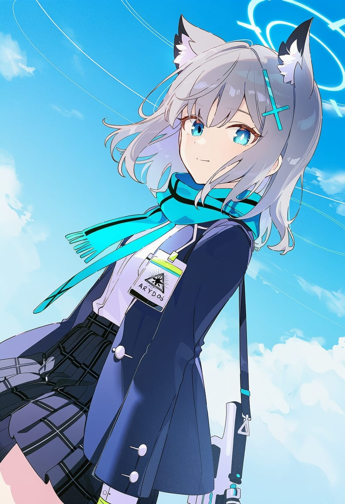

| 字段 | 内容 |
| --- | --- |
| 序号 | 0001 |
| tag | dutch_angle |
| tag中文名 | 荷兰角/倾斜构图 |
| tag中文含义 | 镜头歪着拍，整个画面斜向一边。 |
| tag所属子类 | 镜头视角 |

## 2. from_above — 镜头从角色头顶上方往下拍。

| 字段 | 内容 |
| --- | --- |
| 序号 | 0002 |
| tag | from_above |
| tag中文名 | 俯视/俯拍 |
| tag中文含义 | 镜头从角色头顶上方往下拍。 |
| tag所属子类 | 镜头视角 |

## 3. from_behind — 镜头在角色身后，拍她的后背。

| 字段 | 内容 |
| --- | --- |
| 序号 | 0003 |
| tag | from_behind |
| tag中文名 | 背面视角 |
| tag中文含义 | 镜头在角色身后，拍她的后背。 |
| tag所属子类 | 镜头视角 |

## 4. from_below — 镜头从角色脚边下方往上拍。

| 字段 | 内容 |
| --- | --- |
| 序号 | 0004 |
| tag | from_below |
| tag中文名 | 仰视/仰拍 |
| tag中文含义 | 镜头从角色脚边下方往上拍。 |
| tag所属子类 | 镜头视角 |

## 5. from_side — 镜头从角色正侧面拍过去。

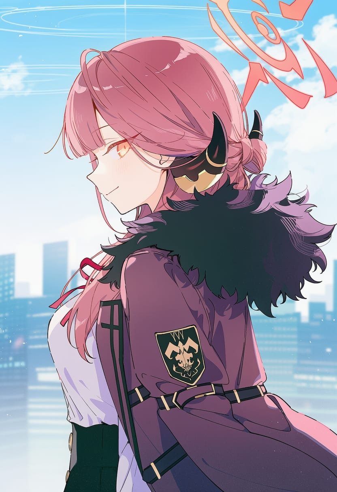

| 字段 | 内容 |
| --- | --- |
| 序号 | 0005 |
| tag | from_side |
| tag中文名 | 侧面视角 |
| tag中文含义 | 镜头从角色正侧面拍过去。 |
| tag所属子类 | 镜头视角 |

## 6. straight-on — 镜头正对角色脸平视拍摄。

| 字段 | 内容 |
| --- | --- |
| 序号 | 0006 |
| tag | straight-on |
| tag中文名 | 正面直拍 |
| tag中文含义 | 镜头正对角色脸平视拍摄。 |
| tag所属子类 | 镜头视角 |

## 7. sideways — 角色或整个画面横向水平摆放。

| 字段 | 内容 |
| --- | --- |
| 序号 | 0007 |
| tag | sideways |
| tag中文名 | 横躺构图 |
| tag中文含义 | 角色或整个画面横向水平摆放。 |
| tag所属子类 | 镜头视角 |

## 8. upside-down — 画面上下完全倒过来拍。

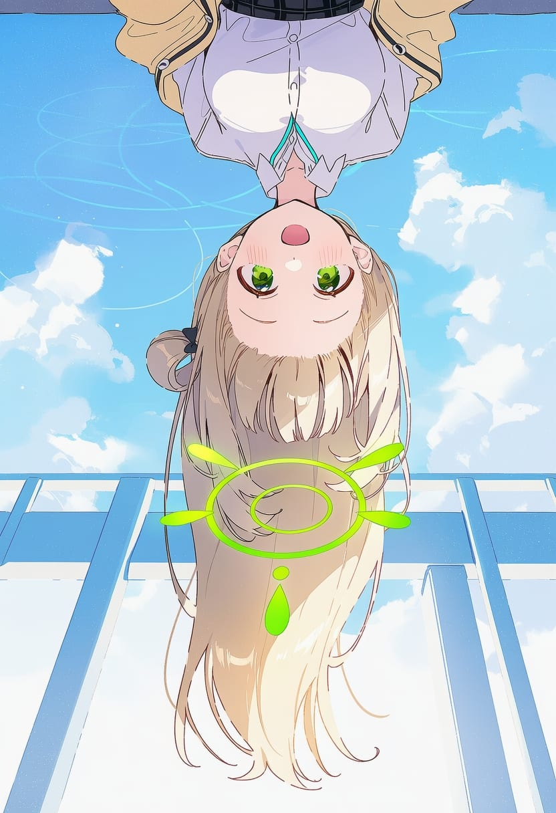

| 字段 | 内容 |
| --- | --- |
| 序号 | 0008 |
| tag | upside-down |
| tag中文名 | 颠倒/倒立 |
| tag中文含义 | 画面上下完全倒过来拍。 |
| tag所属子类 | 镜头视角 |

## 9. profile — 只拍角色的侧面轮廓。

| 字段 | 内容 |
| --- | --- |
| 序号 | 0009 |
| tag | profile |
| tag中文名 | 侧脸 |
| tag中文含义 | 只拍角色的侧面轮廓。 |
| tag所属子类 | 镜头视角 |

## 10. group_profile — 多个角色并排一起拍侧面。

| 字段 | 内容 |
| --- | --- |
| 序号 | 0010 |
| tag | group_profile |
| tag中文名 | 多人侧脸 |
| tag中文含义 | 多个角色并排一起拍侧面。 |
| tag所属子类 | 镜头视角 |

## 11. pov — 画面里通常会出现观察者身体的一部分。

| 字段 | 内容 |
| --- | --- |
| 序号 | 0011 |
| tag | pov |
| tag中文名 | 第一人称视角 |
| tag中文含义 | 画面里通常会出现观察者身体的一部分。 |
| tag所属子类 | 镜头视角 |

## 12. female_pov — 画面的观察者是一名女性

| 字段 | 内容 |
| --- | --- |
| 序号 | 0012 |
| tag | female_pov |
| tag中文名 | 女性视角 |
| tag中文含义 | 画面的观察者是一名女性 |
| tag所属子类 | 镜头视角 |

## 13. pov_hands — 画面中有观察者的双手

| 字段 | 内容 |
| --- | --- |
| 序号 | 0013 |
| tag | pov_hands |
| tag中文名 | 第一人称双手 |
| tag中文含义 | 画面中有观察者的双手 |
| tag所属子类 | 镜头视角 |

## 14. pov_legs — 画面中有观察者的双腿

| 字段 | 内容 |
| --- | --- |
| 序号 | 0014 |
| tag | pov_legs |
| tag中文名 | 第一人称腿部 |
| tag中文含义 | 画面中有观察者的双腿 |
| tag所属子类 | 镜头视角 |

## 15. pov_crotch — 画面中有观察者的跨

| 字段 | 内容 |
| --- | --- |
| 序号 | 0015 |
| tag | pov_crotch |
| tag中文名 | 第一人称胯下 |
| tag中文含义 | 画面中有观察者的跨 |
| tag所属子类 | 镜头视角 |

## 16. pov_breasts — 画面中有观察者的胸口

| 字段 | 内容 |
| --- | --- |
| 序号 | 0016 |
| tag | pov_breasts |
| tag中文名 | 第一人称胸口 |
| tag中文含义 | 画面中有观察者的胸口 |
| tag所属子类 | 镜头视角 |

## 17. pov_shadow — 画面中是观察者的影子

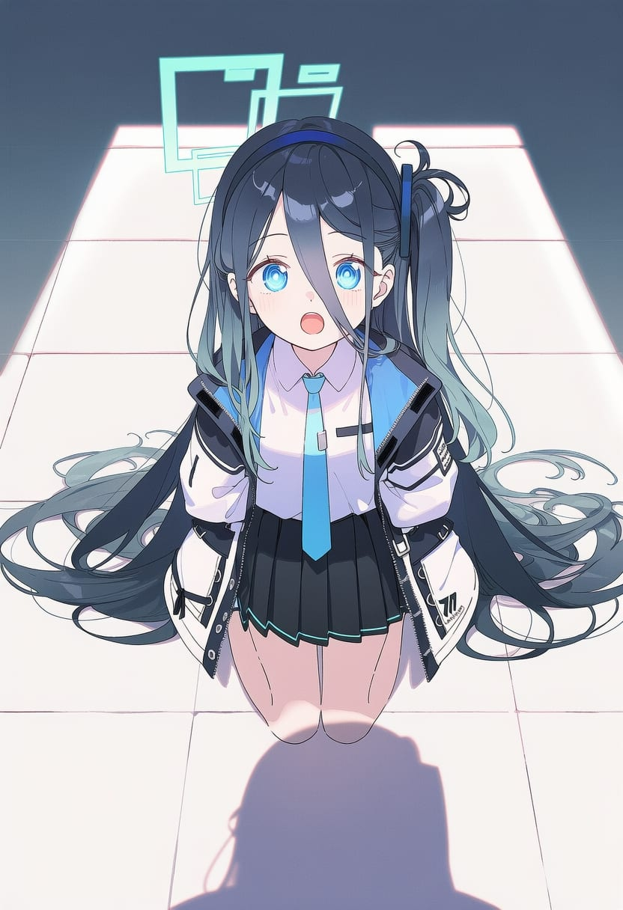

| 字段 | 内容 |
| --- | --- |
| 序号 | 0017 |
| tag | pov_shadow |
| tag中文名 | 第一人称影子 |
| tag中文含义 | 画面中是观察者的影子 |
| tag所属子类 | 镜头视角 |

## 18. dressed_shadow_(meme) — 添加衣服描述词可以做出衣服脱光的效果

| 字段 | 内容 |
| --- | --- |
| 序号 | 0018 |
| tag | dressed_shadow_(meme) |
| tag中文名 | 穿衣影子梗 |
| tag中文含义 | 添加衣服描述词可以做出衣服脱光的效果 |
| tag所属子类 | 镜头视角 |

## 19. eyewear_view — 透过观察者的眼镜镜片看出去

| 字段 | 内容 |
| --- | --- |
| 序号 | 0019 |
| tag | eyewear_view |
| tag中文名 | 眼镜视角 |
| tag中文含义 | 透过观察者的眼镜镜片看出去 |
| tag所属子类 | 镜头视角 |

## 20. pov_peephole — 从门缝或猫眼小孔里往外看角色。

| 字段 | 内容 |
| --- | --- |
| 序号 | 0020 |
| tag | pov_peephole |
| tag中文名 | 猫眼/小孔视角 |
| tag中文含义 | 从门缝或猫眼小孔里往外看角色。 |
| tag所属子类 | 镜头视角 |

## 21. pov_across_bed — 隔着床从这头看对面躺着的人。

| 字段 | 内容 |
| --- | --- |
| 序号 | 0021 |
| tag | pov_across_bed |
| tag中文名 | 隔床视角 |
| tag中文含义 | 隔着床从这头看对面躺着的人。 |
| tag所属子类 | 镜头视角 |

## 22. pov_across_table — 隔着桌子和角色面对面坐着。

| 字段 | 内容 |
| --- | --- |
| 序号 | 0022 |
| tag | pov_across_table |
| tag中文名 | 隔桌视角 |
| tag中文含义 | 隔着桌子和角色面对面坐着。 |
| tag所属子类 | 镜头视角 |

## 23. pov_dating — 模拟和角色约会时面对面的第一人称。

| 字段 | 内容 |
| --- | --- |
| 序号 | 0023 |
| tag | pov_dating |
| tag中文名 | 约会视角 |
| tag中文含义 | 模拟和角色约会时面对面的第一人称。 |
| tag所属子类 | 镜头视角 |

## 24. pov_doorway — 站在门口看角色开门迎接你。

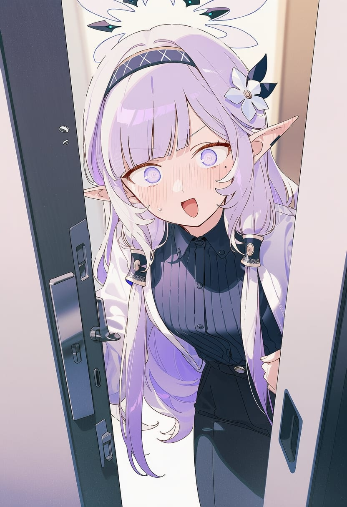

| 字段 | 内容 |
| --- | --- |
| 序号 | 0024 |
| tag | pov_doorway |
| tag中文名 | 门口视角 |
| tag中文含义 | 站在门口看角色开门迎接你。 |
| tag所属子类 | 镜头视角 |

## 25. view_between_legs — 角色分开腿，镜头从腿缝之间看出去。

| 字段 | 内容 |
| --- | --- |
| 序号 | 0025 |
| tag | view_between_legs |
| tag中文名 | 腿间视角 |
| tag中文含义 | 角色分开腿，镜头从腿缝之间看出去。 |
| tag所属子类 | 镜头视角 |

## 26. viewer_on_leash — 角色牵着绳子，观察者是宠物

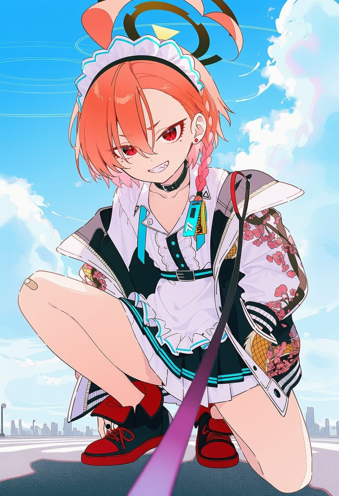

| 字段 | 内容 |
| --- | --- |
| 序号 | 0026 |
| tag | viewer_on_leash |
| tag中文名 | 牵绳视角 |
| tag中文含义 | 角色牵着绳子，观察者是宠物 |
| tag所属子类 | 镜头视角 |

## 27. partially_underwater_shot — 水面上下各占一半，角色半身浸在水里。

| 字段 | 内容 |
| --- | --- |
| 序号 | 0027 |
| tag | partially_underwater_shot |
| tag中文名 | 半水下镜头 |
| tag中文含义 | 水面上下各占一半，角色半身浸在水里。 |
| tag所属子类 | 镜头视角 |

## 28. mirror_selfie — 举着手机对着镜子拍自己。

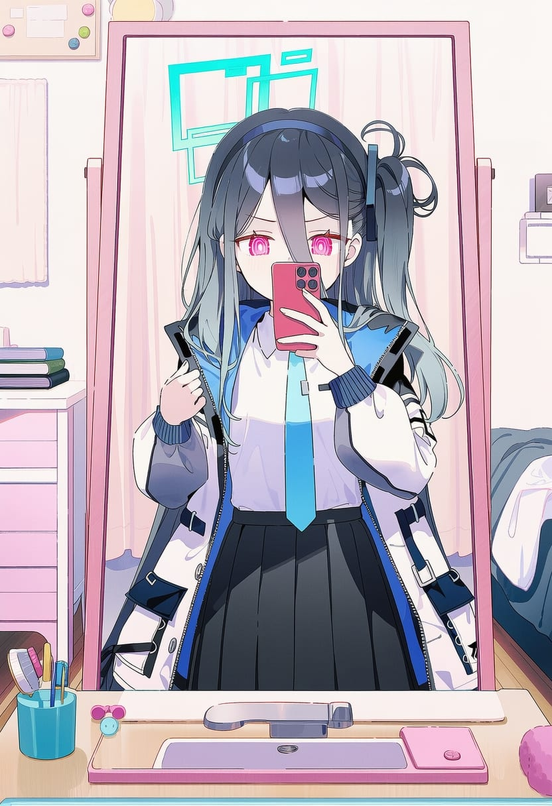

| 字段 | 内容 |
| --- | --- |
| 序号 | 0028 |
| tag | mirror_selfie |
| tag中文名 | 对镜自拍 |
| tag中文含义 | 举着手机对着镜子拍自己。 |
| tag所属子类 | 镜头视角 |

## 29. from_inside — 镜头在室内或车内，朝外拍窗外景象。

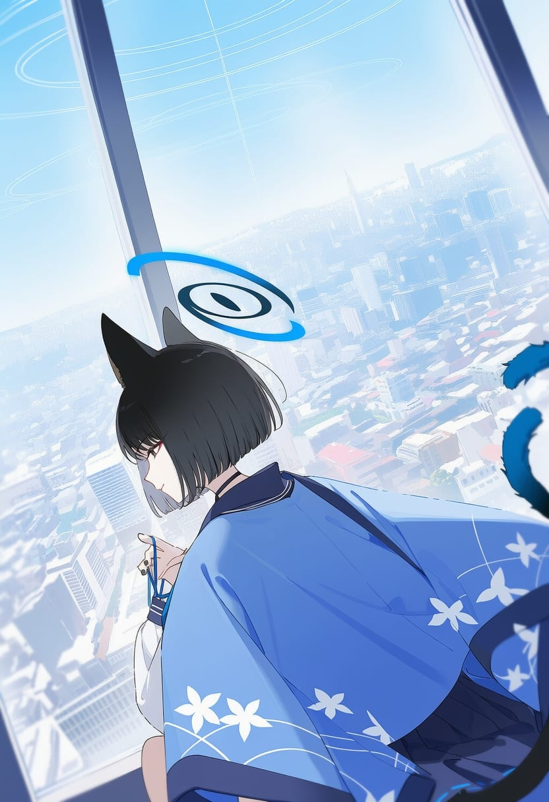

| 字段 | 内容 |
| --- | --- |
| 序号 | 0029 |
| tag | from_inside |
| tag中文名 | 从内往外拍 |
| tag中文含义 | 镜头在室内或车内，朝外拍窗外景象。 |
| tag所属子类 | 镜头视角 |

## 30. from_outside — 镜头在窗外或门外，朝室内拍角色。

| 字段 | 内容 |
| --- | --- |
| 序号 | 0030 |
| tag | from_outside |
| tag中文名 | 从外往内拍 |
| tag中文含义 | 镜头在窗外或门外，朝室内拍角色。 |
| tag所属子类 | 镜头视角 |

## 31. looking_inside — 角色站在外边，朝门里或窗里看。

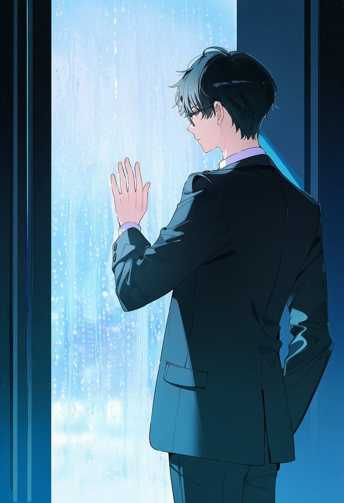

| 字段 | 内容 |
| --- | --- |
| 序号 | 0031 |
| tag | looking_inside |
| tag中文名 | 望向里面 |
| tag中文含义 | 角色站在外边，朝门里或窗里看。 |
| tag所属子类 | 镜头视角 |

## 32. looking_outside — 角色在室内，朝窗外看出去。

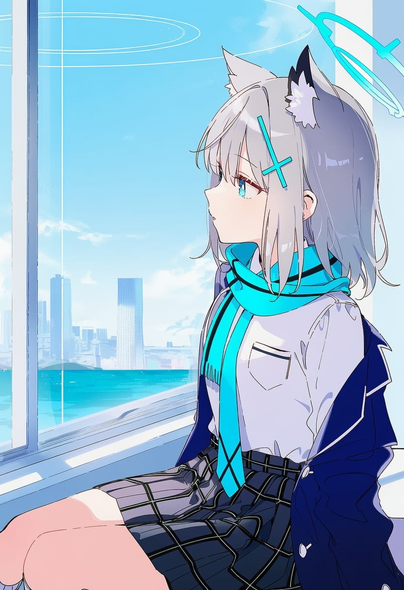

| 字段 | 内容 |
| --- | --- |
| 序号 | 0032 |
| tag | looking_outside |
| tag中文名 | 望向外面 |
| tag中文含义 | 角色在室内，朝窗外看出去。 |
| tag所属子类 | 镜头视角 |

## 33. portrait — 画面以角色脸部为中心，通常只拍到头部加肩膀，像证件照那样的胸像特写

| 字段 | 内容 |
| --- | --- |
| 序号 | 0033 |
| tag | portrait |
| tag中文名 | 肖像构图 |
| tag中文含义 | 画面以角色脸部为中心，通常只拍到头部加肩膀，像证件照那样的胸像特写 |
| tag所属子类 | 画面大小 |

## 34. upper_body — 画面拍到角色头部到腰部，露出胸肩和手臂

| 字段 | 内容 |
| --- | --- |
| 序号 | 0034 |
| tag | upper_body |
| tag中文名 | 上半身 |
| tag中文含义 | 画面拍到角色头部到腰部，露出胸肩和手臂 |
| tag所属子类 | 画面大小 |

## 35. cowboy_shot — 从头部拍到大腿中部（约胯到膝盖之间），像西部片牛仔站姿那样的七分身

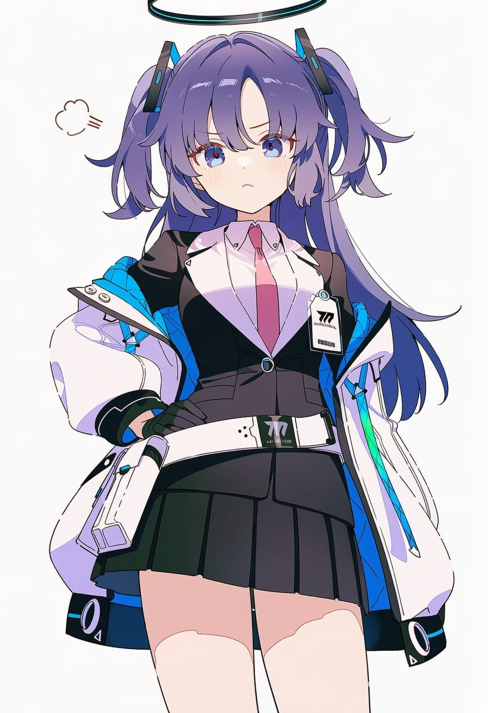

| 字段 | 内容 |
| --- | --- |
| 序号 | 0035 |
| tag | cowboy_shot |
| tag中文名 | 牛仔镜头 |
| tag中文含义 | 从头部拍到大腿中部（约胯到膝盖之间），像西部片牛仔站姿那样的七分身 |
| tag所属子类 | 画面大小 |

## 36. feet_out_of_frame — 角色基本全身入镜，但脚被画面底部裁掉、看不到鞋子

| 字段 | 内容 |
| --- | --- |
| 序号 | 0036 |
| tag | feet_out_of_frame |
| tag中文名 | 脚部出画 |
| tag中文含义 | 角色基本全身入镜，但脚被画面底部裁掉、看不到鞋子 |
| tag所属子类 | 画面大小 |

## 37. full_body — 完整拍到角色从头到脚，全身都在画面里

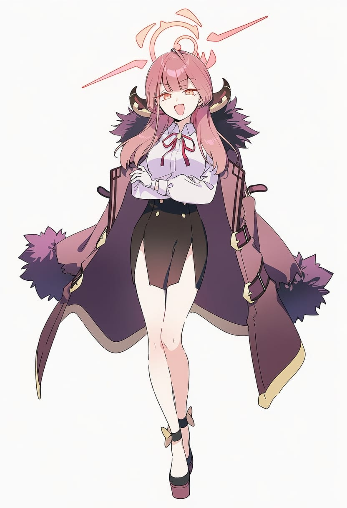

| 字段 | 内容 |
| --- | --- |
| 序号 | 0037 |
| tag | full_body |
| tag中文名 | 全身构图 |
| tag中文含义 | 完整拍到角色从头到脚，全身都在画面里 |
| tag所属子类 | 画面大小 |

## 38. wide_shot — 把角色放进较大的环境里拍，人物占画面比例小、能看到周围场景

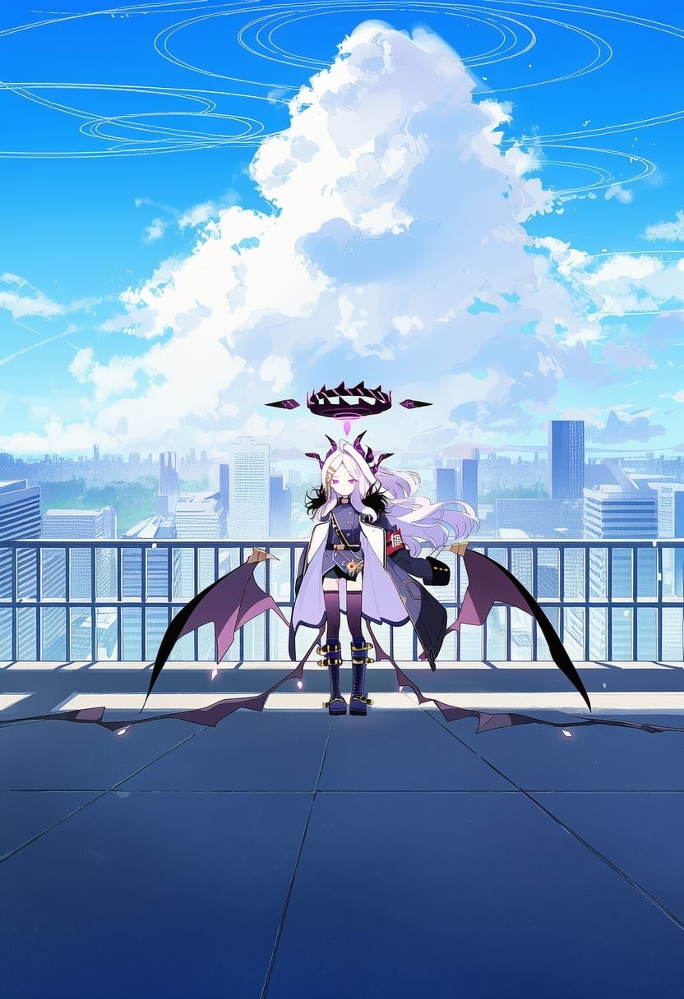

| 字段 | 内容 |
| --- | --- |
| 序号 | 0038 |
| tag | wide_shot |
| tag中文名 | 全景宽镜头 |
| tag中文含义 | 把角色放进较大的环境里拍，人物占画面比例小、能看到周围场景 |
| tag所属子类 | 画面大小 |

## 39. very_wide_shot — 人物缩得很小，画面几乎被风景和环境占满

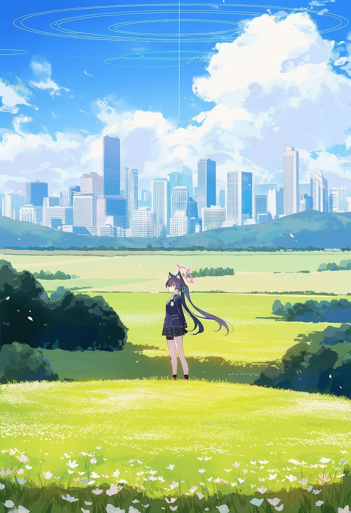

| 字段 | 内容 |
| --- | --- |
| 序号 | 0039 |
| tag | very_wide_shot |
| tag中文名 | 极远景 |
| tag中文含义 | 人物缩得很小，画面几乎被风景和环境占满 |
| tag所属子类 | 画面大小 |

## 40. lower_body — 画面只拍角色腰部以下，重点是腿、裙子和脚部

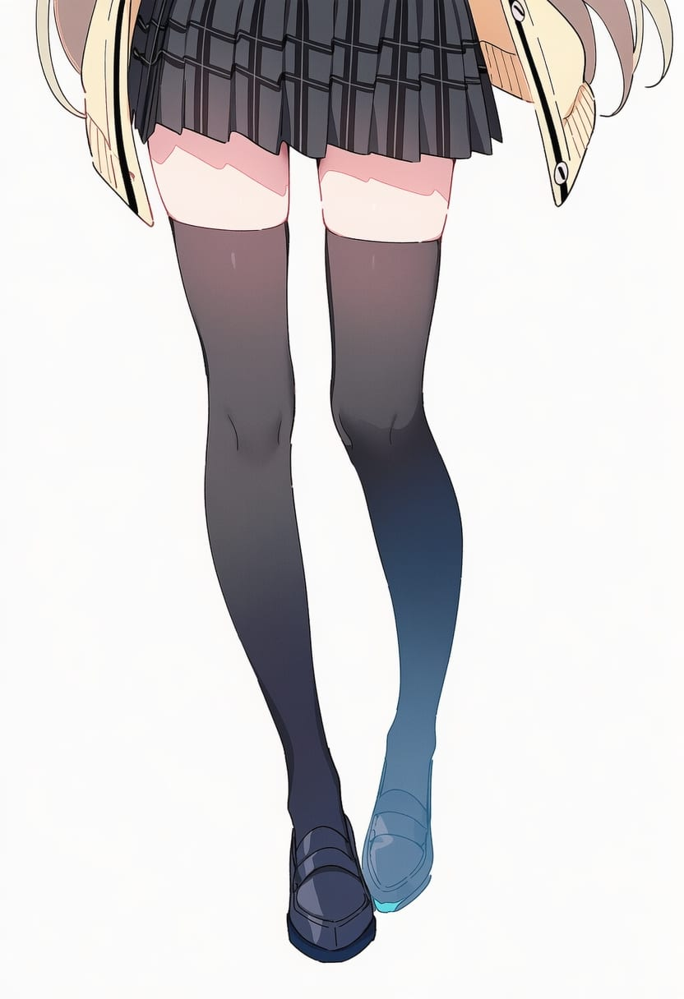

| 字段 | 内容 |
| --- | --- |
| 序号 | 0040 |
| tag | lower_body |
| tag中文名 | 下半身 |
| tag中文含义 | 画面只拍角色腰部以下，重点是腿、裙子和脚部 |
| tag所属子类 | 画面大小 |

## 41. head_out_of_frame — 头完全不在画面里，从脖子肩膀往下拍、看不到脸

| 字段 | 内容 |
| --- | --- |
| 序号 | 0041 |
| tag | head_out_of_frame |
| tag中文名 | 头部出画 |
| tag中文含义 | 头完全不在画面里，从脖子肩膀往下拍、看不到脸 |
| tag所属子类 | 画面大小 |

## 42. eyes_out_of_frame — 眼睛被画面上沿裁掉，只拍到鼻子、嘴巴或额头以下

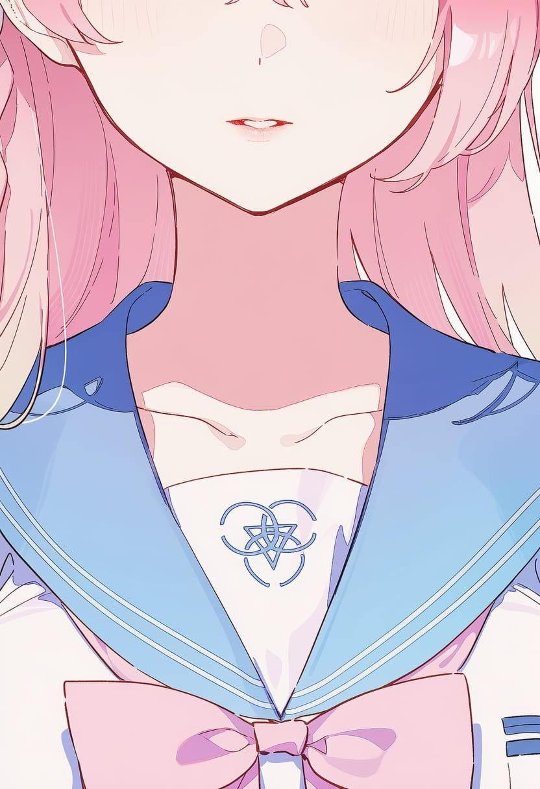

| 字段 | 内容 |
| --- | --- |
| 序号 | 0042 |
| tag | eyes_out_of_frame |
| tag中文名 | 眼部出画 |
| tag中文含义 | 眼睛被画面上沿裁掉，只拍到鼻子、嘴巴或额头以下 |
| tag所属子类 | 画面大小 |

## 43. foot_out_of_frame — 身体基本都在画面里，但有一只脚没拍到、留在画框外

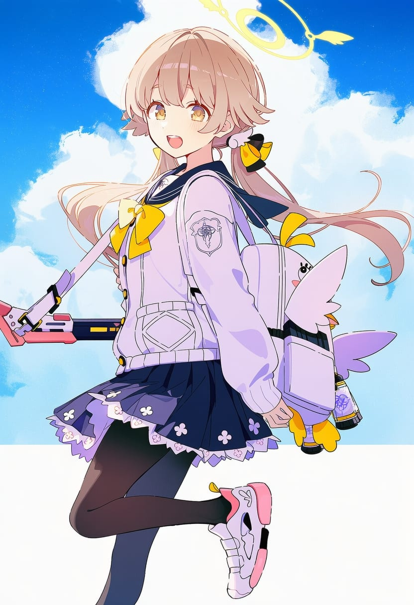

| 字段 | 内容 |
| --- | --- |
| 序号 | 0043 |
| tag | foot_out_of_frame |
| tag中文名 | 单脚出画 |
| tag中文含义 | 身体基本都在画面里，但有一只脚没拍到、留在画框外 |
| tag所属子类 | 画面大小 |

## 44. knees_out_of_frame — 拍到大腿中部附近，膝盖及以下被画面裁掉

| 字段 | 内容 |
| --- | --- |
| 序号 | 0044 |
| tag | knees_out_of_frame |
| tag中文名 | 膝盖出画 |
| tag中文含义 | 拍到大腿中部附近，膝盖及以下被画面裁掉 |
| tag所属子类 | 画面大小 |

## 45. close-up — 镜头拉得极近，聚焦脸部或某个身体部位，背景几乎被挤掉

| 字段 | 内容 |
| --- | --- |
| 序号 | 0045 |
| tag | close-up |
| tag中文名 | 特写 |
| tag中文含义 | 镜头拉得极近，聚焦脸部或某个身体部位，背景几乎被挤掉 |
| tag所属子类 | 画面大小 |

## 46. cropped_legs — 腿在画面里但没画完

| 字段 | 内容 |
| --- | --- |
| 序号 | 0046 |
| tag | cropped_legs |
| tag中文名 | 腿部裁切 |
| tag中文含义 | 腿在画面里但没画完 |
| tag所属子类 | 画面大小 |

## 47. cropped_torso — 身体中段在画面里但没画完

| 字段 | 内容 |
| --- | --- |
| 序号 | 0047 |
| tag | cropped_torso |
| tag中文名 | 躯干裁切 |
| tag中文含义 | 身体中段在画面里但没画完 |
| tag所属子类 | 画面大小 |

## 48. cropped_arms — 手臂入镜但没画完

| 字段 | 内容 |
| --- | --- |
| 序号 | 0048 |
| tag | cropped_arms |
| tag中文名 | 手臂裁切 |
| tag中文含义 | 手臂入镜但没画完 |
| tag所属子类 | 画面大小 |

## 49. cropped_shoulders — 肩膀附近没画完

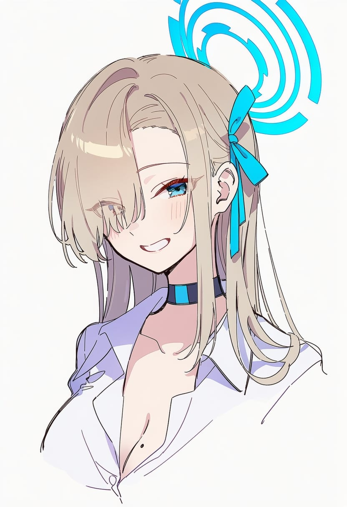

| 字段 | 内容 |
| --- | --- |
| 序号 | 0049 |
| tag | cropped_shoulders |
| tag中文名 | 肩部裁切 |
| tag中文含义 | 肩膀附近没画完 |
| tag所属子类 | 画面大小 |

## 50. cropped_head — 面部画面，再往下就没画完了

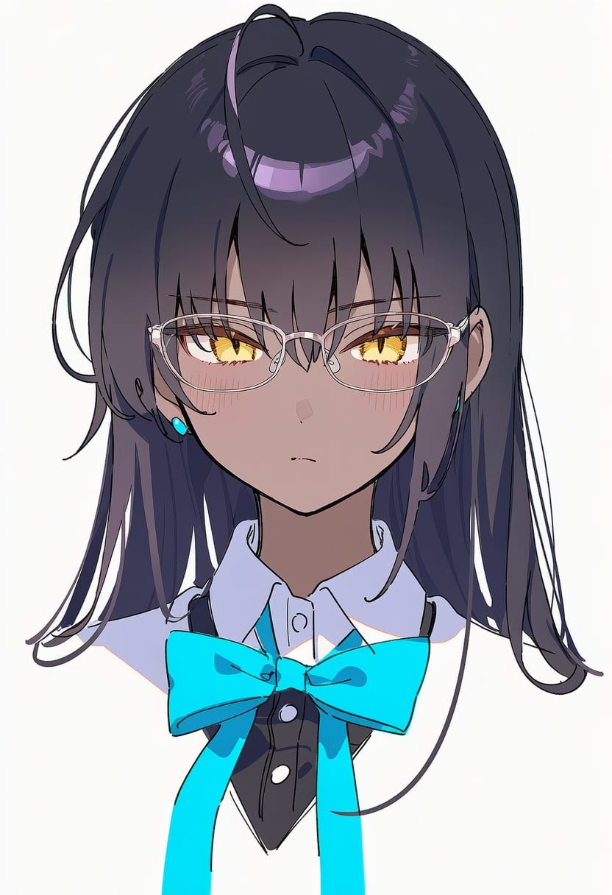

| 字段 | 内容 |
| --- | --- |
| 序号 | 0050 |
| tag | cropped_head |
| tag中文名 | 头部裁切 |
| tag中文含义 | 面部画面，再往下就没画完了 |
| tag所属子类 | 画面大小 |

## 51. cut-in — 画面中突然插入一小块放大特写镜头，常见于对话或战斗瞬间

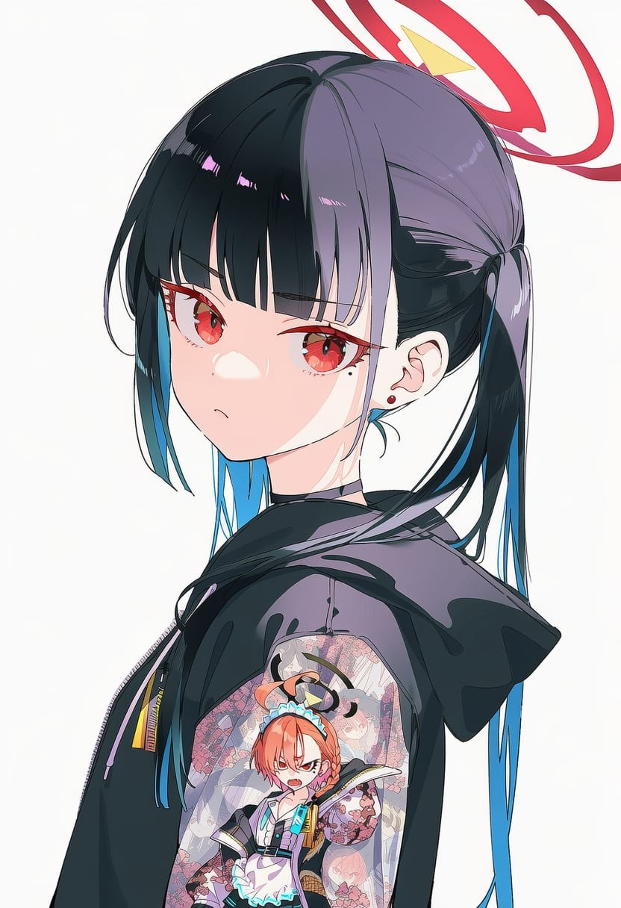

| 字段 | 内容 |
| --- | --- |
| 序号 | 0051 |
| tag | cut-in |
| tag中文名 | 插入特写 |
| tag中文含义 | 画面中突然插入一小块放大特写镜头，常见于对话或战斗瞬间 |
| tag所属子类 | 画面大小 |

## 52. split_crop — 画面被一条线分成两半，左右或上下各裁出一部分内容

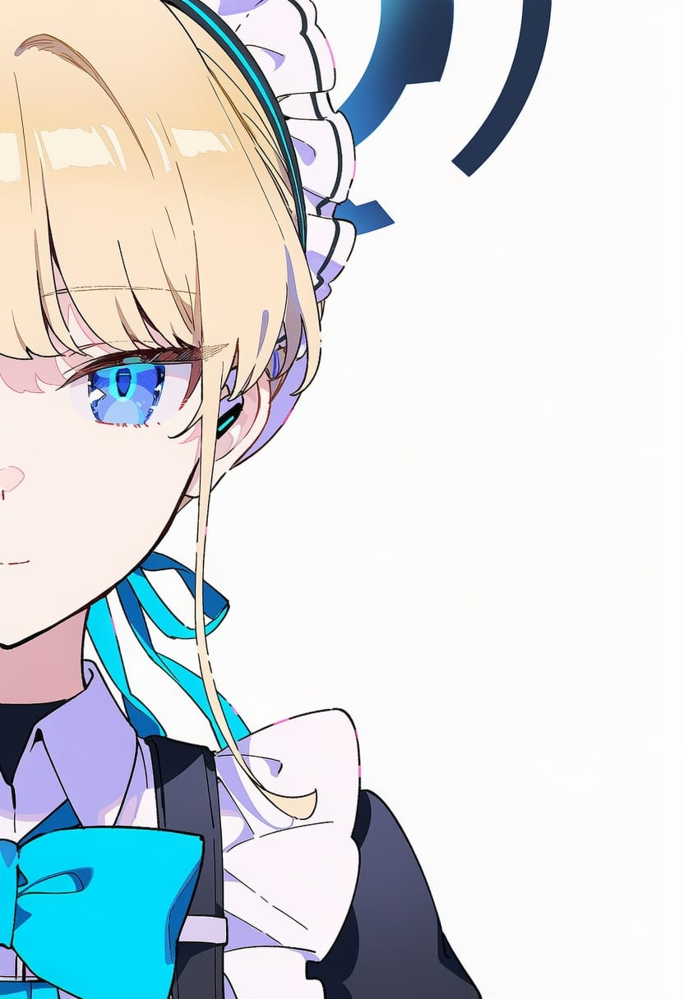

| 字段 | 内容 |
| --- | --- |
| 序号 | 0052 |
| tag | split_crop |
| tag中文名 | 分割裁切 |
| tag中文含义 | 画面被一条线分成两半，左右或上下各裁出一部分内容 |
| tag所属子类 | 画面大小 |

## 53. perspective — 运用透视原理营造空间纵深感，近大远小、线条向远方汇聚

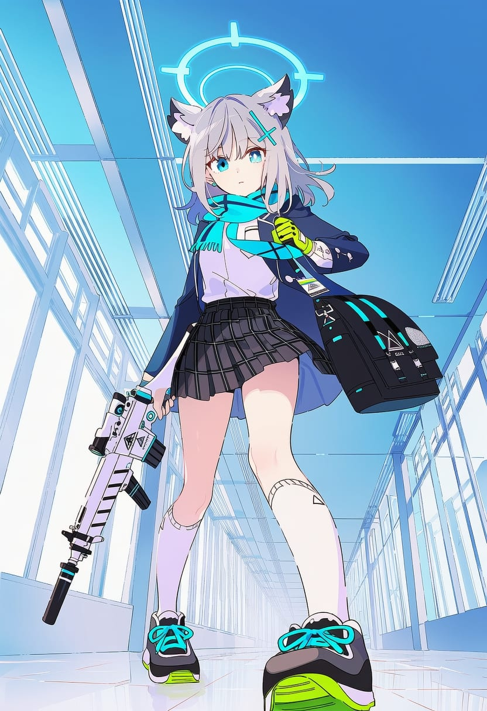

| 字段 | 内容 |
| --- | --- |
| 序号 | 0053 |
| tag | perspective |
| tag中文名 | 透视 |
| tag中文含义 | 运用透视原理营造空间纵深感，近大远小、线条向远方汇聚 |
| tag所属子类 | 透视深度 |

## 54. foreshortening — 近大远小的透视缩短，靠近镜头的部位被放大夸张

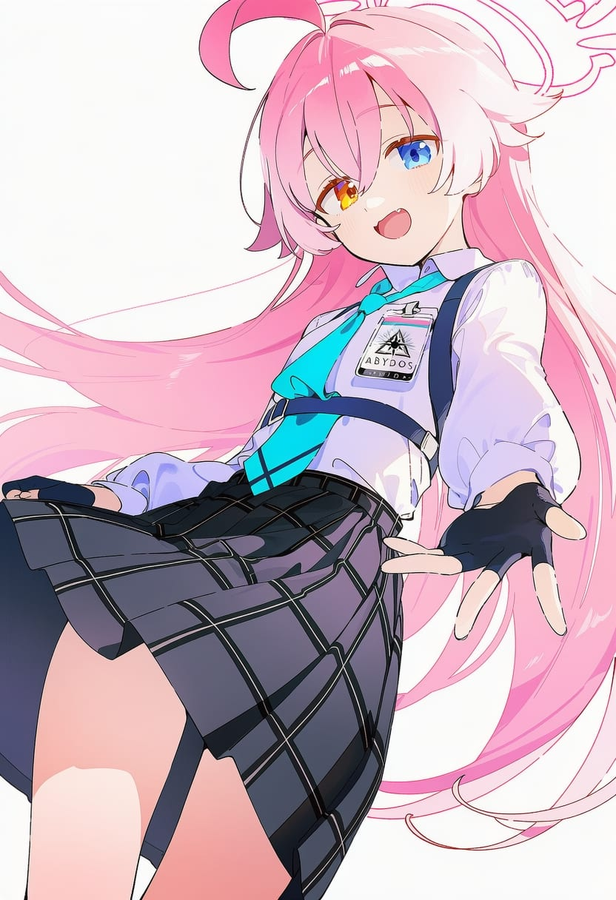

| 字段 | 内容 |
| --- | --- |
| 序号 | 0054 |
| tag | foreshortening |
| tag中文名 | 透视缩短 |
| tag中文含义 | 近大远小的透视缩短，靠近镜头的部位被放大夸张 |
| tag所属子类 | 透视深度 |

## 55. fisheye — 鱼眼镜头造成的边缘球面畸变，视野极广且画面弯曲

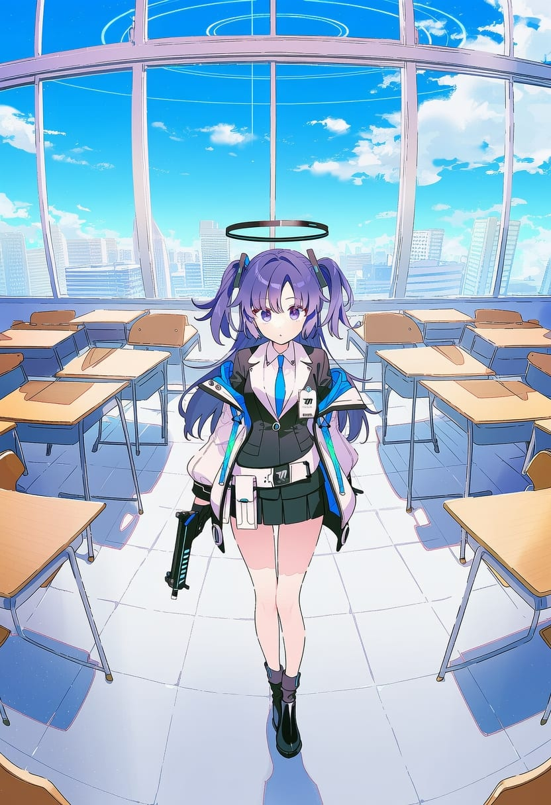

| 字段 | 内容 |
| --- | --- |
| 序号 | 0055 |
| tag | fisheye |
| tag中文名 | 鱼眼镜头 |
| tag中文含义 | 鱼眼镜头造成的边缘球面畸变，视野极广且画面弯曲 |
| tag所属子类 | 透视深度 |

## 56. vanishing_point — 平行线条向远方汇聚于一点，营造强烈的深度延伸感

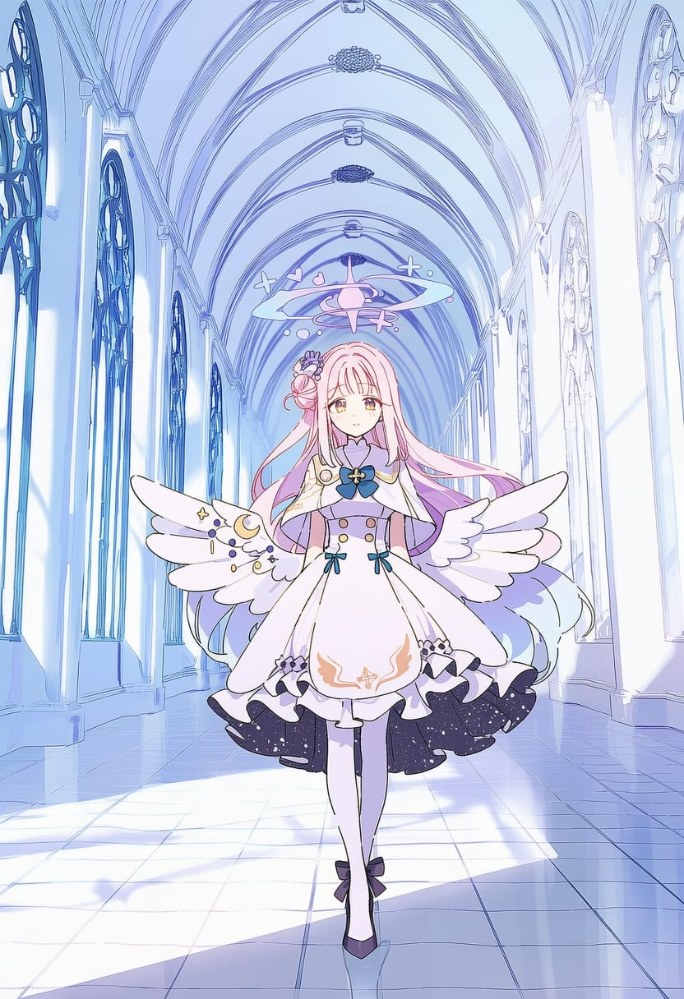

| 字段 | 内容 |
| --- | --- |
| 序号 | 0056 |
| tag | vanishing_point |
| tag中文名 | 消失点 |
| tag中文含义 | 平行线条向远方汇聚于一点，营造强烈的深度延伸感 |
| tag所属子类 | 透视深度 |

## 57. forced_perspective — 利用近大远小的错觉制造大小对比，前景物体看似触碰远方景物

| 字段 | 内容 |
| --- | --- |
| 序号 | 0057 |
| tag | forced_perspective |
| tag中文名 | 强制透视 |
| tag中文含义 | 利用近大远小的错觉制造大小对比，前景物体看似触碰远方景物 |
| tag所属子类 | 透视深度 |

## 58. atmospheric_perspective — 远景因雾气空气呈现偏蓝偏灰的朦胧感，拉开空间距离

| 字段 | 内容 |
| --- | --- |
| 序号 | 0058 |
| tag | atmospheric_perspective |
| tag中文名 | 空气透视 |
| tag中文含义 | 远景因雾气空气呈现偏蓝偏灰的朦胧感，拉开空间距离 |
| tag所属子类 | 透视深度 |

## 59. variations — 同一角色的不同服装、表情或姿态并排排列展示

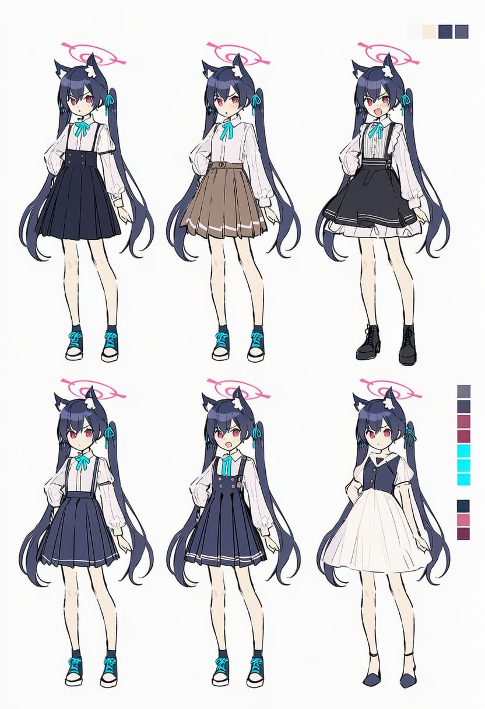

| 字段 | 内容 |
| --- | --- |
| 序号 | 0059 |
| tag | variations |
| tag中文名 | 多版本展示 |
| tag中文含义 | 同一角色的不同服装、表情或姿态并排排列展示 |
| tag所属子类 | 透视深度 |

## 60. depth_of_field — 通过清晰对焦范围控制画面层次，突出对焦主体

| 字段 | 内容 |
| --- | --- |
| 序号 | 0060 |
| tag | depth_of_field |
| tag中文名 | 景深 |
| tag中文含义 | 通过清晰对焦范围控制画面层次，突出对焦主体 |
| tag所属子类 | 透视深度 |

## 61. bokeh — 背景失焦形成的圆润光斑虚化效果

| 字段 | 内容 |
| --- | --- |
| 序号 | 0061 |
| tag | bokeh |
| tag中文名 | 焦外光斑 |
| tag中文含义 | 背景失焦形成的圆润光斑虚化效果 |
| tag所属子类 | 透视深度 |

## 62. blurry_foreground — 画面前景物体失焦模糊，增加前后景深层次感

| 字段 | 内容 |
| --- | --- |
| 序号 | 0062 |
| tag | blurry_foreground |
| tag中文名 | 前景虚化 |
| tag中文含义 | 画面前景物体失焦模糊，增加前后景深层次感 |
| tag所属子类 | 透视深度 |

## 63. blurry_background — 背景模糊失焦，将视觉焦点集中到前方人物主体

| 字段 | 内容 |
| --- | --- |
| 序号 | 0063 |
| tag | blurry_background |
| tag中文名 | 背景虚化 |
| tag中文含义 | 背景模糊失焦，将视觉焦点集中到前方人物主体 |
| tag所属子类 | 透视深度 |

## 64. lineup — 多个角色横向排成一排，正面朝向观众

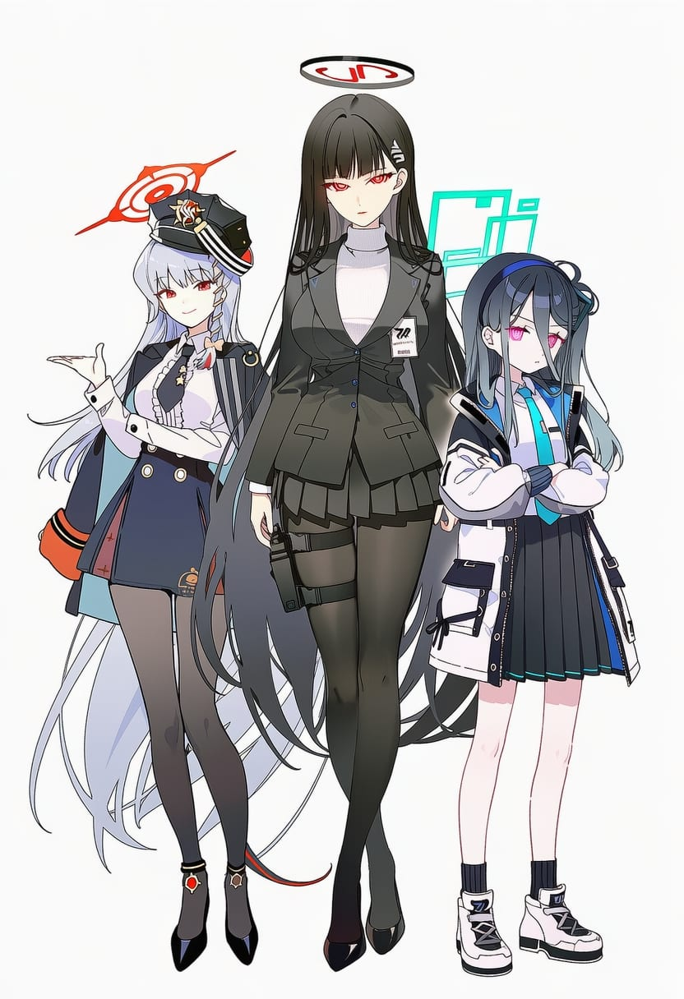

| 字段 | 内容 |
| --- | --- |
| 序号 | 0064 |
| tag | lineup |
| tag中文名 | 列队排列 |
| tag中文含义 | 多个角色横向排成一排，正面朝向观众 |
| tag所属子类 | 布局风格 |

## 65. column_lineup — 多个角色竖排成一列，通常只露脸或上半身

| 字段 | 内容 |
| --- | --- |
| 序号 | 0065 |
| tag | column_lineup |
| tag中文名 | 竖列排列 |
| tag中文含义 | 多个角色竖排成一列，通常只露脸或上半身 |
| tag所属子类 | 布局风格 |

## 66. circle_formation — 多个角色围成一个圆圈，互相朝向圆心

| 字段 | 内容 |
| --- | --- |
| 序号 | 0066 |
| tag | circle_formation |
| tag中文名 | 围成圆圈 |
| tag中文含义 | 多个角色围成一个圆圈，互相朝向圆心 |
| tag所属子类 | 布局风格 |

## 67. side-by-side — 两个角色肩并肩并排站在一起

| 字段 | 内容 |
| --- | --- |
| 序号 | 0067 |
| tag | side-by-side |
| tag中文名 | 并排站立 |
| tag中文含义 | 两个角色肩并肩并排站在一起 |
| tag所属子类 | 布局风格 |

## 68. opposing_sides — 两个角色分别站在画面左右两侧，面对面相对

| 字段 | 内容 |
| --- | --- |
| 序号 | 0068 |
| tag | opposing_sides |
| tag中文名 | 对立两侧 |
| tag中文含义 | 两个角色分别站在画面左右两侧，面对面相对 |
| tag所属子类 | 布局风格 |

## 69. symmetry — 两个角色沿中轴线左右对称站位，姿势呈镜像

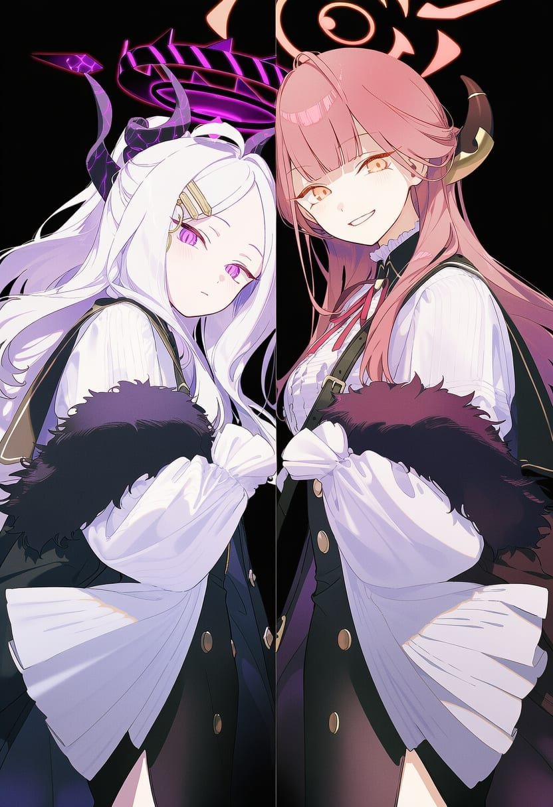

| 字段 | 内容 |
| --- | --- |
| 序号 | 0069 |
| tag | symmetry |
| tag中文名 | 对称构图 |
| tag中文含义 | 两个角色沿中轴线左右对称站位，姿势呈镜像 |
| tag所属子类 | 布局风格 |

## 70. rotational_symmetry — 两个角色绕画面中心旋转180度后重合，呈旋转对称

| 字段 | 内容 |
| --- | --- |
| 序号 | 0070 |
| tag | rotational_symmetry |
| tag中文名 | 旋转对称 |
| tag中文含义 | 两个角色绕画面中心旋转180度后重合，呈旋转对称 |
| tag所属子类 | 布局风格 |

## 71. polar_opposites — 两个角色在外观、气质、色调上形成强烈反差

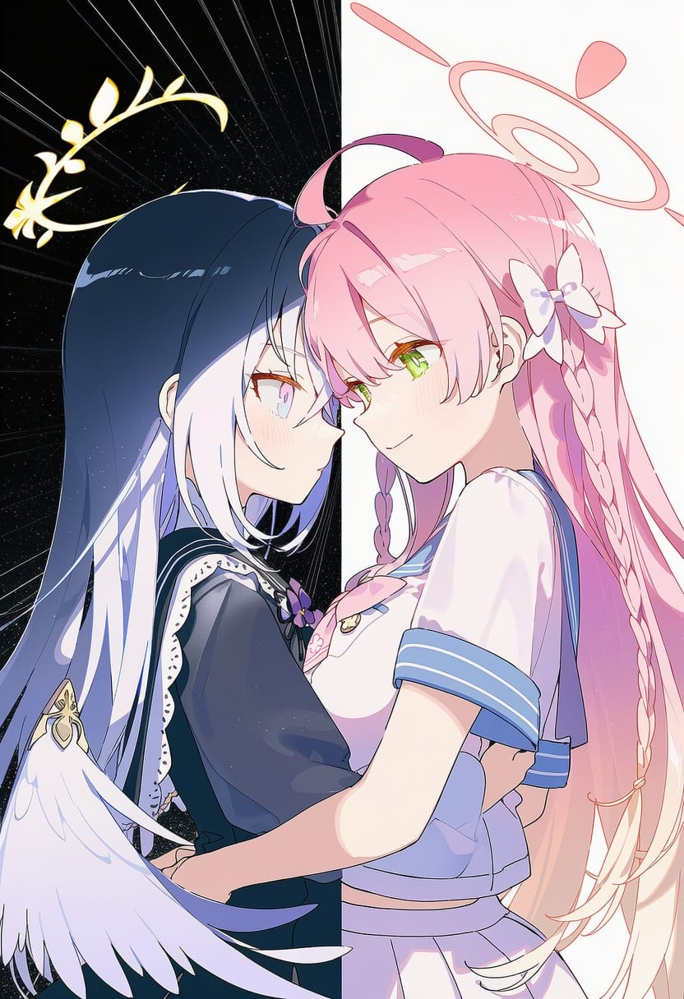

| 字段 | 内容 |
| --- | --- |
| 序号 | 0071 |
| tag | polar_opposites |
| tag中文名 | 极端对比 |
| tag中文含义 | 两个角色在外观、气质、色调上形成强烈反差 |
| tag所属子类 | 布局风格 |

## 72. negative_space — 画面留出大量空白，角色只占一小部分

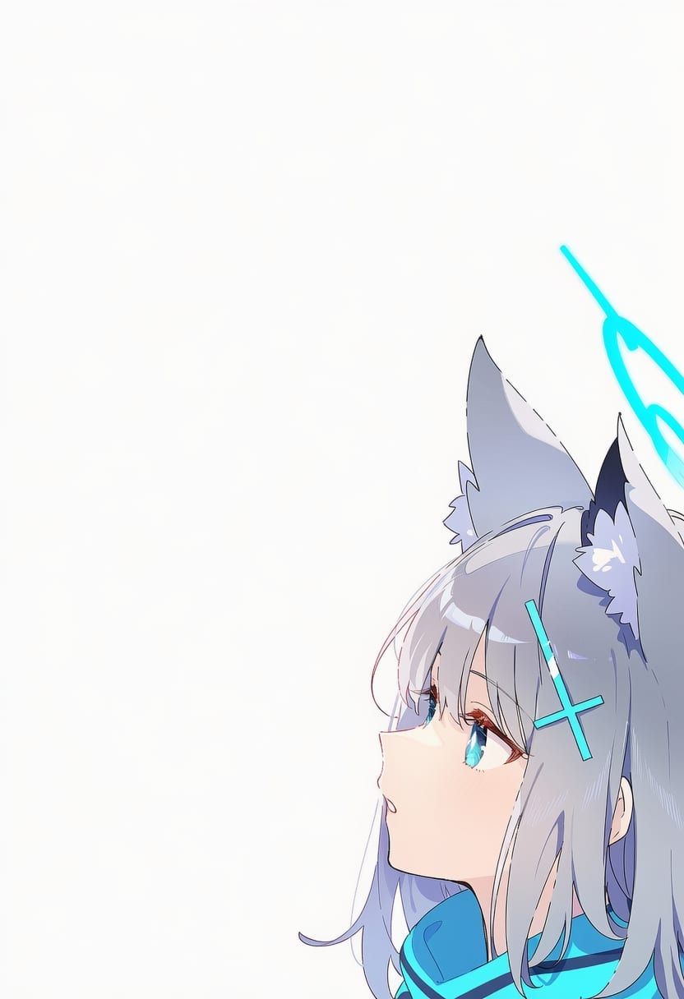

| 字段 | 内容 |
| --- | --- |
| 序号 | 0072 |
| tag | negative_space |
| tag中文名 | 留白构图 |
| tag中文含义 | 画面留出大量空白，角色只占一小部分 |
| tag所属子类 | 布局风格 |

## 73. split_screen — 画面被分割成左右两屏，各自独立展示一个场景

| 字段 | 内容 |
| --- | --- |
| 序号 | 0073 |
| tag | split_screen |
| tag中文名 | 分屏画面 |
| tag中文含义 | 画面被分割成左右两屏，各自独立展示一个场景 |
| tag所属子类 | 布局风格 |

## 74. split_theme — 画面左右两半呈现截然不同的主题或氛围

| 字段 | 内容 |
| --- | --- |
| 序号 | 0074 |
| tag | split_theme |
| tag中文名 | 主题分割 |
| tag中文含义 | 画面左右两半呈现截然不同的主题或氛围 |
| tag所属子类 | 布局风格 |

## 75. before_and_after — 同一角色变化前后的状态并排展示

| 字段 | 内容 |
| --- | --- |
| 序号 | 0075 |
| tag | before_and_after |
| tag中文名 | 前后对比 |
| tag中文含义 | 同一角色变化前后的状态并排展示 |
| tag所属子类 | 布局风格 |

## 76. comparison — 两个角色并排放置进行直观对比

| 字段 | 内容 |
| --- | --- |
| 序号 | 0076 |
| tag | comparison |
| tag中文名 | 对比展示 |
| tag中文含义 | 两个角色并排放置进行直观对比 |
| tag所属子类 | 布局风格 |

## 77. age_comparison — 展示同一角色不同年龄段的样子并排对照

| 字段 | 内容 |
| --- | --- |
| 序号 | 0077 |
| tag | age_comparison |
| tag中文名 | 年龄对比 |
| tag中文含义 | 展示同一角色不同年龄段的样子并排对照 |
| tag所属子类 | 布局风格 |

## 78. size_comparison — 两个角色并排放置，突出身高或体型差异

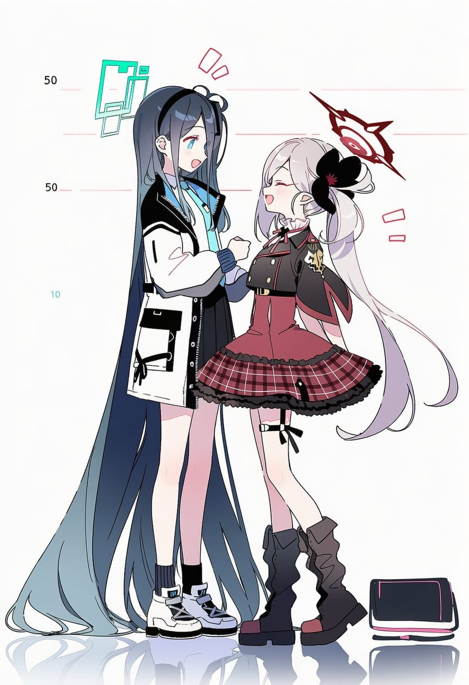

| 字段 | 内容 |
| --- | --- |
| 序号 | 0078 |
| tag | size_comparison |
| tag中文名 | 体型对比 |
| tag中文含义 | 两个角色并排放置，突出身高或体型差异 |
| tag所属子类 | 布局风格 |

## 79. height_chart — 多个角色全身排列成一张身高对照表

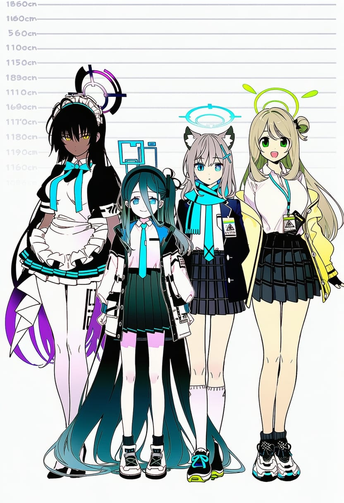

| 字段 | 内容 |
| --- | --- |
| 序号 | 0079 |
| tag | height_chart |
| tag中文名 | 身高图 |
| tag中文含义 | 多个角色全身排列成一张身高对照表 |
| tag所属子类 | 布局风格 |

## 80. reference_sheet — 单个角色的多角度、多视图设定参考图

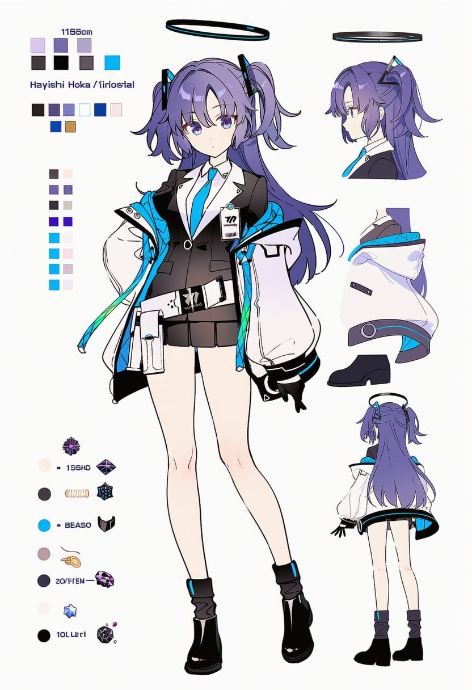

| 字段 | 内容 |
| --- | --- |
| 序号 | 0080 |
| tag | reference_sheet |
| tag中文名 | 参考设定图 |
| tag中文含义 | 单个角色的多角度、多视图设定参考图 |
| tag所属子类 | 布局风格 |

## 81. bust_chart — 单个角色胸部以上的多角度参考图

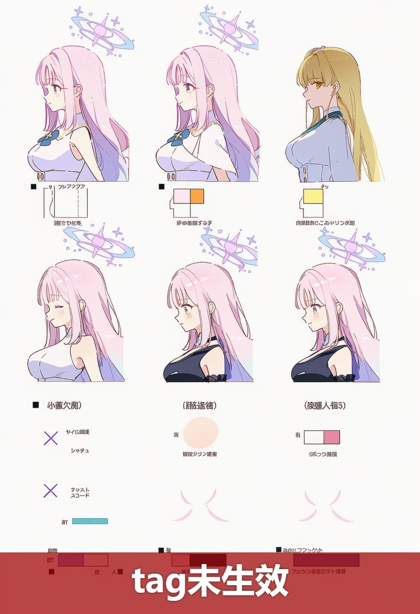

| 字段 | 内容 |
| --- | --- |
| 序号 | 0081 |
| tag | bust_chart |
| tag中文名 | 胸像参考图 |
| tag中文含义 | 单个角色胸部以上的多角度参考图 |
| tag所属子类 | 布局风格 |

## 82. multiple_views — 同一角色从正面、侧面、背面等多个角度展示

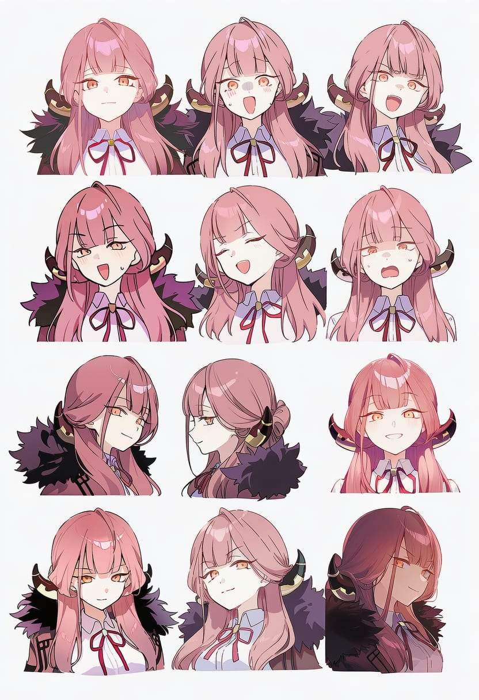

| 字段 | 内容 |
| --- | --- |
| 序号 | 0082 |
| tag | multiple_views |
| tag中文名 | 多视图 |
| tag中文含义 | 同一角色从正面、侧面、背面等多个角度展示 |
| tag所属子类 | 布局风格 |

## 83. group_picture — 一群角色聚在一起拍合影

| 字段 | 内容 |
| --- | --- |
| 序号 | 0083 |
| tag | group_picture |
| tag中文名 | 集体合影 |
| tag中文含义 | 一群角色聚在一起拍合影 |
| tag所属子类 | 布局风格 |

## 84. everyone — 作品中所有角色全部出现在画面中

| 字段 | 内容 |
| --- | --- |
| 序号 | 0084 |
| tag | everyone |
| tag中文名 | 全员登场 |
| tag中文含义 | 作品中所有角色全部出现在画面中 |
| tag所属子类 | 布局风格 |

## 85. absolutely_everyone — 几乎所有角色都登场的超大型集合图

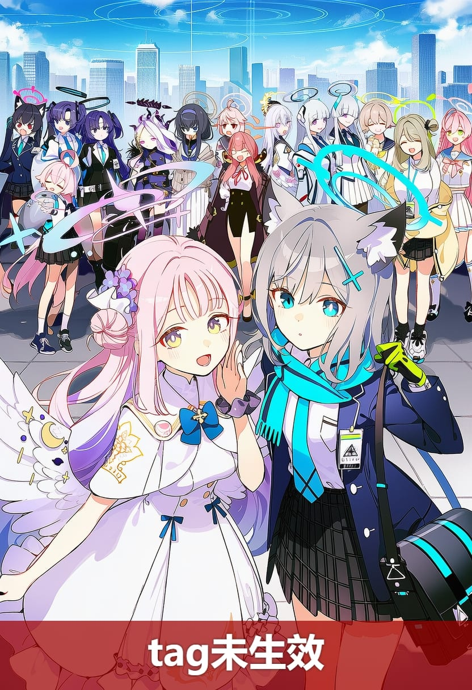

| 字段 | 内容 |
| --- | --- |
| 序号 | 0085 |
| tag | absolutely_everyone |
| tag中文名 | 全员大集合 |
| tag中文含义 | 几乎所有角色都登场的超大型集合图 |
| tag所属子类 | 布局风格 |

## 86. tachi-e — 单个角色全身正面站立的标准立绘

| 字段 | 内容 |
| --- | --- |
| 序号 | 0086 |
| tag | tachi-e |
| tag中文名 | 立绘 |
| tag中文含义 | 单个角色全身正面站立的标准立绘 |
| tag所属子类 | 布局风格 |

---
