## 1. head_wings — 头翼

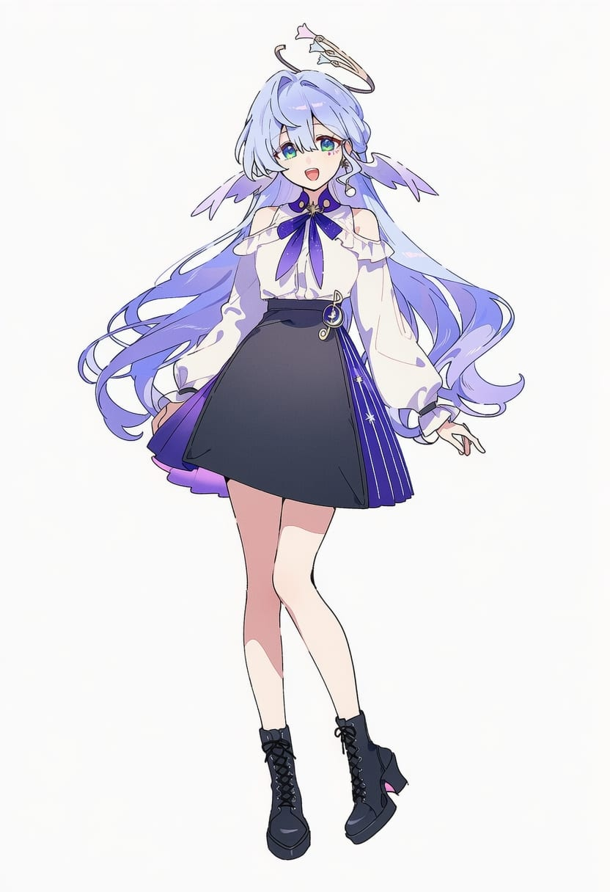

| 字段 | 内容 |
| --- | --- |
| 序号 | 1 |
| tag | head_wings |
| 中文名 | 头翼 |
| 含义 | 头部两侧或头顶长出的翅膀（常见于天使、恶魔、鸟人等角色）。 |
| tag串 | 1girl, head_wings, white_wings, long_hair, blonde_hair, blue_eyes, looking_at_viewer, robin (honkai: star rail) |

## 2. horns — 角

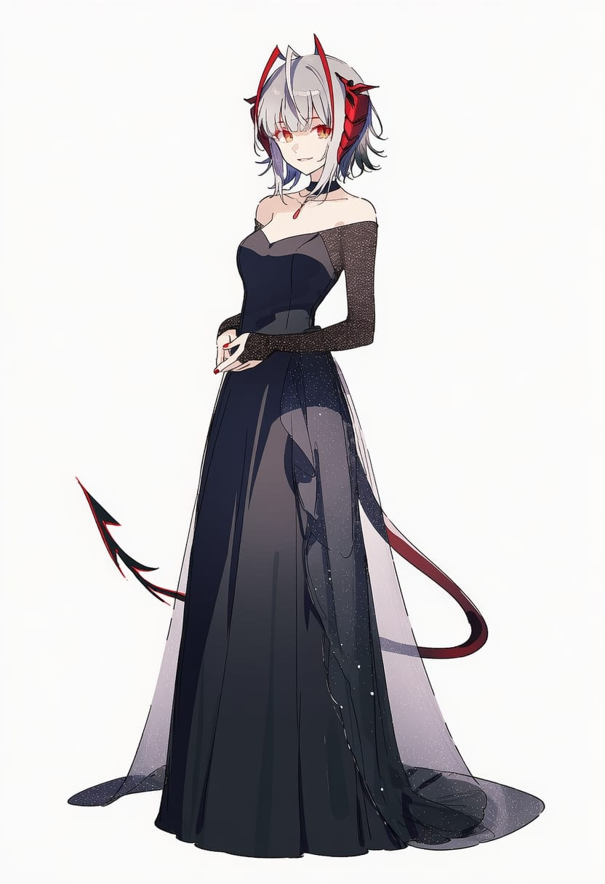

| 字段 | 内容 |
| --- | --- |
| 序号 | 2 |
| tag | horns |
| 中文名 | 角 |
| 含义 | 头上的角（恶魔、龙、牛角等）。 |
| tag串 | 1girl, horns, demon_horns, red_eyes, black_hair, looking_at_viewer, w_(arknights) |

## 3. long_hair — 长发

| 字段 | 内容 |
| --- | --- |
| 序号 | 3 |
| tag | long_hair |
| 中文名 | 长发 |
| 含义 | 长度超过肩膀的长头发，没有单独tag，多作为描述一部分出现。 |
| tag串 | 1girl, long_hair, black_hair, looking_at_viewer, raiden_shogun |

## 4. forehead — 额头

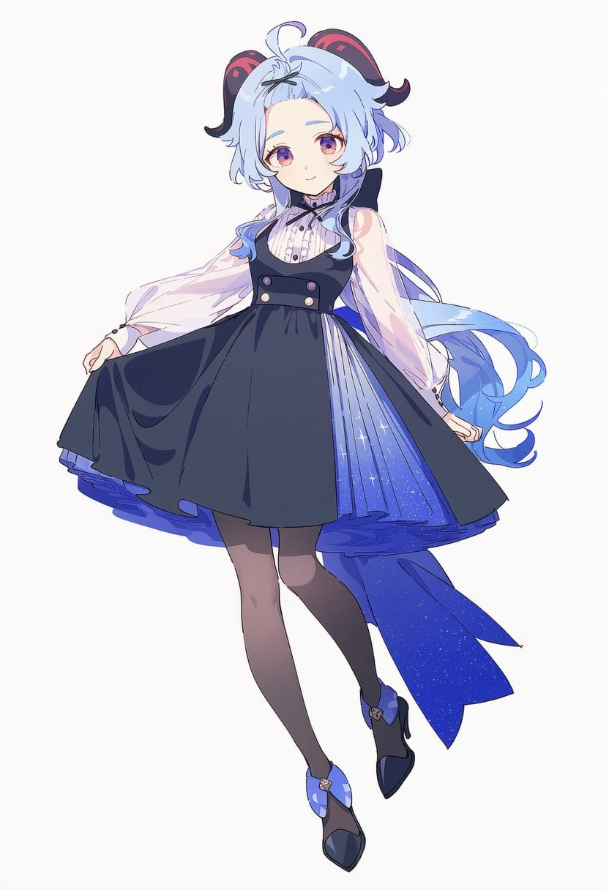

| 字段 | 内容 |
| --- | --- |
| 序号 | 4 |
| tag | forehead |
| 中文名 | 额头 |
| 含义 | 前额部位。 |
| tag串 | 1girl, forehead, bangs, blue_eyes, looking_at_viewer, ganyu_(genshin_impact) |

## 5. eyebrows — 眉毛

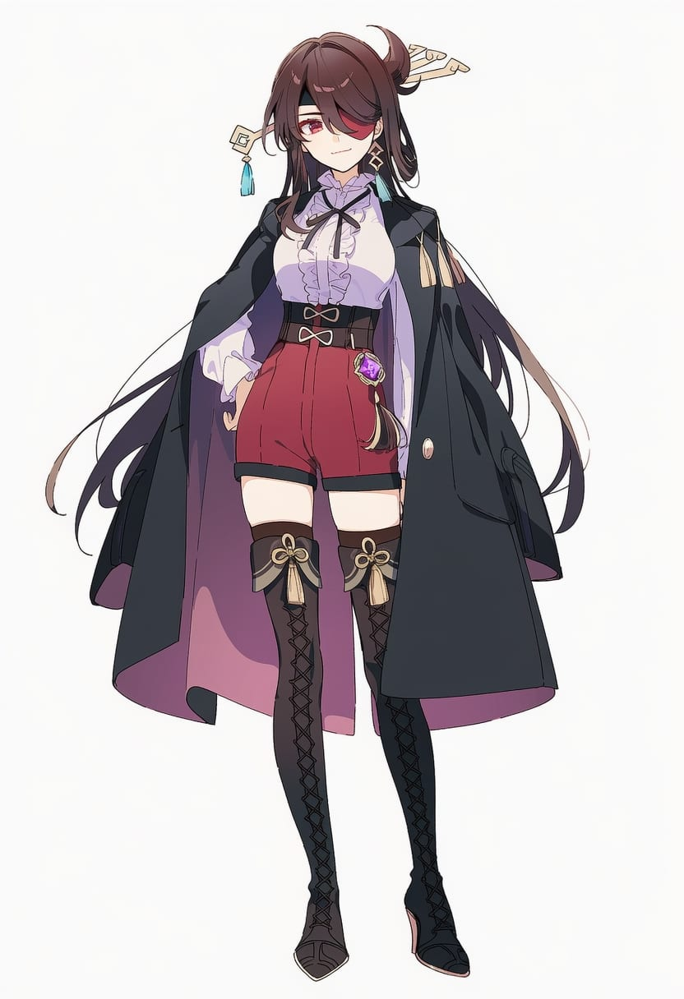

| 字段 | 内容 |
| --- | --- |
| 序号 | 5 |
| tag | eyebrows |
| 中文名 | 眉毛 |
| 含义 | 眉毛。常与颜色或形状组合（如 thick_eyebrows）。 |
| tag串 | 1girl, eyebrows, thick_eyebrows, brown_eyes, looking_at_viewer, beidou_(genshin_impact) |

## 6. blue_eyes — 蓝眼睛

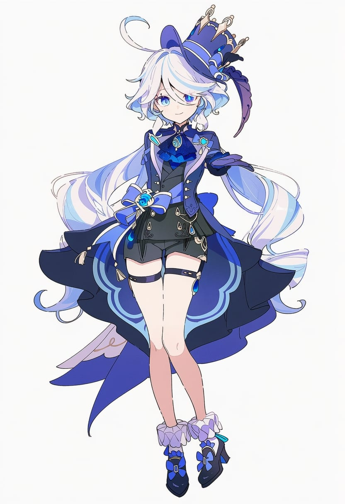

| 字段 | 内容 |
| --- | --- |
| 序号 | 6 |
| tag | blue_eyes |
| 中文名 | 蓝眼睛 |
| 含义 | 蓝色眼睛。眼睛本身没有独立常用tag，几乎都用颜色+eyes组合（如 blue_eyes、red_eyes）。 |
| tag串 | 1girl, blue_eyes, long_hair, looking_at_viewer, furina_(genshin_impact) |

## 7. pointy_ears — 尖耳朵

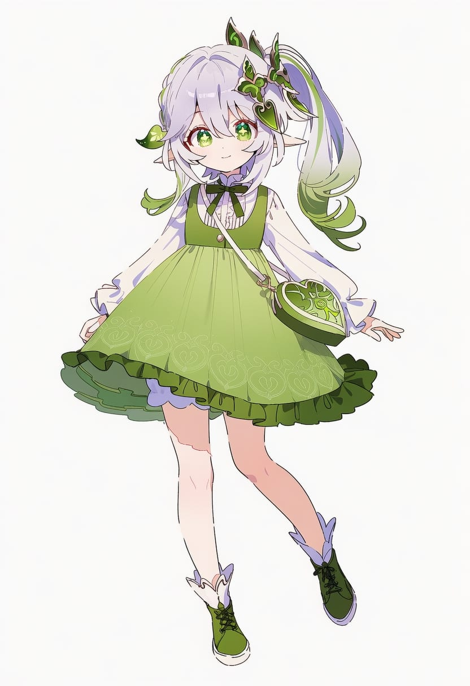

| 字段 | 内容 |
| --- | --- |
| 序号 | 7 |
| tag | pointy_ears |
| 中文名 | 尖耳朵 |
| 含义 | 尖尖的耳朵（精灵、妖精、兽耳等）。耳朵没有单独tag，多作为描述的一部分出现。 |
| tag串 | 1girl, pointy_ears, elf, blonde_hair, green_eyes, looking_at_viewer, nahida_(genshin_impact) |

## 8. nose — 鼻子

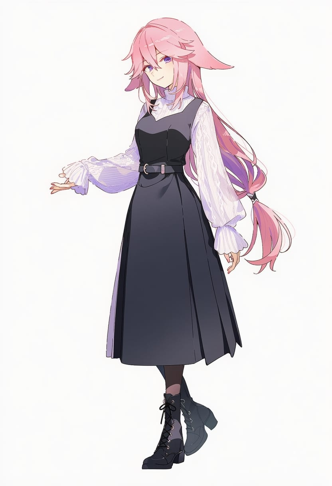

| 字段 | 内容 |
| --- | --- |
| 序号 | 8 |
| tag | nose |
| 中文名 | 鼻子 |
| 含义 | 鼻子。单独出现较少，多用于强调或特殊形状。 |
| tag串 | 1girl, nose, closed_mouth, looking_at_viewer, yae_miko |

## 9. closed_mouth — 闭嘴

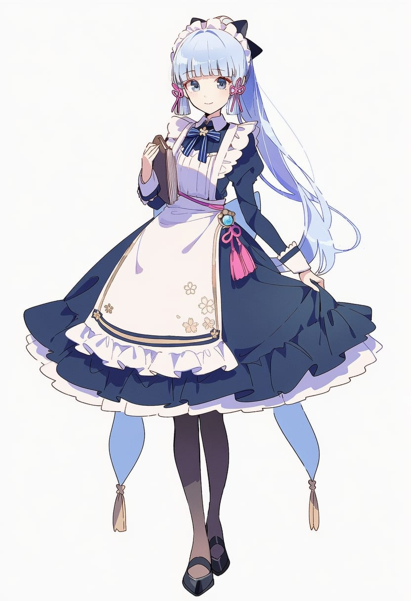

| 字段 | 内容 |
| --- | --- |
| 序号 | 9 |
| tag | closed_mouth |
| 中文名 | 闭嘴 |
| 含义 | 嘴巴闭合的状态。嘴巴没有单独tag，多作为描述的一部分出现。 |
| tag串 | 1girl, closed_mouth, smile, blue_eyes, looking_at_viewer, kamisato_ayaka |

## 10. lips — 嘴唇

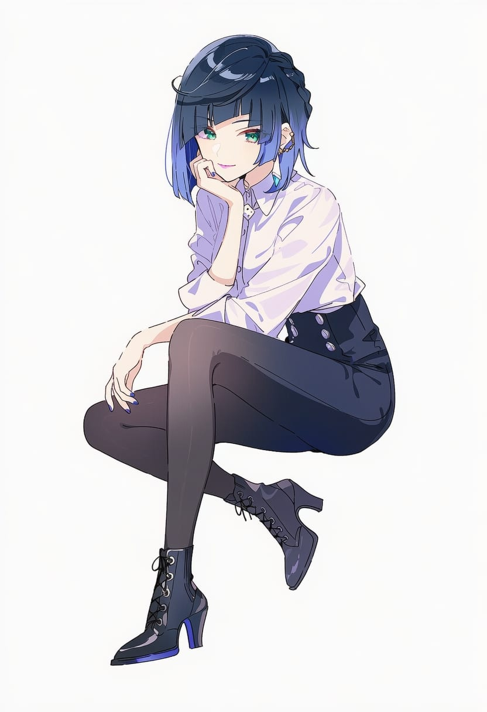

| 字段 | 内容 |
| --- | --- |
| 序号 | 10 |
| tag | lips |
| 中文名 | 嘴唇 |
| 含义 | 嘴唇。常与颜色或状态组合（如 plump_lips）。 |
| tag串 | 1girl, lips, pink_lips, looking_at_viewer, yelan_(genshin_impact) |

## 11. teeth — 牙齿

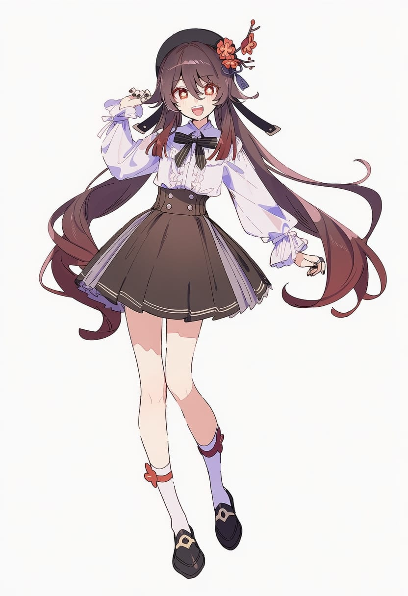

| 字段 | 内容 |
| --- | --- |
| 序号 | 11 |
| tag | teeth |
| 中文名 | 牙齿 |
| 含义 | 露出的牙齿。 |
| tag串 | 1girl, teeth, open_mouth, smile, looking_at_viewer, hu_tao_(genshin_impact) |

## 12. fangs — 尖牙/獠牙

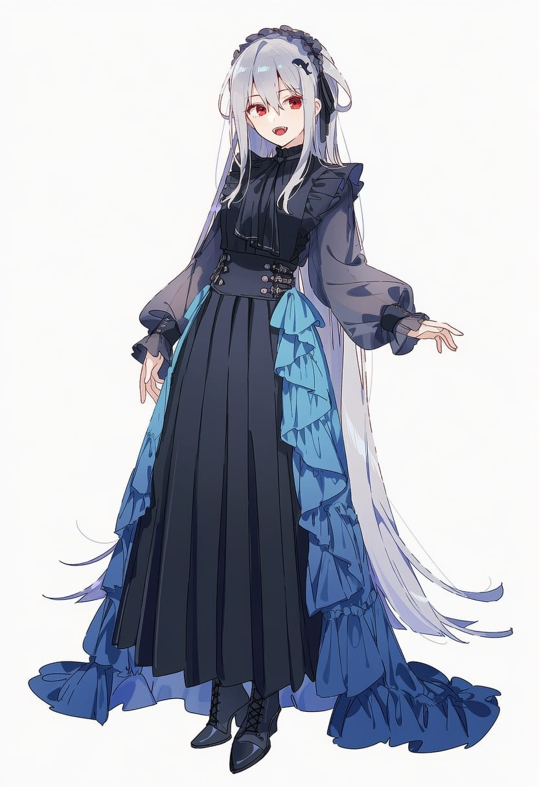

| 字段 | 内容 |
| --- | --- |
| 序号 | 12 |
| tag | fangs |
| 中文名 | 尖牙/獠牙 |
| 含义 | 尖尖的犬齿或獠牙（吸血鬼、兽人常见）。 |
| tag串 | 1girl, fangs, open_mouth, red_eyes, looking_at_viewer, skadi_(arknights) |

## 13. tongue — 舌头

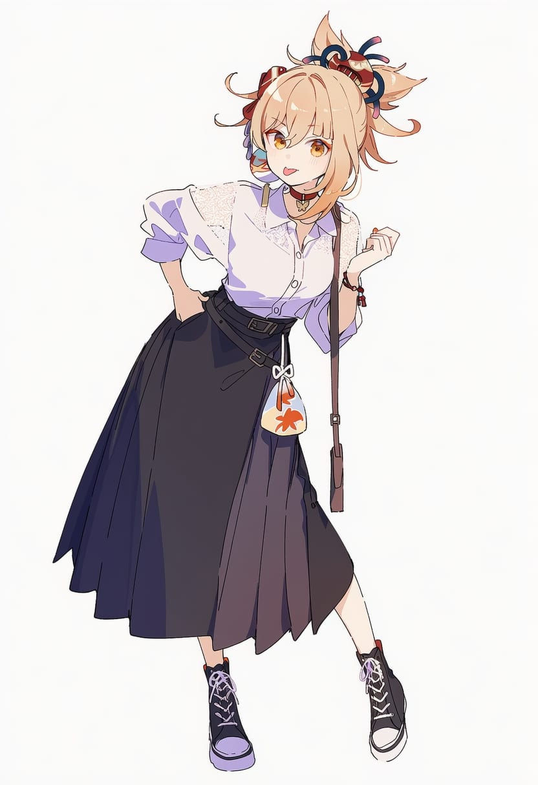

| 字段 | 内容 |
| --- | --- |
| 序号 | 13 |
| tag | tongue |
| 中文名 | 舌头 |
| 含义 | 伸出或可见的舌头。 |
| tag串 | 1girl, tongue, tongue_out, open_mouth, looking_at_viewer, yoimiya_(genshin_impact) |

## 14. uvula — 悬雍垂/小舌头

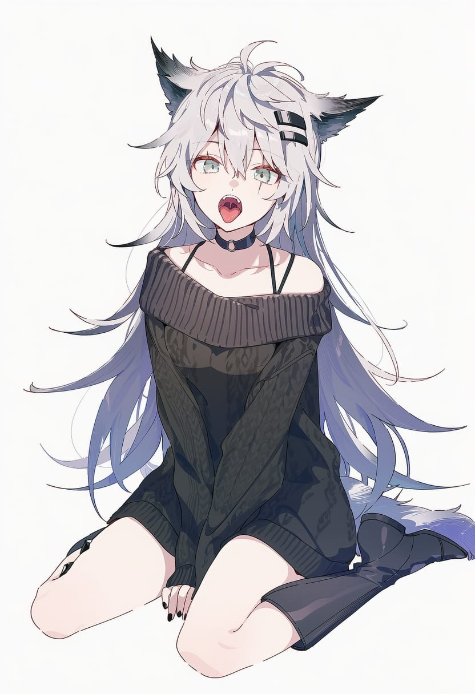

| 字段 | 内容 |
| --- | --- |
| 序号 | 14 |
| tag | uvula |
| 中文名 | 悬雍垂/小舌头 |
| 含义 | 张大嘴时可见的小舌头（口腔内部细节）。 |
| tag串 | 1girl, uvula, open_mouth, tongue, looking_at_viewer, lappland_(arknights) |

## 15. puffy_cheeks — 鼓起的脸颊

| 字段 | 内容 |
| --- | --- |
| 序号 | 15 |
| tag | puffy_cheeks |
| 中文名 | 鼓起的脸颊 |
| 含义 | 脸颊鼓起来的样子（吃东西或撒娇时）。脸颊没有单独tag，多作为描述的一部分出现。 |
| tag串 | 1girl, puffy_cheeks, closed_eyes, blush, looking_at_viewer, klee_(genshin_impact) |

## 16. neck_ribbon — 颈带/颈饰丝带

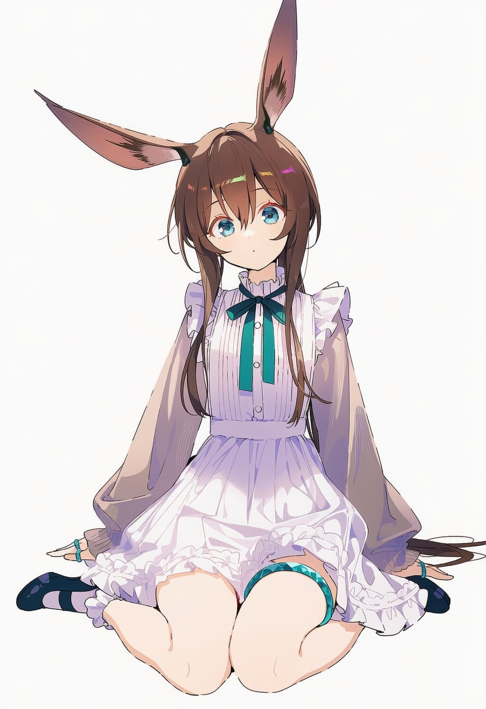

| 字段 | 内容 |
| --- | --- |
| 序号 | 16 |
| tag | neck_ribbon |
| 中文名 | 颈带/颈饰丝带 |
| 含义 | 系在脖子上的丝带或领结。颈部没有单独tag，多作为描述的一部分出现。 |
| tag串 | 1girl, neck_ribbon, long_hair, looking_at_viewer, amiya_(arknights) |

## 17. nape — 后颈

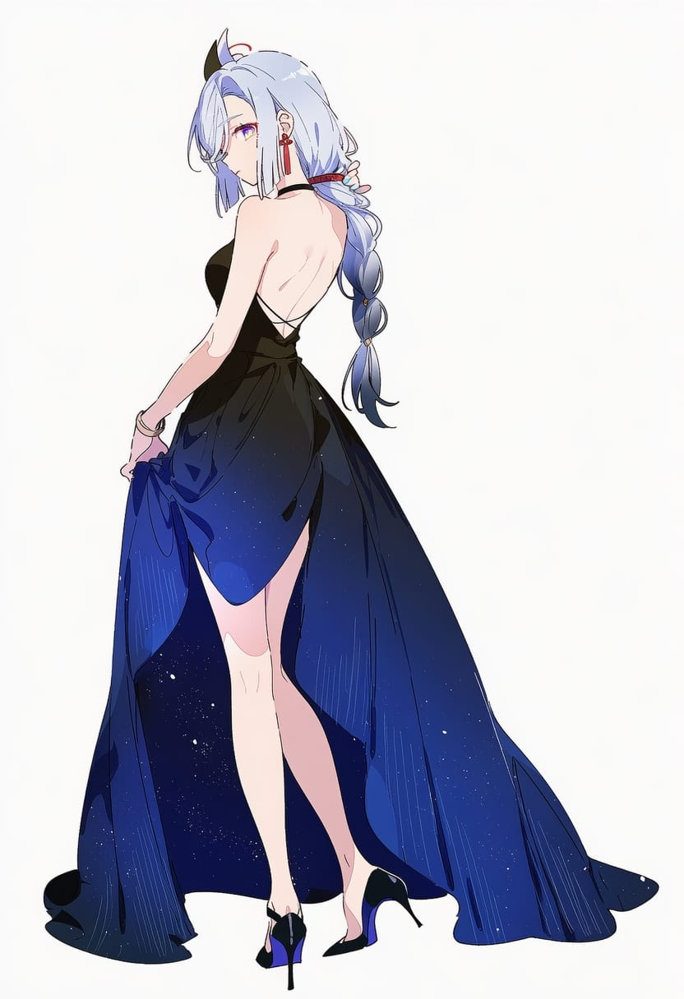

| 字段 | 内容 |
| --- | --- |
| 序号 | 17 |
| tag | nape |
| 中文名 | 后颈 |
| 含义 | 脖子后面的部位（从后视角可见）。 |
| tag串 | 1girl, nape, from_behind, long_hair, looking_back, shenhe_(genshin_impact) |

## 18. moustache — 小胡子/八字胡

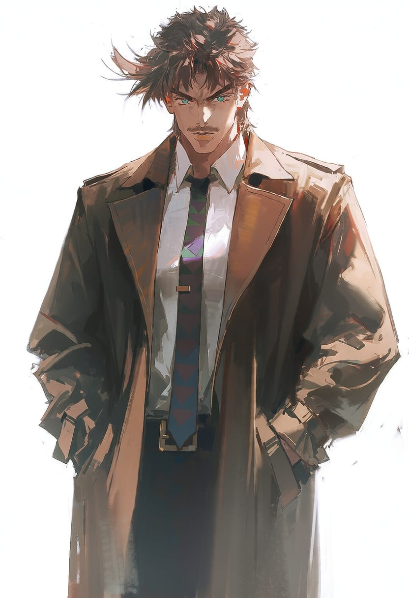

| 字段 | 内容 |
| --- | --- |
| 序号 | 18 |
| tag | moustache |
| 中文名 | 小胡子/八字胡 |
| 含义 | 上唇上方的胡子。 |
| tag串 | 1boy, moustache, mature_male, looking_at_viewer, joseph_joestar |

## 19. beard — 胡须/络腮胡

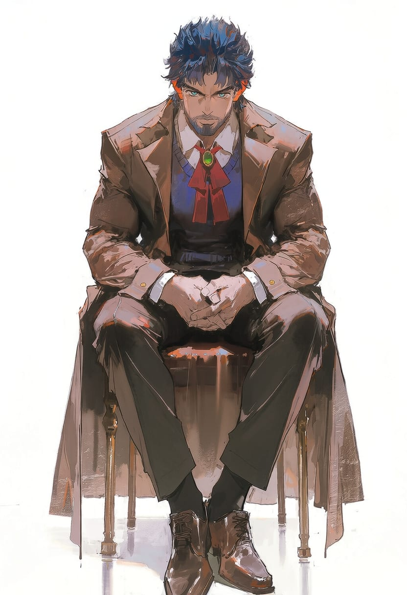

| 字段 | 内容 |
| --- | --- |
| 序号 | 19 |
| tag | beard |
| 中文名 | 胡须/络腮胡 |
| 含义 | 下巴或脸颊的胡须。 |
| tag串 | 1boy, beard, mature_male, looking_at_viewer, jonathan_joestar |

## 20. sideburns — 鬓角

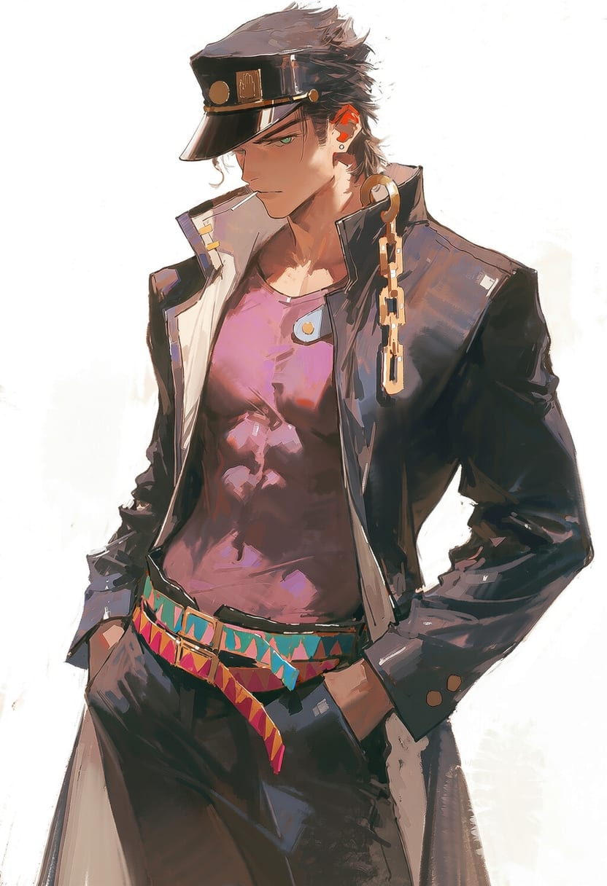

| 字段 | 内容 |
| --- | --- |
| 序号 | 20 |
| tag | sideburns |
| 中文名 | 鬓角 |
| 含义 | 脸颊两侧的鬓角毛发。 |
| tag串 | 1boy, sideburns, short_hair, looking_at_viewer, jotaro_kujo |

## 21. bare_shoulders — 裸肩

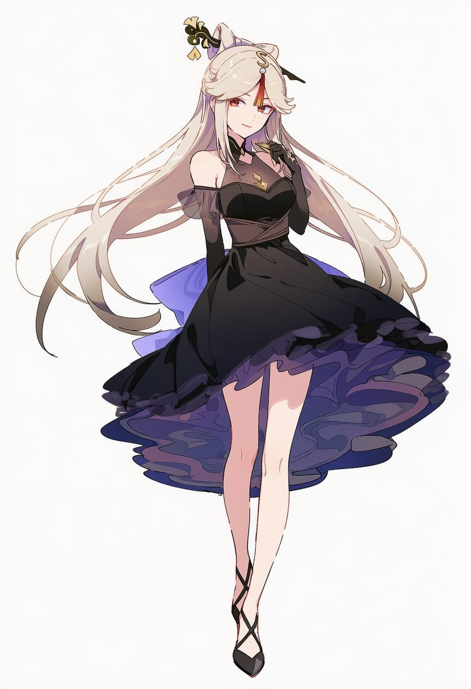

| 字段 | 内容 |
| --- | --- |
| 序号 | 21 |
| tag | bare_shoulders |
| 中文名 | 裸肩 |
| 含义 | 肩膀裸露（无袖或露肩服装）。 |
| tag串 | 1girl, bare_shoulders, off_shoulder, looking_at_viewer, ningguang_(genshin_impact) |

## 22. collarbone — 锁骨

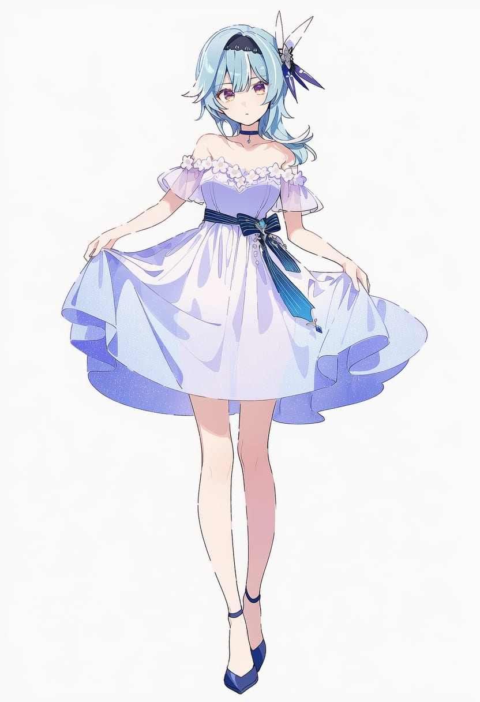

| 字段 | 内容 |
| --- | --- |
| 序号 | 22 |
| tag | collarbone |
| 中文名 | 锁骨 |
| 含义 | 锁骨部位清晰可见。 |
| tag串 | 1girl, collarbone, bare_shoulders, looking_at_viewer, eula_(genshin_impact) |

## 23. shoulder_blades — 肩胛骨

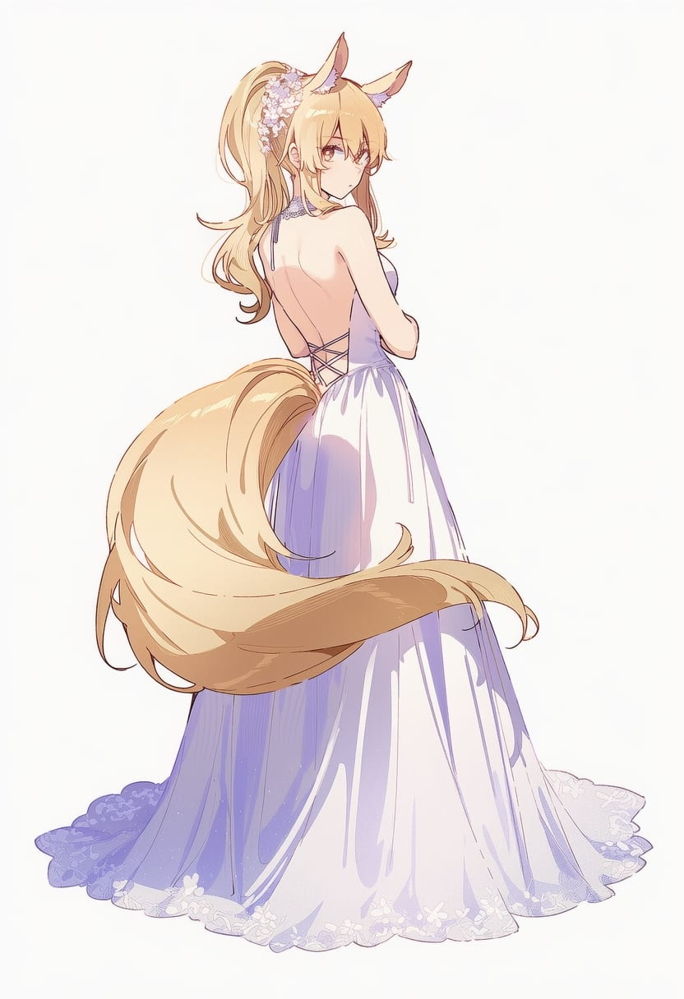

| 字段 | 内容 |
| --- | --- |
| 序号 | 23 |
| tag | shoulder_blades |
| 中文名 | 肩胛骨 |
| 含义 | 后背的肩胛骨（多从后视角）。 |
| tag串 | 1girl, shoulder_blades, from_behind, bare_back, looking_back, nearl_(arknights) |

## 24. breasts — 胸部

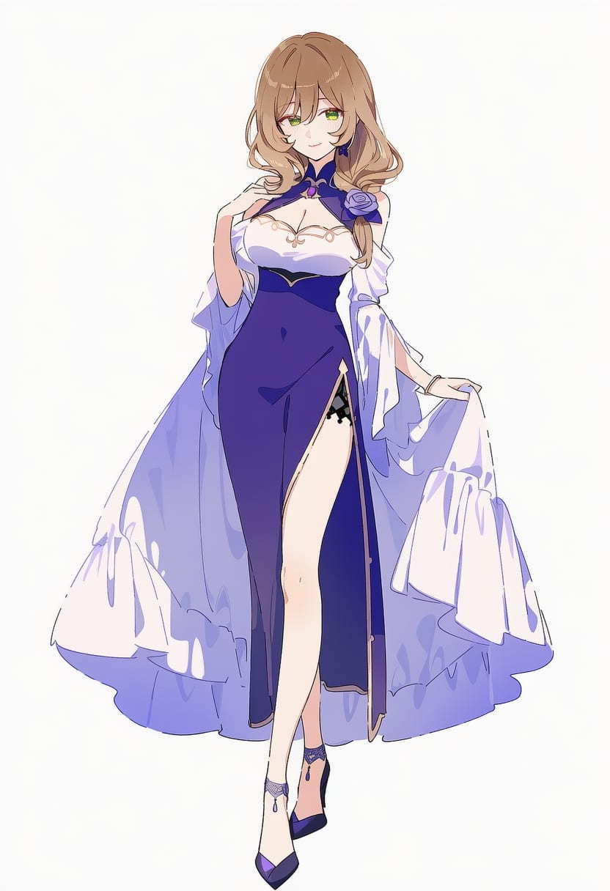

| 字段 | 内容 |
| --- | --- |
| 序号 | 24 |
| tag | breasts |
| 中文名 | 胸部 |
| 含义 | 女性胸部。常与大小组合（如 large_breasts）。 |
| tag串 | 1girl, breasts, large_breasts, looking_at_viewer, lisa_(genshin_impact) |

## 25. cleavage — 乳沟

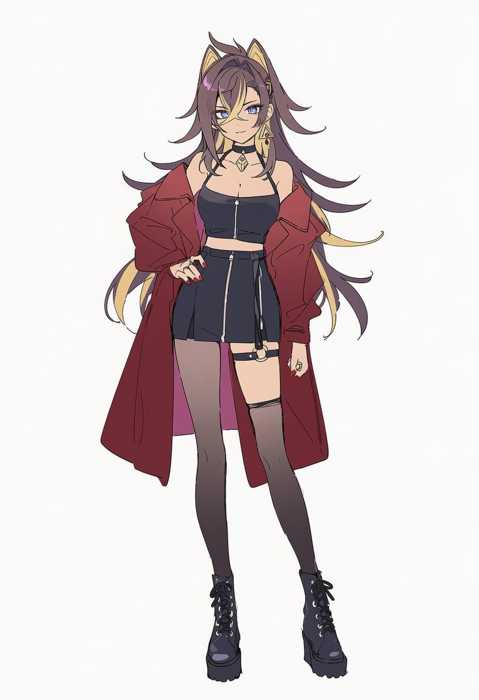

| 字段 | 内容 |
| --- | --- |
| 序号 | 25 |
| tag | cleavage |
| 中文名 | 乳沟 |
| 含义 | 胸部之间的沟壑。 |
| tag串 | 1girl, cleavage, large_breasts, looking_at_viewer, dehya_(genshin_impact) |

## 26. pectorals — 胸肌

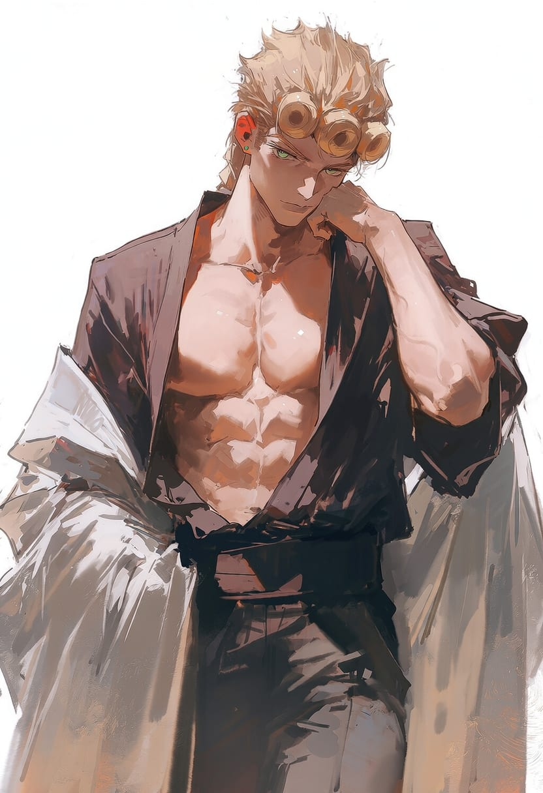

| 字段 | 内容 |
| --- | --- |
| 序号 | 26 |
| tag | pectorals |
| 中文名 | 胸肌 |
| 含义 | 男性或肌肉型角色的胸肌。 |
| tag串 | 1boy, pectorals, muscular, looking_at_viewer, giorno_giovanna |

## 27. muscular — 肌肉发达

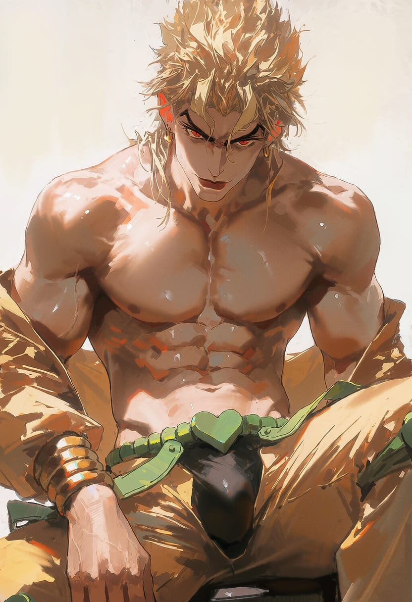

| 字段 | 内容 |
| --- | --- |
| 序号 | 27 |
| tag | muscular |
| 中文名 | 肌肉发达 |
| 含义 | 整体肌肉明显的身材。 |
| tag串 | 1boy, muscular, abs, looking_at_viewer, dio_brando |

## 28. ribs — 肋骨

| 字段 | 内容 |
| --- | --- |
| 序号 | 28 |
| tag | ribs |
| 中文名 | 肋骨 |
| 含义 | 肋骨轮廓可见（偏瘦或特定姿势）。 |
| tag串 | 1girl, ribs, thin, looking_at_viewer, mona_(genshin_impact) |

## 29. armpits — 腋下

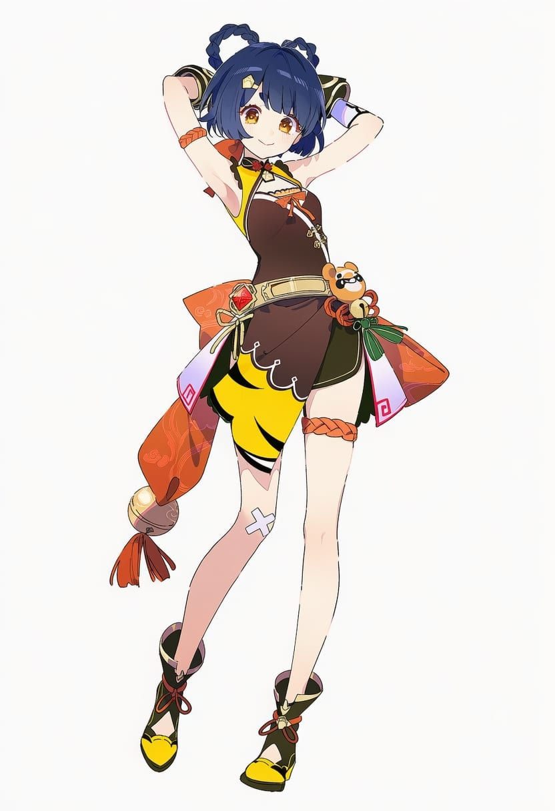

| 字段 | 内容 |
| --- | --- |
| 序号 | 29 |
| tag | armpits |
| 中文名 | 腋下 |
| 含义 | 腋下部位（举手或特定姿势时可见）。 |
| tag串 | 1girl, armpits, arms_up, looking_at_viewer, xiangling_(genshin_impact) |

## 30. bare_arms — 裸臂

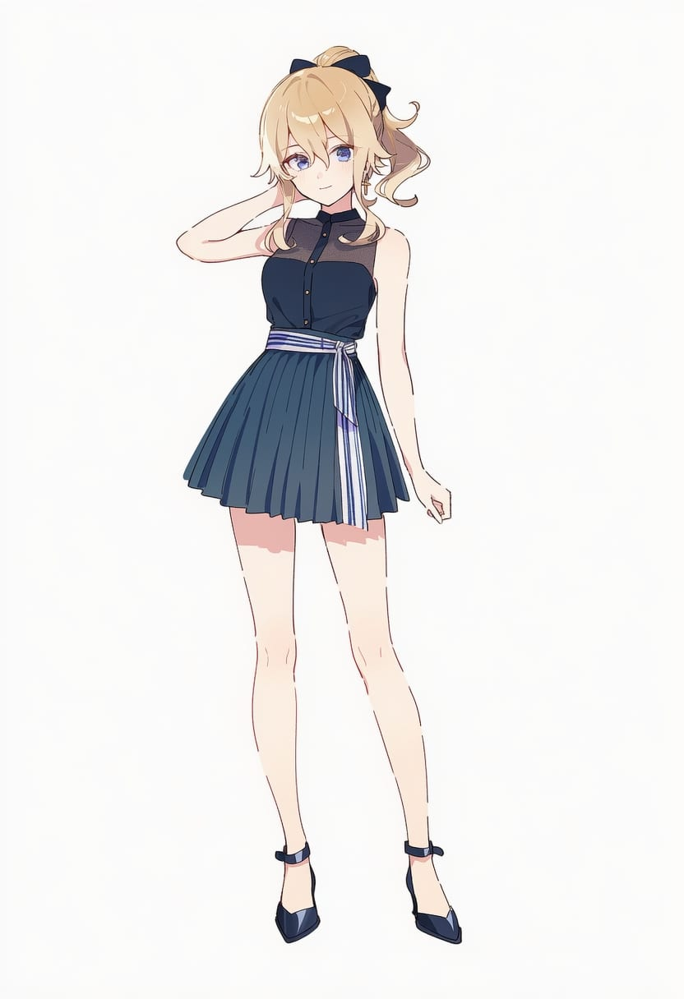

| 字段 | 内容 |
| --- | --- |
| 序号 | 30 |
| tag | bare_arms |
| 中文名 | 裸臂 |
| 含义 | 手臂没有被衣物覆盖。 |
| tag串 | 1girl, bare_arms, sleeveless, looking_at_viewer, jean_(genshin_impact) |

## 31. biceps — 肱二头肌

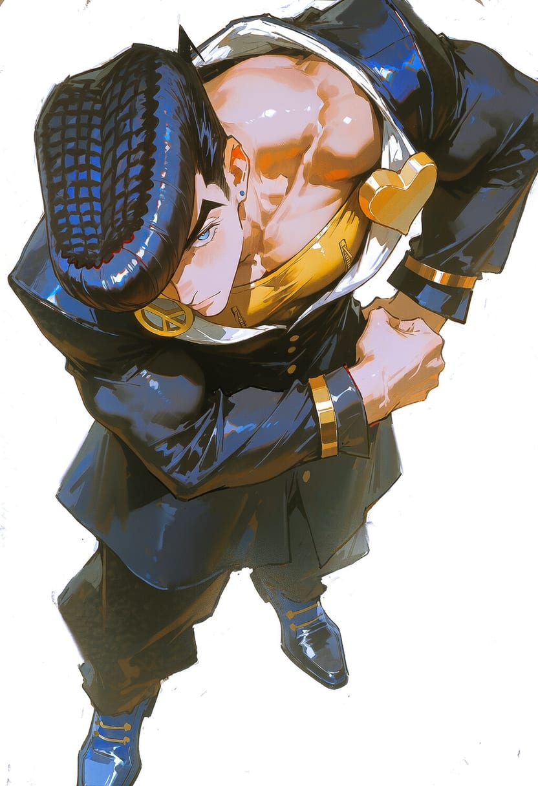

| 字段 | 内容 |
| --- | --- |
| 序号 | 31 |
| tag | biceps |
| 中文名 | 肱二头肌 |
| 含义 | 上臂的肌肉（尤其是弯曲时）。 |
| tag串 | 1boy, biceps, muscular, flexing, looking_at_viewer, josuke_higashikata |

## 32. sleeves_past_wrists — 袖子过腕

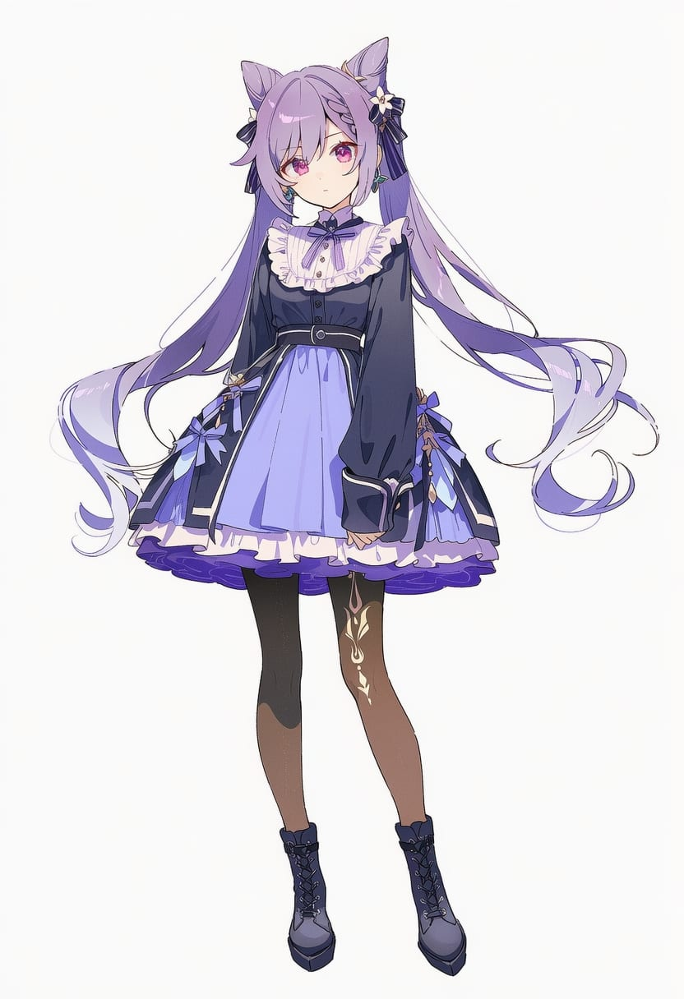

| 字段 | 内容 |
| --- | --- |
| 序号 | 32 |
| tag | sleeves_past_wrists |
| 中文名 | 袖子过腕 |
| 含义 | 袖子长度超过手腕（过长袖）。手腕没有单独tag，多作为描述的一部分出现。 |
| tag串 | 1girl, sleeves_past_wrists, long_sleeves, looking_at_viewer, keqing_(genshin_impact) |

## 33. elbows_on_table — 手肘撑桌

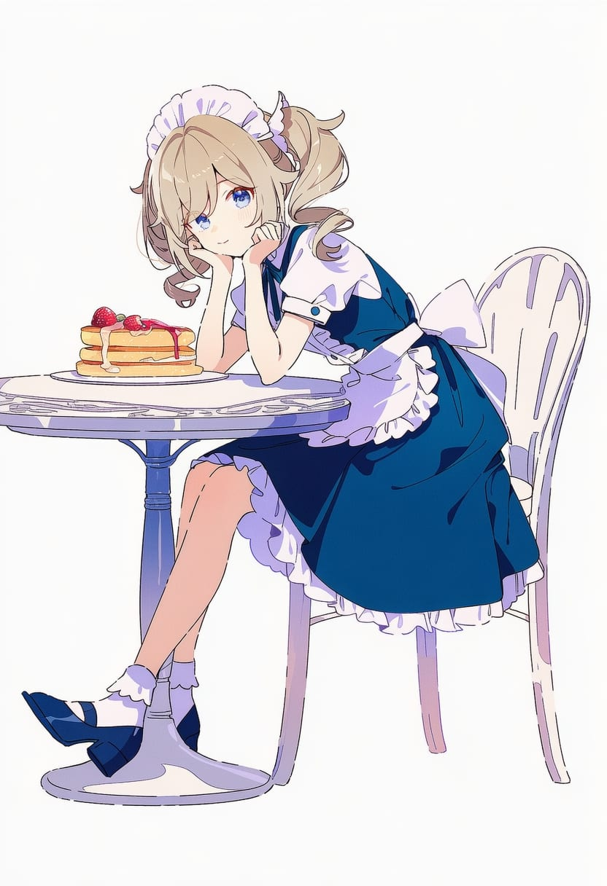

| 字段 | 内容 |
| --- | --- |
| 序号 | 33 |
| tag | elbows_on_table |
| 中文名 | 手肘撑桌 |
| 含义 | 手肘放在桌子上的姿势。手肘没有单独tag，多作为描述的一部分出现。 |
| tag串 | 1girl, elbows_on_table, sitting, table, looking_at_viewer, barbara_(genshin_impact) |

## 34. hands_up — 举手

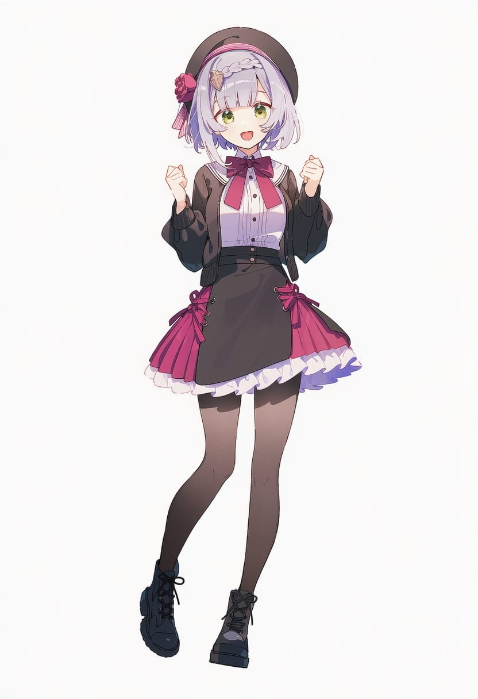

| 字段 | 内容 |
| --- | --- |
| 序号 | 34 |
| tag | hands_up |
| 中文名 | 举手 |
| 含义 | 双手举起的姿势。手没有单独tag，多作为描述的一部分出现。 |
| tag串 | 1girl, hands_up, looking_at_viewer, noelle_(genshin_impact) |

## 35. palms — 手掌

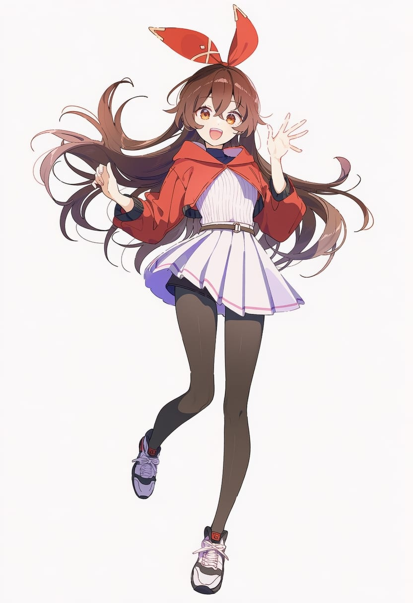

| 字段 | 内容 |
| --- | --- |
| 序号 | 35 |
| tag | palms |
| 中文名 | 手掌 |
| 含义 | 手心朝向观众或可见。 |
| tag串 | 1girl, palms, hands_up, looking_at_viewer, amber_(genshin_impact) |

## 36. index_fingers_together — 食指并拢

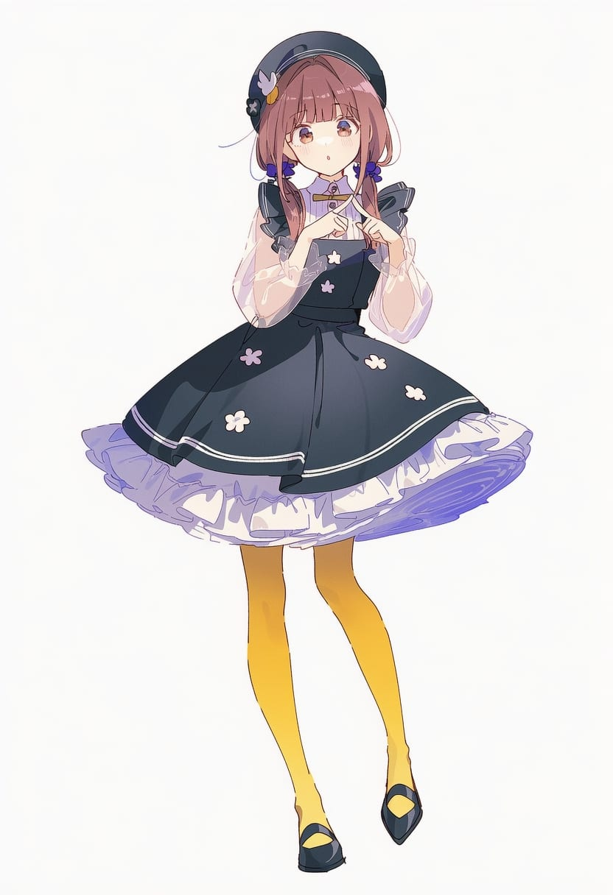

| 字段 | 内容 |
| --- | --- |
| 序号 | 36 |
| tag | index_fingers_together |
| 中文名 | 食指并拢 |
| 含义 | 两根食指尖碰在一起的手势。手指没有单独tag，多作为描述的一部分出现。 |
| tag串 | 1girl, index_fingers_together, hands_together, looking_at_viewer, purestream_(arknights) |

## 37. fingernails — 指甲

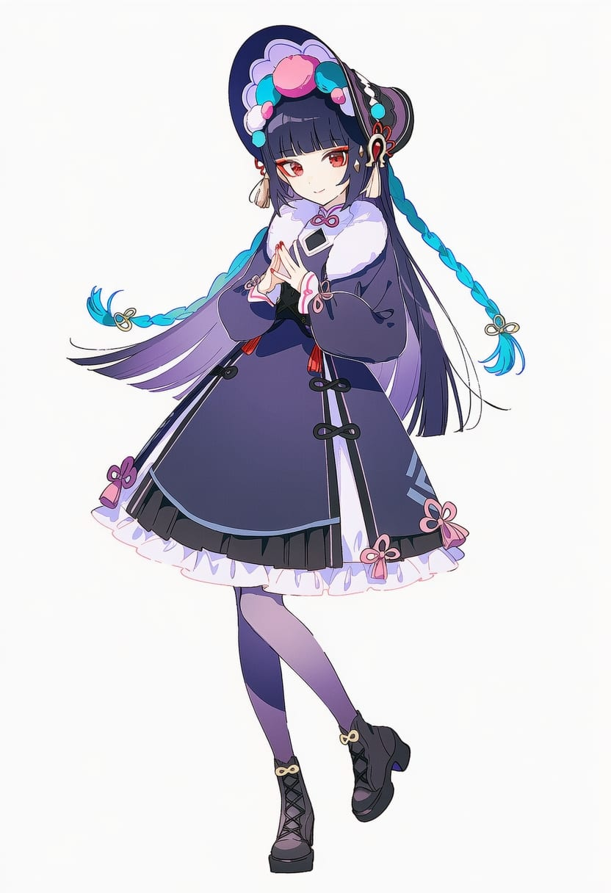

| 字段 | 内容 |
| --- | --- |
| 序号 | 37 |
| tag | fingernails |
| 中文名 | 指甲 |
| 含义 | 可见的手指甲。 |
| tag串 | 1girl, fingernails, hands, looking_at_viewer, yun_jin_(genshin_impact) |

## 38. black_nails — 黑指甲

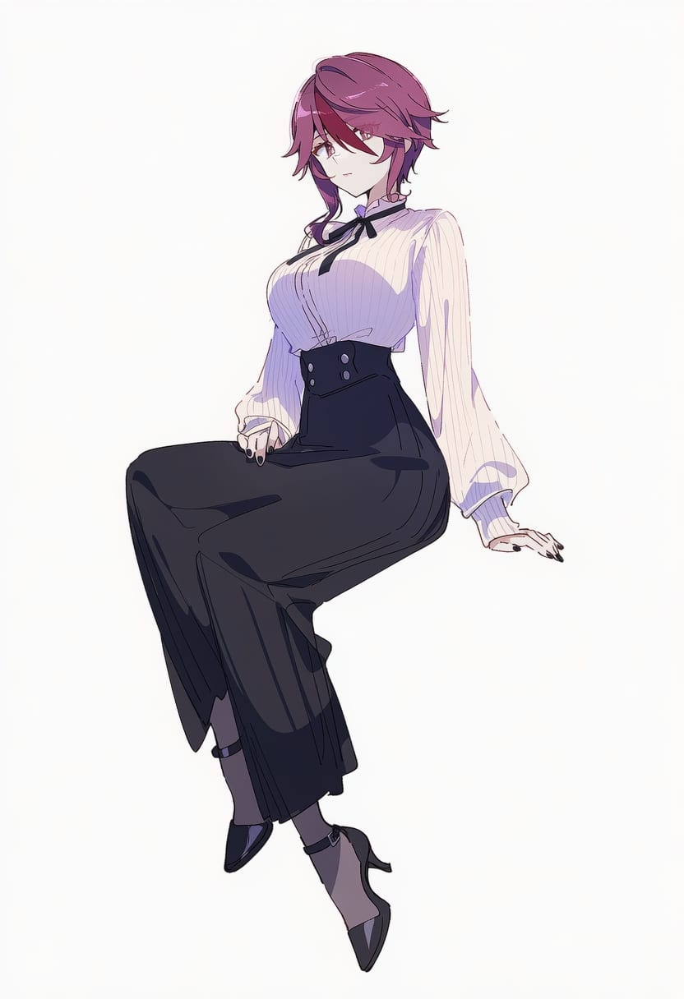

| 字段 | 内容 |
| --- | --- |
| 序号 | 38 |
| tag | black_nails |
| 中文名 | 黑指甲 |
| 含义 | 涂成黑色的指甲。 |
| tag串 | 1girl, black_nails, fingernails, looking_at_viewer, rosaria_(genshin_impact) |

## 39. nail_polish — 指甲油

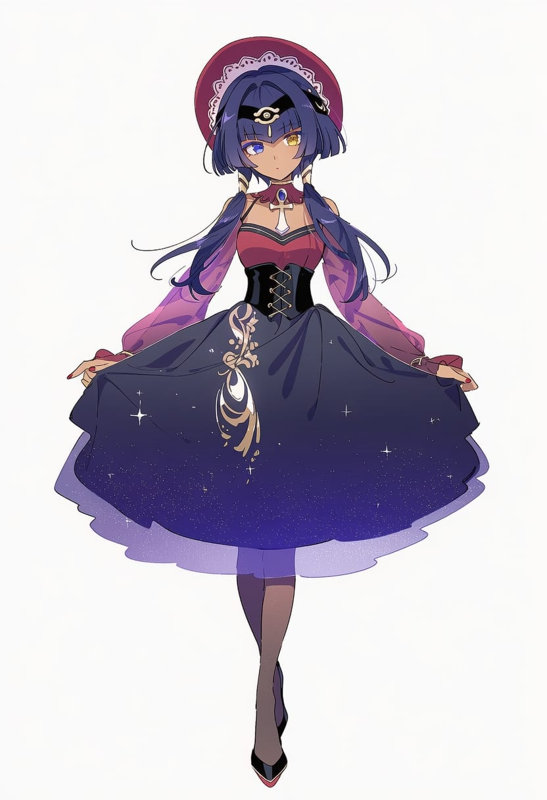

| 字段 | 内容 |
| --- | --- |
| 序号 | 39 |
| tag | nail_polish |
| 中文名 | 指甲油 |
| 含义 | 涂了指甲油的指甲（可指定颜色）。 |
| tag串 | 1girl, nail_polish, red_nails, fingernails, looking_at_viewer, candace_(genshin_impact) |

## 40. stomach — 腹部/胃部

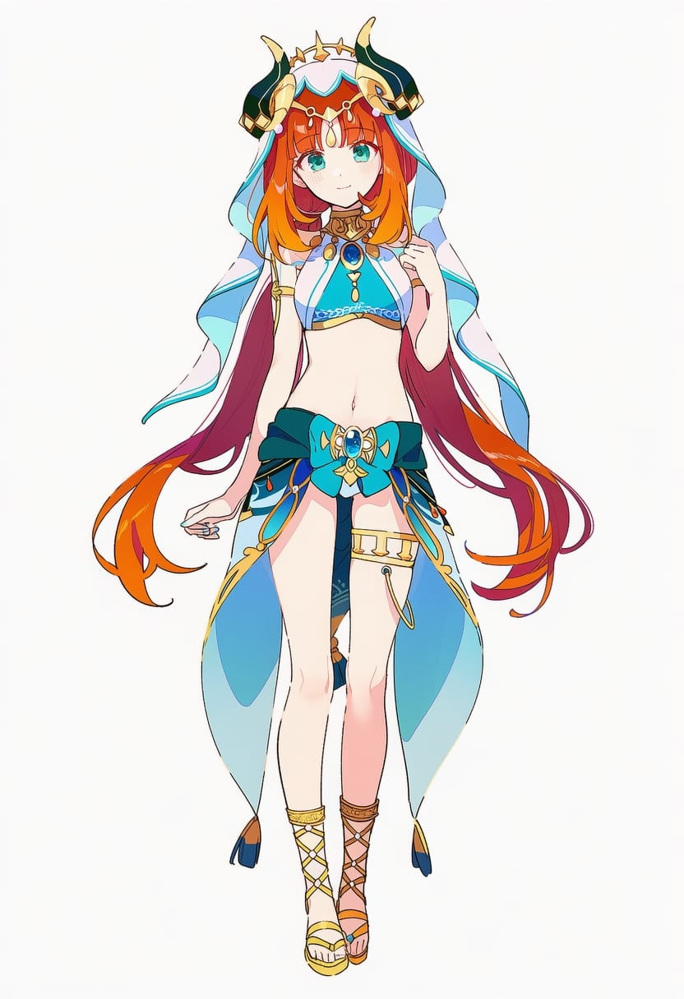

| 字段 | 内容 |
| --- | --- |
| 序号 | 40 |
| tag | stomach |
| 中文名 | 腹部/胃部 |
| 含义 | 肚子正面（较中性描述）。 |
| tag串 | 1girl, stomach, navel, looking_at_viewer, nilou_(genshin_impact) |

## 41. belly — 肚子

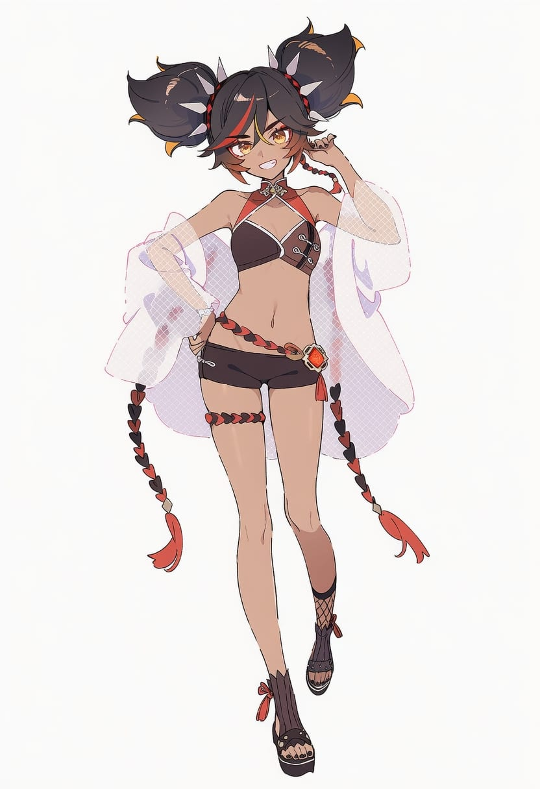

| 字段 | 内容 |
| --- | --- |
| 序号 | 41 |
| tag | belly |
| 中文名 | 肚子 |
| 含义 | 腹部（常指圆润或露出的肚子）。通常指小肚子/小腹，可搭配其他tag生成胖胖的小肚子。 |
| tag串 | 1girl, belly, navel, looking_at_viewer, xinyan_(genshin_impact) |

## 42. midriff — 露腰/腰部

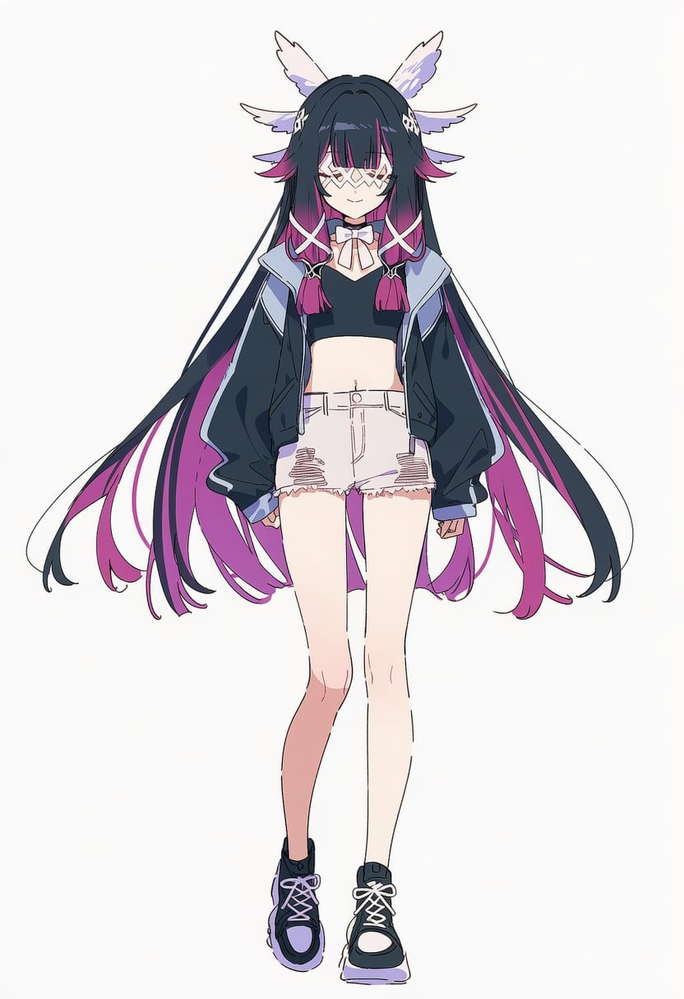

| 字段 | 内容 |
| --- | --- |
| 序号 | 42 |
| tag | midriff |
| 中文名 | 露腰/腰部 |
| 含义 | 腰部露出的部位（短上衣常见）。 |
| tag串 | 1girl, midriff, navel, crop_top, looking_at_viewer, columbina_(genshin_impact) |

## 43. abs — 腹肌

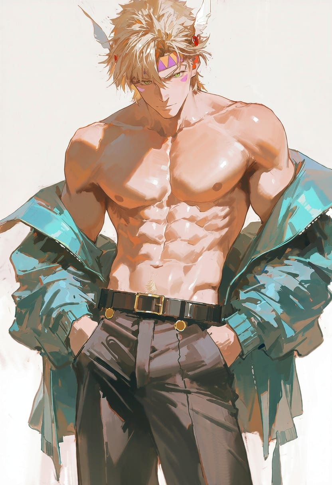

| 字段 | 内容 |
| --- | --- |
| 序号 | 43 |
| tag | abs |
| 中文名 | 腹肌 |
| 含义 | 清晰的腹部肌肉线条。 |
| tag串 | 1boy, abs, muscular, looking_at_viewer, caesar_anthonio_zeppeli |

## 44. navel — 肚脐

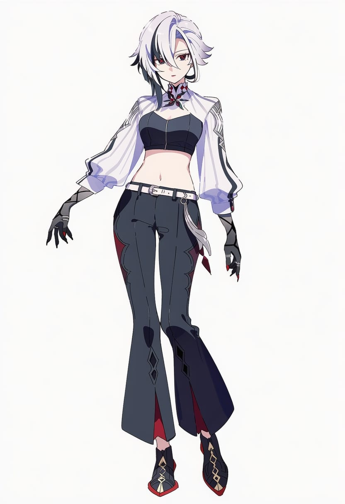

| 字段 | 内容 |
| --- | --- |
| 序号 | 44 |
| tag | navel |
| 中文名 | 肚脐 |
| 含义 | 肚脐眼可见。 |
| tag串 | 1girl, navel, midriff, looking_at_viewer, arlecchino_(genshin_impact) |

## 45. waist_apron — 腰围裙

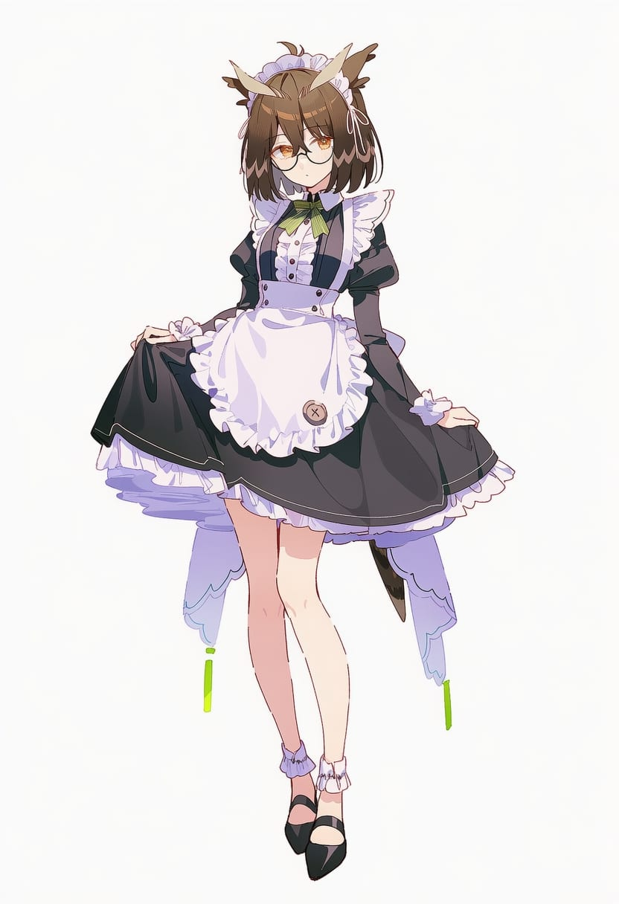

| 字段 | 内容 |
| --- | --- |
| 序号 | 45 |
| tag | waist_apron |
| 中文名 | 腰围裙 |
| 含义 | 系在腰间的围裙。腰部没有单独tag，多作为描述的一部分出现。 |
| tag串 | 1girl, waist_apron, apron, looking_at_viewer, silence_(arknights) |

## 46. wide_hips — 宽臀

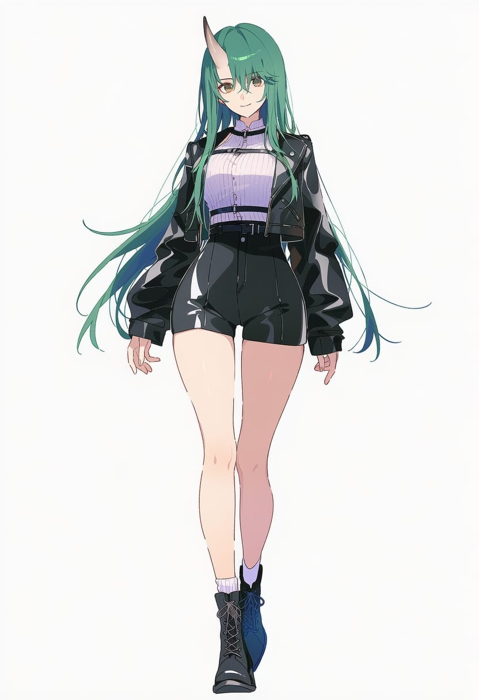

| 字段 | 内容 |
| --- | --- |
| 序号 | 46 |
| tag | wide_hips |
| 中文名 | 宽臀 |
| 含义 | 臀部较宽的体型。臀部没有单独tag，多作为描述的一部分出现。 |
| tag串 | 1girl, wide_hips, thick_thighs, looking_at_viewer, hoshiguma_(arknights) |

## 47. obliques — 腹斜肌

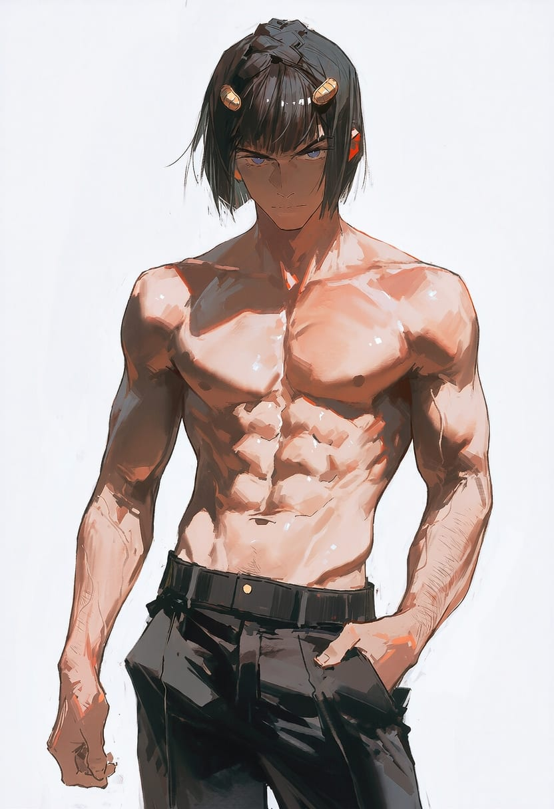

| 字段 | 内容 |
| --- | --- |
| 序号 | 47 |
| tag | obliques |
| 中文名 | 腹斜肌 |
| 含义 | 侧面腹部的肌肉线条。 |
| tag串 | 1boy, obliques, muscular, abs, looking_at_viewer, bruno_bucciarati |

## 48. groin — 胯部/腹股沟

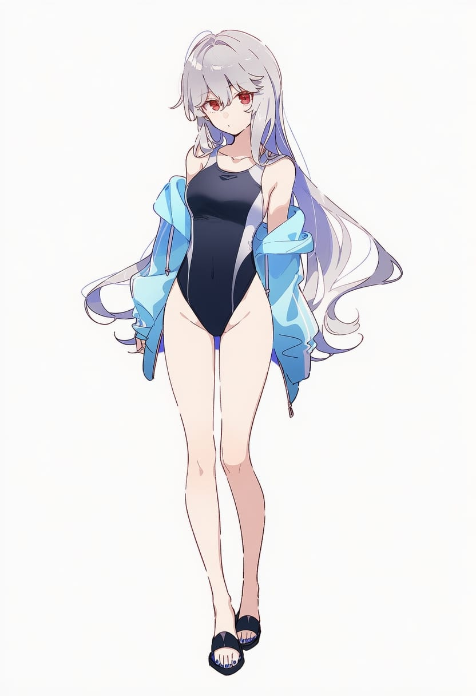

| 字段 | 内容 |
| --- | --- |
| 序号 | 48 |
| tag | groin |
| 中文名 | 胯部/腹股沟 |
| 含义 | 大腿根部与下腹部交界处。 |
| tag串 | 1girl, groin, thighs, looking_at_viewer, specter_(arknights) |

## 49. ass — 臀部

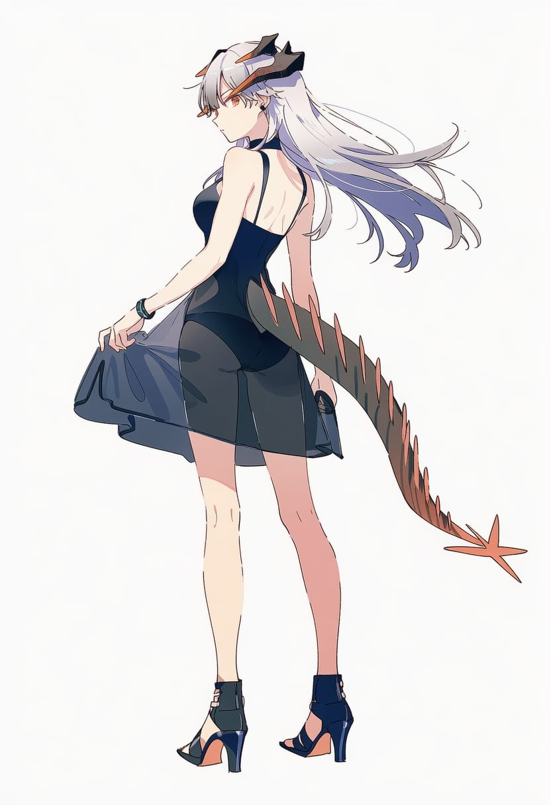

| 字段 | 内容 |
| --- | --- |
| 序号 | 49 |
| tag | ass |
| 中文名 | 臀部 |
| 含义 | 屁股。常用tag。 |
| tag串 | 1girl, ass, from_behind, looking_back, saria_(arknights) |

## 50. legs — 腿

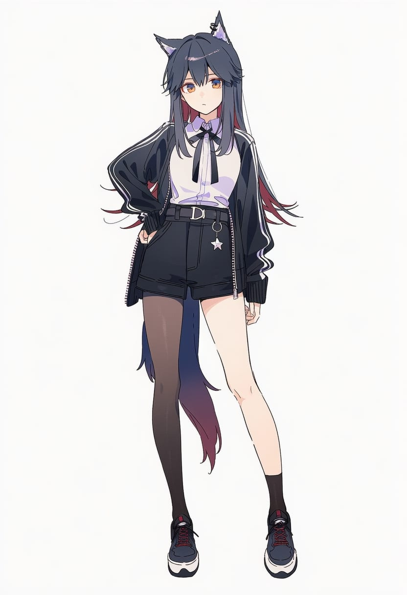

| 字段 | 内容 |
| --- | --- |
| 序号 | 50 |
| tag | legs |
| 中文名 | 腿 |
| 含义 | 腿部整体。 |
| tag串 | 1girl, legs, long_legs, looking_at_viewer, texas_(arknights) |

## 51. thighs — 大腿

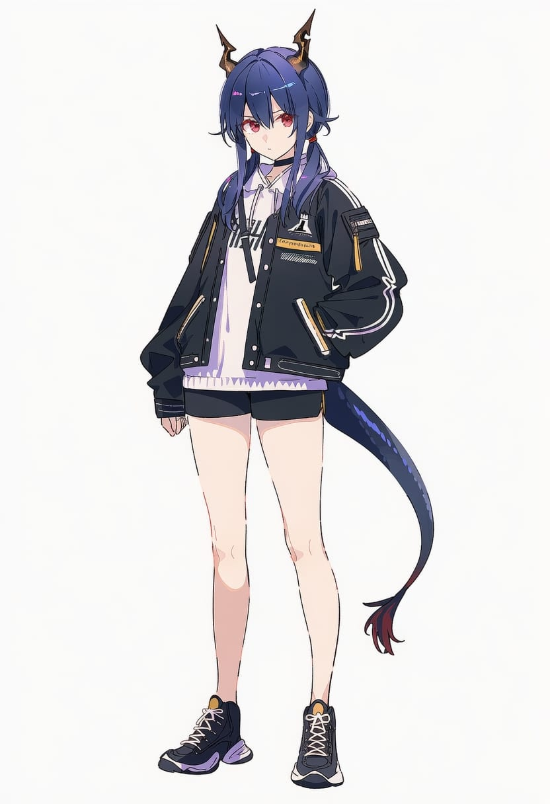

| 字段 | 内容 |
| --- | --- |
| 序号 | 51 |
| tag | thighs |
| 中文名 | 大腿 |
| 含义 | 大腿部位（常强调粗细）。 |
| tag串 | 1girl, thighs, thick_thighs, looking_at_viewer, chen_(arknights) |

## 52. knees — 膝盖

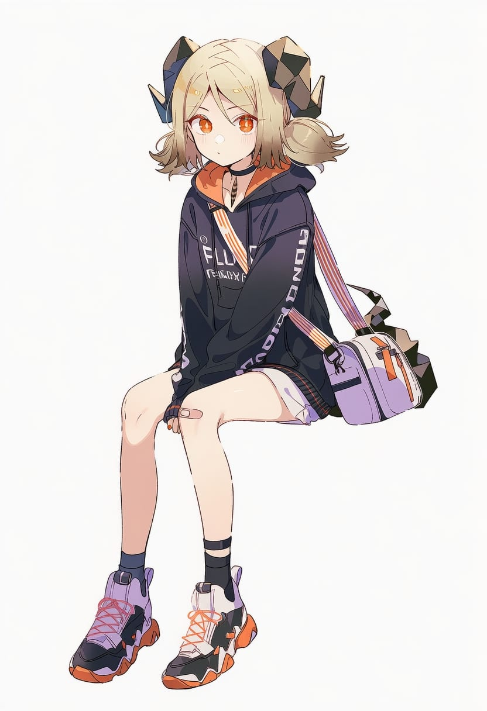

| 字段 | 内容 |
| --- | --- |
| 序号 | 52 |
| tag | knees |
| 中文名 | 膝盖 |
| 含义 | 膝盖部位。 |
| tag串 | 1girl, knees, sitting, looking_at_viewer, ifrit_(arknights) |

## 53. calves — 小腿

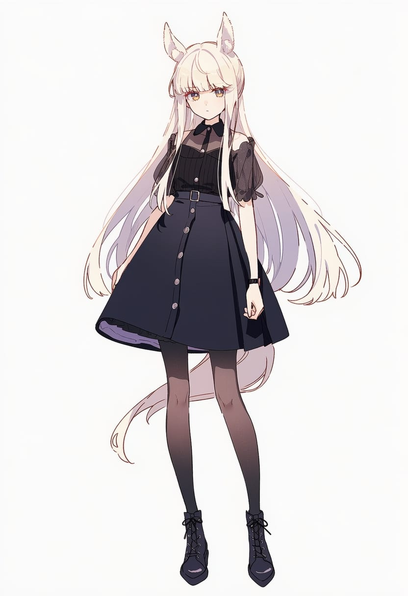

| 字段 | 内容 |
| --- | --- |
| 序号 | 53 |
| tag | calves |
| 中文名 | 小腿 |
| 含义 | 小腿部位。 |
| tag串 | 1girl, calves, standing, looking_at_viewer, platinum_(arknights) |

## 54. feet — 脚

| 字段 | 内容 |
| --- | --- |
| 序号 | 54 |
| tag | feet |
| 中文名 | 脚 |
| 含义 | 脚部整体。 |
| tag串 | 1girl, feet, barefoot, looking_at_viewer, blue_poison_(arknights) |

## 55. barefoot — 赤脚

| 字段 | 内容 |
| --- | --- |
| 序号 | 55 |
| tag | barefoot |
| 中文名 | 赤脚 |
| 含义 | 没穿鞋的脚。 |
| tag串 | 1girl, barefoot, feet, looking_at_viewer, mudrock_(arknights) |

## 56. toes — 脚趾

| 字段 | 内容 |
| --- | --- |
| 序号 | 56 |
| tag | toes |
| 中文名 | 脚趾 |
| 含义 | 脚趾可见。 |
| tag串 | 1girl, toes, barefoot, feet, looking_at_viewer, susie_(arknights) |

## 57. soles — 脚底

| 字段 | 内容 |
| --- | --- |
| 序号 | 57 |
| tag | soles |
| 中文名 | 脚底 |
| 含义 | 脚掌底部朝向观众。 |
| tag串 | 1girl, soles, barefoot, feet, from_below, looking_at_viewer, skadi_the_corrupting_heart_(arknights) |

## 58. crossed_ankles — 脚踝交叉

| 字段 | 内容 |
| --- | --- |
| 序号 | 58 |
| tag | crossed_ankles |
| 中文名 | 脚踝交叉 |
| 含义 | 两脚脚踝交叉的姿势。脚踝没有单独tag，多作为描述的一部分出现。 |
| tag串 | 1girl, crossed_ankles, sitting, barefoot, looking_at_viewer, gladiia_(arknights) |

## 59. shiny_skin — 光滑皮肤/油光皮肤

| 字段 | 内容 |
| --- | --- |
| 序号 | 59 |
| tag | shiny_skin |
| 中文名 | 光滑皮肤/油光皮肤 |
| 含义 | 皮肤有光泽或湿润反光的效果。皮肤没有单独tag，多作为描述的一部分出现。 |
| tag串 | 1girl, shiny_skin, wet, looking_at_viewer, kokomi_(genshin_impact) |

## 60. wings — 翅膀

| 字段 | 内容 |
| --- | --- |
| 序号 | 60 |
| tag | wings |
| 中文名 | 翅膀 |
| 含义 | 背部的翅膀（天使、恶魔、鸟人等）。 |
| tag串 | 1girl, wings, white_wings, looking_at_viewer, exusiai_(arknights) |

## 61. tail — 尾巴

| 字段 | 内容 |
| --- | --- |
| 序号 | 61 |
| tag | tail |
| 中文名 | 尾巴 |
| 含义 | 尾巴（兽人、恶魔、龙等）。 |
| tag串 | 1girl, tail, demon_tail, looking_at_viewer, projekt_red_(arknights) |

---
