## 1. alternate_species — 异种族化

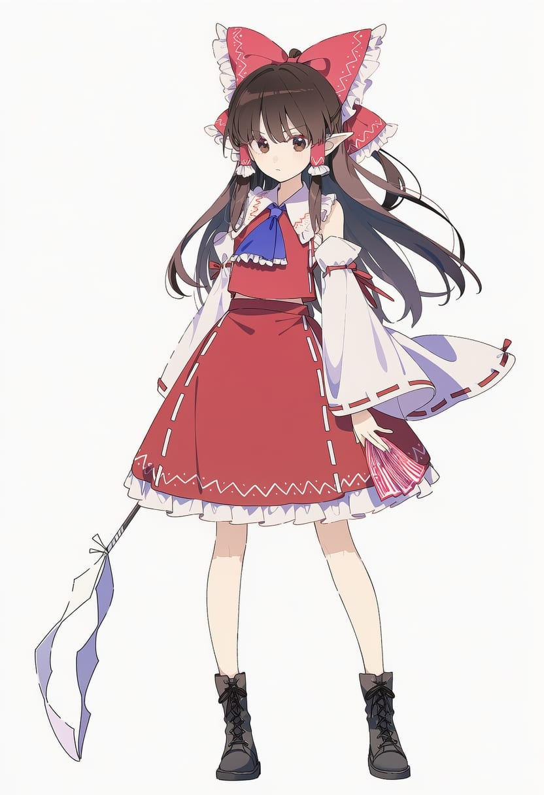

| 字段 | 内容 |
| --- | --- |
| 序号 | 0001 |
| tag | alternate_species |
| tag中文名 | 异种族化 |
| tag中文含义 | 把原本的人形角色画成另一种人形种族，比如人类改成精灵。 |
| tag所属的子类 | 大幅形态变化 |
| tag串 | 1girl,hakurei_reimu,elf,alternate_species,solo |

## 2. splatoonification — 斯普拉遁化

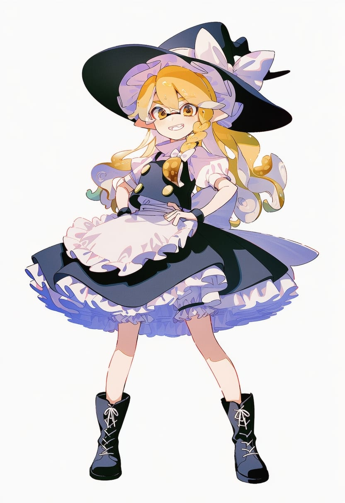

| 字段 | 内容 |
| --- | --- |
| 序号 | 0002 |
| tag | splatoonification |
| tag中文名 | 斯普拉遁化 |
| tag中文含义 | 把现有角色改造成《斯普拉遁》的 Inkling 或 Octoling 外形。 |
| tag所属的子类 | 大幅形态变化 |
| tag串 | 1girl,kirisame_marisa,splatoonification,solo |

## 3. animalization — 动物化

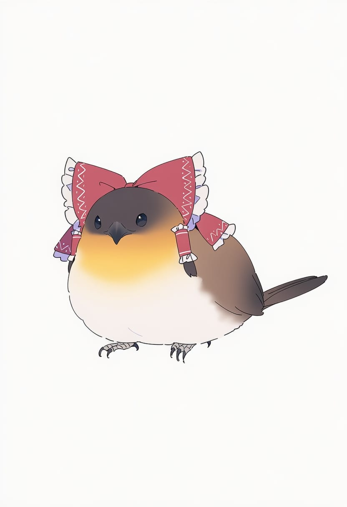

| 字段 | 内容 |
| --- | --- |
| 序号 | 0003 |
| tag | animalization |
| tag中文名 | 动物化 |
| tag中文含义 | 把原本不是动物的角色直接画成动物。 |
| tag所属的子类 | 大幅形态变化 |
| tag串 | animal_focus,no_humans,hakurei_reimu,animalization,solo |

## 4. pokefication — 宝可梦化

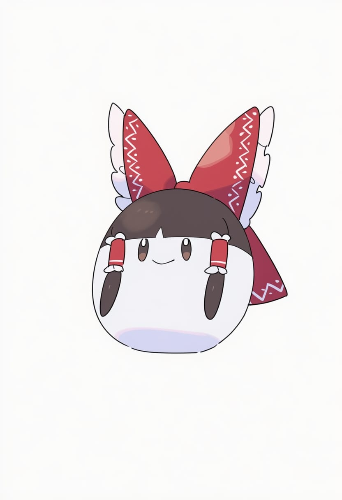

| 字段 | 内容 |
| --- | --- |
| 序号 | 0004 |
| tag | pokefication |
| tag中文名 | 宝可梦化 |
| tag中文含义 | 把角色变成宝可梦。 |
| tag所属的子类 | 大幅形态变化 |
| tag串 | pokemon_(creature),no_humans,hakurei_reimu,pokefication,solo |

## 5. foodification — 食物化

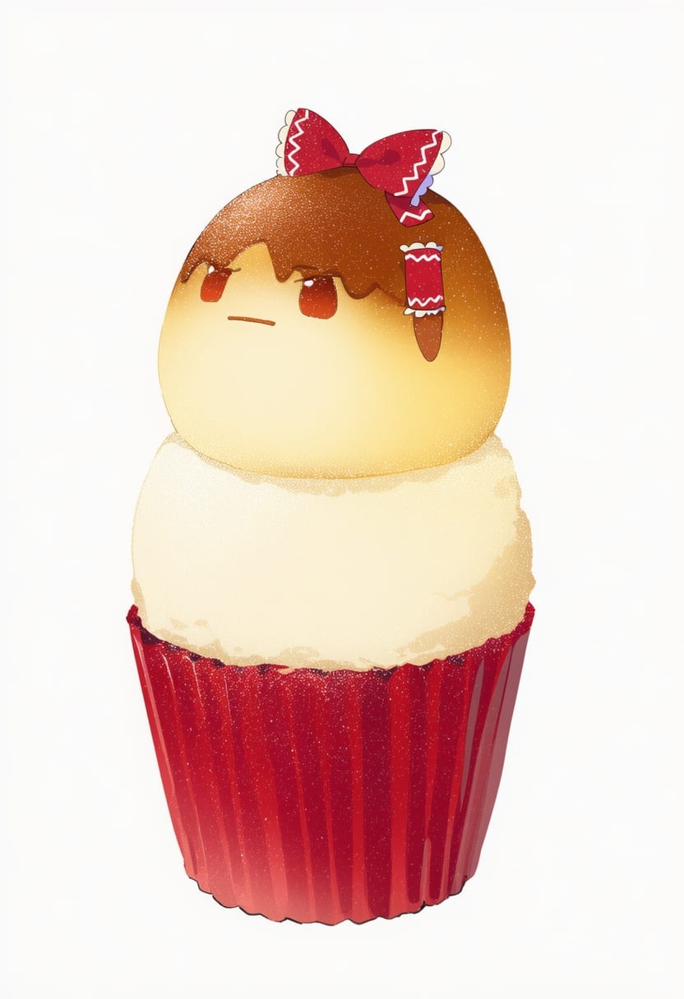

| 字段 | 内容 |
| --- | --- |
| 序号 | 0005 |
| tag | foodification |
| tag中文名 | 食物化 |
| tag中文含义 | 把角色变成有生命的食物。 |
| tag所属的子类 | 大幅形态变化 |
| tag串 | no_humans,hakurei_reimu,foodification,solo |

## 6. furrification — 兽人化

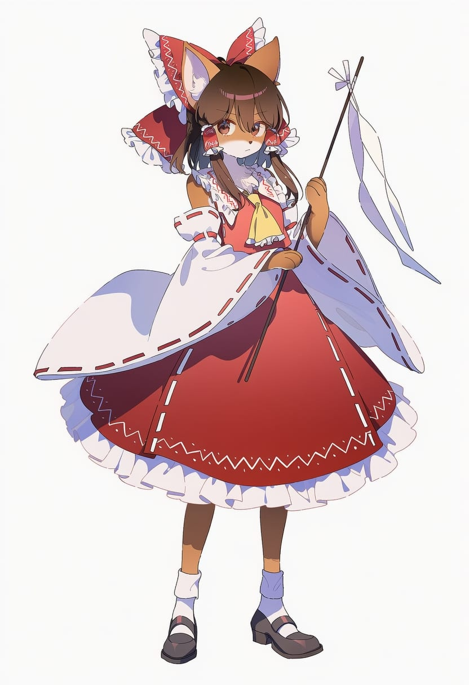

| 字段 | 内容 |
| --- | --- |
| 序号 | 0006 |
| tag | furrification |
| tag中文名 | 兽人化 |
| tag中文含义 | 把原本非 furry 的人形角色改成兽人。 |
| tag所属的子类 | 大幅形态变化 |
| tag串 | 1girl,hakurei_reimu,furry,furrification,solo |

## 7. humanization — 人类化

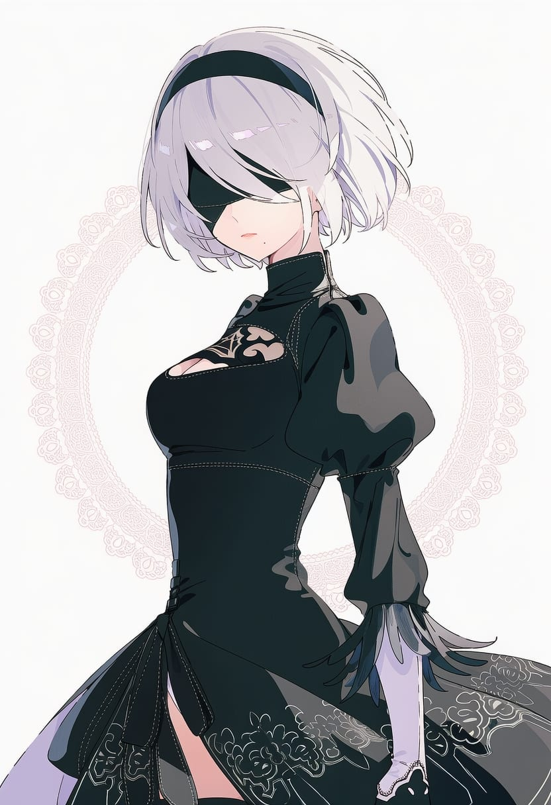

| 字段 | 内容 |
| --- | --- |
| 序号 | 0007 |
| tag | humanization |
| tag中文名 | 人类化 |
| tag中文含义 | 把本来已经是人形但非普通人类的角色改成普通人类。 |
| tag所属的子类 | 大幅形态变化 |
| tag串 | 1girl,2b_(nier:automata),humanization,solo |

## 8. kemonomimi_mode — 兽耳化

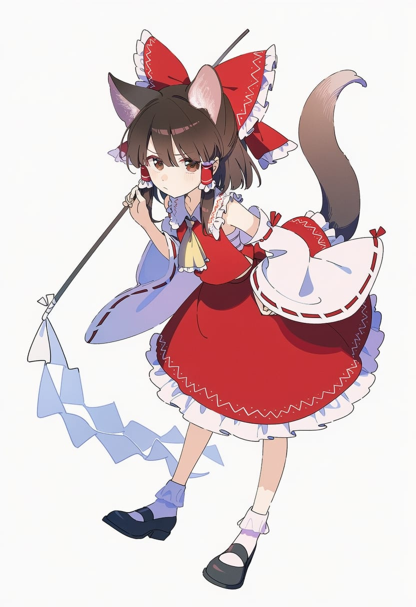

| 字段 | 内容 |
| --- | --- |
| 序号 | 0008 |
| tag | kemonomimi_mode |
| tag中文名 | 兽耳化 |
| tag中文含义 | 给原本没有动物特征的角色加上兽耳或尾巴。 |
| tag所属的子类 | 大幅形态变化 |
| tag串 | 1girl,hakurei_reimu,animal_ears,tail,kemonomimi_mode,solo |

## 9. mechanization — 机械化

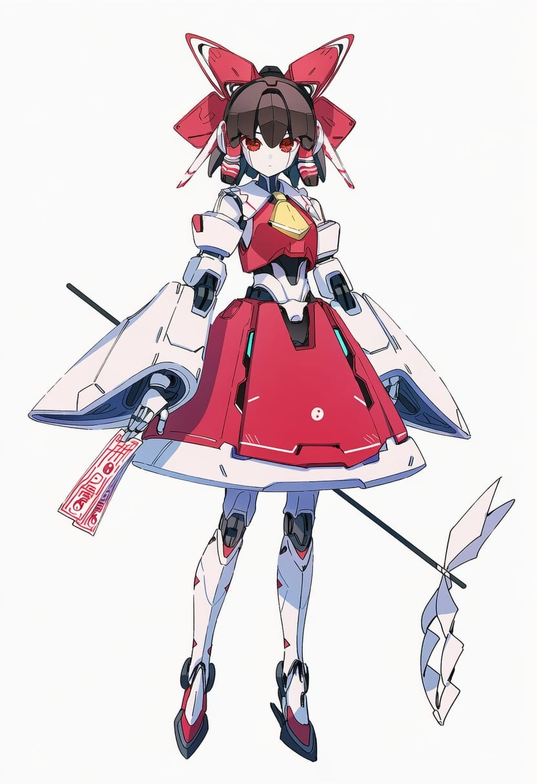

| 字段 | 内容 |
| --- | --- |
| 序号 | 0009 |
| tag | mechanization |
| tag中文名 | 机械化 |
| tag中文含义 | 把角色改造成机甲、机器人、赛博格等机械生命。 |
| tag所属的子类 | 大幅形态变化 |
| tag串 | 1girl,hakurei_reimu,cyborg,mechanization,solo |

## 10. monsterification — 魔物化

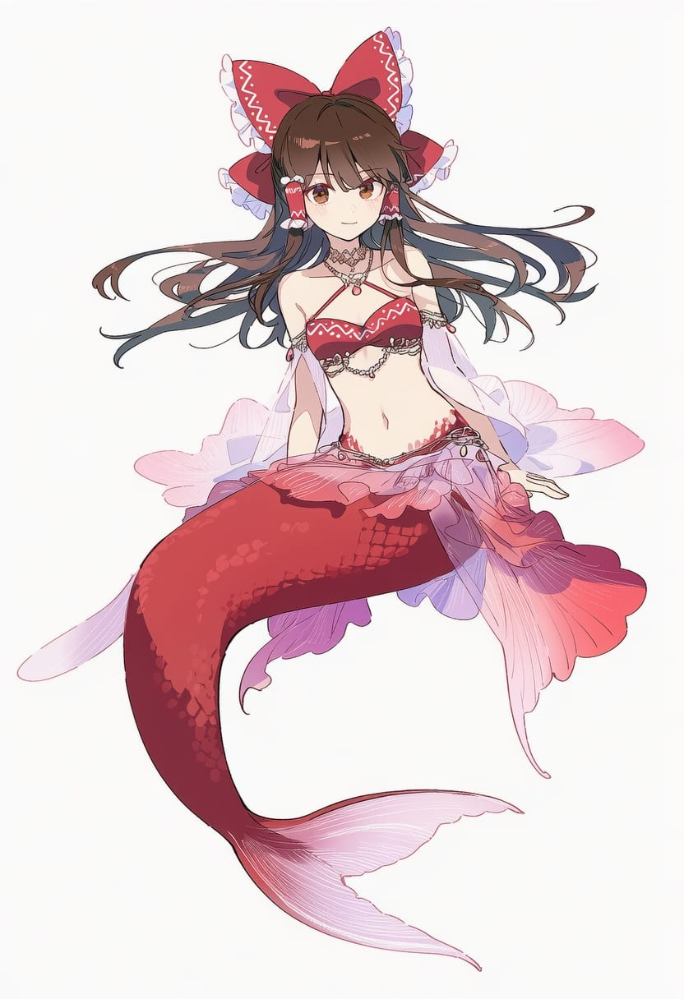

| 字段 | 内容 |
| --- | --- |
| 序号 | 0010 |
| tag | monsterification |
| tag中文名 | 魔物化 |
| tag中文含义 | 把普通人类角色改成魔物娘、史莱姆、人鱼等怪物形态。 |
| tag所属的子类 | 大幅形态变化 |
| tag串 | 1girl,hakurei_reimu,monster_girl,monsterification,solo |

## 11. objectification — 物品化

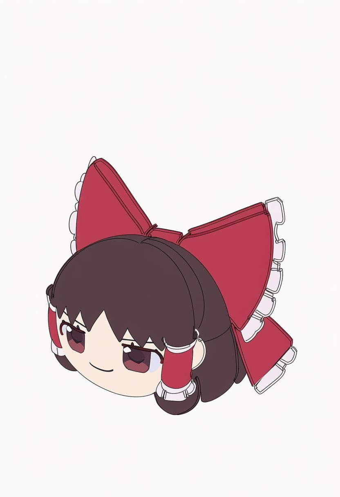

| 字段 | 内容 |
| --- | --- |
| 序号 | 0011 |
| tag | objectification |
| tag中文名 | 物品化 |
| tag中文含义 | 把角色直接变成没有生命的物品。 |
| tag所属的子类 | 大幅形态变化 |
| tag串 | no_humans,hakurei_reimu,objectification,solo |

## 12. personification — 拟人化

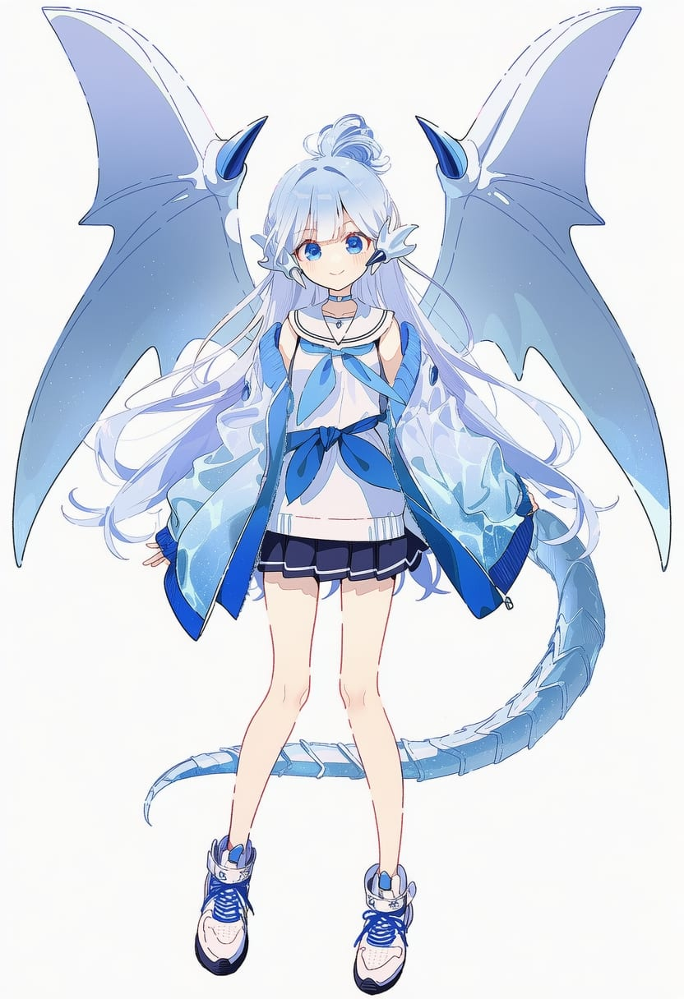

| 字段 | 内容 |
| --- | --- |
| 序号 | 0012 |
| tag | personification |
| tag中文名 | 拟人化 |
| tag中文含义 | 把非人实体、动物、物品或载具画成人类或类人形。 |
| tag所属的子类 | 大幅形态变化 |
| tag串 | 1girl,blue-eyes_white_dragon ,personification,solo |

## 13. zombification — 僵尸化

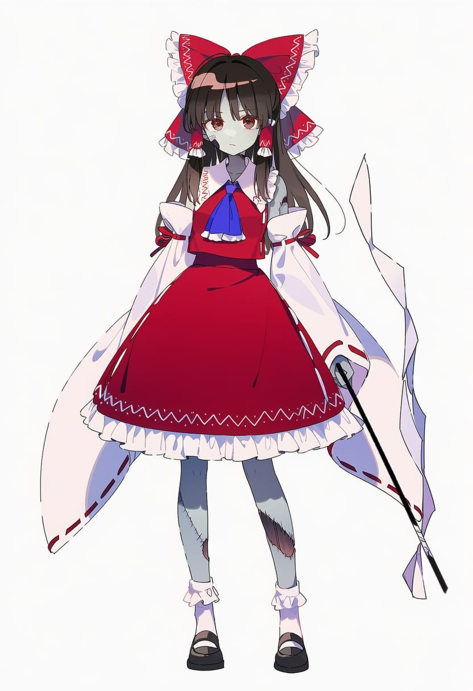

| 字段 | 内容 |
| --- | --- |
| 序号 | 0013 |
| tag | zombification |
| tag中文名 | 僵尸化 |
| tag中文含义 | 把原本不是僵尸的角色画成僵尸或正在变成僵尸。 |
| tag所属的子类 | 大幅形态变化 |
| tag串 | 1girl,hakurei_reimu,zombie,zombification,solo |

## 14. adapted_costume — 改编服装

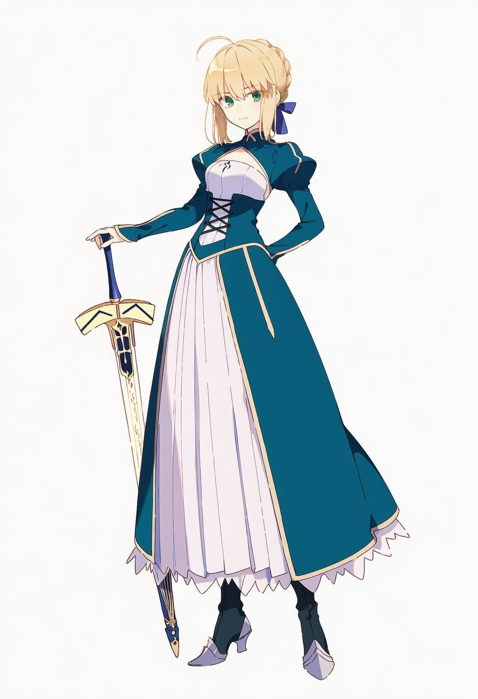

| 字段 | 内容 |
| --- | --- |
| 序号 | 0014 |
| tag | adapted_costume |
| tag中文名 | 改编服装 |
| tag中文含义 | 保留原服装的设计元素，但重新剪裁或改造成新的非官方版本。 |
| tag所属的子类 | 整体服装变化 |
| tag串 | 1girl,artoria_pendragon_(fate),adapted_costume,solo |

## 15. alternate_costume — 非官方换装

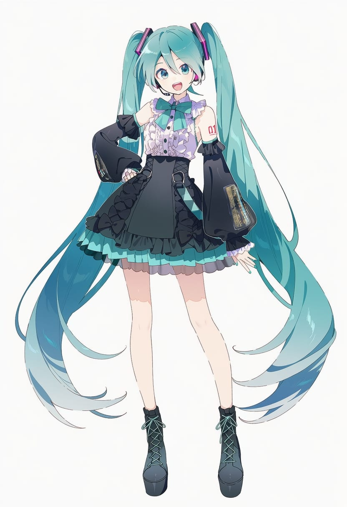

| 字段 | 内容 |
| --- | --- |
| 序号 | 0015 |
| tag | alternate_costume |
| tag中文名 | 非官方换装 |
| tag中文含义 | 给角色穿一套原作里没有的整套服装。 |
| tag所属的子类 | 整体服装变化 |
| tag串 | 1girl,hatsune_miku,alternate_costume,solo |

## 16. costume_switch — 服装互换

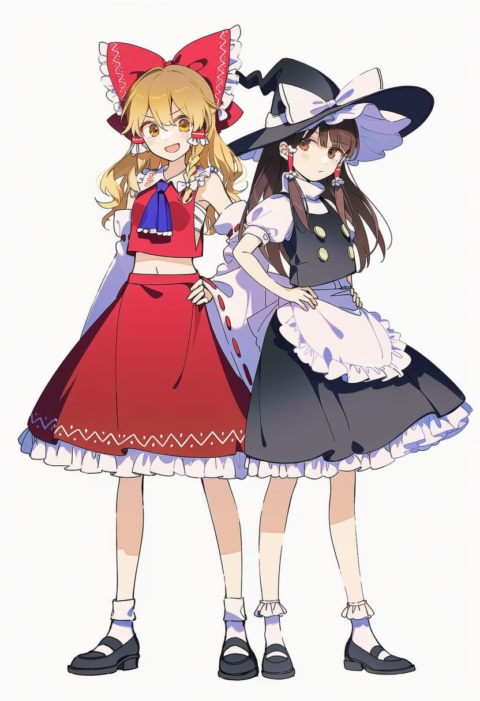

| 字段 | 内容 |
| --- | --- |
| 序号 | 0016 |
| tag | costume_switch |
| tag中文名 | 服装互换 |
| tag中文含义 | 两个角色把彼此的标志性衣服对调着穿。 |
| tag所属的子类 | 整体服装变化 |
| tag串 | 2girls,hakurei_reimu,kirisame_marisa,costume_switch |

## 17. casual — 便服

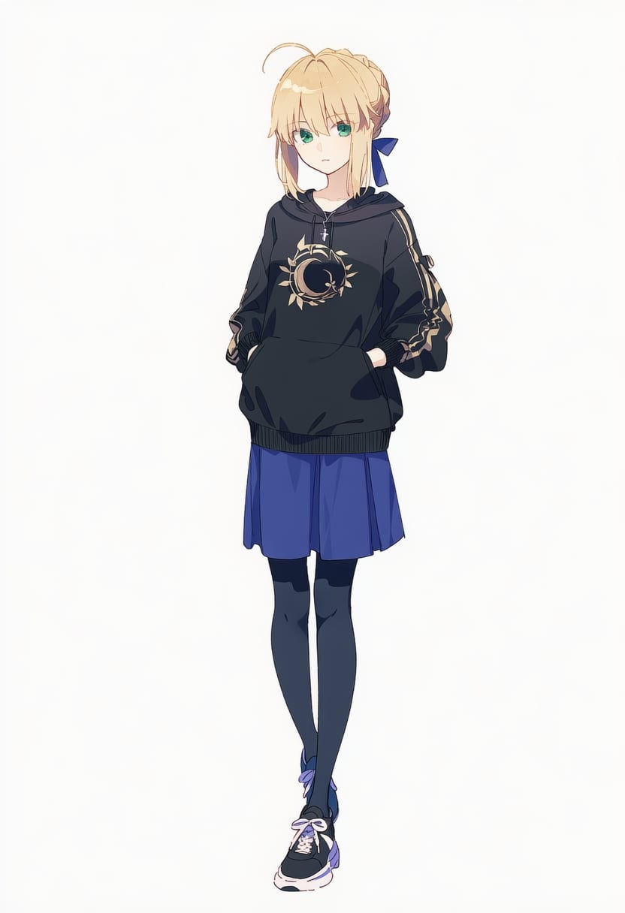

| 字段 | 内容 |
| --- | --- |
| 序号 | 0017 |
| tag | casual |
| tag中文名 | 便服 |
| tag中文含义 | 让平时穿制服、战斗服或礼服等的角色改穿普通现代日常服。 |
| tag所属的子类 | 整体服装变化 |
| tag串 | 1girl,artoria_pendragon_(fate),casual,solo |

## 18. contemporary — 现代化设定

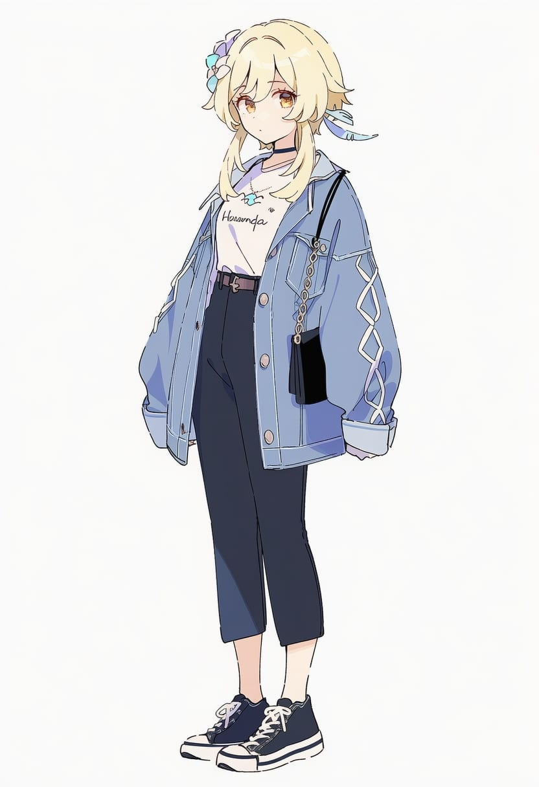

| 字段 | 内容 |
| --- | --- |
| 序号 | 0018 |
| tag | contemporary |
| tag中文名 | 现代化设定 |
| tag中文含义 | 让非现代背景角色穿现代衣服，或把角色放进现代环境。 |
| tag所属的子类 | 整体服装变化 |
| tag串 | 1girl,lumine_(genshin_impact),casual,contemporary,solo |

## 19. enmaided — 女仆化

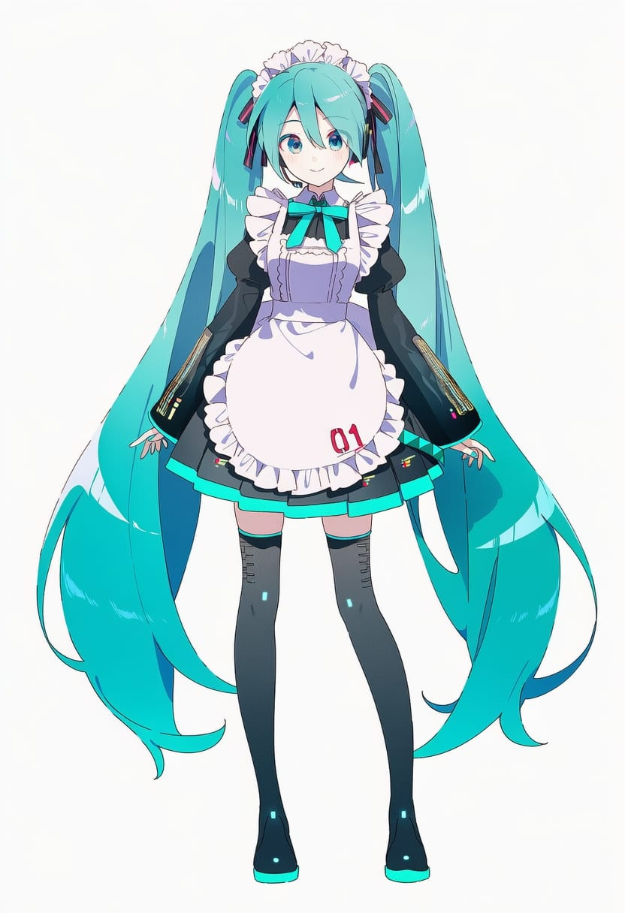

| 字段 | 内容 |
| --- | --- |
| 序号 | 0019 |
| tag | enmaided |
| tag中文名 | 女仆化 |
| tag中文含义 | 让原作里不是女仆的角色穿女仆装。 |
| tag所属的子类 | 整体服装变化 |
| tag串 | 1girl,hatsune_miku,maid,enmaided,solo |

## 20. cosplay — 角色Cosplay

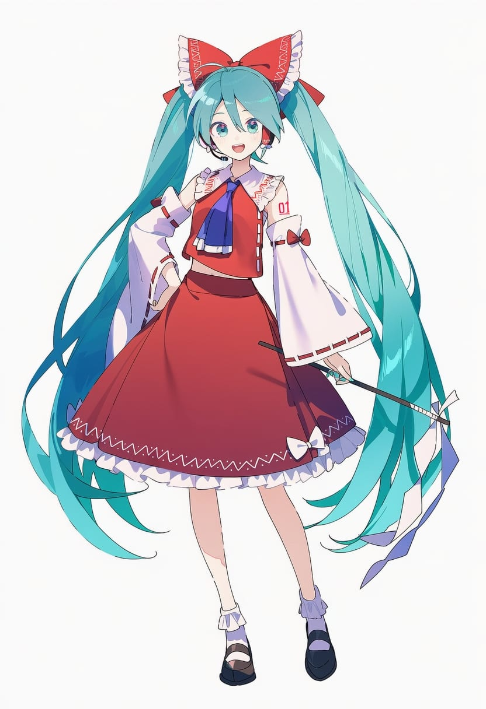

| 字段 | 内容 |
| --- | --- |
| 序号 | 0020 |
| tag | cosplay |
| tag中文名 | 角色Cosplay |
| tag中文含义 | 一个角色扮成另一个角色；被扮演者使用 *_(cosplay) tag。 |
| tag所属的子类 | 整体服装变化 |
| tag串 | 1girl,hatsune_miku,hakurei_reimu_(cosplay),cosplay,solo |

## 21. alternate_headwear — 替换头饰

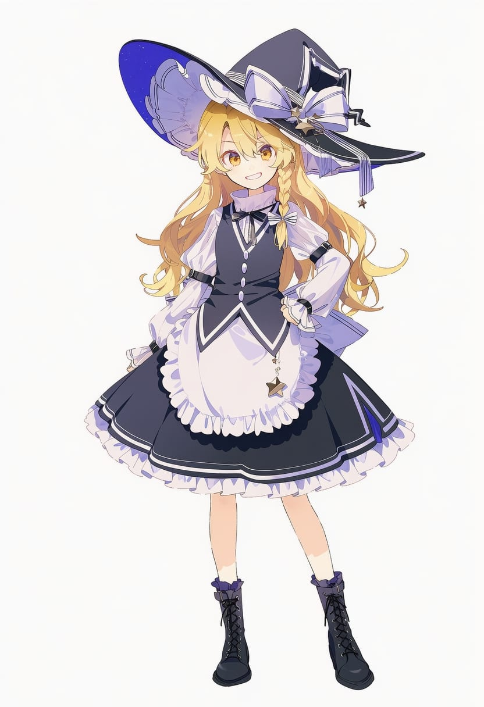

| 字段 | 内容 |
| --- | --- |
| 序号 | 0021 |
| tag | alternate_headwear |
| tag中文名 | 替换头饰 |
| tag中文含义 | 角色仍戴头饰，但换成与平时不同的一件。 |
| tag所属的子类 | 局部服饰/配件变化 |
| tag串 | 1girl,kirisame_marisa,alternate_headwear,solo |

## 22. alternate_weapon — 替换武器

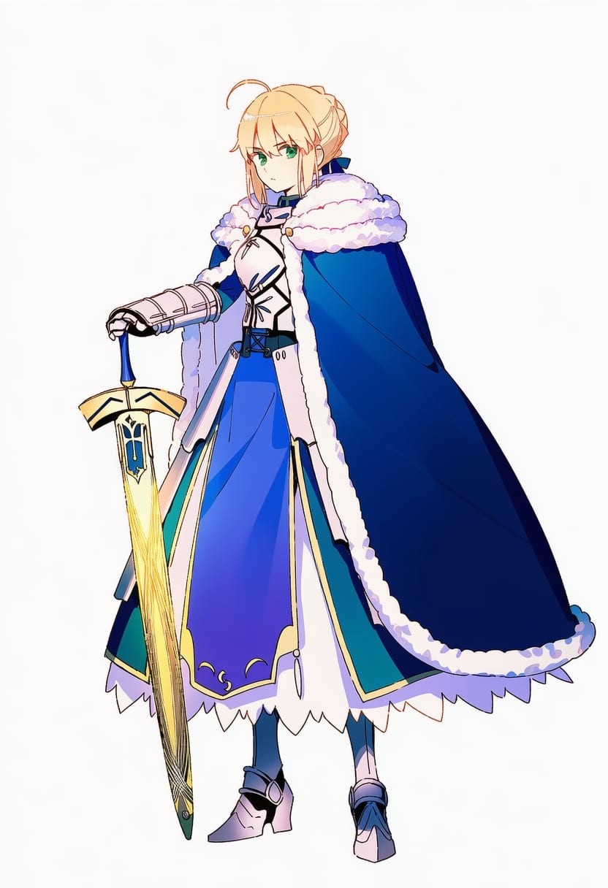

| 字段 | 内容 |
| --- | --- |
| 序号 | 0022 |
| tag | alternate_weapon |
| tag中文名 | 替换武器 |
| tag中文含义 | 让角色使用不是其招牌武器的另一种武器。 |
| tag所属的子类 | 局部服饰/配件变化 |
| tag串 | 1girl,artoria_pendragon_(fate),alternate_weapon,solo |

## 23. bespectacled — 加眼镜

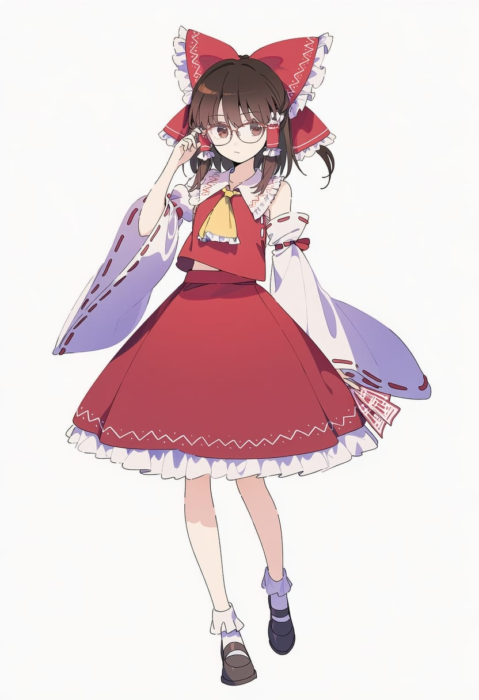

| 字段 | 内容 |
| --- | --- |
| 序号 | 0023 |
| tag | bespectacled |
| tag中文名 | 加眼镜 |
| tag中文含义 | 给平时不戴眼镜的角色加上眼镜。 |
| tag所属的子类 | 局部服饰/配件变化 |
| tag串 | 1girl,hakurei_reimu,glasses,bespectacled,solo |

## 24. headwear_switch — 头饰互换

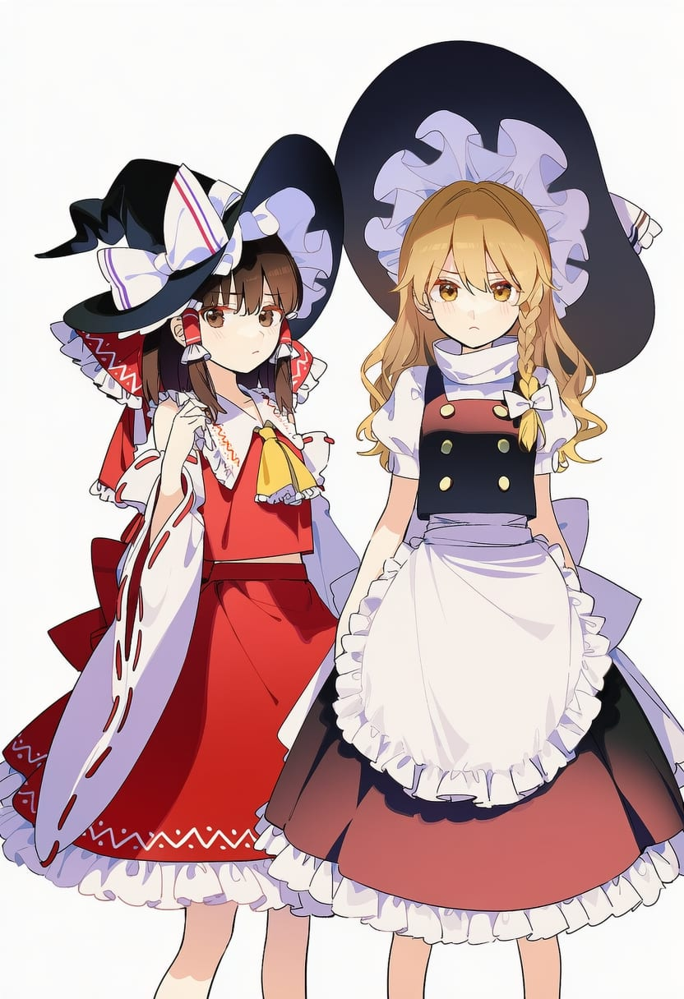

| 字段 | 内容 |
| --- | --- |
| 序号 | 0024 |
| tag | headwear_switch |
| tag中文名 | 头饰互换 |
| tag中文含义 | 让角色戴上另一个角色的标志性帽子或头饰。 |
| tag所属的子类 | 局部服饰/配件变化 |
| tag串 | 2girls,hakurei_reimu,kirisame_marisa,headwear_switch |

## 25. no_eyewear — 去眼部佩饰

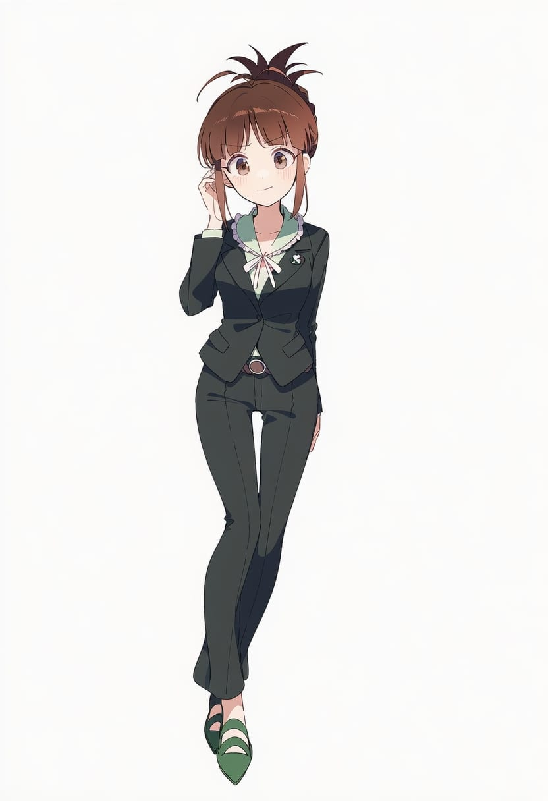

| 字段 | 内容 |
| --- | --- |
| 序号 | 0025 |
| tag | no_eyewear |
| tag中文名 | 去眼部佩饰 |
| tag中文含义 | 平时戴眼镜或眼部佩饰的角色这次没有戴。 |
| tag所属的子类 | 局部服饰/配件变化 |
| tag串 | 1girl,akizuki_ritsuko,no_eyewear,solo |

## 26. missing_headwear — 去掉头饰

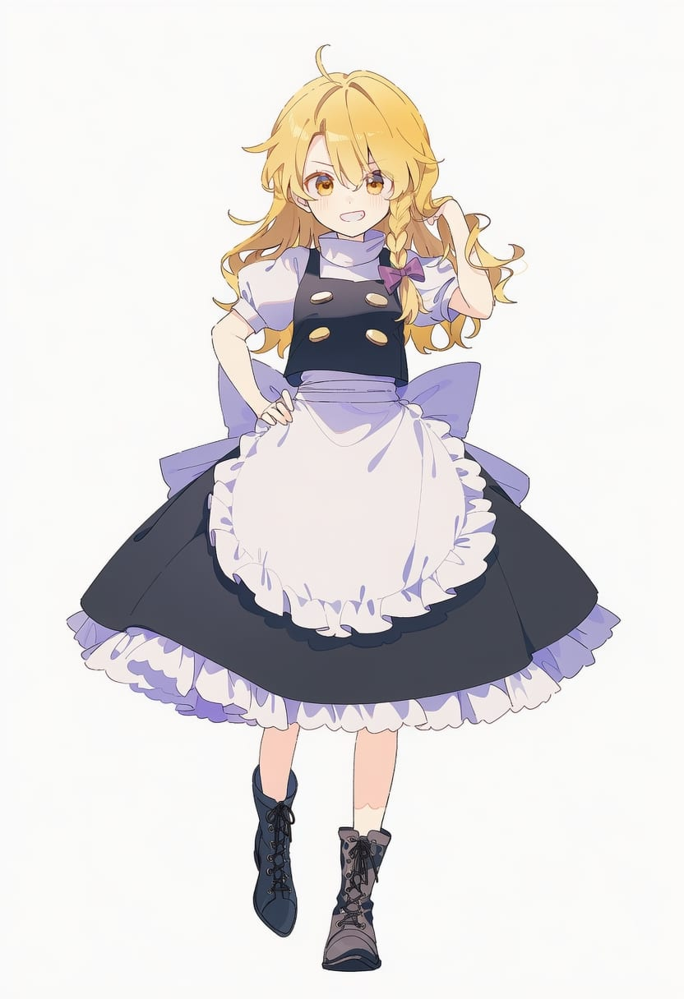

| 字段 | 内容 |
| --- | --- |
| 序号 | 0026 |
| tag | missing_headwear |
| tag中文名 | 去掉头饰 |
| tag中文含义 | 平时固定戴帽子或头饰的角色这次没有戴。 |
| tag所属的子类 | 局部服饰/配件变化 |
| tag串 | 1girl,kirisame_marisa,missing_headwear,solo |

## 27. missing_legwear — 去掉腿部服饰

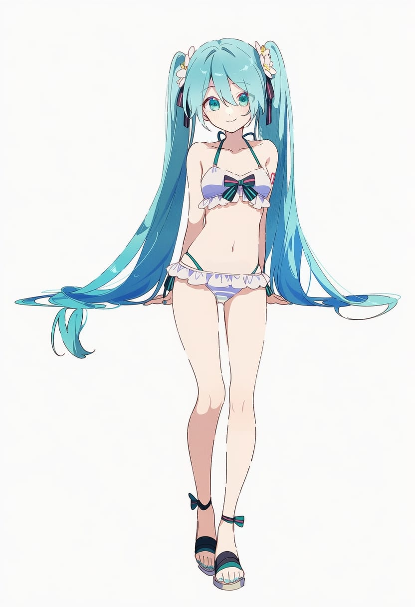

| 字段 | 内容 |
| --- | --- |
| 序号 | 0027 |
| tag | missing_legwear |
| tag中文名 | 去掉腿部服饰 |
| tag中文含义 | 平时固定穿袜子、丝袜等腿部服饰的角色这次没穿。 |
| tag所属的子类 | 局部服饰/配件变化 |
| tag串 | 1girl,hatsune_miku,missing_legwear,solo |

## 28. no_mask — 摘掉面具

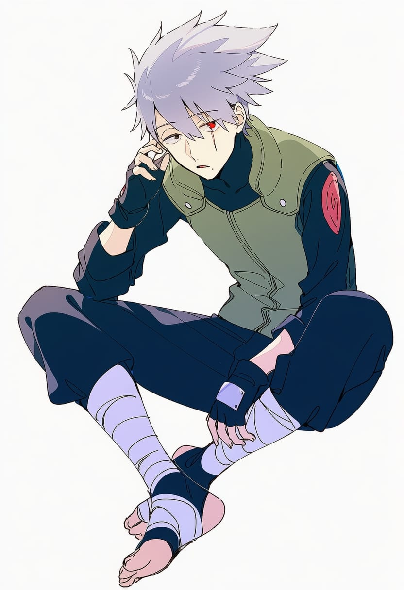

| 字段 | 内容 |
| --- | --- |
| 序号 | 0028 |
| tag | no_mask |
| tag中文名 | 摘掉面具 |
| tag中文含义 | 平时戴面具的角色这次露出没有面具的脸。 |
| tag所属的子类 | 局部服饰/配件变化 |
| tag串 | 1boy,hatake_kakashi,no_mask,solo |

## 29. no_earrings — 去耳环

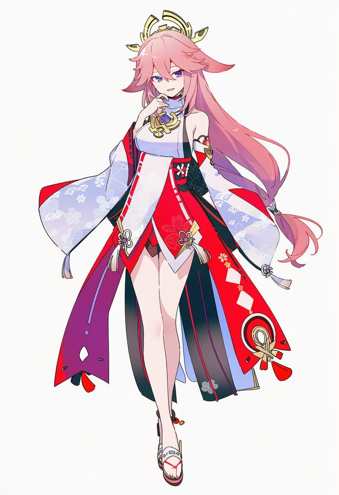

| 字段 | 内容 |
| --- | --- |
| 序号 | 0029 |
| tag | no_earrings |
| tag中文名 | 去耳环 |
| tag中文含义 | 平时戴耳环的角色这次没有戴。 |
| tag所属的子类 | 局部服饰/配件变化 |
| tag串 | 1girl,yae_miko,no_earrings,solo |

## 30. alternate_breast_size — 胸部尺寸变化（旧泛称）

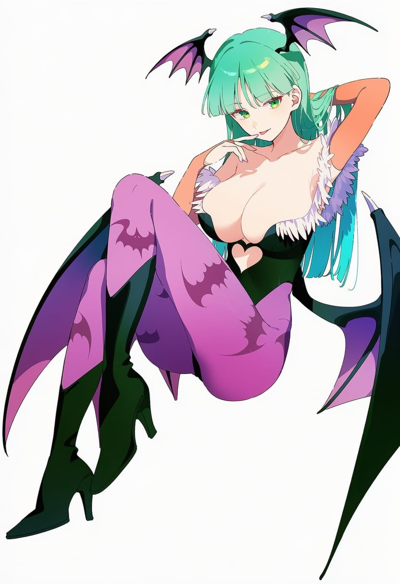

| 字段 | 内容 |
| --- | --- |
| 序号 | 0030 |
| tag | alternate_breast_size |
| tag中文名 | 胸部尺寸变化（旧泛称） |
| tag中文含义 | 旧的泛称：胸部大小和原设不同；现在更适合用 larger 或 smaller 的具体标签。 |
| tag所属的子类 | 身体特征变化 |
| tag串 | 1girl,morrigan_aensland,alternate_breast_size,solo |

## 31. alternate_breast_size_(larger) — 胸部变大

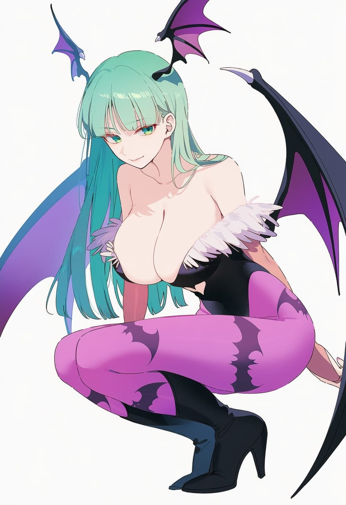

| 字段 | 内容 |
| --- | --- |
| 序号 | 0031 |
| tag | alternate_breast_size_(larger) |
| tag中文名 | 胸部变大 |
| tag中文含义 | 把角色胸部画得明显比原设更大。 |
| tag所属的子类 | 身体特征变化 |
| tag串 | 1girl,morrigan_aensland,large_breasts,alternate_breast_size_(larger),solo |

## 32. alternate_breast_size_(smaller) — 胸部变小

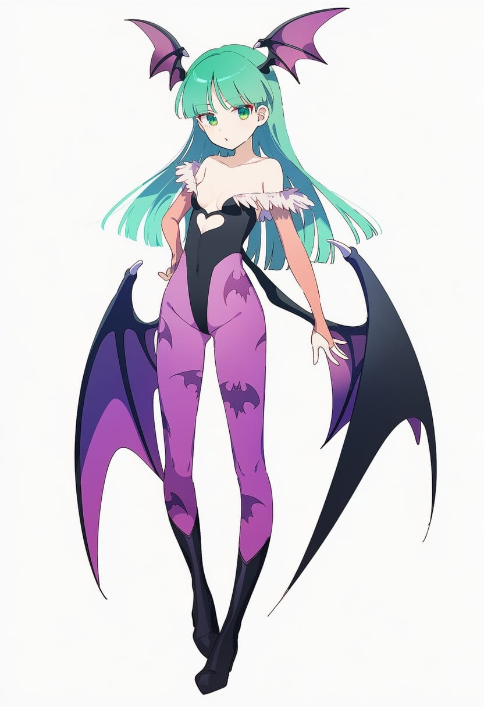

| 字段 | 内容 |
| --- | --- |
| 序号 | 0032 |
| tag | alternate_breast_size_(smaller) |
| tag中文名 | 胸部变小 |
| tag中文含义 | 把角色胸部画得明显比原设更小。 |
| tag所属的子类 | 身体特征变化 |
| tag串 | 1girl,morrigan_aensland,small_breasts,alternate_breast_size_(smaller),solo |

## 33. alternate_ass_size_(larger) — 臀部变大

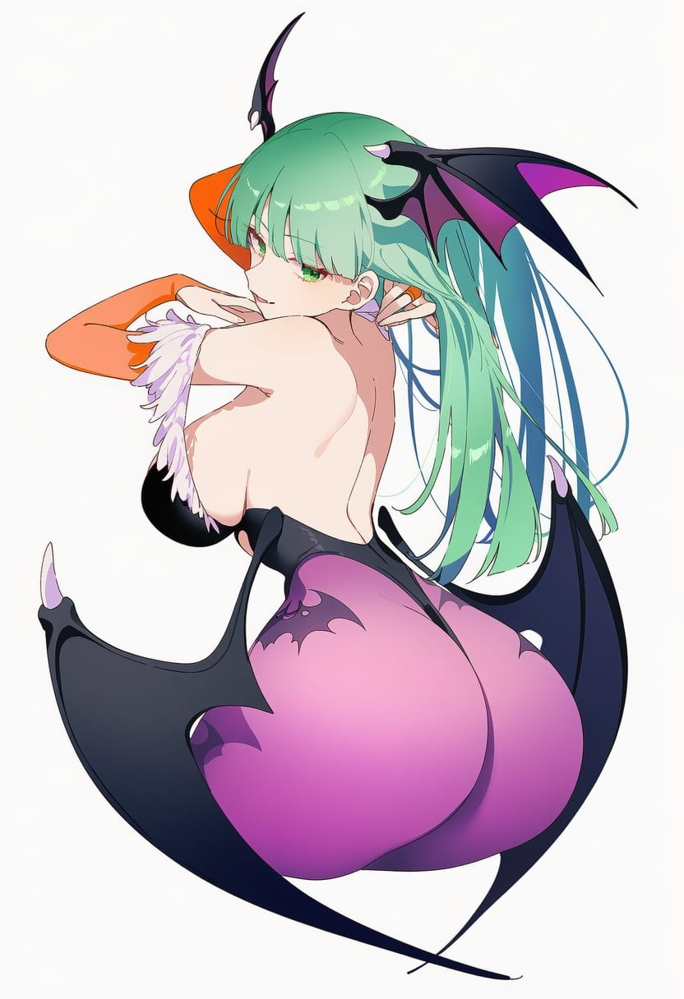

| 字段 | 内容 |
| --- | --- |
| 序号 | 0033 |
| tag | alternate_ass_size_(larger) |
| tag中文名 | 臀部变大 |
| tag中文含义 | 把角色臀部画得明显比原设更大。 |
| tag所属的子类 | 身体特征变化 |
| tag串 | 1girl,morrigan_aensland,large_ass,alternate_ass_size_(larger),solo |

## 34. alternate_body_size — 体型变化（泛称）

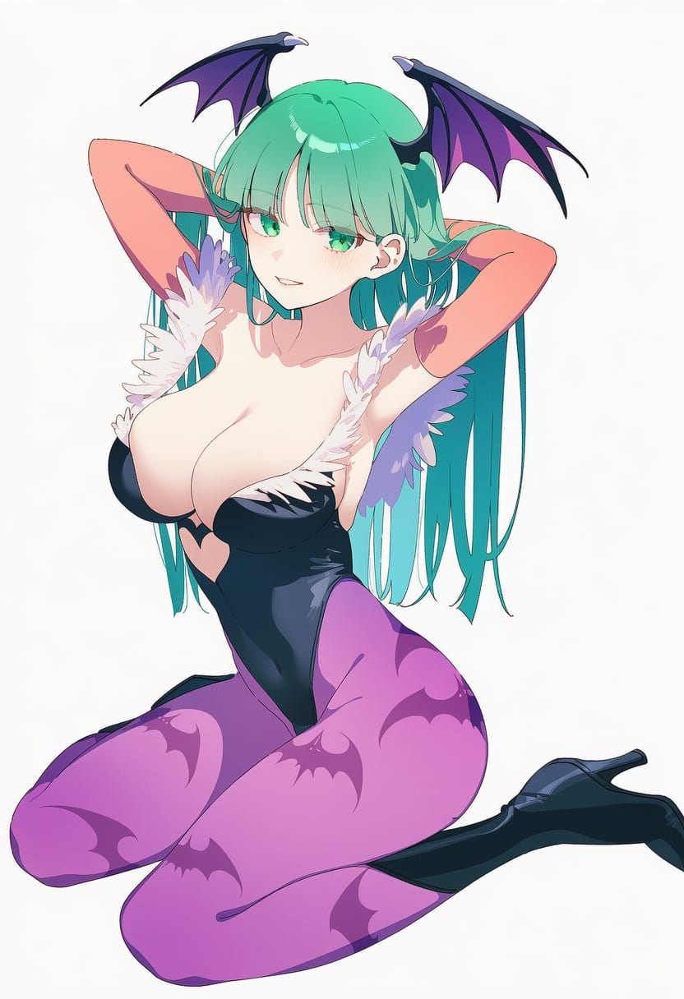

| 字段 | 内容 |
| --- | --- |
| 序号 | 0034 |
| tag | alternate_body_size |
| tag中文名 | 体型变化（泛称） |
| tag中文含义 | 泛指体型和原设不一样；Danbooru 本身把它视为较模糊的标签。 |
| tag所属的子类 | 身体特征变化 |
| tag串 | 1girl,morrigan_aensland,alternate_body_size,solo |

## 35. alternate_wings — 翅膀变化

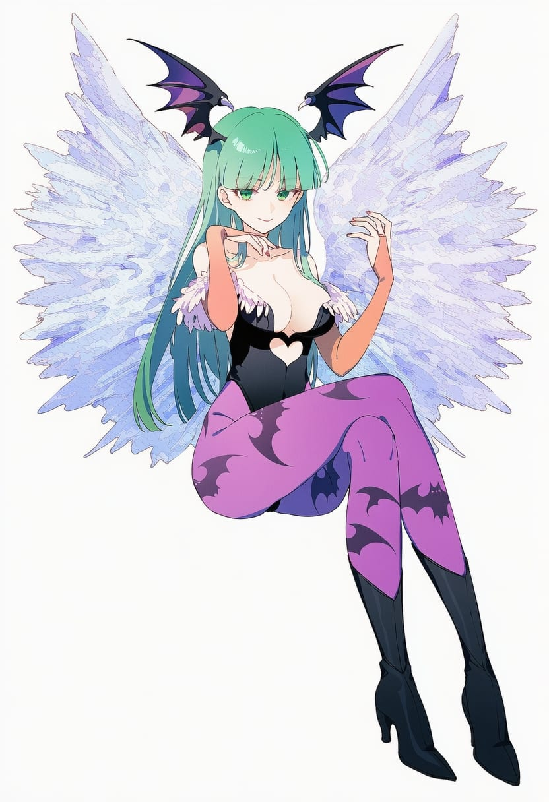

| 字段 | 内容 |
| --- | --- |
| 序号 | 0035 |
| tag | alternate_wings |
| tag中文名 | 翅膀变化 |
| tag中文含义 | 角色本来有翅膀，但这次翅膀的样式或形态和平时不同。 |
| tag所属的子类 | 身体特征变化 |
| tag串 | 1girl,morrigan_aensland,alternate_wings,solo |

## 36. alternate_skin_color — 肤色变化

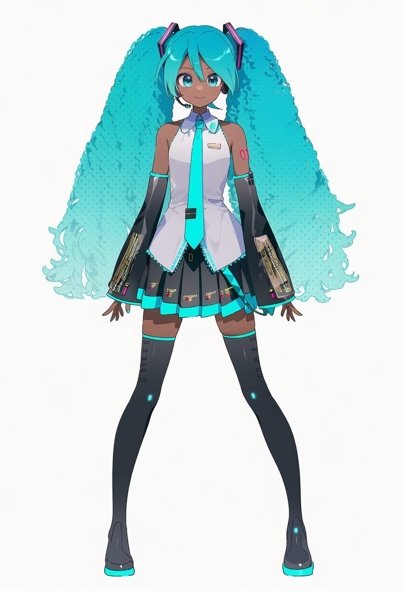

| 字段 | 内容 |
| --- | --- |
| 序号 | 0036 |
| tag | alternate_skin_color |
| tag中文名 | 肤色变化 |
| tag中文含义 | 把角色皮肤颜色改成与原设不同的颜色。 |
| tag所属的子类 | 身体特征变化 |
| tag串 | 1girl,hatsune_miku,dark_skin,alternate_skin_color,solo |

## 37. fatter_than_canon — 比原设更胖

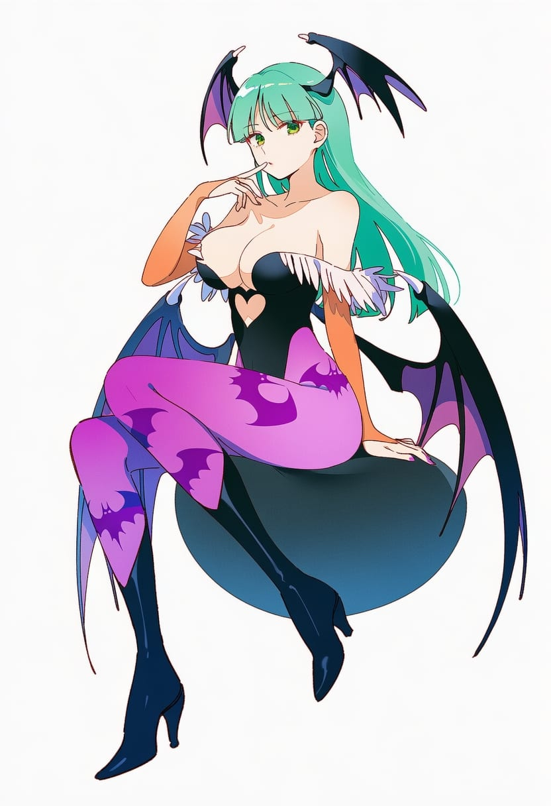

| 字段 | 内容 |
| --- | --- |
| 序号 | 0037 |
| tag | fatter_than_canon |
| tag中文名 | 比原设更胖 |
| tag中文含义 | 把角色画得比原设更胖。 |
| tag所属的子类 | 身体特征变化 |
| tag串 | 1girl,morrigan_aensland,fatter_than_canon,solo |

## 38. more_muscular_than_canon — 比原设更壮

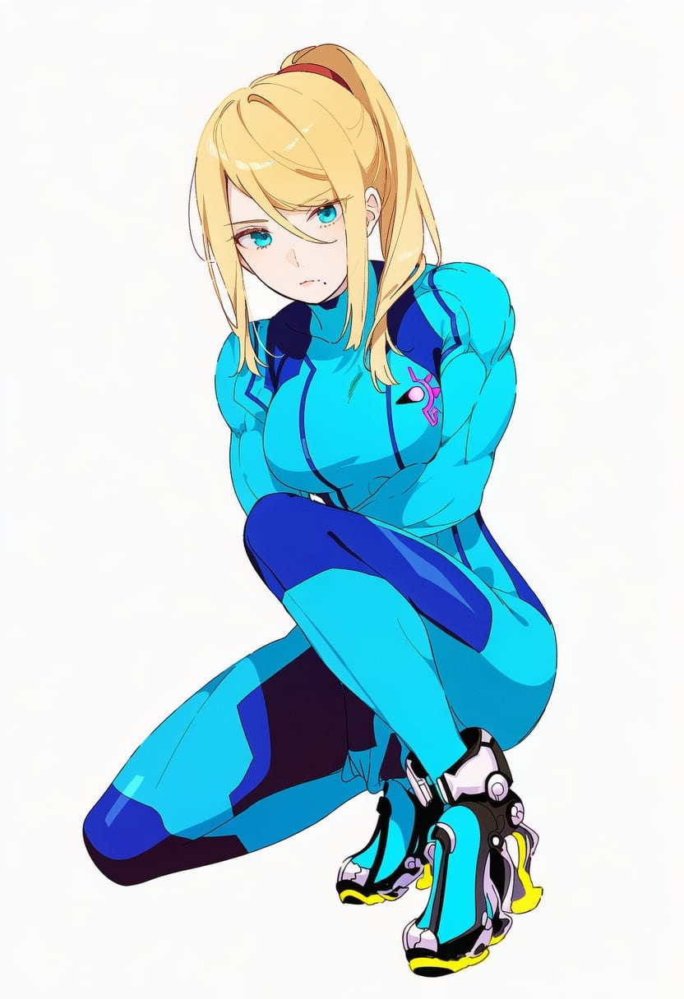

| 字段 | 内容 |
| --- | --- |
| 序号 | 0038 |
| tag | more_muscular_than_canon |
| tag中文名 | 比原设更壮 |
| tag中文含义 | 把角色画得比原设更有肌肉。 |
| tag所属的子类 | 身体特征变化 |
| tag串 | 1girl,samus_aran,muscular_female,more_muscular_than_canon,solo |

## 39. no_animal_ears — 去兽耳

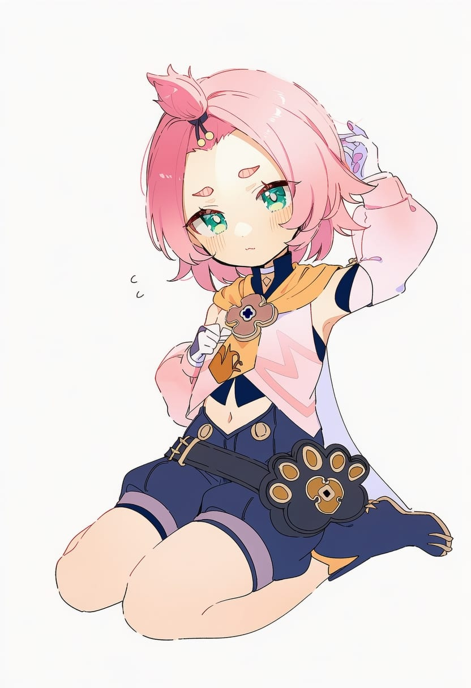

| 字段 | 内容 |
| --- | --- |
| 序号 | 0039 |
| tag | no_animal_ears |
| tag中文名 | 去兽耳 |
| tag中文含义 | 平时有兽耳的角色这次没有兽耳。 |
| tag所属的子类 | 身体特征变化 |
| tag串 | 1girl,diona_(genshin_impact),no_animal_ears,solo |

## 40. no_horns — 去角

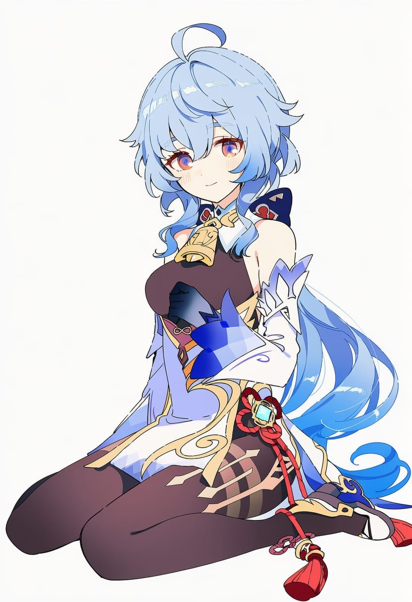

| 字段 | 内容 |
| --- | --- |
| 序号 | 0040 |
| tag | no_horns |
| tag中文名 | 去角 |
| tag中文含义 | 平时有角的角色这次没有角。 |
| tag所属的子类 | 身体特征变化 |
| tag串 | 1girl,ganyu_(genshin_impact),no_horns,solo |

## 41. missing_tail — 去尾巴

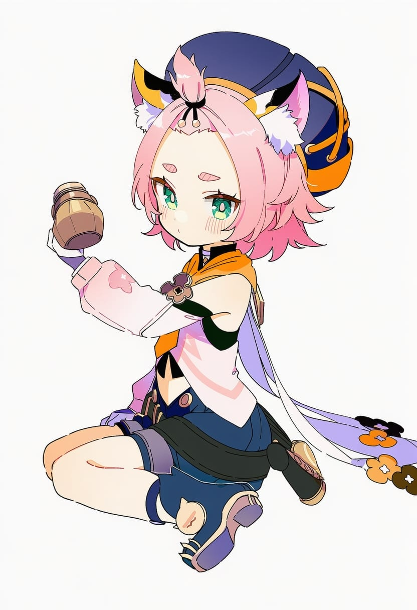

| 字段 | 内容 |
| --- | --- |
| 序号 | 0041 |
| tag | missing_tail |
| tag中文名 | 去尾巴 |
| tag中文含义 | 平时有尾巴的角色这次没有尾巴。 |
| tag所属的子类 | 身体特征变化 |
| tag串 | 1girl,diona_(genshin_impact),missing_tail,solo |

## 42. missing_wings — 去翅膀

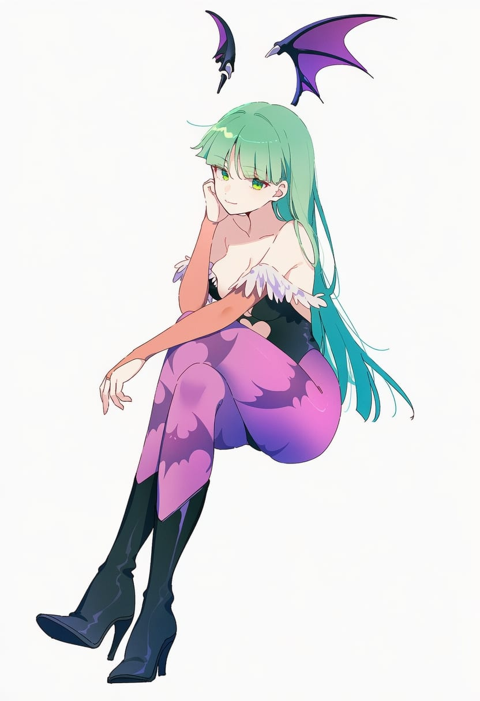

| 字段 | 内容 |
| --- | --- |
| 序号 | 0042 |
| tag | missing_wings |
| tag中文名 | 去翅膀 |
| tag中文含义 | 平时有翅膀的角色这次没有翅膀。 |
| tag所属的子类 | 身体特征变化 |
| tag串 | 1girl,morrigan_aensland,missing_wings,solo |

## 43. taller_than_canon — 比原设更高

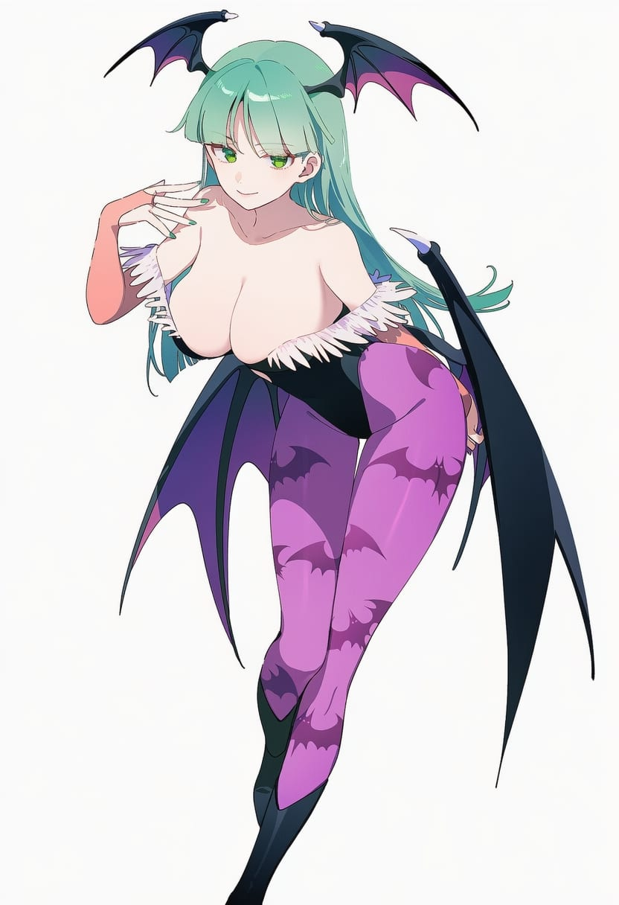

| 字段 | 内容 |
| --- | --- |
| 序号 | 0043 |
| tag | taller_than_canon |
| tag中文名 | 比原设更高 |
| tag中文含义 | 把角色画得比原设更高。 |
| tag所属的子类 | 身体特征变化 |
| tag串 | 1girl,morrigan_aensland,taller_than_canon,solo |

## 44. alternate_hair_color — 发色变化

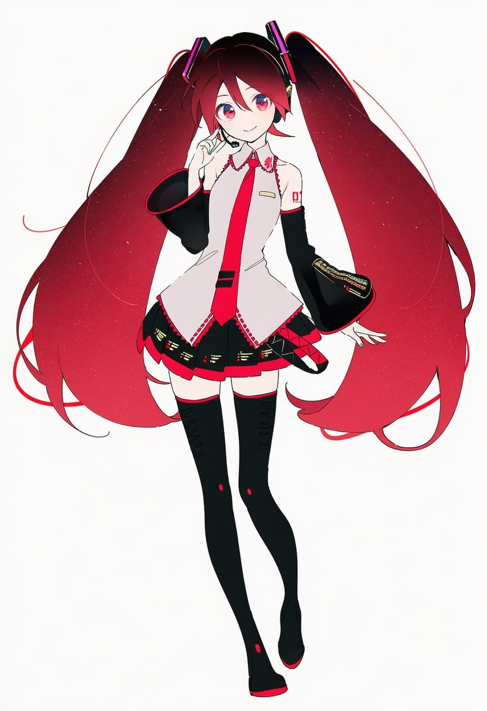

| 字段 | 内容 |
| --- | --- |
| 序号 | 0044 |
| tag | alternate_hair_color |
| tag中文名 | 发色变化 |
| tag中文含义 | 把角色头发改成与原设不同的颜色。 |
| tag所属的子类 | 头发变化 |
| tag串 | 1girl,hatsune_miku,red_hair,alternate_hair_color,solo |

## 45. alternate_hairstyle — 发型变化

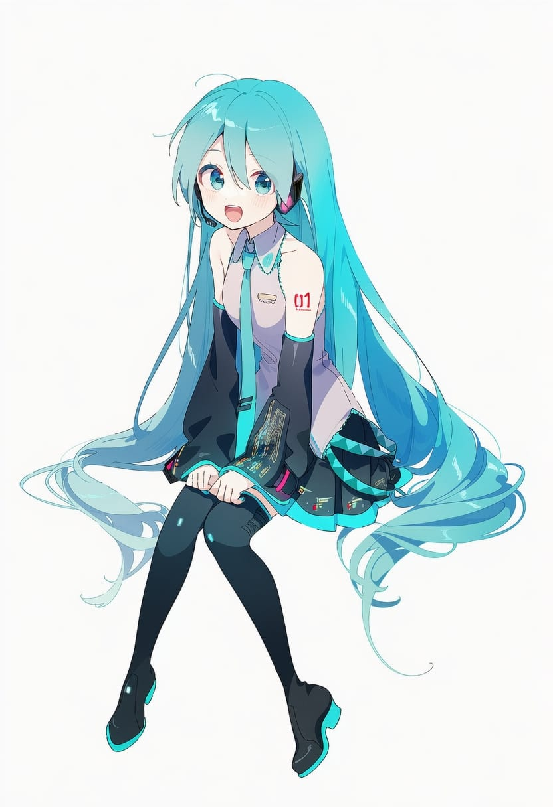

| 字段 | 内容 |
| --- | --- |
| 序号 | 0045 |
| tag | alternate_hairstyle |
| tag中文名 | 发型变化 |
| tag中文含义 | 把角色换成与平时不同的发型。 |
| tag所属的子类 | 头发变化 |
| tag串 | 1girl,hatsune_miku,alternate_hairstyle,solo |

## 46. hair_down — 散发

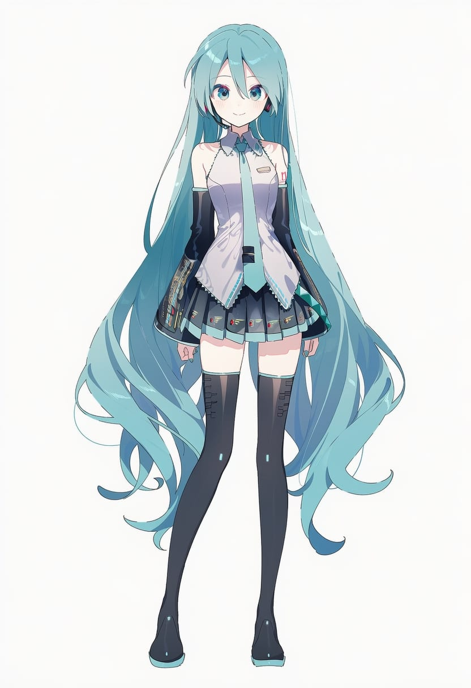

| 字段 | 内容 |
| --- | --- |
| 序号 | 0046 |
| tag | hair_down |
| tag中文名 | 散发 |
| tag中文含义 | 平时扎着头发的角色把头发放下来。 |
| tag所属的子类 | 头发变化 |
| tag串 | 1girl,hatsune_miku,hair_down,solo |

## 47. hair_up — 扎发/盘发

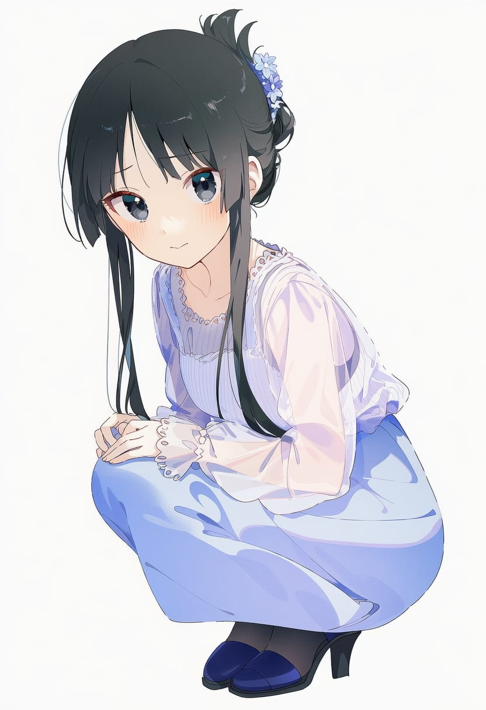

| 字段 | 内容 |
| --- | --- |
| 序号 | 0047 |
| tag | hair_up |
| tag中文名 | 扎发/盘发 |
| tag中文含义 | 平时披着头发的角色把头发扎起来或盘起来。 |
| tag所属的子类 | 头发变化 |
| tag串 | 1girl,akiyama_mio,hair_up,solo |

## 48. alternate_hair_length_(shorter) — 头发变短

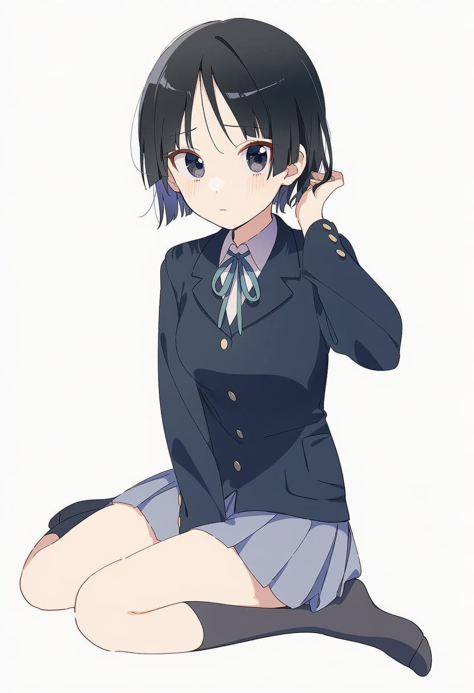

| 字段 | 内容 |
| --- | --- |
| 序号 | 0048 |
| tag | alternate_hair_length_(shorter) |
| tag中文名 | 头发变短 |
| tag中文含义 | 把角色头发画得比原设更短。 |
| tag所属的子类 | 头发变化 |
| tag串 | 1girl,akiyama_mio,short_hair,alternate_hair_length_(shorter),solo |

## 49. alternate_hair_length_(longer) — 头发变长

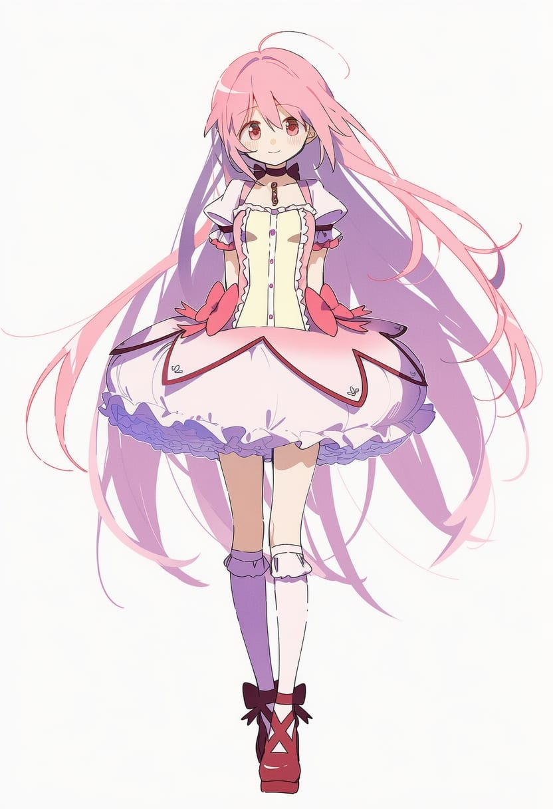

| 字段 | 内容 |
| --- | --- |
| 序号 | 0049 |
| tag | alternate_hair_length_(longer) |
| tag中文名 | 头发变长 |
| tag中文含义 | 把角色头发画得比原设更长。 |
| tag所属的子类 | 头发变化 |
| tag串 | 1girl,kaname_madoka,very_long_hair,alternate_hair_length_(longer),solo |

## 50. alternate_eye_color — 瞳色变化

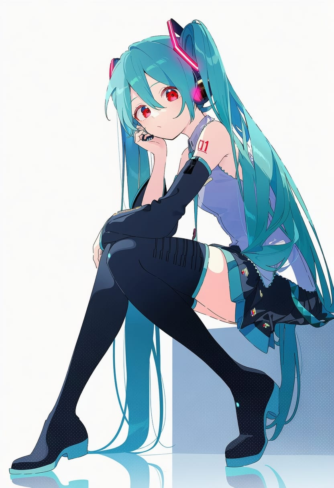

| 字段 | 内容 |
| --- | --- |
| 序号 | 0050 |
| tag | alternate_eye_color |
| tag中文名 | 瞳色变化 |
| tag中文含义 | 把角色眼睛颜色改成原作里没有的颜色。 |
| tag所属的子类 | 眼睛变化 |
| tag串 | 1girl,hatsune_miku,red_eyes,alternate_eye_color,solo |

## 51. unusually_open_eyes — 反常睁眼

| 字段 | 内容 |
| --- | --- |
| 序号 | 0051 |
| tag | unusually_open_eyes |
| tag中文名 | 反常睁眼 |
| tag中文含义 | 平时总是闭着某只或全部眼睛的角色这次睁开了。 |
| tag所属的子类 | 眼睛变化 |
| tag串 | 1girl,ichika_(blue_archive),unusually_open_eyes,solo |

## 52. out_of_character — 角色OOC

| 字段 | 内容 |
| --- | --- |
| 序号 | 0052 |
| tag | out_of_character |
| tag中文名 | 角色OOC |
| tag中文含义 | 角色做出明显不像平时会做的事。 |
| tag所属的子类 | 性格/角色变化 |
| tag串 | 1girl,souryuu_asuka_langley,out_of_character,solo |

## 53. personality_switch — 性格互换

| 字段 | 内容 |
| --- | --- |
| 序号 | 0053 |
| tag | personality_switch |
| tag中文名 | 性格互换 |
| tag中文含义 | 两个角色把彼此的性格对调。 |
| tag所属的子类 | 性格/角色变化 |
| tag串 | 2girls,souryuu_asuka_langley,ayanami_rei,personality_switch |

## 54. role_reversal — 角色定位互换

| 字段 | 内容 |
| --- | --- |
| 序号 | 0054 |
| tag | role_reversal |
| tag中文名 | 角色定位互换 |
| tag中文含义 | 两个角色交换平时的身份、职责或关系位置。 |
| tag所属的子类 | 性格/角色变化 |
| tag串 | 2girls,kaname_madoka,akemi_homura,role_reversal |

## 55. dark_persona — 黑化版本

| 字段 | 内容 |
| --- | --- |
| 序号 | 0055 |
| tag | dark_persona |
| tag中文名 | 黑化版本 |
| tag中文含义 | 把角色画成更阴暗、邪恶的另一版本，并让外观也有区别。 |
| tag所属的子类 | 性格/角色变化 |
| tag串 | 1girl,lumine_(genshin_impact),dark_persona,solo |

## 56. light_persona — 善化版本

| 字段 | 内容 |
| --- | --- |
| 序号 | 0056 |
| tag | light_persona |
| tag中文名 | 善化版本 |
| tag中文含义 | 把角色画成更光明、善良的另一版本，并让外观也有区别。 |
| tag所属的子类 | 性格/角色变化 |
| tag串 | 1girl,morrigan_aensland,light_persona,solo |

## 57. alternate_color — 异色

| 字段 | 内容 |
| --- | --- |
| 序号 | 0057 |
| tag | alternate_color |
| tag中文名 | 异色 |
| tag中文含义 | 角色服装或整体外观改成非官方的另一套颜色。 |
| tag所属的子类 | 整体配色变化 |
| tag串 | 1girl,hatsune_miku,alternate_color,solo |

## 58. palette_swap — 调色板变体

| 字段 | 内容 |
| --- | --- |
| 序号 | 0058 |
| tag | palette_swap |
| tag中文名 | 调色板变体 |
| tag中文含义 | 同一角色或物体做出几乎只差颜色的多个版本。 |
| tag所属的子类 | 整体配色变化 |
| tag串 | 2girls,hatsune_miku,palette_swap |

## 59. aged_down — 幼化/变年轻

| 字段 | 内容 |
| --- | --- |
| 序号 | 0062 |
| tag | aged_down |
| tag中文名 | 幼化/变年轻 |
| tag中文含义 | 把角色画得比平时更年轻。 |
| tag所属的子类 | 年龄变化 |
| tag串 | 1girl,morrigan_aensland,aged_down,solo |

## 60. aged_up — 年长化

| 字段 | 内容 |
| --- | --- |
| 序号 | 0063 |
| tag | aged_up |
| tag中文名 | 年长化 |
| tag中文含义 | 把角色画得比平时更年长。 |
| tag所属的子类 | 年龄变化 |
| tag串 | 1girl,kaname_madoka,aged_up,solo |

## 61. character_doll — 角色人偶化

| 字段 | 内容 |
| --- | --- |
| 序号 | 0064 |
| tag | character_doll |
| tag中文名 | 角色人偶化 |
| tag中文含义 | 把人类角色做成人偶或娃娃形态。 |
| tag所属的子类 | 其他设定变化 |
| tag串 | doll,no_humans,hakurei_reimu,character_doll,solo |

## 62. fusion — 角色融合

| 字段 | 内容 |
| --- | --- |
| 序号 | 0065 |
| tag | fusion |
| tag中文名 | 角色融合 |
| tag中文含义 | 把两个或更多角色的特征合成一个新角色。 |
| tag所属的子类 | 其他设定变化 |
| tag串 | 1girl,hakurei_reimu,kirisame_marisa,fusion |

## 63. genderswap — 性转

| 字段 | 内容 |
| --- | --- |
| 序号 | 0066 |
| tag | genderswap |
| tag中文名 | 性转 |
| tag中文含义 | 把角色画成与原本不同的性别。 |
| tag所属的子类 | 其他设定变化 |
| tag串 | 1girl,emiya_shirou,genderswap,solo |

## 64. genderswap_(mtf) — 男转女

| 字段 | 内容 |
| --- | --- |
| 序号 | 0067 |
| tag | genderswap_(mtf) |
| tag中文名 | 男转女 |
| tag中文含义 | 把原本男性角色画成女性。 |
| tag所属的子类 | 其他设定变化 |
| tag串 | 1girl,emiya_shirou,genderswap_(mtf),solo |

## 65. genderswap_(ftm) — 女转男

| 字段 | 内容 |
| --- | --- |
| 序号 | 0068 |
| tag | genderswap_(ftm) |
| tag中文名 | 女转男 |
| tag中文含义 | 把原本女性角色画成男性。 |
| tag所属的子类 | 其他设定变化 |
| tag串 | 1boy,artoria_pendragon_(fate),genderswap_(ftm),solo |

## 66. alternate_universe — 平行世界设定

| 字段 | 内容 |
| --- | --- |
| 序号 | 0070 |
| tag | alternate_universe |
| tag中文名 | 平行世界设定 |
| tag中文含义 | 把角色放到与原作不同的世界观或人生设定里。 |
| tag所属的子类 | 其他设定变化 |
| tag串 | 1girl,lumine_(genshin_impact),alternate_universe,solo |

## 67. anachronism — 时代错位

| 字段 | 内容 |
| --- | --- |
| 序号 | 0071 |
| tag | anachronism |
| tag中文名 | 时代错位 |
| tag中文含义 | 画面出现不属于作品时代的东西，比如古代角色拿智能手机。 |
| tag所属的子类 | 其他设定变化 |
| tag串 | 1girl,jeanne_d'arc_(fate),medieval,smartphone,anachronism,solo |

---
